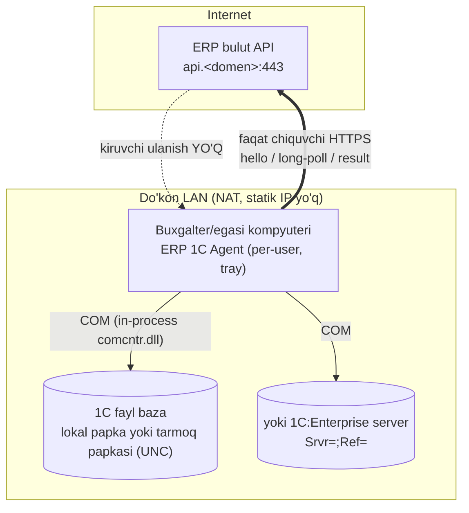
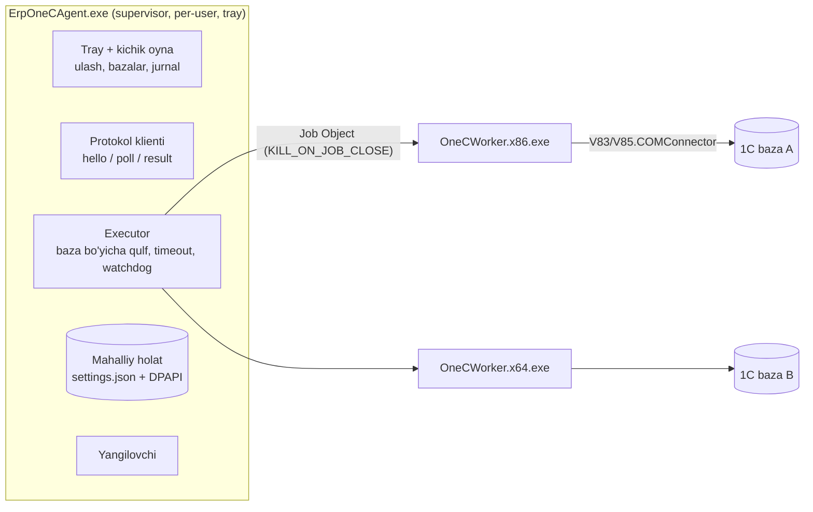
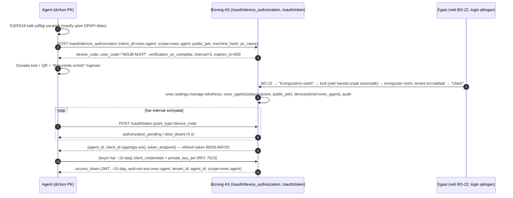
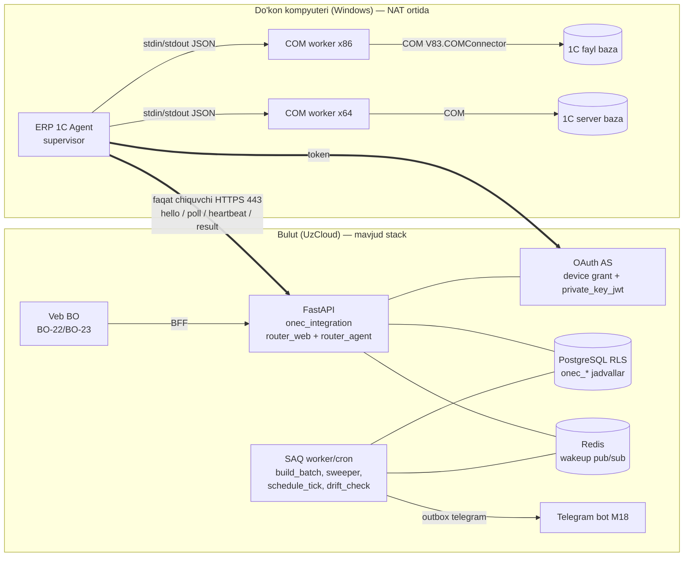
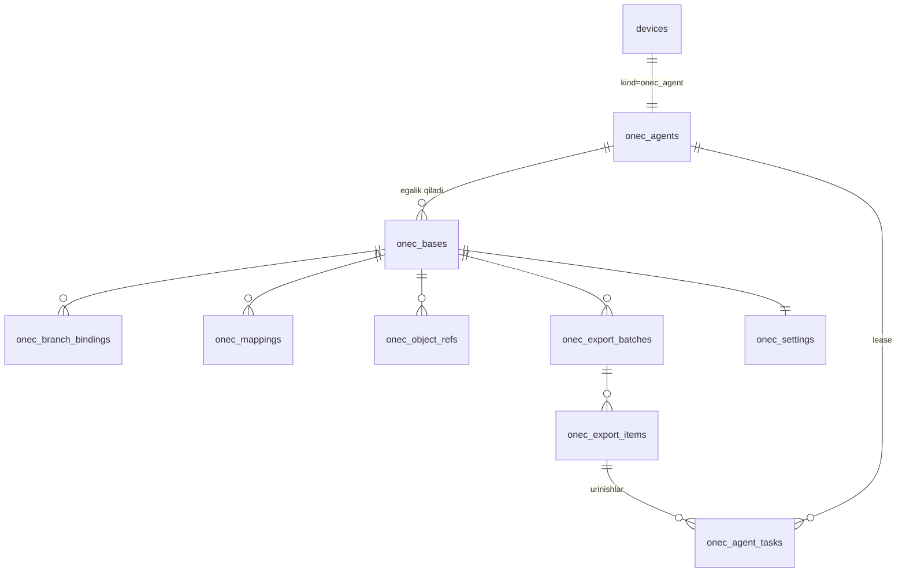
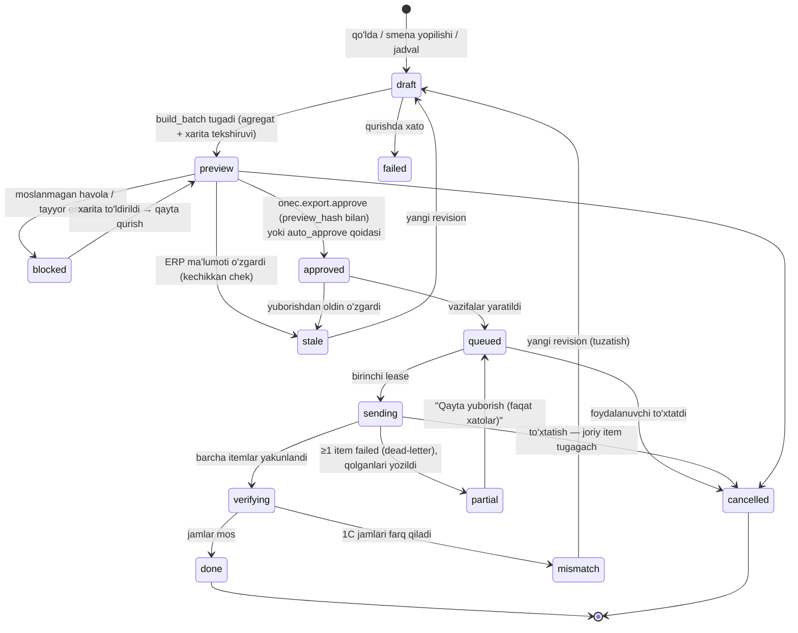
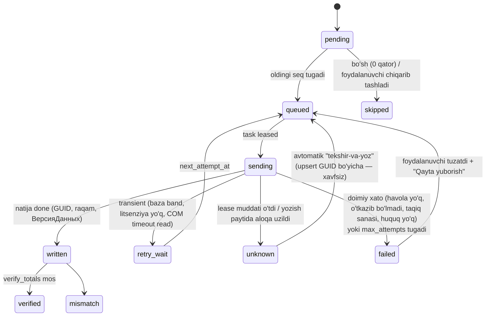
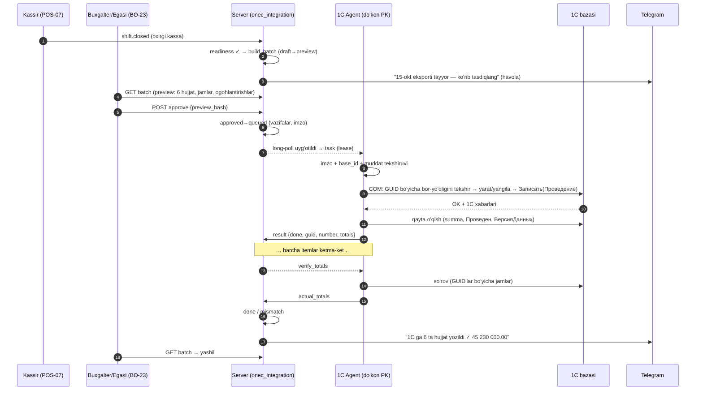

# 1C integratsiyasi — modul arxitekturasi (R4)

> **Yakuniy tavsiya ustun (accept gate, 2026-10-15):** shu papkadagi fayllar orasidagi ziddiyatlar `00-xulosa.md` da hal qilingan (§«Hal qilingan ziddiyatlar»). Bu fayl bilan `00-xulosa.md` farq qilsa — **00-xulosa'dagi yakuniy tavsiya ustun**. Kanonik nomlar: jadvallar — `04` §3.3; idempotentlik algoritmi — `04` §5.3; maydon xaritalari va ketma-ketlik — `03` §3, §5.1.

**Maqsad:** ERP ichidagi **1C integratsiya moduli** (qaror #36) uchun uchdan-uchgacha arxitektura: kun/smena oxirida ERP'dagi sotuv va boshqa hujjatlarni do'konning o'z kompyuteridagi (on-prem) 1C bazasiga ketma-ket, idempotent va tekshiriladigan tarzda yozish.
**Kim uchun:** asoschi, backend (`modules/onec_integration`), frontend (BO ekranlari), Windows agenti ishlab chiquvchisi.
**Bog'liq fayllar:** `spec/kod-uchun/01-qarorlar.md` (#1, #2, #14, #24, #26, #31, #36), `10-umumiy-arxitektura.md`, `14-autentifikatsiya-oauth2.md`, `15-xavfsizlik-va-audit.md`, `16-offline-sync.md`, `21-integratsiyalar.md` §0, `23-backend-arxitekturasi.md`, `25-nofunksional-talablar.md`; tadqiqot — `research_notes/sonar-1c-integratsiya/00–05`; shu papkadagi boshqa R-fayllar (1C hujjat xaritasi, konfiguratsiyalar).
**Holat:** tadqiqot/taklif, 2026-10-15. Spec emas — qabul qilingach `spec/kod-uchun/` ga ko'chiriladi (`00-README.md` qoida 2). Hech narsa publish qilinmagan.

> **Asoschi qarori (bu hujjat uchun qat'iy):** topologiya — **mijoz kompyuteridagi Windows agenti, 1C ga COM orqali yozadi, bulutimizdan faqat chiquvchi HTTPS bilan vazifa tortadi (pull)** — Sonar naqshi. OData ishlatilmaydi; mijoz 1C'dan **hech narsa publish qilmaydi** (veb-server, HTTP/veb-servislar yo'q). Boshqa variantlar faqat qisqa "rad etilgan" izoh sifatida (§1.2).

---

## Asosiy xulosalar

1. **Topologiya (asoschi qarori, qat'iy):** do'kon kompyuteridagi "ERP 1C Agent" 1C'ga **COM** orqali yozadi va bulutdan vazifani **faqat chiquvchi HTTPS long-poll** bilan tortadi. Kiruvchi port, OData, veb-publikatsiya, 1C kengaytmasi yo'q. OData/tashqi ishlov berish/EnterpriseData fayli — rad etilgan (§1.2).
2. **Agent texnologiyasi — tavsiya: C# / .NET Framework 4.8** (supervisor + `x86`/`x64` COM worker'lar): Win10/11'da oldindan o'rnatilgan, Win7'ga ham o'rnatiladi, antivirus soxta signali eng kam, `dynamic` bilan COM qulay. Muqobil — Python 3.13 + PyInstaller onedir (Win 8.1+, AV xavfi bilan). .NET 8 va NativeAOT — rad (§2.1).
3. **Jarayon modeli** — Sonar'dan olingan: supervisor COM'ga tegmaydi; baza bo'yicha bitta worker, stdin/stdout JSON, watchdog + Job Object (`KILL_ON_JOB_CLOSE`), yozish ichkarida qayta urinilmaydi (§2.2). Ishga tushirish — **per-user tray ilova, admin huquqisiz** (xizmat sessiya 0'da UI va foydalanuvchi disklarini ko'rmaydi) (§2.3).
4. **Ulash** — bizning AS'da **RFC 8628 Device Grant** (Authlib tayyor) + doimiy autentifikatsiya **`private_key_jwt` (RFC 7523)** — agentda uzoq muddatli bearer sir yo'q, maxfiy kalit va 1C paroli DPAPI `CurrentUser`da, serverga hech qachon chiqmaydi (§2.4–2.5).
5. **Yangi modul `onec_integration`** (modulli monolit qoidalari bilan) va 11 jadval; "**aqlli server, sodda agent**": konfiguratsiya profili serverda deklarativ `OpSpec` quradi, agent faqat bajaradi — 1C mantiqidagi tuzatishlar agent yangilanishisiz chiqadi (§3.1, §3.3).
6. **Kun eksporti holat mashinasi:** `draft → preview → approved → queued → sending → verifying → done | partial | mismatch` (+ `blocked`, `stale`, `cancelled`); tasdiq — **ruxsat bilan** (`onec.export.approve`) va preview xeshi bilan; Sonar'ning rolsiz tasdiq zaifligi takrorlanmaydi (§3.4, §6.2).
7. **Idempotentlik — deterministik GUID** (UUIDv5 → `УстановитьСсылкуНового`) + `onec_object_refs` daftari; "noma'lum natija" (timeout) xavfsiz: keyingi urinish "GUID bo'yicha tekshir, keyin yoz". `Комментарий` markeri — faqat inson uchun iz. `ОбменДанными.Загрузка` ishlatilmaydi — 1C'ning o'z o'tkazish mantiqi ishlaydi (§5).
8. **Ketma-ketlik:** baza bo'yicha bitta faol partiya, sanalar qat'iy tartibda, partiya ichida bosqichlar (ma'lumotnoma → kirim → ko'chirish → sotuv → qaytarish → kassa → qarz); agent kunlab offline bo'lsa navbat kutadi (§3.6, §7.2).
9. **Solishtirish:** har yozuvdan keyin qayta o'qish + partiya oxirida `verify_totals` (ERP jami = 1C jami, chegara 0.00) + kunlik drift tekshiruvi (1C'da qo'lda o'zgartirilgan ERP hujjatlari) (§3.8).
10. **Hajm:** 2 000 chek/kun 1C'ga chek sifatida emas, **kassa × kun bo'yicha "Отчет о розничных продажах"** agregati sifatida ketadi (300–1 500 qator); maqsad — oddiy do'kon < 3 daq, katta < 10 daq (*taxmin*) (§7.1).
11. **Xavfsizlik:** ikki qulf (server + kompyuter) + inson tasdig'i, **Ed25519 imzolangan vazifalar** (TLS'ni AV/proksi ushlasa ham soxta vazifa bajarilmaydi), minimal huquqli alohida 1C foydalanuvchisi, imzoli avto-yangilanish (Ed25519 manifest + SHA-256 + Authenticode OV — Microsoft Artifact Signing O'zbekistonga mavjud emas) (§2.9, §6).
12. **Asosiy xavflar / ochiq savollar:** 1C litsenziyasi (har kiruvchi ish joyi litsenziya talab qiladi — agent litsenziyalangan PK'da turishi kerak), `УстановитьСсылкуНового` semantikasi va O'zbekiston nashrlari rekvizitlari real bazada tasdiqlanmagan, pilot uchun birinchi profil (§9).

---

## 0. Talab va chegaralar

**Yangi talab:** kun/smena oxirida foydalanuvchi ERP'dagi barcha sotuvlar (va boshqa hujjatlar: qaytarish, kassa harakati, qarz to'lovi, kirim, ko'chirish) ni **ketma-ket** do'konning o'z 1C bazasiga yuboradi. ERP — asosiy tizim (kassa, ombor, hisob shu yerda); 1C — buxgalteriya/hisobot uchun "qabul qiluvchi".

| Chegara | Qiymat | Manba |
|---|---|---|
| ERP yadrosi 1C'siz ishlaydi, integratsiya adapter ortida | qat'iy | qaror #36, `00-README.md` qoida 6 |
| Mijoz tarafida IT xodim yo'q, ko'p hollarda **fayl baza**, statik IP yo'q, NAT ortida | dizayn farazi | asoschi brifi; Sonar ham shu segment uchun (`sonar-1c-integratsiya/00` §3) |
| 1C tomonda hech narsa publish/o'rnatilmaydi (veb-server, OData, HTTP-servis, kengaytma yo'q) | qat'iy | asoschi qarori (yuqorida) |
| Faqat chiquvchi ulanish (do'kondan bulutga HTTPS 443) | qat'iy | shu |
| Pul — o'nlik satr, 2 xona; QQS formulasi umumiy | qat'iy | qaror #26 |
| 1 tenant = 1 yuridik shaxs; ko'p filial/kassa | qat'iy | qaror #31 |
| Jamoa — asoschi + Claude | qat'iy | qaror #35 — shuning uchun texnologiya soni minimal, mavjud stack qayta ishlatiladi |

Bu hujjat **qamrovi**: ERP → 1C yozish yo'nalishi. 1C'dan o'qish/AI tahlil va 1C → ERP migratsiyasi — boshqa R-fayllar (agent va protokol shu dizayn ustida kengaytiriladi: `catalog_read`, `meta_sync` vazifalari allaqachon kerak).

---

## 1. Topologiya

### 1.1 Tanlangan: mijoz kompyuteridagi Windows agenti + COM + pull



**Nega aynan shu** (kichik do'kon sharoitida):

1. **NAT va statik IP muammosi yo'q** — agent o'zi chiqadi; port ochish, VPN, DDNS kerak emas (Sonar ham shunday: `sonar-1c-integratsiya/00` §3, 4-band).
2. **Fayl baza bilan ishlaydi** — COM ulanish fayl bazaga ham, server bazaga ham bir xil ulanish satri bilan (`File=` / `Srvr=;Ref=`) ochiladi (`sonar-1c-integratsiya/01` §2.7). 1C "tashqi ulanish"i — chaqiruvchi jarayon **ichida** ishlaydigan, interfeyssiz yengil COM server (alohida OS jarayoni va jarayonlararo aloqa yo'q) [C1].
3. **1C'ning o'z biznes logikasi ishlaydi** — hujjat COM orqali `Записать(Проведение)` bilan yoziladi, ya'ni tipik konfiguratsiyaning o'tkazish (posting) qoidalari, tekshiruvlari va harakatlari 1C ichida bajariladi; biz registr harakatlarini o'zimiz "taxmin qilmaymiz".
4. **1C tomonda o'rnatiladigan narsa yo'q** — konfiguratsiya o'zgarmaydi, yangilanishlarga ta'sir qilmaydi.
5. **Yig'indilar va tekshiruv 1C ichida** — solishtirish so'rovi (`verify_totals`) agent orqali 1C'ning o'zida bajariladi.

**Narxi (kamchiliklar) va ularga javob:**

| Kamchilik | Javob (bu hujjatda) |
|---|---|
| Kompyuter o'chiq bo'lsa yozilmaydi | Server navbati, kunlar ketma-ket kutadi; Telegram eslatma (§3.6, §7) |
| COM bitligi (32/64) va ro'yxatdan o'tish | Ikki bitlikli worker + avtomatik tanlash + "Tuzatish" (§2.2, §2.6) |
| COM ulanish 1C litsenziyasini egallashi mumkin | Qisqa sessiya, bo'sh turganda yopish, xato matni (§2.7) |
| Mijoz kompyuterida kod — yangilash/AV muammosi | Imzolangan avto-yangilanish, "sodda agent" (§2.9, §3.1) |

### 1.2 Rad etilgan variantlar (qisqa)

| Variant | Nega rad etildi |
|---|---|
| (b) Bulut → 1C **OData** (mijoz veb-serverida publish) | Asoschi qarori: mijoz hech narsa publish qilmaydi. Texnik jihatdan ham: standart OData interfeysi (OData v3) faqat yechim **veb-serverda publish qilingandan keyin** mavjud [C7]; IIS/Apache'da HTTPS bilan publish — ko'p qadamli admin ishi [C8] — IT xodimsiz do'kon uchun real emas, NAT/statik IP muammosi qoladi. EnterpriseData'ning `EnterpriseDataUpload` veb-servisi ham publish talab qiladi [C9] |
| (c) 1C ichidagi tashqi ishlov berish/kengaytma bizning API'dan tortadi | Bozor pretsedenti bor (Poster POS tashqi ishlov berish bilan "Отчеты о розничных продажах… за смену" yuklaydi [C10]), lekin: mijoz bazasiga kod ulash — БСП "Дополнительные отчеты и обработки" orqali, admin roziligi va xavfsizlik profili bilan [C11][C12]; fayl rejimida reglament topshiriqlari avtomatik bajarilmaydi, qo'lda tugma tavsiya etiladi [C13] — "avtomatik kun oxiri" bajarilmaydi; har konfiguratsiya/versiyaga alohida qo'llab-quvvatlash |
| (d) Fayl almashinuvi (EnterpriseData XML) | Format kuchli (BP 3.0, UT 11, Розница 2.0 qo'llaydi; 2026-04 dan "ККМ EnterpriseData" profili ОРП/ЧекККМ/smena hujjatlarini qamraydi [C14][C15]), lekin: foydalanuvchi har kuni faylni qo'lda yuklaydi — "bitta tugma" UX'iga zid; xatolar 1C ichida qoladi (holat, solishtirish ko'rinmaydi); format versiyalari ~yiliga eskiradi, asosiy versiyalar orqaga mos emas [C16]; O'zbekiston nashrlarida ED/БСП qo'llanishi *tasdiqlanmagan*. **Foydali qismi olinadi:** ОРП uchun bizning neytral modelimiz maydon nomlari ККМ ED profiliga moslab tanlanadi (§5.6). Favqulodda zaxira sifatida keyin ko'rilishi mumkin (*ochiq savol*) |

---

## 2. Windows agenti ("ERP 1C Agent")

### 2.1 Texnologiya tanlovi

| Mezon | Python 3.13 + pywin32 + PyInstaller (onedir) | Python 3.13 + Nuitka | **.NET Framework 4.8 (C#)** | .NET 10 self-contained |
|---|---|---|---|---|
| Windows qamrovi | 8.1+; 3.13 Windows 7'da ishlamaydi [W1] | 8.1+ | **Win10 1903+/Win11'da oldindan o'rnatilgan; Win7 SP1'ga o'rnatsa bo'ladi** [W2] | Win10 1607+ / Win11 [W3] |
| Hajm | Interpretator + pywin32 ikki bitlikda (*taxmin* o'nlab MB) | shunga yaqin | **Kichik exe** — runtime OS'da bor | ~70 MB (COM tufayli trimming mumkin emas) [W4] |
| Antivirus soxta signali | PyInstaller'ning umumiy bootloaderi AV'lar tomonidan belgilanadi — o'z bootloaderini qurish tavsiya etiladi [W5] | Nuitka o'zi ogohlantiradi, yechim pullik [W6] | Oddiy IL exe — eng kam | Oddiy |
| COM (IDispatch late binding) | `win32com.client.Dispatch` | shu | **`dynamic` — tabiiy** [W7] | `dynamic` .NET 5'dan qaytgan, NativeAOT/trimming bilan mos emas [W7][W4] |
| 32/64-bit | 32-bit Python va pywin32 g'ildiraklari bor [W8][W9] — ikki to'plam | shu | **Bitta kod, x86 va x64 build — framework ikkala bitlikda bor** | Ikki alohida self-contained build |
| Avto-yangilanish | Velopack Python SDK, faqat `--onedir` [W10] | *tasdiqlanmagan* | Velopack (C#) yoki Inno Setup + o'z yangilovchimiz | Velopack asosiy maqsadi |
| Qo'llab-quvvatlash muddati | Python 3.13 — 2029 gacha (*taxmin*) | shu | Muddatsiz, OS komponenti sifatida [W11] | .NET 10 LTS — 2028-11-14 [W3] |
| Jamoa ko'nikmasi (asoschi Python + Claude) | **eng yaxshi** | yaxshi (C toolchain kerak) | o'rta (Claude C#ni yaxshi yozadi) | o'rta |

**Tavsiya:** agent (supervisor ham, COM worker'lar ham) — **C# / .NET Framework 4.8**, `AnyCPU` supervisor + `x86` va `x64` worker exe'lar. Sabablar: (1) do'kon kompyuterlariga runtime o'rnatish kerak emas, eski (Win7/8.1) PK ham qamraladi; (2) antivirus soxta signali — IT xodimsiz do'konda eng qimmat qo'llab-quvvatlash muammosi; (3) 1C COM bilan eng qulay va Sonar ham worker'larni aynan shunday qurgan (`SonarWorker32.exe.config`/`SonarWorker64.exe.config` — .NET Framework belgisi, `sonar-1c-integratsiya/01` §5.2); (4) agent "sodda" (§3.1) — biznes mantiq serverda Python'da qoladi, shuning uchun ikkinchi tilning narxi kichik. Shartnoma tiplari (OpSpec, protokol) Pydantic'dan JSON Schema orqali C# klasslarga generatsiya qilinadi (bitta manba).

**Muqobil (agar asoschi bitta tilni afzal ko'rsa):** Python 3.13 + PyInstaller `--onedir` (o'z bootloaderi bilan) + Velopack — faqat Win 8.1+ va AV oq ro'yxati uchun vaqt rejalashtirilsa. **Rad:** .NET 8 (2026-11-10 da muddati tugaydi [W3]), NativeAOT (IDispatch'ni qo'llamaydi [W4]), Go/go-ole (jamoa uchun uchinchi til).

### 2.2 Jarayon modeli



- **Supervisor** — UI, tarmoq, rejalashtirish, yangilanish, sirlar; **COM'ga hech qachon o'zi tegmaydi**.
- **Worker** — baza bo'yicha bitta bola jarayon (1 baza = 1 worker = 1 doimiy COM sessiya — Sonar modeli, `sonar-1c-integratsiya/02` §1.5). Protokol — stdin/stdout'da bitta qatorli JSON (`{"id","cmd","op","params"}` → `{"id","ok","data"|"error"}`), buyruqlar `probe/open/run/close`.
- **Bitlik:** in-process DLL faqat bir xil bitlikdagi jarayonga yuklanadi — 32-bit 1C uchun 32-bit worker. Avtomatik tanlash: registrdan `V8x.COMConnector` ikkala ko'rinishda, `com_not_registered` bo'lsa boshqa bitlikka bir marta o'tish (Sonar `ChooseBits` + runtime fallback, `sonar-1c-integratsiya/01` §2.3).
- **Osilib qolish:** sinxron COM chaqiruvini ichkaridan to'xtatib bo'lmaydi — watchdog timeout'da worker'ni o'ldiradi. Worker'lar **Job Object**ga `JOB_OBJECT_LIMIT_KILL_ON_JOB_CLOSE` bilan qo'shiladi — supervisor qulasa ham yetim COM jarayonlar qolmaydi; `JOB_OBJECT_LIMIT_PROCESS_MEMORY` bilan xotira cheklanadi [W12].
- **Timeout'lar** (*taxmin*, Sonar qiymatlari asosida): `open` 120 s; o'qish 60–300 s; `object_upsert` — `op_spec.timeout_s` (10–1800 s, katta ОРП uchun 600 s). Yozish **ichida qayta urinilmaydi** — natija `unknown`, qaror serverda (§5.3).
- **Bo'sh turganda yopish:** 10 daqiqa ishsiz worker yopiladi (litsenziya va xotira bo'shaydi).
- **Bitta nusxa:** nomli mutex `Local\ErpOneCAgent` (bir foydalanuvchida ikki agent ishlamaydi).

### 2.3 Ishga tushirish rejimi: per-user tray ilova (asosiy) vs Windows xizmati

| Jihat | Per-user ilova (HKCU Run / per-user Task Scheduler) | Windows xizmati (LocalSystem/NetworkService) |
|---|---|---|
| UI (ulash kodi, "Tuzatish", toast) | Bor | Xizmat sessiya 0'da — UI ko'rsata olmaydi; alohida GUI jarayon + named pipe kerak [W13] |
| Tarmoqdagi fayl baza (`Z:\1c`) | Foydalanuvchining ulangan disklari ko'rinadi | Har logon sessiyasining o'z disk harflari — xizmat foydalanuvchi ulagan `Z:` ni ko'rmaydi, faqat UNC [W14] |
| 1C foydalanuvchi muhiti (`%APPDATA%\1C\1CEStart\ibases.v8i`) | O'zinikini o'qiydi | LocalSystem'ning HKCU'si — boshqa profil [W15] |
| DPAPI `CurrentUser` | Foydalanuvchi bilan bog'liq — mos | Xizmat hisobiga bog'liq; `LOCAL_MACHINE` esa kompyuterdagi har kimga ochiq [W16] |
| O'rnatish | Admin huquqisiz (`%LOCALAPPDATA%\Programs`) | Admin kerak |
| Kamchilik | Foydalanuvchi tizimga kirmagan bo'lsa ishlamaydi | — |

**Qaror:** asosiy rejim — **per-user fon ilovasi** (tray, `--hidden` bilan avtostart, admin huquqisiz), Sonar bilan bir xil (`sonar-1c-integratsiya/01` §5.1, §5.4). Server-PK (1C server yoki umumiy fayl baza turadigan, hech kim kirmaydigan kompyuter) uchun **keyingi bosqich** varianti: alohida Windows hisobi nomidan "foydalanuvchi kirmagan bo'lsa ham ishga tushir" vazifasi (Task Scheduler, `TASK_LOGON_PASSWORD`/`S4U`, "Log on as batch job" huquqi kerak [W17]) — UI'siz rejim, ulash/sozlash shu hisobda interaktiv kirib bajariladi. Jadvaldagi eksport vaqtida kompyuter yoqilgan va foydalanuvchi kirgan bo'lishi kerakligi BO-22'da aniq yoziladi.

### 2.4 Ulash (pairing) — bizning OAuth AS bilan

Yangi OAuth mijoz turi `onec-agent` (`14-autentifikatsiya-oauth2.md` §2 jadvaliga qo'shiladi). Ikki bosqich:

**(a) Birinchi ulash — Device Authorization Grant (RFC 8628).** Authlib server tomonini tayyor beradi: `authlib.oauth2.rfc8628` — `DeviceAuthorizationEndpoint`, `DeviceCodeGrant`, `AuthorizationPendingError`/`SlowDownError`/`ExpiredTokenError`; biz `save_device_credential`, `query_device_credential`, `query_user_grant`, `should_slow_down` hook'larini o'z jadvallarimizga ulaymiz [W18]. Bu qaror #14 ("Authlib skeleti, storage bizniki") bilan to'liq mos.



- `user_code` — RFC 8628 tavsiyasidagi 20 belgili alifbo (`BCDFGHJKLMNPQRSTVWXZ`), `XXXX-XXXX`, kiritishda chiziqcha olib tashlanadi, katta harfga o'tkaziladi [W19]. Muddat 10 daqiqa (*taxmin*; Authlib standarti 1800 s [W18] — qisqartiriladi).
- Tasdiqlash ekranida **kompyuter nomi va IP'si** ko'rsatiladi — fishing ("kodni menga ayting") xavfiga qarshi; tasdiqlash faqat `onec.settings.manage` ruxsati bilan, Telegram'ga "Kompyuter ulandi: DOKON-PC" xabari (Sonar naqshi, `sonar-1c-integratsiya/01` §4.3).

**(b) Doimiy autentifikatsiya — `private_key_jwt` (RFC 7523).** Agentda uzoq muddatli **bearer sir saqlanmaydi**: ulashda ro'yxatdan o'tgan ochiq kalit bilan har safar imzolangan client assertion (`iss=sub=client_id`, `aud=token_endpoint`, `jti`, `exp` ≤ 60 s) yuborib qisqa access token oladi. Authlib buni `JWTBearerClientAssertion` orqali qo'llaydi (`resolve_client_public_key`, `validate_jti`) [W20]. Afzalligi: maxfiy kalit tarmoqqa hech qachon chiqmaydi, server logidan qayta ishlatib bo'lmaydi; bekor qilish — `onec_agents.status=revoked` (keyingi assertion rad etiladi, ≤10 daqiqa ichida, hello'da darhol).
- **DPoP (RFC 9449)** — access tokenni kalitga bog'lash uchun keyingi qadam; Authlib'da hali yo'q (PR ochiq) [W21] — MVP'da kerak emas, chunki token qisqa va faqat `/onec-agent/*` ga yaroqli.
- Alternativ (rad): refresh token rotatsiyasi (`14` §7) — ishlaydi, lekin agent kunlab offline bo'lsa va tarmoq uzilishida reuse detection oilani bekor qilsa, IT xodimsiz do'konda "qayta ulash" — qo'llab-quvvatlash qo'ng'irog'i.

### 2.5 Sirlarni saqlash (DPAPI)

| Sir | Qayerda | Himoya |
|---|---|---|
| Agent maxfiy kaliti (Ed25519) | `%APPDATA%\ErpOneCAgent\agent.key` | DPAPI `CurrentUser` + entropy, `CRYPTPROTECT_UI_FORBIDDEN` [W16] |
| 1C foydalanuvchi paroli (har baza) | `settings.json` → `password_protected` | DPAPI `CurrentUser`; **serverga hech qachon yuborilmaydi**; ulanish satriga faqat xotirada, worker'ga berishda qo'shiladi (Sonar, `sonar-1c-integratsiya/01` §3.5) |
| Access token | Faqat xotirada | — |

- `LOCAL_MACHINE` ishlatilmaydi — kompyuterdagi istalgan jarayon ocha oladi [W22].
- DPAPI ochilmasa (profil ko'chirilgan, admin parolni majburan tiklagan — *taxmin* [W22]) — xato fatal emas: "Kompyuterni qayta ulang" / "1C parolini qayta kiriting" holati (Sonar jim bo'sh parol qaytaradi — biz aniq aytamiz).
- Yozish atomik (`.tmp` + almashtirish); loglarda `Pwd=`, `Bearer`, `client_assertion` maskalanadi.

### 2.6 Bazalarni topish va qo'shish

- Manba: `%APPDATA%\1C\1CEStart\ibases.v8i` + `1CEStart.cfg` dagi `CommonInfoBases=` ro'yxatlari; UTF-16/UTF-8 BOM aniqlanadi; faqat `File=` va `Srvr=;Ref=` (veb `ws=` chiqariladi); ulanish satri bo'yicha dublikat olib tashlanadi (`sonar-1c-integratsiya/01` §1).
- Platforma: `Program Files*/1cv8/8.*/bin/comcntr.dll` + registr `HKCR\V85|V83|V82.COMConnector\CLSID` ikkala ko'rinishda (`01` §2.1–2.2). Ro'yxatdan o'tmagan bo'lsa — "Tuzatish" tugmasi `regsvr32 /s` ni UAC bilan (`runas`), rad etilsa (1223) aniq matn (`01` §2.4).
- **"Saqlash = sinash":** baza faqat COM orqali haqiqatan ulanib, `base_info` (konfiguratsiya nomi/sinonim/versiya, platforma versiyasi) o'qilgandan keyin saqlanadi; keyin serverga faqat metama'lumot (`local_id`, nom, `connect_kind`, `connect_fingerprint`, konfiguratsiya, versiya) ketadi → `onec_bases`; server `profile_code`ni konfiguratsiya nomidan taklif qiladi.
- Birinchi qo'shilganda `meta_sync` (metadata snapshot, versiya o'zgarganda yangilanadi) — mapping ustasi va OpSpec validatsiyasi uchun.

### 2.7 1C foydalanuvchisi va litsenziya

- Agent uchun **alohida 1C foydalanuvchisi** tavsiya etiladi (`ERP integratsiya`): faqat kerakli hujjat/ma'lumotnomalarga yozish, o'tkazish va **tashqi ulanish (COM) huquqi**; administrator emas. Aniq rollar to'plami — profil bo'yicha (*ochiq savol*, 1C hamkor bilan tekshiriladi).
- 1C'dagi barcha ERP yozuvlari shu foydalanuvchi nomidan → 1C ro'yxatdan jurnalida "kim yozgan" aniq ko'rinadi.
- Windows (OS) autentifikatsiyasi varianti qo'llab-quvvatlanadi (parol saqlanmaydi).
- **Litsenziya:** 1C'ning rasmiy FAQ'i bo'yicha bazaga "u yoki bu usulda" murojaat qiladigan **har bir ish joyi** alohida klient litsenziyasi bilan ta'minlanishi kerak, foydalanuvchilar sonini "kamaytiradigan" vositalar talabni kamaytirmaydi [C2]. Demak agent **allaqachon litsenziyalangan kompyuterda** (buxgalter/egasi PK) turishi eng xavfsiz; alohida server-PK uchun litsenziya kerak bo'lishi mumkin. COM sessiyasi fayl rejimida texnik jihatdan alohida slot egallaydimi — *tasdiqlanmagan*, pilotda o'lchanadi; xato bo'lsa `ONEC_LICENSE_UNAVAILABLE` (transient). 8.5.4 dan litsenziya mexanizmi o'zgaradi ("Менеджер лицензий", rmlic) [C3] — profil/agent platforma versiyasini aniqlab ishlaydi.
- **Platforma 8.3 / 8.5:** its.1c.ru 8.5.1 (chiqqan) va 8.5.4 (test) hujjatlarini ro'yxatlaydi [C4]; `V85.COMConnector` ProgID nomi rasmiy manbada **tasdiqlanmagan** — agent ProgID'ni qattiq kodlamaydi, registrdan `V8*.COMConnector` ni qidiradi (Sonar ham V85/V83/V82 ni tekshiradi — `sonar-1c-integratsiya/01` §2.2).
- **Fayl baza tarmoq papkasida** — 1C'ning o'zi bir nechta PK'dan bir vaqtda kirish `.1CD` ni buzishi mumkinligini, antivirus skanidan chiqarish va offline-kesh'ni o'chirishni tavsiya qiladi [C5]. Agent `.1CD` ga hech qachon to'g'ridan-to'g'ri tegmaydi, faqat COM; yozish tranzaksiyalari qisqa (katta hujjat bo'linadi, §7.1), kassir/buxgalter bloklanmasligi uchun.
- COM bilan ishlashda uzun nuqta-zanjirlardan qochish, oraliq obyektlarni ushlab turish — 1C metodik tavsiyasi [C6] (worker kodlash qoidasi).

### 2.8 Pull protokoli

Barcha so'rovlar: `https://api.<domen>/api/v1/onec-agent/*`, `Authorization: Bearer <access_token>`, JSON (16 KB dan katta tana — gzip), javob `{data}` yoki `{"error":{code,…}}` (`17-api-umumiy.md`).

| Endpoint | Qachon | So'rov → javob |
|---|---|---|
| `POST /hello` | Ishga tushganda, har 10 daqiqada, baza ro'yxati o'zgarganda darhol | `{agent_version, os, worker_bits, platforms[], bases[{local_id, status, last_error_code, config_version}]}` → `{server_time, poll_hint_ms, bases_control[{base_id, active, write_enabled}], update?{version, manifest_url}, revoked?}` |
| `POST /bases` | Yangi baza saqlanganda | metama'lumot → `{base_id, profile_code}` |
| `POST /poll` | Uzluksiz | `{base_ids, busy_base_ids}` → server **25 s gacha ushlaydi** (long-poll); vazifa paydo bo'lsa (Redis pub/sub uyg'otadi) darhol `{tasks:[{task_id, attempt, lease_id, lease_until, base_id, kind, payload, payload_sha256, signature, timeout_s}]}`, aks holda `204` |
| `POST /tasks/{id}/heartbeat` | Uzun vazifada har 15 s | `{lease_id, progress}` → `{lease_until}` yoki `409 LEASE_LOST` (vazifa bekor qilingan) |
| `POST /tasks/{id}/result` | Tugaganda | `{lease_id, attempt, outcome: done|failed|unknown, data, error{code, message, onec_messages[]}, duration_ms}` → `200` (idempotent: bir xil `lease_id` takror — o'sha javob) |
| `POST /logs` | Har 1 daqiqada partiya bilan | maskalangan log yozuvlari |
| `POST /diag` | Server so'raganda | zip (loglar + sozlamalar, sirlarsiz) |

- **Long-poll, WebSocket emas:** RFC 6202 30 s ni xavfsizroq qiymat deydi [W23]; 443 portdagi oddiy HTTPS so'rovi proksi/AV/eski routerlardan eng ishonchli o'tadi. Tarmoq xatosida backoff `1, 2, 5, 10, 30, 60 s` + jitter (Sonar `Agent.cs`, `sonar-1c-integratsiya/01` §6.2). `401` → yangi assertion; `403 AGENT_REVOKED` → to'xtash, kalitni o'chirish, "Kompyuter uzilgan" holati.
- **Proksi:** tizim proksi sozlamalari (`HttpClient.DefaultProxy` — muhit o'zgaruvchilari, keyin foydalanuvchi sozlamasi [W24]); WPAD/PAC kerak bo'lsa WinHTTP auto-proxy [W25] — *keyin*.
- **Result yetib bormasa:** agent natijani diskdagi kichik "outbox"ga yozadi (`results.jsonl`) va qayta yuboradi — 1C'ga yozilgan, lekin server bilmagan holat ham shu bilan yopiladi; server tomonda lease o'tib ketgan bo'lsa ham kech kelgan `done` qabul qilinadi (item `unknown` → `written`).
- **Agent tomonidagi tekshiruvlar har vazifada:** imzo (§6.3), `agent_id`/`base_id` mosligi, `exp` (vazifa imzosi muddati), mahalliy "1C ga yozishga ruxsat" kaliti (qulf №2, Sonar'ning ikki qulfi — `sonar-1c-integratsiya/00` §2.4), `kind` oq ro'yxati.

### 2.9 Avto-yangilanish (imzoli)

1. Agent `hello` javobidan yoki har 6 soatda (*taxmin*, Sonar qiymati — `01` §5.7) `version.json` manifestini oladi: `{product, version, url, sha256, size, min_server_api, rollout_pct, notes}`.
2. Manifest **Ed25519 bilan imzolangan** (minisign uslubi — imzolangan "trusted comment"da versiya, downgrade'ga qarshi [W26]); ochiq kalit agent ichida. Kalit — `signing_keys` jadvalidagi alohida `purpose='agent_update'` (offline saqlanadi, CI'da emas — *taklif*).
3. Yuklash faqat HTTPS, hajm va SHA-256 to'liq mos bo'lsa; aks holda o'rnatilmaydi (Sonar'ning 4 qatlamli zanjiri, `01` §5.7).
4. Exe'lar **Authenticode** bilan imzolanadi. Microsoft Artifact Signing (sobiq Trusted Signing) O'zbekiston tashkilotlariga **mavjud emas** [W27] → tijoriy CA'dan OV sertifikat (kalit apparat tokenda/HSM'da). EV ham SmartScreen'ni endi chetlab o'tmaydi; obro' bir necha hafta va yuzlab toza o'rnatishda yig'iladi [W28] — pilotda "Baribir ishga tushirish" yo'riqnomasi kerak.
5. O'rnatish vaqti: **hech qanday vazifa lease'da bo'lmaganda**; o'rnatuvchi `/S /restart /hidden`, worker'lar Job Object orqali yopiladi. Bosqichma-bosqich tarqatish (`rollout_pct`) va `min_agent_version` (server eski agentga yozish vazifasini bermaydi).
6. Paketlash: Velopack (per-user, `%LocalAppData%`, delta yangilanish, `--signParams`) [W29] yoki Inno Setup `PrivilegesRequired=lowest` [W30] + o'z yangilovchimiz. MSIX — rad (paketdan tashqari jarayonga in-process modul yuklash va `regsvr32` bilan muammoli [W31]).

### 2.10 Loglar va diagnostika

- `%LOCALAPPDATA%\ErpOneCAgent\logs\` — aylanuvchi fayllar (masalan 5 × 2 MB), JSON-qator; Windows Event Log — faqat admin o'rnatgan bo'lsa (manba yaratish admin talab qiladi [W32]).
- Maskalash filtri (parol, token, assertion, ulanish satridagi `Pwd=`), 1C xabarlari to'liq saqlanadi (ular diagnostika uchun eng qimmat).
- Muhim voqealar `POST /logs` orqali serverga (BO-22 "Jurnal"), to'liq paket faqat so'rov bilan (`diag_bundle` vazifasi yoki tray menyusidan "Diagnostikani yuborish").
- Mahalliy audit izi: `actions.jsonl` — har yozish vazifasi (task_id, base, kind, guid, natija) — server bilan solishtirish uchun.

### 2.11 O'chirish (uninstall)

- "Dasturlar"dan o'chirish: avval serverga `unpair` (agent bekor qilinadi, audit + Telegram), keyin fayllar, HKCU Run yozuvi, yorliqlar.
- Tanlov: "Sozlamalarni saqlash" (qayta o'rnatishda bazalar qoladi, lekin **kalit o'chiriladi** — qayta ulash kerak) yoki "Hammasini o'chirish" (DPAPI fayllar ham).
- Server tomonda: agent `revoked`, uning bazalari `disabled`, navbatdagi partiyalar "agent yo'q" holatida kutadi (yangi agent shu bazani `connect_fingerprint` bo'yicha qayta bog'lay oladi — mapping va `onec_object_refs` saqlanadi).

### 2.12 Agent ichida 1C operatsiyalari (vazifa turlari)

| Vazifa `kind` | Agent nima qiladi | Yozadimi |
|---|---|---|
| `probe` | COM ro'yxatdan o'tganmi, bitlik | Yo'q |
| `base_info` | Konfiguratsiya, versiya, platforma, joriy foydalanuvchi huquqlari (*taxmin*) | Yo'q |
| `meta_sync` | Metadata (ma'lumotnomalar, hujjatlar + jadval qismlari, rekvizit turlari) | Yo'q |
| `catalog_read` | Mapping ustasi uchun: Организации, Склады, Кассы/КассыККМ, Номенклатура (kod/артикул/shtrix-kod), Контрагенты (STIR) — sahifalab | Yo'q |
| `object_upsert` | §5.3 algoritmi | Ha |
| `object_post` / `object_unpost` / `object_mark_delete` | Holat o'zgartirish (tuzatishlar) | Ha |
| `verify_totals` | Parametrli so'rov (faqat `&Параметр`, matn server profilidan; `ВЫБРАТЬ РАЗРЕШЕННЫЕ`) | Yo'q |
| `diag_bundle` | Loglar paketi | Yo'q |

O'qish so'rovlari matnini AI emas, **server profili** yozadi; agent faqat oq ro'yxatdagi so'rov shablonlarini parametr bilan bajaradi.

## 3. Server tomoni — `onec_integration` moduli

### 3.1 Modul joylashuvi va qatlamlari

Modul `23-backend-arxitekturasi.md` §1 qoidasiga mos — 20-modul papkasi sifatida qo'shiladi. Boshqa modullarni faqat `application` portlari orqali o'qiydi (`sales`, `returns`, `cash`, `debts`, `purchasing`, `inventory`, `catalog`, `branches`), ularning `infrastructure`'iga tegmaydi.

```
backend/app/modules/onec_integration/
├── domain/
│   ├── entities.py        # ExportBatch, ExportItem, AgentTask, OneCBase, Mapping, ObjectRef (pure Python)
│   ├── states.py          # batch/item/task holat mashinalari — ruxsat etilgan o'tishlar jadvali
│   ├── opspec.py          # "1C amal spetsifikatsiyasi" (OpSpec) — agentga boradigan deklarativ shakl
│   ├── guids.py           # deterministik GUID (UUIDv5) — §5.2
│   └── errors.py          # ONEC_* xato kodlari + "tuzatish maslahati" kalitlari (§4.5)
├── application/
│   ├── ports.py           # SalesDayPort, ReturnsPort, CashPort, CatalogPort ... (boshqa modullardan o'qish)
│   ├── readiness.py       # "kun tayyormi" tekshiruvi (§3.5)
│   ├── batch_builder.py   # ERP agregatlari → ExportItem'lar (profil orqali)
│   ├── profiles/          # konfiguratsiya profillari: bp30_uz.py, ut11.py, roznica.py, unf.py
│   ├── dispatcher.py      # navbatdagi itemni topish, lease berish (§3.6)
│   ├── results.py         # agent natijasini qabul qilish, holat o'tkazish, retry/dead-letter
│   ├── reconcile.py       # yozilgandan keyin solishtirish (§3.8)
│   ├── pairing.py         # agent ulash/uzish (RFC 8628 ustida, §2.4)
│   └── mapping_wizard.py  # avtomatik moslashtirish takliflari (shtrix-kod/kod/STIR bo'yicha)
├── infrastructure/
│   ├── models.py          # SQLAlchemy jadvallari (§3.3)
│   ├── repositories.py
│   ├── task_signer.py     # vazifa imzosi (Ed25519 JWS, §6.3)
│   ├── wakeup.py          # Redis pub/sub — long-poll'ni darhol uyg'otish
│   └── tasks.py           # SAQ job'lar: build_batch, lease_sweeper, schedule_tick, drift_check, notify
└── api/
    ├── router_web.py      # /api/v1/onec-* — BFF orqali veb (Egasi/Buxgalter)
    ├── router_agent.py    # /api/v1/onec-agent/* — faqat agent tokeni (scope `onec.agent`)
    ├── schemas.py
    └── deps.py            # current_agent(), require_base_of_agent()
```

**Asosiy tamoyil — "aqlli server, sodda agent":** qaysi 1C hujjatiga qaysi maydon yozilishini **server** (konfiguratsiya profili) hal qiladi va tayyor `OpSpec` (deklarativ JSON: metadata nomi, GUID, maydonlar, jadval qismlari, havolalar faqat GUID bilan, `post` rejimi, kutilgan jamlar) yuboradi. Agent faqat umumiy bajaruvchi (Sonar'ning `ObjectSpec/ObjectOps` g'oyasi, `sonar-1c-integratsiya/04` §2). Natija: 1C konfiguratsiyasi bo'yicha xato tuzatish yoki yangi hujjat turi **agentni yangilamasdan** serverda chiqariladi; agent yangilanishi kamdan-kam (xavfli operatsiya — mijoz kompyuterida).

**Nega mavjud `outbox_jobs` emas:** `outbox_jobs` (`21-integratsiyalar.md` §0) — *bizning worker tashqi tizimga o'zi chiqadigan* (push) ishlar uchun. Bu yerda tashqi tomon (agent) vazifani **o'zi tortadi**, lease, heartbeat, qurilmaga bog'lanish va qat'iy ketma-ketlik kerak — semantika boshqa. Shuning uchun alohida `onec_agent_tasks` jadvali; SAQ esa faqat server ichki ishlari uchun (partiya qurish, lease muddati tozalagich, jadval "tick", drift tekshiruvi, Telegram xabari — `outbox_jobs(kind=telegram)` orqali, mavjud yo'l).

### 3.2 Komponentlar va oqim (umumiy ko'rinish)



### 3.3 Jadvallar (mantiqiy model)

Hammasi `app` sxemasida, `tenant_id` + RLS (`15-xavfsizlik-va-audit.md` §3), `id` — UUIDv7, pul — `NUMERIC` va JSON'da o'nlik satr (qaror #26), nomlash — snake_case (qaror #24). Migratsiya — alohida `00xx_onec_integration`.

| Jadval | Asosiy ustunlar | Izoh |
|---|---|---|
| `onec_agents` | id, tenant_id, device_id → `devices` (yangi `kind='onec_agent'`), oauth_client_id, name (kompyuter nomi), machine_hash, os, agent_version, worker_bits[] (`{32,64}`), platforms JSONB (topilgan 1C versiyalari), public_jwk (Ed25519), status (`pending`/`active`/`revoked`), last_hello_at, last_poll_at, paired_by, paired_at, revoked_at, revoked_by | Bitta tenantda bir nechta agent bo'lishi mumkin (har kompyuter — bitta agent). 1C paroli **yo'q** |
| `onec_bases` | id, tenant_id, agent_id, local_id (agentdagi ID), name, connect_kind (`file`/`server`), connect_fingerprint (normallashtirilgan ulanish satrining SHA-256 — dublikat aniqlash; satrning o'zi emas), connect_display (maskalangan: `\\SERVER\1c\shop` yoki `srv1c/shop`), config_name, config_synonym, config_version, platform_version, profile_code (`bp30_uz`, `ut11_uz`, `roznica30_uz`, `uk30_uz`, `unknown`), guid_namespace UUID, write_enabled (server qulfi №1), status (`ok`/`error`/`disabled`), last_ok_at, last_error_code, metadata_hash | `UNIQUE(tenant_id, connect_fingerprint)` WHERE active — bitta bazaga faqat bitta "yozuvchi agent" |
| `onec_branch_bindings` | tenant_id, branch_id, base_id, organization_guid, warehouse_guid, division_guid NULL, retail_kind (`auto`/`ntt`) | Filial → baza + 1C tashkilot/ombor. Bir baza bir nechta filialni qabul qilishi mumkin (qaror #31: 1 tenant = 1 STIR) |
| `onec_mappings` | id, tenant_id, base_id, entity (`cash_register`/`payment_type`/`vat_rate`/`product`/`unit`/`counterparty`/`expense_category`/`cash_account`…), erp_id, onec_type (`Справочник.Номенклатура`…), onec_guid, onec_presentation, source (`auto_barcode`/`auto_code`/`auto_inn`/`auto_name`/`manual`/`created_by_erp`), confidence, confirmed_by, confirmed_at | `UNIQUE(base_id, entity, erp_id)`. Havolalar **faqat shu jadvaldan** — yozish paytida 1C'da nom bo'yicha "taxminiy qidiruv" yo'q (Sonar qoidasi: topilmasa — xato, yaratilmaydi) |
| `onec_object_refs` | id, tenant_id, base_id, erp_entity, erp_key, onec_type, onec_guid, onec_number, content_hash, onec_data_version, posted, deletion_mark, last_batch_id, last_written_at | ERP yaratgan har 1C obyektining **daftari** (§5). `UNIQUE(base_id, erp_entity, erp_key)` |
| `onec_export_batches` | id, tenant_id, base_id, business_date, revision, status (§3.4), trigger (`manual`/`shift_close`/`schedule`), readiness JSONB, preview JSONB, preview_hash, expected_totals JSONB, actual_totals JSONB, created_by, approved_by, approved_at, started_at, finished_at, error_code, supersedes_batch_id | `UNIQUE(base_id, business_date, revision)`; **qisman unikal indeks**: bitta bazada `status IN ('queued','sending','verifying')` faqat bitta (§3.6) |
| `onec_export_items` | id, tenant_id, batch_id, seq, phase, kind (`retail_sales_report`, `retail_return`, `cash_in`, `cash_out`, `debt_payment`, `goods_receipt`, `transfer`, `catalog_product`…), erp_key, source_doc_ids UUID[], onec_type, onec_guid, idempotency_key, op_spec JSONB, op_spec_sha256, expected_total, status (§3.4), attempts, next_attempt_at, last_error_code, last_error JSONB (1C xabarlari bilan), result JSONB | `idempotency_key = onec:{base_id}:{kind}:{erp_key}` — `UNIQUE(tenant_id, idempotency_key, batch_id)`; GUID esa revisiyalar bo'ylab **bir xil** (§5.2) |
| `onec_agent_tasks` | id, tenant_id, agent_id, base_id NULL, item_id NULL, kind (`probe`, `base_info`, `meta_sync`, `catalog_read`, `object_upsert`, `object_post`, `object_unpost`, `object_mark_delete`, `verify_totals`, `diag_bundle`), payload JSONB, payload_sha256, signature (JWS), status (`queued`/`leased`/`done`/`failed`/`expired`/`cancelled`), attempt, lease_id, lease_until, timeout_s, not_before, result JSONB, error_code, created_at, finished_at | Agent faqat shu jadvaldan oladi. `SELECT … FOR UPDATE SKIP LOCKED` |
| `onec_agent_logs` | id, tenant_id, agent_id, at, level, code, message (agentda maskalangan), context JSONB | 30 kun saqlanadi (*taxmin*); diagnostika |
| `onec_settings` | tenant_id, base_id, schedule_mode (`manual`/`on_shift_close`/`at_time`), schedule_time, auto_approve, auto_approve_max_warnings (0), readiness_policy (`all_shifts_closed`/`allow_open`), product_create_policy (`deny`/`ask`; *accept gate:* `auto` MVP'da yo'q — 1C'da element faqat inson tasdig'i bilan yaratiladi), notify_user_ids[] | Jadval/avtomatika (§4.4) |
| `onec_metadata_snapshots` | id, tenant_id, base_id, config_version, metadata_hash, data (siqilgan JSONB), created_at | Agent bir marta o'qib yuboradi — server OpSpec'ni metadata bo'yicha oldindan tekshiradi (maydon bormi, turi mosmi) |



### 3.4 Holat mashinalari

**Kun eksporti (partiya) — `onec_export_batches.status`:**



- `approved` → preview'da ko'rsatilgan narsaning SHA-256 xeshi saqlanadi; yuborish paytida partiya qayta hisoblanib xesh solishtiriladi — mos kelmasa `stale` (Sonar'ning `preview_changed` g'oyasi, `sonar-1c-integratsiya/04` §3.3). Tasdiqlovchining **ruxsati tekshiriladi** — Sonar'ning zaif joyi (rolsiz "Bajarish") takrorlanmaydi.
- `partial` — yakuniy holat emas: xatolar tuzatilib, faqat `failed` itemlar qayta navbatga qo'yiladi (GUID o'zgarmaydi → takror yaratilmaydi, §5).
- `done`dan keyin kun uchun yangi ma'lumot kelsa (offline kassa kechikib sinxronlansa) — partiya qayta ochilmaydi, yangi **revision** yaratiladi (§5.5).

**Item — `onec_export_items.status`** va **vazifa — `onec_agent_tasks.status`:**



`unknown` — yozish vazifasining natijasi noma'lum (Sonar matni: «yozildimi yoki yo'qmi noma'lum», `sonar-1c-integratsiya/04` §4.3). Bizda bu holat **foydalanuvchiga ko'rinadigan muammo emas**, chunki keyingi urinish GUID bo'yicha "avval bor-yo'qligini tekshir, keyin yoz" qiladi (§5.3).

### 3.5 "Kun tayyormi" (readiness)

Partiya qurishdan oldin `readiness.py` tekshiradi va natijani `batches.readiness`ga yozadi (preview'da checklist sifatida ko'rinadi):

| Tekshiruv | Manba | Bloklaydimi |
|---|---|---|
| Bazaga bog'langan filiallarning shu sanadagi **barcha smenalari yopilgan** | `shifts` (M01) | `readiness_policy=all_shifts_closed` bo'lsa ha; aks holda ogohlantirish |
| Kassalarda **sinxronlanmagan voqea yo'q** — har qurilmaning `last_sync_at` smena yopilganidan keyin | `devices`, `sync_receipts` (`16-offline-sync.md`) | Ogohlantirish ("2 kassa oxirgi marta 14:05 da sinxronlangan") |
| Agent onlayn (`last_poll_at` < 2 daqiqa) | `onec_agents` | Yo'q — partiya navbatda kutadi |
| Baza `write_enabled` va `status=ok` | `onec_bases` | Ha (yuborishni) |
| Barcha havolalar moslangan (tovar, kassa, to'lov turi, QQS stavkasi) | `onec_mappings` | Ha → `blocked`, "Moslash" tugmasi |
| Oldingi sanalar partiyasi `done`/`partial`-tasdiqlangan | `onec_export_batches` | Ha — sanalar **ketma-ket** ketadi |
| 1C'da shu sana uchun "o'zgartirish taqiqi sanasi" (дата запрета изменения) | `meta_sync`/`base_info` natijasi (*taxmin* — profilga bog'liq) | Ha, aniq matn bilan |

### 3.6 Ketma-ketlik, qulf va dispetcher

- **Tenant+baza bo'yicha bitta faol partiya** — qisman unikal indeks + holat o'tishida `pg_advisory_xact_lock(hashtextextended('onec:'||base_id, 0))`.
- **Sanalar tartibi:** D+1 partiyasi D partiyasi yakunlanmaguncha (`done`, yoki `partial`/`mismatch` foydalanuvchi tomonidan "qabul qilindi" deb belgilangan) `queued`ga o'tmaydi. Agent bir necha kun offline bo'lsa, partiyalar navbatda turadi va qaytganda sana bo'yicha ketma-ket yuboriladi (§7).
- **Partiya ichida bosqichlar (`phase`)** — 1C'dagi bog'liqlik tartibida:

| phase | Item turi | Nega shu tartib |
|---|---|---|
| 10 | `catalog_product`, `catalog_counterparty` (faqat preview'da tasdiqlangan yangilari) | Hujjatlar ularga GUID bilan havola qiladi |
| 20 | `goods_receipt` (kirim) | Sotuvdan oldin qoldiq bo'lishi kerak (1C qoldiq nazorati — *taxmin*, profilga bog'liq) |
| 30 | `transfer` (ko'chirish) | Ombor qoldig'ini to'g'ri joyga olib keladi |
| 40 | `retail_sales_report` (kassa × kun bo'yicha agregat) | Asosiy hujjat |
| 50 | `retail_return` (oldingi kunlar cheklari bo'yicha qaytarish) | Asl sotuv allaqachon 1C'da |
| 60 | `cash_in`/`cash_out` (inkasso, egasi oldi, xarajat) | Kassa qoldig'i sotuvdan keyin |
| 70 | `debt_payment` | Kontragent qarzi |

- **Dispetcher (`poll` ichida):** agentga tegishli bazalar uchun eng kichik `(business_date, phase, seq)` dagi `queued` itemni topadi, `onec_agent_tasks` yozuvini `leased` qiladi, `lease_until = now + timeout_s + 30 s`. **Bitta bazaga bir vaqtda bitta vazifa** (server tomoni) + agent tomonida baza bo'yicha qulf (Sonar'ning `SemaphoreSlim`i, `sonar-1c-integratsiya/02` §1.5) — fayl bazada parallel yozish 1C qulflariga urilmasligi uchun.
- **Lease tozalagich** (SAQ cron, har 30 s): `lease_until < now` va natija yo'q → yozish vazifasi bo'lsa item `unknown`, o'qish vazifasi bo'lsa `queued` (qayta).

### 3.7 Qayta urinish va o'lik xat

`21-integratsiyalar.md` §0 xato tasnifiga mos, 1C uchun moslashtirilgan:

| Sinf | 1C/agent misollari (`ONEC_*` kod) | Harakat |
|---|---|---|
| `transient` | `ONEC_BASE_LOCKED` (monopol rejim / konfigurator ochiq), `ONEC_LICENSE_UNAVAILABLE`, `ONEC_TIMEOUT` (o'qishda), `ONEC_WORKER_CRASHED`, agent offline | `retry_wait`: `next = now + min(30 daq, 60 s × 2^attempts) + jitter(0..30 s)`, `max_attempts = 8` (*taxmin*) |
| `unknown` | yozish paytida timeout/aloqa uzilishi, lease o'tdi | `unknown` → avtomatik "tekshir-va-yoz" (§5.3), `attempts` hisobiga kiradi |
| `config` | `ONEC_AUTH_FAILED`, `ONEC_COM_NOT_REGISTERED`, `ONEC_ACCESS_DENIED`, `ONEC_WRITE_DISABLED` | Butun baza bo'yicha to'xtaydi (`onec_bases.status=error`), partiya `sending`da "pauza", Telegram ogohlantirish |
| `validation` | `ONEC_REF_NOT_MAPPED`, `ONEC_FIELD_TYPE`, `ONEC_POST_FAILED` (1C xabarlari bilan: "недостаточно остатков…"), `ONEC_PERIOD_LOCKED` | Darhol `failed` (o'lik xat), tuzatish maslahati bilan (§4.5) |
| `duplicate` | GUID bo'yicha obyekt bor va kontent xeshi mos | Idempotent muvaffaqiyat (`written`, `existed=true`) |

O'lik xat (`failed`) item hech qachon o'chirilmaydi; `last_error` (1C'ning `ПолучитьСообщенияПользователю` xabarlari bilan) saqlanadi, `audit_log`ga yoziladi; BO-23'da "Qayta yuborish" / "O'tkazib yuborish (sabab bilan)".

### 3.8 Yozilgandan keyingi solishtirish (reconciliation)

1. Har `object_upsert` natijasida agent 1C'dan qayta o'qib qaytaradi: `Ссылка` GUID, `Номер`, `Проведен`, `ВерсияДанных`, hujjat summasi va jadval qismi jami (Sonar'ning "yozgandan keyin qayta o'qib solishtirish" g'oyasi, `sonar-1c-integratsiya/04` §2.5).
2. Partiya yakunida `verify_totals` vazifasi: partiyadagi barcha GUID'lar bo'yicha bitta 1C so'rovi (hujjat summasi, QQS, qatorlar soni, o'tkazilganmi) + profil beradigan **registr darajasidagi** so'rov (masalan shu sana/ombor bo'yicha sotuv registri jami — konfiguratsiyaga bog'liq, *taxmin*). Natija `actual_totals`ga yoziladi.
3. ERP `expected_totals` bilan solishtiriladi. Chegara — `0.00` (pul satr-o'nlik, qaror #26; yaxlitlash farqi bo'lsa profil uni alohida qator sifatida yozadi). Farq → `mismatch` + farq jadvali + Telegram.
4. **Drift tekshiruvi** (SAQ cron, kuniga 1 marta, *taxmin*): oxirgi 7 kunda ERP yozgan obyektlar (`onec_object_refs`) bo'yicha `ВерсияДанных`/`ПометкаУдаления`/`Проведен` o'qiladi. 1C'da kimdir ERP hujjatini o'zgartirgan, o'chirishga belgilagan yoki o'tkazishni bekor qilgan bo'lsa — ogohlantirish (avtomatik "tuzatish" yo'q; buxgalter qaror qiladi).

### 3.9 Ruxsatlar (yangi `permission_code`'lar)

`15-xavfsizlik-va-audit.md` §2.1 formatida; prefiks `onec` → token scope `onec` (`14-autentifikatsiya-oauth2.md` §10).

| Kod | Ma'nosi | Egasi | Menejer | Kassir | Omborchi | Buxgalter |
|---|---|---|---|---|---|---|
| `onec.view` | Holat, partiyalar, jurnal | ✓ | ✓ | – | – | ✓ |
| `onec.settings.manage` | Agent ulash/uzish, bazalar, `write_enabled`, jadval, avto-tasdiq | ✓ | – | – | – | – (*taklif*: Egasi xohlasa beradi) |
| `onec.mapping.edit` | Moslashtirish ustasi, 1C'da yangi tovar yaratish siyosati | ✓ | – | – | – | ✓ |
| `onec.export.prepare` | Kun eksportini qurish, preview | ✓ | ✓ | – | – | ✓ |
| `onec.export.approve` | Tasdiqlash va yuborish | ✓ | – | – | – | ✓ |
| `onec.export.correct` | Qayta yuborish, revision, 1C'da o'tkazishni bekor qilish/o'chirishga belgilash | ✓ | – | – | – | ✓ |

Egasi — barcha ruxsat (qaror #28). Agentning o'zi — foydalanuvchi emas: alohida OAuth mijozi, scope `onec.agent`, faqat `/api/v1/onec-agent/*` ga kiradi (Telegram botning `bot.internal` naqshi kabi — confused deputy'ga qarshi, `14` §2).

### 3.10 Audit va bildirishnomalar

**`audit_log` voqealari:** `onec.agent.paired`, `onec.agent.revoked`, `onec.base.added`, `onec.base.write_enabled_changed`, `onec.mapping.changed` (before/after), `onec.export.approved` (preview_hash bilan), `onec.export.cancelled`, `onec.export.resent`, `onec.item.written` (GUID, raqam), `onec.item.failed`, `onec.verify.mismatch`, `onec.correction.applied`, `onec.update.installed` (agent versiyasi).

**Telegram (M18, `outbox_jobs(kind=telegram)`)** shablonlari: `onec_preview_ready` (avto-tasdiq o'chiq bo'lsa — veb havola bilan), `onec_export_done` ("15-okt: 1C ga 6 ta hujjat yozildi, jami 45 230 000.00 so'm ✓"), `onec_export_partial`, `onec_export_mismatch`, `onec_agent_offline` (jadvaldagi eksport bor, agent 2 soatdan beri jim — *taxmin*), `onec_base_error` (parol/COM/huquq). Botda "Tasdiqlash" tugmasi **MVP'da yo'q** — faqat veb havola (tasdiq ekrani preview'ni to'liq ko'rsatishi kerak).

### 3.11 API

**Veb (BFF, `router_web.py`)** — kebab-case ko'plik, snake_case JSON (qaror #24), `Idempotency-Key` yozuvchi so'rovlarda (`23` §3):

| Endpoint | Ruxsat | Vazifa |
|---|---|---|
| `GET /onec-agents`, `POST /onec-agents/pair` (`{user_code}`), `POST /onec-agents/{id}/revoke` | `onec.view` / `onec.settings.manage` | Agentlar; RFC 8628 `user_code`ni tasdiqlash |
| `GET /onec-bases`, `PATCH /onec-bases/{id}` (`write_enabled`, `profile_code`), `POST /onec-bases/{id}/test` | `onec.view` / `onec.settings.manage` | Bazalar, ulanish sinovi (`probe` vazifasi) |
| `GET /onec-mappings?base_id=&entity=`, `PUT /onec-mappings/{id}`, `POST /onec-mappings/auto-match` | `onec.mapping.edit` | Moslashtirish ustasi |
| `GET /onec-export-batches?base_id=&business_date__gte=` | `onec.view` | Tarix (kalendar) |
| `POST /onec-export-batches` (`{base_id, business_date}`) | `onec.export.prepare` | Qurish → `draft` |
| `GET /onec-export-batches/{id}` (+ `items`) | `onec.view` | Preview / progress |
| `POST /onec-export-batches/{id}/approve` (`{preview_hash}`) | `onec.export.approve` | Tasdiq; xesh mos kelmasa `409 ONEC_PREVIEW_CHANGED` |
| `POST /onec-export-batches/{id}/cancel`, `/resend-failed`, `/new-revision` | `onec.export.correct` | Boshqaruv |
| `GET/PUT /onec-settings/{base_id}` | `onec.settings.manage` | Jadval va avtomatika |

**Agent (`router_agent.py`, Bearer, scope `onec.agent`, CSRF'dan ozod):** §2.8 jadvalida.

---

## 4. UX — "Kunni yopish → 1C ga yuborish"

### 4.1 Asosiy oqim



### 4.2 BO-23 "1C ga yuborish" ekrani (taklif)

| Qism | Mazmun |
|---|---|
| Sarlavha | Baza tanlash (bitta bo'lsa yashirin), sana (standart — kecha yoki bugun, agar smenalar yopilgan bo'lsa), agent holati chipi (🟢 onlayn · "DOKON-PC" · v1.4.2) |
| Tayyorlik checklist | ✓ 3/3 kassa smenasi yopilgan · ⚠ "Kassa-2 oxirgi sinxron 14:05" · ✓ agent onlayn · ✗ "5 ta tovar 1C bilan moslanmagan" → [Moslash] |
| Preview jadvali | Har qator — 1C'da paydo bo'ladigan obyekt: turi ("Отчет о розничных продажах"), filial/kassa, qatorlar soni, summa, QQS, holat (yangi / yangilanadi / o'zgarishsiz). Yuqorida: "ERP jami 45 230 000.00 = 1C ga yoziladigan jami 45 230 000.00" |
| Ogohlantirishlar | "1C da 5 ta yangi tovar yaratiladi (ro'yxat)", "2 ta chek kechikib keldi — 14-okt revision 2 tavsiya etiladi" |
| Tugma | **"1C ga yuborish"** (`onec.export.approve`) → tasdiq modali: «"Do'kon BP" bazasiga 6 ta hujjat yoziladi va o'tkaziladi. Davom etasizmi?» |
| Progress | Stepper: har item — kutilmoqda / yozilmoqda / ✓ yozildi (№ 0000123) / ⚠ qayta urinish 2/8 / ✗ xato. Holat **so'rov bilan** yangilanadi (har 2 s, *taxmin*; SSE — keyinroq) |
| Natija | ✓ yashil banner + "1C da ochish uchun raqamlar"; ⚠ `partial`: xatolar ro'yxati maslahat bilan (§4.5), [Faqat xatolarni qayta yuborish]; `mismatch`: ERP vs 1C farq jadvali |
| Tarix | Kalendar: har kun rangi (yashil done, sariq partial/mismatch, kulrang yuborilmagan, ko'k navbatda) |

### 4.3 BO-22 "1C integratsiyasi" sozlamalari (taklif) — yorliqlar

1. **Kompyuter (agent):** holat, versiya, oxirgi aloqa; "Kompyuterni ulash" — agent ekranidagi 8 belgili kodni kiritish maydoni (yoki agent ochgan havola orqali avtomatik to'ldirilgan sahifa, §2.4); "Uzish".
2. **Bazalar:** agent topgan va foydalanuvchi qo'shgan bazalar (nom, konfiguratsiya + versiya, profil, holat), **"1C ga yozishga ruxsat"** kaliti (server qulfi), "Ulanishni tekshirish".
3. **Moslashtirish ustasi** (qadamma-qadam, har qadamda avtomatik taklif + tasdiq): Tashkilot → Filial↔Ombor/Bo'linma → Kassa↔Касса/КассаККМ → To'lov turlari (naqd, karta, UzQR, Click/Payme → 1C'dagi to'lov turi/эквайринг shartnomasi — *profilga bog'liq*) → QQS stavkalari → Tovarlar (shtrix-kod → kod → nom bo'yicha, ishonch darajasi bilan, ommaviy tasdiq; topilmaganlar uchun "1C da yaratish" yoki qo'lda tanlash) → Kontragentlar (STIR bo'yicha).
4. **Jadval:** `Qo'lda` / `Smena yopilganda avtomatik` / `Har kuni HH:MM da`; "Ogohlantirishsiz bo'lsa avtomatik tasdiqlash" kaliti (standart o'chiq).
5. **Jurnal:** agent loglari va vazifalar tarixi, "Diagnostika paketini so'rash".

### 4.4 Jadval rejimlari

| Rejim | Trigger | Tasdiq |
|---|---|---|
| `manual` | Foydalanuvchi BO-23 | Har doim qo'lda |
| `on_shift_close` | Bazaga bog'langan filiallarning oxirgi smenasi yopilganda (`shift.closed` voqeasidan keyin SAQ job) | `auto_approve=false` → Telegram'da "tasdiqlang"; `true` → ogohlantirish 0 bo'lsa avtomatik |
| `at_time` | SAQ cron har tenant uchun (`list_active_tenant_ids()` fan-out, qaror #1), Asia/Tashkent bo'yicha | Xuddi shunday |

Avtomatik rejimda ham **kompyuter o'chiq** bo'lsa hech narsa yo'qolmaydi — partiya `queued`da kutadi (§7).

### 4.5 Xatolar va tuzatish maslahatlari (namuna katalog)

`17-api-umumiy.md` §15 uslubida (`code` + `message_key` + `params`); matn — o'zbekcha, texnik kod emas (Sonar'ning `ErrorTexts` tamoyili, `sonar-1c-integratsiya/01` §4.8).

| Kod | Foydalanuvchi matni | Tuzatish tugmasi/maslahati |
|---|---|---|
| `ONEC_AGENT_OFFLINE` | "Do'kon kompyuteri (DOKON-PC) 3 soatdan beri aloqada emas" | "Kompyuterni yoqing va ERP 1C Agent ishlayotganini tekshiring" |
| `ONEC_REF_NOT_MAPPED` | "«Coca-Cola 1,5 l» tovari 1C bilan moslanmagan" | [Moslash] [1C da yaratish] |
| `ONEC_BASE_LOCKED` | "1C bazasi monopol rejimda (yoki Konfigurator ochiq)" | "1C dagi Konfiguratorni yoping" → avtomatik qayta urinish |
| `ONEC_LICENSE_UNAVAILABLE` | "1C da bo'sh litsenziya yo'q" | "Bitta 1C oynasini yoping yoki litsenziya qo'shing" (§2.7) |
| `ONEC_AUTH_FAILED` | "1C foydalanuvchisi paroli noto'g'ri" | "Agent oynasida bazani tahrirlang" (parol faqat kompyuterda) |
| `ONEC_COM_NOT_REGISTERED` | "1C ulagichi (COM) ro'yxatdan o'tmagan" | Agentda [Tuzatish] (UAC bilan `regsvr32`) |
| `ONEC_PERIOD_LOCKED` | "1C da 30.09.2026 gacha o'zgartirish taqiqlangan" | "Buxgalter taqiq sanasini o'zgartirsin yoki tuzatishni keyingi davrda yozing" |
| `ONEC_POST_FAILED` | "1C hujjatni o'tkazmadi: «Недостаточно остатков…»" (1C xabari asl tilida + qisqa tarjima) | "1C da qoldiqni tekshiring: kirim hujjati yuborilganmi?" |
| `ONEC_ACCESS_DENIED` | "1C foydalanuvchisida bu hujjat uchun huquq yo'q" | "1C administratori «ERP integratsiya» foydalanuvchisiga rolni qo'shsin" |
| `ONEC_PREVIEW_CHANGED` | "Ma'lumot o'zgardi — ko'rinish yangilandi" | Qayta ko'rib tasdiqlash |
| `ONEC_VERIFY_MISMATCH` | "1C dagi jami ERP'dan 12 000.00 so'mga farq qiladi" | Farq jadvali; [Yangi revision] |

---

## 5. Idempotentlik va izchillik

### 5.1 Variantlar

| Variant | Qanday | + | − | Qaror |
|---|---|---|---|---|
| A. `Комментарий` markeri (Sonar: `"Sonar #<id>"`) | Yaratishda izohga marker; qayta urinishda marker bo'yicha so'rov | Kengaytmasiz, oddiy | Izoh foydalanuvchi tomonidan o'zgartirilishi mumkin; izoh rekviziti bo'lmagan obyektlarda ishlamaydi; qidiruv so'rovi qimmat | **Yordamchi** (inson uchun ko'rinadigan iz: `"ERP #<qisqa_id>"`) |
| B. **Deterministik GUID** (`УстановитьСсылкуНового`) | ERP kalitidan UUIDv5 → yangi obyektga shu GUID; qayta urinishda `ПолучитьСсылку(GUID).ПолучитьОбъект()` — bor bo'lsa mavjudi | Kengaytmasiz, 1C platformasining o'z mexanizmi; foydalanuvchi o'zgartira olmaydi; qidiruv — kalit bo'yicha, tez; revisionlar bir xil obyektga tushadi. 1C standartlari ham almashinuvda obyektni **avval havolaning noyob identifikatori bo'yicha** moslashni talab qiladi (aks holda dublikat) [C17], EnterpriseData kalit xossalarida "уникальная ссылка" bor [C15] | Obyekt 1C'da butunlay o'chirilsa (pometkasiz) — keyingi yuborish uni **qayta yaratadi** (odatda kerakli xatti-harakat). Metodning aniq semantikasi rasmiy sintaksis hujjatida (pullik ITS) — **tadqiqotda tasdiqlanmagan**, pilotdan oldin real bazada sinaladi | **Asosiy** |
| C. Bizning `onec_object_refs` daftari | Yozilgan GUID/raqam/versiya/xesh serverda | Hisobot, drift tekshiruvi, tuzatishlar uchun | Yolg'iz o'zi "noma'lum natija"ni hal qilmaydi (javob kelmagan bo'lsa daftarda yo'q) | **Majburiy** (B bilan birga) |
| D. Konfiguratsiya kengaytmasi (`.cfe`) bilan maxsus rekvizit/registr | "ВнешнийИдентификатор" kabi o'z rekvizitimiz | Eng toza | Mijoz bazasiga kengaytma o'rnatish — "1C tomonda hech narsa o'rnatilmaydi" tamoyiliga zid, yangilanishlarda muammo | **Rad etildi** |
| E. БСП almashinuv registri (`СоответствиеОбъектовИнформационныхБаз`) | Tipik almashinuv mexanizmining moslik registri | Tipik | Har konfiguratsiyada bir xil emas, almashinuv tuguni sozlash kerak | **Rad etildi** (*taxmin* — profil darajasida keyin ko'rilishi mumkin) |

### 5.2 Deterministik GUID

```
guid_namespace  = onec_bases.guid_namespace            # baza ulanganda tasodifiy UUIDv4, o'zgarmaydi
name            = f"{kind}:{erp_key}"                  # masalan "retail_sales_report:{branch_id}:{cash_register_id}:2026-10-15"
onec_guid       = uuid5(guid_namespace, name)
```

- Namespace **baza bo'yicha** — bir xil ERP ma'lumoti ikki xil bazaga ketsa (BP + UT) GUID'lar farq qiladi.
- `erp_key` — **revisiyadan mustaqil**: kun eksporti qayta yuborilsa (revision 2) aynan shu 1C hujjati yangilanadi, ikkinchisi yaratilmaydi.
- Ma'lumotnomalar (`catalog_product`) uchun `erp_key = product_id` — lekin avval `onec_mappings`da mavjud 1C elementi bo'lsa, yangi yaratilmaydi (moslash yaratishdan ustun).

### 5.3 Agent tomonidagi "upsert" algoritmi (OpSpec `object_upsert`)

```
1. ref = Manager.ПолучитьСсылку(Новый УникальныйИдентификатор(guid))
2. obj = ref.ПолучитьОбъект()
3. Agar obj = Неопределено  →  obj = Manager.СоздатьДокумент(); obj.УстановитьСсылкуНового(ref);
                                obj.Заполнить(Неопределено)   # konfiguratsiyaning to'ldirish ishlovchilari (std 451 [C23]) — keyin bizning maydonlar ustidan yoziladi
                                mode = "create"
   Aks holda:
     a) kontent xeshi (Комментарий'dagi "h:<8>" yoki maydonlarni qayta o'qib) == op_spec_sha256 → "existed", yozmaslik (idempotent)
     b) spec.allow_update = false → xato ONEC_EXISTS_DIFFERENT (inson qarori)
     c) spec.expect_version berilgan va obj.ВерсияДанных ≠ expect_version → ONEC_CHANGED_IN_1C (1C da qo'lda o'zgartirilgan — yozilmaydi)
     d) aks holda mode = "update" (jadval qismlari to'liq almashtiriladi)
4. Maydonlar/jadvallarni qo'yish → har qiymatni qayta o'qib solishtirish (Sonar `Verify`) → farq bo'lsa ONEC_FIELD_TYPE, yozilmaydi
5. obj.Записать(РежимЗаписиДокумента.Проведение | Запись)
6. Qayta o'qish: Номер, Проведен, ВерсияДанных, СуммаДокумента, jadval jami → natija
```

Shu algoritm tufayli `unknown` holatdagi itemni **ko'r-ko'rona qayta yuborish xavfsiz**: birinchi urinish yozgan bo'lsa 3a qadam uni topadi.

**`ОбменДанными.Загрузка = Истина` ishlatilmaydi.** 1C standarti bo'yicha bu rejimda `ПередЗаписью/ПриЗаписи` ishlovchilari va obunalar hech narsa qilmaydi, ma'lumot "tekshiruvsiz" yoziladi va **yaxlitlik uchun javobgarlik chaqiruvchiga o'tadi** [C18]. Bizga aksincha — konfiguratsiyaning o'z to'ldirish, tekshiruv va o'tkazish mantiqi kerak; shuning uchun oddiy `Записать(Проведение)`. (Kontent xeshini `Комментарий`ga qo'shish — `"ERP #a1b2c3 h:9f8e7d6c"` — ixtiyoriy, inson uchun iz.)

Bozor misoli: Evotor→1C integratorida "davr bo'yicha" yuklash qayta yuklashni nazorat qilmagani uchun ОРП **dublikatlari** paydo bo'lgan, yechim — "smena yopilishi bo'yicha" yuklash + "takroriy yuklash nazorati" [C19]. Bizda bu nazorat GUID darajasida, foydalanuvchi sozlamasiga bog'liq emas.

### 5.4 Qisman muvaffaqiyatsizlik

- Har item mustaqil va idempotent; partiya tranzaksiya **emas** (1C va PostgreSQL o'rtasida taqsimlangan tranzaksiya yo'q — ataylab). Kafolat — "oxir-oqibat to'liq" (eventual completeness) + ko'rinadigan holat.
- Bosqich bog'liqligi: phase 20 (kirim) `failed` bo'lsa, phase 40 (sotuv) **baribir** yuboriladi (1C qoldiq nazorati sotuvni rad etsa, o'zi `ONEC_POST_FAILED` beradi) — *taklif*; profil `hard_dependency=true` desa kutadi.
- "Faqat xatolarni qayta yuborish" — yangi revision emas, xuddi shu partiya ichida `failed → queued`.

### 5.5 Kechikkan ma'lumot, bekor qilish va qayta o'tkazish

| Holat | ERP'da | 1C'da (yangi revision) |
|---|---|---|
| Kun eksport qilingandan keyin offline kassa cheklari keldi | `sales` yangi qatorlar shu `business_date`ga | Partiya `stale` belgisi → revision 2: **xuddi shu GUID**li ОРП `update` + qayta o'tkazish (1C taqiq sanasi ruxsat bersa) |
| ERP hujjati bekor qilindi (`status=cancelled` + storno, qaror #6) | Storno registr qatorlari | Agregat qayta hisoblanadi → revision 2 `update`; agar butun hujjat yo'qolsa — `object_unpost` + `object_mark_delete` (faqat `onec.export.correct` bilan, preview'da ko'rsatiladi). **Jismoniy o'chirish yo'q** (Sonar ham AI'ga `delete` bermaydi) |
| 1C davri yopilgan (taqiq sanasi) | — | `ONEC_PERIOD_LOCKED`; profil "tuzatuvchi hujjat joriy sanada" varianti bilan revision taklif qiladi (*ochiq savol*, buxgalter qarori) |
| 1C'da ERP hujjatini kimdir qo'lda o'zgartirdi | — | `expect_version` mos emas → `ONEC_CHANGED_IN_1C`, avtomatik ustiga yozilmaydi; drift ogohlantirishi |

### 5.6 Neytral "chakana savdo hisoboti" modeli

Profil (`bp30_uz`, `ut11`, `roznica`, `unf`) OpSpec'ni bitta **neytral** oraliq modeldan quradi. Uning maydonlari 1C'ning o'zi POS tizimlari uchun belgilagan "ККМ EnterpriseData" profilidagi `ОтчетОРозничныхПродажах` tarkibiga moslab nomlanadi [C15] — shunda profillar orasidagi farq faqat "metadata nomi va rekvizit xaritasi" bo'lib qoladi:

| Neytral maydon | ККМ ED ekvivalenti [C15] | ERP manbasi |
|---|---|---|
| `kassa_kkm`, `sklad`, `podrazdelenie` | КассаККМ, Склад, Подразделение | `onec_mappings`, `onec_branch_bindings` |
| `valyuta`, `summa`, `summa_vklyuchaet_nds`, `nalogooblozhenie` | Валюта, Сумма, СуммаВключаетНДС, Налогообложение | tenant soliq rejimi (qaror #32) |
| `tovary[]` (nomenklatura, miqdor, narx, summa, QQS stavkasi/summasi) | Товары | `sales` qatorlari agregati (qaror #26 yaxlitlash) |
| `vozvrat_tovarov[]` | ВозвратТоваров | shu kunning qaytarishlari (profil: shu jadvalda yoki alohida hujjat) |
| `oplata_kartami[]` | ОплатаПлатежнымиКартами | to'lov turlari: karta, UzQR, Click/Payme → mapping |
| `markirovki[]` | МаркировкиУпаковок / АкцизныеМарки | markirovka kodlari (agar profil talab qilsa) |

Aniq O'zbekiston nashrlari ("Бухгалтерия для Узбекистана, ред. 3.0", "Розница для Узбекистана 3.0", "УТ для Узбекистана" — 1C rasmiy ro'yxatida [C20][C21]) rekvizit nomlari — **tasdiqlanmagan**, boshqa R-fayl va real baza bilan tekshiriladi.

---

## 6. Xavfsizlik

### 6.1 Tahdid modeli (qisqa)

| Tahdid | Himoya |
|---|---|
| Internetdan do'kon kompyuteriga hujum | Kiruvchi port yo'q; agent faqat chiquvchi HTTPS |
| Trafikni ushlash (jumladan HTTPS'ni "skanerlaydigan" antivirus yoki korporativ proksi MITM) | TLS 1.2+ (OS sertifikat ombori); **vazifalar alohida imzolangan** (§6.3) — TLS buzilsa ham soxta vazifa bajarilmaydi. SPKI pinning **standartda o'chiq** — AV'ning HTTPS tekshiruvi bilan to'qnashadi (*taxmin*, pilotda tekshiriladi) |
| O'g'irlangan/klonlangan agent kaliti | DPAPI `CurrentUser` (boshqa PK/foydalanuvchida ochilmaydi); BO-22'dan bir tugma bilan bekor qilish; `machine_hash` o'zgarsa ogohlantirish |
| Boshqa tenant ma'lumotiga kirish | Token → `tenant_id` + `agent_id`; har so'rov `tenant_transaction` + RLS (qaror #1); vazifa faqat o'z `agent_id`/`base_id` bo'yicha |
| Server API qatlami buzilgan holda soxta yozish | Vazifa imzo kaliti API'dan alohida (`purpose='onec_task'`), faqat dispetcherda; agent `kind` oq ro'yxati; jismoniy o'chirish (`delete`) umuman yo'q |
| Kompyuterdagi boshqa odam agent orqali 1C'ga yozadi | Agent UI'da yozish yaratish imkoni **yo'q** — faqat serverdan imzolangan vazifa; server tomonida tasdiq ruxsat bilan (`onec.export.approve`) |
| 1C'da ortiqcha huquq | Alohida, minimal huquqli 1C foydalanuvchisi (§2.7) |
| Soxta yangilanish | Ed25519 manifest + SHA-256 + Authenticode (§2.9) |
| Loglarda sir | Agent va server tomonda maskalash; 1C paroli serverga umuman kelmaydi |

### 6.2 Ikki qulf va inson tasdig'i

1. **Server qulfi** — `onec_bases.write_enabled` (BO-22, `onec.settings.manage`).
2. **Kompyuter qulfi** — agent oynasidagi "Bu bazaga yozishga ruxsat" (standart o'chiq; yoqilganda serverga xabar va audit).
3. **Har partiya — tasdiq** `onec.export.approve` bilan (yoki Egasi oldindan yoqqan `auto_approve`, faqat ogohlantirish 0 bo'lsa). Sonar'dagi "kompyuter oldidagi har kim tasdiqlaydi" zaifligi yo'q.

### 6.3 Imzolangan vazifalar

- Dispetcher har `onec_agent_tasks` yozuvini **compact JWS (EdDSA)** bilan imzolaydi: `{task_id, attempt, agent_id, tenant_id, base_id, kind, payload_sha256, iat, exp (= lease_until + 5 daq)}`; payload alohida yuboriladi, agent SHA-256'ni solishtiradi.
- Kalit: `signing_keys(purpose='onec_task')` (`14` §6 jadvali `purpose` enumi kengaytiriladi), JWKS agentga `hello` orqali (ulashda bir marta pinlangan asosiy kalit bilan imzolangan kalit ro'yxati) — rotatsiya 90 kun (*taxmin*, `14` §6 bilan bir xil).
- Agent `exp` o'tgan, takrorlangan `(task_id, attempt)` yoki boshqa `agent_id`li vazifani rad etadi (`ONEC_TASK_REJECTED`, serverga xabar).

### 6.4 Sirlar va tenant izolyatsiyasi (server)

- Serverda 1C paroli, ulanish satrining to'liq matni **saqlanmaydi** (faqat `connect_fingerprint` va maskalangan ko'rinish).
- Bizning hech qanday sir **1C bazasi ichida saqlanmaydi** — fayl bazani "istalgan foydalanuvchi butunlay nusxalashi mumkin", shuning uchun 1C standarti parolni bazada saqlamaslikni tavsiya qiladi [C22]; agent kaliti va 1C paroli faqat DPAPI'da (§2.5).
- `onec_agents.public_jwk` — sir emas; agentning maxfiy kaliti serverga hech qachon kelmaydi.
- Barcha `onec_*` jadvallar standart RLS ro'yxatida (CI RLS testi, `15` §3.3). Agent endpoint'larida `tenant_id` faqat tokendan (so'rov tanasidan emas — `23` §1 qoidasi).
- Obuna lokauti (qaror #15): `restricted` tenant agentiga `hello` → `403 SUBSCRIPTION_RESTRICTED`, yangi vazifa berilmaydi; **lease'dagi yozish vazifasi tugatilishiga ruxsat** (yarim yozilgan holat qolmasligi uchun, `sync.drain` g'oyasiga o'xshash — *taklif*).

---

## 7. Nofunksional talablar

### 7.1 Hajm va vaqt (hammasi *taxmin*, pilotda o'lchanadi)

| Parametr | Qiymat | Izoh |
|---|---|---|
| Kunlik chek (katta do'kon) | 2 000 | `25` §3.1 o'rtachasi 50–150/kassa — 2 000 yuqori chegara |
| 1C ga ketadigan hujjat | **chek emas, agregat**: kassa × kun bo'yicha 1 ta "Отчет о розничных продажах" | 2 000 chek → 1–3 hujjat (kassalar soniga qarab) |
| ОРП qatorlari | sotilgan noyob tovar × QQS stavkasi × narx: 300–1 500 | Bir xil tovar turli narxda sotilgan bo'lsa — alohida qator (profil qarori) |
| OpSpec hajmi | 1 500 qator × ~250 bayt ≈ 375 KB JSON, gzip ≈ 40–60 KB | Bitta vazifa; 10 MB chegarasi (Sonar `HttpTransport`) ichida |
| COM orqali yozish | 1 500 qator × ~8 xossa ≈ 12 000 IDispatch chaqiruvi — soniyalar; **o'tkazish (posting)** 10–120 s (konfiguratsiya, FIFO, fayl baza tezligiga bog'liq) | `timeout_s = 600` katta ОРП uchun |
| Kunlik to'liq eksport (oddiy do'kon: 1 kassa, ~300 qator, 3–5 qo'shimcha hujjat) | **< 3 daqiqa** (maqsad) | approve → done |
| Katta do'kon (3 kassa, 1 500 qator) | **< 10 daqiqa** (maqsad) | |
| Long-poll ulanishlari | 1 000 tenant × 1 agent = 1 000 parallel async ulanish | FastAPI/uvicorn async; Redis pub/sub uyg'otish |

Juda katta hujjatda (masalan > 3 000 qator) profil ОРП'ni **ombor/QQS stavkasi bo'yicha bo'ladi** (bir nechta GUID — `erp_key`ga `:part{n}` qo'shiladi), shunda bitta hujjat o'tkazish vaqti va 1C qulf muddati kichrayadi.

### 7.2 Agent kunlab offline

- Partiyalar serverda `queued`/`preview` holatida turadi; hech narsa muddati o'tib yo'qolmaydi (vazifa imzosining `exp`i lease berilganda yangilanadi).
- Qaytganda: sanalar tartibida, bitta-bitta; UI "3 kun navbatda" ko'rsatadi; Telegram: 24 soat jimlikdan keyin bir marta, keyin kuniga bir marta (*taxmin*).
- `onec_export_items.op_spec` 90 kun saqlanadi (*taxmin*), partiya xulosasi va `onec_object_refs` — **5 yil** (buxgalteriya hujjatlari saqlash muddati, qaror #7) .

### 7.3 Ko'p baza, ko'p filial, ko'p agent

| Holat | Yechim |
|---|---|
| Bitta tenantda ikki baza (masalan BP — buxgalteriya, UT — savdo) | Har baza — o'z `onec_mappings`, `onec_settings`, partiyalar, GUID namespace. Qaysi item turi qaysi bazaga — `onec_settings` (masalan sotuv ikkalasiga, kassa faqat BP'ga) |
| Ko'p filial → bitta baza | `onec_branch_bindings`: har filial → 1C ombor/bo'linma; partiya bazaning barcha filiallarini o'z ichiga oladi, item'lar filial × kassa bo'yicha |
| Ko'p filial → har birining o'z bazasi | Har baza alohida partiya; agentlar ham alohida bo'lishi mumkin |
| Bitta server bazasini ikki kompyuter ko'radi | `connect_fingerprint` bo'yicha bitta **yozuvchi agent**; ikkinchisida "faqat o'qish" (yoki ko'rinmaydi) |
| Agent almashtirildi (yangi PK) | Yangi agent bazani fingerprint bo'yicha "o'z zimmasiga oladi" (Sonar'ning "Claim" naqshi) — tasdiq bilan |

### 7.4 Kuzatuvchanlik

- Metrikalar (`prometheus-client`, `23` §8): `onec_agents_online`, `onec_batch_duration_seconds`, `onec_items_failed_total{code}`, `onec_task_lease_expired_total`, `onec_poll_connections`.
- BO-14 "Integratsiyalar holati" jadvaliga "1C" qatori qo'shiladi (🟢/🟡/🔴/⚪ — agent onlayn, oxirgi `done` partiya, navbatdagi/xato soni) (`21` §0).

---

## 8. Bosqichlar (taklif)

| Bosqich | Tarkib | Qabul mezoni (namuna) |
|---|---|---|
| **A — pilot (bitta profil)** | Agent: ulash (RFC 8628 + `private_key_jwt`), bazani topish, "saqlash=sinash", `probe/base_info/meta_sync/catalog_read`; server: `onec_*` jadvallar, mapping ustasi (tashkilot, ombor, kassa, to'lov turi, QQS, tovar), **ОРП (sotuv) + kirim (`goods_receipt`) + ОРП oldidan qoldiq preflight'i** (*accept gate:* faqat ОРП yuborilsa 1C'da manfiy qoldiq xavfi — `03` §7), qo'lda trigger, preview → approve → yozish → `verify_totals`, Telegram | Bir kunlik 300 qatorli savdo 1C'ga yoziladi va o'tkaziladi; ikkinchi "Yuborish" hech narsani takrorlamaydi; tarmoqni yozish o'rtasida uzish → dublikat yo'q |
| **B** | Qaytarish, kassa harakatlari, qarz to'lovi, kirim, ko'chirish; `on_shift_close`/`at_time` jadval; `auto_approve`; drift tekshiruvi; revisionlar | 7 kunlik offline'dan keyin partiyalar sana tartibida o'tadi |
| **C** | Qo'shimcha profillar, ko'p baza, tuzatishlar (`unpost`/`mark_delete`), server-PK rejimi (Task Scheduler), WPAD/PAC | — |

Pilot uchun **qaysi konfiguratsiya birinchi** — *ochiq savol* (pilot do'konlarda qaysi 1C ko'proq: "Бухгалтерия для Узбекистана" yoki savdo konfiguratsiyasi).

---

## 9. Ochiq savollar

1. Pilot do'konlardagi 1C konfiguratsiyalari va versiyalari (birinchi profil tanlovi); 32/64-bit klient ulushi.
2. Agent uchun 1C foydalanuvchisining minimal rollar to'plami — har profil uchun 1C hamkor bilan tasdiqlash.
3. Yangi tovarni ERP 1C'da **yaratishi** ruxsat etiladimi (`product_create_policy` standarti `ask`) — buxgalterlar fikri.
4. Kechikkan cheklar yopilgan 1C davriga tushsa — tuzatuvchi hujjat qaysi sanaga (buxgalter + yurist).
5. Agent texnologiyasi — tavsiya .NET Framework 4.8; asoschi Python'ni afzal ko'rsa, Win7/8 PK'lar ulushi va AV soxta signali xavfi qabul qilinadimi.
6. Authenticode OV sertifikati — qaysi CA, narx, yuridik shaxs hujjatlari (O'zbekiston).
7. Fayl baza tarmoq papkasida bo'lsa (bir nechta kompyuter ishlatadi) — agent qaysi PK'da turadi (server-PK rejimi kerakmi pilotda).
8. AV'larning HTTPS skanerlashi (O'zbekistonda keng tarqalgan) bilan TLS va long-poll — pilotda o'lchash.
9. Asoschi brifidagi "1C integratsiya" qamrovi qaror #36 dagi ochiq bandni (`26` asoschi bandlari #4) yopadimi — "yozish" yo'nalishi tasdiqlangan deb hisoblash.

---

## Manbalar

**Ichki:** `spec/kod-uchun/01-qarorlar.md` (#1, #2, #6, #7, #14, #15, #24, #25, #26, #28, #31, #32, #35, #36), `10`, `14` (§2, §6, §7, §10, §19), `15` (§2, §3, §4), `16` (§9), `17`, `21` (§0, §11), `23` (§1, §3, §4, §8), `25` (§1, §3.1), `06-ekranlar-umumiy.md` (BO-14, POS-07); `research_notes/sonar-1c-integratsiya/00`–`05` (Sonar AI v1.1.5 kod tahlili — g'oya va arxitektura olindi, kod ko'chirilmaydi).

**Windows / agent texnologiyasi (2026-10 holatiga):**
- [W1] Python 3.13 Windows qo'llab-quvvatlashi — https://docs.python.org/3.13/using/windows.html ; https://www.python.org/downloads/windows/
- [W2] .NET Framework versiyalari va OS — https://learn.microsoft.com/en-us/dotnet/framework/install/versions-and-dependencies
- [W3] .NET qo'llab-quvvatlash siyosati — https://dotnet.microsoft.com/en-us/platform/support/policy/dotnet-core ; https://github.com/dotnet/core/blob/main/release-notes/10.0/supported-os.md
- [W4] COM va NativeAOT/trimming — https://learn.microsoft.com/en-us/dotnet/standard/native-interop/comwrappers-source-generation ; https://learn.microsoft.com/en-us/dotnet/core/deploying/trimming/incompatibilities ; https://learn.microsoft.com/en-us/dotnet/core/deploying/single-file/overview
- [W5] PyInstaller bootloader va AV — https://pyinstaller.org/en/stable/bootloader-building.html
- [W6] Nuitka va AV — https://nuitka.net/user-documentation/common-issue-solutions.html
- [W7] .NET'da IDispatch `dynamic` — https://github.com/dotnet/runtime/issues/12587
- [W8] Python 3.13 32-bit o'rnatuvchi — https://www.python.org/downloads/release/python-3138/
- [W9] pywin32 g'ildiraklari — https://pypi.org/project/pywin32/
- [W10] Velopack + Python — https://docs.velopack.io/getting-started/python
- [W11] .NET Framework hayot sikli — https://learn.microsoft.com/en-us/lifecycle/products/microsoft-net-framework
- [W12] Job Object cheklovlari — https://learn.microsoft.com/en-us/windows/win32/api/winnt/ns-winnt-jobobject_basic_limit_information
- [W13] Xizmatlar va UI (sessiya 0) — https://learn.microsoft.com/en-us/windows/win32/services/interactive-services
- [W14] Xizmatlar va ulangan disklar — https://learn.microsoft.com/en-us/windows/win32/services/services-and-redirected-drives
- [W15] LocalSystem hisobi — https://learn.microsoft.com/en-us/windows/win32/services/localsystem-account
- [W16] `CryptProtectData` — https://learn.microsoft.com/en-us/windows/win32/api/dpapi/nf-dpapi-cryptprotectdata
- [W17] Task Scheduler xavfsizlik konteksti — https://learn.microsoft.com/en-us/windows/win32/taskschd/security-contexts-for-running-tasks
- [W18] Authlib RFC 8628 — https://github.com/authlib/authlib/tree/main/authlib/oauth2/rfc8628
- [W19] RFC 8628 — https://www.rfc-editor.org/rfc/rfc8628
- [W20] Authlib RFC 7523 (`private_key_jwt`) — https://docs.authlib.org/en/latest/oauth2/specs/rfc7523.html
- [W21] RFC 9449 (DPoP) — https://www.rfc-editor.org/rfc/rfc9449 ; Authlib holati — https://github.com/authlib/authlib/issues?q=DPoP
- [W22] DPAPI ichki tuzilishi, parol o'zgarishi — https://learn.microsoft.com/en-us/previous-versions/ms995355(v=msdn.10)
- [W23] RFC 6202 (long polling) — https://www.rfc-editor.org/rfc/rfc6202
- [W24] `HttpClient.DefaultProxy` — https://learn.microsoft.com/en-us/dotnet/api/system.net.http.httpclient.defaultproxy
- [W25] WinHTTP auto-proxy — https://learn.microsoft.com/en-us/windows/win32/winhttp/winhttp-autoproxy-support
- [W26] minisign — https://jedisct1.github.io/minisign/
- [W27] Artifact Signing mamlakatlar ro'yxati — https://learn.microsoft.com/en-us/azure/artifact-signing/quickstart
- [W28] SmartScreen obro'si (EV endi chetlab o'tmaydi) — https://learn.microsoft.com/en-us/windows/apps/package-and-deploy/smartscreen-reputation
- [W29] Velopack o'rnatuvchi/imzo/delta — https://docs.velopack.io/packaging/installer ; https://docs.velopack.io/packaging/signing ; https://docs.velopack.io/packaging/deltas
- [W30] Inno Setup `PrivilegesRequired` — https://jrsoftware.org/ishelp/topic_setup_privilegesrequired.htm
- [W31] MSIX cheklovlari — https://learn.microsoft.com/en-us/windows/msix/desktop/desktop-to-uwp-prepare
- [W32] Event Log manbasi admin talab qiladi — https://learn.microsoft.com/en-us/dotnet/api/system.diagnostics.eventlog.createeventsource

**1C tomoni:**
- [C1] Tashqi ulanish (in-process COM) — https://v8.1c.ru/platforma/vneshnee-soedinenie/
- [C2] Litsenziyalash FAQ (IX.1-57, IX.3-59) — https://v8.1c.ru/priobretenie-i-vnedrenie/otvety-na-tipovye-voprosy-po-litsenzirovaniyu-1s-predpriyatiya-8/
- [C3] 8.5.4 litsenziya menejeri — https://its.1c.ru/db/metod8dev/content/6041/hdoc ; https://v8.1c.ru/platforma/news/novoe-v-platforme-8-5-4/
- [C4] Platforma hujjatlari ro'yxati (8.3.x, 8.5.1, 8.5.4) — https://its.1c.ru/section/dev/doc_dev
- [C5] Fayl baza tarmoqda — https://its.1c.ru/db/metod8dev/content/5932/hdoc ; https://its.1c.ru/db/metod8dev/content/2928/hdoc
- [C6] COM bilan ishlash tavsiyasi — https://its.1c.ru/db/metod8dev/content/4988/hdoc
- [C7] REST (OData) interfeysi — https://v8.1c.ru/platforma/rest-interfeys/
- [C8] Veb-serverda publish (IIS/Apache, HTTPS) — https://its.1c.ru/db/metod8dev/content/5977/hdoc ; https://its.1c.ru/db/metod8dev/content/5978/hdoc
- [C9] `EnterpriseDataUpload` veb-servisi — https://its.1c.ru/db/metod8dev/content/5855/hdoc
- [C10] Poster POS → 1C pretsedenti — https://joinposter.com/applications/1c-integration
- [C11] Standart 669 (tashqi kod) — https://its.1c.ru/db/v8std/content/669/hdoc
- [C12] Standart 794 (xavfsizlik profillari) — https://its.1c.ru/db/v8std/content/794/hdoc
- [C13] Standart 539 (fayl rejimida reglament topshiriqlari) — https://its.1c.ru/db/v8std/content/539/hdoc
- [C14] EnterpriseData formati — https://v8.1c.ru/tekhnologii/obmen-dannymi-i-integratsiya/standarty-i-formaty/format-enterprisedata/
- [C15] "ККМ EnterpriseData" profili (ОРП tarkibi, kalit xossalar) — https://its.1c.ru/db/metod8dev/content/6044/hdoc
- [C16] EnterpriseData versiyalari — https://its.1c.ru/db/metod8dev/content/5934/hdoc
- [C17] Standart 637 (avval noyob ID bo'yicha moslash) — https://its.1c.ru/db/v8std/content/637/hdoc
- [C18] Standart 773 (`ОбменДанными.Загрузка`) — https://its.1c.ru/db/v8std/content/773/hdoc
- [C19] ОРП dublikatlari (AkiTorg/Evotor) — https://wiki.evotor.akitorg.ru/index.php?title=В_1С_загружаются_дубли_документов_«Отчет_о_розничных_продажах»
- [C20] O'zbekiston uchun lokallashtirilgan yechimlar — https://v8.1c.ru/static/lokalizovannye-prikladnye-resheniya-uzbekistan/
- [C21] 1c.uz mahsulotlari — https://1c.uz/v8/generic_products/uz_accounting.php ; https://1c.uz/v8/generic_products/uz_retail.php ; https://1c.uz/v8/generic_products/uz_trade_management.php
- [C22] Standart 740 (fayl bazada parol saqlamaslik) — https://its.1c.ru/db/v8std/content/740/hdoc
- [C23] Standart 451 (obyekt yaratish va `Заполнить`) — https://its.1c.ru/db/v8std/content/451/hdoc

**Tasdiqlanmagan (pilotdan oldin real bazada tekshiriladi):** `УстановитьСсылкуНового`/`ПолучитьОбъект()` aniq semantikasi (rasmiy sintaksis hujjati pullik); COM sessiyasining fayl rejimida litsenziya slotini egallashi; `V85.COMConnector` ProgID; O'zbekiston nashrlarida ОРП rekvizit nomlari va ED/БСП qo'llanishi; Velopack'ning minimal Windows versiyasi va feed imzosi; barcha vaqt/hajm raqamlari (*taxmin*).

