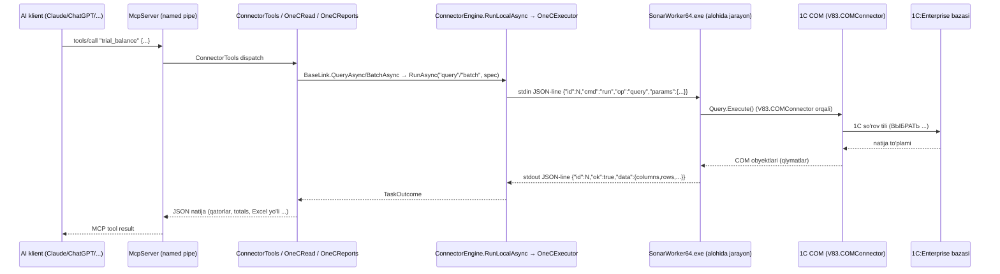

# Sonar AI v1.1.5 — 1C'dan ma'lumot o'qish yo'li (chuqur tahlil)

> Manba: `E:/Project/sonar/decompiled/` (dekompilyatsiya qilingan C# / .NET kodi). Barcha fayl yo'llari va qator raqamlari (`file:line`) `src_app/...`, `src_SonarWorker64/...` yoki ildiz darajadagi `Sonar.Engine/`, `Sonar.Core/` nusxalariga ishora qiladi — bu nusxalar bir-biridan farq qilmaydi (tekshirildi: `diff -q` bo'sh natija berdi), shuning uchun qisqalik uchun ba'zan ildiz yo'l, ba'zan `src_*` yo'li ko'rsatilgan.

## 0. Umumiy arxitektura — qatlamlar

Sonar AI 1C'dan ma'lumotni **to'rt qatlam** orqali o'qiydi. AI klient (Claude Desktop, ChatGPT, Cursor va h.k.) Sonar'ga **MCP serveri** sifatida ulanadi — ya'ni Sonar o'zi 1C uchun MCP server vazifasini bajaradi:



Qatlamlar (pastdan yuqoriga):

1. **COM qatlami** — `src_SonarWorker64/Sonar.Worker/{ComSession,Com,ComObjects}.cs`: `V83.COMConnector`/`V85`/`V82` orqali bevosita 1C bilan gaplashadi, `InvokeMember` bilan ruscha/inglizcha nomlarni sinaydi.
2. **Worker jarayon protokoli** — `Sonar.Worker/Program.cs` (alohida EXE) ↔ `Sonar.Engine/WorkerHost.cs` (asosiy jarayon ichida) — stdin/stdout orqali bitta-qatorli JSON xabarlar.
3. **Executor/orchestratsiya** — `Sonar.Engine/OneCExecutor.cs` — har bir baza uchun worker jarayonini ochadi, qulflaydi, qayta ulaydi, bo'sh turganda yopadi.
4. **So'rov qurish va tayyor hisobotlar** — `Sonar.Core/{QuerySpec,QueryBuilder,Ops,...}.cs` (worker ichida ham, desktop ilovada ham ishlatiladi) va `Sonar.Desktop.Core.Connector/{OneCRead,OneCReports}.cs` — AI'dan kelgan JSON-ni 1C so'rov matniga aylantiradi, tayyor moliyaviy hisobotlarni yig'adi.

Muhim arxitektura kuzatuvi: **turli 1C konfiguratsiyalarida "to'g'ri" registr/hisobni avtomatik topish**ning katta qismi **mahalliy emas, server (bulut) tomonida** — `BaseProfile`/`OnecProfileAsync` orqali (§5.7 ga qarang). Mahalliy kodda faqat kassa/bank hisob kodlari (`50`/`5000`/`5010`) kabi kichik, qattiq yozilgan evristikalar va subconto turini ruscha/o'zbekcha matn bo'yicha aniqlash bor.

---

## 1. Worker jarayoni — stdin/stdout JSON protokoli

### 1.1. Jarayonni ishga tushirish — `Sonar.Engine/WorkerHost.cs:46-87`

`WorkerHost` konstruktori (`WorkerHost.cs:46`) `SonarWorker{bits}.exe` (32 yoki 64-bit, `Platform.WorkerPath` — `Sonar.Engine/Platform.cs:208-225`) faylini `Process.Start` orqali ishga tushiradi:

- `RedirectStandardInput/Output/Error = true`, `UseShellExecute = false`, `CreateNoWindow = true` (`WorkerHost.cs:56-65`).
- Kodlash: UTF-8 **BOM'siz** (`new UTF8Encoding(false)`), chiqish qatori ajratuvchisi `"\n"` (`WorkerHost.cs:16-20` — bu `Program.cs:16-20`dagi worker tomonidagi sozlash bilan bir xil).
- Ikki fon oqim (`Thread`, `IsBackground=true`) ishga tushadi: `ReadLoop` (stdout'ni o'qiydi, `WorkerHost.cs:89-122`) va stderr'ni logga yozuvchi oqim (`WorkerHost.cs:71-86`, `_log.Warn("1C ishchi: " + line)`).

Worker tomonida (`src_SonarWorker64/Sonar.Worker/Program.cs:13-20`) xuddi shu kodlash bilan `Console.OpenStandardInput/Output/Error` o'raladi — ikki tomon formatda farq qilmasligi uchun.

### 1.2. Xabar shakli

Har bir xabar — **bitta qatorli JSON**, `\n` bilan tugaydi (uzatish: `WorkerHost.cs:134` — `Json.Write(msg, asciiOnly: true) + "\n"`; o'qish: `Program.cs:27` — `streamReader.ReadLine()`, `WorkerHost.cs:94` — `_p.StandardOutput.ReadLine()`). `asciiOnly: true` bilan yozilgan — ya'ni kirill/o'zbek harflari `\uXXXX` escape ko'rinishida yuboriladi (ikki tomonlama muvofiqlik va terminal/pipe muammolaridan qochish uchun).

**So'rov (Engine → Worker):**
```json
{"id": 7, "cmd": "run", "op": "query", "params": {"spec": { ... }}}
```
`id` — `WorkerHost._nextId` dan `Interlocked.Increment` bilan olingan ketma-ket `long` (`WorkerHost.cs:130`); worker buni consolega chiqarmaydi, faqat javobda qaytaradi — shu orqali `WorkerHost._pending` lug'atida mos `TaskCompletionSource` topiladi (`WorkerHost.cs:105-109`).

**Javob (Worker → Engine), muvaffaqiyat:**
```json
{"id": 7, "ok": true, "data": { ... }}
```
(`Program.cs:116-119`, `Reply()`)

**Javob, xato:**
```json
{"id": 7, "ok": false, "error": {"code": "not_found", "message": "...", "fatal": false}}
```
(`Program.cs:121-124`, `Fail()`)

### 1.3. Buyruqlar (`cmd`) — `Program.cs:42-86`

| `cmd` | Vazifasi | Kod |
|---|---|---|
| `probe` | 1C COM komponenti ro'yxatdan o'tganini tekshiradi — `Type.GetTypeFromProgID` + `Activator.CreateInstance`, so'ng darhol `Com.Release` | `Program.cs:44-65` |
| `open` | Avvalgi sessiyani yopadi (`comSession?.Dispose()`), yangi `ComSession` ochadi (progid+connect string), `Info()`ni qaytaradi | `Program.cs:66-71` |
| `run` | Ochiq sessiyada `Ops.Run(comSession, op, params)` bajaradi; sessiya yo'q bo'lsa `OneCError("not_open", fatal:true)` | `Program.cs:72-78` |
| `close` | Sessiyani yopadi, `return 0` — jarayon **o'zini tugatadi** | `Program.cs:79-83` |
| (boshqa) | `SpecException("Noma'lum buyruq...", "unsupported_op")` | `Program.cs:84-86` |

`probe` natijasi: `{"registered": bool, "created": bool, "bits": 32|64, "error"?: "..."}` (`Program.cs:54,58`) — bu yordam ekranida "COM ro'yxatdan o'tganmi" tekshiruvi uchun ishlatiladi, haqiqiy bazaga ulanmaydi.

### 1.4. Xatolarni xaritalash va "fatal" bayrog'i — `Program.cs:88-110`

Har bir `catch` blokida xato kodi va `fatal` aniqlanadi:
- `OneCError` to'g'ridan-to'g'ri `Fail()`ga boradi; agar `fatal && cmd != "open"` bo'lsa, sessiya yopiladi (`comSession = null`) — keyingi so'rov yangi `open` talab qiladi.
- Boshqa istisnolar `ErrorMap.From(Com.Unwrap(ex), connecting: cmd=="open")` orqali xaritalanadi (`src_SonarWorker64/Sonar.Worker/ErrorMap.cs:11-78`) — COM xato kodlari (masalan `-2147221164` → `com_not_registered`) va rus/ingliz matn qidiruvi (`"неправильный пароль"` → `auth_failed`, `"монопольн"` → `base_locked`, `"недостаточно прав"` → `access_denied` va h.k., `ErrorMap.cs:18-71`) orqali.
- **Yozish (`write`) amallari uchun** maxsus yo'l: agar `op=="run"` va `Ops.IsWrite(op)` bo'lsa, `ErrorMap.ForWrite` ishlatiladi (`Program.cs:103`), chunki yozish xatolarida boshqa kod/xabar siyosati kerak (1C xabarlar navbati — `TakeMessages()` — qo'shiladi).
- `fatal` bo'lsa va `cmd=="run"` bo'lsa — sessiya yopiladi (`Program.cs:105-109`).

### 1.5. Timeout, qayta ishga tushirish, concurrency — `Sonar.Engine/WorkerHost.cs` va `OneCExecutor.cs`

**Timeout** — har bir `CallAsync` chaqiruvi o'ziga xos `TimeSpan timeout` bilan keladi (`WorkerHost.cs:124-169`):
- `CancellationTokenSource.CreateLinkedTokenSource(ct)` + `cts.CancelAfter(timeout)` (`WorkerHost.cs:150-152`).
- Agar vaqt tugasa: pending yozuvni o'chiradi, **jarayonni o'ldiradi** (`Kill()` — `WorkerHost.cs:171-183`, `_p.Kill()`), `WorkerException("timeout", "1C {N} soniyada javob bermadi", fatal:true)` tashlaydi (`WorkerHost.cs:156-159`).
- Odatiy timeout qiymatlari chaqiruvchida belgilanadi: `open` — 120s (`OneCExecutor.cs:312`), oddiy `query`/`batch` — odatda 120-300s (masalan `OneCRead.cs` da `180/240/300`), mutatsiyali (`run` write) amallarda `task.TimeoutSeconds` (10–1800s oralig'ida, `ConnectorEngine.cs:1585`: `Math.Max(10, Math.Min(1800, timeoutSeconds))`).

**Jarayon o'limini aniqlash** — `WorkerHost.Alive` (`_p.HasExited`, `WorkerHost.cs:31-44`). Agar worker kutilmaganda chiqsa, `ReadLoop` tugaydi va barcha kutilayotgan `_pending` so'rovlarga `WorkerException("worker_exited", fatal:true)` beriladi (`WorkerHost.cs:115-121`).

**Qayta ulanish (reconnect) siyosati** — `OneCExecutor.CallWithReconnectAsync` (`OneCExecutor.cs:186-208`):
- Faqat **o'qish (read)** amallari uchun chaqiriladi (quyida).
- Birinchi urinish `fatal` xato bersa VA kod `timeout`/`auth_failed`/`com_not_registered`/`worker_missing` bo'lmasa — eski sessiya tashlanadi (`Drop(rt)`) va **bir marta** qayta uriniladi (`attempt==1` sharti, `OneCExecutor.cs:196`).
- Boshqa har qanday `WorkerException` — sessiya tashlanadi va xato tepaga uzatiladi (qayta urinilmaydi).

**Mutatsiyali (yozish) amallar uchun qayta urinish YO'Q** (`RunComAsync`, `OneCExecutor.cs:163-184`): avval ulanish tekshiriladi (`CallWithReconnectAsync` bilan arzon `"info"` so'rovi, 60s), so'ng haqiqiy yozish **to'g'ridan-to'g'ri** `rt.Worker.CallAsync(...)` chaqiriladi — fatal xato bo'lsa darhol `Drop(rt)` va tashlanadi, qayta urinilmaydi (ikki marta yozib yuborish xavfi tufayli, `OneCExecutor.cs:176-181`).

**Bo'sh turganda yopish** — `OneCExecutor._idle` Timer har 1 daqiqada `CloseIdle()` chaqiradi (`OneCExecutor.cs:49-52`); agar `WorkerHost.LastUsed`dan `IdleClose` (= **10 daqiqa**, `OneCExecutor.cs:38`) o'tgan bo'lsa va runtime qulfi bo'sh bo'lsa (`Lock.Wait(0)`), worker jarayoni yopiladi (`CloseIdle`, `OneCExecutor.cs:350-373`).

**Concurrency / session pooling** — `OneCExecutor` har bir **baza (`BaseConfig.Id`) uchun bitta `Runtime`** saqlaydi (`Dictionary<string, Runtime> _rt`, `OneCExecutor.cs:30,55-65`). Har bir `Runtime`da `SemaphoreSlim Lock = new SemaphoreSlim(1,1)` bor — ya'ni **bir bazaga faqat bitta so'rov bir vaqtda** boradi (`RunAsync`, `OneCExecutor.cs:85`: `await rt.Lock.WaitAsync(ct)`), lekin **turli bazalar parallel** ishlaydi (har birining o'z `WorkerHost` jarayoni, o'z COM sessiyasi). Bu — 1 baza = 1 worker.exe = 1 doimiy COM ulanish modeli; AI'dan ketma-ket kelgan bir nechta `query_1c` chaqiruvi navbatga turadi, lekin COM-sessiya qayta-qayta ochilmaydi.

**32/64-bit va ProgID tanlash** — `Platform.ChooseBits`/`ChooseProgId` (`Platform.cs:160-206`): ro'yxatdan o'tgan COM registratsiyalarini (`HKCR\V85.COMConnector`, `V83.COMConnector`, `V82.COMConnector` — ustunlik tartibida, `Platform.ProgIds` — `Platform.cs:16`) reestrdan (`RegistryView.Registry64`/`Registry32`) o'qiydi, `BaseConfig.Bits` sozlamasiga mos (yoki "auto" bo'lsa — mavjud bo'lganidan 64-bitni afzal ko'radi). Agar tanlangan bitlik ishlamasa (`com_not_registered`, birinchi urinishda, `OneCExecutor.cs:320-326`), qarama-qarshi bitlikka avtomatik o'tadi va sozlamada "auto" qilib belgilaydi.

---

## 2. COM qatlami — `ComSession.cs`, `Com.cs`, `ComObjects.cs`

### 2.1. Ulanish — `ComSession.cs:24-49`

```csharp
Type t = Type.GetTypeFromProgID(progId, throwOnError:false);   // "V83.COMConnector"
_connector = Activator.CreateInstance(t);                       // COM-obyekt
_conn = Com.Call(_connector, "Connect", connectString);          // IDispatch.Connect(...)
```
`connectString` — `OneCConnect.Build(baseConnect, user, password)` (`Sonar.Core/OneCConnect.cs:89-114`), natija: `File="C:\...";Usr="admin";Pwd="...";` yoki `Srvr="server";Ref="basename";Usr=...;Pwd=...;`. Qiymatlar `"..."` bilan qo'shtirnoqlanadi, ichidagi `"` ikkilanadi (`OneCConnect.cs:84-87`, `Q()`), faqat **fayl** yoki **server** bazasi qo'llanadi (`OneCConnect.cs:99-101`, ws/veb-servis emas).

COM topilmasa — `OneCError("com_not_registered", ..., fatal:true)` (`ComSession.cs:29`). `Connect` muvaffaqiyatsiz bo'lsa — `ErrorMap.From(..., connecting:true)` (`ComSession.cs:47`).

### 2.2. `InvokeMember` — en/ru nomlar bilan ikki marta urinish — `Com.cs:81-114`

Sonar **1C COM obyektida har bir xususiyat/metodni rus VA ingliz nomi bilan ikki marta sinaydi** — chunki 1C konfiguratsiyasi interfeys tilini (rus/ingliz) sozlamaga qarab tanlaydi:

```csharp
public static object Get(object o, params string[] names) => Invoke(o, BindingFlags.GetProperty, names, null);
// chaqiruv: Com.Get(_conn, "Metadata", "Метаданные")
```
`Invoke()` (`Com.cs:81-114`) `names` massivi bo'yicha ketma-ket `o.GetType().InvokeMember(name, flags, null, o, args, CultureInfo.InvariantCulture)` sinaydi; agar `COMException` **"nom noma'lum"** turidagi bo'lsa (`DISP_E_UNKNOWNNAME = -2147352570` yoki `DISP_E_MEMBERNOTFOUND = -2147352573`, `Com.cs:11-13,116-123`) — keyingi nomga o'tadi; aks holda darhol tashlaydi. Barcha nomlar tugaganda oxirgi xato (`Unwrap` qilingan) tashlanadi.

Bu naqsh butun kod bo'ylab takrorlanadi: `Com.Get(md, "Catalogs", "Справочники")`, `Com.CallAny(o2, "Next", "Следующий")`, `Com.CallAny(o, "SetParameter", "УстановитьПараметр")` va h.k. — ya'ni **bitta kod rus/ingliz 1C konfiguratsiyasida ham ishlaydi**.

`Com.Unwrap` — `TargetInvocationException` qobig'ini olib tashlaydi (`.InnerException`, `Com.cs:125-132`) — .NET reflection orqali COM chaqirilganda haqiqiy COM xatosi shu qobiqda keladi.

`Com.Release` — `Marshal.ReleaseComObject` (`Com.cs:169-181`), xato bo'lsa jim yutiladi — COM obyektlarini zudlik bilan bo'shatish uchun butun kodda `finally` bloklarida chaqiriladi (masalan `ComSession.Query`, `ComSession.cs:446-456`).

### 2.3. `Info()` — bazaning asosiy ma'lumotlari — `ComSession.cs:61-78`

```json
{
  "config": {"name": "Бухгалтерия", "synonym": "Бухгалтерия предприятия", "version": "3.0.145.23", "vendor": "1С"},
  "platform": "8.3.24.1548",
  "user": "admin",
  "user_full": "Администратор",
  "time": "2026-09-30T14:22:10"
}
```
`platform` — `Com.Call(_conn, "NewObject", "SystemInfo").AppVersion`/`ВерсияПриложения` (`ComSession.cs:65-74`); barcha ixtiyoriy maydonlar `Try(() => ...)` bilan o'raladi — xato bo'lsa `""` (`ComSession.cs:80-90`), bitta maydon ishlamasa butun `Info()` qulamasin deb.

### 2.4. Metadata'ni aylanib o'tish (metadata walk) — `ComSession.Metadata()` — `ComSession.cs:92-207`

Natija keshlanadi (`_meta`, bitta sessiya davomida bir marta hisoblanadi). Har bir bo'lim uchun `Each(md, [en,ru] nomlar, Action<object>)` yordamchisi (`ComSession.cs:218-246`) kolleksiyani `Count`/`Get(i)` (`Количество`/`Получить`) bilan aylanib o'tadi, har bir elementda xato bo'lsa **shu elementni tashlab, davom etadi** (`catch (Exception) {}`, `ComSession.cs:236-239`) — bitta buzuq metaobyekt butun metadata o'qishni to'xtatmasligi uchun.

Bo'limlar va ularda to'planadigan xususiyatlar:

| Bo'lim (en/ru) | `MetaKind` | Qo'shimcha xususiyatlar |
|---|---|---|
| `Catalogs`/`Справочники` | `Catalog` | `Hierarchical` (`Иерархический`), `Folders` (HierarchyType=="HierarchyFoldersAndItems"/"Иерархия групп..."), `Attributes` |
| `Documents`/`Документы` | `Document` | `Posting` (`Проведение`=="Allow"/"Разрешить"), `Attributes`, `Tables` (`TabularSections`/`ТабличныеЧасти`, har birida o'z `Attributes`) |
| `AccumulationRegisters`/`РегистрыНакопления` | `AccumRegister` | `RegisterKind` = `"balance"` agar `RegisterType=="Balance"/"Остатки"`, aks holda `"turnovers"`; `Dimensions`, `Resources`, `Attributes` |
| `AccountingRegisters`/`РегистрыБухгалтерии` | `AccountingRegister` | `Chart` (bog'langan hisoblar rejasi nomi), `Correspondence` (`Корреспонденция`), `Dimensions`, `Resources` (har biri uchun `Balance` = `Резурс.Балансовый`), `Attributes` |
| `InformationRegisters`/`РегистрыСведений` | `InfoRegister` | `Periodic` (`ПериодичностьРегистраСведений` != "Nonperiodical"/"Непериодич..."), `Dimensions`, `Resources`, `Attributes` |
| `ChartsOfAccounts`/`Планы счетов` | `ChartOfAccounts` | `MaxExtDims` (`МаксКоличествоСубконто`), `Attributes` |
| `Constants`/`Константы` | `Constant` | bitta sintetik `MetaField("Значение")` — turlari `Тип`'dan olinadi |
| `Reports`/`Отчеты` | `Report` | faqat nom/sinonim (ichki tuzilma o'qilmaydi) |

Har bir `MetaField` uchun **turlar ro'yxati** (`TypeNames`, `ComSession.cs:296-332`) `TypeDescription.Types`/`Типы` kolleksiyasidan olinadi, **12 tagacha** cheklanadi (`i < 12`, `ComSession.cs:307` — `TypeCheck.TypesCap=12` bilan muvofiq), har bir tur uchun `Metadata.FindByType`/`НайтиПоТипу` orqali **to'liq nom** (`"Справочник.Номенклатура"`, `"Документ.РеализацияТоваровУслуг"` kabi) olinadi (`ComSession.cs:313-315`); agar topilmasa — `Present(obj2)` (matn ko'rinishi) qoldiq sifatida ishlatiladi.

`Enum()` (`ComSession.cs:334-352`) — `Posting`/`RegisterType`/`HierarchyType` kabi 1C enum qiymatlarini **`XMLString`/`XMLСтрока`** orqali barqaror (til-mustaqil) matnga aylantiradi (masalan `"Allow"` yoki `"Разрешить"` — lokalizatsiyaga qaramay bitta XML identifikator qaytadi).

### 2.5. So'rov bajarish — `ComSession.Query(QuerySpec)` — `ComSession.cs:366-457`

1. `QueryBuilder.Build(spec, Metadata())` — 1C so'rov matnini (§4) quradi.
2. `Com.Call(_conn, "NewObject", "Query")` → `Com.Set(o, "Text", builtQuery.Text)`.
3. Har bir parametr `SetParameter`/`УстановитьПараметр` bilan o'rnatiladi; qiymat avval `ToOneC()` orqali o'tkaziladi (§2.6).
4. **Hisob kodlari** (`AccountParam`) alohida: har biri uchun ichki qidiruv so'rovi ishga tushiriladi (§2.7).
5. `Execute`/`Выполнить` → `Select`/`Выбрать` → har bir qatorda `Next`/`Следующий`, `Get(i)`/`Получить(i)` bilan ustunlar o'qiladi.
6. **Kesish (truncation):** `if (queryResult.Rows.Count >= builtQuery.Limit) { Truncated = true; break; }` (`ComSession.cs:397-401`) — SQL matni `Limit+1` qator so'raydi (§4), shuning uchun aynan `Limit+1`-chi qatorga yetganda kesish bayrog'i qo'yiladi va **aniq `Limit` qator** qaytariladi.
7. Har bir katakcha (`object obj2`) — agar ustun "havola" (`RefColumns[i]`) bo'lsa `RefOf()` orqali, aks holda `QueryResult.Cell(obj2, Present, out type)` orqali JSON-safe qiymatga aylantiriladi (§2.6/4.4), so'ng COM-obyekt bo'lsa darhol `Com.Release`.
8. Ustun **turi** (`Types[i]`) barcha qatorlar bo'yicha `QueryResult.MergeType` bilan birlashtiriladi — agar bir ustunda turli qatorlarda turli tur chiqsa (masalan `number` va `null`), yakuniy tur `"string"`ga tushadi (ziddiyat holatida xavfsiz tomonga, `QueryResult.cs:144-155`).

Xato bo'lsa (`catch (Exception e)`, `ComSession.cs:432-445`): to'liq so'rov matni **stderr**ga qator-qator chiqariladi (diagnostika uchun, `Console.Error.WriteLine("  | " + line)`), so'ng `ErrorMap.From(..., connecting:false)` orqali xaritalangan `OneCError` tashlanadi.

### 2.6. Qiymatlarni aylantirish — `ToOneC` / `RefOf` / `QueryResult.Cell`

**`ToOneC(object v, List<object> temp)`** (`ComSession.cs:486-505`) — .NET qiymatini 1C COM'ga yuborishdan oldin:
- `decimal` → `double` (COM Variant'da `decimal` har doim to'g'ri qabul qilinmaydi, shuning uchun oldindan `double`ga o'giriladi — lekin pastda ko'ramiz, teskari yo'nalishda muammo bor, §2.6.1).
- `List<object>` → 1C `Array`/`Массив` obyekti (`NewObject("Array")`), har bir element rekursiv `ToOneC` orqali qo'shiladi (`Add`/`Добавить`); vaqtinchalik COM-obyekt `temp` ro'yxatiga qo'shiladi — so'rovdan keyin `finally`da bo'shatiladi.

**`RefOf(object v)`** (`ComSession.cs:459-484`) — "havola" (`fn:"ref"`) deb belgilangan ustun uchun: agar COM-obyekt bo'lmasa — `QueryResult.PlainRef` (oddiy skalar qiymatni soxta-havola qiladi); aks holda `ComObjects.RefGuid(_conn, v)` bilan GUID olinadi — agar GUID barcha-nol (`00000000-...`) bo'lsa — bu "bo'sh havola" (`ПустаяСсылка`), `null` qaytariladi; aks holda `{Guid, Presentation}` (`Present(v)` — `String`/`Строка`).

**`QueryResult.Cell(v, present, out type)`** (`Sonar.Core/QueryResult.cs:43-115`) — markaziy JSON-aylantirish funksiyasi, .NET turi bo'yicha katta `if/else` zanjiri:

| .NET turi | JSON `type` | JSON qiymati |
|---|---|---|
| `RefValue` | `"ref"` | `{"guid":"...","presentation":"..."}` |
| `string` | `"string"` | matn |
| `bool` | `"bool"` | `true`/`false` |
| `DateTime` (yil>100) | `"date"` | ISO-8601 (`Json.IsoDate`) |
| `DateTime` (yil<=100 — 1C "sana yo'q" markeri `0001-01-01`) | `"date"` | `null` |
| `decimal`/`double`/`float`/`int`/`long`/`short`/`byte` | `"number"` | matn ko'rinishidagi son (`Num()`/`Dbl()`, oxiridagi nollar kesiladi) |
| boshqa COM-obyekt | `"string"` | `present(v)` (odatda `String`/`Строка`) |
| `null`/`DBNull` | `"null"` | `null` |

**2.6.1. Sonlarning aniqligi — `ComObjects.cs:858-894` muhim izoh.** 1C'dan COM orqali qaytgan sonlar odatda `double` sifatida keladi, **`decimal` emas** — bu `ComObjects.NoteNumberType` (`ComObjects.cs:887-894`) bir martalik ogohlantirish bilan stderr'ga chiqaradi: *"1C sonlari COM orqali {Double} bo'lib keladi — 15 muhim xonagacha aniq; uzunroq sonlar qayta o'qish tekshiruvida rad etiladi"*. Parametr yuborishda (`SetParameter`, `ComObjects.cs:367-392`) agar COM `decimal` turini qabul qilmasa (`IsTypeMismatch`, `ComObjects.cs:868-885` — COM xato kodlari `-2147352571`/`-2147352568` yoki `"несоответствие тип"`/`"type mismatch"` matni), **orqaga qaytish**: son `QueryResult.Num(m)` orqali kanonik matnga, so'ng `Число("...")`/`Number("...")` (1C ichki funksiyasi) orqali qayta 1C obyektiga aylantiriladi (`NumberFrom1C`, `ComObjects.cs:858-866`) — bu ham bir martalik stderr ogohlantirish bilan.

### 2.7. Hisob kodlarini havolaga aylantirish — `ComSession.Accounts()` — `ComSession.cs:507-544`

`acc_balance`/`acc_turnovers`/`acc_balance_turnovers` manbalarida `accounts: ["60","62"]` berilganda, bular **to'g'ridan-to'g'ri SQL literal emas** — ikki bosqichli:

1. Qidiruv so'rovi: `QueryBuilder.AccountLookupText(chart)` (`Sonar.Core/QueryBuilder.cs:818-825`):
   ```
   ВЫБРАТЬ
       Т.Ссылка КАК Ссылка,
       Т.Код КАК Код
   ИЗ
       ПланСчетов.<Chart> КАК Т
   ГДЕ
       Т.Код В (&Коды)
   ```
   `&Коды` — kodlar massivi (`ToOneC` orqali 1C `Array`ga aylantirilgan).
2. Natijadagi `Код` ustuni berilgan kodlar bilan solishtiriladi — topilmagan har bir kod uchun **ogohlantirish** qo'shiladi: `"Hisob topilmadi: {kod}"` (`ComSession.cs:527-533`) — bu `QueryResult.Warnings`ga tushadi va yuqori qatlamda `OneCRead.CheckAccounts()` (§6) buni **xatoga aylantiradi**.
3. `UnloadColumn("Ссылка")`/`ВыгрузитьКолонку` — faqat havolalar ustunini massiv qilib oladi, bu massiv asl so'rovdagi `&Счета`/`&КорСчета` parametriga beriladi (`ИЕРАРХИИ` operatori bilan — pastki hisoblar ham kiradi).

**Izoh — `Sonar.Core/ObjectQueries.cs`:** `QueryBuilder.AccountLookupText` — hisob kodlari uchun maxsus, tor qidiruv matni quradi. Shu bilan bir qatorda **umumiy maqsadli** o'xshash qidiruv matni quruvchilar ham bor — `ObjectQueries.RefLookup(RefSpec)` (`ObjectQueries.cs:13-35`, GUID/kod/INN/nom bo'yicha istalgan katalogdan ssilka topish, `ПЕРВЫЕ 10`), `TargetLookup`/`TargetByFields` (`L37-121`, hujjatni raqam+sana yoki erkin rekvizitlar bo'yicha topish, raqamning "oxiri" bo'yicha qidirish — `Significant()` orqali ortiqcha boshlang'ich nollarni kesib), `Marked` (`L136-148`, izoh matnida maxsus belgi qidirish). Bular — **yozish yo'li**ning (`object.write`/`propose_1c_change`) "qaysi obyektni tahrirlayapmiz" deb aniqlash mexanizmi, ushbu hujjat doirasi (faqat o'qish) tashqarisida, lekin texnik jihatdan `QueryBuilder`ga juda yaqin — bir xil `Select()`/parametrlashtirilgan so'rov naqshidan foydalanadi (§2.6 bilan bir xil qiymat-konversiya yo'li).

### 2.8. Xato xaritasi — `ErrorMap` va `OneCError` — to'liq jadval

`ErrorMap.From(e, connecting)` (`src_SonarWorker64/Sonar.Worker/ErrorMap.cs:11-78`):

| Shart | `code` | `fatal` |
|---|---|---|
| COM kodi `-2147221164`/`-2147221005`/`-2147319779`/`-2147312566` yoki matn `"type_e_libnotregistered"` | `com_not_registered` | har doim `true` |
| COM kodi `-2147417848`/`-2147023174`/`-2147023170` | `connection_lost` | har doim `true` |
| matnda `"неправильное имя пользователя"`/`"неправильный пароль"`/`"идентификация пользователя не выполнена"`/ingliz ekvivalentlari | `auth_failed` | `connecting` qiymati |
| matnda `"лиценз"`/`"license"` | `license` | " |
| matnda `"монопольн"`/`"установлена блокировка"`/(`"начало сеанса"` + `"запрещено"`) | `base_locked` | " |
| matnda `"не обнаружен"` yoki (`"не найден"` + `"информационн"`) yoki `"file not found"` | `base_not_found` (ulanishda) / `query_error` | " |
| matnda `"недостаточно прав"`/`"нарушение прав доступа"`/`"access right"` | `access_denied` | " |
| matnda `"версия"` + (`"отличается"`/`"не соответствует"`/`"несовмест"`) | `version_mismatch` | " |
| matnda `"обновлени"` + `"конфигурац"` | `config_update` | " |
| boshqa barchasi | `connect_failed` (ulanishda) / `query_error` | " |

Har holda matn `Secrets.Mask()` orqali (parol/token kabi sezgir qism yashirinadi) va **600 belgigacha** kesiladi (`ErrorMap.cs:72-76`).

`OneCError` (`Sonar.Core/OneCError.cs:5-17`) — oddiy `Exception` naslidan, `Code` (string) va `Fatal` (bool) maydonlari bilan; worker protokolida JSON `error.code`/`error.fatal`ga to'g'ridan-to'g'ri xaritalanadi.

---

## 3. Metadata saqlash — `MetaStore`, `MetaCache`

### 3.1. Modellar — `Sonar.Core/{MetaObject,MetaField,MetaKind,MetaTable,IMetaSource}.cs`

```
MetaKind = Catalog | Document | AccumRegister | AccountingRegister
         | InfoRegister | ChartOfAccounts | Constant | Report   (MetaKind.cs:3-13)

MetaObject { Kind, Name, Synonym, Attributes:[MetaField], Dimensions:[MetaField],
             Resources:[MetaField], Tables:[MetaTable], RegisterKind, Chart,
             Correspondence, MaxExtDims, Periodic, Posting, Hierarchical, Folders }
                                                              (MetaObject.cs:7-63)

MetaField { Name, Synonym, Types:[string] (to'liq 1C nomlari), Balance:bool }
                                                              (MetaField.cs:5-43)

MetaTable { Name, Attributes:[MetaField] }                   (MetaTable.cs:5-10)

IMetaSource { MetaObject Find(MetaKind, string name) }       (IMetaSource.cs:3-6)
```

`MetaStore` (`Sonar.Core/MetaStore.cs:7-203`) — `Dictionary<MetaKind, Dictionary<string,MetaObject>>` (nom bo'yicha, `OrdinalIgnoreCase`). `ToJson()`/`FromJson()` — **ixcham** JSON kodlash: qisqa kalitlar (`n`=name, `s`=synonym, `a`=attributes, `d`=dimensions, `r`=resources, `ts`=tables, `kind`, `chart`, `corr`, `ext`, `periodic`, `post`, `hier`, `folders`) — hajmni kichraytirish uchun (metadata yuzlab obyekt bo'lishi mumkin). Bo'limlar nomlari: `catalogs`, `documents`, `accum`, `acc`, `info`, `charts`, `constants`, `reports` (`MetaStore.cs:21-31`).

### 3.2. `MetaCache` — disk formati va yangilanish — `src_app/Sonar.Desktop.Core/.../MetaCache.cs`

- **Fayl nomi:** `meta-<baseId regex-tozalangan>.json` (faqat `A-Za-z0-9_-` qoladi, `MetaCache.cs:125-128`), `connector/` papkasida (`ConnectorHost.cs:61,65` — `dataDir/connector`).
- **Format:** `MetaStore.ToJson()` xom natijasi, `Json.Write(raw)` bilan (indent'siz, `MetaCache.cs:162`); yozish **atomik** — avval `.tmp`ga, so'ng `File.Move(..., overwrite:true)` (`MetaCache.cs:162-163`).
- **Keshlash ikki daraja:** xotirada `Dictionary<string,(string Version, MetaStore)>` (`_mem`, `MetaCache.cs:15`) va diskda.
- **Yaroqlilik tekshiruvi (`Fresh`, `MetaCache.cs:35-42`):** agar `LocalBase.ConfigVersion` bo'sh bo'lmasa — keshlangan versiya aniq shunga teng bo'lishi kerak; agar `ConfigVersion` bo'sh (hali noma'lum) bo'lsa — **har doim yaroqli** deb hisoblanadi (fayldan o'qilgan versiyaga ishoniladi). Ya'ni **vaqt asosida eskirish (TTL) yo'q** — faqat **1C konfiguratsiya versiyasi** o'zgarganda (masalan yangilanishdan keyin) kesh bekor qilinadi.
- **Yuklash tartibi (`GetAsync`, `MetaCache.cs:44-96`):** 1) xotiradagi kesh → 2) disk fayli (`Load`, agar versiya mos kelsa) → 3) faqat shundan keyin **haqiqiy `metadata` operatsiyasi** worker orqali yuboriladi (300s timeout) va natija ham xotiraga, ham diskka yoziladi.
- **Bir vaqtda bir nechta chaqiruv** — har bir `baseId` uchun alohida `SemaphoreSlim` (`_locks`, `MetaCache.cs:17,53-61`) — parallel so'rovlar metadata'ni **ikki marta** o'qib yubormaydi, birinchisi tugaguncha kutadi.
- **`Forget(baseId)`** (`MetaCache.cs:98-115`) — xotiradan va diskdan o'chiradi (masalan baza qayta ro'yxatdan o'tganda yoki foydalanuvchi "tuzilmani yangilash"ni bosganda chaqiriladi).

---

## 4. So'rov qurish — `QuerySpec` / `QueryBuilder` / `Ops`

### 4.1. Yuqori darajadagi oqim

```
JSON (AI'dan) → QuerySpec.FromJson() [tekshirish] → QueryBuilder.Build(spec, MetaStore)
     → BuiltQuery {Text, Params, AccountParams, Columns, RefColumns, Limit, SourceLabel}
     → ComSession.Query(spec) [COM orqali bajarish] → QueryResult → ToJson()
```

`Ops.Run(session, op, params)` (`Sonar.Core/Ops.cs:58-125`) — worker ichidagi **yagona kirish nuqtasi**, `op` bo'yicha dispatch:

| `op` | Harakat |
|---|---|
| `ping` | `{"pong":true,"time":"..."}` — faqat tirikligini tekshirish, 1C'ga bormaydi |
| `info` | `session.Info()` (§2.3) |
| `metadata` | `session.Metadata().ToJson()` (§2.4/3.1) |
| `query` | `QuerySpec.FromJson(params.spec)` → `session.Query(spec)` → `.ToJson()`, vaqt o'lchanadi (`Timed`, `Ops.cs:127-133`) |
| `batch` | `params.queries` — **10 tagacha** (`MaxBatch=10`, `Ops.cs:9`) nomli so'rov, har biri **mustaqil** bajariladi; agar bittasi xato bersa (`SpecException`/fatal bo'lmagan `OneCError`) — faqat o'sha kalit ostida `{"error":{code,message}}` qaytadi, **boshqalari davom etadi** (`Ops.cs:84-107`) |
| `document.create` | **eskirgan** — `SpecException("...object.preview / object.write ishlatiladi...", "write_disabled")` (yozish yo'li, ushbu hujjat doirasidan tashqarida) |
| `object.*`, `month.*` | yozish/operatsion amallar (`ObjectOps`/`MonthOps`, ushbu hujjat doirasidan tashqarida) |

`Ops.ReadOps = {ping, info, metadata, query, batch}` (`Ops.cs:11`) — bular "`fatal`" xato kelganda sessiyani darhol yopmaydigan, qayta-ulanish siyosatiga ega bo'ladigan amallar guruhi (§1.5).

### 4.2. `QuerySpec` JSON formatini to'liq hujjatlashtirish — `Sonar.Core/QuerySpec.cs`, `SourceSpec.cs`

**Umumiy forma:**
```json
{
  "source": { "type": "...", "name": "...", "table"?, "period"?, "from"?, "to"?,
              "periodicity"?, "accounts"?, "corr_accounts"?,
              "posted_only"?, "exclude_deleted"?, "exclude_folders"?, "active_only"? },
  "fields": [ {"path": "...", "as"?: "...", "fn"?: "..."} | "YalangPath", ... ],
  "where": [ {"path": "...", "op": "...", "value": ...}, ... ],
  "order": [ {"field": "...", "desc"?: true}, ... ],
  "limit": 1..20000,
  "allowed": true
}
```

**`source.type`** (`QuerySpec.SourceTypes`, `QuerySpec.cs:33-37`) — 13 xil:

| `type` | 1C manbasi | Qo'shimcha talablar |
|---|---|---|
| `catalog` | `Справочник.<name>` | — |
| `document` | `Документ.<name>` | — |
| `document_table` | `Документ.<name>.<table>` | `table` majburiy |
| `accum_balance` | `РегистрНакопления.<name>.Остатки(&Период)` | faqat `RegisterKind=="balance"` registrlarda |
| `accum_turnovers` | `РегистрНакопления.<name>.Обороты(&Начало,&Конец,Периодичность)` | `from`/`to` majburiy |
| `accum_records` | `РегистрНакопления.<name>` (xom yozuvlar) | — |
| `acc_balance` | `РегистрБухгалтерии.<name>.Остатки(&Период, Отбор)` | — |
| `acc_turnovers` | `РегистрБухгалтерии.<name>.Обороты(&Начало,&Конец,...)` | `from`/`to` majburiy |
| `acc_balance_turnovers` | `РегистрБухгалтерии.<name>.ОстаткиИОбороты(...)` | `from`/`to` majburiy |
| `info_register` | `РегистрСведений.<name>` | — |
| `info_slice_last` | `РегистрСведений.<name>.СрезПоследних(&Период)` | faqat `Periodic` registrlarda |
| `chart_of_accounts` | `ПланСчетов.<name>` | — |
| `chart_subconto` | `ПланСчетов.<name>.ВидыСубконто` | faqat `MaxExtDims>0` |
| `constant` | `Константы` (maxsus — faqat `Значение` maydoni) | — |

**Validatsiya qoidalari (`SourceSpec.FromJson`, `SourceSpec.cs:35-94`):**
- `name` — `IsIdent` regex `^[\p{L}_][\p{L}\p{Nd}_]{0,79}$` (`QuerySpec.cs:29`) ga mos bo'lishi kerak; aks holda `"Obyekt nomi noto'g'ri"`.
- `accounts`/`corr_accounts` — har biri `^[\p{L}\p{Nd}.\-]+$`, uzunligi ≤20 (`SourceSpec.cs:96-102`, `CheckCode`); **50 tagacha** har biri (`SourceSpec.cs:85-88`).
- Davr sanasi — `from > to` bo'lsa xato (`SourceSpec.cs:73-76`).
- Aylanma turlari (`accum_turnovers`, `acc_turnovers`, `acc_balance_turnovers`) uchun **`from` VA `to` majburiy** (`SourceSpec.cs:89-92`).

**Standart bayroqlar** (hammasi `true` bo'lib kelsa): `posted_only` (faqat o'tkazilgan hujjatlar), `exclude_deleted` (o'chirishga belgilanmaganlar), `exclude_folders` (katalog guruhlarini chiqarib tashlash), `active_only` (faqat `Активность=true` yozuvlar jamg'arish registrida).

**`fields`** (`QuerySpec.FromJson`, `QuerySpec.cs:91-131`): har biri `{path, as, fn?}`; `path` — `IsPath` (`.` bilan ajratilgan identifikatorlar zanjiri, ≤300 belgi, `QuerySpec.cs:65-80`) yoki maxsus `"*"` (faqat `fn:"count"` bilan — qatorlar sonini sanash). `fn` ∈ `{present, ref, sum, count, count_distinct, min, max}` (`QuerySpec.cs:39`). `as` — **majburiy va noyob** (`QuerySpec.cs:111-120`). **40 tagacha maydon** (`MaxFields=40`, `QuerySpec.cs:13`, tekshiruv `QuerySpec.cs:128-131`).

**`where`** (`QuerySpec.cs:132-161`): `op` ∈ `{=, <>, >, >=, <, <=, in, not_in, like}` (`QuerySpec.cs:41`); `in`/`not_in` → qiymat **ro'yxat** bo'lishi shart, `like` → **matn** bo'lishi shart (`QuerySpec.cs:148-155`). **20 tagacha shart** (`MaxConditions=20`, `QuerySpec.cs:15`, `QuerySpec.cs:162-165`).

**`order`**: faqat `fields`dagi `as` taxalluslariga ishora qilishi mumkin (`QuerySpec.cs:173-176`, aks holda `"Tartiblash maydoni topilmadi"`).

**`limit`**: `1..20000` (`MaxLimit=20000`, `QuerySpec.cs:9`), odatiy qiymat `1000` (`DefaultLimit`, `QuerySpec.cs:11`), chegaradan tashqari bo'lsa xato (`QuerySpec.cs:182-185`).

**`allowed`** (odatiy `true`) — 1C so'rov tilidagi **`РАЗРЕШЕННЫЕ`** kalit so'zini yoqadi/o'chiradi (§6.1).

### 4.3. `QueryBuilder.Build` — manba turlari bo'yicha SQL generatsiyasi — `Sonar.Core/QueryBuilder.cs:58-488`

Umumiy qolip:
```
ВЫБРАТЬ [РАЗРЕШЕННЫЕ] ПЕРВЫЕ <limit+1>
    <field1> КАК Поле1,
    <field2> КАК Поле2, ...
ИЗ
    <manba ifodasi> КАК Т
[ГДЕ <shart1> И <shart2> ...]
[СГРУППИРОВАТЬ ПО <guruh ustunlari>]
[УПОРЯДОЧИТЬ ПО <PoleN> [УБЫВ], ...]
```
(`QueryBuilder.cs:454-487`). Ustun nomlari har doim `"Поле" + raqam` (`QueryAlias`, `QueryBuilder.cs:523-526`) — 1C so'rov tilidagi identifikator qoidalariga (kirill harf bilan boshlanish xavfsiz) mos, asl `as` taxalluslari faqat `BuiltQuery.Columns`da JSON darajasida saqlanadi.

**Har bir manba turi uchun maxsus mantiq:**

- **`catalog`/`document`/`chart_of_accounts`** — `AddStd()` (`QueryBuilder.cs:575-609`) standart maydonlarni (`Ссылка`, `Код`, `Наименование`, `ПометкаУдаления`, `Родитель` va h.k.) `FieldMap`ga qo'shadi, so'ng obyektning haqiqiy `Attributes` ustiga yoziladi. `document` uchun davr filtri `Т.Дата`ga (`DateRange`, `QueryBuilder.cs:779-791`), `catalog`/`chart_of_accounts` uchun `НЕ Т.ПометкаУдаления` qo'shiladi (agar `exclude_deleted`).
- **`document_table`** — `Документ.<name>.<table> КАК Т`; sanaga filtr `Т.Ссылка.Дата` orqali (hujjat tabulyar qismi o'z sanasiga ega emas — ssilka orqali).
- **`accum_balance`** — `.Остатки(&Период)`; har bir resurs uchun `<Resurs>Остаток` maydoni qo'shiladi.
- **`accum_turnovers`** — `.Обороты(&Начало,&Конец,<Периодичность>)`; `<Resurs>Оборот`, agar registr balans turi bo'lsa qo'shimcha `<Resurs>Приход`/`<Resurs>Расход`.
- **`accum_records`** — xom yozuvlar: `Период`, `Регистратор`, `НомерСтроки`, `Активность`, (agar balans turi) `ВидДвижения` maxsus ishlov beriladi (quyida).
- **`acc_balance`/`acc_turnovers`/`acc_balance_turnovers`** — eng murakkab bo'lim (`QueryBuilder.cs:192-292`): `Счет` maydoni bog'langan hisoblar rejasi turi bilan (`FullName(chart)`), `Субконто1..N` (`N`=`MaxExtDims`, 0-3), agar `accounts` berilgan bo'lsa — `Счет В ИЕРАРХИИ (&Счета)` sharti qo'shiladi va `AccountParam` ro'yxatga yoziladi (§2.7). `acc_turnovers`da qo'shimcha `КорСчет`/`КорСубконтоN` (agar registr `Correspondence=true`) va `corr_accounts` → `КорСчет В ИЕРАРХИИ (&КорСчета)`.
- **`info_register`/`info_slice_last`** — oddiy yoki `.СрезПоследних(&Период)`.
- **`chart_subconto`** — `ПланСчетов.<name>.ВидыСубконто` — har bir subkonto turi qatori (`Ссылка`, `НомерСтроки`, `ВидСубконто`, `ТолькоОбороты`, `Суммовой`, `Валютный`, `Количественный`) — bu `ChartCache` tomonidan hisob turlarini (kontragent/nomenklatura/ombor) aniqlash uchun ishlatiladi (§5.4).
- **`constant`** — maxsus yo'l (`BuildConstant`, `QueryBuilder.cs:490-521`): faqat bitta `"Значение"` maydoni ruxsat etiladi, manba — `Константы КАК Т`, `limit` majburan `1`.

**Maydon ifodalari (`fn` bo'yicha)** (`QueryBuilder.cs:367-424`):

| `fn` | 1C ifodasi |
|---|---|
| (yo'q) | `Т.<path>` |
| `present` | `ПРЕДСТАВЛЕНИЕ(Т.<path>)` |
| `ref` | `Т.<path>` (lekin natija `RefOf()` orqali o'tadi — §2.6; oldindan `CheckRef()` bilan tur tekshiriladi, pastda) |
| `sum` | `СУММА(Т.<path>)` |
| `count` (`path="*"`) | `КОЛИЧЕСТВО(*)` |
| `count` | `КОЛИЧЕСТВО(Т.<path>)` |
| `count_distinct` | `КОЛИЧЕСТВО(РАЗЛИЧНЫЕ Т.<path>)` |
| `min`/`max` | `МИНИМУМ`/`МАКСИМУМ(Т.<path>)` |

Agar **kamida bir** maydon agregat (`sum`/`count`/`count_distinct`/`min`/`max`) bo'lsa (`q.HasAggregates`), barcha agregatsiz maydonlar avtomatik `СГРУППИРОВАТЬ ПО` ro'yxatiga tushadi (`QueryBuilder.cs:382-399`), va tartiblash **faqat agregat maydon** bo'yicha ruxsat etiladi (`QueryBuilder.cs:474-483`, aks holda `SpecException`).

**Maxsus holat — `ВидДвижения` (harakat turi):** `accum_records` manbasida faqat balans-turdagi registrlarda mavjud (`IsMoveKind`, `QueryBuilder.cs:707-714`; aks holda `NoMoveKind` orqali oldindan xato, `QueryBuilder.cs:752-761`). Ichki 1C enum (`ВидДвиженияНакопления.Приход`/`.Расход`) tashqi JSON'da oddiy matn `"Приход"`/`"Расход"` bilan ifodalanadi; `QueryBuilder` buni avtomatik `ВЫБОР КОГДА ... ТОГДА "Приход" ИНАЧЕ "Расход" КОНЕЦ` (`fields`da) va `= ЗНАЧЕНИЕ(ВидДвиженияНакопления.Приход)` (`where`da) ifodalariga aylantiradi (`MoveKindText`/`MoveKindCondition`, `QueryBuilder.cs:716-749`).

**Tur tekshiruvi `fn:"ref"` uchun — `CheckRef`/`PathTypes`** (`QueryBuilder.cs:632-705`): maydon yo'li orqali (`"Контрагент.Родитель"` kabi ko'p bosqichli yo'llar ham) haqiqiy 1C turlari ketma-ket metadata orqali kuzatiladi (`RefPrefixes` lug'ati — `Справочник`/`Catalog`, `Документ`/`Document`, `ПланСчетов`/`ChartOfAccounts` va boshqa tur nomlarini tanib oladi, `QueryBuilder.cs:611-630`); agar yo'l oxirida tur **havola emas** ekanligi aniq bo'lsa — `SpecException` (`"fn=ref faqat havola maydoni uchun"`, `QueryBuilder.cs:704`). Agar turlar ro'yxati noaniq (12 tadan ko'p tur yoki `"*"` ishtirok etsa) — tekshiruv **o'tkazib yuboriladi** (xavfsiz default — ishonib so'rov yuboriladi, haqiqiy xato COM darajasida chiqadi).

### 4.3bis. Uch ishlab chiqilgan misol — JSON `spec` → 1C so'rov matni

**Misol A — ombordagi qoldiq (`accum_balance`, guruhlash bilan).**

Kirish:
```json
{
  "source": {"type": "accum_balance", "name": "ТоварыНаСкладах", "period": "2026-09-30T23:59:59"},
  "fields": [
    {"path": "Номенклатура", "as": "item", "fn": "present"},
    {"path": "Склад", "as": "wh", "fn": "present"},
    {"path": "КоличествоОстаток", "as": "qty", "fn": "sum"}
  ],
  "limit": 1000
}
```
`QueryBuilder.Build` izi: `source.type=="accum_balance"` bo'limi (`QueryBuilder.cs:125-141`) — `РегистрНакопления.ТоварыНаСкладах.Остатки(&Период) КАК Т`, `PeriodParam` → `Params["Период"]`. Maydonlar: `present` → `ПРЕДСТАВЛЕНИЕ(...)` va (chunki `qty` — `sum`, demak `q.HasAggregates=true`) `item`/`wh` ustunlari `СГРУППИРОВАТЬ ПО`ga tushadi (`QueryBuilder.cs:382-399`); `qty` — `СУММА(...)`, guruhga tushmaydi.

Natija (`BuiltQuery.Text`):
```sql
ВЫБРАТЬ РАЗРЕШЕННЫЕ ПЕРВЫЕ 1001
	ПРЕДСТАВЛЕНИЕ(Т.Номенклатура) КАК Поле1,
	ПРЕДСТАВЛЕНИЕ(Т.Склад) КАК Поле2,
	СУММА(Т.КоличествоОстаток) КАК Поле3
ИЗ
	РегистрНакопления.ТоварыНаСкладах.Остатки(&Период) КАК Т
СГРУППИРОВАТЬ ПО
	Т.Номенклатура,
	Т.Склад
```
`Params = {"Период": 2026-09-30T23:59:59}`. `BuiltQuery.Columns = ["item","wh","qty"]`, `RefColumns=[false,false,false]` (`present` — oddiy matn, havola emas).

**Misol B — hujjat tabel qismi, shart va tartib bilan (`document_table`).**

Kirish:
```json
{
  "source": {
    "type": "document_table", "name": "РеализацияТоваровУслуг", "table": "Товары",
    "from": "2026-09-01T00:00:00", "to": "2026-09-30T23:59:59", "posted_only": true
  },
  "fields": [
    {"path": "Ссылка", "as": "doc", "fn": "present"},
    {"path": "Номенклатура", "as": "item", "fn": "present"},
    {"path": "Количество", "as": "qty"},
    {"path": "Сумма", "as": "amount"}
  ],
  "where": [{"path": "Количество", "op": ">", "value": 10}],
  "order": [{"field": "amount", "desc": true}],
  "limit": 500
}
```
Izi: `document_table` bo'limi (`QueryBuilder.cs:105-124`) — `Документ.РеализацияТоваровУслуг.Товары КАК Т`; `DateRange(b, list, source, "Т.Ссылка.Дата")` → `Т.Ссылка.Дата >= &Начало`/`<= &Конец`; `posted_only && metaObject.Posting` → `Т.Ссылка.Проведен`. Agregat maydon yo'q, shuning uchun `СГРУППИРОВАТЬ ПО` chiqmaydi. `where` sharti `"P1"` nomli parametr oladi (`QueryBuilder.cs:436-437`). Tartiblash — `order.field=="amount"` → 4-maydon → `QueryAlias(4)="Поле4"`.

Natija:
```sql
ВЫБРАТЬ РАЗРЕШЕННЫЕ ПЕРВЫЕ 501
	ПРЕДСТАВЛЕНИЕ(Т.Ссылка) КАК Поле1,
	ПРЕДСТАВЛЕНИЕ(Т.Номенклатура) КАК Поле2,
	Т.Количество КАК Поле3,
	Т.Сумма КАК Поле4
ИЗ
	Документ.РеализацияТоваровУслуг.Товары КАК Т
ГДЕ
	Т.Ссылка.Дата >= &Начало
	И Т.Ссылка.Дата <= &Конец
	И Т.Ссылка.Проведен
	И Т.Количество > &P1
УПОРЯДОЧИТЬ ПО
	Поле4 УБЫВ
```
`Params = {"Начало": 2026-09-01T00:00:00, "Конец": 2026-09-30T23:59:59, "P1": 10}`.

**Misol C — hisob bo'yicha ОСВ, hisob filtri va subkonto guruhlash bilan (`acc_balance_turnovers`) — `trial_balance`/`account_analysis` orqasidagi aynan shu mexanizm.**

Kirish:
```json
{
  "source": {
    "type": "acc_balance_turnovers", "name": "Хозрасчетный",
    "from": "2026-09-01T00:00:00", "to": "2026-09-30T23:59:59",
    "accounts": ["60", "62"]
  },
  "fields": [
    {"path": "Счет", "as": "acc", "fn": "present"},
    {"path": "Субконто1", "as": "sub", "fn": "present"},
    {"path": "СуммаНачальныйОстатокДт", "as": "open_dt", "fn": "sum"},
    {"path": "СуммаНачальныйОстатокКт", "as": "open_kt", "fn": "sum"},
    {"path": "СуммаОборотДт", "as": "turn_dt", "fn": "sum"},
    {"path": "СуммаОборотКт", "as": "turn_kt", "fn": "sum"},
    {"path": "СуммаКонечныйОстатокДт", "as": "close_dt", "fn": "sum"},
    {"path": "СуммаКонечныйОстатокКт", "as": "close_kt", "fn": "sum"}
  ],
  "limit": 2000
}
```
Izi: `acc_balance_turnovers` bo'limi (`QueryBuilder.cs:192-291`, yakuniy "default" tarmog'i, `L276-291`) — `source.Accounts.Count>0` → `Счет В ИЕРАРХИИ (&Счета)` sharti va `BuiltQuery.AccountParams.Add({Param:"Счета", Chart:"Хозрасчетный", Codes:["60","62"]})` (SQL matniga emas — alohida ro'yxatga, §2.7da ssilkaga aylantiriladi). `value = "РегистрБухгалтерии.Хозрасчетный.ОстаткиИОбороты(" + Args("&Начало","&Конец","","", "Счет В ИЕРАРХИИ (&Счета)") + ") КАК Т"` — `Args()` o'rtadagi bo'sh argumentlarni (`Периодичность`, ishlatilmagan parametr o'rni) vergul-joy sifatida saqlaydi, faqat **oxirgi** bo'shlarni kesadi.

Natija:
```sql
ВЫБРАТЬ РАЗРЕШЕННЫЕ ПЕРВЫЕ 2001
	ПРЕДСТАВЛЕНИЕ(Т.Счет) КАК Поле1,
	ПРЕДСТАВЛЕНИЕ(Т.Субконто1) КАК Поле2,
	СУММА(Т.СуммаНачальныйОстатокДт) КАК Поле3,
	СУММА(Т.СуммаНачальныйОстатокКт) КАК Поле4,
	СУММА(Т.СуммаОборотДт) КАК Поле5,
	СУММА(Т.СуммаОборотКт) КАК Поле6,
	СУММА(Т.СуммаКонечныйОстатокДт) КАК Поле7,
	СУММА(Т.СуммаКонечныйОстатокКт) КАК Поле8
ИЗ
	РегистрБухгалтерии.Хозрасчетный.ОстаткиИОбороты(&Начало, &Конец, , , Счет В ИЕРАРХИИ (&Счета)) КАК Т
СГРУППИРОВАТЬ ПО
	Т.Счет,
	Т.Субконто1
```
`Params = {"Начало":..., "Конец":...}`, `AccountParams = [{"Счета", chart:"Хозрасчетный", codes:["60","62"]}]` — bu oxirgisi bajarilishdan oldin `ComSession.Query()` ichida alohida `AccountLookupText("Хозрасчетный")` so'rovi orqali haqiqiy `Ссылка`lar massiviga aylantiriladi (§2.7); topilmagan kod bo'lsa `"Hisob topilmadi: <kod>"` ogohlantirishi qo'shiladi va `OneCRead.CheckAccounts()` buni qat'iy xatoga aylantiradi.

### 4.4. `QueryResult` va JSON chiqish formati

```json
{
  "columns": [{"name":"item","type":"string"}, {"name":"amount","type":"number"}],
  "rows": [["Телефон Samsung A54", "1250000"], ["Quloqchin", "85000"]],
  "count": 2,
  "truncated": false,
  "source": "РегистрНакопления.Продажи.Обороты",
  "took_ms": 143,
  "warnings": ["Hisob topilmadi: 9999"]
}
```
(`QueryResult.ToJson`, `Sonar.Core/QueryResult.cs:23-41`). Har bir katakcha — yoki skalar (`string`/raqam-matn/`bool`/ISO-sana/`null`), yoki `fn:"ref"` bo'lsa `{"guid":"...","presentation":"..."}` obyekti.

### 4.5. Validatsiya xatolari — xabarlar katalogi (o'zbekcha)

| Holat | Xabar (aynan koddan) |
|---|---|
| `source` yo'q | `"source yo'q"` |
| noma'lum `source.type` | `"Noma'lum manba turi: {type}"` |
| `name` identifikator emas | `"Obyekt nomi noto'g'ri"` |
| `document_table` da `table` yo'q | `"document_table uchun table kerak"` |
| noto'g'ri davriylik | `"Davriylik noto'g'ri: {p}"` |
| `from > to` | `"Davr boshi oxiridan keyin"` |
| hisob kodi noto'g'ri | `"Hisob kodi noto'g'ri: {code}"` |
| 50 dan ko'p hisob | `"Hisoblar juda ko'p"` |
| aylanma uchun davr yo'q | `"Aylanma uchun from va to kerak"` |
| `fields` yo'q | `"Maydonlar (fields) yo'q"` |
| 40 dan ko'p maydon | `"Maydonlar juda ko'p"` |
| noma'lum funksiya | `"Noma'lum funksiya: {fn}"` |
| noto'g'ri maydon yo'li | `"Maydon nomi noto'g'ri: {path}"` |
| taxallus noto'g'ri/takrorlangan | `"Taxallus (as) noto'g'ri: {as}"` / `"Taxallus takrorlangan: {as}"` |
| noto'g'ri shart amali | `"Shart amali noto'g'ri: {op}"` |
| `in`/`not_in` ro'yxatsiz | `"in/not_in uchun ro'yxat kerak: {path}"` |
| `like` matnsiz | `"like uchun matn kerak: {path}"` |
| 20 dan ko'p shart | `"Shartlar juda ko'p"` |
| tartiblash maydoni topilmadi | `"Tartiblash maydoni topilmadi: {field}"` |
| `limit` chegaradan tashqari | `"limit 1…20000 oralig'ida bo'lsin"` |
| metaobyekt topilmadi | `"Bazada «{Label}.{name}» topilmadi"` (kod: `not_found`) |
| so'rovda maydon yo'q | `"«{manba}» da «{field}» maydoni yo'q"` (kod: `not_found`) |

---

## 5. Tayyor hisobotlar — `OneCRead.cs` va `OneCReports.cs`

Bu qatlam `QueryBuilder`dan **bir pog'ona yuqorida** — AI'ga oddiy parametrlar (`"account": "kassa"`, `"from": "2026-09-01"`) orqali tanish moliyaviy hisobotlarni beradi, orada bir yoki bir nechta `QuerySpec`ni quradi, ularni ko'pincha **`batch`** orqali parallel yuboradi, natijalarni .NET tomonida qayta jamlaydi (chunki 1C so'rov tili ba'zi op-ni — masalan davr taqqoslash, ABC-tahlil — bevosita qila olmaydi).

### 5.1. MCP vositalari ro'yxati — `ConnectorTools.cs:104-372`

| Vosita nomi | Vazifasi | Amalga oshiruvchi |
|---|---|---|
| `sonar_overview` | Holat, baza, versiya | — |
| `get_1c_structure` | Metadata ko'rinishi (qidiruv/ta'rif) | `OneCRead.Structure/Describe` |
| `list_documents` | Hujjatlar ro'yxati (davr, filtrlar) | `OneCRead.ListDocumentsAsync` |
| `get_document` | Bitta hujjat (sarlavha+jadvallar) | `OneCRead.GetDocumentAsync` |
| `find_in_1c` | Katalogdan qidirish | `OneCRead.FindAsync` |
| `account_analysis` | Hisob bo'yicha qoldiq/aylanma (subconto kesimida) | `OneCRead.AccountAsync` |
| `trial_balance` | ОСВ — barcha hisoblar | `OneCReports.TrialBalanceAsync` |
| `daily_balance` | Kassa/bank kunma-kun | `OneCReports.DailyAsync` |
| `account_flows` | Hisob tahlili (korrespondensiya) | `OneCReports.FlowsAsync` |
| `debts` | Debitorlik/kreditorlik | `OneCReports.DebtsAsync` |
| `stock` | Ombor qoldig'i | `OneCReports.StockAsync` / `StockRegisterAsync` |
| `sales` | Sotuv tahlili + ABC | `OneCReports.SalesAsync` |
| `query_1c` | Umumiy so'rov (§4) | `OneCRead.QueryAsync` |
| `propose_1c_change`, `get_1c_change` | **Yozish** (doirasidan tashqarida) | — |
| `create_excel`, `create_word`, `open_file` | Fayl yaratish/ochish | `XlsxWriter`/`DocxWriter` |
| `get_exchange_rates` | CBU kurslari | `CbuRates` |

### 5.2. `get_1c_structure` — metadata'ni AI'ga ko'rsatish — `OneCRead.Structure/Describe` (`OneCRead.cs:102-373`)

Ikki rejim: **ro'yxat** (`kind` + ixtiyoriy `search` — nom/sinonim bo'yicha pastki-registr, bo'sh joysiz solishtirish, `Norm()`) yoki **bitta obyekt tafsiloti** (`name` berilganda, `FindAny` — avval so'ralgan turda, topilmasa **boshqa barcha turlarda** qidiradi, `OneCRead.cs:1741-1762`). Har bir `MetaKind` uchun `Describe()` mos `query_sources` maslahatini ham qaytaradi (masalan `AccountingRegister` uchun: `"acc_balance (fields: Счет, Субконто1..3, ...)"`, `"tip":"...account_analysis vositasi qulayroq"` — `OneCRead.cs:284-289`).

Ro'yxat **400 taga** kesiladi (`StructMax=400`, `OneCRead.cs:36`, qo'llanilishi `OneCRead.cs:196-200`).

### 5.3. `list_documents`/`get_document` — hujjatlarni o'qish

**`ListSpec`** (`OneCRead.cs:375-465`) — standart ustunlar (`Номер`, `Дата`, agar `Posting` bo'lsa `Проведен`) + `Summary` massividan mavjudlarini (`Организация, Контрагент, СуммаДокумента, ВалютаДокумента, ВидОперации, Склад, Комментарий` — `OneCRead.cs:50`) avtomatik qo'shadi + foydalanuvchi so'ragan qo'shimcha maydonlar — jami **40 tagacha** (`FieldsMax`). Limit: ro'yxat uchun `100` (`ListLimit`) odatiy, `500` (`ListMax`) maksimal, eksport uchun `20000` (`ExportMax`).

**`DocBatch`** (`OneCRead.cs:557-666`) — bitta hujjatni **to'liq** o'qish murakkab, chunki 1C'da hujjat rekvizitlari soni so'rovning maydon chegarasidan (40) ko'p bo'lishi mumkin:
- Barcha rekvizitlar **35 talik bo'laklarga** (`HeadChunk=35`) bo'linadi, **4 tagacha bo'lak** (`HeadParts=4`) — ya'ni bir hujjat uchun **140 rekvizitgacha** (`140 = 35×4`) o'qiladi, qolgani `Dropped` sonida qaytariladi (`OneCRead.cs:573`, `"{N} ta rekvizit sig'madi"`).
- Har bir jadval qismi (`TabularSections`) uchun alohida so'rov, atributlari **38 taga** kesiladi (`TableAttrs=38`).
- Bitta `batch` so'rovida **10 tagacha** nomli so'rov bo'lishi mumkin (`Batch=10`, worker tomonidagi `MaxBatch=10` bilan mos) — shu sabab sarlavha bo'laklari + jadvallar yig'indisi `10`dan oshmasligi kerak; ortig'i `Skipped` ro'yxatiga tushadi (`OneCRead.cs:628-651`).
- Jadvallar tartibi: avval "asosiy" (`Minor` emas), keyin "kichik" (`MinorTables = {"дополнительн","штрихкод","прослеживаем","удалить"}`, `OneCRead.cs:52,653-656`) — ya'ni qo'shimcha reja/shtrixkod/kuzatuv/"удалить"-prefiksli jadvallar oxiriga suriladi va ko'pincha chegaraga sig'maydi.
- Qidiruv **raqamning oxiri** bo'yicha (`ПОДОБНО &text` bilan `"%"+oxirgi raqamlar`, `OneCRead.cs:559,603`) va **aniq sana** bo'yicha — chunki 1C hujjat raqamlari bazada noyob bo'lmasligi mumkin (ketma-ket raqamlash yiliga tushib ketadi); topilgan nomzodlar **6 tagacha**.

### 5.4. Hisob/registr avtomatik aniqlash — mahalliy evristikalar

**5.4.1. `AccRegister` — buxgalteriya registrini tanlash — `OneCRead.cs:1172-1186`.**
Agar `register` nomi berilmagan bo'lsa: avval **bog'langan hisoblar rejasiga ega** registrni qidiradi (`r.Chart != null && meta.Find(ChartOfAccounts, r.Chart) != null`), topilmasa — **ro'yxatdagi birinchi** buxgalteriya registrini oladi (`source.FirstOrDefault()`). Hech qanday buxgalteriya registri yo'q bo'lsa: `ToolError("not_found", "Bu 1C bazasida buxgalteriya registri (hisoblar rejasi) yo'q")`. `Resources`dan **balans** deb belgilangan birinchisi (`r.Balance`) summaviy resurs sifatida tanlanadi, yo'q bo'lsa — birinchi resurs; `"Количество"` nomli resurs bo'lsa — miqdor resursi (`Qty`) sifatida belgilanadi.

**5.4.2. Kassa/bank kodlari — `Known` jadvali — `OneCReports.cs:26-30`.**
```csharp
("kassa", ["kassa","касса","cash","naqd"], ["50","5000","5010"])
("bank",  ["bank","банк","hisob raqam","расчетный счет","bank hisobi"], ["51","5100","5110"])
```
`Accounts()` (`OneCReports.cs:951-968`) — foydalanuvchi so'zi (`"kassa"`/`"bank"` va sinonimlar) shu jadvaldan topilsa, kod variantlari **ChartCache ichida mavjud bo'lgan birinchisi** tanlanadi (`array2.FirstOrDefault(chart.ContainsKey)`) — bu **ikki hisoblar rejasi оilasini** birlashtiradi: standart rus BUH (`50`, `51`) va **o'zbek/UT-uslub** 4-xonali kodlash (`5000`/`5010`, `5100`/`5110`). Agar hech biri topilmasa — xato: `"«{nom}» hisobi hisoblar rejasida topilmadi — kodini bering"`.

**5.4.3. Debitor/kreditor hisoblarini topish — `DebtsAsync` — `OneCReports.cs:572-579`.**
Agar `accounts` berilmagan bo'lsa, `ChartCache`dagi **har bir** hisobdan: balansdan tashqari bo'lmagan, **birinchi subkonto turi** nomida `"контрагент"`/`"kontragent"` so'zi bor (`IsKind`, `OneCReports.cs:986-990`) va nomi QQS/NDS bo'lmagan (`IsVat`, `OneCReports.cs:1004-1012` — `"ндс"`/`"qqs"`/`"ққс"`/`"добавленн"` so'zlarini tekshiradi) hisoblar tanlanadi, so'ng faqat **"ildiz"** kodlar qoladi (`Roots()`, `OneCReports.cs:980-984` — agar `60.01` kabi kod boshqa ro'yxatdagi `60` kodining pastki hisobi bo'lsa, faqat `60` qoldiriladi, chunki `ИЕРАРХИИ` operatori allaqachon pastkilarni qamrab oladi).

**5.4.4. Ombor hisoblarini topish — `StockAsync` — `OneCReports.cs:725-742`.**
Har bir hisobning subkonto turlari orasida `"номенклатур"`/`"nomenklatur"` (tovar) va `"склад"`/`"ombor"` (ombor) so'zlari qidiriladi (`IndexOfKind`), ularning **subconto RAQAMI** (1, 2 yoki 3) saqlanadi — chunki turli konfiguratsiyalarda tovar 1-subkonto, ombor 2-subkonto bo'lishi, yoki aksincha bo'lishi mumkin. Agar hisob faqat tovar subkontosiga ega bo'lsa (ombor yo'q), baribir qabul qilinadi (`num == 0 ? 1 : num` — standart birinchi subkonto). Shu tip (subconto-raqam kombinatsiyasi) bo'yicha hisoblar guruhlanadi (`group p by (Item, Wh)`, `OneCReports.cs:744-745`) — chunki har xil kombinatsiyali hisoblar **alohida so'rov** talab qiladi (subconto maydon nomi so'rovda kodlanadi: `"Субконто" + raqam`).

**5.4.5. ABC-tahlil (`sales`) — `OneCReports.cs:1243-1264`.** Kümülativ ulush bo'yicha: birinchi **80%**gacha — `A` sinf, keyingi **95%**gacha — `B`, qolgani — `C` (`AbcA=80m`, `AbcB=95m`, `OneCReports.cs:58-60`) — klassik Pareto qoidasi, mahsulotlar summa bo'yicha kamayish tartibida tartiblanib kümülativ йигиндиsi hisoblanadi.

**5.4.6. Hisob kodlarini solishtirish — `CompareCodes` — `OneCReports.cs:1055-1076`.** Kodlar `"."` bo'yicha bo'laklarga ajratiladi, har bir bo'lak **son sifatida** solishtiriladi agar ikkisi ham son bo'lsa (`"9" < "10"`, oddiy matn solishtirish singari `"10" < "9"` bo'lib qolmasligi uchun), aks holda matn sifatida — bu `"60.01"`, `"60.1"`, `"4010"` kabi aralash kodlash uslublarini to'g'ri tartiblash imkonini beradi.

### 5.5. `ChartCache` — hisoblar rejasi keshi — `ChartCache.cs:11-98`

Har bir `(baseId, chartName)` juftligi uchun **10 daqiqalik TTL** (`Ttl`, `ChartCache.cs:15`) bilan keshlanadi. Ikki so'rov **bitta `batch`da** parallel yuboriladi:
- `"c"` — `chart_of_accounts` manbasidan: `Код`, `Наименование`, `Родитель.Код`, `Забалансовый`.
- `"s"` — (faqat `reg.Ext>0` bo'lsa) `chart_subconto` manbasidan: `Ссылка.Код`, `НомерСтроки`, `ВидСубконто` (`fn:"present"`).

Natija — `IReadOnlyDictionary<string, Account>` bo'lib, `Account{Code, Name, Parent, OffBalance, Kinds:[subkonto1..N nomlari]}`. Ushbu lug'at `OneCReports.cs`dagi barcha evristikalarning (§5.4) **ma'lumot bazasi** hisoblanadi.

### 5.6. Tayyor hisobotlar — to'liq ro'yxat va algoritmi

| Hisobot | Manba (QuerySpec turi) | Chiqish shakli (asosiy maydonlar) |
|---|---|---|
| **`trial_balance`** (ОСВ) — `TrialBalanceAsync`, `OneCReports.cs:62-195` | `acc_balance_turnovers`, subconto1 bilan guruhlangan, keyin .NET'da hisob (yoki `level:"top"` bo'lsa ildiz hisob) bo'yicha qayta jamlanadi | `rows:[[Hisob,Nomi,BoshDt,BoshKt,AylDt,AylKt,OxirDt,OxirKt]]`, `totals`, `balanced:bool`, `offbalance{}` |
| **`daily_balance`** — `DailyAsync`, `OneCReports.cs:244-397` | 2 so'rov batch: `acc_balance` (davr boshidagi qoldiq) + `acc_turnovers` kunlik davriylik bilan | `rows:[[Sana,BoshQoldiq,KirimDt,ChiqimKt,OxirQoldiq]]`, `negative_days` ogohlantirishi |
| **`account_flows`** — `FlowsAsync`, `OneCReports.cs:399-559` | 2 so'rov: `acc_balance_turnovers` (ochilish/yopilish) + `acc_turnovers` `КорСчет` bo'yicha guruhlangan | `rows:[[KorHisob,Nomi,Dt,Kt]]`, `opening{dt,kt,net}`, `closing{...}` |
| **`debts`** — `DebtsAsync`, `OneCReports.cs:561-700` | N×`acc_balance` (40 hisobdan iborat bo'laklarda, `batch`), subconto1=kontragent bo'yicha | `rows:[[Kontragent,Dt,Kt,Saldo,Hisoblar]]`, `totals{receivable,payable,net}` |
| **`stock`** — `StockAsync`, `OneCReports.cs:703-871` | N×`acc_balance`, subconto guruhlari (tovar/ombor) bo'yicha bo'linib | `rows:[[Mahsulot,Ombor,Miqdor?,Summa]]` |
| **`stock`** (fallback) — `StockRegisterAsync`, `OneCReports.cs:1764-1871` | `accum_balance` (sotuv profilidan topilgan ombor registri) — faqat miqdor | `rows:[[Mahsulot,Ombor?,Miqdor]]` |
| **`account_analysis`** — `OneCRead.AccountAsync`, `OneCRead.cs:1188-1326` | bitta `acc_balance_turnovers`, `by: account\|subconto1-3\|none` | `rows:[[Hisob,Nomi?,6 ustun]]` |
| **`sales`** — `SalesAsync`, `OneCReports.cs:1164-1500` | profilga qarab: `accum_turnovers` (jamg'arish registri) **yoki** `acc_turnovers` (daromad hisoblari) **yoki** `document`/`document_table` (sotuv hujjati) — §5.7 | `rows:[[Guruh,Miqdor?,Summa,Tannarx?,Foyda?,Marja?,Ulush%,ABC?,...]]`, `abc{A,B,C}`, `compare{...}` |

Barcha hisobotlar: `export:"xlsx"` bo'lmasa, AI'ga **≤300 qator** (yoki hisobotga xos kichikroq `limit`, masalan `debts`/`stock` — 50-100 odatiy, 2000 maksimal) qaytadi, `totals` **har doim to'liq ma'lumot bo'yicha** hisoblanadi (qator cheklansa ham).

### 5.7. Savdo manbasini aniqlash — **mahalliy emas, bulut (server) profilida** — `BaseProfile.cs`, `ConnectorHost.cs:99-124`

`sales`/`stock` (asosiy) hisobotlari **qaysi registr/hisob/hujjat "sotuv" ekanligini o'zi hisoblamaydi** — bu `profile.Source("sales")`/`Source("stock")` orqali keladi (`OneCReports.TradeSource`, `OneCReports.cs:1873-1888`), `BaseProfile` esa butunlay **Sonar bulut API**sidan olinadi:

```
ConnectorHost.ProfileAsync() → _s.Api.OnecProfileAsync(baseId) → server javobi
```
(`ConnectorHost.cs:99-124`, `SonarApi.cs:196`) — natija **10 daqiqa** mijoz tomonida keshlanadi (`ProfileTtl`, `ConnectorHost.cs:23`). Server javobi (`BaseProfile.From`, `BaseProfile.cs:21-24`) uch holatda keladi: `"loading"` (hali o'rganilmoqda — *"Sonar bazaning tuzilmasini o'rganmoqda"*), `"ready"` (profil tayyor) yoki xato. Tayyor profil shakli (demo namunasi, `MockServer.cs:2799-2843`):

```json
{
  "status": "ready",
  "profile": {
    "v": 9, "currency": "UZS",
    "catalogs": {"items": "Номенклатура", "parties": "Контрагенты", "warehouses": "Склады"},
    "sources": {
      "stock": {"mode": "accum", "register": "ТоварыНаСкладах", "kind": "balance",
                "item": "Номенклатура", "wh": "Склад", "qty": "Количество",
                "label": "РегистрНакопления.ТоварыНаСкладах (Количество)"},
      "sales": {"mode": "accum", "register": "Продажи", "kind": "turnovers",
                "item": "Номенклатура", "party": "Контрагент", "wh": "Склад",
                "amount": "Сумма", "qty": "Количество", "cost": "Себестоимость",
                "label": "РегистрНакопления.Продажи (Сумма)"}
    },
    "missing": {}
  }
}
```

`mode` uchta qiymatdan biri bo'lishi mumkin (`SalesPlan`, `OneCReports.cs:1502-1709` orqali tushunarli):
- **`"accum"`** — maxsus savdo/ombor jamg'arish registri bor (klassik BUH/UT uslub) → `accum_turnovers`/`accum_balance`.
- **`"acc"`** — faqat daromad **hisoblari** orqali (kichik/o'z yozilgan konfiguratsiyalar, maxsus registrsiz) → `acc_turnovers`, `item_sub`/`party_sub` — subconto raqami, `party_accounts` — kontragent-qarz hisoblari (korrespondensiya orqali mijoz aniqlanadi).
- **`"doc"`** — faqat **sotuv hujjati** orqali (registr ham, maxsus hisob ham yo'q — eng sodda/o'z yozilgan konfiguratsiya) → `document`/`document_table`, hujjat jadvalidan tovar/miqdor/summa.

Demak: **"qaysi konfiguratsiya turi (BUH/UT/o'zbek/o'z yozilgan) va unda qaysi registr sotuvni bildiradi" — bu aniqlash ishi serverda** (ehtimol LLM yordamida, chunki xabar matni *"Sonar bazaning tuzilmasini o'rganmoqda"* — vaqt talab qiladigan tahlil ekanligini bildiradi), mahalliy ilovaga esa tayyor "xarita" (`sources` JSON) keladi. Mahalliy kodda qoladigan yagona avtomatik-topish — kassa/bank kod ro'yxati (§5.4.2) va subconto-turi matn moslashtirish (§5.4.3-5.4.4), bular esa `profile` ishlamagan/mavjud bo'lmagan holatlar uchun **zaxira (fallback)** vazifasini bajaradi.

### 5.8. `CbuRates` — O'zbekiston Markaziy banki kurslari — `CbuRates.cs`

`https://cbu.uz/uz/arkhiv-kursov-valyut/json/` (bugungi) yoki `.../json/all/{YYYY-MM-DD}/` (tarixiy) dan HTTP orqali JSON oladi, **1 soat** (`Fresh`) keshlaydi; tarmoq xatosida **eski keshga** qaytadi (agar bo'lsa), aks holda `ToolError("unavailable", ...)`. Bu 1C'dan emas, tashqi ochiq API'dan — lekin Sonar asboblar to'plamining bir qismi (valyuta konvertatsiyasi uchun AI qo'lida).

### 5.9. `XlsxWriter`/`DocxWriter` — eksport

Ikkisi ham **tashqi kutubxonasiz**, `System.IO.Compression.ZipArchive` bilan xom OOXML (`.xlsx`/`.docx` — aslida ZIP ichidagi XML qismlar) qo'lda yig'adi. `XlsxWriter.MaxRows=100000` (`XlsxWriter.cs:14`); katak turi (pul/sana/matn) ustun nomi bo'yicha evristika — `MoneyHints`/`TextHints` so'z ro'yxatlari (`"сумм","остат","дт","кт","summa","qoldiq"...` → pul formati; `"код","инн","счет","hisob"...` → majburan matn, hatto raqam bo'lsa ham — yetakchi nollar/hisob kodlari buzilmasin). `DocxWriter.MaxBlocks=500`, `MaxColumns=30`, `MaxTableRows=5000` (`DocxWriter.cs:14-18`).

---

## 6. Ishlash va xavfsizlik — limitlar jadvali

| Konstanta | Qiymat | Fayl:qator | Ma'nosi |
|---|---|---|---|
| `QuerySpec.MaxLimit` | 20000 | `QuerySpec.cs:9` | bitta `QuerySpec.limit` maksimal qiymati (COM darajasida haqiqatan o'qiladigan qator soni) |
| `QuerySpec.DefaultLimit` | 1000 | `QuerySpec.cs:11` | `limit` berilmaganda |
| `QuerySpec.MaxFields` | 40 | `QuerySpec.cs:13` | so'rovdagi maydonlar soni |
| `QuerySpec.MaxConditions` | 20 | `QuerySpec.cs:15` | `where` shartlari soni |
| `Ops.MaxBatch` | 10 | `Ops.cs:9` | bitta `batch` ichidagi nomli so'rovlar soni |
| `TypeCheck.TypesCap` | 12 | `TypeCheck.cs:9` | maydon turlari ro'yxati necha turdan keyin "noaniq" deb e'lon qilinadi |
| `OneCRead.ListLimit` | 100 | `OneCRead.cs:26` | `list_documents` odatiy qator soni |
| `OneCRead.ListMax` | 500 | `OneCRead.cs:28` | `list_documents` maksimal (eksportsiz) |
| `OneCRead.ExportMax` | 20000 | `OneCRead.cs:30` | eksport (`xlsx`) uchun maksimal qator |
| `OneCRead.MaxDays` | 400 | `OneCRead.cs:32` | davr uzunligi (standart hisobotlar) |
| `OneCRead.RowsMax` | 300 | `OneCRead.cs:34` | **AI modeliga qaytariladigan** qatorlar (eksportsiz) — bu ERP memory qoidasidagi "300 qator AI'ga" cheklovi |
| `OneCRead.StructMax` | 400 | `OneCRead.cs:36` | `get_1c_structure` ro'yxat kesimi |
| `OneCRead.FieldsMax` | 40 | `OneCRead.cs:38` | — |
| `OneCRead.HeadChunk` | 35 | `OneCRead.cs:40` | hujjat rekvizitlari bo'lak hajmi |
| `OneCRead.HeadParts` | 4 | `OneCRead.cs:42` | sarlavha uchun bo'laklar soni (jami 140 rekvizit) |
| `OneCRead.TableAttrs` | 38 | `OneCRead.cs:44` | jadval qismi atributlari kesimi |
| `OneCRead.Batch` | 10 | `OneCRead.cs:46` | `get_document` uchun batch hajmi |
| `OneCRead.FoundMax` | 5 | `OneCRead.cs:48` | `get_document`da bir vaqtda ko'rsatiladigan topilgan hujjatlar |
| `OneCReports.Max` | 20000 | `OneCReports.cs:22` | hisobotlar ichidagi so'rov limiti (`TooLarge` xatosi shu yerdan) |
| `OneCReports.PerQuery` | 40 | `OneCReports.cs:24` | hisob kodlarini bo'laklarga bo'lish hajmi (`debts`/`stock`) |
| `ChartCache.Ttl` | 10 daqiqa | `ChartCache.cs:15` | hisoblar rejasi keshi |
| `ConnectorHost.ProfileTtl` | 10 daqiqa | `ConnectorHost.cs:23` | bulut `BaseProfile` keshi |
| `OneCExecutor.IdleClose` | 10 daqiqa | `OneCExecutor.cs:38` | bo'sh turgan worker jarayonini yopish |
| `CbuRates.Fresh` | 1 soat | `CbuRates.cs:17` | valyuta kurslari keshi |
| `XlsxWriter.MaxRows` | 100000 | `XlsxWriter.cs:14` | Excel fayl qatorlari |
| `DocxWriter.MaxTableRows` | 5000 | `DocxWriter.cs:18` | Word jadvali qatorlari |

**`РАЗРЕШЕННЫЕ`** kalit so'zi (1C so'rov tilida — "faqat foydalanuvchiga ruxsat etilgan yozuvlar") **har bir generatsiya qilingan so'rovga qo'shiladi**, agar `QuerySpec.allowed` (odatiy `true`) bo'lsa (`QueryBuilder.cs:456-459`) — bu 1C'ning **Roli asosidagi Yozuv Darajasidagi Xavfsizligi (RLS)**ni hurmat qiladi: Sonar 1C foydalanuvchi huquqlarini **chetlab o'tmaydi**, COM ulanishi aynan shu login/parol (`OneCConnect.Build`, §2.1) ostida ochiladi, shuning uchun AI faqat 1C administratori shu foydalanuvchiga ruxsat bergan ma'lumotni ko'radi. `access_denied` xatosi aynan shu RLS devoriga urilganda keladi (§2.8).

**Parametrlar (`&Параметр`)** — har doim **1C so'rov parametrlari** orqali uzatiladi, **hech qachon** satrlarni to'g'ridan-to'g'ri SQL matniga qo'shib yopishtirmaydi (ba'zi joylarda `like` shabloni uchun `"%"+qiymat` matn birlashtirilsa ham, bu string qiymat parametr sifatida yuboriladi, so'rov matniga emas) — bu **1C so'rov in'ektsiyasi (query injection)**dan himoya. Yagona joy qaerda matn to'g'ridan-to'g'ri so'rov matniga tushadi — bu identifikator nomlari (`name`, `path`, `table`) va ular qattiq `IsIdent`/`IsPath` regexlari bilan oldindan tekshiriladi (§4.2) — erkin matn hech qachon identifikator o'rnida ishlatilmaydi.

**Timeout siyosati (xulosa):** `open` — 120s; `metadata` — 300s; oddiy `query`/`batch` — 120-300s (chaqiruvchiga bog'liq); yozish (`run` + mutatsiya) — 10-1800s oralig'ida chaqiruvchi beradi.

---

## O'z ilovamizda takrorlash uchun xulosa

> Bu bo'lim ERP'ning **1C integratsiya moduli** uchun (asosi — AIOS, `E:/Project/universal_ai_platform`, ERP'ga integratsiya sifatida qo'shiladi).

1. **COM worker (Windows agent)** — AIOS'ning hozirgi OData yo'li (`aios_connectors_onec/runtime.py`) yoniga Windows'da ishlaydigan alohida jarayon: `pywin32` (`win32com.client.Dispatch("V83.COMConnector")`) yoki .NET Framework worker. Protokol — Sonar'niki kabi stdin/stdout bitta-qatorli JSON (`probe/open/run/close`, `id` bo'yicha javob), bazaga bitta qulf, timeoutda jarayonni o'ldirish, 10 daqiqa bo'sh tursa yopish, 32/64-bit worker tanlash (§1).
2. **Pull agent** — server 1C'ga ulanmaydi: agent `hello` (10 daqiqada) / `poll` (0,25–60 s moslashuvchan) / `result` sikli bilan vazifa oladi; backoff `1,2,5,10,30,60 s` + jitter; `Revoked`da to'xtaydi. Port/VPN/OData publikatsiyasi kerak bo'lmaydi.
3. **Tuzilmali so'rov DSL** — `QuerySpec` JSON (§4.2) Pydantic modellari bilan; nomlar metadata keshi bilan tekshiriladi, identifikatorlar `IsIdent/IsPath` regexidan o'tadi, qiymatlar faqat `&Параметр`; `ВЫБРАТЬ РАЗРЕШЕННЫЕ ПЕРВЫЕ limit+1`; yig'indilar 1C ichida (`СУММА`, `СГРУППИРОВАТЬ ПО`) — AIOS'dagi Python aggregator va OData `$apply 501` muammosi yo'qoladi.
4. **Metadata kesh** — konfiguratsiya versiyasi o'zgarganda bekor qilinadi (TTL emas).
5. **Tayyor hisobotlar** — ОСВ, kassa/bank kunma-kun, korrespondensiya, qarzlar, ombor, sotuv+ABC (§5.6) — AI parametr beradi, kod quradi. Kassa/bank kod jadvali (`50/5000/5010`, `51/5100/5110`) va subkonto nomi evristikasi — zaxira; asosiy "qaysi registr sotuv" xaritasi — bazani bir marta tahlil qiluvchi **server profili** (§5.7). AIOS'dagi "egasi tasdiqlagan concept" mexanizmi shu profilning o'rnini bosadi.
6. **Limitlar** — AI'ga ≤300 qator + `truncated`, eksport 20 000, totals doim to'liq ma'lumotdan (§6).
