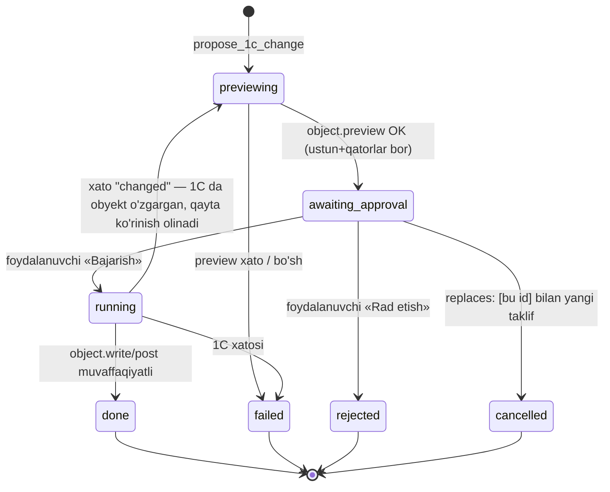
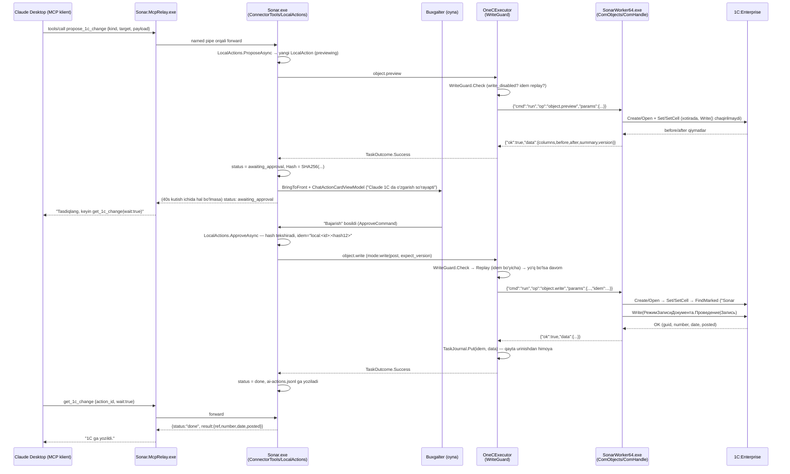

# Sonar AI — 1C'ga yozish va tasdiqlash yo'li (chuqur tahlil)

> Manba: `E:/Project/sonar/decompiled/` (dekompilyatsiya qilingan C#/.NET kodi, Sonar AI v1.1.5).
> Barcha havolalar `file:line` formatida. `Sonar.Core/*`, `Sonar.Engine/*` — bu ikkisi dekompilyatsiya tub papkasi bilan `src_app/Sonar.Core/Sonar.Core/*` va `src_app/Sonar.Engine/Sonar.Engine/*` ichidagi fayllarga **satr-ma-satr bir xil** (tekshirildi: `diff` — faqat literalning `1.0` / `1L` kabi dekompilyator formatlash farqi, mazmun va satr raqamlari bir xil). Desktop UI qatlami (`Sonar.Desktop.Core.*`, `Sonar.Desktop.Views`) faqat `src_app/` ichida bor; worker — `src_SonarWorker64/`; alohida MCP ko'prigi — `src_SonarMcp/`.
> Bu hujjat **YOZISH** yo'lini yozadi: AI (masalan Claude Desktop, MCP orqali) 1C'da hujjat/ma'lumotnoma yaratish/o'zgartirish/o'tkazishni so'raganda — so'rov avval Sonar'ga keladi, Sonar foydalanuvchidan tasdiq so'raydi, va faqat tasdiqlangandan keyin 1C'ga yoziladi.

---

## 0. Yuqori darajadagi arxitektura va to'liq ketma-ketlik

```
[Claude Desktop / ChatGPT / Cursor / ...]  — MCP klient
          │  stdio (JSON-RPC qatorlari)
          ▼
[Sonar.McpRelay.exe]  — AI ilova ishga tushiradigan alohida, yengil .exe
   Relay.cs: stdin'dan o'qiydi → named pipe orqali asosiy Sonar'ga yuboradi;
   Sonar ishlamasa — o'zi "Sonar dasturi ishlamayapti" javobini qaytaradi va Sonar.exe'ni ishga tushirishga urinadi
          │  Named Pipe "Sonar.Mcp.<SHA256(user|domain)[..16]>"
          ▼
[Sonar.exe — asosiy desktop dastur]
   McpPipeHost → McpServer → ConnectorTools.propose_1c_change / get_1c_change
          │  ctx.Actions (LocalActions) — JARAYON ICHIDA, xotirada
          ▼
[LocalActions.ProposeAsync] → object.preview so'rovi → [IOneCRunner → EngineRunner → ConnectorEngine.RunLocalAsync]
          ▼
[Sonar.Engine — OneCExecutor]  (WriteGuard: write_disabled / idempotent replay)
          │  stdin/stdout JSON-lines, bola jarayon
          ▼
[SonarWorker64.exe] → ComObjects/ComHandle → COM (V8*.COMConnector, late-binding)
          ▼
[1C:Enterprise — mahalliy baza]
```

Tasdiqlash qaytishi:

```
LocalActions: status = "awaiting_approval"  (ko'rinish tayyor)
          │  ConnectorHost.ApprovalNeeded → Dispatcher.Post → ShellViewModel.OnApprovalRequested
          ▼
Services.BringToFront()  — Sonar oynasi oldinga chiqadi
          ▼
ChatActionCardViewModel (ActionDialogViewModel ichida, "lg" o'lchamli modal)
   Foydalanuvchi: «Bajarish» (ApproveCommand) yoki «Rad etish» (RejectCommand)
          ▼
LocalActions.ApproveAsync → object.write/object.post (xuddi shu Engine→Worker→COM zanjiri)
          ▼
status = "done" | "failed" | "previewing" (agar 1C o'zgargan bo'lsa, qayta ko'rinish)
          ▼
AI: get_1c_change(action_id, wait: true) — javobni oladi
```

---

## 1. Taklif (Proposal): MCP vositalari va holat mashinasi

### 1.1. `propose_1c_change` va `get_1c_change` ta'riflari

Fayl: `src_app/Sonar.Desktop.Core/Sonar.Desktop.Core.Connector/ConnectorTools.cs`.

`propose_1c_change` — `ConnectorTools.cs:288-310`:

```csharp
span[13] = new ToolDef("propose_1c_change", "1C ga o'zgartirish taklifi", ProposeHelp(), Obj(new JsonObject
{
    ["kind"] = E("What to do", LocalActions.Kinds),   // create|update|post|unpost|mark_delete|unmark_delete|fill
    ["title"] = S(...),
    ["target"] = { "type": "Catalog"|"Document", "name": "<1C nomi>", "find"?: {…} },
    ["payload"] = { "fields"?: {…}, "tables"?: {…}, "rows"?: {…}, "mode"?: "write"|"post", "fill"?: {…} },
    ["replaces"] = [ <eski action_id lar> ],
    ["module"] = S(...), ["base"] = BaseArg()
}, "kind", "title", "target", "payload"), ReadOnly: false);
```

`kind` enumi `LocalActions.Kinds` dan olinadi — `src_app/.../Sonar.Desktop.Core.Connector/LocalActions.cs:19`:
```csharp
public static readonly string[] Kinds = new string[7] { "create", "update", "post", "unpost", "mark_delete", "unmark_delete", "fill" };
```
**Diqqat**: `delete` va `close_month` bu ro'yxatda **yo'q** — ular faqat serverga bog'liq, jamoaviy (`Api.ActionKinds`, p.3.3) modelda bor, AI MCP orqali so'ray olmaydi (`LocalActions.ProposeAsync` `kind == "delete"` kelsa alohida xabar bilan rad etadi — `LocalActions.cs:81-84`: "Butunlay o'chirish hozircha yo'q — kind: mark_delete; 1C da «Удаление помеченных» bilan o'chiriladi").

`get_1c_change` — `ConnectorTools.cs:311-315`:
```csharp
span[14] = new ToolDef("get_1c_change", "1C o'zgarishi holati",
  "Status of a proposed 1C change: previewing → awaiting_approval (the accountant must press «Bajarish»...) → running → done (or failed / rejected / cancelled)... wait: true — waits up to ~40 s...",
  Obj(new JsonObject { ["action_id"] = I(...), ["wait"] = B("Wait up to ~40 s for the final status") }, "action_id"), ReadOnly: true);
```

To'liq "qoidalar matni" (AI'ga ko'rsatiladigan izoh) — `ConnectorTools.ProposeHelp()`, `ConnectorTools.cs:380-383` — asosiy jumlalar:
- *"Nothing is written until the accountant presses «Bajarish» in the Sonar window on this computer (it opens by itself)"*
- *"References are only found, never created — create a missing catalog item first with a separate "create""*
- *"One job = one proposal; to fix a proposal send a new one with "replaces": [old id]"*
- `target.find` misollari: `{"by":"name"|"code"|"inn","value":"..."}`, hujjat uchun `{"by":"number","value":"12","date":"2026-09-28"}` yoki `{"by":"fields","date":...,"fields":{...}}`
- `payload.fields` qiymat ko'rinishlari: oddiy matn, `{"num":"1000.00"}`, `{"date":"2026-09-28"}`, `{"ref":{"type":"Catalog","name":"Контрагенты","find":{...}}}`, `{"enum":{"name":"...","value":"..."}}`
- Jadval qatorlarini qisman o'zgartirish: `"rows": {"Услуги":[{"row":1,"set":{...},"expect":{...}}]} — always give "expect"`.

### 1.2. `CallAsync` ichida ishlov berish

`ConnectorTools.cs:385-449` — `CallAsync`: har bir chaqiruvdan oldin `sonar_overview`'dan tashqari barcha vositalar `ctx.Gate(ct)` orqali o'tadi (obuna/tarif tekshiruvi, `ToolContext.Gate`, `ConnectorTools.cs:393-403`). `propose_1c_change` → `ProposeAsync` (`ConnectorTools.cs:419, 592-601`), `get_1c_change` → `ChangeAsync` (`ConnectorTools.cs:420, 603-612`).

```csharp
// ConnectorTools.cs:592-601
private async Task<JsonObject> ProposeAsync(JsonObject args, string client, CancellationToken ct)
{
    LocalBase b = SelectBase(args);
    LocalAction localAction = await ctx.Actions.ProposeAsync(b, args, client, ct);
    if (localAction.Status == "failed")
        throw new ToolError("preview_failed", "1C ko'rinish bermadi (amal #" + localAction.Id + "): " + localAction.Error + " — tuzatib, qayta taklif qiling");
    return View(await ctx.Actions.WaitAsync(localAction.Id, ctx.DecisionWait, ct));
}
```

`ctx.DecisionWait = TimeSpan.FromSeconds(40L)` — `ConnectorTools.cs` orqali ulangan `ToolContext.cs:35`. Demak **~40 soniyalik kutish** bevosita shu konstanta: `propose_1c_change` chaqiruvi avval ko'rinishni oladi (preview — darhol, sinxron), so'ng `WaitAsync` bilan 40 soniyagacha foydalanuvchi qarorini kutadi; agar shu vaqtda hal bo'lmasa — `awaiting_approval` holatida qaytadi va AI'ga `get_1c_change(wait: true)` bilan qayta so'rash tavsiya etiladi (`ConnectorTools.cs:665-667`). `get_1c_change` ham xuddi shu `ctx.DecisionWait` bilan kutadi (`ConnectorTools.cs:607-610`).

`WaitAsync` — `LocalActions.cs:298-324` — poll emas, `TaskCompletionSource`'ga asoslangan event: har bir `Update`/`Raise` chaqirilganda eski `_changed` TCS'ga `TrySetResult()` qilinadi va yangisi almashtiriladi (`LocalActions.cs:348-356`), `WaitAsync` esa `deadline` gacha shu task'ni `await`laydi.

### 1.3. Holat mashinasi — IKKI XIL model

Bu kodda **ikki alohida** holat modeli bor, ularni aralashtirmaslik kerak:

**(A) Mahalliy (local) — AI'ning `propose_1c_change` dan o'tgan har bir taklifi shu.**
`LocalAction.Status` (`LocalActions.cs:26`, boshlang'ich qiymat `"previewing"`) faqat quyidagi 7 qiymatni oladi: `previewing → awaiting_approval → running → done | failed | rejected | cancelled`. `Final` xossasi — `LocalAction.cs:42-57`: `done/failed/rejected/cancelled` — yakuniy.

**(B) Server/jamoaviy (team) — `Sonar.Desktop.Core.Api.ActionStatuses`** (`ActionStatuses.cs:7`):
```
"proposed","previewing","awaiting_approval","approved","queued","running","done","failed","rejected","cancelled"  (10 ta)
```
Bu kengroq model avtomatlashtirish/oy yopish kabi **server orqali** tug'iladigan amallar, bir nechta xodim tasdig'i (`Approval`, `ProposedBy`, `Requires`) uchun ishlatiladi (`ActionItem.cs`, quyida 3.3-bo'lim). AI'ning to'g'ridan-to'g'ri MCP orqali yuborgan taklifi hech qachon `proposed`/`approved`/`queued` holatiga tushmaydi — chunki server bilan round-trip yo'q, preview darhol mahalliy COM orqali olinadi.

UI darajasida bu ikkisi `CardState` enumiga (`src_app/.../Sonar.Desktop.Core.Logic/CardState.cs:3-13`: `Proposed, Previewing, Awaiting, Writing, Waiting, Done, Failed, Cancelled, Replaced`) va `InlineLogic.StateOf(ActionItem)` xaritasiga (`InlineLogic.cs:19-45`) birlashtiriladi — `LocalActionSource.ToItem` (3.2-bo'lim) `LocalAction`ni shu umumiy `ActionItem` shakliga aylantiradi.

Holat diagrammasi (mahalliy, AI MCP yo'li):



Bu o'tishlar `LocalActions.cs` ichida: `ProposeAsync` (78-142) → `PreviewAsync` (156-191, `object.preview` chaqiradi, natija bo'yicha `awaiting_approval` yoki `failed`) → `ApproveAsync` (193-261, `running` → `object.write/post` → `done`/`failed`/qayta `previewing` agar `ErrorCode=="changed"`) → `Reject` (263-287) → `Cancel` (289-296, faqat `replaces` orqali, ichki chaqiriladi).

### 1.4. Holat qayerda saqlanadi — FAQAT MAHALLIY

`LocalActions` — `List<LocalAction> _items` **xotirada** (`LocalActions.cs:29`), max `100` ta saqlanadi (yakunlanganlari birinchi chiqariladi, `Keep = 100`, `LocalActions.cs:21, 118-131`). **Server'ga hech narsa yuborilmaydi** — bu `IActionSource` ikki implementatsiyasidan eng muhim farq: `LocalActionSource` (`src_app/.../Sonar.Desktop.Core.ViewModels/LocalActionSource.cs`) to'g'ridan-to'g'ri `LocalActions` obyektiga ishlaydi, `ServerActionSource` (`ServerActionSource.cs`) esa `SonarApi` (HTTP) orqali — ikkinchisi faqat jamoaviy/avtomatlashtirish amallariga ishlatiladi (3.3-bo'lim), AI'ning MCP taklifiga emas.

Qo'shimcha — **audit jurnal** (faqat yozib boriladi, holatni *o'qishda* ishlatilmaydi): `LocalActions.Journal` (`LocalActions.cs:361-381`) har bir `Update`/`Raise`da `%LOCALAPPDATA%\...\connector\ai-actions.jsonl` fayliga (`ConnectorHost.cs:60`: `Path.Combine(dataDir, "connector")`, `LocalActions` konstruktorida `"ai-actions.jsonl"`) bitta JSON-qator qo'shadi: `{id, at, client, base, kind, title, status, error, result}`. Fayl 2 MB'dan oshsa `.1`ga ko'chiriladi (rotatsiya, `LocalActions.cs:371-375`). Bu — Sonar'ning o'z ichki AI-audit izi, 4.4-bo'limdagi `TaskJournal` (idempotentlik uchun) bilan **aralashtirmang** — ular ikki boshqa narsa.

---

## 2. Ko'rinish (preview) va yozish mexanizmi — `ObjectSpec` / `ObjectOps`

Fayllar: `Sonar.Core/ObjectSpec.cs` (840 qator), `Sonar.Core/ObjectOps.cs` (1096 qator) va yordamchilar (`TargetFind.cs`, `RefSpec.cs`, `RefHit.cs`, `Resolved.cs`, `RefTypes.cs`, `FillSpec.cs`, `FillMethod.cs`, `FillMethods.cs`, `RowPatch.cs`, `TablePatch.cs`, `TypeCheck.cs`, `WValue.cs`, `OValue.cs`).

### 2.1. `ObjectSpec` — to'liq shakl

`ObjectSpec.cs:33-61` xususiyatlari:

| Maydon | Tur | Izoh |
|---|---|---|
| `Op` | string | `"object.preview"` \| `"object.write"` \| `"object.post"` \| `"object.unpost"` \| `"object.mark_delete"` \| `"object.unmark_delete"` \| `"object.delete"` |
| `Kind` | string | `Kinds = {"create","update","fill","post","unpost","mark_delete","unmark_delete","delete"}` (`ObjectSpec.cs:31`) |
| `ActionId` | long | `propose_1c_change`dagi `action_id` — markirovka uchun (2.6) |
| `Idem` | string | majburiy, `Ops.Mutates(op)` bo'lsa (`ObjectSpec.cs:237-242`), max 80 belgi |
| `ExpectVersion` | string | preview paytidagi `DataVersion`/`ВерсияДанных` — optimistik lock (2.5) |
| `Mode` | string | `"write"` (standart) \| `"post"` — faqat `object.write` da (`ObjectSpec.cs:244-262`) |
| `Meta` / `Ref` / `Find` | — | nishon: metadata, mavjud obyekt guid'i YOKI `TargetFind` qidiruv spetsifikatsiyasi (ikkisi bir vaqtda bo'lmaydi) |
| `Fields` | `List<FieldSet>` | yangi/o'zgaruvchi maydonlar |
| `Tables` | `List<TableSet>` | to'liq jadval qismi (create uchun) |
| `Patches` | `List<TablePatch>` | mavjud jadval qatorlarini qisman o'zgartirish (`rows`) |
| `Fill` | `FillSpec` | 1C'ning tayyor "to'ldirish" metodini chaqirish |
| `Show` | `ShowSpec` | preview'da qaysi ustun/maydonlar ko'rsatiladi |

`Kind` qiymati manba `op`ga qarab aniqlanadi: `object.post/unpost/mark_delete/unmark_delete/delete` uchun kind operatsiya nomidan majburan olinadi (`ObjectSpec.cs:150-199`); `object.write` uchun esa agar `target.ref`/`target.find` bo'lsa — `update`, bo'lmasa — `create` (yoki aniq `kind: fill`) (`ObjectSpec.cs:201-209`). `CreatesNew` (`ObjectSpec.cs:75-86`): `kind=="create"` yoki (`kind=="fill"` va nishon berilmagan).

`Ops.Mutates(op)` esa `Idem` talab qilinadigan va keyin `TaskJournal`ga yoziladigan amallarni belgilaydi — `Ops.cs:32-43`: hamma `object.*` (bundan `object.preview` mustasno) va `month.close`.

### 2.2. `object.preview` va `object.write` — BIR XIL FUNKSIYA, bitta `bool write` farqi

`ObjectOps.Run` (`ObjectOps.cs:133-148`):
```csharp
public static object Run(IOneCSession s, string op, IDictionary<string, object> prms)
{
    ObjectSpec objectSpec = ObjectSpec.Parse(op, prms, s.Metadata());
    using IObjectAccess objectAccess = s.OpenObjects();
    objectAccess.TakeMessages();
    Ctx c = new Ctx(objectSpec, objectAccess);
    if (objectSpec.Find != null) FindTarget(c);
    if (objectSpec.IsState) return State(c, op == "object.preview");   // post/unpost/mark_delete/unmark_delete/delete
    return Build(c, op == "object.write");                              // create/update/fill
}
```
`Build(Ctx c, bool write)` (`ObjectOps.cs:256-328`) — **bitta** metod: markirovka qidiradi (2.6), `Create`/`Open` bilan COM handle oladi, `before = Read(c,h)` (hozirgi holat), `Apply(c,h,marker)` — maydon/jadval/fill qiymatlarini **COM obyektiga qo'yadi** (`h.Set`/`h.SetCell`/`h.Fill`, `ObjectOps.cs:330-400`, bu bosqich `write=false` bo'lsagina ham bajariladi — ya'ni **preview rejimida ham qiymatlar xotiradagi COM obyektiga yoziladi**, faqat `h.Write(mode)` chaqirilmaydi va natija 1C bazasiga COM darajasida saqlanmaydi!). Keyin:
```csharp
if (!write) return Preview(c, h, before, Read(c, h), existing, text2);   // ObjectOps.cs:312
h.Write((spec.Mode == "post") ? WriteMode.Post : WriteMode.Write);       // ObjectOps.cs:314 — HAQIQIY YOZISH
...
return Result(c, h, existed: false, flag ? text : null);                // ObjectOps.cs:319
```
Ya'ni **"before/after" preview'i** — COM obyektiga qiymatlarni real qo'yib, keyin uni **yozmasdan** o'qib olish (1C'ning o'zi hisoblagan hosila/formula maydonlarini ham ko'rsatish uchun), so'ng `h.Dispose()` (`finally`, `ObjectOps.cs:321-327`) obyektni tashlab yuboradi — hech narsa bazaga tegmaydi. Faqat `write=true` bo'lganda xuddi shu kod yo'li davom etib, `h.Write(mode)` chaqiriladi.

`State(Ctx c, bool preview)` (`ObjectOps.cs:669-...`) — `post/unpost/mark_delete/unmark_delete/delete` uchun xuddi shu g'oya: obyektni ochib, holatni (`Posted`, `DeletionMark`) o'zgartirib ko'rsatadi, `preview=false` bo'lsagina haqiqiy `h.Write`/`SetDeletionMark`/`Delete` chaqiriladi.

### 2.3. Nishonni topish — `TargetFind`

`Sonar.Core/TargetFind.cs`. Ma'lumotnoma uchun `by`: `code` | `name` | `inn`; hujjat uchun `by`: `number` (kerak bo'lsa `date` bilan) | `fields` (sarlavha rekvizitlari + majburiy `date`, ixtiyoriy `date_to`, max 31 kun oralig'i — `TargetFind.cs:142-144`). `fields`-rejimida max 5 ta rekvizit (`TargetFind.cs:147-150`). Topilgan hujjat raqami aniq moslashi `TargetFind.NumberMatches` bilan tekshiriladi (`TargetFind.cs:163-188` — oxiridagi muhim raqamlar bo'yicha, masalan "12" "0000012"ga mos tushadi, lekin oldida boshqa muhim raqam bo'lsa — yo'q). Topilmasa → `not_found`; 2+ ta mos kelsa → `ref_not_found` ("bir nechta mos keldi… aniq bittasi kerak", `ObjectOps.cs:183-204`, `Narrower()` orqali qanday toraytirish kerakligi aytiladi).

### 2.4. Havolalarni yechish — `RefSpec`/`RefHit`/`Resolved`/`PickRef` — **HECH QACHON O'ZI YARATMAYDI**

`WValue{"ref": {"type","name","guid"|"find":{by,value}}}` → `RefSpec.Parse` (`RefSpec.cs:36-92`, hujjatga faqat `guid` bilan havola mumkin — `RefSpec.cs:82-85`) → `ObjectOps.Ctx.Resolve` (`ObjectOps.cs:65-93`) → `Acc.FindRefs(r)` (COM orqali qidiradi, 6-bo'lim) → **`PickRef`** (`ObjectOps.cs:1069-1095`) — qat'iy qoida:

```csharp
// ObjectOps.cs:1081-1094
List<RefHit> list = hits.Where(x => !x.DeletionMark && !x.IsFolder).ToList();
if (list.Count == 1) return list[0];
if (list.Count > 1) throw new SpecException(text + " — " + list.Count + "+ ta topildi, aniq bittasi kerak (taxmin qilinmaydi)", "ref_not_found");
if (hits.Count > 0) throw new SpecException(text + " — faqat o'chirishga belgilangan yoki guruh topildi", "ref_not_found");
throw new SpecException(text + " — topilmadi (yangi element yaratilmaydi)", "ref_not_found");
```
Ya'ni: aniq bitta topilsa — ishlatiladi; 0 ta yoki noaniq (2+) bo'lsa — **xato, yangi element hech qachon o'zi yaratilmaydi** ("taxmin qilinmaydi"). `ConnectorTools.ProposeHelp()` ham buni AI'ga ochiq aytadi: *"References are only found, never created — create a missing catalog item first with a separate "create""* (`ConnectorTools.cs:382`).

### 2.5. `expect` / optimistik qulf / `row_mismatch`

Ikki qatlam:
1. **Butun obyekt darajasida**: `ExpectVersion` — ko'rinish (`object.preview`) qaytargan `version` (1C'ning `DataVersion`/`ВерсияДанных`, `ComHandle.cs:112-122`) `object.write/post` chaqiruvida `expect_version` sifatida qaytariladi (`LocalActions.ApproveAsync`, `LocalActions.cs:212-220`: `dictionary["expect_version"] = text` — faqat `Preview["version"]` bo'sh bo'lmasa va ≤200 belgi). `ObjectOps.CheckVersion` (`ObjectOps.cs:247-254`): mos kelmasa → `OneCError("changed", "1C da ob'ekt ko'rinishdan keyin o'zgargan — hech narsa yozilmadi")`. Shu `"changed"` kodi `LocalActions.ApproveAsync`da alohida ushlanadi va **avtomatik qayta preview** qilinadi (`LocalActions.cs:252-258`), foydalanuvchiga: *"Tasdiqdan keyin 1C da o'zgargan — hech narsa yozilmadi. Yangi ko'rinishni ko'rib, qayta tasdiqlang"*.
2. **Qator darajasida** (`payload.rows`, jadval qismini qisman o'zgartirish): har bir `RowPatch.Expect` (`RowPatch.cs:15`) — `ObjectOps.CheckExpect` (`ObjectOps.cs:485-501`) **barcha** qatorlarning `expect`ini **yozishdan oldin** tekshiradi (`ApplyPatches`, `ObjectOps.cs:432-435`), moslik topilmasa:
```csharp
throw new OneCError("row_mismatch", p.Where + " («" + t.Name + "» " + (idx+1) + "-qator): " + ... + " — qator boshqa yoki allaqachon o'zgargan; hech narsa yozilmadi");
```
Qolaversa, har bir `Set` qiymati yozilgandan keyin **darhol qayta o'qilib** (`Verify`/`Same`, `ObjectOps.cs:1001-1062`) kutilgan qiymat bilan solishtiriladi — mos kelmasa (1C turi/uzunligi/aniqligi sabab "jim" kesilgan/yumaloqlangan bo'lsa) — `bad_field` xatosi, **hech narsa yozilmagan deb hisoblanadi** (aslida qiymat COM xotirasida bor, lekin `h.Write()` hali chaqirilmagan — demak haqiqatan bazaga yozilmaydi, chunki `Build()` istisno tashlasa `h.Write()` qatoriga yetib bormaydi).

### 2.6. Qayta yuborishdan himoya — `Sonar #<id>` markeri (idempotentlik, 2-qavat)

`ObjectOps.cs:101-103`: `MarkerPrefix = "Sonar #"`, `MarkerField = "Комментарий"`. `MarkerFor(spec)` (`ObjectOps.cs:174-181`) faqat **yangi obyekt yaratishda** (`CreatesNew`), `ActionId > 0` va nishon metadatasida satr turidagi `Комментарий` rekviziti bo'lsa ishlaydi. `Build()` ichida (`ObjectOps.cs:259-280`): avval **`FindMarked`** bilan shu markerli obyekt allaqachon bor-yo'qligi 1C'dan so'raladi (COM so'rov, 6-bo'lim) — bor bo'lsa va `write=true` — **yangi obyekt yaratilmaydi, mavjudi qaytariladi** (`existed: true`); bo'lmasa, yangi obyekt yaratilib, `Apply()` oxirida `Комментарий` maydoniga `"Sonar #<action_id>"` yozib qo'yiladi (`ObjectOps.cs:380-399`, eski matn bo'lsa `" | "` bilan qo'shiladi). Bu — tarmoq/COM darajasida "yozildimi yoki yo'qmi noma'lum" holatida (4.3-bo'lim) qayta urinish **1C ichida** ikki marta yaratmasligini kafolatlaydigan asosiy mexanizm (birinchi himoya qatlami — 4.2-bo'limdagi `idem` + `TaskJournal`).

### 2.7. `fill` — 1C'ning tayyor to'ldirish metodlari

`FillMethods.All` (`FillMethods.cs:8-22`) — oq ro'yxat, atigi 2 ta: `"Заполнить"` (platforma standarti, `Fill(Неопределено)` — obyekt modulidagi `ОбработкаЗаполнения`) va `"ЗаполнитьДокументНачисленияЗарплаты"` (БП 3.0'ga xos, faqat `НачислениеЗарплаты` hujjatiga). Ikkisi ham izohda aytilgandek **"Xotirada, yozmaydi"** — ya'ni `h.Fill()` (`ComHandle.cs:303-329`) ham xuddi `Set`/`SetCell` kabi faqat ochiq COM obyektiga ta'sir qiladi, haqiqiy yozish yana `h.Write()` orqali bo'ladi. `ObjectOps.Apply` (`ObjectOps.cs:361-379`) `fill` chaqirilgandan keyin, agar oldin aniq `fields` bilan berilgan qiymatni usul o'zgartirib yuborgan bo'lsa — ogohlantirish qo'shadi ("«...» «...» qiymatini o'zgartirdi").

### 2.8. `TypeCheck`, `WValue` vs `OValue`

- **`WValue`** (`WValue.cs`) — AI JSON'dan **yozish uchun** kelgan qiymat: `Kind ∈ {string,number,date,bool,ref,enum}`, `Parse(json, where)` (`WValue.cs:32-...`) oddiy satr/son/`{"num"}`/`{"date"}`/`{"ref"}`/`{"enum"}` shakllarini ajratadi.
- **`OValue`** (`OValue.cs`) — 1C'dan COM orqali **o'qilgan** qiymat (preview/before-after/diff uchun), `Type ∈ {null,string,number,date,bool,ref,enum}`, `Of(string|decimal|bool|DateTime)` fabrikalari (`OValue.cs:25-...`).
- **`Resolved`** (`Resolved.cs`) — ikkisini bog'laydi: `Value` (`WValue`, niyat) + `Native`/`Guid`/`Presentation` (havola yechilgandan keyingi haqiqiy COM obyekt/guid).
- **`TypeCheck.Accepts(types, WValue v)`** (`TypeCheck.cs:11-33`) — `v.Kind` 1C metadata'dagi e'lon qilingan tur ro'yxati (`MetaField.Types`, masalan `Строка`/`Число`/`Дата`/`Булево`/`Справочник.*`/`Документ.*`/`Перечисление.*`) bilan mos kelishini oldindan tekshiradi — ya'ni **yozishdan oldingi** validatsiya. Haqiqiy "yozildi, lekin to'g'ri yozildimi" tekshiruvi esa yuqoridagi `Verify`/`Same` (2.5) — **yozishdan keyingi** o'qib-solishtirish.

> **Muhim tuzatish**: vazifa matnida ko'rsatilgan `UpdateKeys.cs` va `UpdateVerifier.cs` nomlari chalg'ituvchi — bular jadval qatorini moslashtirish bilan **bog'liq emas**. Tekshirildi: `UpdateKeys.cs` (`Sonar.Core/UpdateKeys.cs:5-7`) — dastur **o'z-o'zini yangilash** (auto-update) manifestini RSA bilan tasdiqlash uchun ochiq kalit (`Modulus`/`Exponent`); `UpdateVerifier.cs` (`Sonar.Core/UpdateVerifier.cs:22-57`) — shu manifestning RSA imzosini (`VerifyManifest`) tekshiradigan kod. Qatorlarni **moslashtirish/tekshirish** aslida `ObjectOps.RowByMatch` (`ObjectOps.cs:460-483` — `row` raqami YOKI `match` maydonlari bo'yicha, 0 mos → `not_found`, 2+ mos → `ref_not_found`) va `ObjectOps.CheckExpect`/`Verify`/`Same` (yuqorida) orqali amalga oshadi.

### 2.9. `mode` — write/post semantikasi

`object.write` uchun `Mode ∈ {"write","post"}` (`ObjectSpec.cs:244-262`). `"post"` — faqat hujjatlarga (`Meta.Posting` ruxsat bersa), `CreatesNew` bo'lsa `ActionId` shart. `Build()` oxirida `h.Write(mode=="post" ? WriteMode.Post : WriteMode.Write)`. Alohida `object.post`/`object.unpost` operatsiyalari (`State()` orqali) — allaqachon mavjud, hali o'tkazilmagan/o'tkazilgan hujjatni **o'zgartirmasdan** o'tkazadi/qaytaradi; bular ichida `ComHandle.Write(WriteMode.Post | WriteMode.UndoPost)` chaqiriladi (6-bo'lim). Qoida: allaqachon o'tkazilgan hujjatni `update` qilish uchun avval `object.unpost` kerak, YOKI bevosita `mode:"post"` bilan qayta yozib-o'tkazish mumkin (`ObjectOps.cs:293-303`).

---

## 3. Tasdiqlash UI — oyna qanday chiqadi, foydalanuvchi nima ko'radi

### 3.1. Oynani oldinga chiqarish va dialog ochish

`ConnectorHost` (`src_app/.../Sonar.Desktop.Core.Connector/ConnectorHost.cs:83-91`) `LocalActions.ApprovalNeeded` hodisasini UI dispatcher navbatiga qo'yib, o'zining `ApprovalRequested` hodisasini chaqiradi. `ShellViewModel` shunga obuna bo'ladi (`src_app/.../Sonar.Desktop.Core.ViewModels/ShellViewModel.cs:751`) va `OnApprovalRequested` (`ShellViewModel.cs:791-822`):

```csharp
private void OnApprovalRequested(LocalAction action)
{
    ...
    Services.BringToFront?.Invoke();                       // ShellViewModel.cs:796 — oynani oldinga chiqaradi
    if (Dialog is ActionDialogViewModel ... && card.Id == action.Id) return;   // allaqachon ochiq — hech narsa
    if (Dialog != null) {
        if (... card.IsFinal) goto IL_009e;                 // eski dialog yakunlangan — yangisini ochadi
        Toasts.Show(Uz.Connector.ApprovalToast(action.Client, action.Title), ToastTone.Warning, "Ochish", () => OpenLocalAction(action.Id));
        return;                                             // band — toast ko'rsatiladi, bosilsa ochiladi
    }
    IL_009e: OpenLocalAction(action.Id);
}
```
`OpenLocalAction` (`ShellViewModel.cs:825-838`) `ActionDialogViewModel` ochadi: `size="lg"` modal, sarlavha `Uz.Connector.DialogTitle(client)` — masalan **"Claude 1C da o'zgarish so'rayapti"** (`Uz.cs:812-815`). `McpServer.Display(name,title,parent)` (`McpServer.cs:26-67`) `client` ismini `"claude"/"codex"/"chatgpt"/"cursor"/"gemini"/"vscode"/"windsurf"/"lmstudio"` kalit so'zlariga qarab chiroyli nomga aylantiradi.

Toast matni: `Uz.Connector.ApprovalToast(app, title)` → `app + ": «" + title + "» — tasdiqlang"` (`Uz.cs:817-820`).

### 3.2. Karta nimani ko'rsatadi, tugmalar

`ChatActionCardViewModel` (`src_app/.../Sonar.Desktop.Core.ViewModels/ChatActionCardViewModel.cs`). Asosiy maydonlar: `Title`, `KindText` (`Uz.ActionKinds.Get(kind)` — pastdagi jadval), `Summary`, `Warnings`, `Fields`/`Table` (`ChangeView.Of(preview)` orqali, before/after), `ResultText`, `FailedText`.

Tugma matnlari:
```csharp
// ChatActionCardViewModel.cs:302-312
public string ApproveText => Busy ? "Yuklanmoqda…" : "Bajarish";
```
Rad etish — `RejectCommand` → `RejectOpen=true` → sabab maydoni (`Reason`) → `ConfirmRejectCommand`. `Uz.cs:4596-4697` (`Inline` klassi, bevosita `ChatActionCardViewModel.cs`da ishlatiladi — `:248,928`): `Reject = "Bekor qilish"` (`:4618`), `RejectConfirm = "Ha, bekor qilish"` (`:4622`), `RejectBack = "Qaytish"` (`:4624`).

**Tekshirilgan tuzatish**: `Uz.cs:1737-1844` da alohida `Approvals` klassi bor — `Approve = "Tasdiqlash"` (`:1816`), `Reject = "Rad etish"` (`:1818`), to'liq o'z dialog oqimi bilan (`ConfirmTitle = "Amalni tasdiqlaysizmi?"`, `RejectTitle = "Amalni rad etish"`). Lekin `grep -rn "Uz\.Approvals\." src_app` — **bo'sh natija**: bu klass butun klient kodida hech qayerdan chaqirilmaydi (xuddi pastdagi `ApprovalsLogic` kabi, 3.4-bo'lim) — ya'ni "Tasdiqlash"/"Rad etish" matnlari **tayyor, lekin shu dekompilyatsiya qilingan desktop build'ida ulanmagan/ishlatilmaydigan** matn (ehtimol boshqa, bu arxivda yo'q ekran — masalan server/jamoa "Amallar" ro'yxati — uchun mo'ljallangan). **Amalda, MCP orqali kelgan AI taklifi uchun ko'rinadigan, ishlaydigan juft — faqat `Inline.Approve/Reject` = "Bajarish"/"Bekor qilish"**, yuqorida.

`ApproveAsync` (`ChatActionCardViewModel.cs:991-1072`) → `_source.ApproveAsync(a.Id, a.PayloadHash)` → mahalliy bo'lsa `LocalActionSource.ApproveAsync` → `LocalActions.ApproveAsync(id, hash)`. `hash` — `PayloadHash` faqat `awaiting_approval` holatida to'ldiriladi (`LocalActionSource.cs:97`: `(a.Status == "awaiting_approval") ? a.Hash : null`) — demak **tugma faqat shu holatda bosilishi mumkin** (`CanDecide`, `ChatActionCardViewModel.cs:266-276`).

### 3.3. Ko'rinish xeshi — tasdiq *nimani* tasdiqlaydi

`LocalActions.Hash(a)` (`LocalActions.cs:410-415`): `kind+target+payload+preview{columns,before,after,summary,version}` ni kanonik tartiblab (`Canon`, kalitlar alfavit bo'yicha, `LocalActions.cs:417-432`) JSON qilib, SHA-256. `ApproveAsync` (`LocalActions.cs:193-208`) kelgan `hash` ni saqlangan `a.Hash` bilan **qattiq solishtiradi** — mos kelmasa `ToolError("preview_changed", "Ko'rinish yangilandi — qayta ko'rib, tasdiqlang")`. Bu — UI darajasidagi ikkinchi optimistik qulf (COM darajasidagi `ExpectVersion`dan tashqari): agar karta ochiq turgan vaqtda (nazariy jihatdan) preview boshqacha hisoblanib qolsa, eski xesh bilan "Bajarish" bosilsa ham rad etiladi.

### 3.4. Ko'p foydalanuvchili tasdiq — faqat SERVER modelida

`Roles` (`src_app/.../Sonar.Desktop.Core.Api/Roles.cs:7-15`): `admin`, `bosh_buxgalter`, `buxgalter`, `xodim`. `Member` (`Member.cs`) — jamoa a'zosi, `Role` va `Modules` bilan. `ActionItem.Requires: List<string>` (talab qilinadigan rollar) va `Approvals: List<Approval>` (`Approval.UserName, Role, Decision, At, Reason, Current`) — `ApprovalsLogic.Match` (`src_app/.../Sonar.Desktop.Core.Logic/ApprovalsLogic.cs:31-84`) talablarni rol darajasiga (`xodim=0 < buxgalter=1 < bosh_buxgalter=2 < admin=3`, `ApprovalsLogic.cs:9-15`) qarab moslashtiradi: avval bir xil rol, keyin yuqoriroq rol (`xodim` bundan mustasno) qoplaydi.

**Tekshirilgan qo'shimcha**: `grep -rn "ApprovalsLogic\." src_app` — **bo'sh natija**, bu klass klientning o'zida hech qayerdan chaqirilmaydi (haqiqiy serverga, SonarApi backend'iga mo'ljallangan tasvir bo'lishi mumkin). Shu bilan birga, **aynan bir xil algoritm** Sonar'ning o'z ichki demo/oflayn server-emulyatorida — `Sonar.Desktop.Core.Mock/MockServer.cs` — mustaqil qayta yozilgan va **haqiqatan ishlaydi**: `MockServer.Satisfied(MockAction a)` (`MockServer.cs:4689-4716`) xuddi shu `Rank`/rol-ierarxiya mantig'ini qo'llaydi; `MockServer.ActionsApprove` (`:4736-4769`) qo'shimcha amaliy qoidalar bilan — yuborilgan `payload_hash` joriygа mos kelishi shart (409 `preview_changed`), ko'rinish 1 soatdan (`3600000` ms) eski bo'lsa `409 preview_stale`, bitta foydalanuvchi bitta hashga ikki marta ovoz bera olmaydi (`already_voted`). Xulosa: ko'p-kishi/rol-asosida tasdiqlash kontseptual jihatdan to'liq ishlangan va demo-serverda isbotlangan, lekin haqiqiy tarmoq-server kodi bu dekompilyatsiyada yo'q.

**Lekin bu — faqat `ServerActionSource` (`Api.ActionItem`, HTTP) orqali keladigan amallar (jamoaviy avtomatlashtirish, oy yopish) uchun.** AI'ning `propose_1c_change`dan o'tgan `LocalAction`'ida `Requires`/`Approvals` umuman yo'q — **har qanday shu kompyuterda Sonar sessiyasini ochib turgan foydalanuvchi** "Bajarish"ni bosa oladi, rol tekshirilmaydi (`LocalActions.ApproveAsync` kodida rol/`Member` haqida bironta tekshiruv yo'q). Ya'ni AI yozish yo'lida **rolga asoslangan ruxsat yo'q** — faqat "1C ga yozish yoqilgan/o'chiq" global tugmasi (4.1-bo'lim) va shu kompyuterda sessiya ochiq odam.

---

## 4. Bajarish qo'riqchisi — `WriteGuard`, idempotentlik, audit

### 4.1. Global yozish tugmasi

`IOneCRunner.AllowWrite` → `EngineRunner.AllowWrite` (`src_app/.../Sonar.Desktop.Core.Connector/EngineRunner.cs:35`): `engine()?.Status.AllowWrite ?? false` — bu `ConnectorEngine.Status.AllowWrite` dan keladi, Sonar ilovasining **Sozlamalar → 1C** bo'limida foydalanuvchi qo'lda yoqadigan/o'chiradigan global kalit (matnlar: `Uz.Connector.WriteOn = "1C ga yozish: ruxsat berilgan"`, `WriteOff = "1C ga yozish: o'chiq — AI faqat o'qiydi"`, `Uz.cs:675-679`). `LocalActions.ProposeAsync` bu yerda **birinchi** darajada tekshiradi (`LocalActions.cs:99-102`): o'chiq bo'lsa, ko'rinish so'ralmasdan oq `ToolError("write_disabled", ...)`.

### 4.2. `WriteGuard` — ikkinchi, pastki darajadagi himoya

`Sonar.Core/WriteGuard.cs`. Bu — `OneCExecutor` darajasida, **har bir** `object.*`/`month.close` operatsiyasi uchun:

```csharp
// WriteGuard.cs:19-35
public TaskOutcome Check(TaskItem task)
{
    if (!Ops.Known(task.Op)) return TaskOutcome.Fail("unsupported_op", ...);
    TaskOutcome r = Replay(task);                 // idempotent qayta javob
    if (r != null) return r;
    if (Ops.IsWrite(task.Op) && !_allowWrite())
        return TaskOutcome.Fail("write_disabled", "Connector sozlamalarida 1C'ga yozishga ruxsat berilmagan");
    return null;  // davom etsin
}
```
`Replay(task)` (`WriteGuard.cs:37-54`) — `Ops.Mutates(op)` bo'lsa, `TaskJournal.Find(Key(task))` dan oldin bajarilgan natijani qaraydi; topilsa va `op` bir xil bo'lsa — **1C'ga umuman murojaat qilmasdan** eski natijani qaytaradi (`TaskOutcome.Success`); `op` boshqacha bo'lsa — `bad_spec` ("idem «...» avval boshqa amal uchun ishlatilgan").

`Key(task)` (`WriteGuard.cs:76-84`): agar `task.Params["idem"]` bo'lsa → `"idem:" + idem`, bo'lmasa → `"task:" + task.Id`. `Idem` qatori AI tomonidan berilmaydi — uni **Sonar o'zi** tasdiqlash vaqtida generatsiya qiladi: `LocalActions.ApproveAsync` → `dictionary["idem"] = "local:" + a.Id + ":" + a.Hash.Substring(0,12)` (`LocalActions.cs:211`) — ya'ni amal ID'si + preview xeshining birinchi 12 belgisi. Shu tufayli **bir xil tasdiqlangan taklif ikki marta yuborilsa (masalan AI qayta so'ragan bo'lsa), 1C'ga ikkinchi marta yozilmaydi** — `TaskJournal`dan javob qaytariladi.

### 4.3. `TaskJournal` — fayl formati va "yozildimi yoki yo'qmi noma'lum"

`Sonar.Core/TaskJournal.cs`. Bitta JSON fayl (yo'li `OneCExecutor` konstruktoridan: `journalPath`), ichida `Dictionary<string,Dictionary<string,object>>`: kalit — `"idem:<...>"` yoki `"task:<id>"`, qiymat — `{"op": "...", "task": <id>, "data": <natija>, "at": "<ISO sana>"}`. Yozish atomik: `path + ".tmp"`ga yoziladi, eski fayl o'chiriladi, keyin `File.Move` (`TaskJournal.cs:64-73`). Max `500` yozuv, eng eskisi `at` bo'yicha chiqariladi (`TaskJournal.cs:55-63`).

`OneCExecutor.RunAsync` (`Sonar.Engine/OneCExecutor.cs:67-123`): `_guard.Check(task)` → agar o'tsa, bazaga xos `SemaphoreSlim` qulf olinadi (**bitta bazaga bir vaqtda faqat bitta yozish**, `OneCExecutor.cs:84-85`), `_guard.Replay` yana tekshiriladi (race'dan himoya), so'ng `RunComAsync` (worker'ga yuboradi). Muvaffaqiyatli bo'lsa `_guard.Remember(task, data)` (`WriteGuard.cs:56-69`) — **faqat shunda** journal'ga yoziladi.

Aynan shu yerda **"yozildimi yoki yo'qmi noma'lum"** holati yuzaga keladi: agar worker/COM chaqiruvi **javob qaytmasdan** uzilsa (timeout yoki fatal xato), `Remember` chaqirilmaydi — lekin 1C'da amal (masalan hujjat yaratish) haqiqatan bajarilgan bo'lishi mumkin. Aniq matn — `Sonar.Engine/ErrorTexts.cs:75`:
```csharp
"timeout" => mutating
  ? "1C o'z vaqtida javob bermadi — yozildimi yoki yo'qmi noma'lum: 1C da tekshiring (qayta yuborilsa, jurnal va «Sonar #» belgisi takror yozishdan saqlaydi)"
  : "1C so'rovi juda uzoq davom etdi",
```
va yuqori darajadagi `Agent.cs:218` (server navbati uchun) xuddi shunga o'xshash: *"1C N soniyada javob bermadi — yozildimi yoki yo'qmi noma'lum: 1C da tekshiring"*. Xabarning o'zi tushuntirganidek, ikki qatlamli himoya bor: (1) **qayta yuborilganda** — agar `idem` journal'da bo'lsa, natija journal'dan qaytadi (lekin aynan shu holat — javob kelmagan — journal'da yozuv yo'q, demak bu himoya **ishlamaydi**, chunki `Remember` chaqirilmagan); (2) shuning uchun **asosiy** himoya — `ObjectOps`dagi `"Sonar #<action_id>"` markeri (2.6-bo'lim): qayta urinishda (yangi `idem` bilan ham) avval shu markerli obyekt 1C'da borligi tekshiriladi va bo'lsa — ikkinchi marta yaratilmaydi. Ya'ni timeout holatida foydalanuvchiga 1C'ni qo'lda tekshirish tavsiya etiladi, lekin **qayta urinish xavfsiz** — chunki marker obyektni, `idem` esa natija-javobni dublikatsiyadan saqlaydi.

`WorkerException.Fatal` (`Sonar.Engine/OneCExecutor.cs:99-106, 177-181`): yozish operatsiyasi paytida fatal xato bo'lsa — worker/COM sessiyasi `Drop(rt)` bilan tashlab yuboriladi (keyingi chaqiruv yangi worker ochadi), lekin baza holati (`Mark(b, ex.Code)`) faqat "object-level bo'lmagan" xatolarda yangilanadi (`ObjectLevel(code)`, `OneCExecutor.cs:125-146` — `bad_spec, bad_field, not_found, ref_not_found, method_not_allowed, post_failed, locked, write_failed, access_denied, changed, row_mismatch, in_use, close_failed` — bular "obyekt darajasida", baza ulanishi buzilgani degani emas).

### 4.4. Audit — `AuditItem`/`AuditPage` (server, insonlar uchun)

`src_app/.../Sonar.Desktop.Core.Api/AuditItem.cs` / `AuditPage.cs`: `{Id, At, Actor, UserName, Event, Text}`, sahifalab (`NextBeforeId`) `SonarApi` orqali serverdan o'qiladi — bu jamoaviy audit jurnali (kim nima qildi, "Tarix" sahifasida ko'rsatiladi), 1.4-bo'limdagi mahalliy `ai-actions.jsonl` bilan **boshqa narsa**: biri AI yozish urinishlarining mahalliy texnik izi, ikkinchisi — foydalanuvchi harakatlarining serverga yoziladigan jamoaviy jurnali.

---

## 5. Oyni yopish — `MonthOps`

`Sonar.Core/MonthOps.cs`. **Muhim**: `"close_month"` kind `LocalActions.Kinds`da yo'q (1.1-bo'lim) — demak **AI buni `propose_1c_change` orqali to'g'ridan-to'g'ri so'ray olmaydi**; bu faqat `Api.ActionKinds.All` (server modeli, 9 ta: `..., "delete", "close_month"`) orqali — ya'ni Sonar'ning o'z avtomatlashtirish/jamoaviy "Tasdiqlar" oqimidan tug'iladi, keyin xuddi shu `ChatActionCardViewModel`/tasdiq oynasi orqali ko'rsatiladi (`Uz.ActionKinds.Get("close_month") == "Oyni yopish"`, `Uz.cs:3034,3046`; karta izohi: `Uz.Onec.KindHints["close_month"] == "Oyni yopish (1C ning «Закрытие месяца»)"`, `Uz.cs:2539,2551`).

Ammo bajarilish zanjiri **bir xil**: `Ops.Run` (`Sonar.Core/Ops.cs:119-121`) `"month.close"`/`"month.preview"`ni xuddi `object.*` bilan bir qatorda `WriteGuard` ostiga qo'yadi (`Ops.IsWrite`/`Ops.Mutates`, `Ops.cs:15-43` — `"month.close"` `Mutates==true`).

`MonthOps.Run(s, op, prms)` (`MonthOps.cs:113-167`): `Parse` — `month: {period: "YYYY-MM", organization: {...havola...}, method}` (`MonthOps.cs:169-206`); `organization` faqat `Справочник.Организации` bo'lishi mumkin (`MonthOps.cs:194-198`, aks holda `WValue.Bad`), havola **yana faqat topiladi, yaratilmaydi** (`ObjectOps.PickRef` shu yerda ham ishlatiladi, `MonthOps.cs:120`). `method` oq ro'yxatdan (`MonthMethods.All`, `MonthMethods.cs:8-22`):

| `method` | 1C konfiguratsiyasi | Yopish usuli |
|---|---|---|
| `bp` | Бухгалтерия предприятия 3.0 | `Обработки.ЗакрытиеМесяца.ЗакрытьМесяцПоЗагруженнымДанным(Период, Организация)` |
| `unf` | Управление нашей фирмой 3.0 | `Обработки.ЗакрытиеМесяца.ВыполнитьЗакрытиеМесяца(Структура)` |

`month.preview` — `Preview()` (`MonthOps.cs:250-307`): joriy holatni (`MonthState` — `Steps`, `Errors`, `Closed`) `IObjectAccess.MonthStatus(plan)` orqali o'qiydi, "oldin/keyin" jadvalini (har bir reglament amal nomi + holati) qaytaradi, **hech narsa yopmaydi**. `month.close` — `objectAccess.CloseMonth(plan)` chaqiradi, so'ng holatni qayta o'qiydi; agar yopilmagan bo'lsa — `OneCError("close_failed", Failure(...))` (`MonthOps.cs:149-151`), aks holda yakuniy xulosa va bosqichlar ro'yxati qaytariladi. `UNF` usulida qaysi bo'limlar (amortizatsiya, to'g'ridan-to'g'ri xarajatlar, kurs farqlari va h.k.) mavjudligi `Документ.ЗакрытиеМесяца` metadatasidagi bayroqlardan avtomatik aniqlanadi (`Plan()`, `MonthOps.cs:208-239`, `UnfSections` ro'yxati `MonthOps.cs:40-90`).

UI'da alohida "Oy" yorlig'i (`MonthTabViewModel`/`MonthTabView`) kodda bor, ammo bu maosh (payroll) oyi bilan bog'liq, **buxgalteriya oyini yopish** (`close_month`) alohida ekran orqali emas, balki tasdiq (Approvals) oqimi orqali ko'rinadi — chunki u `ActionKinds` ro'yxatida (server modeli) va `ChatActionCardViewModel` umumiy kartasi orqali ishlov olinadi.

Preview JSON namunasi (soddalashtirilgan, `MonthOps.cs:296`):
```json
{
  "kind": "close_month",
  "target": {"type": "DataProcessor", "name": "ЗакрытиеМесяца", "ref": null},
  "columns": ["Amal", "Holati"],
  "before": [["Начисление амортизации", "yopilmagan"], ["Расчет прямых затрат", "yopilgan"]],
  "after":  [["Начисление амортизации", "bajariladi"], ["Расчет прямых затрат", "yopilgan"]],
  "summary": "«Oltin Don» MCHJ — 2026-yil sentabr oyi 1C ning o'z «Закрытие месяца» usuli bilan yopiladi.\nKerakli amallar: 7 ta, bajarilmagan: 1.",
  "month": {"period": "2026-09", "method": "unf", "closed": false, "steps": 7, "left": 1},
  "changed": true,
  "version": null
}
```

---

## 6. COM orqali haqiqiy yozish — `ComObjects` / `ComHandle`

Fayllar: `src_SonarWorker64/Sonar.Worker/ComObjects.cs` (895 qator), `src_SonarWorker64/Sonar.Worker/ComHandle.cs` (401 qator). Bular — `OneCExecutor` tomonidan ishga tushirilgan **alohida bola jarayon** (`SonarWorker64.exe`/`32.exe`) ichida, 1C COM'iga **late-binding** (`Com.CallAny`/`Com.Get`/`Com.SetAny`, har doim rus/ingliz nom juftligi bilan sinaladi, masalan `{"Write","Записать"}`) orqali gaplashadi.

### 6.1. Yaratish / ochish

```csharp
// ComObjects.cs:122-135
public IObjectHandle Create(MetaObject meta)
{
    object o = Manager(meta);
    obj = (meta.Kind == MetaKind.Document)
        ? Com.CallAny(o, new[]{"CreateDocument","СоздатьДокумент"})
        : Com.CallAny(o, new[]{"CreateItem","СоздатьЭлемент"});
    return new ComHandle(this, meta, obj);
}

// ComObjects.cs:137-153
public IObjectHandle Open(MetaObject meta, string guid)
{
    obj = Com.CallAny(RefByGuid(meta, guid), new[]{"GetObject","ПолучитьОбъект"});
    return (obj != null) ? new ComHandle(this, meta, obj) : null;
}
```

### 6.2. Yozish/o'tkazish — `ComHandle.Write`

```csharp
// ComHandle.cs:331-363
public void Write(WriteMode mode)
{
    if (Meta.Kind == MetaKind.Document)
    {
        o = Com.Get(_a.Conn, "DocumentWriteMode", "РежимЗаписиДокумента");
        obj = mode switch
        {
            WriteMode.UndoPost => Com.Get(o, "UndoPosting", "ОтменаПроведения"),
            WriteMode.Post      => Com.Get(o, "Posting", "Проведение"),
            _                    => Com.Get(o, "Write", "Запись"),
        };
        Com.CallAny(_obj, new[]{"Write","Записать"}, obj);
    }
    else
    {
        Com.CallAny(_obj, new[]{"Write","Записать"});   // ma'lumotnoma elementida rejim yo'q
    }
    // xato bo'lsa: ErrorMap.ForWrite(e, mode==Post ? "post_failed" : "write_failed", ...)
}
```
Ya'ni aynan shu joyda **`РежимЗаписиДокумента.Проведение`** (yoki `.ОтменаПроведения` / `.Запись`) tanlanadi va COM'ning `Записать`/`Write` metodi shu rejim bilan chaqiriladi — vazifa tasvirlashidagi "`Write(РежимЗаписиДокумента.Проведение)`" aynan shu kod.

Boshqa yozish amallari xuddi shu `ComHandle` ichida: `SetDeletionMark(bool)` → `УстановитьПометкуУдаления`/`SetDeletionMark` (`ComHandle.cs:365-375`); `Delete()` → `Удалить`/`Delete` (`ComHandle.cs:377-387`, lekin yuqorida aytilganidek, bu `kind:"delete"` MCP orqali ochiq emas); `Set`/`SetCell` → `Com.SetAny` (`ComHandle.cs:170-301`, raqam turi mos kelmasa — `NumberFrom1C` orqali 1C'ning o'z raqam formatiga konvertatsiya qilib qayta urinadi, `ComHandle.cs:182-191`); `Fill` → metodni chaqiradi, agar modul ko'rsatilgan bo'lsa (`ЗаполнитьДокументНачисленияЗарплаты` kabi) — avval obyektni argument sifatida qo'shadi (`ComHandle.cs:303-329`).

### 6.3. Havola/nishon/marker qidirish — COM so'rovlari

`FindRefs` (`ComObjects.cs:155-194`) — `ObjectQueries.RefLookup` natijasida COM query orqali `guid`/`code`/`name`/`inn` bo'yicha qidiradi. `FindTargets` (`ComObjects.cs:196-247`) — hujjat raqami/sanasi yoki ma'lumotnoma kodi/nomi bo'yicha, natijalarni 2 tagacha qaytaradi (ko'proq topilsa — noaniq xato). `FindByFields` (`ComObjects.cs:249-275`) — `target.find.by=="fields"` uchun, sarlavha rekvizitlari bo'yicha. `FindMarked` (`ComObjects.cs:290-308`) — `"Sonar #<id>"` markerini `Комментарий` maydonida qidiradi (2.6-bo'lim bilan to'g'ridan-to'g'ri bog'liq).

---

## 7. To'liq ketma-ketlik diagrammasi



---

## 8. JSON misollar

**Taklif (`propose_1c_change` argumentlari)** — `ConnectorTools.ProposeHelp()` misolidan (`ConnectorTools.cs:382`):
```json
{
  "kind": "create",
  "title": "Yangi kontragent: «Sonar sinov MChJ»",
  "target": { "type": "Catalog", "name": "Контрагенты" },
  "payload": { "fields": { "Наименование": "Sonar sinov MChJ", "ИНН": "123456789" } }
}
```

Jadval qatorini qisman o'zgartirish (dokument, `rows`):
```json
{
  "kind": "update",
  "title": "«№45» hujjatida xizmat summasini 2500 ga o'zgartirish",
  "target": { "type": "Document", "name": "ПоступлениеТоваровУслуг",
              "find": { "by": "number", "value": "45", "date": "2026-09-16" } },
  "payload": { "rows": { "Услуги": [
      { "row": 1, "set": { "Сумма": {"num": "2500"} }, "expect": { "Сумма": {"num": "2000"} } }
  ] } }
}
```

**`get_1c_change` javobi** (`ConnectorTools.View`, `ConnectorTools.cs:614-686`) — `awaiting_approval` holatida:
```json
{
  "action_id": 4120,
  "status": "awaiting_approval",
  "title": "Yangi kontragent: «Sonar sinov MChJ»",
  "kind": "create",
  "base": "Asosiy baza",
  "preview": {
    "summary": "Yangi «Контрагенты» yaratiladi: «Sonar sinov MChJ» (ИНН 123456789)",
    "columns": ["Rekvizit", "Qiymat"],
    "before": [],
    "after": [["Наименование", "Sonar sinov MChJ"], ["ИНН", "123456789"]]
  },
  "next": "Buxgalter Sonar oynasida ko'rinishni tekshirib «Bajarish» ni bosishi kerak (oyna o'zi ochildi). Keyin get_1c_change (wait: true)."
}
```
va tasdiqlangandan keyin `"status": "done"`, `"result": {"ref": {"guid": "...", "presentation": "Sonar sinov MChJ"}, ...}`, `"next": "1C ga yozildi."`.

---

## 9. O'z ilovamizda takrorlash uchun xulosa

### 9.1. ERP 1C integratsiya moduli uchun (1C ga yozish)

AI 1C ga hech qachon to'g'ridan-to'g'ri yozmasligi kerak. Sonar yo'li asosida:

1. `propose_1c_change` / `get_1c_change` — yagona yozuvchi vosita; `kind` oq ro'yxati (`create|update|post|unpost|mark_delete|unmark_delete|fill`), `delete` va oy yopish AI'ga ochiq emas.
2. Preview va write — bitta kod yo'li (`write=False` → COM obyektiga qiymat qo'yiladi, `Записать` chaqirilmaydi, before/after o'qiladi, obyekt tashlanadi).
3. `awaiting_approval` → ilova oynasi oldinga chiqadi (relay `AllowSetForegroundWindow(-1)`), karta: before/after + «Bajarish» / «Bekor qilish»; tasdiq `preview_hash` bilan bog'lanadi (`preview_changed`).
4. Yozishda `expect_version` (`ВерсияДанных`) → `changed` bo'lsa avtomatik qayta preview; qatorlarga majburiy `expect` → `row_mismatch`; har qiymat yozilgach qayta o'qib solishtirish (`bad_field`).
5. Havola faqat topiladi: 0 yoki 2+ → `ref_not_found`, hech qachon avtomatik yaratilmaydi.
6. Idempotentlik: `idem = local:<id>:<hash12>` + jurnal (500 yozuv, atomik fayl) + 1C ichida `Комментарий = "Sonar #<id>"` markeri (timeoutdan keyin qayta urinish ikki marta yaratmaydi).
7. Ikki qulf: kompaniya darajasida (server) + shu kompyuter darajasida `AllowWrite`; `WriteGuard` har yozuvda qayta tekshiradi; bazaga bitta yozish qulfi.
8. Sonar'dagi zaif joy — AI yozuvida rol tekshiruvi yo'q (kompyuterdagi har kim tasdiqlay oladi); bizda tasdiqlovchi rolini tekshirish kerak (`xodim < buxgalter < bosh_buxgalter < admin`, ikki kishilik tasdiq — MockServer'dagi `Satisfied` mantig'i).

### 9.2. ERP'ning o'z bazasiga AI yozuvlari uchun naqsh

Bizning ERP — Python/FastAPI, web-first, FIFO+AVECO, Kotlin POS keyinroq — Sonar'ning COM/1C qatlamiga muhtoj emas (biz to'g'ridan-to'g'ri o'z bazamizga yozamiz), lekin **taklif → ko'rinish → tasdiq → bajarish → jurnal** naqshi (pattern) to'liq takrorlashga arziydi, chunki aynan shu naqsh "AI hech qachon to'g'ridan-to'g'ri yozmaydi" tamoyilini amalga oshiradi. Konkret dizayn:

1. **Yagona "write-spec" sxemasi** (Sonar'ning `ObjectSpec`iga o'xshash) — AI (Claude API, tool-use orqali) faqat shu sxemani to'ldiradi: `{kind: create|update|post|unpost|void, target: {entity, find|id}, fields: {...}, lines/rows: {...}, expect: {...}, mode, idem}`. Bitta umumiy Pydantic model + bitta umumiy `/propose` endpoint — har bir hujjat turi (schet-faktura, ombordan chiqarish, to'lov) uchun alohida kod yozmaymiz, Sonar kabi.
2. **Preview = Write bilan bir xil kod yo'li, faqat `commit=False`.** FastAPI tomonida: DB tranzaksiyasini ochamiz, SQLAlchemy obyektlariga qiymatlarni qo'yamiz (hisob-kitoblarni — FIFO narxi, soliqlar — xuddi haqiqiy yozishdagidek bajaramiz), `before`/`after` snapshot'larini SQLAlchemy `history`/`dirty` orqali olamiz, so'ng **har doim `rollback()`** qilamiz agar `commit=False`. Bu Sonar'ning "COM obyektiga Set qilib, Write chaqirmasdan o'qib olish" usulining aynan DB analogi — ikkita alohida hisoblash mantig'ini yozib yurishdan qutqaradi.
3. **Havolalar hech qachon avtomatik yaratilmaydi.** Mahsulot/mijoz/hisob topilmasa — `ref_not_found` xatosi, AI'ga aniq ko'rsatma: "avval alohida `create` yuboring". Noaniq (2+) topilsa ham xato — "taxmin qilinmaydi" tamoyili.
4. **Ikki qatlamli idempotentlik**: (a) `idem` kaliti (amal_id + preview_hash[:12]) — natijalar jadvali (`write_journal` DB jadvali, Sonar'ning `TaskJournal`iga o'xshash, lekin fayl o'rniga Postgres jadvali: `idem_key UNIQUE, op, result_json, created_at`) orqali takror so'rovni bir xil javob bilan qaytarish; (b) har bir yangi yozuvga **tashqi markirovka** (masalan `external_ref = "ai-action:<id>"` ustuni) — tarmoq uzilib "yozildimi-yo'qmi noma'lum" holatida qayta urinish avval shu markirovka bo'yicha mavjudligini tekshiradi (Sonar'dagi `"Sonar #<id>"` kommentariya markerining DB analogi — bitta ustun, indekslangan, ancha ishonchliroq, chunki FTS kommentariyga qaraganidek emas, aniq ustunga qaraydi).
5. **Optimistik qulf ikki darajada**: obyekt darajasida `updated_at`/`version` ustuni (preview paytidagi qiymat tasdiqda qaytariladi, mos kelmasa — "o'zgargan, qayta ko'ring"), qator darajasida har bir `set`'ga majburiy `expect` (eski qiymat) — mos kelmasa `row_mismatch`.
6. **Holat mashinasi — soddalashtirilgan, bitta jadval**: `pending → awaiting_approval → applying → done|failed|rejected|cancelled`. Serverga yuborilgani uchun bu bizda **har doim** DB'da (Sonar'da mahalliy va server ikki xil bo'lishiga hojat yo'q — biz boshidan web/markaziy bo'lamiz), shu bilan birga rol-asoslangan ko'p bosqichli tasdiq (`required_roles`, `approvals` jadvali, Sonar'ning `ApprovalsLogic`iga o'xshash rol darajasi: `xodim < buxgalter < bosh_buxgalter < admin`) — bizda buni **birinchi kundan** qo'shish mumkin, Sonar'dagi kabi "faqat shu kompyuterdagi odam" cheklovisiz.
7. **UI**: tasdiq kartasi — before/after jadvali + "Bajarish"/"Rad etish" tugmalari, veb-ilovada WebSocket/SSE orqali real-vaqt push (Sonar'dagi "oynani oldinga chiqarish"ning veb-analogi — brauzer bildirishnomasi + badge). AI chatida (agar bizda ham AI-yordamchi bo'lsa) aynan Sonar'ning matni foydali namuna: *"Hech narsa yozilmaydi, toki foydalanuvchi tasdiqlagunga qadar"* — tool tasvirida ochiq yozilishi kerak, modelni "ishontirish" uchun.
8. **Audit ikki alohida jurnal**: (a) texnik — har bir AI-taklif/urinish (`ai_actions` jadvali, status o'zgarishlari bilan — debugging uchun), (b) biznes — "kim nimani tasdiqladi" (`audit_log`, inson o'qiydigan), Sonar'dagi `ai-actions.jsonl` vs `AuditItem` ajratilishiga o'xshab ikkisini aralashtirmaslik kerak — birinchisi texnik tozalash (rotatsiya/eskirish) bilan, ikkinchisi doimiy saqlanishi bilan boshqariladi.
9. **Timeout semantikasi ochiq aytilsin**: agar yozish so'rovi tashqi tizim (masalan tashqi soliq integratsiyasi — "farqlovchi" xususiyatimiz) bilan tugamagan bo'lsa, foydalanuvchiga aniq "yozildimi-yo'qmi noma'lum, tekshiring" xabari va **xavfsiz qayta urinish tugmasi** (idem+marker tufayli) ko'rsatilsin — Sonar'ning `ErrorTexts.WriteError` dagi aniq, halol xabar uslubi yaxshi namuna.
