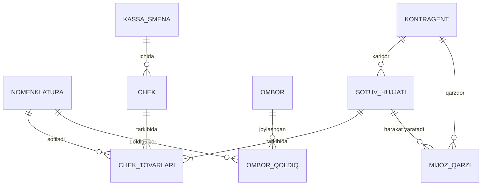

# 1C:UT/Buxgalteriya modullari va ma'lumotlar modeli → MVP modullar ro'yxati

## Asosiy xulosalar

1. 1C'da "ERP+POS" bitta mahsulot emas — kamida 3 ta alohida konfiguratsiya: **1C:Savdo Boshqaruvi (UT 11)** — savdo/ombor/kassa, **1C:Buxgalteriya 8 (BP)** — rasmiy buxgalteriya/soliq, **1C:ERP** — ikkisi + ishlab chiqarish. O'zbekiston uchun hammasi alohida lokalizatsiya qilingan ([v8.1c.ru](https://v8.1c.ru/static/lokalizovannye-prikladnye-resheniya-uzbekistan/)).
2. Sessiyada jonli ulangan baza — **1C:UT 11.4.7.141** (metadata orqali tasdiqlangan) — bu RUS umumiy versiyasi, O'zbekiston lokalizatsiyasi EMAS: QQS stavkalari 20/18/10/0% (RF), ИКПУ (MXIK) maydoni topilmadi, ЕГАИС/ВетИС kataloglari (faqat RF uchun) mavjud. Shuning uchun struktura (obyekt nomlari, maydonlar) ishonchli manba, lekin O'zbekiston-specific qiymatlar (QQS 15/12%, MXIK/IKPU) jamoat manbalaridan olindi.
3. MVP uchun **kassa (POS) + ombor + nasiya** qismi UT 11'ning savdo/kassa/hisob-kitob qatlamiga to'g'ri keladi: asosiy obyektlar — Номенклатура, Контрагенты/Партнеры, Склады, РеализацияТоваровУслуг, ЧекККМ, ТоварыНаСкладах, РасчетыСКлиентами.
4. **Buxgalteriya (NSBU/IFRS hisob rejasi)** UT 11'da umuman yo'q (РегистрБухгалтерии=0, ПланСчетов=0 — tasdiqlandi config so'rovi orqali) — bu faqat 1C:Buxgalteriya'da bor. AIOS (bu hujjatda — qurilayotgan AI-ERP+POS mahsulotining ishchi nomi, loyihaning oldingi bozor-tadqiqot hujjatida ishlatilgan qisqartma) MVP buxgalteriya hisob rejasini UT modelidan emas, **yangi** NSBU №21 rasmiy hisob rejasidan olishi kerak (eski 2002-yilgi versiya 2025-01-01'dan amal qilmaydi — tafsilot 3.4-bo'limda).
5. Fiskal kassa (ЧекККМ/КассоваяСмена) modeli RF'ning 54-ФЗ online-kassa arxitekturasiga (ФН/ФД/ОФД) qurilgan — O'zbekistonning OFD/virtual kassa modeliga **kontseptual** o'xshash (smena → chek → OFD'ga real vaqtda), lekin maydon nomlari/protokol farq qiladi — to'g'ridan-to'g'ri ko'chirib bo'lmaydi.
6. Markirovka (КиЗГИСМ, МаркировкаТоваровГИСМ) — bu RF'ning "Честный знак" (ГИС МТ) uchun, Asl belgisi EMAS, lekin ikkisi ham CRPT texnologiyasiga asoslangan, shuning uchun arxitektura jihatidan (nomenklatura darajasida "markirovka kodi" maydoni, chekda tekshirish) qayta ishlatish mumkin.
7. 1C'dan migratsiya uchun ikki rasmiy yo'l bor: **EnterpriseData (XML)** — biznes-ob'ektlar almashinuvi uchun standart, va **OData** (`/odata/standard.odata`) — REST orqali to'g'ridan-to'g'ri o'qish/yozish. UT 11'da ikkisiga mos ПланОбмена (SinxronizatsiyaDannyxCherezUniversalnyyFormat = EnterpriseData) tayyor holda mavjud.
8. MVP uchun tashlab ketish mumkin bo'lgan qismlar: ЕГАИС (alkogol, faqat RF), ВетИС (veterinariya, faqat RF), komissiya savdosi, RIB (распределенная ИБ), mobil savdo vakili ilovasi, CRM (анкета/опрос/маркетинг акциялари) — bularning hech biri O'zbekiston MVP uchun majburiy emas.

## 1. 1C mahsulotlari xaritasi (O'zbekiston uchun)

| Konfiguratsiya | Vazifasi | MVP uchun kerak? |
|---|---|---|
| 1C:Savdo Boshqaruvi 8 (UT 11), UZ | Savdo, ombor, kassa (POS), xaridorlar/yetkazib beruvchilar bilan hisob-kitob | **Ha** — asosiy manba |
| 1C:Buxgalteriya 8, UZ | Rasmiy buxgalteriya, soliq hisoboti, hisob rejasi (NSBU) | **Ha**, lekin alohida model — hisob rejasi UT'dan emas, NSBU'dan olinadi |
| 1C:Ish Haqi va HR 8, UZ | Ish haqi, HR | Yo'q (MVP'dan tashqarida) |
| 1C:ERP 2, UZ | UT+BP+ishlab chiqarish, katta korxonalar | Yo'q — narxi 197,4 mln so'm, MVP uchun ortiqcha ([perfect-solutions.uz](https://perfect-solutions.uz/vnedrenie-soprovozhdenie/stoimost-vnedreniya-1c-uzbekistan/)) |

Manba: 4 ta lokalizatsiya rasmiy ro'yxati — [v8.1c.ru](https://v8.1c.ru/static/lokalizovannye-prikladnye-resheniya-uzbekistan/).

## 2. MVP ma'lumotlar modeli (UT 11.4.7.141 jonli metadata asosida)

**Manba**: "1C:UT 11.4.7.141 metadata" — sessiyadagi MCP ulanishi orqali olingan haqiqiy obyekt/maydon nomlari (mcp__1c-ut11__describe / get_structure). Umumiy obyekt sonlari: Справочник 340, Документ 181, РегистрНакопления 89, РегистрСведений 426, ПланСчетов 0, РегистрБухгалтерии 0.

### 2.1 Asosiy spravochniklar (katalog)

| Obyekt | Vazifasi | Muhim maydonlar |
|---|---|---|
| Справочник.Номенклатура | Tovar/xizmat kartochkasi, ierarxik | Артикул, ВидНоменклатуры, СтавкаНДС, ШтрихкодыУпаковок (tab. bo'lim), **ПродукцияМаркируемаяДляГИСМ / КиЗГИСМ** (markirovka — RF uchun, UZ'da ИКПУ/Asl belgisi maydoni qo'shiladi), КодТНВЭД, ПодакцизныйТовар |
| Справочник.Контрагенты | Yuridik/jismoniy shaxs — mijoz/yetkazib beruvchi | ИНН, ЮрФизЛицо, Партнер (bog'lanish), КонтактнаяИнформация (tab. bo'lim) |
| Справочник.Склады | Ombor/do'kon nuqtasi | ТипСклада (Склад/Магазин), ИспользоватьАдресноеХранение, Касса (bog'lanish orqali) |
| Справочник.Кассы / КассыККМ | Pul kassasi / POS kassa apparati | — |
| Справочник.КартыЛояльности | Loyallik kartasi | — |

### 2.2 Asosiy hujjatlar (Документ)

| Hujjat | Vazifasi | Qaysi registrlarga yozadi |
|---|---|---|
| Документ.РеализацияТоваровУслуг ("РЕАЛИЗАЦИЯ") | Mijozga sotuv (B2B/hisob-faktura bilan) | ТоварыНаСкладах, РасчетыСКлиентами, ВыручкаИСебестоимостьПродаж, НДСЗаписиКнигиПродаж va h.k. (jami 34 registr) |
| Документ.ЧекККМ | Kassa cheki (POS, chakana) | ТоварыНаСкладах, ДенежныеСредстваВКассахККМ, БонусныеБаллы, ПодарочныеСертификаты, РасчетыПоЭквайрингу |
| Документ.КассоваяСмена | Kassa smenasi (ochish/yopish, fiskal qurilma bilan) | Статус, ФискальноеУстройство, НомерСменыККТ, ДатаПервогоНепереданногоФД — RF 54-ФЗ (ФН/ОФД) modeli |
| Документ.ЗаказКлиента | Mijoz buyurtmasi (oldindan) | ЗаказыКлиентов, ОбеспечениеЗаказов |
| Документ.ПриходныйКассовыйОрдер / РасходныйКассовыйОрдер | Naqd pul kirim/chiqim | ДенежныеСредства регистрлари, РасчетыСКлиентами |
| Документ.ПоступлениеТоваровНаСклад / ПриобретениеТоваровУслуг | Omborga tovar kirimi | ТоварыНаСкладах, РасчетыСПоставщиками |
| Документ.ВозвратТоваровОтКлиента | Mijozdan qaytarish | ТоварыНаСкладах, РасчетыСКлиентами |
| Документ.ИнвентаризационнаяОпись / ПересчетТоваров | Inventarizatsiya | ТоварыНаСкладах |
| Документ.СчетФактураВыданный/Полученный | Soliq hisob-fakturasi | НДСЗаписиКнигиПродаж/Покупок |

### 2.3 Asosiy registrlar (balans/harakat)

| Registr | Turi | Resurslar | Vazifasi |
|---|---|---|---|
| РегистрНакопления.ТоварыНаСкладах | Balans (остатки) | ВНаличии, КОтгрузке | Ombordagi qoldiq, o'lchamlar: Номенклатура, Склад, Характеристика, Серия |
| РегистрНакопления.РасчетыСКлиентами | Balans (остатки) | Сумма, КОплате, Оплачивается, КОтгрузке | Mijoz qarzi/nasiya hisobi — "ДопустимаяСуммаЗадолженности" maydoni orqali kredit limiti nazorati |
| РегистрНакопления.ДенежныеСредстваВКассахККМ | Balans | — | Kassadagi naqd pul qoldig'i |
| РегистрНакопления.ВыручкаИСебестоимостьПродаж | Aylanma (обороты) | — | Sotuv tushumi va tannarx |
| РегистрСведений.СрезПоследних (narxlar, kurslar) | Срез (snapshot) | — | Narx tarixi, valyuta kursi |

### 2.4 MVP uchun soddalashtirilgan sxema (mermaid)

Ya'ni MVP uchun minimal obyektlar: **Nomenklatura, Kontragent, Ombor, Kassa, Sotuv hujjati (chek/realizatsiya), Ombor qoldig'i (balans registri), Mijoz qarzi (balans registri)**. Bu — UT 11'dagi Номенклатура / Контрагенты / Склады / РеализацияТоваровУслуг+ЧекККМ / ТоварыНаСкладах / РасчетыСКлиентами ning to'g'ridan-to'g'ri analogi.

## 3. MVP modullar bo'yicha tahlil

### 3.1 Kassa (POS)
Kerak: ЧекККМ + КассоваяСмена naqshi (smena ochish → cheklar → smena yopish → OFD'ga hisobot). UZ virtual kassa reyestri talabiga mos keladi ([soliq.uz](https://soliq.uz/page/onlayn-nkm)). To'lov usullari (ФормаОплаты enum, ОплатаПлатежнымиКартами tab. bo'limi) — Payme/Click/Uzum uchun shu modelni kengaytirish kerak.

### 3.2 Ombor
Kerak: ТоварыНаСкладах (balans), ПоступлениеТоваровНаСклад, ПеремещениеТоваров, ИнвентаризационнаяОпись. Tashlab ketish mumkin: ордерная схема (ordered warehouse — faqat yirik omborlar uchun), адресное хранение (katta distribyutorlar uchun), серии/характеристики (agar mahsulot partiyasi/variant kerak bo'lmasa).

### 3.3 Nasiya (mijoz qarzlari)
Kerak: РасчетыСКлиентами registri — "ДопустимаяСуммаЗадолженности" (kredit limiti) va "ДатаПлатежа" (to'lov grafigi, ЭтапыГрафикаОплаты tab. bo'limi RealizatsiyaTovarov hujjatida) tayyor naqsh beradi — aynan "nasiya" (bo'lib-bo'lib to'lash) logikasi uchun mos.

### 3.4 Buxgalteriya (NSBU/IFRS)
UT 11'da **yo'q** (ПланСчетов=0, РегистрБухгалтерии=0 — config orqali tasdiqlandi). Rasmiy hisob rejasi manbasi — **НСБУ №21**, lekin diqqat: **eski (2002-yilgi, Moliya vazirligi 103-son buyrug'i, 23.10.2002, Adliya vazirligida 1181-son bilan ro'yxatga olingan) versiya 2025-01-01'dan kuchini yo'qotgan** ([lex.uz — eski hujjat, ONDATE bilan tarixiy holat ko'rinadi](https://lex.uz/ru/docs/417624?ONDATE=01.01.2025); tasdiq: [bss.uz sharhi](https://www.bss.uz/article/443-nsbu-21---plan-schetov-buhgalterskogo-ucheta-finansovo-hozyaystvennoy-deyatelnosti)). Uning o'rniga **2025-01-01'dan amalda bo'lgan YANGI НСБУ №21** keldi — Iqtisodiyot va moliya vazirligi 191-son buyrug'i (14.11.2024), Adliya vazirligida 3593-son bilan ro'yxatga olingan (27.12.2024), to'liq matn [lex.uz](https://lex.uz/ru/docs/7282759). 2025-yil sentyabrida yana tuzatilgan (0870-hisob qo'shilgan).

Bundan tashqari, **ПП-282-son Prezident qarori** (15.09.2025, ["О мерах по совершенствованию системы финансового учета..."](https://lex.uz/uz/docs/7728927)) — bu alohida, parallel islohot: ma'lum mezonlarga mos keladigan yirik/jamoat ahamiyatiga ega korxonalarni bosqichma-bosqich to'liq **МСФО (IFRS)** bo'yicha hisobotga o'tkazadi (reestrga kiritilgan yildan keyingi yildan boshlab, ikkinchi yil oxirida IFRS bo'yicha audit qilingan hisobot). Bu kichik-o'rta savdo MVP uchun **majburiy emas** — faqat yirik/jamoat ahamiyatiga ega korxonalarga tegishli ([buxgalter.uz sharhi](https://buxgalter.uz/en/publish/doc/text210576_chto_menyaetsya_v_pravilah_perehoda_na_msfo); [bss.uz](https://www.bss.uz/news/8920-uzbekistan-menyaet-pravila-kak-postanovlenie-pp-282-ot-15092025-vliyaet-na-perehod-na-msfo)). Alohida manbalarda 2027-yildan kuchga kirishi mo'ljallangan yangi, IFRS'ga yanada yaqinlashtirilgan milliy standart ("НСФО") haqida ham yoziladi ([legalise.uz](https://legalise.uz/nsfo-v-uzbekistane-s-2027-goda-chto-menyaetsya-v-finansovoy-otchetnosti)) — bu AIOS MVP'dan tashqarida, kelajakdagi, hali to'liq amal qilmagan islohot.

**Xulosa**: AIOS MVP hisob rejasini **yangi НСБУ №21 (2024/2025)** asosida qurishi kerak, eski 2002-yilgi reja yoki ПП-282'ning yirik-korxona IFRS talabiga emas.

| Bo'lim | Hisoblar oralig'i | Mazmuni |
|---|---|---|
| I | 0100–0999 | Uzoq muddatli aktivlar (asosiy vositalar, NMA, amortizatsiya) |
| II | 1000–1999 | Tovar-moddiy zaxiralar |
| IV–V | ...–5999 | Kechiktirilgan xarajatlar, pul mablag'lari (kassa 5000, hisob-kitob hisobi 5100) |
| — | 6000+ | Majburiyatlar, kapital, daromad/xarajat hisoblari (aniq chegaralar rasmiy hujjatda) |

Eslatma: yuqoridagi bo'lim/oraliq jadvali qisman — faqat qidiruv parchalarida topilgan bo'limlar (I, II, V); to'liq jadval ochiq savol sifatida qoldirildi (pastda).

To'liq 1C:Buxgalteriya UZ funksiyalari (rasmiy sahifa, [solutions.1c.ru](https://solutions.1c.uz/catalog/buhv8-uz/features) / [1c.uz](https://1c.uz/v8/generic_products/uz_accounting.php)): soliq hisoboti (QQS, foyda solig'i, aylanma solig'i, mol-mulk solig'i, INPS/ijtimoiy soliq, NDFL), elektron hisob-faktura, elektron ish daftarchasi, bank bilan to'g'ridan-to'g'ri almashinuv, asosiy vositalar/NMA hisobi, ish haqi.

**MVP tavsiyasi**: to'liq NSBU hisob rejasini emas, faqat savdo/ombor operatsiyalaridan kelib chiqadigan asosiy hisoblar to'plamini (tovar, kassa, hisob-kitob, QQS, daromad/xarajat) avtomatik generatsiya qilish — to'liq buxgalteriya (asosiy vositalar, ish haqi) keyingi bosqich.

## 4. 1C'dan migratsiya (ma'lumot ko'chirish)

| Format | Vazifasi | Qo'llanilishi |
|---|---|---|
| **EnterpriseData (XML)** | 1C'ning rasmiy biznes-ob'ektlar almashinuv formati — 94+ tur (hujjat, spravochnik) tasvirlangan, XDTO-sxema asosida | Bir martalik yoki davriy export/import; UT 11'da tayyor ПланОбмена.СинхронизацияДанныхЧерезУниверсальныйФормат mavjud (tasdiqlandi, metadata) ([v8.1c.ru](https://v8.1c.ru/tekhnologii/obmen-dannymi-i-integratsiya/standarty-i-formaty/format-enterprisedata/)) |
| **OData** | REST interfeysi, `/odata/standard.odata`, to'liq CRUD (GET/POST/PUT/PATCH/DELETE), JSON/XML javob | Jonli, real-vaqt integratsiya (AIOS'ning 1C ustida ishlashi uchun eng mos yo'l) — platforma ≥8.3.5.1068 va "Публиковать OData" flagini yoqish kerak ([v8.1c.ru](https://v8.1c.ru/platforma/rest-interfeys/)) |
| Hisobotlar/qo'lda export | Excel/CSV orqali | Oddiy, lekin katalog bog'lanishlarini (ID) yo'qotadi — faqat kichik hajm uchun |

AIOS uchun tavsiya: o'qish uchun **OData** (yoki shu loyihada ishlatilgan maxsus MCP-connector naqshi kabi to'g'ridan-to'g'ri so'rov), bir martalik katta migratsiya uchun **EnterpriseData XML**.

## 5. O'zbekiston lokalizatsiyasi xususiyatlari

- **MXIK/ИКПУ**: 17 xonali mahsulot/xizmat identifikatsiya kodi (1–3 raznryad guruh, 4-5 sinf, 6-8 pozitsiya, 9-11 subpozitsiya, 12-14 brend, 15-17 belgi). To'liq ro'yxat — [tasnif.soliq.uz](https://tasnif.soliq.uz/). UZ-lokalizatsiyalangan 1C'da Номенклатура kartochkasining "Дополнительно" bo'limida alohida matn maydoni sifatida kiritiladi ([buxgalter.uz](https://buxgalter.uz/publish/doc/text191001_kak_nayti_pravilnyy_ikpu_na_tasnif_soliq_uz); [moysklad.uz](https://www.moysklad.uz/poleznoe/shkola-torgovli/kody-ikpu/)). Sessiyadagi jonli UT 11 bazasida bu maydon topilmadi (RUS versiya, qidirildi: describe filter="ИКПУ" → 0 natija) — demak faqat UZ-lokalizatsiyalangan konfiguratsiyada mavjud, ochiq manbada 1C'dan tashqari tasdiq topilmadi.
- **QQS (НДС/VAT)**: Jonli UT 11 bazasida ko'rilgan stavkalar (СтавкиНДС enum: 20%, 18%, 10%, 0%) — bular **Rossiya Federatsiyasi** stavkalari (RF Soliq kodeksi, 1C'ning umumiy/eksport versiyasida standart to'plam), UZ uchun amal qilmaydi. **O'zbekistonning 2026-yildagi QQS standart stavkasi — 12%** (Soliq kodeksining 258-moddasi; 2026-yildan avvalgi 15%'dan tushirilgan) — rasmiy/amaliy manbalar: [gov.uz/soliq (qishloq xo'jaligi mahsulotlariga 0% stavka yangiligi, standart stavkaga ishora bilan)](https://gov.uz/ru/soliq/news/view/84640); [kovchegpremium.com — 2026 QQS 12%, 258-modda](https://kovchegpremium.com/academy/nalogi/nds.html); [uz24.uz — 2026 soliq stavkalari sharhi](https://uz24.uz/ru/articles/soliq-25-12-22). Qo'shimcha: 2026-yil 1-yanvardan qishloq xo'jaligi mahsulotlariga 0%, 2026-yil 1-iyundan ayrim toifalar uchun ixtiyoriy 6% stavka joriy etilgan. **Tuzatish**: bu loyihaning oldingi tadqiqot qaydida (`06_integratsiyalar.md`) "QQS 15%" deb yozilgan edi — bu eski (2026'dan oldingi) stavka, joriy 2026-yil holatiga mos emas; shu qayd ham yangilanishi tavsiya etiladi. AIOS'da stavka enum'ini UZ qiymatlariga (12%, 0%, 6% ixtiyoriy) almashtirish kerak.
- **Aylanma solig'i**: QQS to'lamaydigan kichik biznes uchun muqobil soliq rejimi (oldingi tadqiqotda tasdiqlangan, `02_1c.md`/`06_integratsiyalar.md`); 1C:Buxgalteriya UZ'da alohida deklaratsiya shakli bor ([solutions.1c.ru](https://solutions.1c.ru/catalog/buhv8-uz/features)).
- **Asl belgisi (mahsulot markirovkasi)**: UT 11'dagi ГИСМ (КиЗГИСМ, МаркировкаТоваровГИСМ, ПеремаркировкаТоваровГИСМ) — bu RF'ning "Честный знак" (ГИС МТ) tizimi uchun yozilgan, Asl belgisi EMAS. Ikkisi bir xil CRPT texnologiyasiga asoslangan (shuning uchun maydon arxitekturasi — "mahsulotga markirovka turi biriktirilgan", "chekda kod tekshiriladi" — konseptual mos keladi), lekin aniq API/kod formati farq qiladi: Asl belgisi operatori CRPT Turon (crpt-turon.uz), ochiq API topilmadi (oldingi tadqiqotda ⚠ belgilangan).
- **ЕГАИС / ВетИС**: UT 11'dagi bu kataloglar/hujjatlar (alkogol va veterinariya nazorati) faqat Rossiya qonunchiligi uchun — AIOS MVP'da **kerak emas**, kodga qo'shilmasligi kerak.

## Ochiq savollar

- UZ-lokalizatsiyalangan 1C:UT/BP konfiguratsiyasining jonli metadatasi (ИКПУ maydoni aniq qanday nomlanadi, QQS enum qiymatlari) — ochiq manbada va sessiya MCP orqali topilmadi, chunki ulangan baza RUS umumiy versiyasi. Buni aniqlash uchun UZ-lokalizatsiyalangan demo-baza yoki 1C hamkor (franchayzi) kerak.
- YANGI НСБУ №21 (2024/2025, [lex.uz/ru/docs/7282759](https://lex.uz/ru/docs/7282759)) hisob rejasining to'liq hisob ro'yxati (barcha bo'lim/kichik hisob raqamlari) — bu tadqiqotda faqat eski (2002, endi amal qilmaydigan) versiya bo'yicha qisman bo'limlar (I, II, V) topildi; yangi hisob rejasining to'liq jadvali rasmiy hujjatning to'liq o'qilishi orqali chiqarilishi kerak (ko'p sahifali, bu tadqiqotda faqat qidiruv parchalari ko'rildi).
- ПП-282 (IFRS/МСФО o'tish) qaysi aniq mezon (aylanma, aktiv hajmi) bo'yicha korxonalarni reestrga kiritadi — qidiruvda umumiy jarayon topildi, aniq chegara raqamlari topilmadi.
- OData'ning 1C:UT/BP UZ-lokalizatsiyasida qaysi obyektlar standart ravishda ochilgan (publish qilingan) — rasmiy hujjatda umumiy mexanizm tasdiqlangan, lekin UZ-specific sozlash misoli topilmadi.
- EnterpriseData formatining 1C:БП UZ versiyasiga mosligi (ayrim UZ-specific hujjatlar — ИКПУ, elektron hisob-faktura — standart 94 turga kiritilganmi) — ochiq manbada aniq javob topilmadi.

## Manbalar

- 1C:UT 11.4.7.141 metadata — sessiyadagi MCP ulanishi (mcp__1c-ut11__config, describe, get_structure), 2026-10-10
- [v8.1c.ru — O'zbekiston uchun lokalizatsiyalar](https://v8.1c.ru/static/lokalizovannye-prikladnye-resheniya-uzbekistan/)
- [1c.uz — 1C:Buxgalteriya 8 UZ](https://1c.uz/v8/generic_products/uz_accounting.php)
- [solutions.1c.ru — 1C:Buxgalteriya 8 UZ imkoniyatlari](https://solutions.1c.ru/catalog/buhv8-uz/features)
- [perfect-solutions.uz — 1C narxlari UZ (2026-09-24)](https://perfect-solutions.uz/vnedrenie-soprovozhdenie/stoimost-vnedreniya-1c-uzbekistan/)
- [lex.uz — eski НСБУ №21 (2002, 2025-01-01'dan amal qilmaydi, tarixiy holat ONDATE bilan)](https://lex.uz/ru/docs/417624?ONDATE=01.01.2025)
- [lex.uz — YANGI НСБУ №21 (191-son buyruq, 14.11.2024; Adliya ro'yxati 3593, 27.12.2024; 2025-01-01'dan amalda)](https://lex.uz/ru/docs/7282759)
- [bss.uz — НСБУ 21 o'zgarishi sharhi](https://www.bss.uz/article/443-nsbu-21---plan-schetov-buhgalterskogo-ucheta-finansovo-hozyaystvennoy-deyatelnosti)
- [lex.uz — ПП-282-son Prezident qarori (15.09.2025, IFRS/МСФО o'tish)](https://lex.uz/uz/docs/7728927)
- [buxgalter.uz — ПП-282 sharhi](https://buxgalter.uz/en/publish/doc/text210576_chto_menyaetsya_v_pravilah_perehoda_na_msfo)
- [bss.uz — ПП-282 va МСФО o'tish sharhi](https://www.bss.uz/news/8920-uzbekistan-menyaet-pravila-kak-postanovlenie-pp-282-ot-15092025-vliyaet-na-perehod-na-msfo)
- [legalise.uz — НСФО 2027-yildan (kelajakdagi islohot)](https://legalise.uz/nsfo-v-uzbekistane-s-2027-goda-chto-menyaetsya-v-finansovoy-otchetnosti)
- [gov.uz/soliq — 2026-yil QQS yangiliklari](https://gov.uz/ru/soliq/news/view/84640)
- [kovchegpremium.com — 2026 QQS 12% stavkasi, 258-modda](https://kovchegpremium.com/academy/nalogi/nds.html)
- [uz24.uz — 2026-yil soliq stavkalari sharhi](https://uz24.uz/ru/articles/soliq-25-12-22)
- [v8.1c.ru — EnterpriseData format](https://v8.1c.ru/tekhnologii/obmen-dannymi-i-integratsiya/standarty-i-formaty/format-enterprisedata/)
- [its.1c.ru — EnterpriseData texnik tavsif](https://its.1c.ru/db/content/metod8dev/src/developers/dataexchange/enterprisedata/i8105851.htm)
- [v8.1c.ru — REST interfeys (OData)](https://v8.1c.ru/platforma/rest-interfeys/)
- [1cfresh.com — OData ishlatish](https://1cfresh.com/articles/data_odata)
- [tasnif.soliq.uz — ИКПУ/MXIK kodlar bazasi](https://tasnif.soliq.uz/)
- [moysklad.uz — ИКПУ qanday topiladi (2026)](https://www.moysklad.uz/poleznoe/shkola-torgovli/kody-ikpu/)
- [buxgalter.uz — tasnif.soliq.uz'da ИКПУ qidirish](https://buxgalter.uz/publish/doc/text191001_kak_nayti_pravilnyy_ikpu_na_tasnif_soliq_uz)
- [soliq.uz — Onlayn NKM (virtual kassa)](https://soliq.uz/page/onlayn-nkm)
- Loyihaning oldingi tadqiqot qaydlari: `research_notes/AI ERP startap Ozbekistonda/02_1c.md`, `06_integratsiyalar.md`, `00_oldingi_hujjat.md` (bozor tadqiqoti, qayta qilinmadi)
