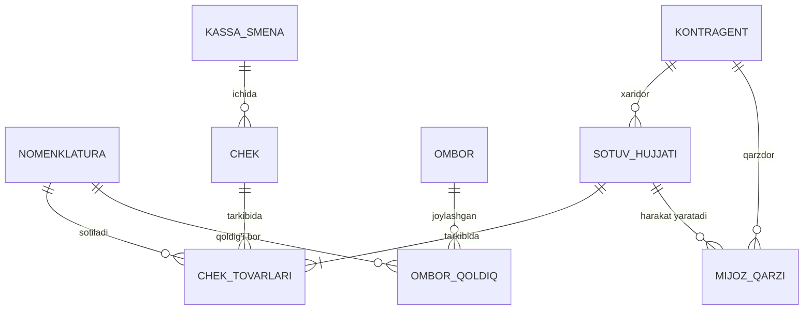

# ERP+POS modullar va ma'lumotlar modeli → MVP modullar ro'yxati

## Asosiy xulosalar

1. "ERP+POS" bitta yaxlit tizim emas — kamida 3 ta funksional qatlam ajraladi: **savdo/ombor/kassa (POS)** boshqaruvi, **rasmiy buxgalteriya/soliq** hisobi va (kengaytma sifatida) **ishlab chiqarish** boshqaruvi. Ko'pchilik bozor yechimlari bu qatlamlarni alohida mahsulot/modul sifatida taqdim etadi.
2. MVP uchun **kassa (POS) + ombor + nasiya** qismi savdo/kassa/hisob-kitob qatlamiga to'g'ri keladi: asosiy obyektlar — Nomenklatura (tovar/xizmat kartochkasi), Kontragent (mijoz/yetkazib beruvchi), Ombor, Sotuv hujjati, Kassa cheki, Ombor qoldig'i, Mijoz bilan hisob-kitob.
3. **Buxgalteriya (NSBU hisob rejasi)** savdo/ombor modulidan mustaqil, alohida ma'lumotlar qatlami: MVP buxgalteriya hisob rejasini **yangi NSBU №21 rasmiy hisob rejasidan** olishi kerak (eski 2002-yilgi versiya 2025-01-01'dan amal qilmaydi — tafsilot 3.4-bo'limda).
4. Fiskal kassa (chek/kassa smenasi) modeli odatda "smena ochish → cheklar → smena yopish → OFD'ga hisobot" naqshiga quriladi — bu O'zbekistonning OFD/virtual kassa modeliga mos keladi.
5. Mahsulot markirovkasi (Asl belgisi) — arxitektura jihatidan nomenklatura darajasida "markirovka kodi" maydoni va chekda tekshirish mexanizmi sifatida modellashtiriladi.
6. Tovar-moddiy zaxiralarni baholash usuli — **BHMS №4** standartiga ko'ra uchta usuldan biri tanlanishi kerak: identifikatsiyalangan tannarx, o'rtacha tortilgan qiymat (AVECO) yoki FIFO (LIFO standartda ko'rsatilmagan).
7. MVP uchun tashlab ketish mumkin bo'lgan qismlar: komissiya savdosi, mobil savdo vakili ilovasi, kengaytirilgan CRM (anketa/so'rov/marketing aksiyalari) — bularning hech biri O'zbekiston MVP uchun majburiy emas.

## 1. ERP+POS funksional qatlamlari (MVP nuqtai nazaridan)

| Qatlam | Vazifasi | MVP uchun kerak? |
|---|---|---|
| Savdo/ombor/kassa (POS) | Savdo, ombor, kassa, xaridorlar/yetkazib beruvchilar bilan hisob-kitob | **Ha** — asosiy qatlam |
| Rasmiy buxgalteriya | Rasmiy buxgalteriya, soliq hisoboti, hisob rejasi (NSBU) | **Ha**, lekin alohida model — hisob rejasi savdo modulidan emas, NSBU'dan olinadi |
| Ish haqi va HR | Ish haqi, HR | Yo'q (MVP'dan tashqarida) |
| Ishlab chiqarish | Savdo+buxgalteriya+ishlab chiqarish, yirik korxonalar uchun | Yo'q — MVP uchun ortiqcha |

## 2. MVP ma'lumotlar modeli (umumiy ERP konsepsiyasi)

Ko'pchilik tranzaksion ERP tizimlari bir xil umumiy naqshga quriladi: **hujjat → o'tkazma → qoldiq registri**. Ya'ni foydalanuvchi kiritgan har bir hujjat (masalan, sotuv yoki kirim) bir yoki bir nechta "o'tkazma" (harakat yozuvi) hosil qiladi, bu o'tkazmalar esa tegishli **registrlarga** (qoldiq va aylanma hisoblagichlariga) yoziladi — natijada har qanday vaqtda joriy qoldiq (ombordagi tovar, kassadagi pul, mijoz qarzi) tezkor so'rov orqali olinadi, uni har safar barcha hujjatlarni qayta hisoblash orqali chiqarish shart bo'lmaydi. Quyidagi model shu umumiy konsepsiyaga asoslanadi.

### 2.1 Asosiy katalog (spravochnik) obyektlari

| Obyekt | Vazifasi | Muhim maydonlar |
|---|---|---|
| Nomenklatura | Tovar/xizmat kartochkasi, ierarxik | Artikul, tovar turi, QQS stavkasi, shtrixkodlar (jadval bo'limi), **markirovka kodi maydoni** (Asl belgisi uchun), TIF TN kodi, aksiz tovari belgisi |
| Kontragent | Yuridik/jismoniy shaxs — mijoz/yetkazib beruvchi | STIR, yuridik/jismoniy shaxs belgisi, kontakt ma'lumotlari (jadval bo'limi) |
| Ombor | Ombor/do'kon nuqtasi | Ombor turi (ombor/do'kon), manzilli saqlash belgisi, bog'langan kassa |
| Kassa | Pul kassasi / POS kassa apparati | — |
| Loyallik kartasi | Mijoz chegirma/bonus kartasi | — |

### 2.2 Asosiy hujjatlar va ularning hayot sikli

| Hujjat | Vazifasi | Qaysi registrlarga yozadi |
|---|---|---|
| Sotuv hujjati (realizatsiya) | Mijozga sotuv (B2B/hisob-faktura bilan) | Ombor qoldig'i, mijoz bilan hisob-kitob, tushum va tannarx, QQS kitobi yozuvlari |
| Kassa cheki | Kassa cheki (POS, chakana) | Ombor qoldig'i, kassadagi naqd pul, bonus ballar, sovg'a sertifikatlari, ekvayring hisob-kitoblari |
| Kassa smenasi | Kassa smenasi (ochish/yopish, fiskal qurilma bilan) | Smena holati, fiskal qurilma ma'lumotlari, OFD'ga yuborish holati |
| Mijoz buyurtmasi | Mijoz buyurtmasi (oldindan) | Buyurtmalar registri, buyurtma ta'minoti |
| Kassa kirim/chiqim orderi | Naqd pul kirim/chiqim | Pul mablag'lari registrlari, mijoz bilan hisob-kitob |
| Omborga tovar kirimi | Omborga tovar kirimi | Ombor qoldig'i, yetkazib beruvchi bilan hisob-kitob |
| Mijozdan qaytarish | Mijozdan qaytarish | Ombor qoldig'i, mijoz bilan hisob-kitob |
| Inventarizatsiya | Inventarizatsiya/qayta hisoblash | Ombor qoldig'i |
| Soliq hisob-fakturasi | Soliq hisob-fakturasi (chiqarilgan/qabul qilingan) | QQS sotuv/xarid kitobi yozuvlari |

Hujjat hayot sikli umumiy holda: **loyiha (qoralama) → o'tkazilgan (provedeno)** holatiga o'tganda tegishli registrlarga yozuvlar hosil bo'ladi → kerak bo'lsa **bekor qilish/qaytarish** hujjati qarama-qarshi yozuv kiritadi. Bu — audit izini (kim, qachon, nimani o'zgartirgan) saqlashning asosiy mexanizmi.

### 2.3 Asosiy registrlar (qoldiq/aylanma)

| Registr | Turi | Resurslar | Vazifasi |
|---|---|---|---|
| Ombor qoldig'i | Qoldiq (остатки) | Mavjud miqdor, yuborishga tayyor miqdor | Ombordagi qoldiq; o'lchamlar: nomenklatura, ombor, xarakteristika, seriya |
| Mijoz bilan hisob-kitob | Qoldiq (остатки) | Summa, to'lanishi kerak, to'lanmoqda | Mijoz qarzi/nasiya hisobi — ruxsat etilgan qarz summasi (kredit limiti) nazorati orqali |
| Kassadagi naqd pul | Qoldiq | — | Kassadagi naqd pul qoldig'i |
| Sotuv tushumi va tannarxi | Aylanma (обороты) | — | Sotuv tushumi va tannarx |
| Narx/kurs tarixi | Срез (snapshot) | — | Narx tarixi, valyuta kursi |

### 2.4 MVP uchun soddalashtirilgan sxema (mermaid)

Ya'ni MVP uchun minimal obyektlar: **Nomenklatura, Kontragent, Ombor, Kassa, Sotuv hujjati (chek/realizatsiya), Ombor qoldig'i (qoldiq registri), Mijoz qarzi (qoldiq registri)**.

## 3. MVP modullar bo'yicha tahlil

### 3.1 Kassa (POS)
Kerak: kassa cheki + kassa smenasi naqshi (smena ochish → cheklar → smena yopish → OFD'ga hisobot). UZ virtual kassa reyestri talabiga mos keladi ([soliq.uz](https://soliq.uz/page/onlayn-nkm)). To'lov usullari (naqd, karta, Payme/Click/Uzum) alohida enum va to'lov turlari jadvali sifatida modellashtiriladi.

### 3.2 Ombor
Kerak: ombor qoldig'i (balans registri), omborga tovar kirimi, tovarlar ko'chirilishi, inventarizatsiya. Tashlab ketish mumkin: orderli sxema (faqat yirik omborlar uchun), manzilli saqlash (katta distribyutorlar uchun), seriya/xarakteristika hisobi (agar mahsulot partiyasi/variant hisobi kerak bo'lmasa).

### 3.3 Nasiya (mijoz qarzlari)
Kerak: mijoz bilan hisob-kitob registri — "ruxsat etilgan qarz summasi" (kredit limiti) va "to'lov sanasi" (to'lov grafigi) — aynan "nasiya" (bo'lib-bo'lib to'lash) logikasi uchun mos naqsh.

### 3.4 Buxgalteriya (NSBU/IFRS)
Rasmiy hisob rejasi manbasi — **NSBU №21**, lekin diqqat: **eski (2002-yilgi, Moliya vazirligi 103-son buyrug'i — buyruqning o'zi 09.09.2002'da imzolangan, Adliya vazirligida 1181-son bilan 23.10.2002'da ro'yxatga olingan) versiya 2025-01-01'dan kuchini yo'qotgan** ([lex.uz — eski hujjat, ONDATE bilan tarixiy holat ko'rinadi](https://lex.uz/ru/docs/417624?ONDATE=01.01.2025); tasdiq: [bss.uz sharhi](https://www.bss.uz/article/443-nsbu-21---plan-schetov-buhgalterskogo-ucheta-finansovo-hozyaystvennoy-deyatelnosti)). Uning o'rniga **2025-01-01'dan amalda bo'lgan YANGI NSBU №21** keldi — Iqtisodiyot va moliya vazirligi 191-son buyrug'i (14.11.2024), Adliya vazirligida 3593-son bilan ro'yxatga olingan (27.12.2024), to'liq matn [lex.uz](https://lex.uz/ru/docs/7282759). 2025-yil sentyabrida yana tuzatilgan (0870-hisob qo'shilgan).

Bundan tashqari, **ПП-282-son Prezident qarori** (15.09.2025, ["O'zbekiston Respublikasida moliyaviy hisob tizimini takomillashtirish chora-tadbirlari to'g'risida"](https://lex.uz/uz/docs/7728927)) — bu alohida, parallel islohot: ma'lum mezonlarga mos keladigan yirik/jamoat ahamiyatiga ega korxonalarni bosqichma-bosqich to'liq **MSFO (IFRS)** bo'yicha hisobotga o'tkazadi (reestrga kiritilgan yildan keyingi yildan boshlab, ikkinchi yil oxirida IFRS bo'yicha audit qilingan hisobot). Bu kichik-o'rta savdo MVP uchun **majburiy emas** — faqat yirik/jamoat ahamiyatiga ega korxonalarga tegishli ([buxgalter.uz sharhi](https://buxgalter.uz/en/publish/doc/text210576_chto_menyaetsya_v_pravilah_perehoda_na_msfo); [bss.uz](https://www.bss.uz/news/8920-uzbekistan-menyaet-pravila-kak-postanovlenie-pp-282-ot-15092025-vliyaet-na-perehod-na-msfo)). Alohida manbalarda 2027-yildan kuchga kirishi mo'ljallangan yangi, IFRS'ga yanada yaqinlashtirilgan milliy standart ("НСФО") haqida ham yoziladi ([legalise.uz](https://legalise.uz/nsfo-v-uzbekistane-s-2027-goda-chto-menyaetsya-v-finansovoy-otchetnosti)) — bu MVP'dan tashqarida, kelajakdagi, hali to'liq amal qilmagan islohot.

**Xulosa**: MVP hisob rejasini **yangi NSBU №21 (2024/2025)** asosida qurish kerak, eski 2002-yilgi reja yoki ПП-282'ning yirik-korxona IFRS talabiga emas.

| Bo'lim | Hisoblar oralig'i | Mazmuni |
|---|---|---|
| I | 0100–0999 | Uzoq muddatli aktivlar (asosiy vositalar, NMA, amortizatsiya) |
| II | 1000–1999 | Tovar-moddiy zaxiralar |
| IV–V | ...–5999 | Kechiktirilgan xarajatlar, pul mablag'lari (kassa 5000, hisob-kitob hisobi 5100) |
| — | 6000+ | Majburiyatlar, kapital, daromad/xarajat hisoblari (aniq chegaralar rasmiy hujjatda) |

Eslatma: yuqoridagi bo'lim/oraliq jadvali qisman — faqat qidiruv parchalarida topilgan bo'limlar (I, II, V); to'liq jadval ochiq savol sifatida qoldirildi (pastda).

**MVP tavsiyasi**: to'liq NSBU hisob rejasini emas, faqat savdo/ombor operatsiyalaridan kelib chiqadigan asosiy hisoblar to'plamini (tovar, kassa, hisob-kitob, QQS, daromad/xarajat) avtomatik generatsiya qilish — to'liq buxgalteriya (asosiy vositalar, ish haqi) keyingi bosqich.

### 3.5 Tovar-moddiy zaxiralarni baholash usuli (BHMS №4)
Ombor qoldig'ini pul ko'rinishida baholash (va shu orqali COGS/sotilgan tovar tannarxini hisoblash) uchun **BHMS №4 "Tovar-moddiy zaxiralar"** standarti (Moliya vaziri buyrug'i №24, 28.05.2020; Adliya vazirligida 3259-son bilan ro'yxatga olingan, 30.06.2020 — [lex.uz](https://lex.uz/docs/-4890446), 7-bob, 62-band) faqat **uchta** usulni ruxsat beradi:
1. **Identifikatsiyalangan tannarx** — har bir birlik o'zining haqiqiy tannarxi bo'yicha hisoblanadi (odatda noyob/qimmat tovarlar uchun).
2. **O'rtacha tortilgan qiymat (AVECO)** — davr davomidagi barcha kirimlarning o'rtacha tannarxi.
3. **FIFO** — birinchi kirgan, birinchi chiqadi.

**LIFO standartda umuman ko'rsatilmagan** — bu usul tanlanmasligi kerak. MVP arxitekturasi ombor/buxgalteriya integratsiyasini loyihalashdan oldin ushbu uchta usuldan birini (odatda AVECO yoki FIFO) standart sifatida tanlashi shart, aks holda COGS va foyda-zarar hisobotining hisoblash formulasi aniqlanmay qoladi.

## 4. O'zbekiston lokalizatsiyasi xususiyatlari

- **MXIK (mahsulot/xizmat identifikatsiya kodi)**: 17 xonali kod (1–3 raznryad guruh, 4-5 sinf, 6-8 pozitsiya, 9-11 subpozitsiya, 12-14 brend, 15-17 belgi). To'liq ro'yxat — [tasnif.soliq.uz](https://tasnif.soliq.uz/). Nomenklatura kartochkasida alohida maydon sifatida kiritiladi ([buxgalter.uz](https://buxgalter.uz/publish/doc/text191001_kak_nayti_pravilnyy_ikpu_na_tasnif_soliq_uz); [moysklad.uz](https://www.moysklad.uz/poleznoe/shkola-torgovli/kody-ikpu/)).
- **QQS (VAT)**: O'zbekistonning 2026-yildagi QQS standart stavkasi — **12%** (Soliq kodeksining 258-moddasi; 15%'dan 12%'ga **2023-yil 1-yanvarda** tushirilgan — gazeta.uz, kun.uz; 2026-yilda stavka o'zgarishsiz 12%da qoladi) — rasmiy/amaliy manbalar: [gov.uz/soliq (qishloq xo'jaligi mahsulotlariga 0% stavka yangiligi, standart stavkaga ishora bilan)](https://gov.uz/ru/soliq/news/view/84640); [kovchegpremium.com — 2026 QQS 12%, 258-modda](https://kovchegpremium.com/academy/nalogi/nds.html); [uz24.uz — 2026 soliq stavkalari sharhi](https://uz24.uz/ru/articles/soliq-25-12-22). Qo'shimcha: 2026-yil 1-yanvardan qishloq xo'jaligi mahsulotlariga 0%, 2026-yil 1-iyundan ayrim toifalar uchun ixtiyoriy 6% stavka joriy etilgan. Mahsulotda stavka enum'ini UZ qiymatlariga (12%, 0%, 6% ixtiyoriy) moslash kerak.
- **Aylanma solig'i**: QQS to'lamaydigan kichik biznes uchun muqobil soliq rejimi; alohida deklaratsiya shakli talab qilinadi.
- **Asl belgisi (mahsulot markirovkasi)**: nomenklatura darajasida "markirovka kodi" maydoni va chekda kod tekshirish mexanizmi sifatida modellashtiriladi. Operator — CRPT Turon (crpt-turon.uz), ochiq API topilmadi (oldingi tadqiqotda ⚠ belgilangan).

## Ochiq savollar

- Yangi NSBU №21 (2024/2025, [lex.uz/ru/docs/7282759](https://lex.uz/ru/docs/7282759)) hisob rejasining to'liq hisob ro'yxati (barcha bo'lim/kichik hisob raqamlari) — bu tadqiqotda faqat eski (2002, endi amal qilmaydigan) versiya bo'yicha qisman bo'limlar (I, II, V) topildi; yangi hisob rejasining to'liq jadvali rasmiy hujjatning to'liq o'qilishi orqali chiqarilishi kerak (ko'p sahifali, bu tadqiqotda faqat qidiruv parchalari ko'rildi).
- ПП-282 (IFRS/MSFO o'tish) qaysi aniq mezon (aylanma, aktiv hajmi) bo'yicha korxonalarni reestrga kiritadi — qidiruvda umumiy jarayon topildi, aniq chegara raqamlari topilmadi.
- BHMS №4'dagi uchta baholash usulidan qaysi birini MVP standart sifatida tanlash kerakligi (AVECO yoki FIFO) — buxgalter/tashqi maslahatchi bilan hal qilinishi kerak bo'lgan arxitektura qarori.

## Manbalar

- [tasnif.soliq.uz — MXIK kodlar bazasi](https://tasnif.soliq.uz/)
- [moysklad.uz — MXIK qanday topiladi (2026)](https://www.moysklad.uz/poleznoe/shkola-torgovli/kody-ikpu/)
- [buxgalter.uz — tasnif.soliq.uz'da MXIK qidirish](https://buxgalter.uz/publish/doc/text191001_kak_nayti_pravilnyy_ikpu_na_tasnif_soliq_uz)
- [soliq.uz — Onlayn NKM (virtual kassa)](https://soliq.uz/page/onlayn-nkm)
- [lex.uz — eski NSBU №21 (2002, 2025-01-01'dan amal qilmaydi, tarixiy holat ONDATE bilan)](https://lex.uz/ru/docs/417624?ONDATE=01.01.2025)
- [lex.uz — YANGI NSBU №21 (191-son buyruq, 14.11.2024; Adliya ro'yxati 3593, 27.12.2024; 2025-01-01'dan amalda)](https://lex.uz/ru/docs/7282759)
- [bss.uz — NSBU 21 o'zgarishi sharhi](https://www.bss.uz/article/443-nsbu-21---plan-schetov-buhgalterskogo-ucheta-finansovo-hozyaystvennoy-deyatelnosti)
- [lex.uz — BHMS №4 "Tovar-moddiy zaxiralar" (Moliya vaziri buyrug'i №24, 28.05.2020; Adliya ro'yxati №3259, 30.06.2020)](https://lex.uz/docs/-4890446)
- [lex.uz — ПП-282-son Prezident qarori (15.09.2025, IFRS/MSFO o'tish)](https://lex.uz/uz/docs/7728927)
- [buxgalter.uz — ПП-282 sharhi](https://buxgalter.uz/en/publish/doc/text210576_chto_menyaetsya_v_pravilah_perehoda_na_msfo)
- [bss.uz — ПП-282 va MSFO o'tish sharhi](https://www.bss.uz/news/8920-uzbekistan-menyaet-pravila-kak-postanovlenie-pp-282-ot-15092025-vliyaet-na-perehod-na-msfo)
- [legalise.uz — НСФО 2027-yildan (kelajakdagi islohot)](https://legalise.uz/nsfo-v-uzbekistane-s-2027-goda-chto-menyaetsya-v-finansovoy-otchetnosti)
- [gov.uz/soliq — 2026-yil QQS yangiliklari](https://gov.uz/ru/soliq/news/view/84640)
- [kovchegpremium.com — 2026 QQS 12% stavkasi, 258-modda](https://kovchegpremium.com/academy/nalogi/nds.html)
- [uz24.uz — 2026-yil soliq stavkalari sharhi](https://uz24.uz/ru/articles/soliq-25-12-22)
