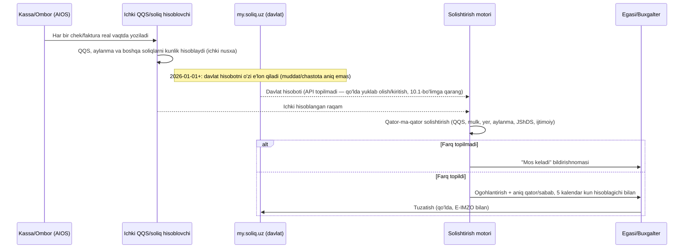
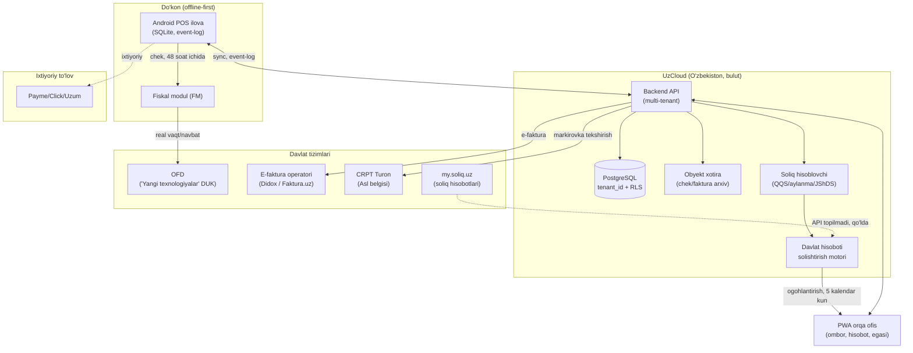

# Tech stack va arxitektura tavsiyasi: multi-tenant SaaS + offline-first kassa

*Tadqiqotchi: Integrator · 2026-10-12*

## Asosiy xulosalar

1. **Mahsulot hech qanday tashqi buxgalteriya/savdo dasturidan ma'lumot olmaydi va ular bilan integratsiya qilmaydi** (Claude Docs — asosiy hujjat, [artifact e57e7cd7](https://claude.ai/code/artifact/e57e7cd7-1117-40a7-8af5-8154a8d22540)) — noldan quriladi; umumiy ERP ma'lumotlar modeli faqat ichki loyihalash namunasi sifatida ishlatilgan (`01-erp-modullar-va-malumot-modeli.md`). Shuning uchun uchinchi tomon dasturlardan ma'lumot ko'chirish/migratsiya yo'llari **rejadan olib tashlandi**.
2. **2026-yildagi eng muhim arxitektura talabi — davlat hisoboti bilan solishtirish oqimi.** 2026-01-01 dan Soliq qo'mitasi mol-mulk, yer, JShDS, ijtimoiy soliq, QQS va aylanma solig'i hisobotlarini (foyda solig'i **bundan mustasno**) cheklar/e-fakturalardan **o'zi tuzadi**; korxonaga tafovutni tuzatish uchun **5 kalendar kun** beriladi (hisobot topshirish muddatidan kechiktirmay), javob bo'lmasa hisobot davlat tuzgan holida topshirilgan hisoblanadi (O'RQ-1108-son Qonun, 2025-12-25, Soliq kodeksi 81-moddasi, 2026-01-01 dan kuchda; [lex.uz/docs/-7944527](https://lex.uz/docs/-7944527); kontekst: [uz.kursiv.media, 2025-12-30](https://uz.kursiv.media/uz/2025-12-30/1-yanvardan-ayrim-soliq-hisobotlari-avtomatik-shakllantiriladi/)). Demak bizning vazifamiz deklaratsiya yozish emas — chek/faktura/ombor ma'lumotining to'g'ri ketishini ta'minlash va davlat hisobotini ichki hisob bilan solishtirib, farqni 5 kalendar kun ichida ko'rsatish. Bu **6-bo'limda** asosiy yangi arxitektura oqimi sifatida yoritilgan. *(2026-10-14 tekshiruvida tuzatildi: avval "5 ish kuni" deyilgan edi va qonun/qaror raqami "ochiq manbada topilmadi" deb qoldirilgan edi — to'g'risi 5 **kalendar** kun, qonun raqami O'RQ-1108 (SK 81-modda); foyda solig'i ro'yxatda yo'qligi aniq ko'rsatildi.)*
3. **Multi-tenant model: shared DB + tenant_id (row-level isolation) — MVP uchun tavsiya**, chunki SME segment uchun operatsion xarajat past bo'lishi kerak (07-faylda UzCloud narxlari — vCPU 85 000 so'm/oy — kichik marjin bilan ishlaydi). Schema-per-tenant/baza-per-tenant — faqat yirik/nozik (masalan buxgalteriya auditi talab qiladigan) mijozlar uchun kelajakdagi variant.
4. **Offline-first — majburiy, ixtiyoriy emas.** O'zbekistonda dalolatlangan internet/elektr uzilishlari (2022 Qoraqalpog'iston, yillik imtihon kuni to'xtatilishi, 2022 mintaqaviy elektr avariyasi, 2024–2025 Toshkent uzilishlari — `07-hosting-lokalizatsiya-xavfsizlik.md`) buni asoslaydi. Sinxronizatsiya **append-only event-log** asosida, CRDT asosida emas — sabab 2-bo'limda.
5. **Qattiq fiskal muddat: offline holatda shakllangan birinchi chek 48 soat ichida OFD'ga yetib borishi shart** (943-son qaror, 1-ilova, 31-band — `02-kassa-ofd-markirovka.md`'da birlamchi manbadan tasdiqlangan). Bu sync arxitekturasining qattiq SLA chegarasi.
6. **Platforma: Android-native POS ilova — asosiy kanal.** Bozordagi fiskal uskunalarning aksariyati Android asosida (PAX A930/PayDroid — Kapitalbank orqali tarqatiladi; `02-fayl`). Orqa ofis (ombor, hisobotlar, boshqaruv) uchun PWA — har qanday brauzerda ishlaydi, alohida ilova o'rnatish shart emas.
7. **Backend/baza: PostgreSQL, UzCloud DBaaS orqali** — managed PostgreSQL xizmati va to'liq narx jadvali mavjud (`07-fayl`). Ma'lumotlarni O'zbekistonda saqlash **qonuniy majburiyat emas** (faqat biometrik/genetik/telekom ma'lumotlari uchun), lekin kam kechikish va soliq/OFD API'lariga yaqinlik sababli **biznes tanlovi** sifatida tavsiya etiladi.
8. **Xavfsizlik sertifikatlash talabi noaniq.** ЗРУ-764 (Kiberxavfsizlik to'g'risida) davlat organlari/KAI obyektlariga tegishli; oddiy xususiy SaaS ERP'ning shu toifaga kirishi **ochiq manbada tasdiqlanmagan** (`07-fayl`) — MVP rejasining birinchi haftalarida csec.uz bilan yozma aniqlashtirish kerak.
9. Hujjat/audit saqlash muddati — buxgalteriya hujjatlari uchun kamida 3 yil (Buxgalteriya hisobi to'g'risidagi qonun, 23-modda — `07-fayl`); backup siklini shu muddatga moslashtirish kerak.
10. Birinchi 90 kun uchun eng katta ikki texnik xavf: (a) Asl belgisi (markirovka) integratsiyasi — CRPT Turon'ning integrator API hujjatlari 403 bilan yopiq (`02-fayl`); (b) davlat hisobotini olish/solishtirish uchun **hech qanday rasmiy API topilmadi** (my.soliq.uz'dan dasturiy o'qish yo'li yo'q) — bu MVP'ning markaziy qiymat taklifini qo'lda/yarim-avtomatik qilib qo'yadi, batafsil 10-bo'limda.

---

## 1. Multi-tenant model

| Model | Afzalligi | Kamchiligi | AIOS uchun moslik |
|---|---|---|---|
| **Umumiy baza + tenant_id** (row-level) | Eng past operatsion xarajat; bitta schema migratsiyasi hammaga tarqaladi; UzCloud'dagi kichik VM/DBaaS tarifida (116 000–1 136 000 so'm/oy, `07-fayl`) ko'p tenant joylashadi | Noto'g'ri yozilgan so'rov boshqa tenant ma'lumotini ko'rsatishi xavfi (row-level security majburiy); "qo'shni shovqini" (bir tenant ko'p resurs yeganda boshqasiga ta'sir) | **MVP uchun tavsiya etiladi** — kichik-o'rta do'konlar segmenti narxga sezgir, tez ishga tushirish kerak |
| **Schema-per-tenant** | Kuchliroq izolatsiya, bitta baza ichida; backup/restore tenant darajasida mumkin | Schema soni o'sgani sayin migratsiya va ulanish pool boshqaruvi murakkablashadi | O'rta bosqich — yirik ulgurjichi/buxgalteriya auditi talab qiladigan mijozlar uchun |
| **Baza-per-tenant** | To'liq izolatsiya; soliq/audit talabiga eng oson javob beradi (har bir mijoz o'z ma'lumotini alohida ko'rsatishi mumkin) | Eng yuqori operatsion xarajat; har bir yangi mijoz uchun yangi baza/backup/monitoring | Kelajakda — faqat katta korporativ mijoz yoki qattiq komplayens talab qilgan holatda |

**Tavsiya**: MVP — umumiy baza + `tenant_id` + PostgreSQL Row-Level Security (RLS) siyosatlari har bir jadvalda. Buxgalteriya/QQS hisoblash jadvallari uchun alohida qat'iy RLS tekshiruvi shart, chunki bu ma'lumot soliq tekshiruvida dalil sifatida ishlatiladi. Kelajakda yirik mijozlar uchun schema-per-tenant'ga o'tish yo'li ochiq qoldiriladi (PostgreSQL'da schema qo'shish — downtime'siz).

---

## 2. Offline-first kassa: lokal saqlash, sinxronizatsiya, konfliktlar

### 2.1 Lokal saqlash
- **Android POS (asosiy kanal)**: SQLite — Android platformasida native, deyarli barcha fiskal POS ilovalari (PAX A930 kabi PayDroid qurilmalarda) shu bilan ishlaydi.
- **PWA (orqa ofis)**: IndexedDB — brauzer ichida offline ombor/hisobot ko'rish uchun, lekin kassa tranzaksiyasi PWA'da birinchi ustuvorlik emas (asosiy savdo — Android ilova orqali).

### 2.2 Sinxronizatsiya: event-log, CRDT emas
`01-fayl`da tasdiqlangan kassa-smena naqshi (smena → chek ketma-ketligi, smena ichida ketma-ket chek raqami) va `02-fayl`dagi fiskal talab (chek OFD'ga **ketma-ket, 48 soat ichida** yetishi) — bu ikki xususiyat CRDT'ning "istalgan tartibda birlashadigan" modeliga mos kelmaydi: fiskal chek raqami smena ichida qat'iy ketma-ket bo'lishi shart, shuning uchun **append-only event-log (outbox pattern)** tavsiya etiladi:
1. Kassa lokal SQLite'da har bir amalni (chek, qaytarish, smena ochish/yopish) **o'zgarmas voqea (event)** sifatida yozadi, lokal ketma-ket ID bilan.
2. Internet qaytganda, voqealar serverga **xronologik tartibda** yuboriladi; server ularga global, smena-darajasidagi ketma-ket raqam beradi (fiskal chek raqami shu yerda rasmiylashadi).
3. Server qabul qilgach, OFD'ga yuborish navbati boshlanadi — **48 soatlik hisob shu yerdan boshlanadi** (chek yaratilgan payt, OFD'ga yetib borish payti emas — bu `02-fayl`dagi 1-ilova 31-band talqiniga mos).
4. Idempotentlik: har bir voqea lokal UUID bilan belgilanadi, server takror yuborilgan voqeani (tarmoq uzilib qayta urinishda) e'tiborsiz qoldiradi.

### 2.3 Konflikt hal qilish
- **Ombor qoldig'i** (`ТоварыНаСкладах` analogi, `01-fayl`) — to'g'ridan-to'g'ri "qiymatni almashtirish" emas, balki **harakat (delta) qo'shish** orqali hisoblanadi: ikki kassa bir vaqtda offline oflayn savdo qilsa, qoldiq ikkisining kamayishi yig'indisi sifatida serverda qayta hisoblanadi — raqamli qiymatlarni to'g'ridan-to'g'ri "last write wins" bilan almashtirish qoldiq buzilishiga olib keladi.
- **Mijoz qarzi (nasiya)** — xuddi shunday, delta-asosida; kredit limitidan oshib ketish holatini server-tomon qayta tekshiradi va agar oflayn paytda limit buzilgan bo'lsa, menejerga ogohlantirish chiqaradi (bloklamaydi — savdo allaqachon bo'lgan).
- **Narx o'zgarishi** offline paytda — kassa oxirgi sinxronlangan narxni ishlatadi; agar narx serverda o'zgargan bo'lsa va kassa eski narxda sotgan bo'lsa, farq buxgalteriya tomonidan ko'rib chiqiladigan istisno (exception) sifatida belgilanadi, avtomatik tuzatilmaydi (soliq/chek yaxlitligini buzmaslik uchun).

### 2.4 Fiskal moslik
- `02-fayl`da tasdiqlangan: FM (fiskal modul) o'z ichida yuborilmagan cheklar sonini kuzatadi (xato kodi 704031). Arxitektura shu signalni serverga ham ko'chirishi kerak — agar kassa X soat sinxronlanmasa, markaziy tizim ogohlantirish yuborishi shart (48 soatlik qonuniy chegaradan oldin, masalan 24 soatda birinchi signal).
- Markirovka (Asl belgisi) kodini offline tekshirish **mumkin emas** — kod tekshiruvi markaziy CRPT Turon tizimiga bog'liq (`02-fayl`, POS jarayoni tasnifi). Shuning uchun markirovkalangan tovar sotuvi **internet yo'qligida kechiktiriladi yoki "keyinroq tekshirish" belgisi bilan vaqtinchalik ruxsat etiladi** — bu huquqiy xavf, ochiq savol sifatida pastda qoldirilgan.

---

## 3. Platforma: Android POS / PWA / desktop

- `02-fayl`da tasdiqlangan bozor uskunalari: **PAX A930** (Android 7.1/PayDroid, PCI PTS/EMV sertifikatlangan, Kapitalbank orqali), **UZKASSA** (N5/P100), **Rahmat POS**, **REGOS VCR** (Windows dasturi). Android ustunlik qiladi, ayniqsa yangi avlod smart-POS terminallarida.
- **Tavsiya**: asosiy kassa ilovasi — **Android-native (Kotlin)**, chunki fiskal printer/terminal SDK'lari (PAX, UZKASSA) odatda Android native kutubxona sifatida taqdim etiladi, va offline-first SQLite+local service arxitekturasi Android'da tabiiy ishlaydi.
- **Orqa ofis/boshqaruv** (ombor, hisobotlar, narxlar, filiallar — `01-fayl`dagi MVP modullar) — **PWA**: egasi/menejer kompyuter yoki telefondan brauzer orqali kirishi mumkin, alohida ilova kerak emas, yangilanish markazlashgan.
- **Desktop (Windows)** — faqat agar mijoz allaqachon REGOS VCR kabi Windows-only virtual kassa dasturi ishlatayotgan bo'lsa, integratsiya qatlami sifatida ko'rib chiqiladi; MVP'ning o'zida asosiy platforma emas.

---

## 4. Backend va baza tanlovi

- **Ma'lumotlar bazasi: PostgreSQL.** Sabab: (a) UzCloud'da to'liq managed DBaaS xizmati bor — HA klaster, avtomatik backup, PITR (`07-fayl`); (b) relyatsion model `01-fayl`dagi hujjat-registr naqshiga (qoldiq/aylanma registrlari) yaxshi mos keladi — PostgreSQL'ning jamlangan (aggregate) so'rovlari ombor qoldig'i/mijoz qarzi balansini real vaqtda hisoblash uchun yetarli; (c) JSONB maydon turi orqali tenant-specific moslashuvchan maydonlarni (masalan qo'shimcha hisobot ustunlari) qattiq schema o'zgarishisiz saqlash mumkin.
- **Backend tili/freymvork** — bu bosqichda sohaga xos majburiy talab yo'q (hech bir qonun/standart buni belgilamaydi); tanlov jamoaning tajribasiga bog'liq, shuning uchun bu hujjat aniq til/freymvorkni "fakt" sifatida tavsiya qilmaydi — bu komandaning ichki muhandislik qarori.

---

## 5. Ma'lumotlarni saqlash joyi va hosting

(To'liq tafsilot: `07-hosting-lokalizatsiya-xavfsizlik.md`.)

- **Qonuniy talab**: faqat biometrik, genetik va telekom-foydalanuvchi ma'lumotlari O'zbekistonda saqlanishi shart (ZRU-547, 27-1-modda). AIOS'ning odatiy savdo/ombor/buxgalteriya ma'lumoti bu toifaga kirmaydi — chet el buluti **qonunan taqiqlanmagan**.
- **Biznes tanlovi sifatida tavsiya**: **UzCloud** (Uztelecom bilan bir xil milliy platforma) — 5 ta Tier III-loyiha data-markaz, to'liq ochiq narx jadvali: VM (vCPU 85 000 so'm/oy, RAM 12 000 so'm/oy/GB), Managed Kubernetes (HA boshqaruv paneli 1 500 000 so'm/oy), DBaaS (PostgreSQL, HA+PITR), S3-mos obyekt xotira (450 so'm/GB/oy). Sabab — soliq/OFD/bank API'lariga past kechikish, va kelajakda lokalizatsiya doirasi kengaytirilsa (yangi qonun) qayta ko'chirish xavfi bo'lmaydi.
- **Yandex Cloud ishlatilmasligi tavsiya etiladi** — O'zbekistonda jismoniy data-markazi yo'q (faqat Rossiya/Qozog'iston), bu yuqoridagi lokalizatsiya toifalari (agar kelajakda AI-OCR/biometrik funksiya qo'shilsa) uchun muhim bo'lib qolishi mumkin.

---

## 6. Davlat hisoboti bilan solishtirish oqimi (2026-yildagi yangi talab)

Bu — arxitektor tomonidan belgilangan eng muhim yangi yo'nalish, shuning uchun alohida bo'lim sifatida ajratildi.

### 6.1 Fon
2026-01-01 dan Soliq qo'mitasi quyidagi hisobotlarni **o'zi, cheklar va e-fakturalardan avtomatik tuzadi**: mol-mulk solig'i, yer solig'i, JShDS, ijtimoiy soliq, QQS, aylanmadan olinadigan soliq (**foyda solig'i bu ro'yxatga kirmaydi**) ([uz.kursiv.media, 2025-12-30](https://uz.kursiv.media/uz/2025-12-30/1-yanvardan-ayrim-soliq-hisobotlari-avtomatik-shakllantiriladi/)). Korxonaga tafovutni tuzatish uchun **5 kalendar kun** beriladi — "besh kun ichida", lekin hisobot topshirish muddatidan kechiktirmay; shu muddatda tuzatish kiritish mumkin, aks holda hisobot davlat tuzgan holida **topshirilgan** hisoblanadi. **Qonun/qaror asosi aniqlandi: O'RQ-1108-son Qonun (2025-12-25, 2026-01-01 dan kuchda), Soliq kodeksi 81-moddasiga kiritilgan o'zgartirish** ([lex.uz/docs/-7944527](https://lex.uz/docs/-7944527)). *(2026-10-14 tekshiruvida tuzatildi: avval "5 ish kuni" va "qonun/qaror raqami ochiq manbada topilmadi" deyilgan edi — to'g'risi 5 **kalendar** kun, qonun — O'RQ-1108 (SK 81-modda); foyda solig'i ro'yxatda yo'q.)*

### 6.2 Nega bu arxitektura uchun markaziy
Agar davlat hisobotni o'zi tuzsa va javobsizlik avtomatik qabul deb hisoblansa, korxona uchun eng katta xavf — **davlat hisobga olgan raqam korxonaning o'z hisobidan farq qilishi, lekin 5 kalendar kun ichida bu farq payqalmasligi**. AIOS'ning qiymat taklifi shu yerda: deklaratsiya yozish emas, balki **(a) chek/faktura/ombor ma'lumotining to'g'ri va to'liq ketishini ta'minlash, (b) davlat tuzgan hisobotni ichki hisob bilan avtomatik solishtirish, (c) farqni 5 kalendar kunlik oyna yopilishidan oldin ko'rsatish.**

### 6.3 Taklif qilinadigan oqim (arxitektura darajasida)

### 6.4 Texnik talablar
- **Ichki ledger** (soliq hisoblash motori) har bir savdo/xarid/qaytarish hujjatidan real vaqtda QQS/aylanma/boshqa soliq bazasini yig'ib boradi — bu `01-fayl`dagi MVP buxgalteriya moduli (NSBU №21 asosida) ustiga quriladi.
- **5 kalendar kunlik hisoblagich** (O'RQ-1108, SK 81-modda) — har bir soliq turi uchun alohida kuzatiladigan deadline obyekti; UI'da egasi/buxgalterga aniq "N kun qoldi" ko'rsatiladi, lekin hisobot topshirish muddatidan kechiktirmasligi ham nazorat qilinadi.
- **Solishtirish motori** — qator darajasida (masalan har bir e-faktura/chek bo'yicha), umumiy summa darajasida emas, chunki umumiy summa mos kelsa ham, bitta noto'g'ri yozilgan faktura boshqasini yashirib qo'yishi mumkin.

---

## 7. Xavfsizlik va zaxira nusxa

- **Sertifikatlash/ekspertiza noaniqligi** (`07-fayl`, ЗРУ-764 18/19-moddalar) — davlat organi/KAI bo'lmagan oddiy SaaS'ning holati ochiq manbada aniqlanmagan. **Tavsiya**: MVP rejasining birinchi 2–4 haftasida csec.uz'ga yozma so'rov yuborish — agar majburiy ekspertiza kerak bo'lsa, bu loyiha jadvaliga katta ta'sir qiladi (narx/muddat noma'lum).
- **Kriptografiya** — faqat fiskal modul (FM) uchun milliy standart (O'zDST 1106/1092, 3DES/AES/RSA/SHA — `02-fayl`) aniq; AIOS'ning o'z backend/frontend aloqasi uchun standart sanoat amaliyoti (TLS 1.2+, parolni bcrypt/argon2 bilan heshlash) yetarli — buning uchun qonun darajasida qo'shimcha talab topilmadi.
- **Zaxira nusxa**: UzCloud Backup-as-a-Service xizmati mavjud (`07-fayl`); kunlik avtomatik backup + DBaaS'ning PITR (nuqta-vaqt tiklash) imkoniyati. Buxgalteriya hujjatlari saqlash muddati — kamida 3 yil (Buxgalteriya hisobi to'g'risidagi qonun, 23-modda) — backup siklini shu muddatdan kam qilib bo'lmaydi; amalda tavsiya — operatsion backup 30 kun, arxiv backup kamida 3 yil (soliq hujjatlari uchun kengaytirilgan holatlarda 13 yilgacha, `07-fayl`).
- **Audit log** — umumiy qonuniy saqlash muddati topilmadi (`07-fayl`da KAI uchun "3 oy" past ishonchli raqam sifatida belgilangan); AIOS o'zining tizim jurnalini kamida buxgalteriya hujjatlari bilan bir xil muddat (3 yil) saqlashi — ichki siyosat sifatida, qonuniy majburiyat sifatida emas — tavsiya etiladi.

---

## 8. Tavsiya etilgan stack jadvali

| Qatlam | Tavsiya | Sabab | Muqobil |
|---|---|---|---|
| Multi-tenant model | Umumiy baza + tenant_id + RLS | Past xarajat, tez MVP | Schema-per-tenant (yirik mijoz uchun kelajakda) |
| Kassa lokal saqlash | SQLite (Android) | Native, offline-first, fiskal SDK'lar bilan mos | — |
| Orqa ofis saqlash | IndexedDB (PWA) | Brauzerda offline ombor/hisobot | — |
| Sinxronizatsiya | Append-only event-log (outbox) | Fiskal chek ketma-ketligi va 48-soat qoidasi bilan mos; CRDT mos kelmaydi | CRDT (faqat konflikt-ozod ma'lumotlar uchun, masalan mahsulot katalogi) |
| Kassa platformasi | Android-native (Kotlin) | Bozordagi uskunalar (PAX A930, UZKASSA) Android asosida | Windows (faqat mavjud REGOS VCR integratsiyasi uchun) |
| Orqa ofis platformasi | PWA | O'rnatishsiz, markazlashgan yangilanish | Native mobil ilova (keyingi bosqich) |
| Baza | PostgreSQL (UzCloud DBaaS) | Managed, HA, PITR, relyatsion model hujjat-registr naqshiga mos | — |
| Hosting | UzCloud / Uztelecom | Mahalliy, ochiq narx, past kechikish, biznes tanlovi (qonuniy majburiyat emas) | Beeline fortifAI, East Telecom (narx yopiq) |
| Obyekt xotira | UzCloud S3-mos | Chek/faktura PDF arxivi uchun | — |
| Backup | UzCloud Backup-as-a-Service + PITR | Buxgalteriya hujjat saqlash muddatiga (3+ yil) mos | — |

---

## 9. Umumiy arxitektura diagrammasi

---

## 10. Birinchi 90 kun uchun texnik xavflar

1. **Markirovka (Asl belgisi) integratsiyasi yopiq** — CRPT Turon'ning integrator uchun API hujjatlari 403 bilan yopiq (`02-fayl`). Birinchi 30 kunda rasmiy integrator sifatida ro'yxatdan o'tish arizasi yuborilishi kerak; aks holda markirovkalangan tovar (suv, ichimlik, tamaki — oziq-ovqat do'konlarida keng tarqalgan) sotuvi bloklanadi.
2. **Davlat hisobotini olish uchun API yo'q.** my.soliq.uz'dan dasturiy o'qish yo'li topilmadi (`09-soliq-integratsiyasi.md`, Claude Docs). 6-bo'limdagi "solishtirish motori" MVP'da **qo'lda yuklab olish/kiritish** bilan boshlanishi kerak — bu avtomatlashtirish va'dasini kechiktiradi, lekin boshlanish nuqtasi sifatida yetarli.
3. **Virtual kassa reyestriga kiritish narxi/muddati noma'lum** (`02-fayl`) — mustaqil dasturiy mahsulot sifatida ro'yxatdan o'tish xarajati loyihaga ta'sir qilishi mumkin; muqobil — E-POS/UZKASSA kabi mavjud reyestr a'zosi bilan OEM/hamkorlik orqali tezroq bozorga chiqish.
4. **ЗРУ-764 sertifikatlash talabi noaniqligi** (`07-fayl`) — agar MVP ishga tushgandan keyin davlat ekspertizasi majburiy deb topilsa, qayta ishlab chiqish xavfi bor; erta huquqiy aniqlik olish risk mitigatsiyasi.
5. **E-IMZO'ning rasmiy dasturchi hujjati yo'q** (faqat jamoatchilik GitHub repo `qo0p/e-imzo-doc` — `03-fayl`) — e-faktura/e-TTN/hisobot imzolash integratsiyasi kutilganidan ko'proq vaqt olishi mumkin, chunki rasmiy qo'llab-quvvatlash kanali yo'q.
6. **Offline markirovka tekshiruvi mumkin emas** (2.4-bo'lim) — agar do'kon internetsiz vaqtda markirovkalangan tovar sotishga majbur bo'lsa, huquqiy xavf (jarima choraklik aylanmaning 2–20%'igacha, Claude Docs/gazeta.uz) yuzaga keladi; MVP'da bu holat uchun aniq siyosat (ruxsat/taqiq) ishlab chiqarishgacha hal qilinishi kerak.

---

## Ochiq savollar

1. Davlat hisobotini (my.soliq.uz) dasturiy ravishda olish/yuklab olish uchun biror yarim-rasmiy yo'l (masalan E-IMZO orqali autentifikatsiyalangan portal-skreyping) mavjudmi — to'g'ridan-to'g'ri my.soliq.uz bilan aniqlashtirish kerak.
2. ~~"5 ish kuni" qoidasining aniq qonun/qaror raqami — faqat kursiv.media orqali tasdiqlangan, lex.uz'da to'g'ridan-to'g'ri topilmadi.~~ **Yopildi (2026-10-14 tekshiruvida tuzatildi)**: qonun — O'RQ-1108-son (2025-12-25, 2026-01-01 dan kuchda), Soliq kodeksi 81-moddasi ([lex.uz/docs/-7944527](https://lex.uz/docs/-7944527)); muddat — 5 **kalendar** kun ("ish kuni" emas), hisobot topshirish muddatidan kechiktirmay.
3. Markirovkalangan tovarni offline sotish siyosati (ruxsat/taqiq) — huquqiy maslahat talab qiladi.
4. Virtual kassa reyestriga mustaqil kiritish narxi/muddati (`02-fayl`dagi ochiq savol — hal qilinmagan, bu hujjat ham undan meros oladi).
5. CRPT Turon bilan integrator sifatida ro'yxatdan o'tish shartlari — help.crpt-turon.uz asosiy bo'limlari 403 bilan yopiq.

## Manbalar

- Ichki tadqiqot fayllari: `research_notes/texnik/01-erp-modullar-va-malumot-modeli.md`, `02-kassa-ofd-markirovka.md`, `03-efaktura-va-tolov.md`, `07-hosting-lokalizatsiya-xavfsizlik.md`, `09-soliq-integratsiyasi.md`
- Claude Docs — loyihaning asosiy hujjati: [artifact e57e7cd7-1117-40a7-8af5-8154a8d22540](https://claude.ai/code/artifact/e57e7cd7-1117-40a7-8af5-8154a8d22540)
- [uz.kursiv.media, 2025-12-30 — 2026-yildan avtomatik soliq hisobotlari](https://uz.kursiv.media/uz/2025-12-30/1-yanvardan-ayrim-soliq-hisobotlari-avtomatik-shakllantiriladi/)
- [lex.uz/docs/4603329](https://lex.uz/docs/4603329) — VM 943-son qaror, 1-ilova 31-band (48 soat offline qoidasi)
- [lex.uz/docs/-7944527](https://lex.uz/docs/-7944527) — O'RQ-1108-son Qonun (2025-12-25), Soliq kodeksi 81-moddasi (davlat hisobotlari, 5 kalendar kun)
