# Uchdan-uchgacha biznes jarayonlar

*Muallif: Jarayonchi (Mahsulot team) · 2026-10-12*

## Asosiy xulosalar

1. Mahsulotning markaziy oqimi endi deklaratsiya yozish emas — **davlat (Soliq qo'mitasi/soliq organlari) 2026-01-01 dan QQS, aylanma, mol-mulk, yer, JShDS va ijtimoiy soliq hisobotlarini o'zi tuzadi** (Soliq kodeksi 81-moddasi, O'RQ-1108-son Qonun, 2025-12-25, lex.uz/docs/-7944527 — **foyda solig'i bu ro'yxatga kirmaydi**), korxonaga shuni ichki hisob bilan solishtirish va **5 kalendar kun ichida (hisobot topshirish muddatidan kechiktirmay) tuzatish kiritish** imkoni beriladi *(2026-10-14: tuzatildi — avval "5 ish kuni" va ikkinchi darajali OAV manbasi ko'rsatilgan edi; endi birlamchi qonun manbasi topildi)*. AIOS'ning 18 MVP moduli faqat **QQS va aylanma solig'ini** to'liq ichki ma'lumot bilan solishtira oladi *(2026-10-14: tuzatildi — "aylanma/foyda solig'i" noto'g'ri edi, foyda solig'ini davlat o'zi tuzmaydi)* — mol-mulk, yer, JShDS va ijtimoiy soliq uchun kerakli ichki ma'lumot (asosiy vositalar, kadrlar/ish haqi) MVP modullari qatorida yo'q, shuning uchun ular faqat "davlat ko'rsatgan raqam sifatida ko'rsatiladi, ichki solishtirish keyingi bosqich" deb belgilanadi (README.md MVP ro'yxati). Shu sabab BP-08 (davlat hisobotini solishtirish) — eng muhim jarayon.
2. **13 ta biznes jarayon** (BP-01…BP-13) aniqlandi: xarid, kassa sotuv, nasiya sotuv, qaytarish, to'lov qabul qilish, buxgalteriya provodkalari, QQS ichki hisob-kitob, davlat hisobotini solishtirish, filiallararo ko'chirish, inventarizatsiya, nasiya qarzini undirish, yetkazib beruvchiga to'lov, **va chek asosida keyinchalik e-faktura chiqarish** (BP-13, *2026-10-15: foydalanuvchi qarori bilan qo'shildi*, US-M01-06).
3. Oltita majburiy davlat tizimi (virtual kassa/OFD, e-faktura, e-TTN, Asl belgisi, MXIK, E-IMZO) jarayonlarda qayerda ishtirok etishi pastdagi matritsada ko'rsatilgan — soliq hisobotlari (my.soliq.uz) BP-08 uchun va e-ishonchnoma (Vakolat.uz) BP-01 uchun qo'shimcha ustun sifatida kiritildi, chunki ular matritsaning talab qilingan 6 tizimidan tashqari, lekin markaziy oqim/vakillik holatlari uchun zarur (e-ishonchnoma — 8 majburiy tizim ro'yxatidan, `09-soliq-integratsiyasi.md`, 14-qator).
4. Offline rejim majburiy: kassa internetsiz chek shakllantiradi, **48 soat ichida** OFD'ga yuborishi shart (943-son qaror, 1-ilova, 31-band — `02-kassa-ofd-markirovka.md`). Markirovkalangan tovar (Asl belgisi) kodi esa markaziy tizimga bog'liq bo'lgani uchun offlayn rejimda tekshirilishi **mumkin emas** — offline **sotish** siyosati 2026-10-15 qarori bilan hal qilindi (narx qurilmada ma'lum bo'lsa ruxsat, bo'lmasa taqiq, US-M01-03); offline **qaytarish/ko'chirish** siyosati hali ochiq savol (quyida) *(2026-10-15: foydalanuvchi qarori)*.
5. Markirovkalangan tovar (Asl belgisi) sotuv, qaytarish va filiallararo ko'chirishning har uchida alohida qadam talab qiladi; ko'chirishda **72 soat** chegarasi bor (23-son qaror, 2026-01-23 — `02-kassa-ofd-markirovka.md`).
6. Onlayn/QR to'lovda fiskal chekni kim chiqarishi (to'lov tizimi "komissioner" sifatida, yoki merchant o'zi) **huquqiy jihatdan ziddiyatli** — amaliyotda ustun model to'lov tizimi tomonidan chiqarilishi, lekin buxgalter.uz tahlili buni majburiy emas deb hisoblaydi (`03-efaktura-va-tolov.md`, 2.5-band). BP-05'da ikki variant ham ko'rsatildi.
7. Buxgalteriya provodkalari faqat **mahsulot darajasida** (qaysi hodisa qaysi hisob guruhiga ta'sir qiladi — so'z bilan, hisob raqamlarisiz) tasvirlandi; to'liq hisob rejasi (NSBU №21 asosida) Arxitektura teamining ishi.
8. *(2026-10-14: tuzatildi — tezis haddan oshirilgan edi)* Bozorda ayrim mahsulotlar (eng muhimi — **MoySklad**, o'z saytida "Регистрация продаж в налоговой Узбекистана через один клик" va Asl belgisi/AslBelgisi integratsiyasini ochiq da'vo qiladi) virtual kassa + e-faktura + Asl belgisi integratsiyasining ko'pini uchinchi tomon ulanishlari orqali ta'minlaydi — shuning uchun "hech kim integratsiya qilmagan" degan tezis noto'g'ri. AIOS'ning haqiqiy farqlanish nuqtasi: (a) bu integratsiyalar **bitta tizimda ichki**, tashqi kassa/EDO dasturiga bog'lanish shart emas; (b) **davlat tuzgan soliq hisobotini ichki hisob bilan avtomatik solishtirish** (BP-08) — bu 2026-01-01'dan boshlangan yangi talab bo'lib, tekshirilgan 9 ta raqobatchining birortasida ham rasmiy sahifada bunday funksiya haqida da'vo topilmadi; (c) offline-first + markirovka maxsus holatlari; (d) o'zbek tilidagi AI. Jarayonlar shu to'rtta nuqta asosida loyihalashtirildi (`research_notes/texnik/tekshiruv-2026-10-14/4-raqobat-bozor.md`).
9. QQS krediti endi shartli: agar e-faktura davlat xavf-baholashda "yuqori xavfli" (qizil) toifaga tushsa, QQS krediti faqat to'lovdan keyin beriladi va bunday fakturalar ulushi davr uchun ≤10% bilan cheklanadi (VM Qarori №830-son, 2025-12-26 — `03-efaktura-va-tolov.md`). Bu BP-01, BP-07 va BP-12'ga (yetkazib beruvchiga to'lov) ta'sir qiladi.
10. **"5 kalendar kun"** hisoblagichi davlat hisoboti **tuzilgan/e'lon qilingan paytdan** boshlanadi (farq topilgan paytdan emas), lekin hisobot topshirish muddatidan kechiktirmasligi kerak, va muddat ichida tuzatish kiritilmasa hisobot **davlat shakllantirgan ko'rinishda topshirilgan** hisoblanadi *(2026-10-14: tuzatildi — "5 ish kuni" va manba endi birlamchi: Soliq kodeksi 81-moddasi, O'RQ-1108-son Qonun, 2025-12-25, [lex.uz/docs/-7944527](https://lex.uz/docs/-7944527); ikkinchi darajali kursiv.media manbasi ham mazmunan mos ekanligi tasdiqlandi).*
11. To'lov oqimi sotuv paytidagi kiruvchi to'lov (BP-05) bilan tugamaydi — nasiya qarzini keyinroq undirish (BP-11) va yetkazib beruvchiga to'lov/kreditorlikni yopish (BP-12) alohida jarayon sifatida qo'shildi, chunki BP-07'dagi "qizil faktura — QQS krediti to'lovdan keyin" qoidasi aynan BP-12'ga bog'liq.

---

## Yagona ID'lar (eslatma)

Rollar: Egasi, Menejer, Kassir, Omborchi, Buxgalter. Modullar: M01 kassa, M02 qaytarish, M03 chegirma, M04 ombor qoldig'i, M05 inventarizatsiya, M06 ko'chirish, M07 xarid, M08 nasiya, M09 narxlar, M10 QQS, M11 buxgalteriya, M12 hisobotlar, M13 huquqlar, M14 filiallar, M15 xarajatlar, M16 kassa pul harakati, M17 obuna/ro'yxatdan o'tish, M18 bildirishnomalar/Telegram. Jarayonlar: BP-nn.

---

## BP-01: Xarid (yetkazib beruvchidan tovar kirimi)

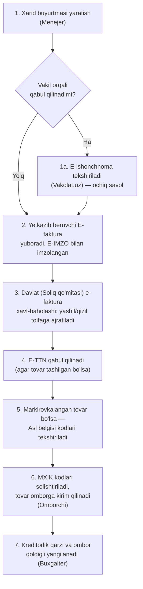

| Qadam | Rol | Modul | Hujjat | Davlat tizimi | Buxgalteriya effekti |
|---|---|---|---|---|---|
| 1 | Menejer | M07 | Ichki xarid buyurtmasi | — | Effekt yo'q (hali majburiyat yo'q) |
| 1a | Omborchi | M07 | E-ishonchnoma | E-ishonchnoma (Vakolat.uz) | Effekt yo'q |
| 2 | Buxgalter / tizim | M07 | E-faktura (EHF) | E-faktura, E-IMZO | Kreditorlik qarzi paydo bo'ladi |
| 3 | Davlat (tashqi) | M07, M10 | E-faktura risk-belgisi | E-faktura (davlat xavf-baholashi, VM Qarori №830-son) | Agar "qizil" — QQS krediti to'lovgacha kechiktiriladi |
| 4 | Omborchi | M07, M04 | E-TTN | E-TTN, E-IMZO | Effekt yo'q |
| 5 | Omborchi | M04, M07 | Asl belgisi qabul akti | Asl belgisi | Effekt yo'q (faqat tekshirish) |
| 6 | Omborchi | M04 | Ichki kirim hujjati | MXIK | Ombor qoldig'i ortadi |
| 7 | Buxgalter | M11 | Provodka (avtomatik) | — | Ombor (aktiv) ortadi, kreditorlik qarzi (passiv) ortadi |

Manba: `03-efaktura-va-tolov.md` (E-faktura, E-TTN, E-IMZO, davlat xavf-baholashi), `02-kassa-ofd-markirovka.md` (Asl belgisi qabul jarayoni), `09-soliq-integratsiyasi.md` (MXIK, e-ishonchnoma — 14-qator). *Ochiq savol (qadam 1a va 3): (a) e-ishonchnoma tekshirish AIOS'ga qanday integratsiya qilinishi (Vakolat.uz API hujjati topilmadi) va bu qadam qachon kerak bo'lishi aniq emas; (b) davlat xavf-baholash natijasi (yashil/qizil belgi) AIOS'ga qaysi kanal orqali (EDO operatori — Didox/Faktura.uz orqali, yoki boshqa yo'l bilan) yetib kelishi ochiq manbada ko'rsatilmagan.*

---

## BP-02: Sotuv — kassa (naqd/karta bilan oddiy chakana savdo)

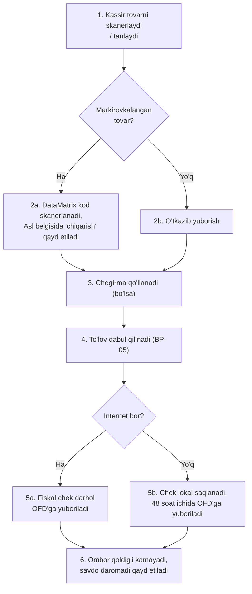

| Qadam | Rol | Modul | Hujjat | Davlat tizimi | Buxgalteriya effekti |
|---|---|---|---|---|---|
| 1 | Kassir | M01 | — | — | — |
| 2a | Kassir | M01, M04 | Asl belgisi chiqarish yozuvi | Asl belgisi | — |
| 3 | Kassir | M03 | — | — | Sotish narxi kamayadi |
| 4 | Kassir | M01, M08 (naqd bo'lmasa) | To'lov kvitansiyasi | To'lov tizimi (BP-05) | Pul mablag'i (kassa/bank) ortadi |
| 5a/5b | Tizim | M01 | Fiskal chek (MXIK, fiskal belgi, QR) | Virtual kassa/OFD (48 soat qoidasi — 943-son, 1-ilova, 31-band), MXIK | Savdo daromadi va QQS majburiyati hisoblanadi |
| 6 | Tizim | M04, M11 | Avtomatik provodka | — | Ombor qoldig'i kamayadi, sotilgan tovar tannarxi hisoblanadi |

Manba: `02-kassa-ofd-markirovka.md` (fiskal chek, 48 soat qoidasi, Asl belgisi POS jarayoni, MXIK), `09-soliq-integratsiyasi.md`.

---

## BP-03: Sotuv — nasiya (qarzga sotish)

*(2026-10-15: asoschi qarori, Q3 — avvalgi diagramma/jadval "nasiya sotuvda fiskal chek darhol chiqadi" deb ko'rsatgan edi, bu almashtirildi)*

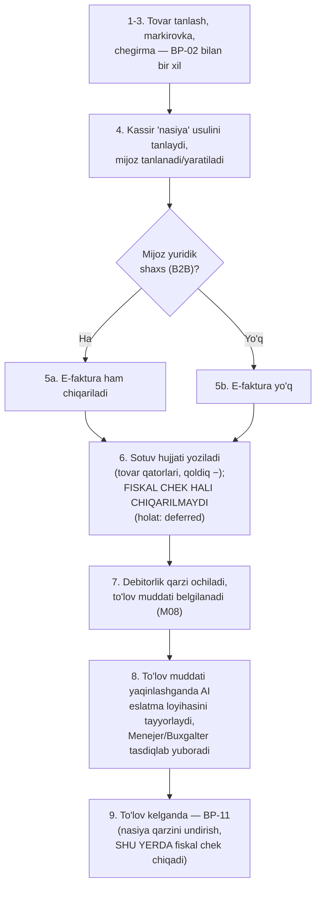

| Qadam | Rol | Modul | Hujjat | Davlat tizimi | Buxgalteriya effekti |
|---|---|---|---|---|---|
| 1-3 | Kassir | M01, M04, M03 | — | Asl belgisi, MXIK | BP-02 bilan bir xil |
| 4 | Kassir | M08 | Mijoz kartasi | — | — |
| 5a | Tizim | M08, M10 | E-faktura (agar B2B) | E-faktura, E-IMZO | — |
| 6 | Tizim | M01, M08 | Sotuv hujjati (`deferred`) — **fiskal chek yo'q** | — | Ombor kamayadi; savdo daromadi/QQS **hali tan olinmaydi** (⚠ aniq vaqt — buxgalter/yurist tasdig'ini kutadi, `FiscalPolicy`) |
| 7 | Tizim | M08 | Nasiya hujjati | — | Debitorlik qarzi ortadi (pul o'rniga) |
| 8 | Tizim (AI) / Menejer | M08 | Eslatma matni (loyiha) | — | Effekt yo'q — AI faqat matn loyihasini tayyorlaydi, odam tasdiqlagandan keyin yuboriladi (AI-06, `05-ai-funksiyalar.md`) |
| 9 | — | M08 | **Fiskal chek shu yerda chiqadi** | — | Davomi BP-11'da (nasiya qarzini undirish) |

Manba: `03-efaktura-va-tolov.md` (B2B e-faktura), `02-kassa-ofd-markirovka.md`; `spec/tekshiruv/asoschi-qarorlari-2026-10-15.md`, Q3. *Eslatma: B2C nasiya savdosida ham e-faktura kerakligi/kerak emasligi ochiq manbada aniq ko'rsatilmagan — "taxmin" sifatida belgilangan (faqat yuridik shaxslar uchun E-faktura shart, `03-fayl` 1.1-band).*

---

## BP-04: Qaytarish

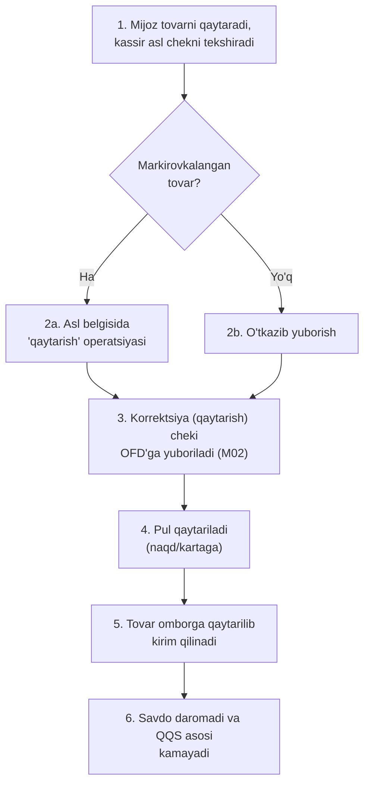

| Qadam | Rol | Modul | Hujjat | Davlat tizimi | Buxgalteriya effekti |
|---|---|---|---|---|---|
| 1 | Kassir | M02 | Asl chek | — | — |
| 2a | Kassir | M02, M04 | Asl belgisi qaytarish yozuvi | Asl belgisi | — |
| 3 | Tizim | M01, M02 | Korrektsiya cheki | Virtual kassa/OFD, MXIK | Savdo daromadi kamayadi |
| 4 | Kassir | M02 | To'lov qaytarish kvitansiyasi | To'lov tizimi (karta bo'lsa) | Pul mablag'i kamayadi |
| 5 | Omborchi | M04 | Ichki kirim hujjati | — | Ombor qoldig'i ortadi |
| 6 | Buxgalter | M10, M11 | Avtomatik provodka | — | QQS majburiyati mos ravishda qayta hisoblanadi |

Manba: `02-kassa-ofd-markirovka.md` (korrektsiya cheki tushunchasi fiskal chek talablaridan kelib chiqadi). *Eslatma: markirovkalangan tovarni Asl belgisi tizimida qanday "qaytarish" qilish kerakligi texnik API hujjatlari yopiq bo'lgani sababli ochiq manbada tasdiqlanmagan — "taxmin" (qadam 2a).* *(2026-10-15: foydalanuvchi qarori)* **Markirovkalangan tovarni qaytarish faqat internet bor paytda (online) amalga oshiriladi** — offline rejimda bu jarayon butunlay bloklanadi (`02-modullar-talablari.md`, M02 Offline xatti-harakati; `spec/tekshiruv/savollar-yakuniy-tavsiyalar.md`, tavsiya #5).

---

## BP-05: To'lov qabul qilish (naqd, karta, QR/Click/Payme)

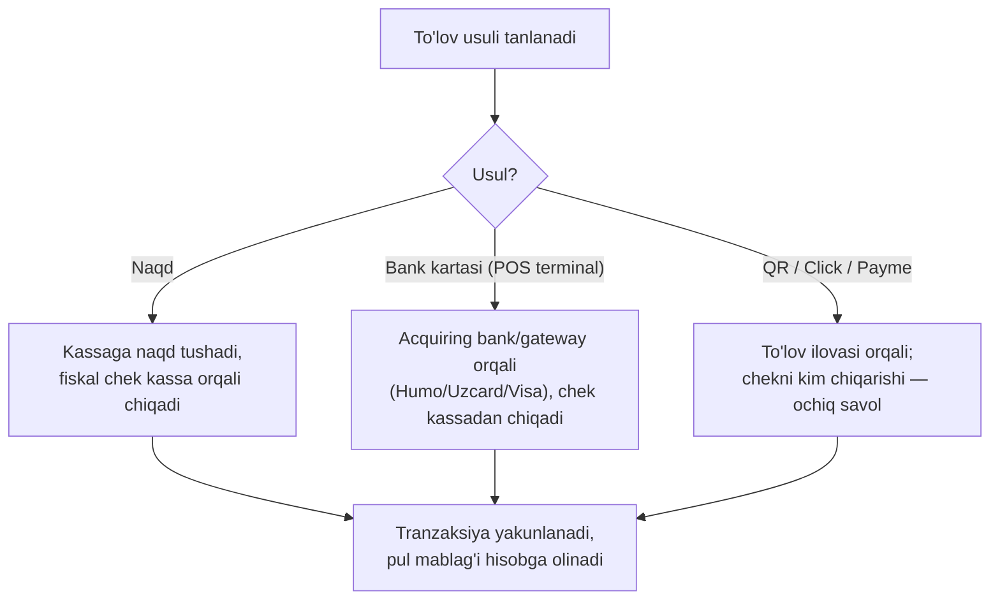

| Qadam | Rol | Modul | Hujjat | Davlat tizimi | Buxgalteriya effekti |
|---|---|---|---|---|---|
| Naqd | Kassir | M01 | Fiskal chek | Virtual kassa/OFD | Kassadagi naqd pul ortadi |
| Karta | Kassir | M01 | Terminal cheki + fiskal chek | Virtual kassa/OFD (acquiring bank orqali) | Bank hisobidagi mablag' ortadi (kechikish muddati manbada ko'rsatilmagan — taxmin qilinmaydi) |
| *(2026-10-15: foydalanuvchi qarori)* Karta — mustaqil terminal (qo'lda belgilangan) | Kassir | M01, M16 | Fiskal chek + ixtiyoriy terminal operatsiya raqami | Virtual kassa/OFD (kassa terminal bilan integratsiyalanmagan) | Online va offline'da ruxsat; Z-hisobotda "karta" jami alohida chiqadi, Egasi kun oxirida bank ko'chirmasi bilan solishtiradi |
| QR/Click/Payme | Kassir/mijoz | M01 | To'lov tasdiqlash + fiskal chek | Virtual kassa/OFD, (Click/Payme/Uzum API) | Mablag' vositachi orqali tushadi, komissiya ushlab qolinadi |
| *(2026-10-14: tekshiruv)* Yagona QR (UzQR, bank) | Kassir/mijoz | M01 | To'lov tasdiqlash + fiskal chek | Virtual kassa/OFD, bank (yagona QR) | Mablag' bank orqali tushadi; yuridik shaxslar uchun 2026-07-01'dan majburiy (PF-246-son, 3-band "b"), YTT uchun ixtiyoriy, Click/Payme/Uzum'ning o'rnini bosmaydi |

Manba: `03-efaktura-va-tolov.md` (Payme/Click/Uzum protokollari, komissiya jadvali, 2.5-band — chekni kim chiqarishi haqidagi huquqiy ziddiyat). *Ochiq savol: QR/Click/Payme orqali to'lovda fiskal chekni to'lov tizimi yoki merchant kassasi chiqarishi — ikki huquqiy talqin mavjud, aniqlashtirish kerak (quyidagi "Ochiq savollar"ga qarang).*

---

## BP-06: Buxgalteriya provodkalari (yuqori daraja)

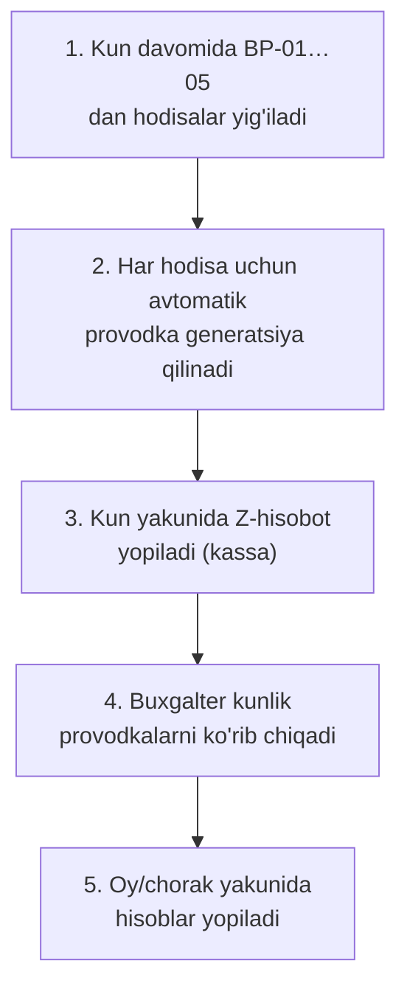

| Qadam | Rol | Modul | Hujjat | Davlat tizimi | Buxgalteriya effekti |
|---|---|---|---|---|---|
| 1-2 | Tizim | M11 | Avtomatik provodkalar | — | Xarid → ombor va kreditorlik qarzi ortadi; sotuv → ombor kamayadi, daromad va QQS ortadi; to'lov → pul mablag'i o'zgaradi; qaytarish → teskari yozuv |
| 3 | Kassir/tizim | M01, M11 | Z-hisobot | Virtual kassa/OFD | Kunlik savdo yakunlanadi |
| 4 | Buxgalter | M11 | Kunlik hisobot | — | Xatolar/tafovutlar aniqlanadi |
| 5 | Buxgalter | M11, M12 | Oylik/choraklik yopish | — | Davr natijasi shakllanadi |

*Eslatma: bu yerda faqat qaysi hodisa qaysi hisob guruhiga (aktiv/passiv/daromad/xarajat) ta'sir qilishi ko'rsatilgan — aniq hisob raqamlari va to'liq hisob rejasi (NSBU №21 asosida) Arxitektura teamining `spec/02-arxitektura/` hujjatida bo'ladi (`00-xulosa-va-ochiq-savollar.md`, "MVP uchun eng muhim texnik qarorlar" jadvali).*

Manba: `00-xulosa-va-ochiq-savollar.md`.

---

## BP-07: QQS — ichki hisob-kitob va monitoring

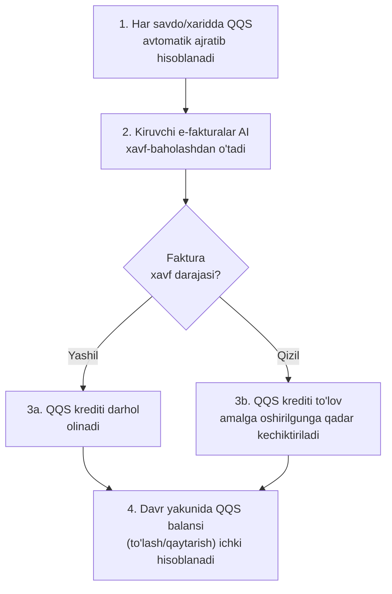

| Qadam | Rol | Modul | Hujjat | Davlat tizimi | Buxgalteriya effekti |
|---|---|---|---|---|---|
| 1 | Tizim | M10 | — | — | Chiquvchi/kiruvchi QQS hisoblanadi |
| 2 | Davlat (tashqi) | M10 | E-faktura risk-belgisi | E-faktura (davlat xavf-baholashi, VM Qarori №830-son) | — |
| 3a/3b | Buxgalter | M10 | — | — | QQS krediti olinadi yoki kechiktiriladi |
| 4 | Buxgalter | M10, M12 | Ichki QQS hisob-kitobi | — | Davr uchun QQS qarzi/haqdorligi aniqlanadi |

Manba: `03-efaktura-va-tolov.md` (davlat xavf-baholashi, ≤10% cheklov, VM Qarori №830-son — 1.2-band). *Eslatma: 2026-01-01 dan QQS deklaratsiyasining o'zini Soliq qo'mitasi tuzgani sababli, bu jarayonning natijasi endi "deklaratsiya topshirish" emas — BP-08'ga kirish ma'lumoti.*

---

## BP-08: Davlat tuzgan hisobotni ichki hisob bilan solishtirish (markaziy oqim)

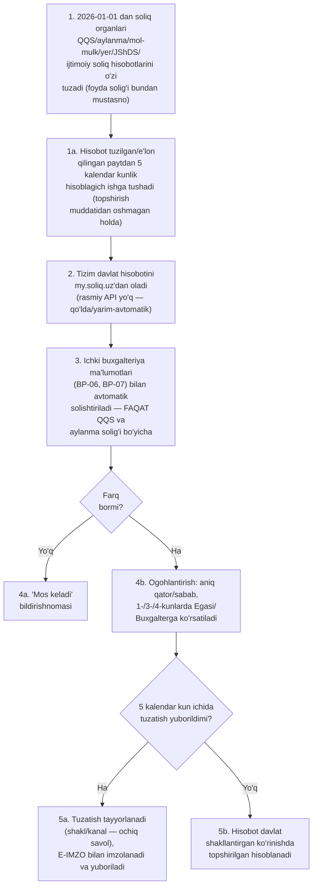

| Qadam | Rol | Modul | Hujjat | Davlat tizimi | Buxgalteriya effekti |
|---|---|---|---|---|---|
| 1 | Davlat (tashqi) | — | Davlat tuzgan hisobot | Soliq hisobotlari (my.soliq.uz) | — |
| 1a | Tizim | M12 | 5 kalendar kunlik hisoblagich (deadline obyekti, topshirish muddati bilan cheklangan) | — | — |
| 2 | Tizim/Buxgalter | M12 | Yuklab olingan hisobot | Soliq hisobotlari (my.soliq.uz) | — |
| 3 | Tizim | M10, M11, M12 | Solishtirish hisoboti | — | Farqlar (agar bor) aniqlanadi — faqat QQS va aylanma solig'i uchun |
| 4a/4b | Tizim/Buxgalter | M12 | Ogohlantirish (1-/3-/4-kun) | — | — |
| 5a | Buxgalter | M12 | Tuzatish hujjati | E-IMZO, Soliq hisobotlari (my.soliq.uz) | — |
| 5b | — | M12 | — | Soliq hisobotlari (my.soliq.uz) | Hisobot davlat shakllantirgan ko'rinishda topshirilgan hisoblanadi, keyingi tuzatish imkoni yo'qolishi mumkin |

Manba: Soliq kodeksi 81-moddasi, O'RQ-1108-son Qonun (2025-12-25) — [lex.uz/docs/-7944527](https://lex.uz/docs/-7944527) *(2026-10-14: birlamchi manba qo'shildi)*; `00-xulosa-va-ochiq-savollar.md` (5-band, markaziy xulosa), `04-arxitektura-va-stack.md` (6.1–6.3-band, solishtirish oqimi), `09-soliq-integratsiyasi.md` ("Elektron hisobotlar" qatori), [uz.kursiv.media, 2025-12-30](https://uz.kursiv.media/uz/2025-12-30/1-yanvardan-ayrim-soliq-hisobotlari-avtomatik-shakllantiriladi/) (ikkinchi darajali, mazmunan mos).

*Ochiq savollar:*
- *my.soliq.uz'dan dasturiy (API) o'qish yo'li topilmadi — qadam 2 MVP'da qo'lda yoki yarim-avtomatik (masalan, E-IMZO orqali shaxsiy kabinetga kirib yuklab olish) bo'lishi mumkin; bu avtomatlashtirish va'dasini kechiktiradi.*
- *(2026-10-14: hal qilindi)* ~~"5 ish kuni" qoidasining aniq qonun/qaror raqami lex.uz'da topilmadi~~ — endi aniq: Soliq kodeksi 81-moddasi, O'RQ-1108 (2025-12-25), muddat **5 kalendar kun**.
- *3-qadamda ichki solishtirish faqat QQS va aylanma solig'i uchun to'liq bajariladi* (2026-10-14: "foyda solig'i" olib tashlandi) *— mol-mulk, yer, JShDS va ijtimoiy soliq hisobotlari uchun kerakli ichki ma'lumot (asosiy vositalar hisobi, kadrlar/ish haqi) 18 MVP moduli qatorida yo'q (README.md); bu hisobotlar MVP'da faqat davlat bergan raqam sifatida ko'rsatiladi, ichki solishtirish keyingi bosqich.*
- *5a-qadamdagi tuzatishning aniq shakli (alohida ariza? my.soliq.uz portalida to'g'ridan-to'g'ri tuzatish kiritish?) va kanali manbada tasvirlanmagan — bu qism hali **ochiq savol** (muddat va huquqiy asos aniqlangan bo'lsa ham).*

---

## BP-09: Filiallararo ko'chirish

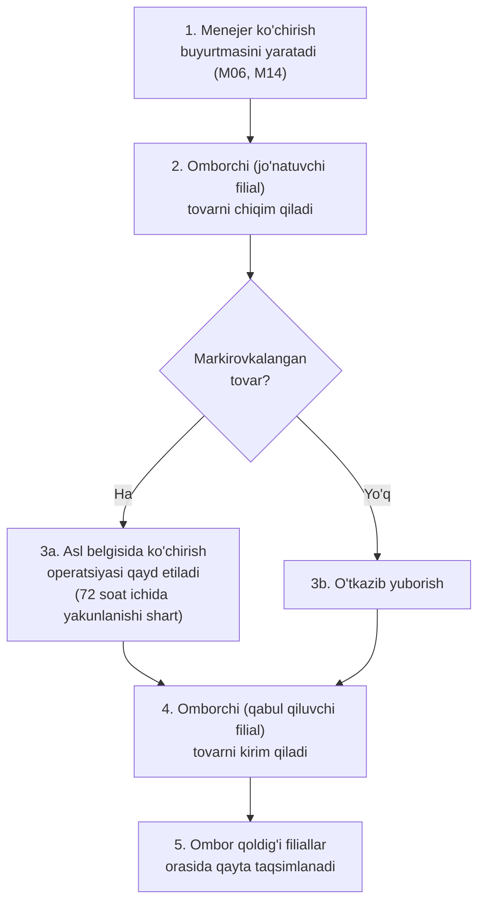

| Qadam | Rol | Modul | Hujjat | Davlat tizimi | Buxgalteriya effekti |
|---|---|---|---|---|---|
| 1 | Menejer | M06, M14 | Ko'chirish buyurtmasi | — | — |
| 2 | Omborchi | M06, M04 | Chiqim hujjati | — | Jo'natuvchi filial ombori kamayadi |
| 3a | Omborchi | M06 | Asl belgisi ko'chirish yozuvi | Asl belgisi (72 soat — 23-son qaror, 2026-01-23) | — |
| 4 | Omborchi | M06, M04 | Kirim hujjati | — | — |
| 5 | Tizim | M04, M14 | Avtomatik provodka | — | Qabul qiluvchi filial ombori ortadi, jo'natuvchi filial kamayadi (moddiy javobgarlik o'zgaradi) |

Manba: `02-kassa-ofd-markirovka.md` (23-son qaror, 72 soat chegarasi). *Ochiq savol: filiallararo (bir yuridik shaxs ichidagi) ichki ko'chirish uchun E-TTN talab qilinishi aniq tasdiqlanmagan — tashqi tashish uchun majburiylik aniq, ichki ko'chirish uchun "taxmin" sifatida belgilanadi.* *(2026-10-15: foydalanuvchi qarori)* **Markirovkalangan tovarni o'z filiallar/omborlar orasida ko'chirish offline rejimda ruxsat etiladi** (jo'natish va qabul ikkisi ham) — keyin sinxronlanadi, audit bilan; sabab — ichki ko'chirishda tovar egasi o'zgarmaydi (`02-modullar-talablari.md`, M06 Offline xatti-harakati; `spec/tekshiruv/savollar-yakuniy-tavsiyalar.md`, tavsiya #5).

---

## BP-10: Inventarizatsiya

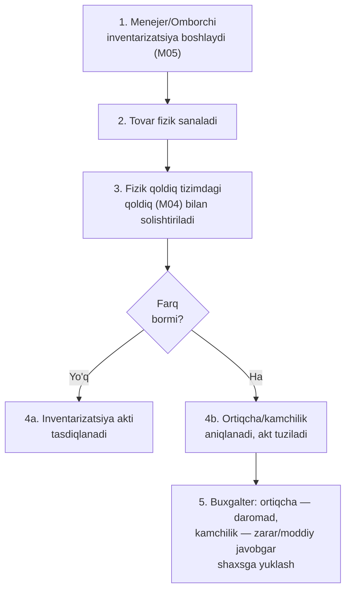

| Qadam | Rol | Modul | Hujjat | Davlat tizimi | Buxgalteriya effekti |
|---|---|---|---|---|---|
| 1 | Menejer/Omborchi | M05 | Inventarizatsiya buyrug'i | — | — |
| 2 | Omborchi | M05 | Fizik sanash varaqasi | — | — |
| 3 | Tizim | M05, M04 | Solishtirish hisoboti | — | — |
| 4a/4b | Omborchi/Menejer | M05 | Inventarizatsiya akti | — | — |
| 5 | Buxgalter | M11 | Avtomatik provodka | — | Ortiqcha aniqlansa — boshqa daromad ortadi; kamchilik aniqlansa — zarar yoki moddiy javobgar shaxsning qarzi ortadi |

Manba: `08-mahsulot-modullari.md` ro'yxatidagi M05 moduli (`README.md` orqali umumiy ro'yxat). *Ochiq savol: inventarizatsiyada aniqlangan markirovkalangan tovar kamchiligini Asl belgisi tizimida qanday "yopish" (ro'yxatdan chiqarish) kerakligi ochiq manbada topilmadi.*

---

## BP-11: Nasiya qarzini undirish (debitorlikni yopish)

*(2026-10-15: asoschi qarori, Q3 — avvalgi diagramma/jadval va ochiq savol almashtirildi; endi aniq: fiskal chek asl sotuvda emas, aynan shu bosqichda chiqadi)*

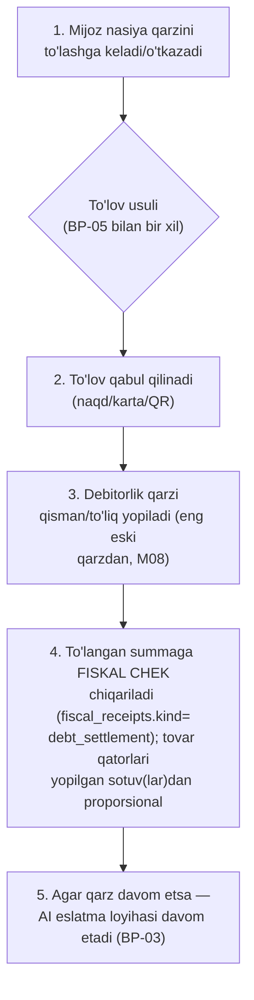

| Qadam | Rol | Modul | Hujjat | Davlat tizimi | Buxgalteriya effekti |
|---|---|---|---|---|---|
| 1 | Mijoz/Kassir | M08 | — | — | — |
| 2 | Kassir | M01, M08 | To'lov kvitansiyasi | Virtual kassa/OFD (BP-05 bilan bir xil) | Pul mablag'i ortadi |
| 3 | Tizim | M08 | Avtomatik provodka | — | Debitorlik qarzi kamayadi |
| 4 | Tizim | M01, M08 | **Fiskal chek** (`debt_settlement`) | Virtual kassa/OFD | Savdo daromadi va QQS majburiyati **shu bosqichda** hisoblanadi (⚠ standart ishchi qaror — aniq vaqt buxgalter/yurist tasdig'ini kutadi, `FiscalPolicy` sozlamasi) |
| 5 | Tizim (AI) / Menejer | M08 | — | — | Effekt yo'q |

Manba: `02-kassa-ofd-markirovka.md`, `09-soliq-integratsiyasi.md`; `spec/tekshiruv/asoschi-qarorlari-2026-10-15.md`, Q3. *(2026-10-15: asoschi qarori bilan hal qilindi, Q3)* ~~Ochiq savol: asl sotuvda fiskal chek allaqachon chiqarilgani uchun, keyinroq qarz to'langanda yangi fiskal chek kerak bo'lishi/kerak emasligi ochiq manbada ko'rsatilmagan~~ — endi aniq: asl nasiya sotuvida fiskal chek **chiqarilmaydi** (BP-03), **har bir qarz to'lovida yangi fiskal chek chiqariladi**. ⚠ Qolgan ochiq qism — QQS/daromadni tan olish vaqti (sotuv vs to'lov) va bu tartibning soliq qonunchiligiga mosligi, buxgalter va yurist tasdig'ini kutadi.

---

## BP-12: Yetkazib beruvchiga to'lov (kreditorlikni yopish)

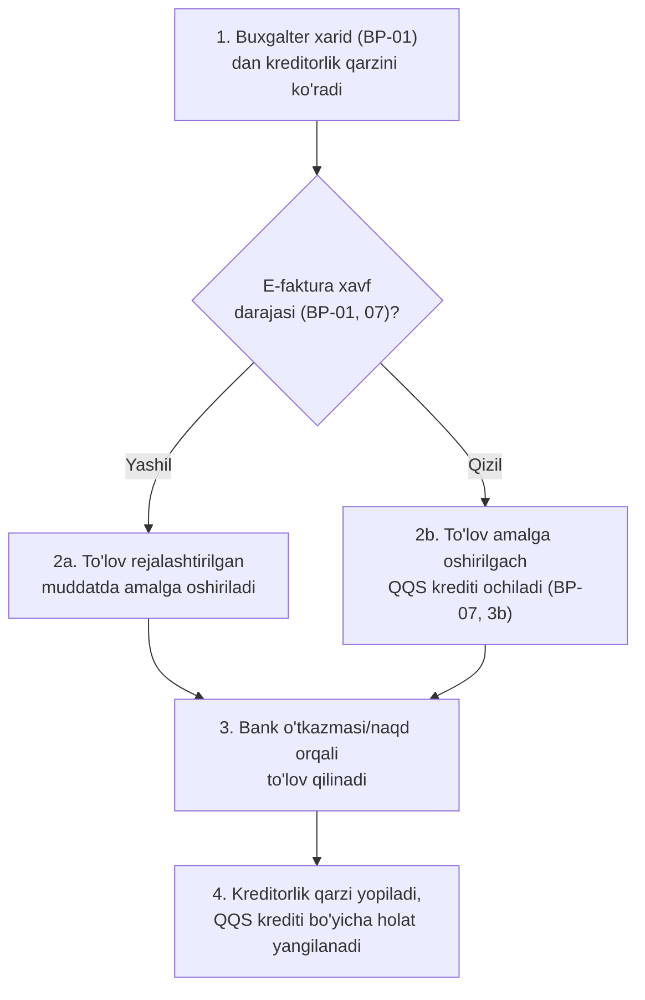

| Qadam | Rol | Modul | Hujjat | Davlat tizimi | Buxgalteriya effekti |
|---|---|---|---|---|---|
| 1 | Buxgalter | M07, M11 | Kreditorlik ro'yxati | — | — |
| 2a/2b | Buxgalter | M07, M10 | — | E-faktura (davlat xavf-baholashi) | — |
| 3 | Buxgalter/Egasi | M07 | To'lov topshirig'i/bank hujjati | Bank-klient (ixtiyoriy) | Pul mablag'i kamayadi |
| 4 | Tizim | M07, M10, M11 | Avtomatik provodka | — | Kreditorlik qarzi kamayadi; "qizil" faktura bo'lsa — QQS krediti endi olinadi |

Manba: `03-efaktura-va-tolov.md` (1.2-band — QQS krediti to'lovdan keyin beriladi), `04-arxitektura-va-stack.md` (6-bo'lim).

---

## BP-13: Chek asosida keyinchalik e-faktura chiqarish *(2026-10-15: foydalanuvchi qarori — qo'shildi)*

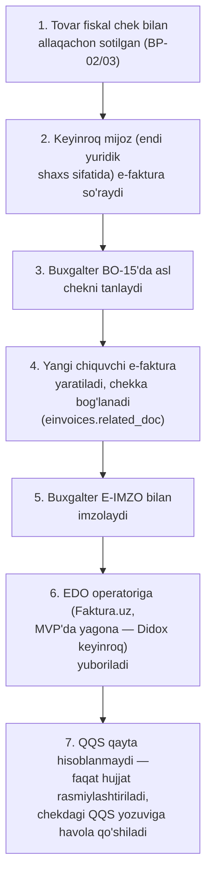

| Qadam | Rol | Modul | Hujjat | Davlat tizimi | Buxgalteriya effekti |
|---|---|---|---|---|---|
| 1 | Kassir/Tizim | M01 | Fiskal chek | Virtual kassa/OFD | Savdo daromadi va QQS allaqachon hisoblangan (BP-02/03) |
| 2 | Mijoz | M01 | So'rov (tizimdan tashqari, masalan qo'ng'iroq) | — | — |
| 3 | Buxgalter | M01, M07 | Asl chek tanlovi | — | — |
| 4 | Tizim | M01, M10 | Chiquvchi e-faktura (`einvoices.related_doc`) | — | Effekt yo'q — `ledger_entries`/`vat_moves`ga yangi yozuv qo'shilmaydi (append-only); bog'lanish faqat `einvoices.related_doc` orqali (`02-provodka-qoidalari.md` §2.22) *(2026-10-15: qabul-5 O13 bo'yicha aniqlashtirildi)* |
| 5 | Buxgalter | M01 | PKCS#7 imzo | E-IMZO | — |
| 6 | Tizim | M01 | Yuborilgan e-faktura | E-faktura (Faktura.uz — MVP'da yagona operator) | — |
| 7 | Tizim | M10, M11 | — | — | QQS **ikkinchi marta hisoblanmaydi** — registr yozuvlari o'zgarmaydi (append-only), bog'lanish faqat hujjat darajasida (`einvoices.related_doc`, `02-provodka-qoidalari.md` §2.22) *(2026-10-15: qabul-5 O13 bo'yicha aniqlashtirildi)* |

Manba: `spec/01-mahsulot/02-modullar-talablari.md` (US-M01-06, M01 chekka holatlar). *Eslatma: bu jarayon B2C sotuvdan keyin mijoz maqomi B2B'ga aniqlanganda (yoki boshidanoq B2B bo'lib, e-faktura keyin so'ralganda) ishlaydi.* *(2026-10-15: foydalanuvchi qarori)* **E-faktura operatori — MVP'da faqat Faktura.uz** (ochiq API hujjati tekshirilgan, REGOS ham ishlatadi); Didox — MVP'dan keyingi birinchi integratsiya (`spec/tekshiruv/savollar-yakuniy-tavsiyalar.md`, tavsiya #4).

---

## Davlat tizimlari × jarayon matritsasi

| Jarayon | Virtual kassa/OFD | E-faktura | E-TTN | Asl belgisi | MXIK | E-IMZO | E-ishonchnoma (Vakolat.uz) | Soliq hisobotlari (my.soliq.uz) |
|---|---|---|---|---|---|---|---|---|
| BP-01 Xarid | — | ✓ | ✓ | ✓ (qabulda) | ✓ | ✓ | ? (ochiq savol, vakil orqali qabulda) | — |
| BP-02 Sotuv (kassa) | ✓ | — | — | ✓ | ✓ | — | — | — |
| BP-03 Sotuv (nasiya) | **— (BP-11'da, Q3)** *(2026-10-15: asoschi qarori — avvalgi ✓ xato edi)* | ✓ (B2B bo'lsa, asl sotuv vaqtida) | — | ✓ | ✓ | ✓ (B2B e-faktura) | — | — |
| BP-04 Qaytarish | ✓ | — | — | ✓ | ✓ | — | — | — |
| BP-05 To'lov qabul qilish | ✓ | — | — | — | — | — | — | — |
| BP-06 Buxgalteriya provodkalari | — | — | — | — | — | — | — | — |
| BP-07 QQS ichki hisob-kitob | — | ✓ (davlat xavf-baholashi) | — | — | — | — | — | — |
| BP-08 Davlat hisobotini solishtirish | — | — | — | — | — | ✓ (e'tiroz imzosi, ochiq savol) | — | ✓ |
| BP-09 Filiallararo ko'chirish | — | — | ? (ochiq savol) | ✓ | — | — | — | — |
| BP-10 Inventarizatsiya | — | — | — | — | — | — | — | — |
| BP-11 Nasiya qarzini undirish | ✓ (BP-05 bilan bir xil) | — | — | — | — | — | — | — |
| BP-12 Yetkazib beruvchiga to'lov | — | ✓ (holat kuzatish) | — | — | — | — | — | — |
| BP-13 Chek asosida keyinchalik e-faktura *(2026-10-15)* | — | ✓ (chiquvchi, chekka bog'langan) | — | — | — | ✓ | — | — |

Matritsa talab qilingan 6 majburiy davlat tizimining barchasini kamida bitta jarayonda qoplaydi: Virtual kassa/OFD (BP-02, 03, 04, 05, 11), E-faktura (BP-01, 03, 07, 12, 13), E-TTN (BP-01), Asl belgisi (BP-01…04, 09), MXIK (BP-01…04), E-IMZO (BP-01, 03, 08, 13). Qo'shimcha ikki ustun — E-ishonchnoma (Vakolat.uz, 8 majburiy tizim ro'yxatidan, `09-fayl` 14-qator) va Soliq hisobotlari (my.soliq.uz) — markaziy oqim/vakillik holatlari uchun kiritildi.

---

## Ochiq savollar

1. Onlayn/QR to'lovda (Click/Payme/Uzum) fiskal chekni kim chiqarishi — to'lov tizimi "komissioner" sifatida (ГНК amaliy pozitsiyasi) yoki merchant o'zi (buxgalter.uz huquqiy tahlili) — ikki talqin ziddiyatli, aniqlashtirish kerak (`03-efaktura-va-tolov.md`, 2.5-band).
2. Davlat tuzgan hisobotni (my.soliq.uz) dasturiy (API) o'qish uchun rasmiy yo'l yo'q — BP-08'ning 2-qadami MVP'da qo'lda/yarim-avtomatik bo'lishi mumkin, bu avtomatlashtirish va'dasini kechiktiradi (`00-xulosa-va-ochiq-savollar.md`).
3. *(2026-10-15: to'liq hal qilindi — foydalanuvchi qarori)* Offline rejimda Asl belgisi kodini real-vaqtda tekshirish mumkin emas (CRPT Turon markaziy tizimga bog'liq), lekin endi barcha uchta harakat uchun siyosat aniq: **sotish** — narx qurilmada ma'lum bo'lsa ruxsat, bo'lmasa taqiq (US-M01-03); **ko'chirish** — o'z filiallar/omborlari orasida offline ruxsat (BP-09); **qaytarish** — faqat internet bor paytda, offline'da bloklanadi (BP-04). Huquqiy tasdiq (huquqshunos bilan) hamon tavsiya etiladi, lekin mahsulot qarori allaqachon qabul qilingan (`spec/tekshiruv/savollar-yakuniy-tavsiyalar.md`, tavsiya #5).
4. Markirovkalangan tovarni Asl belgisida "qaytarish" (BP-04) va inventarizatsiya kamchiligini "yopish" (BP-10) operatsiyalarining texnik tartibi ochiq manbada topilmadi — CRPT Turon integrator API hujjatlari 403 bilan yopiq (`02-kassa-ofd-markirovka.md`).
5. Bir yuridik shaxs ichidagi filiallararo (ichki) ko'chirish uchun E-TTN talab qilinishi aniq tasdiqlanmagan — faqat tashqi tashish uchun majburiylik aniq (taxmin, BP-09).
6. B2C (jismoniy shaxsga) nasiya savdosida e-faktura talab qilinishi/qilinmasligi aniq ko'rsatilmagan — faqat B2B (yuridik shaxslar orasida) uchun e-faktura shart ekani tasdiqlangan (taxmin, BP-03).
7. *(2026-10-14: qisman hal qilindi)* Virtual kassa dasturini Davlat reyestriga kiritish **muddati endi aniq**: VMQ-943 4-ilova — Soliq qo'mitasi qarori 20 ish kuni, Kiberxavfsizlik markazi xulosasi 15 ish kuni, fiskal ma'lumotlar operatori xulosasi 10 ish kuni, texnik tartibga solish agentligi/"O'zeltexsanoat" xulosasi 5 ish kuni (bosqichlar ketma-ket bo'lsa, jami jarayon bir necha oy davom etishi mumkin). **Narx qisman aniq**: zaxira mablag' talabi (100/500/1000 BHM) virtual kassaga **tegishli emas**. Bu BP-02…05'ning amaliy ishga tushish jadvaliga ta'sirini kamaytiradi, lekin jadvalni hali ham aniqlashtirish kerak (bosqichlar ketma-ketmi, parallelmi — manbada ko'rsatilmagan).
8. *(2026-10-14: hal qilindi)* ~~"5 ish kuni" qoidasining aniq qonun/qaror raqami lex.uz'da topilmadi~~ — endi aniq: Soliq kodeksi 81-moddasi, O'RQ-1108-son Qonun (2025-12-25), muddat **5 kalendar kun** ([lex.uz/docs/-7944527](https://lex.uz/docs/-7944527)).
9. BP-08, 5a-qadamdagi tuzatishning aniq shakli (ariza? portalda to'g'ridan-to'g'ri tuzatish?) va yuborish kanali manbada tasvirlanmagan — faqat "tuzatish, qo'lda, E-IMZO bilan" deyilgan (`04-fayl`, 6.3-band); muddat (5 kalendar kun) va huquqiy asos (Soliq kodeksi 81-moddasi) endi aniq.
10. E-ishonchnoma (Vakolat.uz) AIOS'ga qanday integratsiya qilinishi va BP-01'da aniq qachon talab qilinishi (har doim vakil orqali qabulda, yoki faqat ba'zi holatlarda) ochiq manbada ko'rsatilmagan — API hujjati topilmadi (`09-soliq-integratsiyasi.md`, 14-qator).
11. BP-01, 3-qadamda davlat xavf-baholash natijasi (yashil/qizil) AIOS'ga qaysi kanal orqali yetib kelishi (EDO operatori — Didox/Faktura.uz orqali, yoki boshqa yo'l) ochiq manbada ko'rsatilmagan.
12. *(2026-10-15: asoschi qarori bilan hal qilindi, Q3)* ~~BP-11'da nasiya qarzi to'langanda yangi fiskal chek chiqarilishi kerakligi/kerak emasligi ochiq manbada javobsiz qoldi~~ — endi aniq: **ha**, BP-11'da har bir to'lovga yangi fiskal chek (`debt_settlement`) chiqariladi, asl BP-03 sotuvida chek chiqarilmaydi. ⚠ Qolgan ochiq qism: QQS/daromadni tan olish vaqti va bu tartibning qonuniyligi — buxgalter/yurist tasdig'ini kutadi (`spec/tekshiruv/asoschi-qarorlari-2026-10-15.md`, Q3).

## Manbalar

- `research_notes/texnik/00-xulosa-va-ochiq-savollar.md`
- `research_notes/texnik/02-kassa-ofd-markirovka.md`
- `research_notes/texnik/03-efaktura-va-tolov.md`
- `research_notes/texnik/04-arxitektura-va-stack.md`
- `research_notes/texnik/09-soliq-integratsiyasi.md`
- `research_notes/texnik/10-bozorda-soliq-integratsiyasi.md`
- `spec/01-mahsulot/05-ai-funksiyalar.md` (AI-06 — nasiya eslatma matni, odam tasdiqlaydi)
- [lex.uz/docs/4603329](https://lex.uz/docs/4603329) — VM 943-son qaror, 1-ilova 31-band (48 soat offline qoidasi)
- [lex.uz/docs/8012407](https://www.lex.uz/docs/8012407) — 23-son qaror (2026-01-23), Asl belgisi 72 soat ko'chirish chegarasi
- [lex.uz/uz/docs/-7962143](https://lex.uz/docs/-7962143) — VM Qarori №830-son, e-faktura davlat xavf-baholashi
- [lex.uz/docs/-7944527](https://lex.uz/docs/-7944527) — Soliq kodeksi 81-moddasi, O'RQ-1108-son Qonun (2025-12-25) — davlat hisobot shakllantirish, 5 kalendar kunlik tuzatish qoidasi *(2026-10-14: qo'shildi)*
- [uz.kursiv.media, 2025-12-30](https://uz.kursiv.media/uz/2025-12-30/1-yanvardan-ayrim-soliq-hisobotlari-avtomatik-shakllantiriladi/) — 5 kunlik va avtomatik qabul qoidasi (ikkinchi darajali manba, endi birlamchi qonun bilan tasdiqlangan)
- `research_notes/texnik/tekshiruv-2026-10-14/` — 2026-10-14 fakt-tekshiruv natijalari
- Foydalanuvchi qarori, 2026-10-15 — BP-13 (chek asosida keyinchalik e-faktura) qo'shildi (US-M01-06, `02-modullar-talablari.md`)
- `spec/tekshiruv/savollar-yakuniy-tavsiyalar.md` — 2026-10-15, tavsiya #5 (offline qaytarish/ko'chirish) va #6 (mustaqil terminal bilan karta)
