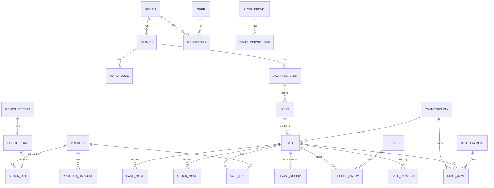

# Ma'lumotlar modeli

*2026-10-14 · Asos: `spec/01-mahsulot/02-modullar-talablari.md` (M01–M18), `03-biznes-jarayonlar.md` (BP-01…12), `research_notes/texnik/01-erp-modullar-va-malumot-modeli.md` (hujjat → o'tkazma → registr), `04-arxitektura-va-stack.md`.*

## Asosiy xulosalar

1. **Uch qatlam**: (a) **ma'lumotnomalar** (tovarlar, mijozlar, filiallar…) — tahrirlanadi, o'chirilmaydi (arxivlanadi); (b) **hujjatlar** (chek, kirim, qaytarish, qarz, xarajat…) — o'tkazilgandan keyin **o'zgarmaydi**, faqat teskari (storno) registr yozuvlari bilan bekor qilinadi (`status=cancelled`) *(2026-10-14: tekshiruv)*; (c) **registrlar** (qoldiq, partiyalar, qarz, kassa, buxgalteriya) — faqat hujjat o'tkazilganda yoziladigan **append-only harakatlar** + ulardan hisoblangan balanslar.
2. Har jadvalda `tenant_id` (RLS); filialga tegishli jadvallarda `branch_id`. Kalitlar — **UUIDv7** (vaqt bo'yicha tartiblangan, offline qurilmada ham yaratiladi — kassa serverni kutmasdan ID beradi).
3. Pul — `NUMERIC(18,2)` (so'm, tiyin bilan), miqdor — `NUMERIC(18,3)` (kg/l uchun), narx/tannarx — `NUMERIC(18,4)`. Float ishlatilmaydi.
4. Hujjat o'tkazish (posting) **bitta DB tranzaksiya**: hujjat holati + barcha registr harakatlari + buxgalteriya provodkasi birga yoziladi yoki birga bekor bo'ladi.
5. Tannarx uchun kirimlar har doim **partiya** (`stock_lots`) sifatida saqlanadi — FIFO ham, AVECO ham shu ma'lumotdan hisoblanadi (US-M04-05).
6. Offline'da yaratilgan har hujjatda `client_event_id` (qurilma generatsiya qilgan UUID) — server uni ikkinchi marta qabul qilmaydi (idempotentlik).
7. Hujjat raqamlari tenant + filial + hujjat turi + yil bo'yicha ketma-ket; fiskal chek raqami — kassa + smena ichida ketma-ket (OFD talabi).

---

## 1. Umumiy qoidalar

| Qoida | Tafsilot |
|---|---|
| Kalit | `id UUID` (v7). Offline qurilma o'zi yaratadi |
| Majburiy ustunlar | `tenant_id`, `created_at`, `created_by`, `updated_at`; hujjatlarda — 6-bo'limdagi umumiy sarlavha (yagona ro'yxat) *(2026-10-14: tekshiruv)* |
| O'chirish | Ma'lumotnomalar: `archived_at` (soft). Hujjatlar: hech qachon — `status=cancelled` + registrlarda storno qatorlar (`reversal_of_id`) *(2026-10-14: tekshiruv)*. Registrlar: hech qachon |
| Vaqt | `TIMESTAMPTZ`, UTC saqlanadi; UI'da Toshkent vaqti (UTC+5). Hisob sanasi — `doc_date DATE` (Toshkent bo'yicha) |
| Matn | Nomlar lotin/kirill/rus aralash bo'lishi mumkin; qidiruv uchun `pg_trgm` indeks |
| Tenant izolyatsiyasi | Har jadvalda RLS siyosati: `tenant_id = current_setting('app.tenant_id')` (`05-xavfsizlik-va-audit.md`) |
| Versiya | Ma'lumotnomalarda `version INT` — optimistik qulflash (ikki kishi bir vaqtda tahrirlasa) |
| RLS istisnolari | `tenant_id`'siz global jadvallar: `plans`, `units`, `platform_admins` (ilova roliga faqat SELECT, `platform_admins`ga umuman yo'q). `tenants` — siyosat `id = app.tenant_id`. `users` — siyosat `id = app.user_id OR EXISTS(memberships m WHERE m.user_id = users.id AND m.tenant_id = app.tenant_id)`; login/tenant tanlash — `SECURITY DEFINER` funksiyalar `auth_find_user(phone)`, `auth_list_memberships(user_id)` orqali *(2026-10-14: tekshiruv)* |

## 2. Platforma (M17)

| Jadval | Asosiy maydonlar | Izoh |
|---|---|---|
| `tenants` | id, name, activity_type, stir (null), phone, settings JSONB (`valuation_method`, `ai_training_consent`, …) | Bitta do'kon/kompaniya. Obuna/hayot sikli holati bu yerda **emas** — `subscriptions.status` *(2026-10-14: tekshiruv)* |
| `plans` | id, code (`start`/`biznes`/`pro`), price_month, price_year, limits JSONB (`max_registers`, `max_branches`, `ai_monthly_tokens`, …) | Tariflar (`06-mvp-chegarasi.md` 3.3) |
| `subscriptions` | tenant_id (UNIQUE — bitta tenant, bitta qator), plan_id, period (`month`/`year`), current_period_end (trial'da = trial tugash sanasi), grace_ends_at, status (`trial`/`active`/`grace`/`restricted`/`closed`) | Tenant hayot siklining **yagona** manbai; holat mashinasi 8-bo'limda *(2026-10-14: tekshiruv)* |
| `billing_payments` | tenant_id, amount, provider (`click`/`payme`), provider_tx_id (unique), status, paid_at | Bizning daromad; webhook idempotent |
| `platform_admins` | id, email, role | Ichki admin (ADM-01), tenantlarga RLS'siz kiradi — faqat audit bilan |

## 3. Tashkilot, foydalanuvchilar, huquqlar (M13, M14)

| Jadval | Asosiy maydonlar | Izoh |
|---|---|---|
| `branches` | tenant_id, name, address, is_default, settlement_category (`city_100k_plus`/`other`/`remote_mountain`), activity_type (`retail`/`other`) | Filial (M14). `settlement_category` + `activity_type` aylanma solig'i stavkasini aniqlaydi (Soliq kodeksi 467-modda: chakana 4% / 2% / 1%; tamaki savdosi har doim 4%; boshqa faoliyat 4%; YTT/o'zini o'zi band qilgan 1% — tenant darajasida) *(2026-10-14: tekshiruv)* |
| `branch_tax_settings` | branch_id, valid_from, settlement_category, activity_type | Aylanma solig'i stavkasi tarixi — yangi qiymat faqat `valid_from` sanasidan qo'llanadi, oldingi davrlar qayta hisoblanmaydi *(2026-10-14: tekshiruv)* |
| `warehouses` | tenant_id, branch_id, name, type (`store`/`stock`) | MVP: har filialda 1 ta ombor (avtomatik) |
| `cash_registers` | tenant_id, branch_id, name, kind (`web`/`android`), fiscal_module_id, ofd_status | Kassa (virtual kassa ID shu yerda) |
| `devices` | tenant_id, cash_register_id, kind (`web`/`android`), token_hash (**faqat android**, Bearer), token_expires_at, revoked_at, revoked_by, last_seen_at, last_sync_at, app_version | Offline sync uchun. Qurilma tokeni (Bearer) faqat Android uchun; veb-kassa — sessiya cookie (`05-xavfsizlik-va-audit.md` 1-bo'lim) *(2026-10-14: tekshiruv)* |
| `users` | id, phone (unique global), name, password_hash/pin_hash, locale | Bir odam bir nechta tenantda ishlashi mumkin |
| `memberships` | tenant_id, user_id, role_ids[], branch_ids[] (bo'sh = hammasi), status | Kim qaysi do'konda, qaysi filialda |
| `roles` | tenant_id, name, is_system (`owner`/`manager`/`cashier`/`storekeeper`/`accountant`) | Standart 5 rol + o'zinikini yaratish |
| `role_permissions` | role_id, permission_code, limit_value (null) | Masalan `discount.give` limit 10%, `cash.withdraw` limit 500 000 |
| `permissions` (kod ichida, jadval emas) | `sales.create`, `returns.approve`, `debts.forgive`, `prices.edit`, … | Ro'yxat `05-xavfsizlik-va-audit.md` da |

## 4. Katalog va narxlar (M09)

| Jadval | Asosiy maydonlar | Izoh |
|---|---|---|
| `product_categories` | tenant_id, parent_id, name | Daraxt |
| `units` | code (`pcs`, `kg`, `l`, `m`, `box`), is_fractional | Global ro'yxat |
| `products` | tenant_id, name, category_id, unit_code, mxik_code (17 belgi), package_code, vat_rate (12 / 0 / imtiyoz kodi), is_marked (Asl belgisi), is_weighed, min_stock, archived_at, version | MXIK — chekning majburiy rekviziti |
| `product_barcodes` | tenant_id, product_id, barcode (unique per tenant), kind (`ean`/`internal`/`weighed_prefix`), units_per_barcode | Bir tovarga bir nechta kod (dona/quti) |
| `product_prices` | tenant_id, product_id, branch_id (null = hamma), price, valid_from, set_by, price_change_doc_id | Tarix saqlanadi (US-M09-01) |
| `label_print_queue` | tenant_id, product_id, reason (`price_changed`/`new`), printed_at | US-M09-04 |
| `internal_barcode_seq` | tenant_id, next_value | Ichki kodlar diapazoni (masalan `2000000…`) — tashqi EAN bilan to'qnashmaydi |
| `discount_rules` | tenant_id, name, scope (`product`/`category`/`all`), target_ids[], kind (`percent`/`amount`/`n_plus_m`), value, branch_ids[] (bo'sh = hammasi), valid_from, valid_to, priority, archived_at | US-M03-02 (MVP'dan keyin); bitta chek qatoriga eng yuqori `priority`li bitta qoida (**taxmin**) *(2026-10-14: tekshiruv)* |

## 5. Kontragentlar (M07, M08)

| Jadval | Asosiy maydonlar | Izoh |
|---|---|---|
| `counterparties` | tenant_id, kind (`person`/`company`), name, phone, stir (yuridik), is_customer, is_supplier, credit_limit (null = limitsiz), notify_consent (bool + sana), telegram_chat_id, note | Mijoz ham, yetkazib beruvchi ham bitta jadvalda |

## 6. Hujjatlar

Barcha hujjatlarda umumiy sarlavha (**yagona ro'yxat**, boshqa joyda takrorlanmaydi): `id, tenant_id, branch_id, number, temp_number` (offline vaqtinchalik raqam, `{qurilma}-{lokal seq}`; server yaratgan hujjatda null; UNIQUE (tenant_id, device_id, temp_number)), `doc_date, status, created_by, created_at, updated_at, posted_at, cancelled_at, cancelled_by, cancel_reason, client_event_id` (UNIQUE (tenant_id, client_event_id)), `device_id, comment`. Bekor qilish alohida teskari hujjat yaratmaydi: asl hujjat `cancelled` bo'ladi, registrlarga storno qatorlar yoziladi (7-bo'lim). *(2026-10-14: tekshiruv)*

| Hujjat (jadval) | Qatorlar | Modul | Nimani o'zgartiradi (registrlar) |
|---|---|---|---|
| `shifts` | — | M01, M16 | ochilish/yopilish, boshlang'ich va sanalgan naqd |
| `sales` (chek) | `sale_lines` (product, qty, price, discount, vat_rate, vat_amount, cost_amount, marking_code (markirovkalangan tovarda **qty = 1** majburiy — har kod alohida qator), lot_allocations JSONB), `sale_payments` (method: `cash`/`card`/`uzqr`/`click`/`payme`/`uzum`/`debt`, amount, provider_tx_id, qr_type: `static`/`dynamic`/null — `uzqr` = bank tomonidan generatsiya qilingan yagona QR, PF-246 bo'yicha yuridik shaxslar uchun 2026-07-01'dan majburiy) | M01, M03, M08 | qoldiq −, tannarx, kassa naqd +, qarz + (nasiya), QQS, buxgalteriya *(2026-10-14: tekshiruv)* |
| `returns` | `return_lines` (sale_line_id, qty) | M02 | qoldiq +, kassa −/qarz −, QQS −, buxgalteriya |
| `purchase_orders` | `po_lines` | M07 | — (rejalashtirish, registrga ta'sir yo'q) |
| `goods_receipts` (kirim) | `receipt_lines` (product, qty, cost, vat, expiry_date (ixtiyoriy)) | M07 | yangi partiya (lot), qoldiq +, yetkazib beruvchiga qarz + (nasiya bo'lsa), kirish QQS *(2026-10-14: tekshiruv)* |
| `supplier_returns` (yetkazib beruvchiga qaytarish) | `supplier_return_lines` (receipt_line_id, lot_id, qty, cost, vat) | M07 | qoldiq − (asl partiyadan), yetkazib beruvchiga qarz − (yoki debitorlik), kiritiladigan QQS − *(2026-10-14: tekshiruv)* |
| `transfers` | `transfer_lines` | M06 | jo'natuvchi qoldiq −, yo'lda; qabul qiluvchi qoldiq + (tannarx partiya bilan ko'chadi) |
| `stock_counts` (inventarizatsiya) | `count_lines` (expected, counted) | M05 | farq bo'yicha qoldiq ±, kamomad xarajat / ortiqcha daromad |
| `write_offs` (hisobdan chiqarish) | `write_off_lines` (product, lot_id, qty, reason: `expired`/`damaged`/`gift`/`other`) | M04, M05 | qoldiq −, xarajat *(2026-10-14: tekshiruv)* |
| `price_changes` | `price_change_lines` | M09 | `product_prices`, yorliq navbati |
| `stock_openings` (boshlang'ich qoldiq) | `opening_lines` (product, qty, unit_cost, expiry_date) | M04 | yangi partiya, qoldiq + (chek/faktura yo'q, US-M04-04) *(2026-10-14: tekshiruv)* |
| `debt_openings` (boshlang'ich qarz) | — (counterparty, amount, direction) | M08 | qarz registri (chek yo'q, US-M08-07) |
| `debt_payments` (qarz to'lovi) | `allocations` (qaysi qarzni yopdi) | M08 | qarz −, kassa/bank + |
| `debt_writeoffs` (kechish) | — | M08 | qarz −, xarajat (shubhali qarz), faqat Egasi |
| `supplier_payments` | `allocations` | M07, M08 | yetkazib beruvchiga qarz −, kassa/bank − |
| `expenses` | — (category_id, amount, source: `cash`/`bank`/`card`, cash_register_id + shift_id (source=`cash` bo'lsa majburiy), attachment_id, recurring_rule_id) | M15 | kassa/bank −, xarajat *(2026-10-14: tekshiruv)* |
| `cash_movements` (kassa pul harakati) | — (direction `in`/`out`, reason: `collection` (inkasso)/`deposit`/`owner_withdrawal`/`other`) | M16 | kassa naqd ±. Xarajat to'lovi bu hujjat **emas** — `ExpensePostingService` `cash_moves`ni o'zi yozadi *(2026-10-14: tekshiruv)* |

Qo'shimcha: `expense_categories`, `recurring_expenses` (rule: summa, kun, davr), `attachments` (S3 kaliti, turi, hajmi).

## 7. Registrlar (append-only)

| Registr | Maydonlar | Balans qanday olinadi |
|---|---|---|
| `stock_moves` | tenant_id, warehouse_id, product_id, lot_id, qty (±), cost_amount (±), doc_type, doc_id, line_id, moved_at | `stock_balances` (warehouse, product) — trigger/ilova tomonidan yangilanadigan jamlama jadval; tekshirish uchun `SUM(stock_moves)` |
| `stock_lots` (partiyalar) | tenant_id, warehouse_id, product_id, receipt_line_id, received_at, qty_in, qty_left, unit_cost, expiry_date | FIFO: `qty_left > 0` eng eskisidan; AVECO: `avg_costs` jadvali (warehouse, product, avg_cost, qty) har kirimda qayta hisoblanadi |
| `debt_moves` | tenant_id, counterparty_id, direction (`receivable` — bizga qarz / `payable` — bizning qarz), amount (±), due_date, doc_type, doc_id | `debt_balances` (counterparty, direction); qarz daftari = shu harakatlar ro'yxati |
| `cash_moves` | tenant_id, cash_register_id (yoki `bank_account_id`), shift_id, amount (±), method, doc_type, doc_id | Kutilgan naqd = smena bo'yicha `SUM` (US-M16-02) |
| `ledger_entries` (buxgalteriya) | tenant_id, entry_date, account_dt, account_kt, amount, doc_type, doc_id, analytics JSONB (product, counterparty, branch) | Aylanma va qoldiq vedomosti; hisob raqamlari `02-provodka-qoidalari.md` |
| `vat_moves` | tenant_id, period (oy), kind (`output`/`input`), base_amount, vat_amount, doc_type, doc_id, einvoice_id | QQS ichki hisob (M10) va davlat hisoboti bilan solishtirish. `status` ustuni yo'q: "qizil" faktura bo'yicha kiruvchi QQS to'lovgacha **umuman yozilmaydi** (`02-provodka-qoidalari.md` 4.1) *(2026-10-14: tekshiruv)* |

Barcha registrlarda umumiy ustunlar: `id, tenant_id, doc_type, doc_id, reversal_of_id` (storno qatorida — teskari qilinayotgan asl registr qatori, aks holda null), `created_at`. Storno qatori asl qatorning teskari belgili nusxasi; sanasi — bekor qilish sanasi (joriy ochiq davr). `debt_balances`: (tenant_id, counterparty_id, direction, balance, updated_at), UNIQUE (tenant_id, counterparty_id, direction). `stock_balances`: (tenant_id, warehouse_id, product_id, qty, value, updated_at), UNIQUE (tenant_id, warehouse_id, product_id) — FIFO/AVECO posting'ining qulflash nuqtasi (`09-backend-arxitekturasi.md` 2.1). Registrlar va hujjatlar hech qachon o'chirilmaydi; saqlash muddati **kamida 5 yil** (O'RQ-404, 29-modda). *(2026-10-14: tekshiruv)*

**Tannarx hisoblash** (`stock_lots` + `tenants.settings.valuation_method`):
- Sotuv/chiqim o'tkazilganda: FIFO — eski partiyalardan `qty_left` kamaytiriladi, `sale_lines.lot_allocations` ga yoziladi; AVECO — joriy `avg_cost` olinadi (partiyalar ham FIFO tartibida kamaytiriladi — kelajakda usul almashtirish uchun). Qaytarish: asl qatordagi tannarxda (`sale_lines.cost_amount/qty`) qabul qilinadi; FIFO — `lot_allocations` bo'yicha asl partiyalarga; AVECO — kirim kabi o'rtachaga qo'shiladi: `avg = (qty_left×avg + ret_qty×asl_birlik_tannarx)/(qty_left+ret_qty)`. Ko'chirishning qabul tomoni AVECO'da ham shu formula bilan (jo'natuvchi tannarxida). *(2026-10-14: tekshiruv)*
- **O'tgan sanali hujjat** kelganda (kech sinxron, kech kirim): shu sana va keyingi chiqimlar uchun tannarx **qayta hisoblash ishi** navbatga qo'yiladi (`recost_jobs`, 10-bo'lim). Yopilgan davr (`period_closings`) ga tegsa — rad etiladi.
- Manfiy qoldiqda sotuv (offline to'qnashuv): `stock_lots` dan yetmagan qism `pending_cost` sifatida oxirgi ma'lum narxda yoziladi va keyingi kirimda qayta hisoblanadi.

## 8. Holat mashinalari

| Obyekt | Holatlar |
|---|---|
| Chek (`sales`) | `draft` (faqat qurilmada) → `posted` → `cancelled`. Fiskal holat bu yerda **emas** — `fiscal_receipts.status`: `pending` → `sent` → `fiscalized` / `failed` (qayta urinish). Qaytarilganlik holati saqlanmaydi — `return_lines` yig'indisidan hisoblanadi; `draft` bekor qilinsa → `sale.draft_voided` audit voqeasi (registrga ta'sirsiz) *(2026-10-14: tekshiruv)* |
| Kirim (`goods_receipts`) | `draft` → `posted` → (`cancelled` — storno yozuvlar bilan) |
| Yetkazib beruvchiga qaytarish | `draft` → `posted` → (`cancelled` — storno yozuvlar bilan) *(2026-10-14: tekshiruv)* |
| Narx o'zgarishi (`price_changes`) | `draft` → `pending_approval` (limitdan katta, US-M09-02) → `posted` / `rejected` *(2026-10-14: tekshiruv)* |
| Ko'chirish | `draft` → `sent` (jo'natuvchida chiqim) → `received` (qabul qiluvchida kirim) / `discrepancy` (farq bilan qabul) |
| Inventarizatsiya | `counting` → `review` → `posted` |
| Smena | `open` → `closing` (naqd sanalmoqda) → `closed` (Z-hisobot) |
| E-faktura | `draft` → `signed` → `sent` → `accepted` / `rejected` / `cancelled`; xavf belgisi `green`/`red` (VM 830) |
| Davlat hisoboti (`state_reports`) | `uploaded` → `compared` → `match` / `diff_found` → `correction_sent` / `auto_accepted` (5 kalendar kun o'tdi) |
| Obuna | `subscriptions.status` (yagona manba): `trial` → `active` → `grace` (**24 soat**, eslatmalar: −3 kun, −1 kun, to'lov kuni, 0 / 12 / 2 soat qolganda) → `restricted` (kassa ishlaydi) → `active` (to'lov) / `closed` *(2026-10-14: tekshiruv)* |
| Integratsiya ishi (`outbox_jobs`) | `queued` → `running` → `done` / `retry` (backoff) → `failed` (qo'lda ko'rish) |

## 9. Fiskal, markirovka, e-hujjatlar, davlat hisoboti

| Jadval | Asosiy maydonlar |
|---|---|
| `fiscal_receipts` | tenant_id, sale_id/return_id, cash_register_id, shift_id, receipt_seq (**qurilma beradi**, smena ichida ketma-ket; UNIQUE (tenant_id, cash_register_id, shift_id, receipt_seq)), payload JSONB, fiscal_sign, qr_url, sent_at, offline_since, status (`pending`/`sent`/`fiscalized`/`failed`), attempts |
| `marking_codes` | tenant_id, code (DataMatrix), product_id, status (`in_stock`/`sold`/`returned`/`written_off`/`returned_to_supplier`), last_doc_id, verified_at *(2026-10-14: tekshiruv)* |
| `einvoices` | tenant_id, direction (`in`/`out`), operator (`didox`/`faktura`), operator_doc_id, counterparty_id, related_doc (receipt/sale), status, risk_flag, signed_at, payload |
| `ettn_documents` | tenant_id, einvoice_id, status, operator_doc_id | 
| `state_reports` | tenant_id, tax_type (`vat`/`turnover`/`property`/`land`/`pit`/`social`), period, published_at, deadline_at (= min(published_at + 5 kalendar kun, filing deadline)), file_attachment_id, status |
| `state_report_diffs` | state_report_id, indicator, state_value, our_value, diff, explanation (AI-05), resolved |

## 10. Integratsiya navbati, sync, bildirishnoma, AI, audit

| Jadval | Asosiy maydonlar | Hujjat |
|---|---|---|
| `outbox_jobs` | tenant_id, kind (`ofd_send`, `einvoice_send`, `einvoice_accept`, `ettn_send`, `marking_verify`, `marking_sell`, `state_report_reminder`, `sms`, `telegram`, `ai`), payload, status, attempts, next_run_at, last_error, idempotency_key; har job `tenant_id` bilan, worker `tenant_transaction(tenant_id)` ichida bajaradi | `03-integratsiyalar.md` *(2026-10-14: tekshiruv)* |
| `sync_receipts` | tenant_id, device_id, client_event_id (UNIQUE (tenant_id, client_event_id)), received_at, result | `04-offline-sync.md` *(2026-10-14: tekshiruv)* |
| `idempotency_keys` | tenant_id, key, request_hash, response_status, response_body, created_at; UNIQUE (tenant_id, key); 30 kundan keyin tozalanadi (buxgalteriya yozuvi emas) | Faqat back-office REST; POS — `sync_receipts` (`09-backend-arxitekturasi.md` 3-bo'lim) *(2026-10-14: tekshiruv)* |
| `recost_jobs` | tenant_id, warehouse_id, product_id, from_date, status (`queued`/`running`/`done`/`failed`/`rejected_period_closed`), reason_doc_type, reason_doc_id, attempts, last_error, created_at, finished_at; qisman UNIQUE (tenant_id, warehouse_id, product_id) WHERE status='queued' — yangi so'rov mavjud navbatdagi job'ning `from_date`ini `LEAST` bilan yangilaydi | `02-provodka-qoidalari.md` 3.3, `09-backend-arxitekturasi.md` 2.4 *(2026-10-14: tekshiruv)* |
| `import_jobs` | tenant_id, kind (`products`/`opening_stock`/`opening_debts`), attachment_id, status (`uploaded` → `validated` → `committed` / `failed`), total_rows, ok_rows, errors JSONB (qator, maydon, xato kodi), created_by | US-M04-04, US-M08-07; commit bitta tranzaksiyada `stock_openings`/`debt_openings` yaratadi *(2026-10-14: tekshiruv)* |
| `telegram_links` | tenant_id, user_id, chat_id, linked_at | M18 |
| `notification_settings` | tenant_id, user_id, kind, enabled, time | M18 |
| `notifications_log` | tenant_id, channel (`telegram`/`sms`), recipient, template, status, cost | M08, M18 |
| `ai_requests` | tenant_id, user_id, feature (`AI-01`…), model, prompt_version, input_tokens, output_tokens, cache_read_tokens, cost_usd, fx_rate_used, cost_uzs, latency_ms, guard_result, status | `07-ai-qatlami.md` |
| `ai_training_samples` (keyin) | tenant_id (anonimlashtirilgandan keyin olib tashlanadi), feature, input_redacted, output_corrected, consent_ref, created_at | Faqat rozilik bilan, kelajakdagi o'qitish uchun (`07-ai-qatlami.md`) |
| `ai_feedback` | ai_request_id, rating, correction (foydalanuvchi tuzatgan qiymat), consent_for_training | Kelajakdagi o'qitish uchun (rozilik bilan) |
| `tenant_glossary` | tenant_id, term, meaning ("kola" → mahsulot) | AI uchun do'kon "xotirasi" |
| `audit_log` | tenant_id, user_id, action, entity, entity_id, before JSONB, after JSONB, ip, device_id, at | `05-xavfsizlik-va-audit.md` |
| `period_closings` | tenant_id, period, closed_at, closed_by | Yopilgan davrga yozish taqiqlanadi |

## 11. Raqamlash

| Nima | Format | Qayerda yaratiladi |
|---|---|---|
| Hujjat raqami | `{tur}-{filial kodi}-{yil}-{ketma-ket}` masalan `K-01-2026-000154` | Serverda (`doc_sequences`: tenant, branch, type, year → next). Offline hujjatga vaqtincha raqam: `{qurilma}-{lokal ketma-ket}`, sinxronda doimiy raqam beriladi, vaqtinchalik raqam saqlanadi |
| Fiskal chek raqami | Kassa + smena ichida ketma-ket | Qurilmada (offline ham), OFD talabi (`research_notes/texnik/04-arxitektura-va-stack.md`, 2.2). Server raqam bermaydi va o'zgartirmaydi — faqat noyoblikni tekshiradi, takror → `RECEIPT_SEQ_CONFLICT`; uzilishlar smena yopilganda aniqlanadi. Bitta smena — bitta qurilma (`shifts.device_id`) *(2026-10-14: tekshiruv)* |
| Ichki shtrix-kod | `2` + tenant ichidagi ketma-ket + EAN-13 nazorat raqami (taxmin — tarozi og'irlik kodlari bilan diapazon ajratiladi) | Serverda |

## 12. ER diagramma (soddalashtirilgan)

## Ochiq savollar

1. Bitta chekda bir nechta QQS stavkasi (12% va 0%/imtiyozli tovar) — chek va e-faktura formatida qanday ko'rsatiladi — OFD hujjatlari bilan tekshiriladi.
2. Kassa pul harakatini (M16) OFD'ga yuborish kerakmi — ochiq (M16).
3. Tarozi og'irlik shtrix-kodi formati (prefiks, og'irlik/narx joylashuvi) — pilot tarozilarida aniqlanadi.
4. Ko'p ombor bitta filialda (masalan alohida sklad) — MVP'da bitta, model esa bir nechtasini qo'llaydi.
5. `stock_balances` ni trigger bilanmi yoki ilova kodida yangilash — `09-backend-arxitekturasi.md` da qaror (taklif: ilova kodida, posting xizmati ichida, bitta tranzaksiyada).

## Manbalar

- `spec/01-mahsulot/02-modullar-talablari.md` — M01–M18, US-M04-05 (partiyalar, qayta hisoblash), US-M08-05…11 (qarz daftari).
- `spec/01-mahsulot/03-biznes-jarayonlar.md` — BP-01…12 (hujjat oqimlari va buxgalteriya ta'siri).
- `research_notes/texnik/01-erp-modullar-va-malumot-modeli.md` — hujjat/registr modeli, MXIK, BHMS-4, NSBU 21.
- `research_notes/texnik/02-kassa-ofd-markirovka.md` — fiskal chek rekvizitlari, 48 soat, markirovka.
- `research_notes/texnik/04-arxitektura-va-stack.md` — multi-tenant RLS, event-log, fiskal ketma-ketlik.
