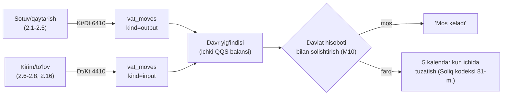
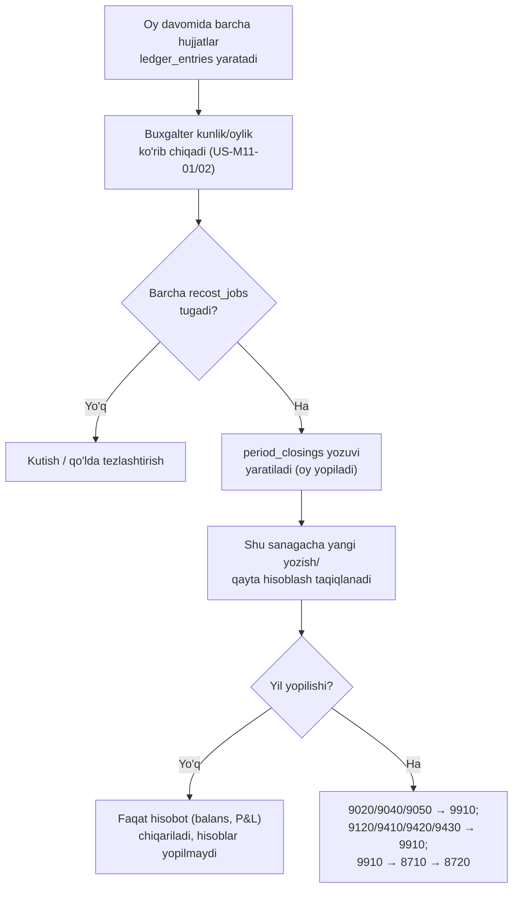

# Provodka qoidalari (NSBU №21, 2024/2025)

*2026-10-14 · Asos: `00-umumiy-arxitektura.md`, `01-malumotlar-modeli.md` (hujjatlar 6-bo'lim, registrlar 7-bo'lim), `spec/01-mahsulot/02-modullar-talablari.md` (M04, M08, M10, M11, M15, M16), `03-biznes-jarayonlar.md` (BP-01…12), `research_notes/texnik/01-erp-modullar-va-malumot-modeli.md`, `research_notes/texnik/tekshiruv-2026-10-14/5-buxgalteriya-soliq.md`.*

> ## ⚠️ Buxgalter (O'zbekiston, NSBU) tomonidan tasdiqlanishi SHART
>
> Bu hujjatdagi hisob raqamlari **lex.uz'dagi 191-son buyruq (Iqtisodiyot va moliya vazirligi, 14.11.2024, Adliya ro'yxati 3593, 27.12.2024, [lex.uz/ru/docs/7282759](https://lex.uz/ru/docs/7282759)) ilovalarining to'liq rasmiy matnidan emas**, balki ushbu ilovalarni iqtibos qiluvchi ikkinchi darajali huquqiy ma'lumot bazalari (nrm.uz, buxgalter.uz) orqali **qisman** o'qildi — lex.uz'ning o'zida Ilova №1 (Hisoblar rejasi) va Ilova №2 (Qo'llash yo'riqnomasi) to'liq matni ushbu tadqiqotda ochilmadi/ko'rinmadi (faqat buyruq sarlavhasi va bekor qilinadigan eski hujjatlar ro'yxati ko'rindi). Shuning uchun **har bir hisob raqami buxgalter tomonidan rasmiy manbaning to'liq nusxasi bilan solishtirilmaguncha ishlatilmasligi kerak**. Quyidagilar aniq tasdiqlanishi shart:
>
> 1. Pastdagi barcha hisob kodlari va nomlari — to'liq rasmiy ro'yxat (barcha bo'lim/kichik hisoblar, jumladan 2025-sentyabrda qo'shilgan **0870-hisob**) bilan solishtirilsin.
> 2. QQS uchun **4410** (kiritiladigan/kompensatsiya) va **6410** (byudjetga to'lovlar, turi bo'yicha analitika) hisoblaridan foydalanish to'g'riligi — yoki QQS uchun alohida maxsus hisob kerakligi.
> 3. Ijara/komunal/transport xarajatlari **9410 (Sotish xarajatlari)** yoki **9420 (Ma'muriy xarajatlar)**ga tushishi — do'kon savdo maydoni ijarasi odatda qaysi hisobga yozilishi.
> 4. Kamomad/ortiqcha hisoblari: **5910** (javobgar shaxs aniqlanmagan kamomad), **4730** (javobgar shaxsdan undiriladigan), ortiqcha uchun aniq daromad hisobi (bu hujjatda kod **tasdiqlanmagan**, faqat "9300 oilasi — asosiy faoliyatdan boshqa daromadlar" deb taxmin qilingan).
> 5. Shubhali/umidsiz qarzni **9430 (Boshqa operatsion xarajatlar)** orqali yopish — yoki NSBU №19 bo'yicha alohida zahira (rezerv) tartibi kerakligi.
> 6. Karta/Click/Payme/Uzum to'lovlari uchun **klirinig (vositachi) hisobi** — bu hujjatda to'g'ridan-to'g'ri **5110 (bank)**ga yozilgan, lekin komissiya va kechikish tufayli alohida oraliq sub-hisob kerak bo'lishi mumkin.
> 7. Boshlang'ich qarz balansini kiritishda qarshi hisob (**8720**) to'g'riligi.
> 8. QQS yaxlitlash qoidasi (qator bo'yicha tiyingacha, so'ng yig'indi) — OFD/soliq.uz rasmiy talablari bilan.
> 9. Aylanma solig'i stavkasi (4% / 1%) — aniq Soliq kodeksi moddasi raqami bilan.
> 10. Ish haqi to'lovini **6710** orqali ikki bosqichli (hisoblash + to'lash) yozish kerakligi — yoki MVP'da to'g'ridan-to'g'ri xarajat sifatida yetarli ekanligi.

## Asosiy xulosalar

1. Hisob rejasi manbasi — **yangi NSBU №21 (2024/2025, 191-son buyruq)**, eski 2002-yilgi reja (2025-01-01'dan amal qilmaydi) **emas**. To'liq rasmiy matn bu tadqiqotda o'qilmadi; pastdagi raqamlar ikkinchi darajali huquqiy bazalar (nrm.uz, buxgalter.uz) orqali olingan va **buxgalter tasdig'iga muhtoj** (yuqoridagi ogohlantirish).
2. MVP buxgalteriyasi faqat **savdo/ombor/kassa/qarz/xarajat** operatsiyalaridan kelib chiqadigan asosiy hisoblarni avtomatlashtiradi (tovar, kassa, bank, hisob-kitob, QQS, daromad/xarajat) — asosiy vositalar, ish haqi hisoblash (faqat to'lov), to'liq kapital harakati MVP'dan tashqarida.
3. Har bir hujjat o'tkazilganda **bitta tranzaksiyada** `ledger_entries` (Dt/Kt/summa/analitika) yoziladi; hujjat bekor qilinganda yangi, teskari (storno) yozuv qo'shiladi — hech qachon tahrirlanmaydi (`01-malumotlar-modeli.md`, 1-band).
4. Tannarx (COGS, 9120-hisob) **FIFO** yoki **AVECO** (tenant sozlamasi, US-M04-05) bo'yicha `stock_lots`dan hisoblanadi; o'tgan sanali hujjat kelsa — qayta hisoblash (`recost_jobs`), yopilgan davrga tegmaydi.
5. QQS (12% standart, 0% imtiyozli, 6% ixtiyoriy) har sotuv/xaridda ajratiladi; ichki QQS yig'indisi (`vat_moves`) 2026-01-01'dan davlat tuzgan hisobot bilan **5 kalendar kun** ichida solishtiriladi (Soliq kodeksi 81-moddasi, O'RQ-1108). QQS to'lamaydigan biznes uchun **aylanma solig'i** (4% standart 2026, ba'zi holatlarda 1% — O'RQ-1108) muqobil.
6. Oy yopish (`period_closings`) — shundan keyingi sanaga yozish/qayta hisoblash taqiqlanadi; yillik yopishda daromad/xarajat hisoblari (9000-guruh) yakuniy natija hisobiga (9910) va undan kapitalga (8710) yopiladi.
7. Ko'p filial: har `ledger_entry`da `branch_id` analitika; filiallararo ko'chirish **2970 (yo'ldagi tovarlar)** oraliq hisobi orqali o'tadi.

---

## 1. Hisoblar rejasi — MVP subset

Quyidagi jadval faqat savdo/ombor/kassa/qarz/xarajat operatsiyalari uchun kerak bo'lgan hisoblarni o'z ichiga oladi. Manba: nrm.uz'dagi NSBU №21 (2024/2025) ilova parchalari va buxgalter.uz izohlari — **to'liq rasmiy ro'yxat emas** (yuqoridagi ogohlantirishga qarang).

| Kod | Nomi | Turi | Analitika (MVP) | Ishonchlilik |
|---|---|---|---|---|
| 2910 | Tovarlar omborlarda | Aktiv | ombor, mahsulot, partiya (lot) | nrm.uz orqali o'rtacha ishonchli |
| 2970 | Yo'ldagi tovarlar | Aktiv | jo'natuvchi/qabul qiluvchi filial, mahsulot, partiya | nrm.uz orqali o'rtacha ishonchli |
| 4010 | Xaridorlardan olinadigan hisoblar (debitorlik) | Aktiv | kontragent, filial, hujjat (chek) | nrm.uz orqali o'rtacha ishonchli |
| 4310 | Yetkazib beruvchilarga berilgan avanslar | Aktiv | kontragent | buxgalter.uz, tasdiqlanmagan |
| 4410 | Byudjetga soliqlar bo'yicha avans to'lovlari (shu jumladan kiritiladigan QQS) | Aktiv | soliq turi (QQS), hujjat | buxgalter.uz + nrm.uz izohi, **tasdiqlanmagan** |
| 4730 | Kamomad bo'yicha moddiy javobgar shaxsdan undiriladigan summalar | Aktiv | xodim, hujjat | **tasdiqlanmagan** |
| 5010 | Kassadagi naqd pul mablag'lari (milliy valyuta) | Aktiv | kassa_register, smena | buxgalter.uz orqali o'rtacha ishonchli |
| 5110 | Bank hisob-kitob hisobvarag'i | Aktiv | bank hisobi | buxgalter.uz orqali o'rtacha ishonchli |
| 5910 | TMZ/OS kamomadi va buzilishidan yo'qotishlar (javobgar shaxs aniqlanmagan) | Aktiv (vaqtinchalik) | hujjat | buxgalter.uz, **tasdiqlanmagan** |
| 6010 | Yetkazib beruvchi va pudratchilarga to'lovlar (kreditorlik) | Passiv | kontragent, filial | nrm.uz orqali o'rtacha ishonchli |
| 6410 | Byudjetga to'lovlar bo'yicha qarz (turi bo'yicha) | Passiv | soliq turi (QQS / aylanma solig'i) | nrm.uz + buxgalter.uz, **tasdiqlanmagan** |
| 6710 | Xodimlar bilan ish haqi bo'yicha hisob-kitoblar | Passiv | xodim | **tasdiqlanmagan**, MVP'da shartli |
| 8710 | Hisobot davri taqsimlanmagan foydasi (zarari) | Kapital | — | buxgalter.uz, o'rtacha ishonchli |
| 8720 | To'plangan foyda (yopilmagan zarar) | Kapital | — | buxgalter.uz, o'rtacha ishonchli |
| 9020 | Tovarlarni sotishdan daromad | Daromad | mahsulot, filial, kontragent | nrm.uz (Ilova 2, Bob 4) — **yaxshi ishonchli** |
| 9040 | Sotilgan tovarni qaytarish (daromaddan chegirish) | Daromad (kontr) | mahsulot, filial, hujjat | nrm.uz — yaxshi ishonchli |
| 9050 | Xaridorlarga berilgan chegirmalar | Daromad (kontr) | hujjat | nrm.uz — yaxshi ishonchli |
| 9120 | Sotilgan tovarlar tannarxi (COGS) | Xarajat | mahsulot, partiya, filial | nrm.uz — yaxshi ishonchli |
| 9410 | Sotish xarajatlari | Xarajat | xarajat toifasi (analitik), filial | buxgalter.uz — o'rtacha ishonchli |
| 9420 | Ma'muriy xarajatlar | Xarajat | xarajat toifasi, filial | buxgalter.uz — o'rtacha ishonchli |
| 9430 | Boshqa operatsion xarajatlar (shu jumladan shubhali qarz zahirasi) | Xarajat | hujjat, filial | buxgalter.uz — o'rtacha ishonchli |
| 9910 | Yakuniy moliyaviy natija (foyda/zarar) | Natija (texnik) | davr | nrm.uz — yaxshi ishonchli |

**Analitika o'lchamlari** (barcha `ledger_entries.analytics` JSONB ichida): `product_id`, `counterparty_id`, `branch_id`, `cash_register_id` (agar 5010), `warehouse_id` (agar tovar hisobi), `expense_category_id` (agar 9410/9420/9430), `tax_type` (agar 4410/6410).

---

## 2. Har hujjat turi uchun Dt/Kt jadvallari

Umumiy qoida: narxga QQS **kiritilgan** holda saqlanadi (chek/faktura summasi). QQS ajratish formulasi: `QQS_summasi = Narx × stavka / (100 + stavka)` (12% uchun `× 12/112`); 0%/imtiyozli tovarda QQS = 0. **Yaxlitlash**: har chek qatori alohida tiyingacha (0,01 so'm) yaxlitlanadi, so'ng qatorlar yig'indisi chek QQS summasini beradi — bu qoida OFD/soliq.uz rasmiy hujjatlarida alohida tasdiqlanmagan, **taxmin**.

### 2.1 Sotuv (chek) — naqd

| # | Dt | Kt | Summa | Analitika | QQS |
|---|---|---|---|---|---|
| 1 | 5010 | 9020 | Chek summasi − QQS (sof daromad) | mahsulot, filial, kassa | 12% standart: ajratilgan; 0%/imtiyozli: 0 |
| 2 | 5010 | 6410 | QQS summasi (qator-qator yaxlitlangan yig'indi) | tax_type=QQS | — |
| 3 | 9120 | 2910 | Sotilgan tovar tannarxi (FIFO/AVECO) | mahsulot, partiya, filial | — |

*Eslatma*: 1- va 2-qator amalda bitta chek summasiga (5010 debiti) ikki kredit yozuvi sifatida birlashadi: `Dt 5010 = Kt 9020 + Kt 6410`.

### 2.2 Sotuv — karta / Click / Payme / Uzum (QR)

Xuddi 2.1, lekin 1–2-qatorlarda `Dt 5010` o'rniga `Dt 5110` (bank, analitika: to'lov usuli/provayder) — **taxmin**: komissiya va kechikish tufayli aslida oraliq klirinig hisobi kerak bo'lishi mumkin (yuqoridagi ogohlantirish 6-band).

### 2.3 Sotuv — nasiya (qarzga, debt)

| # | Dt | Kt | Summa | Analitika |
|---|---|---|---|---|
| 1 | 4010 | 9020 | Sof daromad | kontragent, mahsulot, filial |
| 2 | 4010 | 6410 | QQS summasi | kontragent, tax_type=QQS |
| 3 | 9120 | 2910 | Tannarx | mahsulot, partiya |

Qo'shimcha: `debt_moves` registriga `direction=receivable, amount=+` yoziladi (buxgalteriya yozuvi bilan bir xil summa, bitta tranzaksiyada).

### 2.4 Sotuv — aralash to'lov (qisman naqd + qisman karta ± nasiya)

2.1–2.3 bilan bir xil, faqat 1–2-qatorlar `sale_payments` jadvali bo'yicha **har to'lov usuli uchun alohida qator** sifatida bo'linadi (masalan `Dt 5010 = 40 000`, `Dt 5110 = 30 000`, `Dt 4010 = 30 000`), yig'indisi chek summasiga teng bo'lishi shart. QQS va tannarx qatorlari o'zgarmaydi (chek darajasida bitta).

### 2.5 Qaytarish (return)

| # | Dt | Kt | Summa | Analitika |
|---|---|---|---|---|
| 1 | 9040 | 5010/5110/4010 (to'lov usuliga qarab) | Sof summa (QQS siz) | mahsulot, hujjat (asl chekka bog'liq) |
| 2 | 6410 | 5010/5110/4010 | QQS summasi | tax_type=QQS |
| 3 | 2910 | 9120 | Qaytarilgan tovar tannarxi (asl partiyaga qaytadi) | mahsulot, partiya |

*Nasiya bilan sotilgan tovar qaytarilsa*: `Kt 4010` — debitorlik kamayadi (balans ikki tomonlama tuzatiladi: ombor + qarz, `02-modullar-talablari.md` M02 chekka holat).

### 2.6 Omborga kirim (goods_receipt) — QQS bilan, nasiyaga

| # | Dt | Kt | Summa | Analitika |
|---|---|---|---|---|
| 1 | 2910 | 6010 | Tovar narxi (QQS siz, yangi partiya) | mahsulot, yetkazib beruvchi, yangi `stock_lot` |
| 2 | 4410 | 6010 | QQS summasi (kiritiladigan) | tax_type=QQS, yetkazib beruvchi |

Umumiy: `Kt 6010` = faktura summasi (QQS bilan) = qatorlar 1+2 yig'indisi.

### 2.7 Omborga kirim — QQS siz (0%/imtiyozli tovar yoki soliq to'lamaydigan yetkazib beruvchi)

| # | Dt | Kt | Summa |
|---|---|---|---|
| 1 | 2910 | 6010 | To'liq faktura summasi |

### 2.8 Omborga kirim — darhol naqd/bank to'langan (nasiyasiz)

2.6/2.7 bilan bir xil, faqat `Kt 6010` o'rniga `Kt 5010` yoki `Kt 5110` to'g'ridan-to'g'ri (kreditorlik qarzi umuman ochilmaydi).

**"Qizil" e-faktura qoidasi** (VM Qarori №830): agar faktura yuqori xavfli deb belgilansa, 2-qator (`Dt 4410`) **to'lov amalga oshirilgunga qadar yozilmaydi** — QQS krediti faqat `supplier_payment` o'tkazilganda (2.12-bo'lim) qo'shiladi (US-M07-04, US-M10-03).

### 2.9 Ko'chirish — jo'natish (filiallararo)

| # | Dt | Kt | Summa | Analitika |
|---|---|---|---|---|
| 1 | 2970 | 2910 | Tannarx (jo'natuvchi ombor) | mahsulot, partiya, jo'natuvchi filial |

### 2.10 Ko'chirish — qabul qilish

| # | Dt | Kt | Summa | Analitika |
|---|---|---|---|---|
| 1 | 2910 | 2970 | Tannarx (qabul qiluvchi ombor, partiya saqlanadi) | mahsulot, partiya, qabul qiluvchi filial |
| 2 (farq bo'lsa) | 5910 | 2970 | Yo'qotgan/kam kelgan qism | hujjat |

### 2.11 Inventarizatsiya — kamomad / ortiqcha

| Holat | Dt | Kt | Summa |
|---|---|---|---|
| Kamomad, javobgar shaxs aniq | 4730 | 2910 | Tannarx |
| Kamomad, javobgar shaxs aniqlanmagan | 5910 (keyin 9430'ga yopiladi: `Dt 9430 / Kt 5910`) | 2910 | Tannarx |
| Ortiqcha | 2910 | *9300-oilasi — aniq kod tasdiqlanmagan* | Bozor/tannarx qiymati |

### 2.12 Hisobdan chiqarish (write-off — muddati o'tgan/yaroqsiz tovar)

| # | Dt | Kt | Summa |
|---|---|---|---|
| 1 | 9430 (javobgar shaxs yo'q) yoki 4730 (javobgar shaxs bor) | 2910 | Tannarx |

### 2.13 Boshlang'ich qarz balansi (debt_openings)

| Yo'nalish | Dt | Kt | Summa |
|---|---|---|---|
| Mijoz bizga qarzdor (receivable) | 4010 | 8720 | Boshlang'ich summa |
| Biz yetkazib beruvchiga qarzdor (payable) | 8720 | 6010 | Boshlang'ich summa |

*Tovar tarkibisiz, chek chiqarilmaydi (US-M08-07) — qarshi hisob sifatida 8720 (to'plangan foyda) **taxmin**; buxgalter tasdig'i shart (yuqoridagi band 7).*

### 2.14 Qarz to'lovi (debt_payment, mijozdan)

| # | Dt | Kt | Summa |
|---|---|---|---|
| 1 | 5010/5110 (to'lov usuliga qarab) | 4010 | To'langan summa (eng eski qarzdan boshlab, `allocations`) |

### 2.15 Qarzni kechish (debt_writeoff, shubhali qarz)

| # | Dt | Kt | Summa |
|---|---|---|---|
| 1 | 9430 | 4010 | Kechirilgan summa |

Faqat Egasi tasdig'i bilan (US-M08-10), audit jurnaliga yoziladi.

### 2.16 Yetkazib beruvchiga to'lov (supplier_payment)

| # | Dt | Kt | Summa |
|---|---|---|---|
| 1 | 6010 | 5010/5110 | To'langan summa (`allocations`) |

Agar faktura "qizil" bo'lsa — shu tranzaksiyada 2.8'dagi kechiktirilgan `Dt 4410 / Kt 6010` QQS yozuvi ham qo'shiladi (QQS krediti endi ochiladi).

### 2.17 Xarajat (expense, manba bo'yicha)

| Manba | Dt | Kt | Summa |
|---|---|---|---|
| Kassa naqdi | 9410 yoki 9420 (toifaga qarab — band 3) | 5010 | Xarajat summasi |
| Bank | 9410 yoki 9420 | 5110 | Xarajat summasi |
| Karta | 9410 yoki 9420 | 5110 | Xarajat summasi |

Toifa → hisob moslashuvi (**taxmin**, buxgalter tasdig'i kerak): Ijara/Transport/Boshqa → odatda 9410 (savdo maydoni bilan bog'liq) yoki 9420 (umumiy boshqaruv) — do'kon tipiga qarab; Ish haqi → 9420 (yoki 6710 orqali ikki bosqichli, agar kelajakda ish haqi hisoblash moduli qo'shilsa); Kommunal → 9410/9420; Ta'mirlash → 9420; Soliq va yig'imlar (ish haqiga bog'liq bo'lmagan) → 6410/9420.

### 2.18 Kassa pul harakati (cash_movement, M16)

| Sabab | Dt | Kt | Izoh |
|---|---|---|---|
| Inkasso (bankka topshirish) | 5110 | 5010 | Oddiy kassa→bank o'tkazmasi |
| Pul qo'yish (bankdan/maydalash puli) | 5010 | 5110 | Teskarisi |
| Egasi oldi (shaxsiy ehtiyoj) | 8720 (**taxmin**) | 5010 | Aniq "Egasi bilan hisob-kitob" hisobi tasdiqlanmagan |
| Xarajat to'lovi | — (provodka yaratilmaydi) | — | M15 xarajat hujjatining o'zi 2.17-bandidagi yozuvni yaratadi; M16 faqat `cash_moves` registrini yuritadi, ikki marta yozilmasligi uchun |

### 2.19 Smena ochilishi/yopilishi (shift)

Buxgalteriya provodkasi **yaratilmaydi** — faqat boshlang'ich/sanalgan naqd `cash_moves`/holat sifatida qayd etiladi. Smena yopilganda aniqlangan farq (US-M16-02) 2.11-bandidagi kamomad/ortiqcha qoidasi bo'yicha yoziladi (`Dt 4730`/`5910` yoki `Kt 9300-oilasi`).

---

## 3. COGS: FIFO va AVECO

### 3.1 Qoida

- **FIFO**: chiqimda eng eski `stock_lot`dan boshlab yechiladi (`qty_left > 0` tartib bo'yicha); bitta chek bir nechta partiyaga bo'linishi mumkin.
- **AVECO**: har kirimda `avg_cost = (eski_qty_left × eski_avg_cost + yangi_qty_in × yangi_narx) / (eski_qty_left + yangi_qty_in)` qayta hisoblanadi (ombor+mahsulot bo'yicha); chiqim joriy `avg_cost`da yechiladi.
- Ikkalasi ham BHMS №4 (Moliya vaziri buyrug'i №24, 28.05.2020, 7-bob 62-band, [lex.uz/docs/-4890446](https://lex.uz/docs/-4890446)) ga mos — LIFO taqiqlangan.

### 3.2 Misol (ikki kirim, turli narxda + bitta sotuv)

| Hodisa | Miqdor | Birlik narx | Jami |
|---|---|---|---|
| Kirim 1 | 100 dona | 8 000 so'm | 800 000 |
| Kirim 2 | 50 dona | 9 000 so'm | 450 000 |
| Sotuv | 120 dona | — | — |

**FIFO**: 100 dona × 8 000 = 800 000 (Kirim 1 to'liq) + 20 dona × 9 000 = 180 000 (Kirim 2'dan) → **COGS = 980 000 so'm**; qoldiq = 30 dona × 9 000 = 270 000 so'm (Kirim 2'dan qolgan).

**AVECO**: kirim 2'dan keyin `avg_cost = (100×8 000 + 50×9 000) / 150 = (800 000+450 000)/150 = 8 333,33 so'm`. Sotuv 120 dona × 8 333,33 = **COGS = 999 999,60 ≈ 1 000 000 so'm** (tiyingacha yaxlitlab); qoldiq = 30 dona × 8 333,33 ≈ 250 000 so'm.

Provodka (ikkala usulda bir xil shaklda, faqat summasi farqli): `Dt 9120 / Kt 2910` = yuqoridagi COGS summasi.

### 3.3 O'tgan sanali hujjat va qayta hisoblash

- Kech kirim yoki kech sinxronlangan offline sotuv kelganda — shu sanadan keyingi barcha chiqimlar uchun `recost_jobs` navbatga qo'yiladi (tenant, warehouse, product, from_date); tegishli `ledger_entries` (9120/2910) yangi tuzatish yozuvi bilan qayta hisoblanadi (eski yozuv o'chirilmaydi, storno + yangi).
- **Yopilgan davrga (`period_closings`) tegsa — qayta hisoblash rad etiladi**, buxgalter qo'lda keyingi ochiq davrda tuzatish kiritishi kerak (band 3.4).
- Manfiy qoldiqda sotuv (offline to'qnashuv): tannarx vaqtincha oxirgi ma'lum narxda (`pending_cost`) yoziladi, keyingi kirimda `recost_jobs` orqali tuzatiladi.

### 3.4 Davr yopish va COGS

Oy yopilganda (`period_closings`): shu oygacha bo'lgan barcha `recost_jobs` tugallanishi shart; 9120 hisobining oy bo'yicha aylanmasi P&L hisobotiga (US-M11-02) kiradi. Yopilgan oyga tegishli yangi recost — rad etiladi, tuzatish faqat **joriy ochiq davrda**, aniq izoh bilan kiritiladi (audit-trail).

---

## 4. QQS registri va davlat hisoboti bilan solishtirish

### 4.1 Chiquvchi (output) va kiruvchi (input) QQS

- Har sotuv/qaytarish `ledger_entries`dagi 6410-yozuvi bilan bir vaqtda `vat_moves(kind=output, base_amount, vat_amount, doc_type, doc_id, einvoice_id)` yoziladi.
- Har xarid (QQS bilan) `ledger_entries`dagi 4410-yozuvi bilan bir vaqtda `vat_moves(kind=input, ...)` yoziladi; agar faktura "qizil" bo'lsa, `vat_moves` yozuvi `pending` holatda saqlanadi (to'lovgacha ichki hisobga kirmaydi, VM Qarori №830).
- E-faktura bilan bog'lanish: `einvoices.id` → `vat_moves.einvoice_id` (chiquvchi — B2B sotuv, kiruvchi — xarid fakturasi).

### 4.2 Ichki QQS figurasi (davlat hisoboti bilan solishtirish uchun, M10)

`Ichki_QQS = SUM(vat_moves.vat_amount WHERE kind=output, period) − SUM(vat_moves.vat_amount WHERE kind=input, period, status != 'pending')`

Bu summa 2026-01-01'dan davlat (Soliq qo'mitasi) o'zi tuzgan QQS hisoboti bilan solishtiriladi; farq topilsa, hisobot e'lon qilingan kundan **5 kalendar kun** ichida (lekin qonuniy topshirish muddatidan oshmay) tuzatish kiritiladi (Soliq kodeksi 81-moddasi, O'RQ-1108-son Qonun, 25.12.2025, [lex.uz/docs/-7944527](https://lex.uz/docs/-7944527)); muddat o'tsa — davlat shakllantirgan ko'rinishda avtomatik qabul qilinadi (`state_reports` holat mashinasi, `01-malumotlar-modeli.md` 8-bo'lim).

### 4.3 Aylanma solig'i (QQS to'lamaydigan biznes uchun)

QQS to'lamaydigan tenant uchun 4410/6410(QQS)/`vat_moves` yozuvlari yaratilmaydi; o'rniga oy yakunida: `Aylanma_solig'i = Davr_aylanmasi (9020 netto + 9040/9050 tuzatilgan) × stavka`. 2026-yil standart stavka **4%** (3%'dan oshirilgan), yillik aylanmasi 1 mlrd so'mgacha bo'lgan yakka tartibdagi tadbirkor/o'zini-o'zi band qilganlar uchun **1%** — manba: O'RQ-1108-son Qonun (25.12.2025) asosidagi 2026-yil o'zgarishlari sharhi ([spot.uz, 2025-11-26](https://www.spot.uz/oz/2025/11/26/taxes-for-2026), [azma.uz](https://azma.uz/tpost/7ux0mbzis1-aylanmadan-olinadigan-soliq-2026-stavkal)) — **Soliq kodeksining aniq modda raqami bu tadqiqotda topilmadi, ochiq savol** (pastda). Ichki aylanma solig'i summasi ham xuddi QQS kabi davlat hisoboti bilan 5 kalendar kunlik tartibda solishtiriladi (US-M10-04).

---

## 5. Davr yopish, storno, yaxlitlash, ko'p filial

### 5.1 Oy/yil yopish

- **Oylik yopish** (MVP, US-M11-02): faqat `period_closings` orqali **bloklash** + balans/foyda-zarar hisoboti generatsiyasi; hisoblar jismoniy nolga tushirilmaydi (bu rasmiy amaliyotda odatda yillik).
- **Yillik yopish**: daromad/xarajat hisoblari (9020, 9040, 9050, 9120, 9410, 9420, 9430) yakuniy natija hisobiga (9910) yopiladi, so'ng 9910 → 8710 (joriy davr taqsimlanmagan foydasi) → (taqsimlangandan keyin) 8720 (to'plangan foyda).
- Yopilgan davrga tegishli har qanday tuzatish — faqat yangi, joriy ochiq davrdagi storno + tuzatuvchi yozuv bilan, hech qachon eski yozuvni o'zgartirmasdan.

### 5.2 Teskari (storno) qoidasi

Hujjat bekor qilinganda (`status=cancelled`, `reversal_of_id`): asl `ledger_entries` qatorlari **o'zgartirilmaydi**; har bir asl qator uchun **Dt/Kt o'rni almashtirilgan** (yoki manfiy summali) yangi qator qo'shiladi, `doc_id` = bekor qiluvchi hujjat, `reversal_of_id` = asl hujjat. Bu qoida `stock_moves`, `debt_moves`, `cash_moves`, `vat_moves` uchun ham bir xil (append-only, hech qachon UPDATE/DELETE).

### 5.3 Yaxlitlash

- Pul: `NUMERIC(18,2)` (tiyingacha), miqdor: `NUMERIC(18,3)`, narx/tannarx: `NUMERIC(18,4)` (`01-malumotlar-modeli.md`, band 3).
- QQS: har chek **qatori** alohida tiyingacha yaxlitlanadi, so'ng qatorlar yig'indisi chek umumiy QQS summasi bo'ladi — **taxmin**, OFD/soliq.uz rasmiy formati bilan tasdiqlanishi kerak (ochiq savol, pastda).
- AVECO `avg_cost`: `NUMERIC(18,4)` saqlanadi, COGS hisoblashda yakuniy summa tiyingacha yaxlitlanadi.

### 5.4 Ko'p filial

- Har `ledger_entry`da `branch_id` majburiy analitika — konsolidatsiya `SUM(...) GROUP BY branch_id` yoki `branch_id` filtrsiz.
- Filiallararo ko'chirish — 2910 (jo'natuvchi) → 2970 (oraliq) → 2910 (qabul qiluvchi), moddiy javobgarlik filial bo'yicha o'tadi (2.9–2.10-band).
- Bitta tenant ichidagi barcha filiallar **bitta** yuridik shaxs hisob-kitobi (bitta 6410/4410/8710) ostida yuritiladi — alohida yuridik shaxs filiallari (masalan QQS to'lovchisi farqli) MVP modelida yo'q, **ochiq savol**.

---

## Ochiq savollar

1. Yuqoridagi "Buxgalter tasdiqlanishi shart" bandidagi barcha 10 punkt — eng muhimi, to'liq rasmiy hisoblar ro'yxati (191-son buyruq to'liq ilovasi, 0870-hisob bilan) hali o'qilmadi.
2. QQS yaxlitlash qoidasi (qator-bo'yicha tiyingacha) — rasmiy OFD/soliq.uz hujjatida tasdiqlanmagan, **taxmin**.
3. Aylanma solig'ining aniq Soliq kodeksi moddasi raqami — faqat ikkinchi darajali manbalarda (spot.uz, azma.uz) 4%/1% stavkasi topildi, birlamchi modda raqami yo'q.
4. Karta/Click/Payme/Uzum uchun alohida klirinig (oraliq) hisobi kerakligi — MVP'da to'g'ridan-to'g'ri 5110'ga yozilgan, **taxmin**.
5. Ortiqcha (inventarizatsiya, 2.11-band) uchun aniq daromad hisob kodi topilmadi.
6. Boshlang'ich qarz balansini kiritishda qarshi hisob (8720) to'g'riligi tasdiqlanmagan.
7. Ish haqi to'lovini 6710 orqali ikki bosqichli yozish yoki MVP'da to'g'ridan-to'g'ri xarajat (9420) sifatida qolishi — biznes/buxgalter qarori kerak.
8. Ko'p yuridik shaxsli (filiallar turli STIR/QQS holatida) tenant — MVP modelida yo'q, kelajakda kerak bo'lishi mumkin.
9. M16'dagi "Egasi oldi" operatsiyasi uchun aniq qarshi hisob (8720 taxmin qilindi, aslida "Egasi bilan hisob-kitoblar" alohida sub-hisob kerak bo'lishi mumkin).

## Manbalar

- `spec/02-arxitektura/00-umumiy-arxitektura.md`, `01-malumotlar-modeli.md` (hujjatlar/registrlar modeli).
- `spec/01-mahsulot/02-modullar-talablari.md` — M04 (US-M04-05, FIFO/AVECO), M08, M10, M11, M15, M16.
- `spec/01-mahsulot/03-biznes-jarayonlar.md` — BP-01…12.
- `research_notes/texnik/01-erp-modullar-va-malumot-modeli.md` (3.4–3.5-bo'lim, NSBU №21/BHMS №4).
- `research_notes/texnik/tekshiruv-2026-10-14/5-buxgalteriya-soliq.md` (QQS 12%, aylanma solig'i, NSBU №21 sana/raqamlar fakt-tekshiruvi).
- [lex.uz/ru/docs/7282759](https://lex.uz/ru/docs/7282759) — NSBU №21 (191-son buyruq, 14.11.2024, ro'yxat 3593, 27.12.2024) — **faqat sarlavha/metama'lumot o'qildi, ilova matni emas**.
- [lex.uz/docs/-4890446](https://lex.uz/docs/-4890446) — BHMS №4 (FIFO/AVECO/identifikatsiyalangan tannarx, LIFO yo'q).
- [lex.uz/docs/-7944527](https://lex.uz/docs/-7944527) — Soliq kodeksi 81-moddasi, O'RQ-1108 (5 kalendar kun, davlat hisoboti).
- nrm.uz — "План счетов... (Приложение N 1 к НСБУ N 21)" va "Глава 1/2/4 Инструкции... (Приложение N 2)" parchalari (0100–0599, 6010/6020/6110/6120, 9010–9150/9910) — ikkinchi darajali huquqiy baza, lex.uz matnini qisman iqtibos qiladi.
- buxgalter.uz/plan_schetov, buxgalter.uz/publish/doc/text150372 (9420), buxgalter.uz/publish/group4782 (9400-guruh), buxgalter.uz/publish/doc/text150316 (8720) — ikkinchi darajali, hisob kodlari uchun qo'shimcha tasdiq.
- [spot.uz, 2025-11-26](https://www.spot.uz/oz/2025/11/26/taxes-for-2026), [azma.uz](https://azma.uz/tpost/7ux0mbzis1-aylanmadan-olinadigan-soliq-2026-stavkal) — 2026 aylanma solig'i stavkasi (4%/1%).
- www.bss.uz/article/443 — NSBU №21 o'zgarishi sharhi (0870-hisob, 2025-sentyabr tuzatish).
