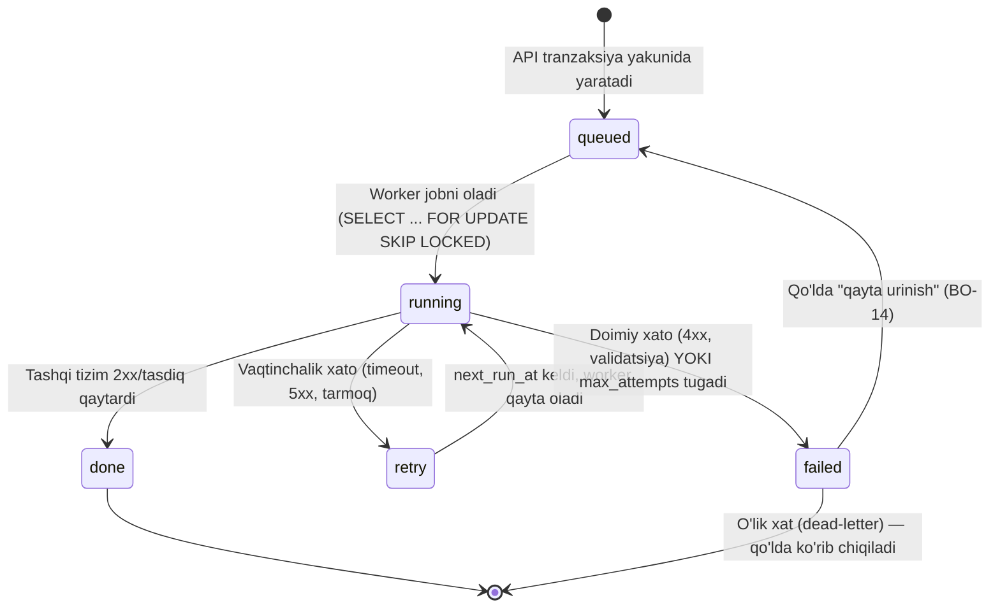

# Integratsiyalar

*2026-10-14 · Asos: `spec/02-arxitektura/00-umumiy-arxitektura.md`, `01-malumotlar-modeli.md`, `spec/01-mahsulot/02-modullar-talablari.md`, `03-biznes-jarayonlar.md`, `07-tuzatishlar-va-yechimlar.md`, `research_notes/texnik/00-xulosa-va-ochiq-savollar.md`, `02-kassa-ofd-markirovka.md`, `03-efaktura-va-tolov.md`, `09-soliq-integratsiyasi.md`, `10-bozorda-soliq-integratsiyasi.md`, `12-taxminlar-va-murojaatlar.md`, `14-tekshiruv-xulosasi.md`.*

## Asosiy xulosalar

1. **13 tashqi tizim** (12 + Google OIDC, Q7 — 11-band), barchasi **faqat backend worker'lar orqali** ulanadi (Google OIDC — interaktiv login redirect, worker emas, lekin bir xil "tashqi tizim" ro'yxatida) (hech qanday klient to'g'ridan-to'g'ri tashqi tizimga chiqmaydi, E-IMZO imzolashdan tashqari — u brauzerda, lokal E-IMZO.exe bilan, `00-umumiy-arxitektura.md`). Har biri bitta umumiy **outbox/navbat naqshi** (`outbox_jobs`, 2-bo'lim) orqali ishlaydi — API so'rovi tashqi tizimni hech qachon kutmaydi.
2. **Faqat 3 tizimda** to'liq ochiq, mustaqil tekshirilgan API hujjati va/yoki sandbox bor: **Faktura.uz** (`api.faktura.uz/help/`), **Payme** (`test.paycom.uz`), **E-IMZO** (`testvpn.e-imzo.uz`, jamoatchilik hujjati). Qolgan 9 tasida hujjat yopiq, login talab qiladi yoki umuman topilmadi — bu MVP jadvaliga to'g'ridan-to'g'ri xavf (`research_notes/texnik/14-tekshiruv-xulosasi.md`, 4-bo'lim).
3. Uchta qattiq **SLA/muddat** butun arxitekturani belgilaydi: OFD offline chegarasi **48 soat** (VMQ-943, 1-ilova, 31-band), markirovkalangan tovar ko'chirish **72 soat** (23-son qaror, 2026-01-23), davlat hisobotini tuzatish **5 kalendar kun** (Soliq kodeksi 81-moddasi, O'RQ-1108). Uchtasi ham worker darajasida taymer va eskalatsiya bildirishnoma sifatida amalga oshiriladi.
4. **my.soliq.uz uchun rasmiy API yo'q** — davlat hisobotini solishtirish (markaziy qiymat taklifi, M10/BP-08) MVP'da **qo'lda fayl yuklash** bilan boshlanadi; bu `08-mahsulot-modullari.md`/`00-xulosa-va-ochiq-savollar.md`dagi 1-raqamli texnik xavf.
5. **CRPT Turon (Asl belgisi) integrator hujjatlari yopiq** (help.crpt-turon.uz, 403 xato) — markirovka moduli (M01/M02/M06) texnik xavf ostida; *(2026-10-15: foydalanuvchi qarori)* integratsiya yo'li: har do'kon o'z bepul "ishtirokchi" API kalitini oladi, rad etilsa hamkor proksi, ikkisi ham ishlamasa sotuv bloklanadi (4-bo'lim). Offline siyosat endi **to'liq aniq**: **sotish** — narx ma'lum bo'lsa ruxsat, bo'lmasa taqiq; **ko'chirish** — ruxsat (audit bilan); **qaytarish** — faqat online (4-bo'lim, `04-offline-sync.md` §7).
6. **Click, Payme, Uzum ikki alohida vazifada** ishlatiladi: (a) do'kon QR to'lovlari (mijoz do'konga to'laydi, do'konning o'z merchant hisobi) va (b) bizning obuna billing'imiz (M17, `billing_payments` — bizning merchant hisobimiz). Ikkisi texnik jihatdan bir xil adapter interfeysidan foydalanadi, lekin **kredensial va tenant kontekst butunlay ajratilgan**.
7. Har bir integratsiya kredensiali (API kalit, sertifikat, merchant ID) **tenant darajasida shifrlangan** saqlanadi (`tenants.settings` JSONB emas — alohida `tenant_secrets` jadvali, shifrlangan ustun; tafsilot `05-xavfsizlik-va-audit.md`).
8. **BO-14 "Integratsiyalar holati"** ekrani — har bir tashqi tizim uchun: ulanganmi, oxirgi muvaffaqiyatli chaqiruv vaqti, navbatdagi/muvaffaqiyatsiz ishlar soni, qo'lda qayta urinish tugmasi. Bu ekran bo'lmasa, OFD/e-faktura muvaffaqiyatsizligi Egasi/Buxgalterga ko'rinmay qoladi.
9. Qurilish tartibi (14-bo'lim): **OFD → MXIK → E-IMZO/e-faktura → Click/Payme (billing + do'kon) → Telegram/SMS → Claude API → Asl belgisi/e-TTN/e-ishonchnoma/my.soliq.uz** (eng ko'p noaniqlikka ega to'rttasi oxirida, parallel ravishda rasmiy murojaatlar bilan).
10. Ko'p integratsiya uchun hal qiluvchi noaniqlik hali ham **ochiq savol** — bu fayl ularni "taxmin" deb aniq belgilaydi va `12-taxminlar-va-murojaatlar.md`dagi xat loyihalariga bog'laydi.
11. **Google bilan kirish + Telegram OTP (asoschi qarori, Q7, 2026-10-15)**: Google OIDC — bizning OAuth AS'imizga ulangan tashqi identity provider (§9.1); OTP/parol tiklash/taklif/eksport/qarz eslatmalari — asosiy kanal **Telegram bot** (telefon "share contact" orqali ulanadi, §11.1), **SMS (Eskiz) faqat zaxira** (§10).

---

## 0. Umumiy naqsh: outbox, holat mashinasi, o'lik xat, BO-14

Barcha 12 integratsiya (Claude API va MXIK qidiruvidan tashqari — ular ko'pincha sinxron/kesh bilan ishlaydi, pastda izohlangan) **bitta umumiy mexanizm** orqali o'tadi:

1. Biznes amali (sotuv, faktura imzolash, ro'yxatdan o'tish to'lovi...) **bitta DB tranzaksiyada** hujjat + registr + `outbox_jobs` yozuvini yaratadi (`01-malumotlar-modeli.md`, 10-bo'lim).
2. API darhol javob qaytaradi (tashqi tizimni kutmaydi) — foydalanuvchi "yuborilmoqda" holatini ko'radi.
3. Worker (Redis navbatidan) ishni oladi, adapter orqali tashqi tizimga chaqiradi, natijani yozadi.

### Holat mashinasi (`outbox_jobs.status`)



- **Jadval**: `outbox_jobs(tenant_id, kind, payload, status, attempts, next_run_at, last_error, idempotency_key)` (`01-malumotlar-modeli.md`, 10-bo'lim). `kind` ro'yxati bu hujjatda kerakli integratsiyalar bo'yicha kengaytiriladi: mavjud `ofd_send`, `einvoice_send`, `marking_sell`, `sms`, `telegram`, `ai` ustiga qo'shiladi — `einvoice_accept`, `ettn_send`, `marking_verify`, `marking_return`, `marking_transfer`, `poa_verify`, `billing_webhook_reconcile`, `state_report_reminder` (implementatsiya tafsiloti, ma'lumotlar modeli hujjati tomonidan rasmiylashtiriladi).
- **Qayta urinish siyosati (umumiy formula)**: eksponensial backoff + jitter: `next_run_at = now() + min(cap, base * 2^attempts) + random(0, jitter)`. Har integratsiya o'z `base`/`cap`/`max_attempts`ini SLA'siga qarab belgilaydi (pastda har bo'limda).
- **O'lik xat (dead-letter)**: `max_attempts` tugagach `status=failed`; job **o'chirilmaydi**, `last_error` va to'liq `payload` saqlanadi — qo'lda tekshirish/qayta urinish/bekor qilish uchun. Fiskal va e-faktura kabi huquqiy oqibati bor ishlarda `failed` holati **audit_log**ga ham yoziladi.
- **Idempotentlik**: har job `idempotency_key` bilan (odatda `client_event_id` + `kind`, yoki tashqi tizim talab qilgan `merchant_trans_id`/`provider_tx_id`). Worker va tashqi tizim ikkisi ham qayta yuborilgan so'rovni xavfsiz rad etishi/bir xil natija qaytarishi kerak — bu ayniqsa offline sinxronlashda (bir xil chek ikki marta yuborilishi) va to'lov webhook'larida (bank ikki marta qayta yuborishi) muhim.
- **Circuit-breaker** *(2026-10-15: spec yozish bilan yopildi, kamchiliklar-yakuniy #33)*: har adapter uchun alohida, tenant'dan mustaqil (bitta tenant bitta integratsiyani "buzmasligi" uchun) — 1 daqiqa ichida 5 ketma-ket vaqtinchalik xato (`transient`, pastda) kelsa breaker **ochiladi** (shu adapterga yangi chaqiruv yo'q, job'lar `retry` holatida navbatda qoladi), 5 daqiqadan keyin **half-open** holatida bitta sinov so'rovi yuboriladi — muvaffaqiyatli bo'lsa yopiladi, yo'q bo'lsa yana 5 daqiqa. Breaker ochiq holati BO-14'da 🔴 va M18 orqali ogohlantirish bilan ko'rinadi. **OFD'ning 48 soatlik qonuniy taymeri** (6-bo'lim, `04-offline-sync.md` §6) breaker holatidan **mustaqil** — breaker ochiq bo'lsa ham 48 soat hisoblanishda davom etadi (taxmin).
- **Umumiy xato tasnifi** *(2026-10-15: spec yozish bilan yopildi, kamchiliklar-yakuniy #34)*: `transient` (timeout/5xx/429 → `retry`, backoff bilan qayta uriniladi), `auth` (401/403 → `failed`, BO-14'da "kredensial muammosi" matni bilan), `validation` (4xx, sxema/biznes qoida xatosi → `failed`, foydalanuvchiga tarjima qilingan matn), `duplicate` (tashqi tizim "allaqachon qabul qilingan" deb javob bersa → idempotent muvaffaqiyat, xato emas). Har integratsiyaning vendor-xos xato kodlari (masalan OFD 704031) ilova sifatida, hujjat kelganda qo'shiladi.

### BO-14 — "Integratsiyalar holati" ekrani (talab)

`spec/01-mahsulot/04-ekranlar-va-ux.md` BO-14'ni "Tenant/do'kon sozlamalari" (integratsiyalar holati bilan) deb belgilagan; bu yerda texnik talab aniqlashtiriladi:

| Ustun | Mazmun |
|---|---|
| Tizim | OFD, Didox/Faktura.uz, Asl belgisi, E-IMZO, Vakolat.uz, MXIK, my.soliq.uz, Click, Payme, Uzum, SMS, Telegram, Claude API |
| Holat | 🟢 ulangan va ishlayapti / 🟡 ogohlantirish (retry ko'p) / 🔴 uzilgan (failed job bor) / ⚪ sozlanmagan |
| Oxirgi muvaffaqiyat | vaqt (`outbox_jobs` so'nggi `done` yozuvi) |
| Navbatda / Muvaffaqiyatsiz | `queued+running` soni / `failed` soni (so'nggi 7 kun) |
| Amal | "Qayta urinish" (bitta jobni yoki hammasini `queued`ga qaytaradi), "Tafsilot" (xato matni, payload) |

Bu ekran bo'lmasa, Egasi/Buxgalter OFD yoki e-faktura 48 soatdan ko'p muvaffaqiyatsiz bo'lib turganini bilmay qoladi — M18 (Telegram bot) bildirishnomalari shu jadvaldan oziqlanadi (US-M18-03).

---

## 1. OFD / virtual kassa ("Yangi texnologiyalar" DUK, VMQ-943)

**Maqsad va modullar**: har bir sotuv/qaytarish/Z-hisobotni fiskal chek sifatida davlat OFD'siga yuborish — qonuniy majburiy, M01, M02, M16 (Z-hisobot).

**Yo'nalish va trigger**: chiquvchi (backend → OFD). Trigger: `sales`/`returns` o'tkazilganda va smena yopilganda (`fiscal_receipts` yozuvi + `outbox_jobs(kind=ofd_send)`). **Qarz to'lovi** (`debt_payments` `post` bo'lganda) — asoschi qarori Q3, 2026-10-15: `fiscal_receipts(kind='debt_settlement')` yoziladi (qarzga sotuvda sotuv vaqtida chek chiqarilmaydi, faqat to'lov vaqtida), xuddi shu `outbox_jobs(kind=ofd_send)` navbati orqali yuboriladi — alohida yo'nalish/worker kerak emas (`02-provodka-qoidalari.md` §2.14, `13-api-katalog-1-kassa.md` §12.2).

**API holati**: Rasmiy, ochiq "OFD API spetsifikatsiyasi" hujjati **topilmadi**; integratsiya "Yangi texnologiyalar" DUK bilan to'g'ridan-to'g'ri shartnoma asosida (`research_notes/texnik/02-kassa-ofd-markirovka.md`, "Chekni yuborish protokoli/API"). Mustaqil dasturni Davlat reyestriga kiritish (sertifikatlash) muddati **aniq**: Soliq qo'mitasi 20 ish kuni + Kiberxavfsizlik markazi 15 + fiskal operator (FMO) 10 + texnik tartibga solish agentligi 5 — jami taxminan 50 ish kunigacha (bosqichlar ketma-ket/parallelligi ochiq, VMQ-943 4-ilova). Narx hamon **ochiq savol** (zaxira mablag' talabidan virtual kassa mustasno, lekin sertifikatlash xizmat haqi so'mda topilmadi). Sandbox — **ochiq savol** (reyestrga kiritilmagan dastur uchun sinov integratsiya kaliti bormi — noma'lum).

**Adapter interfeysi**:
```python
class FiscalAdapter(Protocol):
    async def send_receipt(self, receipt: FiscalReceiptPayload) -> FiscalSendResult: ...
    async def send_correction(self, receipt: FiscalReceiptPayload, original_fiscal_sign: str) -> FiscalSendResult: ...
    async def send_zreport(self, shift_id: UUID, payload: ZReportPayload) -> FiscalSendResult: ...
    async def issue_credit_payment(self, debt_payment: DebtPaymentFiscalPayload) -> FiscalSendResult: ...  # *(2026-10-15: asoschi qarori, Q3)* endi faol, eski "stub" holati bekor qilindi
    async def get_status(self, fiscal_receipt_id: UUID) -> FiscalStatus: ...
```

**Ma'lumot moslashtirish**: `fiscal_receipts(kind: sale/return/z_report/debt_settlement, sale_id/return_id/debt_payment_id, cash_register_id, shift_id, receipt_seq, payload JSONB, fiscal_sign, qr_url, sent_at, offline_since, status, attempts)` — `kind='debt_settlement'` qarz to'lovida (Q3). `payload` — chek rekvizitlari: tovar nomi (`products.name`, ixtiyoriy `products.name_ru` — chek qatori ikki tilda, asoschi qarori Q2, `13-api-katalog-1-kassa.md` §4.9), miqdor, narx, **MXIK kod (17 raqam)** + o'lchov birligi, QQS stavkasi/summasi, to'lov turi, fiskal belgi, QR-kod (`research_notes/texnik/02-kassa-ofd-markirovka.md`, "Chek formati"). **OFD rekvizitlari** (STIR/korxona nomi, fiskal belgi, QR) — operator talab qilgan formatda, tarjima qilinmaydi.

**Idempotentlik kaliti**: `cash_register_id + shift_id + receipt_seq` (kassa+smena ichida ketma-ket, offline qurilmada ham generatsiya qilinadi, OFD talabi) — shu uchlik qayta yuborilsa OFD bir xil chekni ikkinchi marta qabul qilmasligi kutiladi.

**Qayta urinish/backoff**: `base=30s, factor=2, cap=15 daqiqa`, lekin umumiy oyna **48 soat** (SLA) — shu oyna ichida juda ko'p marta (masalan har 15 daqiqada) urinib ko'riladi; 44-soatdan keyin urinish chastotasi oshiriladi (har 2 daqiqa) va Egasi/kassirga qizil ogohlantirish chiqadi; 48 soatda ham yuborilmasa — `failed`, huquqiy xavf sifatida audit_log + Telegram ogohlantirish (US-M01-02).

**Xato UX**: kassir chekni normal chop etadi/ko'rsatadi ("offline" belgisi bilan) — **sotuv to'xtamaydi**. Fiskal modul texnik xatosi huquqiy javobgarlik keltirishi mumkin (`11-raqobatchilar-kamchiliklari.md`), shuning uchun xato faqat orqa fonda, foydalanuvchiga bloklovchi xato ko'rsatilmaydi.

**Offline**: to'liq qo'llab-quvvatlanadi — bu integratsiyaning asosiy loyihalash sharti (`00-umumiy-arxitektura.md`, append-only event-log). Offline chek `fiscal_receipts.status=pending`, `offline_since` belgilanadi; internet qaytganda worker avtomatik yuboradi. **Lokaut (obuna to'xtagan) holatida ham** — agar chek lokautdan **oldin** yaratilgan bo'lsa, qurilma uni cheklangan `sync.drain` scope orqali serverga topshiradi (`04-offline-sync.md` §3.5, D1, 2026-10-15); bir marta `fiscal_receipts`ga qabul qilingandan keyin worker→OFD oqimi yuqoridagidek, o'zgarishsiz davom etadi — D1 faqat **qurilma→server** `/sync/push` yo'lini cheklaydi, server→OFD yo'nalishiga ta'sir qilmaydi.

**SLA**: **48 soat** (VMQ-943, 1-ilova, 31-band, [lex.uz/docs/4603329](https://lex.uz/docs/4603329)) — birlamchi manbadan tasdiqlangan.

**Xavfsizlik**: fiskal modul kaliti/sertifikati tenant darajasida shifrlangan saqlanadi; OFD bilan aloqa TLS + operator talab qilgan kripto (O'zDST 1106/1092, 3DES/AES/RSA/SHA).

**Monitoring**: BO-14 + har kassa uchun "oxirgi muvaffaqiyatli fiskalizatsiya" ko'rsatkichi; 24/36/44-soat bosqichlarida kuchaygan ogohlantirish (Telegram, M18).

**MVP bosqichi va fiskal yo'l qarori** *(2026-10-15: foydalanuvchi qarori — `tekshiruv/savollar-yakuniy-tavsiyalar.md` (b)-bo'lim va #2)*: MVP — majburiy (markaziy funksiya). Qaror: (1) **0-bosqichda, birinchi kundan** o'z virtual kassamizni Davlat reyestriga kiritish arizasi boshlanadi (VMQ-943, 4-ilova, ~50 ish kuni ≈ 2,5–3 oy; `11-backlog.md` 0-bosqich); (2) reyestr tasdiqlanguncha **pilot (10–20 do'kon)** bitta reyestr hamkori (Multikassa yoki E-POS Communicator, qaysi biri ko'p-tenant SaaS'ga ulgurji narx bersin) orqali, `FiscalAdapter` porti ortida — adapter almashtirilishi kod o'zgarishi talab qilmaydi; (3) pilot davridagi hamkor haqini (taxminan ≤100 000 so'm/kassa) **biz to'laymiz**, jami byudjet **≤ ~13 mln so'm** (20 kassa × ~100 000 so'm/oy × 3 oy + ulanish xarajati); (4) ommaviy sotuv faqat o'z reyestrimiz tasdiqlangandan keyin boshlanadi — agar reyestr 6 oydan ortiq cho'zilsa/rad etilsa, hamkor orqali davom etiladi, qo'shimcha narxi mijozga ochiq "o'tkaziladigan to'lov" sifatida ko'rsatiladi (hamkor narxi + ~10%). **Narxga ta'siri** *(2026-10-15: foydalanuvchi qarori — tuzatildi)*: **1 ta virtual kassa yagona 99 000 so'm/oy tarifga kiradi**; uning fiskal xarajati (o'z reyestrimizda ~35 000 so'm/kassa/oy, 1 BHM/yil; pilotda hamkor haqi) tarif ichida qoplanadi, marja ≈31–39 ming so'm (`06-nofunksional-talablar.md` §11). Har bir **qo'shimcha** kassa — +39 000 so'm/oy (taxmin; `addons.code='extra_register'`, `01-malumotlar-modeli.md` §2). **Zaxira yo'l** (agar pilot hamkori ham mos kelmasa): reyestrda allaqachon bor vendor (E-POS, UZKASSA, Rahmat POS) bilan OEM/oq-etiket hamkorlik (`12-taxminlar-va-murojaatlar.md`, savol 1).

### 1.1 Mermaid: sotuv → OFD fiskalizatsiya (onlayn + offline)

```mermaid
sequenceDiagram
    participant POS as Veb-kassa (brauzer)
    participant API as Backend API
    participant DB as PostgreSQL
    participant Q as Redis navbat
    participant W as OFD Worker
    participant OFD as OFD ("Yangi texnologiyalar" DUK)

    POS->>POS: Lokal yozuv (Dexie/IndexedDB), client_event_id yaratiladi
    POS->>API: POST /sync/push {events:[sale.created]}
    API->>DB: Hujjat + registrlar + provodka (1 tranzaksiya) + outbox_jobs(kind=ofd_send, status=queued)
    API-->>POS: results:[{status: accepted, server:{id, number}}] (fiscal_receipts.status=pending)
    API->>Q: enqueue ofd_send

    alt Internet bor
        Q->>W: job claimed (status=running)
        W->>OFD: fiskal payload yuborish
        alt OFD tasdiqladi
            OFD-->>W: fiscal_sign, qr_url
            W->>DB: fiscal_receipts.status=fiscalized, outbox_jobs.status=done
            Note over DB,POS: fiskal belgi/QR keyingi GET /sync/pull'da
        else Xato/vaqt tugadi
            OFD--xW: timeout/5xx
            W->>DB: outbox_jobs.status=retry, attempts+=1, next_run_at=+backoff
        end
    else Internet yo'q
        Note over POS,DB: Chek offline: fiscal_receipts.status=pending, offline_since=now()
        Note over Q,W: Internet qaytganda worker ishga tushadi;<br/>44–48 soat oralig'ida ogohlantirish kuchayadi (M18)
    end
```

---

## 2. E-faktura operatorlari — Didox va Faktura.uz (+ VM 830 xavf-baholash)

**Maqsad va modullar**: yetkazib beruvchidan kiruvchi faktura qabul qilish va imzolash (M07), B2B sotuvda chiquvchi faktura chiqarish (M08/BP-03), QQS kreditini hisoblash (M10).

**Yo'nalish va trigger**: ikki yo'nalishli. Kiruvchi — operator → backend (poll yoki webhook, aniqlanmagan); chiquvchi — backend → operator (faktura yaratilgan/imzolanganda).

**API holati**:
- **Faktura.uz** — rasmiy, ochiq API hujjati **topildi va o'qildi** ([api.faktura.uz/help/](https://api.faktura.uz/help/)): token autentifikatsiya (`POST account.faktura.uz/token`), asosiy endpointlar `Document/SendDocument`, `Document/SignDocument`, `Document/GetDocumentStatus`, `CheckCompanyExist/:inn` va boshqalar. Sandbox/narx **topilmadi**.
- **Didox** — API hujjat portali (`api-docs.didox.uz`) **login talab qiladi**, ochiq o'qib bo'lmadi. Faqat norasmiy (jamoatchilik) npm SDK (`didox`) bor. Sandbox **topilmadi**.
- Ikkisida ham QQS **AI xavf-baholash** (yashil/qizil) natijasi AIOS'ga qaysi kanal orqali kelishi (operator orqali maydon sifatida, yoki alohida so'rov bilan) **ochiq savol** (`spec/01-mahsulot/03-biznes-jarayonlar.md`, Ochiq savol 11).
- **VM 830 xavfi**: yuqori xavfli ("qizil") fakturalar ulushi davr uchun ≤10% bilan cheklangan, bunday fakturaning QQS krediti faqat to'lovdan keyin ochiladi (VM Qarori №830-son, 2025-12-26, 6- va 8-moddalar).

**Adapter interfeysi**:
```python
class EInvoiceAdapter(Protocol):
    async def fetch_incoming(self, since: datetime) -> list[IncomingInvoice]: ...
    async def sign_and_accept(self, einvoice_id: UUID, signature: Pkcs7Signature) -> EInvoiceResult: ...
    async def send_outgoing(self, einvoice_id: UUID, signature: Pkcs7Signature) -> EInvoiceResult: ...
    async def get_status(self, operator_doc_id: str) -> EInvoiceStatus: ...
    async def get_risk_flag(self, operator_doc_id: str) -> RiskFlag: ...  # yashil/qizil — kanal ochiq savol
```

**Ma'lumot moslashtirish**: `einvoices(tenant_id, direction, operator, operator_doc_id, counterparty_id, related_doc, status, risk_flag, signed_at, payload)`; qizil faktura → kiruvchi QQS `vat_moves`ga **to'lovgacha yozilmaydi** (append-only registr, `status` ustuni yo'q — `tekshiruv/00-qarorlar.md` #5). BO-07/BO-10'dagi "kutilayotgan QQS krediti" ko'rsatkichi `einvoices.risk_flag='red'` va to'lanmagan qoldiqdan hisoblanadi (US-M07-03/US-M10-03). *(2026-10-15: tekshiruv — eskirgan `vat_moves.status` eslatmasi olib tashlandi)*

**Idempotentlik kaliti**: `operator_doc_id` (operatordan kelgan hujjat ID'si) + `tenant_id`; chiquvchi fakturada `client_event_id`.

**Chiquvchi e-faktura oqimi (qaror #18 — chekdan keyin e-faktura, BP-13/BP-03)** *(2026-10-15: qabul-6 — K1-04/A1-24)*: avvalgi tekshiruvda chiquvchi e-faktura API'si umuman yo'q edi (KRITIK topilma) — endi yagona yo'l belgilandi:

1. `POST /api/v1/einvoices` — `{direction:"out", source:"sale"|"manual", sale_id|null, counterparty_id, lines[]}`; B2B nasiya sotuvdan (`counterparty.kind=company`) server **avtomatik** `draft` yaratadi. Ruxsat — **`einvoice.create`** (05 §2.1, X-01).
2. `POST /api/v1/einvoices/from-receipt` (yoki `from-sale/{sale_id}`) — `{sale_id, counterparty_id}`; chekdan keyin alohida chiquvchi faktura so'ralsa (BP-13), `related_doc` orqali asl chekka bog'lanadi, **QQS ikki marta hisoblanmaydi va provodka yozilmaydi** (`02-provodka-qoidalari.md` 2.22) — xatolar `EINVOICE_ALREADY_LINKED`, `EINVOICE_AMOUNT_EXCEEDS_RECEIPT`, `EINVOICE_COUNTERPARTY_INCOMPLETE`.
3. Imzolash/yuborish — kiruvchi fakturadagi bilan **bir xil** `sign-challenge`/`submit-signed` oqimi (E-IMZO, yo'nalishdan qat'i nazar umumiy), ruxsat `einvoice.sign` (Buxgalter); yuborish `outbox_jobs(kind=einvoice_send)` orqali — faqat **Faktura.uz** (tavsiya #4, MVP'da yagona operator).
4. DB cheklovi — bitta hujjatga (chek/kirim) bitta **faol** chiquvchi faktura (`uq_einvoice_out_per_doc`, 02 §2.22).

Bu oqim bilan "sotuv/qarz katalogida" deb ko'rsatilgan, lekin kassa katalogida ta'riflanmagan ziddiyat (qabul-6 Asosiy xulosa #3) yopildi.

**Qayta urinish/backoff**: `base=1 daqiqa, factor=2, cap=1 soat, max_attempts=24` (taxminan 1 kun davomida); e-faktura qonuniy muddati OFD'dan farqli, qattiq soat chegarasi topilmadi — shuning uchun `failed` bo'lganda Buxgalterga ko'rinadigan ogohlantirish, avtomatik to'xtatish yo'q.

**Xato UX**: Buxgalter BO-15 (kiruvchi/chiquvchi e-faktura markazi) ekranida ko'radi, qo'lda qayta yuboradi/E-IMZO bilan qayta imzolaydi. Faktura kelmasa/yuborilmasa boshqa modul (sotuv, ombor) to'xtamaydi — faqat QQS krediti/kreditorlik holati "kutilmoqda" qoladi.

**Offline**: yo'q — M07 odatda internet mavjud joyda (ofis) bajariladi; offline bo'lsa, qabul hujjati mahalliy saqlanadi, faktura ulashi internet qaytganda.

**SLA**: qattiq davlat muddati topilmadi; amaliy maqsad — yetkazib beruvchiga to'lov va QQS hisobotigacha (oylik davr) yetib kelishi.

**Xavfsizlik**: operator login/parol yoki client_id/secret tenant darajasida shifrlangan; imzolash tokeni serverda saqlanmaydi (E-IMZO brauzerda, 5-bo'lim).

**Monitoring**: BO-14 + BO-15; "qizil" faktura ulushi 10%ga yaqinlashganda Buxgalterga ogohlantirish (M10 bilan bog'liq).

**MVP bosqichi** *(2026-10-15: foydalanuvchi qarori — `tekshiruv/savollar-yakuniy-tavsiyalar.md` #4)*: MVP — **faqat Faktura.uz** majburiy (ochiq API hujjati tasdiqlangan, REGOS allaqachon ishlatadi); **Didox — MVP'dan keyingi birinchi integratsiya** (Didox API hujjati login ortida, faqat norasmiy SDK bor). **Zaxira yo'l**: Faktura.uz ham kutilganidan sekin bo'lsa — qo'lda hujjat yuklash (PDF/skan) bilan vaqtincha almashtiriladi.

### 2.1 Mermaid: kiruvchi e-faktura qabul qilish va imzolash

```mermaid
sequenceDiagram
    participant OP as Didox/Faktura.uz
    participant W as E-faktura Worker
    participant DB as PostgreSQL
    participant UI as Back-office (brauzer, BO-15)
    participant EI as E-IMZO.exe (lokal)
    participant BUX as Buxgalter

    OP->>W: Yangi kiruvchi faktura (poll — webhook mavjudligi ochiq savol)
    W->>DB: einvoices(direction=in, status=draft, risk_flag)
    W->>DB: outbox_jobs(kind=telegram) → Buxgalterga ogohlantirish
    BUX->>UI: BO-15 ochadi, fakturani ko'rib chiqadi
    UI->>EI: /frontend/challenge (imzolash so'rovi)
    EI->>BUX: kalit tanlash (PFX/ID-karta), parol
    EI-->>UI: PKCS#7 imzo
    UI->>DB: einvoices.status=signed, outbox_jobs(kind=einvoice_accept, status=queued)
    DB->>W: job claimed
    W->>OP: imzolangan tasdiqlash (accept) yuborish
    alt Operator qabul qildi
        OP-->>W: status=accepted
        W->>DB: einvoices.status=accepted; agar yashil — vat_moves(kind=input) yoziladi
    else Rad etildi/xato
        OP-->>W: status=rejected/error
        W->>DB: outbox_jobs.status=retry yoki failed; Buxgalterga ko'rinadi (BO-15)
    end
```

---

## 3. E-TTN (tovar-transport xati)

**Maqsad va modullar**: tashilayotgan tovar uchun elektron yo'l xati — M07 (xarid, tashqi yetkazib berish), M06 (filiallararo ko'chirish — ichki ko'chirish uchun majburiyligi **ochiq savol**, `spec/01-mahsulot/03-biznes-jarayonlar.md`, Ochiq savol 5).

**Yo'nalish va trigger**: ko'pincha kiruvchi (yetkazib beruvchi tomonidan tuzilgan e-TTN'ni qabul qilish), ba'zan chiquvchi (filiallararo tashishda o'zimiz tuzsak).

**API holati**: Didox va Faktura.uz orqali o'tishi kutiladi (ikkisi ham hujjat turlari ro'yxatida "TTN"ga mos keladigan narsani aniq ko'rsatmaydi — Faktura.uz'da "Akt va faktura" qisman mos bo'lishi mumkin, tasdiqlanmagan). Alohida mustaqil e-TTN API'si **ochiq manbada topilmadi** (`research_notes/texnik/09-soliq-integratsiyasi.md`). Majburiylik: VM 249-son (2021-04-28, 31-ilova, nizom) + VM 673-son (2023-12-21, muddatlar — 2024-04-01 yirik soliq to'lovchilar, 2024-07-01 hamma).

**Adapter interfeysi**:
```python
class ETtnAdapter(Protocol):
    async def fetch_incoming(self, since: datetime) -> list[IncomingEttn]: ...
    async def send(self, ettn_id: UUID, signature: Pkcs7Signature) -> ETtnResult: ...
    async def get_status(self, operator_doc_id: str) -> ETtnStatus: ...
```

(E-faktura adapteriga juda o'xshash — amalda bir xil operator/kanal orqali, shuning uchun implementatsiyada `EInvoiceAdapter`ni kompozitsiya qilish mumkin.)

**Ma'lumot moslashtirish**: `ettn_documents(tenant_id, einvoice_id, status, operator_doc_id)` — e-faktura bilan bog'langan (`01-malumotlar-modeli.md`, 9-bo'lim).

**Idempotentlik kaliti**: `operator_doc_id` + `tenant_id`, xuddi e-faktura kabi.

**Qayta urinish/backoff**: e-faktura bilan bir xil (`base=1 daqiqa, cap=1 soat, max_attempts=24`).

**Xato UX**: Omborchi qabul hujjatini e-TTN'siz ham davom ettira oladi (ichki kirim), lekin tizim "E-TTN yo'q/kutilmoqda" belgisini saqlaydi — huquqiy xavf (BP-01, Ochiq savol).

**Offline**: yo'q (ofis/ombor sharoitida).

**SLA**: aniq muddat topilmadi; 5 yil saqlash (buxgalteriya hujjati sifatida — O'RQ-404, 29-modda). *(2026-10-14: tekshiruv)*

**Xavfsizlik/Monitoring**: e-faktura bilan bir xil kanal/kredensial.

**MVP bosqichi**: **keyin** — faqat tashqi tashish bo'lgan xaridlarda kerak, ko'p kichik do'kon uchun ustunlik past; MVP'da "qo'lda belgilash" (bor/yo'q) bilan boshlanishi mumkin. **Zaxira yo'l**: e-faktura operatori orqali bitta "hujjat turi" sifatida ishlov berish, alohida adapter yozmaslik.

---

## 4. Asl belgisi / CRPT Turon markirovkasi

**Maqsad va modullar**: markirovkalangan tovar (suv, ichimlik, tamaki, alkogol, maishiy texnika, dori) sotuvda/qaytarishda/ko'chirishda kod tekshirish va holatini yozish — M01 (US-M01-03), M02, M06.

**Yo'nalish va trigger**: chiquvchi (backend → CRPT Turon, DataMatrix kod skanerlanganda, sotuv/qaytarish/ko'chirish yakunlanganda).

**API holati**: **Rasmiy, ochiq API texnik hujjati topilmadi** — `help.crpt-turon.uz` asosiy integratsiya bo'limlari **403 (kirish taqiqlangan)** bilan yopiq; integrator ro'yxatidan o'tish shartlari noma'lum (`research_notes/texnik/02-kassa-ofd-markirovka.md`, 3-bo'lim). Uchinchi tomon manbalardan tiklangan umumiy oqim: kod skanerlanadi → OFD orqali (yoki to'g'ridan-to'g'ri, aniq emas) Asl Belgisi tizimiga yuboriladi → haqiqiylik/sotilmaganlik tekshiriladi → "chiqarish" (spisaniye) qayd etiladi. Sandbox — **topilmadi/ochiq savol**.

**Adapter interfeysi**:
```python
class MarkingAdapter(Protocol):
    async def verify_code(self, code: str) -> MarkingVerifyResult: ...
    async def sell(self, codes: list[str], sale_id: UUID) -> MarkingSellResult: ...
    async def return_codes(self, codes: list[str], return_id: UUID) -> MarkingReturnResult: ...
    async def transfer(self, codes: list[str], from_branch_id: UUID, to_branch_id: UUID) -> MarkingTransferResult: ...
    async def write_off(self, codes: list[str], write_off_id: UUID) -> MarkingWriteOffResult: ...
```

**Ma'lumot moslashtirish**: `marking_codes(tenant_id, code, product_id, status, last_doc_id, verified_at)` (`01-malumotlar-modeli.md`, 9-bo'lim); `status`: `in_stock` → `sold`/`returned`/`written_off`; offline sotuvda oraliq holat **`pending_verification`** (kod mahalliy yozilgan, CRPT tasdig'i internet qaytganda kutilmoqda, `04-offline-sync.md` §7) → `sold` (muvaffaqiyatli `verify_code`+`sell`dan keyin) yoki qoladi + ogohlantirish (`verify_failed`). *(2026-10-15: foydalanuvchi qarori)*

**Idempotentlik kaliti**: `code` (DataMatrix, global noyob) + `doc_id` — bir xil kod bitta hujjatga ikki marta "chiqarilmaydi".

**Qayta urinish/backoff**: `verify` — sinxron, foydalanuvchi kutadi, **retry yo'q** (darhol natija kerak, kassir kutib turolmaydi, `base=yo'q, max_attempts=1-2, timeout=3s`); `sell`/`return`/`transfer` (yakuniy "chiqarish" qaydi) — asinxron outbox, `base=1 daqiqa, cap=30 daqiqa, max_attempts` — ko'chirish uchun **72 soat** oynasida (pilot normasi, ichki siyosat sifatida qabul qilindi). *(2026-10-14: tekshiruv)*

**Xato UX**: `verify` muvaffaqiyatsiz (noto'g'ri/takroriy/muddati o'tgan kod) — MVP standart siyosat **sotuvni rad etish** (kassir markirovkasiz tovar bilan davom etishi/almashtirishi mumkin) — bu **taxmin**, rasmiy talab tasdiqlanmagan (`spec/01-mahsulot/02-modullar-talablari.md`, US-M01-03).

**Offline**: `verify_code` (real-vaqt CRPT tasdig'i) **ishlay olmaydi** — CRPT markaziy tizimga real-time bog'liq. *(2026-10-15: foydalanuvchi qarori — avvalgi "ochiq savol" hal qilindi)* Shunga qaramay, markirovkalangan tovarni **offline sotish ruxsat etiladi**, agar tovar narxi qurilmada ma'lum bo'lsa (POS'ga oldindan sinxronlangan/keshlangan katalog narxi): DataMatrix kod skanerlanadi, qurilmada faqat mahalliy format tekshiruvi o'tkaziladi, kod `marking_codes`ga (status kutilmoqda) va mahalliy event-logga yoziladi; internet qaytganda worker CRPT Turon'ga `verify_code` + `sell` so'rovini yuboradi (asinxron, `outbox_jobs(kind=marking_sell)`), natija `marking_codes.status=sold` (yoki `verify_failed` — bu holat Egasi/Buxgalterga ko'rinadi, keyingi tekshiruv/tuzatish talab qiladi). Agar tovar narxi qurilmada ma'lum **bo'lmasa** — bu tovar bilan sotuv offline rejimda **ruxsat etilmaydi**. Offline **qaytarish/ko'chirish** siyosati hali ochiq (quyida). *Eslatma: bu mahsulot qarori; yuridik tasdiq (huquqshunos bilan) tavsiya etiladi, lekin spec darajasidagi qaror allaqachon qabul qilingan.*

**SLA**: ko'chirish **72 soat** — faqat tajriba loyihasi ishtirokchilari uchun (VMQ 23-son, 23.01.2026, 1-ilova Nizom; hozircha o'simlik yog'i pilot loyihasi), umumiy majburiy muddat sifatida tasdiqlanmagan; 2026-07-01'dan elektron hisob-fakturada kod avtomatik tekshirish va kassada avtomatik kiritish majburiy. *(2026-10-14: tekshiruv)*

**Xavfsizlik** *(2026-10-15: foydalanuvchi qarori bilan yangilandi)*: CRPT API kaliti endi **tenant darajasida** (har do'konning o'z "ishtirokchi" kalitida) shifrlangan saqlanadi (`tenant_secrets`) — avvalgi "bitta platforma kaliti" taxmini (1)-yo'l tanlanganda bekor bo'ladi; agar (2) proksi-hamkor yo'li ishlatilsa, u holda hamkor shartnomasi/kaliti **platforma darajasida** saqlanadi (bizning yagona integratsiya shartnomamiz orqali).

**Monitoring**: BO-14 + har do'kon uchun "offline markirovka savdosi kutilmoqda" ogohlantirishi (internet qaytganda avtomatik tekshirish navbati).

**MVP bosqichi va integratsiya yo'li** *(2026-10-15: foydalanuvchi qarori — `tekshiruv/savollar-yakuniy-tavsiyalar.md` #3, `11-backlog.md`dagi CRPT-MVP ziddiyati hal qilindi)*: MVP — majburiy, lekin **eng yuqori texnik xavf**. Qaror: (1) **har bir do'kon o'zining bepul "ishtirokchi" (Participant) kabinetidan** CRPT Turon'da "API Key Manager" roli bilan API kalit yaratadi va tizimimizga kiritadi (tenant darajasidagi kalit, `tenant_secrets`da shifrlangan — bu band platforma darajasidagi kalit haqidagi pastdagi "Xavfsizlik" bandini **tenant darajasiga** o'zgartiradi, F9 tasdiqlanmagan fakt bo'lgani uchun zaxira bilan); (2) agar bu yo'l Xat 2 javobi bilan rasman rad etilsa — reyestr hamkori (masalan hamkor allaqachon integrator maqomida bo'lgan MoySklad/E-POS/Smartup) orqali **proksi**; (3) ikkalasi ham ishga tushmasa — markirovkalangan tovar sotuvi tizimda **bloklanadi** (CRPT'siz sotilmaydi, qonunga zid bo'lmasligi uchun). **Xat 2 (CRPT Turon) javobi hali kutilmoqda** — uchinchi tomon SaaS'ning ishtirokchi kalitidan foydalanishi rasman ruxsat etilganmi, aniqlanmagan; shu sabab (1) — asosiy, (2)/(3) — zaxira zanjiri. Integratsiya vazifasi `11-backlog.md`da endi **MVP sprintiga** ko'chirildi (ilgari "MVP'dan keyin" edi).

### 4.1 Mermaid: markirovkalangan tovar sotuvi

```mermaid
sequenceDiagram
    participant K as Kassir (POS)
    participant API as Backend API
    participant DB as PostgreSQL
    participant Q as Navbat
    participant MW as Markirovka Worker
    participant CRPT as CRPT Turon (Asl belgisi)

    K->>K: DataMatrix kodni skanerlaydi
    K->>API: POST /marking/verify {code}
    Note over K,API: (faqat tekshiruv, hech narsa yozmaydi; savatcha lokal)
    alt Internet bor
        API->>CRPT: verify_code(code) — sinxron, qisqa timeout
        alt Kod yaroqli
            CRPT-->>API: OK (sotilmagan, haqiqiy)
            API-->>K: Chekka qo'shishga ruxsat
        else Kod yaroqsiz/takroriy/muddati o'tgan
            CRPT-->>API: xato
            API-->>K: Sotuv rad etiladi (MVP taxmin siyosati)
        end
    else Internet yo'q
        Note over K,API: Real-vaqtda tekshirish imkoni yo'q (CRPT markaziy tizim)
        alt Narx qurilmada ma'lum (keshlangan katalog, 2026-10-15 qarori)
            API-->>K: Chekka qo'shishga ruxsat — kod mahalliy yoziladi,<br/>CRPT tasdig'i internet qaytganda
        else Narx qurilmada noma'lum
            API-->>K: Sotuv rad etiladi — narx online bo'lganda sinxronlanadi
        end
    end
    API->>DB: sale_lines(marking_code), sotuv yakunlanadi
    API->>Q: enqueue outbox_jobs(kind=marking_sell)
    Q->>MW: job claimed
    MW->>CRPT: sell(codes, sale_id) — "chiqarish" (spisaniye)
    MW->>DB: marking_codes.status=sold yoki retry/failed
    Note over API,DB: Fiskal chekning o'zi alohida OFD oqimi orqali yuboriladi (1.1-bo'lim)
```

---

## 5. E-IMZO (elektron raqamli imzo, brauzerda)

**Maqsad va modullar**: e-faktura/e-TTN imzolash (M07), B2B chiquvchi faktura imzolash (M08), davlat hisobotiga tuzatish imzolash (M10/BP-08), M13 (audit — kim imzolagan).

**Yo'nalish va trigger**: imzolashning o'zi **brauzerda, lokalda** — server faqat tayyor PKCS#7 imzoni qabul qiladi va tasdiqlaydi (`00-umumiy-arxitektura.md`: "server faqat imzolangan hujjatni oladi va operatorga yuboradi").

**API holati**: Rasmiy dasturchi portali (OpenAPI/Swagger) **topilmadi**; yagona batafsil texnik hujjat — jamoatchilik GitHub repo [qo0p/e-imzo-doc](https://github.com/qo0p/e-imzo-doc). Qonun asosi aniq: O'RQ-793-son (2022-10-12), 2023-01-14 dan kuchda. **Sandbox tasdiqlandi**: `testvpn.e-imzo.uz:2443`, TestCA sertifikatlari, demo saytlar (`test.e-imzo.uz/demo/`), ID-karta emulyatori (`wss://test.e-imzo.uz/idcard-emulator`).

**Adapter interfeysi** (backend tomoni — brauzer-server qismi, lokal E-IMZO.exe bilan gaplashuv frontendda):
```python
class SignatureVerificationAdapter(Protocol):
    async def verify_pkcs7_attached(self, signed_blob: bytes) -> SignatureVerifyResult: ...
    async def verify_pkcs7_detached(self, document_hash: str, signature: bytes) -> SignatureVerifyResult: ...
    async def get_timestamp(self, pkcs7: bytes) -> TimestampedPkcs7: ...
```

**Ma'lumot moslashtirish**: `einvoices.signed_at`, imzolagan foydalanuvchi `audit_log(action=sign, entity, user_id)`; PKCS#7 blob hujjat bilan bog'lanib saqlanadi (S3/`attachments`).

**Idempotentlik kaliti**: imzolanadigan hujjatning `document_hash` (bitta hujjat bir necha marta imzolansa, oxirgisi amal qiladi, eski imzolar audit uchun saqlanadi).

**Qayta urinish/backoff**: imzolash o'zi foydalanuvchi amali (retry mantiqiy emas); backend tasdiqlash (`verify`) vaqtinchalik xato bo'lsa `base=10s, cap=1 daqiqa, max_attempts=5`.

**Xato UX**: imzolash muvaffaqiyatsiz bo'lsa (parol xato, sertifikat muddati o'tgan, E-IMZO.exe o'rnatilmagan) — Buxgalter/foydalanuvchiga aniq xabar, hujjat `draft` holatida qoladi, boshqa modullarga ta'sir qilmaydi.

**Offline**: imzolash **online talab qiladi** (OCSP/TSA tekshiruvi `vpn.e-imzo.uz`ga bog'liq); offline rejimda imzolash kechiktiriladi.

**SLA**: qattiq muddat yo'q, lekin e-faktura/hisobot muddatlariga bog'liq (masalan 5 kalendar kunlik tuzatish oynasida imzolash ulgurishi kerak).

**Xavfsizlik**: xususiy kalit **hech qachon serverga yuborilmaydi** (E-IMZO.exe lokalda saqlaydi) — bu arxitektura jihatidan eng xavfsiz integratsiya. Server faqat PKCS#7 natijasini tasdiqlaydi.

**Monitoring**: imzolash muvaffaqiyatsizligi audit_log + BO-15'da ko'rinadi.

**MVP bosqichi**: MVP — majburiy (e-faktura/hisobot oqimining bir qismi). **Zaxira yo'l**: rasmiy hujjat yo'qligi sababli integratsiya kutilganidan ko'proq vaqt olishi mumkin — jadvalga bufer qo'shilishi va E-IMZO'ni allaqachon integratsiya qilgan (Didox, Faktura.uz) kompaniyalar bilan maslahatlashish tavsiya etiladi (`12-taxminlar-va-murojaatlar.md`, savol 5).

---

## 6. E-ishonchnoma (Vakolat.uz)

**Maqsad va modullar**: yetkazib beruvchi vakili ishonchnoma bilan tovar topshirganda (M07/BP-01, qadam 1a) ishonchnomani tekshirish.

**Yo'nalish va trigger**: chiquvchi so'rov (backend → Vakolat.uz), tovar qabul qilishdan oldin, vakil orqali qabul qilinganda.

**API holati**: Majburiy 2026-01-01'dan (VM 825-son, 2025-12-25). Identifikatsiya **E-IMZO yoki Face ID (biometrik)** orqali — ikkisi ham mumkin, E-IMZO yagona majburiy yo'l emas (`research_notes/texnik/09-soliq-integratsiyasi.md`, tuzatilgan). **API hujjati topilmadi** — integratsiya usuli (REST, qanday autentifikatsiya) **ochiq savol**.

**Adapter interfeysi**:
```python
class PowerOfAttorneyAdapter(Protocol):
    async def verify(self, poa_number: str, representative_pinfl: str, issuer_stir: str) -> PoAVerifyResult: ...
```

**Ma'lumot moslashtirish**: `goods_receipts`ga tegishli vakolat tekshiruvi natijasi (alohida jadval yo'q — implementatsiyada `goods_receipts.poa_verification JSONB` yoki alohida `poa_checks` jadvali kerak bo'lishi mumkin — ma'lumotlar modeli hujjatida kengaytiriladi).

**Idempotentlik kaliti**: `poa_number + receipt_id`.

**Qayta urinish/backoff**: `base=30s, cap=5 daqiqa, max_attempts=10` — qabul paytida tezkor javob kutiladi.

**Xato UX**: tekshirish muvaffaqiyatsiz/ishonchlar mavjud bo'lmasa — Omborchi qabulni **vakolat tasdiqlanmagan** deb belgilab davom ettiradi (qattiq bloklash siyosati tasdiqlanmagan, **taxmin**: ogohlantirish bilan davom etish, chunki rasmiy "majburiy taqiq" topilmadi).

**Offline**: yo'q (ofis/ombor, internet mavjud joy).

**SLA**: aniq emas.

**Xavfsizlik/Monitoring**: platforma darajasida kredensial (agar kerak bo'lsa); BO-14'da holat.

**MVP bosqichi**: **keyin** — faqat vakil orqali qabul qilinganda kerak, past chastota. MVP'da "ishonchnoma raqamini qo'lda yozib qo'yish" bilan boshlanishi mumkin, avtomatik tekshiruv keyingi bosqichda. **Zaxira yo'l**: API ochilmaguncha qo'lda tekshirish (Vakolat.uz veb-saytida qo'lda qidirish) + tizimda faqat izoh maydoni.

---

## 7. MXIK/IKPU klassifikatori (tasnif.soliq.uz)

**Maqsad va modullar**: har bir tovar uchun 17 raqamli MXIK kodini qidirish/tanlash — chekning va fakturaning majburiy rekviziti, M09 (narxlar/katalog), M01 (chek), M10 (QQS stavkasi kod bilan bog'liq).

**Yo'nalish va trigger**: chiquvchi, **sinxron** so'rov (tovar yaratilganda/tahrirlanganda, Menejer MXIK qidiradi) — bu outbox job emas, to'g'ridan-to'g'ri (kesh bilan) chaqiruv.

**API holati**: `tasnif.soliq.uz` — ochiq veb, bepul qidiruv. Rasmiy API emas, lekin jamoatchilik SDK'lari bor: [mxik-js](https://github.com/azabroflovski/mxik-js), [ikpu-mxik](https://github.com/aslbekkucharov/ikpu-mxik). MXIK kod tuzilishi tasdiqlangan: 17 raqam (2–3 tovar guruhi, 4–5 sinf, 6–8 pozitsiya, 9–11 subpozitsiya, 12–14 brend, 15–17 atribut).

**Adapter interfeysi**:
```python
class ClassifierAdapter(Protocol):
    async def search(self, query: str, limit: int = 20) -> list[MxikCandidate]: ...
    async def validate(self, mxik_code: str) -> bool: ...
    async def get_vat_category(self, mxik_code: str) -> VatCategory: ...
```

**Ma'lumot moslashtirish**: `products.mxik_code` (17 belgi), `products.vat_rate`. Natija **lokal kesh** jadvalida (`mxik_cache(code, name, vat_hint, cached_at)`) saqlanadi — tez-tez o'zgarmaydigan ma'lumot, offline/tez qidiruv uchun.

**Idempotentlik**: kerak emas (faqat o'qish, side-effect yo'q).

**Qayta urinish/backoff**: `base=5s, cap=30s, max_attempts=3`; muvaffaqiyatsiz bo'lsa **lokal keshdan** oxirgi ma'lum natija ko'rsatiladi.

**Xato UX**: qidiruv ishlamasa, Menejer kodni **qo'lda** kiritadi (agar oldin biladi) yoki tovar vaqtincha MXIK'siz saqlanadi (chek chiqarishdan oldin to'ldirilishi shart bo'ladi — bloklovchi validatsiya sotuv vaqtida).

**Offline**: kesh orqali qisman ishlaydi (oldin qidirilgan kodlar); yangi qidiruv internet talab qiladi.

**SLA**: yo'q, foydalanuvchi tajribasi darajasidagi talab (tez javob).

**Xavfsizlik**: kredensial kerak emas (ochiq, autentifikatsiyasiz).

**Monitoring**: kesh hit-rate, qidiruv xatolari soni (BO-14'da kam muhim, ichki metrikaga yetarli).

**MVP bosqichi**: MVP — majburiy, past texnik xavf (eng oson integratsiya). **Zaxira yo'l**: API butunlay ishlamasa — tasnif.soliq.uz sahifasini qo'lda ochib, kodni qo'lda topib kiritish (hamma vaqt mavjud variant).

---

## 8. my.soliq.uz — davlat hisobotlari (QQS, aylanma va boshqalar)

**Maqsad va modullar**: davlat (Soliq qo'mitasi) tuzgan QQS/aylanma solig'i hisobotini ichki hisob bilan solishtirish — markaziy qiymat taklifi, M10, M12, BP-08.

**Yo'nalish va trigger**: mantiqan kiruvchi (davlat → biz), lekin **texnik jihatdan push/pull API yo'q** — foydalanuvchi (Buxgalter) my.soliq.uz shaxsiy kabinetiga E-IMZO bilan kirib, hisobotni **qo'lda yuklab oladi** (PDF/Excel) va tizimga yuklaydi.

**API holati**: **Rasmiy dasturiy (API) o'qish yo'li topilmadi** — bu `00-xulosa-va-ochiq-savollar.md`, `14-tekshiruv-xulosasi.md` va `12-taxminlar-va-murojaatlar.md`ning barchasida takrorlangan eng muhim ochiq savol/blokker. Huquqiy asos aniq: Soliq kodeksi 81-moddasi, O'RQ-1108-son (2025-12-25), [lex.uz/docs/-7944527](https://lex.uz/docs/-7944527).

**Adapter interfeysi** (MVP — faylga asoslangan "adapter", tashqi tizimga chaqiruv emas):
```python
class StateReportAdapter(Protocol):
    async def import_report(
        self, file: UploadedFile, tax_type: TaxType, period: str
    ) -> StateReportImportResult: ...
    # MVP: API yo'q — faqat fayldan parsing (AI-05 yordamida) + qo'lda tasdiqlash.
    # Kelajakda (API ochilsa): async def fetch_report(self, tax_type, period) -> StateReport: ...
```

**Ma'lumot moslashtirish**: `state_reports(tenant_id, tax_type, period, published_at, deadline_at, file_attachment_id, status)`, `state_report_diffs(state_report_id, indicator, state_value, our_value, diff, explanation, resolved)` (`01-malumotlar-modeli.md`, 9-bo'lim). Ichki qiymat `vat_moves` (M10) registridan hisoblanadi.

**Idempotentlik kaliti**: `tenant_id + tax_type + period` — bir davr uchun bitta hisobot import qilinadi, qayta yuklash eskisini almashtiradi (versiyalash bilan).

**Qayta urinish/backoff**: integratsiya yo'q — **retry tushunchasi qo'llanilmaydi**; o'rniga **eslatma job'lari** (`outbox_jobs(kind=state_report_reminder)`) 1-, 3-, 4-kunlarda (taxmin) Telegram/UI orqali Buxgalter/Egasiga yuboriladi.

**Xato UX**: fayl formatini tizim tanimasa — Buxgalter qiymatlarni **qo'lda** kiritadi (zahira yo'l); hisobot kelmasa ham ichki QQS hisob-kitobi (M10) normal davom etadi, faqat solishtirish `kutilmoqda` holatida qoladi.

**Offline**: yo'q (shaxsiy kabinetga kirish, fayl yuklash — online amal).

**SLA**: **5 kalendar kun** (min(e'lon+5 kun, qonuniy topshirish muddati)) — tuzatish kiritish uchun; o'tsa hisobot "davlat tuzgan holida topshirilgan" hisoblanadi (Soliq kodeksi 81-moddasi).

**Xavfsizlik**: yuklangan fayl (soliq hisoboti) `attachments`da shifrlangan S3'da; tizimda saqlanadigan shaxsiy/moliyaviy ma'lumot sifatida alohida ruxsat (faqat Buxgalter/Egasi).

**Monitoring**: BO-14'da "qo'lda jarayon" sifatida belgilanadi (avtomatik ulanish yo'q); 5 kunlik taymer holati asosiy ko'rsatkich (M10 holat mashinasi: `kutilmoqda` → `mos keladi`/`farq topildi` → `tuzatish yuborildi`/`avtomatik qabul qilingan`).

**MVP bosqichi**: MVP — qo'lda/yarim-avtomatik (majburiy funksiya, lekin avtomatlashtirilmagan). **Zaxira yo'l**: agar API rasmiy ravishda ham ochilmasa — doimiy qo'lda jarayon, faqat fayl parsing (AI-05 OCR/matn tahlili) bilan tezlashtiriladi. Rasmiy murojaat Xat 1'da yozilgan (`12-taxminlar-va-murojaatlar.md`, savol 4).

---

## 9. Click, Payme, Uzum, UzQR — do'kon QR to'lovlari VA bizning obuna billing'imiz (M17)

**Maqsad va modullar**: (a) mijozning do'konga to'lovi (M01, to'lov turi `click`/`payme`/`uzum` — **ixtiyoriy kanallar**). Alohida: 2026-07-01'dan barcha savdo va xizmat ko'rsatuvchi **yuridik shaxslar** uchun banklarda generatsiya qilingan **yagona QR kod** (UzQR) orqali to'lov qabul qilish ham majburiy, undan foydalanmaslik savdo qoidalarini buzish hisoblanadi (PF-246-son, 10.12.2025, 3-band "b"); PF-246 Click/Payme/Uzum'ni nomma-nom majburiy qilmaydi, YTT'lar bu bandda tilga olinmagan (9.1-bo'lim); (b) bizning platformamizning obuna to'lovi — do'kon Egasi bizga oylik/yillik to'laydi (M17, `billing_payments`). *(2026-10-14: tekshiruv)*

**Muhim ajratish**: bular **ikki butunlay alohida merchant hisobi**: (a) — har bir tenant (do'kon) **o'z** Click/Payme/Uzum merchant hisobiga ega (tenant kredensiali); (b) — **bizning** kompaniyamizning bitta umumiy merchant hisobi (platforma kredensiali). Adapter interfeysi bir xil, lekin konfiguratsiya kontekst (`tenant` vs `platform`) orqali ajratiladi.

**Yo'nalish va trigger**: chiquvchi (checkout yaratish) + kiruvchi (webhook — to'lov tizimi natijani push qiladi).

**API holati**:
- **Payme**: rasmiy hujjat (`developer.help.paycom.uz`), protokol JSON-RPC uslubida (rasmiy hujjat "2.0" deb atamaydi), metodlar `CheckPerformTransaction/CreateTransaction/PerformTransaction/CancelTransaction/CheckTransaction/GetStatement/SetFiscalData`. **Sandbox bor**: `test.paycom.uz`. Komissiya: 1–2% (kanalga qarab).
- **Click**: REST + MD5 imzo, ikki bosqichli Prepare/Complete ("Shop API"). Rasmiy sandbox hujjati **topilmadi**. Komissiya: 1–5% (kanal/karta turiga qarab, `business.click.uz`).
- **Uzum**: dasturchi portali bor (`developer.uzumbank.uz`), protokol aralash (OpenAPI + ba'zi qismda JSON-RPC), to'liq aniqlanmagan. Test muhiti: **Uzum Checkout** uchun rasmiy test muhiti va test kartalari bor (HUMO/UzCard, 3-DS 777777; API kalit Uzum tomonidan beriladi — developer.uzumbank.uz/checkout, "Тестирование"); **Merchant API** (ilova orqali, vebxuk) hujjatida sandbox ko'rsatilmagan — Uzum menejeridan so'raladi. Komissiya: Uzum karta 0%, boshqa karta 0,4%. *(2026-10-14: tekshiruv)*
- Uchtasida ham **fiskal chekni kim chiqarishi** (to'lov tizimi "komissioner" sifatida, yoki merchant o'zi) huquqiy jihatdan ziddiyatli — ikki talqin bor (`03-efaktura-va-tolov.md`, 2.5-bo'lim). AIOS bu ikkisini ham zahira sifatida qo'llab-quvvatlashi kerak (konfiguratsiya bilan).

**Adapter interfeysi**:
```python
class PaymentAdapter(Protocol):
    async def create_checkout(self, amount: Money, order_id: str, context: Literal["shop", "billing"]) -> CheckoutResult: ...
    async def handle_webhook(self, payload: dict, headers: dict) -> WebhookResult: ...
    async def check_transaction(self, provider_tx_id: str) -> TransactionStatus: ...
    async def cancel(self, provider_tx_id: str) -> CancelResult: ...
```

**Ma'lumot moslashtirish**:
- Do'kon sotuvi: `sale_payments(method, amount, provider_tx_id)`.
- Bizning billing: `billing_payments(tenant_id, amount, provider, provider_tx_id UNIQUE, status, paid_at)` (`01-malumotlar-modeli.md`, 2-bo'lim).

**Idempotentlik kaliti**: `provider_tx_id` (tashqi tizim bergan tranzaksiya ID'si) — **UNIQUE** constraint `billing_payments`da; webhook ikki marta kelsa, ikkinchisi rad etiladi/no-op.

**Qayta urinish/backoff**: `checkout` yaratish — foydalanuvchi kutadi, retry yo'q (xato bo'lsa darhol ko'rsatiladi); webhook qabul qilish — kelgan so'rovga darhol 200 qaytarish shart (aks holda tashqi tizim qayta-qayta yuboradi — bu o'zi "tashqi retry"); ichki reconcile job (`billing_webhook_reconcile`) `base=1 daqiqa, cap=10 daqiqa, max_attempts=10` — agar webhook ishlov berishda vaqtinchalik DB xatosi bo'lsa.

**Xato UX**:
- Do'kon sotuvida: to'lov muvaffaqiyatsiz bo'lsa kassir boshqa usul (naqd/karta) taklif qiladi — sotuv to'xtamaydi.
- Bizning billingda: to'lov o'tmasa — 24 soatlik imtiyozdan keyin (US-M17-03) *(2026-10-15: foydalanuvchi qarori — qayta belgilandi)* tenant uchun kirish **to'liq to'xtaydi**: barcha faol sessiya/tokenlar bekor qilinadi, har bir ochiq ekran (kassa va back-office, farqlanmasdan) login sahifasiga qaytariladi, login sahifasida "Obuna muddati tugagan" xabari + Click/Payme to'lov havolasi ko'rsatiladi, yangi login ham rad etiladi. To'lov kelgach darhol qayta ochiladi. Offline qurilma — mahalliy imzolangan litsenziya (`subscription_end + 24 soat`) muddati tugaganda o'zi mahalliy qulflanadi (serverga ulanishni kutmaydi). Avvalgi "kassa ishlayveradi, back-office cheklanadi" taklifi va unga tegishli huquqiy ochiq savol olib tashlandi; endi xizmat shartlarida (ToS) do'konning kirish to'xtatilgan davrdagi fiskal/soliq majburiyatlari uchun o'zi javobgar ekani aniq yozilishi shart (huquqshunos bilan tasdiqlash tavsiya etiladi). Ikki tor istisno *(2026-10-15: foydalanuvchi qarori, `04-offline-sync.md` §3.5)*: **D1** — lokautdan oldin yaratilgan, hali yuborilmagan fiskal voqealar cheklangan `sync.drain` scope orqali baribir OFD'ga yetib boradi (yangi sotuv/login yo'q, 1-bo'lim); **D2** — lokaut davrida ma'lumot eksporti faqat to'lov sahifasidan, SMS OTP tasdig'i bilan ruxsat etiladi, boshqa barcha ekran yopiq.

**Offline**: yo'q — QR/karta to'lovi online amal; offline paytda faqat naqd/nasiya ishlaydi.

**SLA**: yagona (bank) QR kod orqali to'lov qabul qilish yuridik shaxslar uchun 2026-07-01'dan majburiy (PF-246-son, 3-band "b") — bu "muddat" emas, "doimiy majburiyat" boshlanish sanasi. *(2026-10-14: tekshiruv)*

**Xavfsizlik**: har tenant o'z Click/Payme/Uzum `merchant_id`/`secret_key`ni shifrlangan saqlaydi (`tenant_secrets`); bizning platforma kaliti alohida, yuqori maxfiylik darajasida (faqat billing worker'ga ko'rinadi). Webhook imzosi (Click MD5, Payme Basic Auth) har safar tekshiriladi — soxta webhook rad etiladi.

**Monitoring**: BO-14 (do'kon darajasida — qaysi to'lov usuli ulangan) + ADM-01 (platforma darajasida — bizning billing holati, muvaffaqiyatsiz to'lovlar).

**MVP bosqichi**: MVP — majburiy ikkisi uchun ham (do'kon QR to'lovi va bizning billing). **Zaxira yo'l**: Click sandbox topilmasa — birinchi navbatda Payme (sandbox tasdiqlangan) bilan boshlash, Click/Uzum'ni parallel ravishda merchant hisobi ochib sinov qilish.

### 9.1 UzQR (bank yagona QR) *(2026-10-14: tekshiruv)*

**Maqsad va modullar**: 2026-07-01'dan barcha savdo va xizmat ko'rsatuvchi **yuridik shaxslar** uchun banklarda generatsiya qilingan yagona QR kod (UzQR) orqali to'lov qabul qilish majburiy (PF-246-son, 10.12.2025, 3-band "b", [lex.uz/uz/docs/-7897630](https://lex.uz/uz/docs/-7897630)); YTT'lar uchun ixtiyoriy (PF-246 3-band "b" faqat yuridik shaxslarni nomlaydi). Yagona QR Click/Payme/Uzum'ning o'rnini bosmaydi — ular ixtiyoriy kanal sifatida qoladi ("ham majburiy"). M01, `sale_payments.method=uzqr`.

**Yo'nalish va trigger**: chiquvchi (checkout/QR generatsiyasi — statik yoki dinamik) + kiruvchi (bank tasdig'i — webhook yoki poll, aniqlanmagan).

**API holati**: **Ochiq savol (tasdiqlanmagan)**: UzQR'ni banklar qanday API/vebxuk orqali tasdiqlashi va Markaziy bank yagona QR standarti texnik hujjati — bu tekshiruvda topilmadi. PF-246 faqat majburiyatni belgilaydi, texnik protokolni emas (Ochiq savollar, 13-band).

**Adapter interfeysi** (Click/Payme/Uzum adapteri bilan bir xil shaklda, kontekst `uzqr`):
```python
class UzqrAdapter(Protocol):
    async def create_checkout(self, amount: Money, order_id: str, qr_type: Literal["static", "dynamic"]) -> CheckoutResult: ...
    async def handle_webhook(self, payload: dict, headers: dict) -> WebhookResult: ...
    async def check_transaction(self, provider_tx_id: str) -> TransactionStatus: ...
```

**Ma'lumot moslashtirish**: `sale_payments(method: ...`uzqr`..., qr_type: `static`/`dynamic`/null)` — `uzqr` = bank tomonidan generatsiya qilingan yagona QR (`01-malumotlar-modeli.md`).

**Idempotentlik kaliti**: `provider_tx_id` — Click/Payme/Uzum bilan bir xil naqsh.

**Qayta urinish/backoff**: checkout yaratish — foydalanuvchi kutadi, retry yo'q; webhook — Click/Payme/Uzum bilan bir xil (yuqoridagi asosiy bo'lim).

**Xato UX**: bank tasdig'i kelmay qolsa (internet uzilishi yoki to'lov kechikishi) — chek "to'lov kutilmoqda" holatida qoladi, kassir boshqa to'lov usuliga o'tishi yoki bekor qilishi mumkin; ikki marta to'lov tushishining oldini olish uchun `provider_tx_id` bo'yicha idempotentlik.

**Offline**: yo'q — bank QR online amal; offline paytda faqat naqd/nasiya ishlaydi.

**SLA**: yuridik shaxslar uchun 2026-07-01'dan majburiy (PF-246-son, 3-band "b").

**Xavfsizlik**: filial/tenant darajasida bank tomonidan berilgan QR rekvizitlari shifrlangan saqlanadi (`tenant_secrets`, Click/Payme bilan bir xil naqsh).

**Monitoring**: BO-14, Click/Payme/Uzum bilan bitta qatorda.

**MVP bosqichi**: MVP — yuridik shaxslar uchun majburiy. **Zaxira yo'l**: texnik protokol aniqlanmaguncha — statik QR (bosma) bilan boshlash, dinamik (summaga mos) QR keyinroq.

### 9.2 Mustaqil bank terminali bilan "karta"ni qo'lda belgilash *(2026-10-15: foydalanuvchi qarori — `tekshiruv/savollar-yakuniy-tavsiyalar.md` #6)*

**Maqsad**: ko'p kichik do'konda kassa tizimiga integratsiyalanmagan, alohida bank POS-terminali bor — kassir to'lovni terminalda qabul qiladi va kassada shunchaki "karta" to'lov turini **qo'lda** belgilaydi (API integratsiya yo'q, chunki bu **mustaqil** uskuna).

**Qaror**: ruxsat etiladi, **online va offline'da ikkisida ham**. `sale_payments.method='card'` tanlanganda ixtiyoriy **`terminal_ref`** maydoni (terminal operatsiya raqami, `01-malumotlar-modeli.md` §6) to'ldiriladi. Z-hisobotda (M16) "karta" jami alohida qatorda chiqadi; Egasi kun oxirida bu summani bank ko'chirmasi bilan qo'lda solishtiradi (kelishtirish tizimda avtomatlashtirilmagan, MVP'da qo'lda jarayon).

**Nega**: bozorda standart amaliyot (terminal kvitansiyasi va fiskal chek — ikki alohida hujjat, masalan uzum.uz); integratsiyalangan terminal veb-kassaga texnik jihatdan mos emas (WebUSB/Web Serial orqali bank terminali protokoli ochiq emas) va qimmat.

**Ochiq savol**: O'zbekistonda to'lov turini qo'lda belgilashga yuridik cheklov/jarima bor-yo'qligi — yurist maslahati tavsiya etiladi (`tekshiruv/savollar-yakuniy-tavsiyalar.md` #6, "Keyin tekshiriladi").

---

## 9.1 Google OIDC — Google bilan kirish (asoschi qarori, Q7)

**Maqsad va modullar**: ro'yxatdan o'tish/kirish uchun qo'shimcha usul — telefon+parolni almashtirmaydi, bizning OAuth AS'imizga **tashqi identity provider** sifatida ulanadi (M17, `12-autentifikatsiya-oauth2.md` §2.2).

**Yo'nalish va trigger**: kiruvchi — foydalanuvchi "Google bilan kirish" tugmasini bosganda (`GET /auth/google/start` → Google → `GET /auth/google/callback`).

**API holati**: Google OpenID Connect — **to'liq ochiq, rasmiy, bepul** (`accounts.google.com/.well-known/openid-configuration`); bizning tomondan faqat Google Cloud Console'da bitta OAuth 2.0 client (`web`+`android` uchun) ro'yxatdan o'tkaziladi, hech qanday to'lov yo'q.

**Adapter interfeysi**:
```python
class GoogleOidcAdapter(Protocol):
    async def build_auth_url(self, state: str, code_challenge: str) -> str: ...
    async def exchange_code(self, code: str) -> GoogleIdToken: ...        # email, email_verified, sub
    async def verify_id_token(self, id_token: str) -> GoogleIdToken: ...   # Android native oqimi uchun
```

**Ma'lumot moslashtirish**: `user_identities(user_id, provider='google', provider_user_id, email, email_verified, linked_at)` (`01-malumotlar-modeli.md` §1, `14-db-sxema.md`).

**Idempotentlik kaliti**: `provider + provider_user_id` (UNIQUE) — bir xil Google hisobi ikkinchi marta bog'lanmaydi, mavjud bog'lanish ishlatiladi.

**Qayta urinish/backoff**: yo'q — bu interaktiv login oqimi (foydalanuvchi xato bo'lsa qayta bosadi), fon ishi emas.

**Xato UX**: `GOOGLE_EMAIL_NOT_VERIFIED` — "Google hisobingiz email tasdiqlanmagan, boshqa usul bilan kiring"; `GOOGLE_AUTH_FAILED` — "Google orqali kirish amalga oshmadi, qayta urinib ko'ring yoki telefon+parol bilan kiring".

**Offline**: yo'q — Google login har doim internet talab qiladi (ROPC/offline variant yo'q, bu normal OIDC cheklovi); offline qurilmalarda allaqachon login qilingan sessiya/litsenziya tokeni ishlaydi (`12-autentifikatsiya-oauth2.md` §17).

**SLA**: interaktiv, soniyalar ichida (Google o'z tomonidan).

**Xavfsizlik**: Google OAuth client_secret platforma darajasida shifrlangan; ID token imzosi Google JWKS orqali tekshiriladi; `email_verified=false` har doim rad etiladi.

**Monitoring**: `user_identities` orqali Google bilan bog'langan foydalanuvchilar ulushi — pilot ko'rsatkichi (qancha foydalanuvchi SMS zaxirasidan umuman voz kechadi).

**MVP bosqichi**: MVP'da ixtiyoriy qo'shimcha usul sifatida qo'shiladi (`11-backlog.md`); telefon+parol — asosiy, majburiy yo'l o'zgarishsiz qoladi.

---

## 10. SMS provayder — faqat zaxira kanal (asoschi qarori, Q7)

**Maqsad va modullar** *(2026-10-15: asoschi qarori, Q7 — rol yangilandi)*: OTP (ro'yxatdan o'tish, tiklash, taklif, eksport tasdig'i), mijozga qarz/to'lov eslatmasi — **faqat zaxira kanal**, asosiy kanal endi Telegram bot (§11.1). SMS ishlatiladi faqat: (a) foydalanuvchi Telegramga ulanmagan **va** Google bilan kirmagan, (b) Telegram yetkazib berish muvaffaqiyatsiz bo'lgan holatlarda.

**Yo'nalish va trigger**: chiquvchi, `outbox_jobs(kind=sms)` — endi odatda faqat Telegram urinishi muvaffaqiyatsiz bo'lgandan keyin navbatga qo'yiladi.

**API holati**: **Tanlanmagan — ochiq savol.** Tadqiqot fayllarida SMS provayder tanlanmagan (`spec/01-mahsulot/05-ai-funksiyalar.md`, AI-06 "Kanal" bandi). O'zbekiston bozorida SMS gateway xizmatlari mavjudligi umumiy ma'lum, lekin **konkret provayder, narx va API tadqiqot fayllarida tasdiqlanmagan/tekshirilmagan** — shuning uchun bu yerda hech qanday nom "fakt" sifatida keltirilmaydi.

**Adapter interfeysi** (provayder tanlanmaguncha umumiy):
```python
class SmsAdapter(Protocol):
    async def send(self, phone: str, text: str) -> SmsSendResult: ...
    async def get_status(self, provider_message_id: str) -> SmsStatus: ...
```

**Ma'lumot moslashtirish**: `notifications_log(tenant_id, channel=sms, recipient, template, status, cost)` (`01-malumotlar-modeli.md`, 10-bo'lim).

**Idempotentlik kaliti**: `client_event_id + template + recipient` (bir xil eslatma ikki marta yuborilmasligi uchun).

**Qayta urinish/backoff**: `base=30s, factor=2, cap=10 daqiqa, max_attempts=5` (OTP uchun qisqaroq oyna — `max_attempts=3, cap=1 daqiqa`, chunki foydalanuvchi kutadi).

**Xato UX**: OTP kelmasa — "qayta yuborish" tugmasi (BO-21, US-M17-01 Xato: "SMS kelmadi"); qarz eslatmasi yetib bormasa — Telegram orqali zahira (agar ulangan) yoki ekranda ko'rsatish.

**Offline**: yo'q.

**SLA**: OTP — soniyalar ichida (foydalanuvchi tajribasi talabi); eslatma — soat ichida yetarli.

**Xavfsizlik**: provayder API kaliti platforma darajasida shifrlangan; mijoz telefon raqami shaxsiy ma'lumot — faqat rozilik bilan yuboriladi (US-M08-08).

**Monitoring**: `notifications_log` orqali yetkazilish foizi, xarajat (`cost`); BO-14'da "SMS" qatori.

**MVP bosqichi**: MVP — majburiy, lekin **faqat zaxira sifatida** (Telegram-first — asoschi qarori, Q7, §11.1). Eskiz.uz — kandidat provayder (95 so'm/SMS, `06-nofunksional-talablar.md` §11), rasmiy shartnoma hali tasdiqlanmagan.

---

## 11. Telegram Bot API

**Maqsad va modullar**: Egasi uchun kunlik hisobot va ogohlantirishlar (M18), AI-01 savol-javob bot orqali, mijozga qarz xabari (M08, alohida bot/kanal — Egasi boti bilan aralashtirilmaydi).

**Yo'nalish va trigger**: ikki yo'nalishli — chiquvchi (kunlik hisobot, ogohlantirish, `outbox_jobs(kind=telegram)`) va kiruvchi (foydalanuvchi botga savol yozadi, webhook).

**API holati**: Telegram Bot API — **to'liq ochiq, rasmiy, bepul** (`core.telegram.org/bots/api`); tadqiqot fayllarida alohida tekshirilmagan, chunki bu global, keng tanilgan API (davlat tizimi emas). Test uchun alohida bot yaratish bepul va cheklovsiz.

**Adapter interfeysi**:
```python
class TelegramAdapter(Protocol):
    async def send_message(self, chat_id: str, text: str, buttons: list[Button] | None = None) -> TelegramSendResult: ...
    async def handle_update(self, update: TelegramUpdate) -> None: ...
    async def link_account(self, one_time_code: str, chat_id: str) -> LinkResult: ...
```

**Ma'lumot moslashtirish**: `telegram_links(tenant_id, user_id, chat_id, linked_at)`, `notification_settings(tenant_id, user_id, kind, enabled, time)`, `notifications_log(channel=telegram, ...)` (`01-malumotlar-modeli.md`, 10-bo'lim).

**Idempotentlik kaliti**: `chat_id + template + period` (kunlik hisobot bir kunda bir marta); `update_id` (Telegram'ning o'zi beradi) — takroriy webhook'ni rad etish uchun.

**Qayta urinish/backoff**: `base=10s, factor=2, cap=5 daqiqa, max_attempts=10` (Telegram API odatda barqaror, lekin rate-limit bo'lishi mumkin).

**Xato UX**: xabar yetib bormasa (bot bloklangan, chat o'chirilgan) — `telegram_links` holati `inactive` belgilanadi, Egasi UI'da qayta ulash so'raladi.

**Offline**: server tomonida ishlaydi; kassa offline bo'lsa, ma'lumotlar sinxronlangach xabarlar yangilanadi (M18 chekka holat).

**SLA**: qattiq muddat yo'q; kunlik hisobot belgilangan vaqtda (masalan kun yopilganda) yuboriladi.

**Xavfsizlik**: bot tokeni platforma darajasida shifrlangan; `chat_id` faqat o'z tenant/user kontekstida ishlatiladi (RLS bilan mos).

**Monitoring**: yetkazilish foizi, `telegram_links` faol/nofaol soni; BO-14 + BO-20 (Telegram sozlamalari).

**MVP bosqichi**: MVP — majburiy (M18). **Zaxira yo'l**: Telegram butunlay ishlamasa (masalan mintaqaviy bloklanish xavfi) — faqat ekrandagi bildirishnoma + SMS (agar ulangan) zahira sifatida.

### 11.1 Telegram orqali OTP yetkazish — asosiy kanal (asoschi qarori, Q7)

**Oqim**: foydalanuvchi botga `/start` qiladi → bot "📱 Telefon raqamni ulashish" (Telegram native "share contact") tugmasini ko'rsatadi → foydalanuvchi bosganda Telegram o'zi tasdiqlangan telefon raqamini (foydalanuvchi akkauntiga bog'langan) botga yuboradi → bot `phone ↔ chat_id` juftligini `telegram_links`ga yozadi (bu yerda `tenant_id`/`user_id` **shart emas** — ro'yxatdan o'tishdan oldin ham ishlaydi, faqat telefon-chat bog'lanishi; tenant/user kontekst keyin login/signup paytida mavjud bo'lgan `telegram_links` yozuviga ulanadi).

**OTP yuborish**: `POST /auth/otp/request` chaqirilganda server avval `telegram_links`da shu telefon uchun faol (`chat_id`) yozuv bor-yo'qligini tekshiradi:
- **Bor** → bot orqali `send_message(chat_id, "Tasdiqlash kodingiz: {code}")` — bepul, odatda 1-2 soniyada yetib boradi.
- **Yo'q** yoki bot xabari yuborilmadi (foydalanuvchi botni bloklagan, `chat not found` va h.k.) → avtomatik SMS'ga (Eskiz, §10) o'tiladi, `otp_challenges.channel='sms'` deb belgilanadi.

**Ma'lumot moslashtirish**: `otp_challenges.channel` (`telegram`/`sms`), mavjud `telegram_links(tenant_id NULL mumkin, user_id NULL mumkin, chat_id, phone, linked_at)` — ro'yxatdan o'tishdan oldingi bog'lanish uchun `tenant_id`/`user_id` ustunlari bu bosqichda `NULL` bo'lishi mumkin (keyin signup/login paytida to'ldiriladi).

**Xatolar** (`12-autentifikatsiya-oauth2.md` §4.2 bilan bir xil): `OTP_CHANNEL_UNAVAILABLE` (na Telegram, na SMS ishladi), `TELEGRAM_NOT_LINKED` (ma'lumot sifatida — xato emas, SMS'ga avtomatik o'tiladi).

**Rate limit**: Telegram kanali uchun SMS'dan yuqoriroq (bepul, past xavf) — `12-autentifikatsiya-oauth2.md` §12 jadvaliga qarang.

---

## 12. Claude API

**Maqsad va modullar**: AI-01 (savol-javob/chat, Telegram bot ichida ham), AI-03 (OCR — boshlang'ich katalog/qoldiq fotosi), AI-05 (davlat hisobot farqini tushuntirish), AI-06 (nasiya eslatma matni) — `spec/01-mahsulot/05-ai-funksiyalar.md`. Pul va soliqni AI hech qachon hisoblamaydi — faqat kod hisoblagan raqamni tushuntiradi ("code computes, AI explains", `00-umumiy-arxitektura.md`).

**Yo'nalish va trigger**: chiquvchi, foydalanuvchi so'rovi yoki fon ishi (masalan kunlik qarz eslatmasi tayyorlash) trigger qiladi; `outbox_jobs(kind=ai)` orqali (AI chaqiruvi ham asinxron — UI "yozilmoqda..." holatini kutadi yoki natija tayyor bo'lganda yangilanadi).

**API holati**: Claude API — tijorat shartlari bo'yicha to'liq ruxsat etilgan, rasmiy hujjat (`docs.claude.com`), standart model **Haiku 5.5** ($0,10–0,50 kirish / $0,50–2,50 chiqish, 1M token, hajmga qarab), murakkab tahlil uchun Sonnet 5.5/Sonnet 5 ($2/$10) — `claude.com/pricing` (2026-10-14 tekshirilgan). Claude Code CLI/claude.ai login orqali obuna ishlatish mahsulotda **ruxsat etilmaydi** (Agent SDK hujjati) — faqat to'g'ridan-to'g'ri API kaliti.

**Adapter interfeysi** (`07-ai-qatlami.md`da to'liq rasmiylashtiriladi, bu yerda faqat integratsiya nuqtai nazaridan):
```python
class AiProvider(Protocol):
    async def complete(self, prompt: str, feature: str, max_tokens: int, model: str | None = None) -> AiResult: ...
    async def complete_with_image(self, prompt: str, image: bytes, feature: str) -> AiResult: ...  # AI-03 OCR
```

**OCR — yagona yo'l** *(2026-10-15: qabul-6 — Q4/K2-01/A2-01)*: AI-03 (qog'oz hujjat OCR) ikki marta loyihalashtirilgan edi (13-2 `/purchase-ocr-drafts` vs 13-3 `/ai/ocr/jobs`) — bu endi **`ai_ocr_jobs`** jadvali va **`POST /api/v1/ai/ocr/jobs`** (`doc_type_hint=purchase`) orqali birlashtirilgan, yagona manba sifatida ta'riflangan: fayl avval `POST /attachments` orqali yuklanadi, natija `poll GET /ai/ocr/jobs/{id}`, tasdiq `POST /ai/ocr/jobs/{id}/confirm` (`purchases.receive` + `ai.ocr.use`). To'liq oqim va ishonch chegaralari — `07-ai-qatlami.md` §10.

**Ma'lumot moslashtirish**: `ai_requests(tenant_id, user_id, feature, model, input_tokens, output_tokens, cost_usd, latency_ms, status)`, `ai_feedback(ai_request_id, rating, correction, consent_for_training)` (`01-malumotlar-modeli.md`, 10-bo'lim).

**Idempotentlik kaliti**: `client_event_id` (bir xil so'rov ikki marta hisoblanmasligi uchun, masalan foydalanuvchi tugmani ikki marta bossa).

**Qayta urinish/backoff**: `base=2s, factor=2, cap=30s, max_attempts=3` (API vaqtinchalik xato/rate-limit uchun); OCR (AI-03) kabi ko'proq token ishlatuvchi so'rovlarda `max_attempts=2` (xarajatni nazorat qilish uchun kamroq urinish).

**Xato UX**: AI javob bermasa — foydalanuvchiga "hozircha javob bera olmadim, keyinroq urinib ko'ring" + standart shablon (masalan AI-06 nasiya eslatmasi uchun oldindan tayyor matn) zahira sifatida ishlatiladi; **hech qanday biznes amal AI javobini kutib turmaydi** (sotuv, buxgalteriya AI'siz ham to'liq ishlaydi).

**Offline**: yo'q — AI chaqiruvi online talab qiladi; offline paytda AI funksiyalari (chat, OCR) vaqtincha ishlamaydi, bu UI'da aniq ko'rsatiladi.

**SLA**: qattiq muddat yo'q; foydalanuvchi tajribasi darajasida tezlik kutiladi (bir necha soniya).

**Xavfsizlik**: Claude API kaliti platforma darajasida shifrlangan (tenant'ga individual kalit emas — bitta platforma kaliti, tenant limiti `ai_requests` orqali kuzatiladi). O'zbekistonda ma'lumotni saqlash majburiy emas (faqat biometrik/genetik/telekom), lekin Claude API'ga yuboriladigan ma'lumot hajmini cheklash siyosati `07-ai-qatlami.md`da belgilanadi (ochiq savol, `00-umumiy-arxitektura.md`, Ochiq savol 3).

**Monitoring**: `ai_requests` orqali xarajat/latency/xato darajasi; tenant oylik limiti (`plans.limits.ai_monthly_tokens`) tugaganda ogohlantirish (M17/M18).

**MVP bosqichi**: MVP — majburiy (asosiy AI qatlami). **Zaxira yo'l**: Claude API vaqtincha ishlamasa (tashqi uzilish) — barcha AI funksiyalari "hozircha mavjud emas" holatiga o'tadi, standart shablon matnlar (AI-06) va kod-hisoblangan raqamlar (AI-05'siz ham) ishlashda davom etadi; lokal/fine-tune model — faqat keyingi bosqich, MVP'da yo'q (tadqiqotda o'zbek tilida zaif/sekin deb baholangan).

---

## 13. Test muhitiga kirish holati

| Tizim | Hozirgi holat | Sandbox/test muhiti | Nima so'ralishi kerak | Murojaat (`12-taxminlar-va-murojaatlar.md`) |
|---|---|---|---|---|
| OFD / virtual kassa | Yo'q — mustaqil dastur reyestrga kiritilmagan | Noma'lum | Reyestrga kiritish narxi/muddati, sinov integratsiya kaliti | **Xat 1** (Soliq qo'mitasi / "Yangi texnologiyalar" DUK) |
| Asl belgisi / CRPT Turon | Yo'q — integrator emasmiz, portal 403 | Topilmadi | Integrator maqomi, API hujjat, offline siyosat | **Xat 2** (CRPT Turon) |
| Didox | Yo'q — login talab qiluvchi portal, hisob yo'q | Topilmadi | Hisob ochish, sandbox, narx, shartnoma | Yangi xat kerak — hali yozilmagan |
| Faktura.uz | Qisman — ochiq API hujjati o'qildi, hisob/shartnoma yo'q | Topilmadi | Sandbox, narx, shartnoma shartlari | Yangi xat kerak — hali yozilmagan |
| E-TTN | Didox/Faktura.uz kanali orqali kutiladi, alohida tasdiqlanmagan | Topilmadi | TTN hujjat turi aniqlashtirilishi | Didox/Faktura.uz xati bilan birga |
| E-IMZO | **Bor** — `testvpn.e-imzo.uz`, jamoatchilik hujjat | ✅ Bor | Prod sertifikat olish jarayoni, qo'llab-quvvatlash kanali | **Xat 1** (qisman qo'shiladi) |
| E-ishonchnoma (Vakolat.uz) | Yo'q | Topilmadi | API hujjat, integratsiya usuli (E-IMZO/Face ID) | Yangi xat kerak — hali yozilmagan |
| MXIK (tasnif.soliq.uz) | **Bor** — ochiq veb, bepul qidiruv, jamoatchilik SDK | ✅ (alohida sandbox kerak emas — prod'ning o'zi ochiq) | — | — |
| my.soliq.uz (davlat hisobotlari) | Yo'q — API umuman topilmadi | Yo'q | API mavjudligi, yarim-rasmiy yo'l (E-IMZO orqali?) | **Xat 1** |
| Payme | **Bor** — `test.paycom.uz`, TEST_KEY | ✅ Bor | Prod merchant hisobi (har tenant + platforma) | — (merchant.payme.uz orqali o'z-o'zidan) |
| Click | Topilmadi — rasmiy sandbox hujjati yo'q | Noma'lum | Sandbox mavjudligi, rasmiy tasdiq | Yangi so'rov/xat kerak |
| Uzum | Qisman — Uzum Checkout test muhiti tasdiqlandi, Merchant API sandbox yo'q | ✅ (Uzum Checkout) / ❌ (Merchant API) | Merchant API sandbox, aniq protokol (OpenAPI/JSON-RPC) | Yangi so'rov/xat kerak |
| UzQR (bank yagona QR) | Yo'q — texnik protokol aniqlanmagan | Topilmadi | Bank API/vebxuk formati, Markaziy bank yagona QR standarti hujjati | Yangi xat kerak — hali yozilmagan |
| SMS provayder | Tanlanmagan | — | Provayder tanlovi (narx, API, OTP tezligi) | Ochiq savol — tadqiqotda yo'q |
| Telegram Bot API | **Bor** — ochiq, token bilan bepul | ✅ (cheklovsiz) | — | — |
| Claude API | **Bor** — tijorat shartlari, API kalit mavjud | ✅ | Tenant limit/xarajat siyosati (`07-ai-qatlami.md`) | — |
| Kiberxavfsizlik sertifikatlash (ЗРУ-764) | Majburiyligi noaniq — integratsiya emas, lekin loyiha jadvaliga ta'sir qiladi | — | Oddiy SaaS ERP'ga tegishliligi | **Xat 3** (csec.uz) |

**Jami**: 17 band ichidan **5 tasida to'liq** (E-IMZO, MXIK, Payme, Telegram, Claude API) va **1 tasida qisman** (Uzum — Checkout test muhiti bor, Merchant API yo'q) ishlaydigan test/prod kirish bor; qolgan 11 tasida (shu jumladan UzQR) yo'q yoki noma'lum. Uch rasmiy xat loyihasi (`12-taxminlar-va-murojaatlar.md`) mavjud — Didox, Faktura.uz, Vakolat.uz, Click, Uzum (Merchant API) va UzQR uchun **yangi xat loyihalari hali yozilmagan**, bu o'zi ochiq ish sifatida qayd etiladi. *(2026-10-14: tekshiruv)*

---

## 14. Qurilish tartibi (birinchi bosqichlar)

Tanlov mezoni: (a) ochiq/tasdiqlangan API/sandbox birinchi, (b) qonuniy SLA bosimi (48 soat OFD) ustunlik beradi, (c) noaniq/yopiq API'lar oxirgi navbatda, parallel ravishda rasmiy murojaat bilan.

1. **OFD / virtual kassa** — markaziy funksiya, 48 soatlik qonuniy bosim; eng ko'p arxitektura (offline-first, outbox) shu atrofda quriladi. Zaxira: E-POS/UZKASSA bilan OEM muzokarasi parallel boshlanadi.
2. **MXIK (tasnif.soliq.uz)** — eng oson, ochiq, chekning oldingi sharti (har tovar MXIK'siz chek chiqarib bo'lmaydi).
3. **E-IMZO** — sandbox bor, e-faktura/hisobotning old sharti; birinchi navbatda shaklini (frontend-backend-E-IMZO.exe oqimi) ishlab chiqish.
4. **Faktura.uz** (keyin Didox) — ochiq API hujjati bor, birinchi e-faktura adapterini shu bilan boshlash; Didox hisob ochilgandan keyin qo'shiladi.
5. **Payme** (billing + do'kon to'lovi) — sandbox bor, bizning obuna oqimimiz (M17) shu bilan birinchi ishga tushadi; Click/Uzum parallel so'rov bilan qo'shiladi.
6. **Telegram Bot API** — ochiq, tez, past xavf; M18 (bildirishnomalar) va BO-14 monitoring ekrani shu orqali birinchi "ko'rinadigan natija"ni beradi.
7. **Claude API** — AI qatlami, boshqa integratsiyalardan mustaqil (`07-ai-qatlami.md` bilan parallel).
8. **Click, Uzum** — sandbox/hujjat yetishmovchiligi sababli Payme'dan keyin, merchant hisobi ochib amaliy sinov bilan.
9. **SMS provayder** — tanlov qilingandan keyin (ochiq savol hal bo'lgach), minimal OTP integratsiyasi.
10. **Asl belgisi / CRPT Turon** — eng yuqori texnik xavf; rasmiy murojaat (Xat 2) bilan **parallel** boshlanadi, lekin modul relizi API javobiga bog'liq (zaxira: mavjud integrator orqali proxy).
11. **e-TTN, e-ishonchnoma (Vakolat.uz)** — past chastota/past ustunlik, MVP'da "qo'lda belgilash" bilan boshlanadi, API ochilgach avtomatlashtiriladi.
12. **my.soliq.uz** — API umuman yo'q; qo'lda fayl yuklash + AI-05 tushuntirish birinchi relizdan boshlab qo'lda ishlaydi (bu funksiyaning o'zi kechiktirilmaydi, faqat avtomatlashtirish kechiktiriladi).

---

## Ochiq savollar

1. CRPT Turon (Asl belgisi) integrator sifatida ro'yxatdan o'tish shartlari va API texnik spetsifikatsiyasi — `help.crpt-turon.uz` 403 bilan yopiq (Xat 2 javobini kutish).
2. *(2026-10-15: foydalanuvchi qarori — to'liq hal qilindi, `tekshiruv/savollar-yakuniy-tavsiyalar.md` #5)* Offline rejimda markirovkalangan tovar siyosati endi to'liq aniq: **sotish** — narx qurilmada ma'lum bo'lsa ruxsat, bo'lmasa taqiq (4-bo'lim); **ko'chirish** (o'z filiallar/omborlar orasida) — offline **ruxsat etiladi**, keyin sinxronlanadi, audit bilan (egasi o'zgarmaydi, 72 soatlik qoida subyektlar o'rtasidagi ko'chirishga tegishli ko'rinadi); **qaytarish** — **faqat internet bor paytda** (offline'da qaytarish tugmasi bloklanadi — rasmiy qaytarish cheki kodi kerak, firibgarlik xavfi yuqori). To'liq siyosat `04-offline-sync.md` §7. Huquqiy tasdiq hamon tavsiya etiladi (qaytarish — qonun talabi tasdiqlangan, ko'chirish — ehtiyotkor tanlov).
3. my.soliq.uz'dan hisobotni dasturiy (yoki yarim-rasmiy, E-IMZO orqali autentifikatsiyalangan) o'qish yo'li bormi — Xat 1 javobini kutish.
4. Virtual kassa dasturini Davlat reyestriga kiritishning aniq narxi (sertifikatlash/ekspertiza xizmat haqi) — hamon topilmadi.
5. Onlayn/QR to'lovda fiskal chekni kim chiqarishi (to'lov tizimi "komissioner" sifatida, yoki merchant o'zi) — ikki huquqiy talqin ziddiyatli, OFD operatori/Soliq qo'mitasi bilan aniqlashtirish kerak.
6. Didox API'ga to'liq kirish (login), Click'ning rasmiy sandbox mavjudligi, Uzum Merchant API'ning aniq protokoli — uchtasi uchun ham yangi rasmiy murojaat xati hali yozilmagan.
7. E-ishonchnoma (Vakolat.uz) AIOS'ga qanday integratsiya qilinishi (API formati) va BP-01'da aniq qachon talab qilinishi.
8. ЗРУ-764 (Kiberxavfsizlik) sertifikatlash talabining oddiy xususiy SaaS ERP'ga tegishliligi — "ha" bo'lsa, butun integratsiya/MVP jadvaliga katta ta'sir (Xat 3 javobini kutish).
9. SMS provayder tanlovi (narx, API, OTP yetkazilish tezligi O'zbekiston ichida) — tadqiqotda umuman yo'q, biznes qarori kerak.
10. `outbox_jobs.kind` ro'yxatini bu hujjatda ko'rsatilgan qo'shimcha qiymatlar (`einvoice_accept`, `ettn_send`, `marking_verify` va h.k.) bilan kengaytirish — `01-malumotlar-modeli.md`ga tegishli, ushbu fayl faqat talabni qayd etadi.
11. Davlat xavf-baholash natijasi (yashil/qizil belgi, VM 830) AIOS'ga qaysi kanal orqali (operator maydon sifatida, yoki alohida so'rov) yetib kelishi — aniqlashtirish kerak.
12. Bizning billing (M17) uchun Click/Uzum sandbox topilmaguncha, test rejimi qanday simulyatsiya qilinadi (masalan qo'lda "to'landi" belgilash) — implementatsiya bosqichida hal qilinadi.
13. UzQR'ni banklar qanday API/vebxuk orqali tasdiqlashi va Markaziy bank yagona QR standarti texnik hujjati — bu tekshiruvda topilmadi (9.1-bo'lim). *(2026-10-14: tekshiruv)*

## Manbalar

- `spec/02-arxitektura/00-umumiy-arxitektura.md`, `01-malumotlar-modeli.md`
- `spec/01-mahsulot/02-modullar-talablari.md` (M01–M18), `03-biznes-jarayonlar.md` (BP-01…12), `05-ai-funksiyalar.md`, `07-tuzatishlar-va-yechimlar.md`
- `research_notes/texnik/00-xulosa-va-ochiq-savollar.md`
- `research_notes/texnik/02-kassa-ofd-markirovka.md` (OFD, 48 soat, Asl belgisi)
- `research_notes/texnik/03-efaktura-va-tolov.md` (Didox, Faktura.uz, E-IMZO, Payme/Click/Uzum)
- `research_notes/texnik/09-soliq-integratsiyasi.md` (barcha davlat tizimlari jamlangan jadval)
- `research_notes/texnik/10-bozorda-soliq-integratsiyasi.md` (raqobatchilar integratsiya holati)
- `research_notes/texnik/12-taxminlar-va-murojaatlar.md` (taxminlar reyestri, xat loyihalari)
- `research_notes/texnik/14-tekshiruv-xulosasi.md` (fakt-tekshiruv xulosasi)
- [lex.uz/docs/4603329](https://lex.uz/docs/4603329) — VMQ-943 (OFD, 48 soat 1-ilova 31-band, reyestr 4-ilova)
- [lex.uz/docs/8012407](https://www.lex.uz/docs/8012407) — 23-son qaror (markirovka, 72 soat)
- [lex.uz/docs/-7962143](https://lex.uz/docs/-7962143) — VM 830-son (e-faktura xavf-baholash)
- [lex.uz/docs/-7944527](https://lex.uz/docs/-7944527) — O'RQ-1108-son (davlat hisobotlari, 5 kalendar kun)
- [lex.uz/uz/docs/-7897630](https://lex.uz/uz/docs/-7897630) — PF-246-son (yagona QR kod orqali to'lov qabul qilish majburiyligi, yuridik shaxslar) *(2026-10-14: tekshiruv)*
- [lex.uz/docs/-6234904](https://lex.uz/docs/-6234904) — O'RQ-793-son (E-IMZO qonuni)
- [api.faktura.uz/help/](https://api.faktura.uz/help/), [developer.help.paycom.uz](https://developer.help.paycom.uz/), [docs.click.uz](https://docs.click.uz/), [developer.uzumbank.uz](https://developer.uzumbank.uz/en/)
- [github.com/qo0p/e-imzo-doc](https://github.com/qo0p/e-imzo-doc), [tasnif.soliq.uz](https://tasnif.soliq.uz/)
- Foydalanuvchi qarori, 2026-10-15 — obuna kechikkanda to'liq to'xtash (9-bo'lim); markirovkalangan tovar offline sotish siyosati (4-bo'lim)
