# Uchdan-uchgacha biznes jarayonlar

**Maqsad:** 15 ta biznes jarayonni (xarid, sotuv, qaytarish, to'lov, buxgalteriya, QQS, davlat hisobotini solishtirish, filiallararo ko'chirish, inventarizatsiya, qarz undirish, yetkazib beruvchiga to'lov, chekdan keyingi e-faktura, kunni 1C ga yuborish, bank tushumi tasdig'i) qadam-baqadam, rol/modul/hujjat/davlat tizimi/buxgalteriya effekti bilan tasvirlash.
**Kim uchun:** backend/frontend ishlab chiquvchilar va ekran/API loyihalovchilar.
**Bog'liq fayllar:** `01-qarorlar.md`, `03-modullar-talablari.md`, `06-ekranlar-umumiy.md`, `07-ekran-tafsilotlari.md`, `13-provodka-qoidalari.md`, `16-offline-sync.md`, `33-1c-integratsiya.md`.
**Holat:** joriy, 2026-10-16.

> BP — faqat tranzaksion hujjat oqimlari; sozlama/admin modullari (M09 narxlar, M12 hisobotlar, M13, M14, M17, M18) BP'siz, ularning talablari — `03-modullar-talablari.md` (qaror #58).

## Asosiy xulosalar

1. Mahsulotning markaziy oqimi endi deklaratsiya yozish emas — **davlat (Soliq qo'mitasi/soliq organlari) 2026-01-01 dan QQS, aylanma, mol-mulk, yer, JShDS va ijtimoiy soliq hisobotlarini o'zi tuzadi** (Soliq kodeksi 81-moddasi, O'RQ-1108-son Qonun, 2025-12-25, lex.uz/docs/-7944527 — **foyda solig'i bu ro'yxatga kirmaydi**), korxonaga shuni ichki hisob bilan solishtirish va **5 ish kuni ichida (SK 5-modda 7-qism; hisobot topshirish muddatidan kechiktirmay) my.soliq.uz kabinetida tasdiqlash yoki tuzatib taqdim etish** imkoni beriladi. Tizimning 18 MVP moduli faqat **QQS va aylanma solig'ini** to'liq ichki ma'lumot bilan solishtira oladi — mol-mulk, yer, JShDS va ijtimoiy soliq uchun kerakli ichki ma'lumot (asosiy vositalar, kadrlar/ish haqi) MVP modullari qatorida yo'q, shuning uchun ular faqat "davlat ko'rsatgan raqam sifatida ko'rsatiladi, ichki solishtirish keyingi bosqich" deb belgilanadi (README.md MVP ro'yxati). Shu sabab BP-08 (davlat hisobotini solishtirish) — eng muhim jarayon.
2. **15 ta biznes jarayon** (BP-01…BP-15) aniqlandi: xarid, kassa sotuv, nasiya sotuv, qaytarish, to'lov qabul qilish, buxgalteriya provodkalari, QQS ichki hisob-kitob, davlat hisobotini solishtirish, filiallararo ko'chirish, inventarizatsiya, nasiya qarzini undirish, yetkazib beruvchiga to'lov, chek asosida keyinchalik e-faktura chiqarish (BP-13, qaror #18, US-M01-06), **kunni 1C ga yuborish** (BP-14, M19 — MVP'dan keyin, Bosqich 7, qaror #36–#41) va **bank tushumi tasdig'i** — yo'ldagi pul mablag'larini bank hisobiga o'tkazish (BP-15, qaror #42).
3. Oltita majburiy davlat tizimi (virtual kassa/OFD, e-faktura, e-TTN, Asl belgisi, MXIK, E-IMZO) jarayonlarda qayerda ishtirok etishi pastdagi matritsada ko'rsatilgan — soliq hisobotlari (my.soliq.uz) BP-08 uchun va e-ishonchnoma (e-faktura operatori orqali, VM 249 3-ilova) BP-01 uchun qo'shimcha ustun — ular matritsaning talab qilingan 6 tizimidan tashqari, lekin markaziy oqim/vakillik holatlari uchun zarur.
4. Offline rejim majburiy: kassa internetsiz chek shakllantiradi, **48 soat ichida** OFD'ga yuborishi shart (VMQ-943 1-ilova 31-band); OFD tasdig'ini olmagan eng eski chekdan 48 soat o'tsa kassa yangi fiskal chek chiqarmaydi (`FISCAL_OFFLINE_48H_BLOCKED`, VMQ-943 2-ilova 6-band), ogohlantirishlar 24/40/46 soatda (qaror #43). Markirovkalangan tovar kodi chakana sotuvda fiskal chek ichida OFD orqali Asl belgisiga ketadi — offline **sotish** ruxsat (FM chekni offline imzolaydi), oldindan onlayn tekshiruv faqat internet bo'lsa (`MARKING_PRECHECK=warn`), lokal takror-kod nazorati majburiy (qaror #17, #62; US-M01-03); offline **qaytarish** — faqat online (BP-04); offline **ko'chirish** — o'z filiallari ichida ruxsat, lekin avtotransportda tashishdan oldin e-TTN rasmiylashtiriladi (BP-09, qaror #63).
5. Markirovkalangan tovar (Asl belgisi) kirim, sotuv va qaytarishda alohida qadam talab qiladi: sotuv va xaridordan qaytarishda kod chekda OFD orqali uzatiladi (VM 833 75–77, 90-band); kirimda qabul xabarnomasi tovar guruhi muddatida — umumiy **3 ish kuni** (VM 833 66–67-band), suv/ichimlik, dori va o'simlik yog'i sxemalarida **72 soat** (BP-01). O'z filiallari orasidagi ko'chirish Asl belgisiga xabar qilinmaydi (egalik o'zgarmaydi), lekin e-TTN majburiy (BP-09).
6. Do'kondagi har qanday elektron to'lovda (QR, Click/Payme/Uzum, UzQR, karta) fiskal chekni **merchant kassasi** (bizning tizim) chiqaradi (VMQ-943 1-ilova 6-band; 1a-ilova 2-band); to'lov tizimi chek chiqarishi faqat masofaviy savdoga tegishli. Ikki marta fiskallashtirmaslik uchun provayder tomonidagi avto-fiskallashtirish o'chirilgan bo'ladi, provayderga faqat chek havolasi yuboriladi (BP-05).
7. Buxgalteriya provodkalari asosan **mahsulot darajasida** (qaysi hodisa qaysi hisob guruhiga ta'sir qiladi) tasvirlangan, hisob raqamlari faqat qaror bilan belgilangan joylarda (5710/5110, 9430/9410, 6410/4410); to'liq hisob rejasi va Dt/Kt (NSBU №21) — `13-provodka-qoidalari.md`.
8. Bozorda ayrim mahsulotlar (eng muhimi — **MoySklad**, o'z saytida "Регистрация продаж в налоговой Узбекистана через один клик" va Asl belgisi/AslBelgisi integratsiyasini ochiq da'vo qiladi) virtual kassa + e-faktura + Asl belgisi integratsiyasining ko'pini uchinchi tomon ulanishlari orqali ta'minlaydi — shuning uchun "hech kim integratsiya qilmagan" degan tezis noto'g'ri. Tizimning haqiqiy farqlanish nuqtasi: (a) bu integratsiyalar **bitta tizimda ichki**, tashqi kassa/EDO dasturiga bog'lanish shart emas; (b) **davlat tuzgan soliq hisobotini ichki hisob bilan avtomatik solishtirish** (BP-08) — bu 2026-01-01'dan boshlangan yangi talab bo'lib, tekshirilgan 9 ta raqobatchining birortasida ham rasmiy sahifada bunday funksiya haqida da'vo topilmadi; (c) offline-first + markirovka maxsus holatlari; (d) o'zbek tilidagi AI. Jarayonlar shu to'rtta nuqta asosida loyihalashtirildi (`research_notes/texnik/tekshiruv-2026-10-14/4-raqobat-bozor.md`).
9. QQS krediti endi shartli: agar e-faktura davlat xavf-baholashda "yuqori xavfli" (qizil) toifaga tushsa, QQS krediti faqat to'lovdan keyin beriladi va bunday fakturalar ulushi davr uchun ≤10% bilan cheklanadi (VM Qarori №830-son, 2025-12-26 — `03-efaktura-va-tolov.md`). Bu BP-01, BP-07 va BP-12'ga (yetkazib beruvchiga to'lov) ta'sir qiladi.
10. **"5 ish kuni"** hisoblagichi davlat hisoboti shaxsiy kabinetga joylashtirilgan kundan keyingi kundan boshlanadi (farq topilgan paytdan emas), hisobot topshirish muddatidan oshmaydi (QQS — keyingi oyning 20-sanasi, SK 273-modda; aylanma — 15-sana, SK 470-modda); muddat ichida javob berilmasa hisobot **davlat shakllantirgan ko'rinishda topshirilgan** hisoblanadi (Soliq kodeksi 81-moddasi 6–7-qism, O'RQ-1108-son Qonun, [lex.uz/docs/-7944527](https://lex.uz/docs/-7944527)).
11. To'lov oqimi sotuv paytidagi kiruvchi to'lov (BP-05) bilan tugamaydi — nasiya qarzini keyinroq undirish (BP-11), yetkazib beruvchiga to'lov/kreditorlikni yopish (BP-12) va naqdsiz tushumni bank ko'chirmasi bo'yicha bank hisobiga o'tkazish (BP-15) alohida jarayonlar, chunki BP-07'dagi "qizil faktura — QQS krediti to'lovdan keyin" qoidasi aynan BP-12'ga, yo'ldagi pul mablag'larining yopilishi esa BP-15'ga bog'liq.
12. 1C ishlatadigan tenant uchun kun oxiri BP-14 bilan tugaydi: ERP o'tkazilgan hujjatlarni 1C ga birlamchi hujjat sifatida yozadi (provodka emas — 1C o'zi o'tkazadi, qaror #39); ERP yadrosi va BP-01…13, BP-15 1C'siz ham to'liq ishlaydi.

---

## Yagona ID'lar (eslatma)

Rollar: Egasi, Menejer, Kassir, Omborchi, Buxgalter. Modullar: M01 kassa, M02 qaytarish, M03 chegirma, M04 ombor qoldig'i, M05 inventarizatsiya, M06 ko'chirish, M07 xarid, M08 nasiya, M09 narxlar, M10 QQS, M11 buxgalteriya, M12 hisobotlar, M13 huquqlar, M14 filiallar, M15 xarajatlar, M16 kassa pul harakati, M17 obuna/ro'yxatdan o'tish, M18 bildirishnomalar/Telegram, M19 1C integratsiyasi (MVP'dan keyin, Bosqich 7). Jarayonlar: BP-nn.

---

## BP-01: Xarid (yetkazib beruvchidan tovar kirimi)

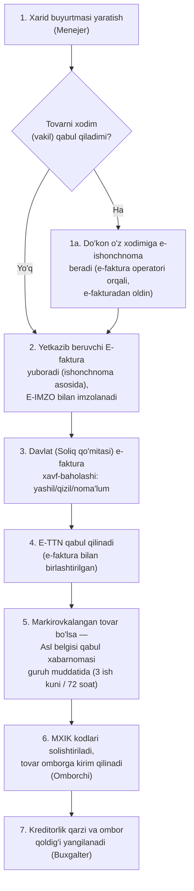

| Qadam | Rol | Modul | Hujjat | Davlat tizimi | Buxgalteriya effekti |
|---|---|---|---|---|---|
| 1 | Menejer | M07 | Ichki xarid buyurtmasi | — | Effekt yo'q (hali majburiyat yo'q) |
| 1a | Menejer/Buxgalter (chiqaradi), Omborchi (imzolaydi) | M07 | E-ishonchnoma (EDO: Faktura.uz PowerOfAttorney / Didox Empowerment) | E-faktura operatori, E-IMZO | Effekt yo'q |
| 2 | Buxgalter / tizim | M07 | E-faktura (EHF) | E-faktura, E-IMZO | Kreditorlik qarzi paydo bo'ladi |
| 3 | Davlat (tashqi) | M07, M10 | E-faktura risk-belgisi (`risk_flag`: `green`/`red`/`unknown`) | E-faktura (davlat xavf-baholashi, VM Qarori №830-son) | "Qizil" yoki "noma'lum" — QQS krediti to'lovgacha kechiktiriladi; Buxgalter `unknown`ni kabinetdan ko'rib BO-15 da qo'lda belgilaydi |
| 4 | Omborchi | M07, M04 | E-TTN (sotuv bilan jo'natishda e-faktura tarkibida keladi) | E-TTN, E-IMZO | Effekt yo'q |
| 5 | Omborchi | M04, M07 | Asl belgisi qabul xabarnomasi (EHF shaklida) — muddat tovar guruhi bo'yicha sozlanadi (qaror #63): umumiy 3 ish kuni, suv/ichimlik, dori, o'simlik yog'i — 72 soat; tizim kuzatadi va ogohlantiradi, bloklamaydi | Asl belgisi (CRPT API) | Effekt yo'q |
| 6 | Omborchi | M04 | Ichki kirim hujjati | MXIK | Ombor qoldig'i ortadi |
| 7 | Buxgalter | M11 | Provodka (avtomatik) | — | Ombor (aktiv) ortadi, kreditorlik qarzi (passiv) ortadi |

Manba: `03-efaktura-va-tolov.md` (E-faktura, E-TTN, E-IMZO), `research_notes/ochiq-savollar/P2-efaktura-markirovka.md` (OQ-019 xavf darajasi kanali, OQ-024 e-ishonchnoma — VM 249 3-ilova, OQ-027 qabul muddati — VM 833 66–67-band). E-ishonchnoma — qaror #63: ishonchnomasiz e-fakturani Buxgalter (direktor ERI) imzolaydi, tizim bloklamaydi; Vakolat.uz (VM 825) TMZ qabulida ishlatilmaydi. Xavf darajasi: VM 830 (11-band) bo'yicha EDO oqimida va my.soliq.uz kabinetida ko'rinadi; Faktura.uz API'si uni qaytaradimi — Tashqi javob kerak: 26 #47 (OQ-019).

---

## BP-02: Sotuv — kassa (naqd/karta bilan oddiy chakana savdo)

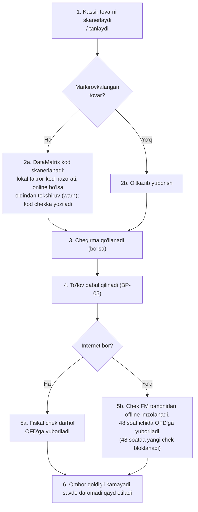

| Qadam | Rol | Modul | Hujjat | Davlat tizimi | Buxgalteriya effekti |
|---|---|---|---|---|---|
| 1 | Kassir | M01 | — | — | — |
| 2a | Kassir | M01, M04 | Chek qatoridagi markirovka kodi (`marking_codes`) — Asl belgisiga fiskal chek ichida OFD orqali uzatiladi; dublikat/avval sotilgan kod rad etiladi, oldindan tekshiruv `MARKING_PRECHECK=warn` (qaror #62) | Asl belgisi (OFD orqali) | — |
| 3 | Kassir | M03 | — | — | Sotish narxi kamayadi |
| 4 | Kassir | M01 | To'lov (to'lov shakli: naqd / bank kartalari / QR-kodli to'lov / aralash) | To'lov tizimi (BP-05) | Pul mablag'i ortadi: naqd — kassa; karta/QR — yo'ldagi pul mablag'lari, bankka tushgani tasdiqlanganda bank hisobi (BP-05, qaror #42) |
| 5a/5b | Tizim | M01 | Fiskal chek (MXIK, markirovka kodi, to'lov shakli, fiskal belgi, QR); standart — bosma, elektron (QR/Telegram/SMS) — faqat zahira (`delivery`, `delivery_reason`) | Virtual kassa/OFD (48 soat qoidasi — VMQ-943 1-ilova 31-band; 48 soatda blok — 2-ilova 6-band, qaror #43), MXIK | Savdo daromadi va QQS majburiyati hisoblanadi |
| 6 | Tizim | M04, M11 | Avtomatik provodka | — | Ombor qoldig'i kamayadi, sotilgan tovar tannarxi hisoblanadi |

Manba: `02-kassa-ofd-markirovka.md` (fiskal chek, MXIK), `research_notes/ochiq-savollar/P1-soliq-fiskal.md` (OQ-004 48 soat blok, OQ-018 chek yetkazish), `P2-efaktura-markirovka.md` (OQ-026 markirovka chek orqali). Elektron chekning do'kon savdosida yagona shakl sifatida qonuniyligi — Tashqi javob kerak: 26 #112 (OQ-018).

---

## BP-03: Sotuv — nasiya (qarzga sotish) (qaror #30)

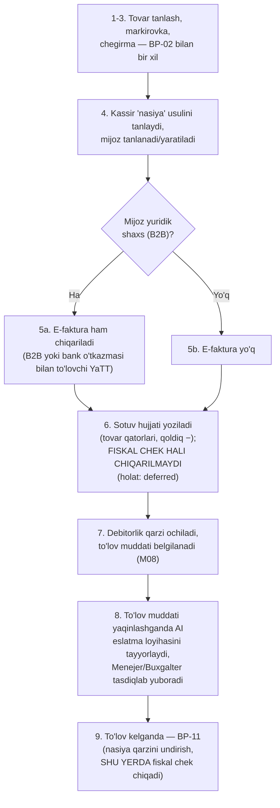

| Qadam | Rol | Modul | Hujjat | Davlat tizimi | Buxgalteriya effekti |
|---|---|---|---|---|---|
| 1-3 | Kassir | M01, M04, M03 | — | Asl belgisi, MXIK | BP-02 bilan bir xil |
| 4 | Kassir | M08 | Mijoz kartasi | — | — |
| 5a | Tizim | M08, M10 | E-faktura (agar B2B) | E-faktura, E-IMZO | — |
| 6 | Tizim | M01, M08 | Sotuv hujjati (`deferred`) — fiskal chek to'lovda chiqadi (qaror #30); sotuv paytidagi "kredit" turidagi chek — `FiscalPolicy.credit_sale_receipt` (standart `none`) | — | Ombor kamayadi; savdo daromadi va QQS majburiyati **sotuv kuni** tan olinadi (SK 242, 78-modda; BHMS 2; `13-provodka-qoidalari.md` §2.14, qaror #30). Provodka sanasi (sotuv kuni) ≠ fiskal chek sanasi (to'lov kuni, BP-11) |
| 7 | Tizim | M08 | Nasiya hujjati | — | Debitorlik qarzi ortadi (pul o'rniga) |
| 8 | Tizim (AI) / Menejer | M08 | Eslatma matni (loyiha) | — | Effekt yo'q — AI faqat matn loyihasini tayyorlaydi, odam tasdiqlagandan keyin yuboriladi (AI-06, `09-ai-funksiyalar.md`) |
| 9 | — | M08 | **Fiskal chek shu yerda chiqadi** | — | Davomi BP-11'da (nasiya qarzini undirish) |

Manba: `03-efaktura-va-tolov.md` (B2B e-faktura), `research_notes/ochiq-savollar/P1-soliq-fiskal.md` (OQ-002), `P2-efaktura-markirovka.md` (OQ-022); qaror #30, #42. B2C — e-faktura chiqarilmaydi (kassa cheki EHF o'rnini bosadi, SK 47-modda 3-qism, VM 489 3-band); B2B (`counterparty.kind=company`) va bank o'tkazmasi bilan to'laydigan YaTT — e-faktura majburiy. Sotuv paytida "kredit" turidagi chek majburiyligi va OFD chek turi kodi — Tashqi javob kerak: 26 #9 (OQ-002).

---

## BP-04: Qaytarish

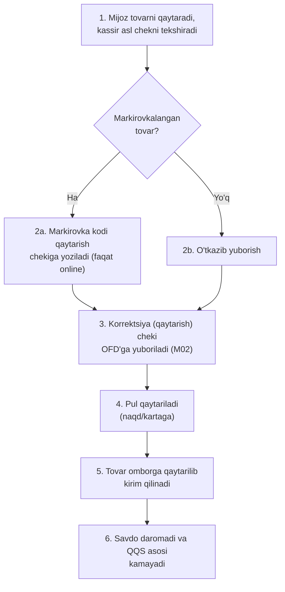

| Qadam | Rol | Modul | Hujjat | Davlat tizimi | Buxgalteriya effekti |
|---|---|---|---|---|---|
| 1 | Kassir | M02 | Asl chek | — | — |
| 2a | Kassir | M02, M04 | Qaytarish chekidagi markirovka kodi — OFD orqali Asl belgisiga (VM 833 90-band) | Asl belgisi (OFD orqali) | — |
| 3 | Tizim | M01, M02 | Korrektsiya cheki | Virtual kassa/OFD, MXIK | Savdo daromadi kamayadi |
| 4 | Kassir | M02 | To'lov qaytarish kvitansiyasi | To'lov tizimi (karta bo'lsa) | Pul mablag'i kamayadi |
| 5 | Omborchi | M04 | Ichki kirim hujjati | — | Ombor qoldig'i ortadi |
| 6 | Buxgalter | M10, M11 | Avtomatik provodka | — | QQS majburiyati mos ravishda qayta hisoblanadi |

Manba: `02-kassa-ofd-markirovka.md`, `research_notes/ochiq-savollar/P2-efaktura-markirovka.md` (OQ-026). **Markirovkalangan tovarni qaytarish faqat internet bor paytda (online) amalga oshiriladi** — qonundan qat'iyroq ichki tanlov (kod holatini tekshirish, firibgarlik xavfi), offline rejimda bloklanadi (`03-modullar-talablari.md`, M02 Offline xatti-harakati). Muddati o'tgan tovar qaytarilsa — `returns.approve` bilan, `restock=false`, avtomatik `write_offs` qoralamasi (sabab `expired_return`) (qaror #48). 48 soatlik offline blokda qaytarish cheki ham chiqarilmaydi (qaror #43).

---

## BP-05: To'lov qabul qilish (naqd, karta, QR/Click/Payme)

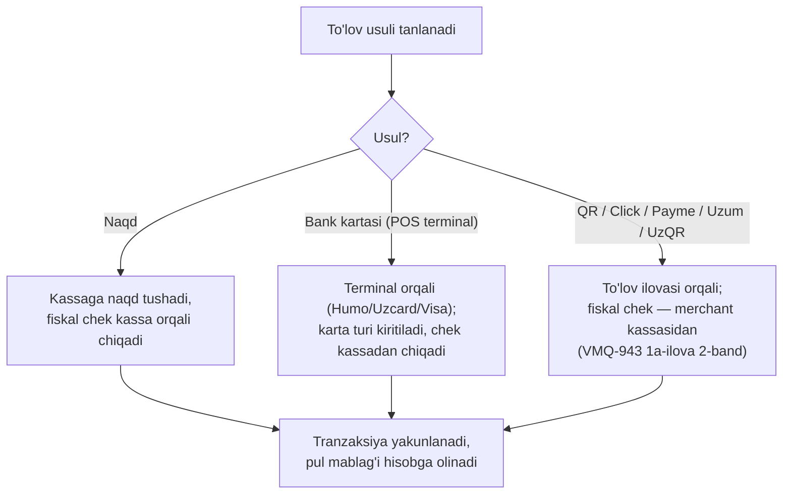

| Qadam | Rol | Modul | Hujjat | Davlat tizimi | Buxgalteriya effekti |
|---|---|---|---|---|---|
| Naqd | Kassir | M01 | Fiskal chek | Virtual kassa/OFD | Kassadagi naqd pul ortadi |
| Karta | Kassir | M01 | Terminal cheki + fiskal chek | Virtual kassa/OFD (acquiring bank orqali) | **Yo'ldagi pul mablag'lari** ortadi; ekvayer bankka o'tkazgani bank ko'chirmasi bo'yicha **bank tushumi tasdig'i** (`bank_settlements`) bilan bank hisobiga o'tadi, komissiya 9430 xarajatiga yoziladi (qaror #42) |
| Karta — mustaqil terminal (qo'lda belgilangan) | Kassir | M01, M16 | Fiskal chek (to'lov shakli "bank kartalari" + karta turi `card_type`: `personal`/`corporate`/`social`/`unknown`); ijtimoiy kartada `card_mask` va `rrn` majburiy (qaror #64) | Virtual kassa/OFD (kassa terminal bilan integratsiyalanmagan — VMQ-943 1-ilova 6-band bo'yicha qonuniy) | Online va offline'da ruxsat; Z-hisobotda "karta" jami alohida chiqadi; yo'ldagi pul mablag'lari → bank tushumi tasdig'i (BP-15) |
| QR/Click/Payme/Uzum | Kassir/mijoz | M01 | To'lov tasdiqlash (`provider_tx_id`) + fiskal chek (to'lov shakli "QR-kodli to'lov"); chek havolasi provayderga yuboriladi (Click `submit_qrcode`) | Virtual kassa/OFD, Click/Payme/Uzum API | Mablag' vositachi orqali tushadi, komissiya ushlab qolinadi — avval yo'ldagi pul mablag'lari, bank tushumi tasdig'ida bank hisobi + komissiya (9430) xarajati (qaror #42) |
| Yagona QR (UzQR, bank) | Kassir/mijoz | M01 | Statik QR (`qr_type='static'`) — faqat online, kassir qo'lda tasdiqlaydi, ixtiyoriy tranzaksiya raqami; dinamik QR (`qr_type='dynamic'`) — `UzqrPort`, `provider_tx_id` majburiy; fiskal chek (to'lov shakli "QR-kodli to'lov") | Virtual kassa/OFD, bank (yagona QR, operator — CBU MUNIS) | Mablag' bank orqali tushadi — avval yo'ldagi pul mablag'lari, bank tushumi tasdig'ida bank hisobi (qaror #42); yuridik shaxslar uchun bank UzQR majburiy (PF-246 3-band "b"; CBU 5/11-son qoidalari), YaTT (`legal_form='sole_proprietor'`) uchun to'lov tashkiloti platformasidagi maxsus QR (Click/Payme/Uzum) majburiy (PQ-247 7-band "a") (qaror #64) |

Manba: `03-efaktura-va-tolov.md` (Payme/Click/Uzum protokollari), `research_notes/ochiq-savollar/P1-soliq-fiskal.md` (OQ-001), `P3-tolovlar-bank.md` (OQ-032, OQ-033, §7.2). Fiskalizatsiya qoidasi: do'kon sotuvida chekni har doim bizning kassa chiqaradi (VMQ-943 1-ilova 6-band; 1a-ilova 2-band — UzQR uchun ham); tenant provayder kabinetida provayder tomonidagi avto-fiskallashtirishni o'chiradi (BO-14 tekshiruv bandi). 2026-10-22 dan chekda to'lov shakli va karta turi majburiy (VMQ-943 1-ilova 7-band). Dinamik UzQR POS API spetsifikatsiyasi — Tashqi javob kerak: 26 #49 (OQ-032).

---

## BP-06: Buxgalteriya provodkalari (yuqori daraja)

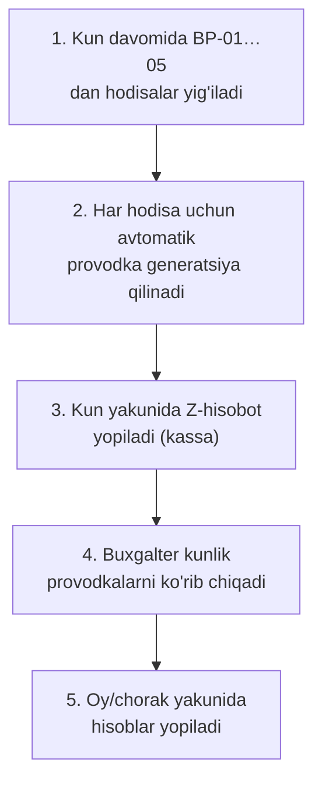

| Qadam | Rol | Modul | Hujjat | Davlat tizimi | Buxgalteriya effekti |
|---|---|---|---|---|---|
| 1-2 | Tizim | M11 | Avtomatik provodkalar | — | Xarid → ombor va kreditorlik qarzi ortadi; sotuv → ombor kamayadi, daromad va QQS ortadi (nasiyada ham sotuv kuni — qaror #30); to'lov → pul mablag'i o'zgaradi (naqdsiz tushum va inkassa avval yo'ldagi pul mablag'lariga, bank ko'chirmasi tasdiqlanganda bank hisobiga — qaror #42); qaytarish → teskari yozuv |
| 3 | Kassir/tizim | M01, M11 | Z-hisobot | Virtual kassa/OFD | Kunlik savdo yakunlanadi |
| 4 | Buxgalter | M11 | Kunlik hisobot | — | Xatolar/tafovutlar aniqlanadi |
| 5 | Buxgalter | M11, M12 | Oylik/choraklik yopish | — | Davr natijasi shakllanadi |

Naqdsiz tushum va inkassaning yo'ldagi pul mablag'laridan bank hisobiga o'tishi — alohida jarayon BP-15 (bank tushumi tasdig'i).

*Eslatma: bu yerda faqat qaysi hodisa qaysi hisob guruhiga (aktiv/passiv/daromad/xarajat) ta'sir qilishi ko'rsatilgan — aniq hisob raqamlari va to'liq hisob rejasi (NSBU №21 asosida) — `13-provodka-qoidalari.md`.*

Manba: `00-xulosa-va-ochiq-savollar.md`.

---

## BP-07: QQS — ichki hisob-kitob va monitoring

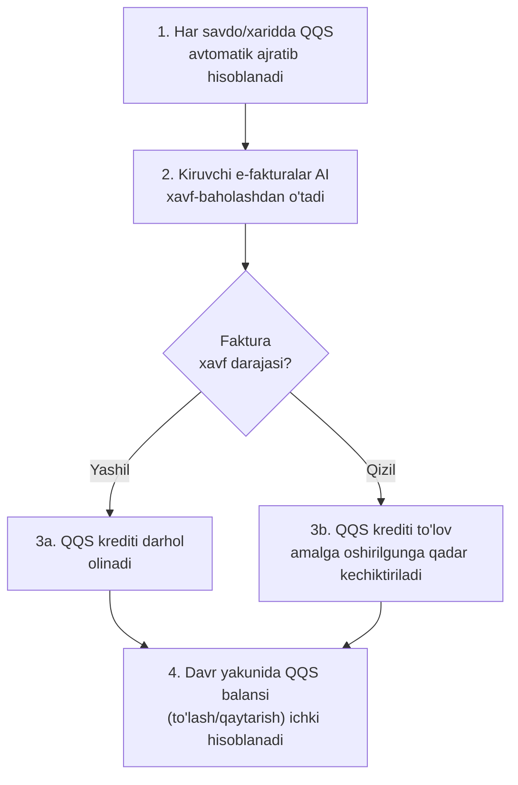

| Qadam | Rol | Modul | Hujjat | Davlat tizimi | Buxgalteriya effekti |
|---|---|---|---|---|---|
| 1 | Tizim | M10 | — | — | Chiquvchi/kiruvchi QQS hisoblanadi |
| 2 | Davlat (tashqi) | M10 | E-faktura risk-belgisi | E-faktura (davlat xavf-baholashi, VM Qarori №830-son) | — |
| 3a/3b | Buxgalter | M10 | — | — | QQS krediti olinadi yoki kechiktiriladi |
| 4 | Buxgalter | M10, M11 | Soliq hisob-kitobi hujjati (`tax_settlements`, ST, `tax_kind='vat_offset'`) — server qoralamani hisoblaydi, Buxgalter o'tkazadi; aylanma solig'i to'lovchida `tax_kind='turnover_tax'` | — | QQS: hisobga olinadigan QQS chiquvchi QQS bilan yopiladi (Dt 6410 / Kt 4410); aylanma solig'i: xarajat va budjetga qarz (Dt 9430 / Kt 6410) — `13-provodka-qoidalari.md` §2.26, §4.3 |

Manba: `03-efaktura-va-tolov.md` (davlat xavf-baholashi, ≤10% cheklov, VM Qarori №830-son — 1.2-band). *Eslatma: 2026-01-01 dan QQS deklaratsiyasining o'zini Soliq qo'mitasi tuzgani sababli, bu jarayonning natijasi endi "deklaratsiya topshirish" emas — BP-08'ga kirish ma'lumoti.*

---

## BP-08: Davlat tuzgan hisobotni ichki hisob bilan solishtirish (markaziy oqim)

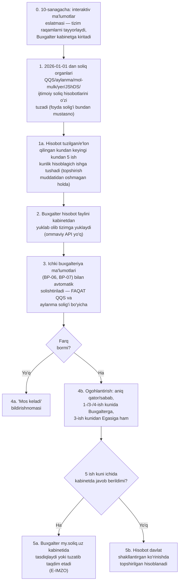

| Qadam | Rol | Modul | Hujjat | Davlat tizimi | Buxgalteriya effekti |
|---|---|---|---|---|---|
| 0 | Tizim/Buxgalter | M10, M12 | Interaktiv ma'lumotlar eslatmasi (10-sanagacha): aylanma — soliq solinmaydigan daromad, chegirmalar, imtiyozlar; QQS — hisobga olinadigan QQS tuzatishlari, imtiyozlar | Soliq hisobotlari (my.soliq.uz) | — |
| 1 | Davlat (tashqi) | — | Davlat tuzgan hisobot | Soliq hisobotlari (my.soliq.uz) | — |
| 1a | Tizim | M12 | 5 ish kunlik hisoblagich (deadline obyekti, topshirish muddati bilan cheklangan) | — | — |
| 2 | Buxgalter | M12 | Kabinetdan yuklab olingan hisobot fayli (PDF/Excel), tizimga yuklanadi | Soliq hisobotlari (my.soliq.uz) | — |
| 3 | Tizim | M10, M11, M12 | Solishtirish hisoboti: QQS — e-faktura darajasida (STIR + faktura raqami + sana) va yig'indi; aylanma — yig'indi, 5 manba (0101 e-faktura, 0102 NKM/fiskal chek, 0103–0105) va stavka bo'yicha; farq `vat_diff_tolerance_amount` ("1000.00", qaror #50) dan boshlab | — | Farqlar (agar bor) aniqlanadi — faqat QQS va aylanma solig'i uchun |
| 4a/4b | Tizim/Buxgalter | M12 | Ogohlantirish (1-, 3-, 4-ish kuni; 3-ish kunidan Egasiga — qaror #50) | — | — |
| 5a | Buxgalter | M12 | Kabinetda tasdiqlash yoki tuzatib taqdim etish (alohida e'tiroz arizasi yo'q, VM 736 3¹-ilova 11-band); tizim farqlar ro'yxati va tuzatish raqamlarini tayyorlaydi | E-IMZO, Soliq hisobotlari (my.soliq.uz) | — |
| 5b | — | M12 | — | Soliq hisobotlari (my.soliq.uz) | Hisobot topshirish muddati tugagan kuni davlat shakllantirgan ko'rinishda taqdim etilgan hisoblanadi; keyingi tuzatish — SK 83-modda bo'yicha aniqlashtirilgan hisobot |

Manba: Soliq kodeksi 81-moddasi, O'RQ-1108-son Qonun (2025-12-25) — [lex.uz/docs/-7944527](https://lex.uz/docs/-7944527); `00-xulosa-va-ochiq-savollar.md` (5-band, markaziy xulosa), `04-arxitektura-va-stack.md` (6.1–6.3-band, solishtirish oqimi), `09-soliq-integratsiyasi.md` ("Elektron hisobotlar" qatori), [uz.kursiv.media, 2025-12-30](https://uz.kursiv.media/uz/2025-12-30/1-yanvardan-ayrim-soliq-hisobotlari-avtomatik-shakllantiriladi/) (ikkinchi darajali, mazmunan mos).

Mexanizm: SK 81-modda 6–8-qism, SK 5-modda 7-qism, VM 736 3¹-ilova 10–11-band (yagona kanal — shaxsiy kabinet; avtomatik yuborish yo'q) — `research_notes/ochiq-savollar/P1-soliq-fiskal.md` (OQ-013, OQ-014). Ommaviy API yo'q — fayl yuklash yakuniy MVP qarori (26 #41).

- *3-qadamda ichki solishtirish faqat QQS va aylanma solig'i uchun to'liq bajariladi — mol-mulk, yer, JShDS va ijtimoiy soliq hisobotlari uchun kerakli ichki ma'lumot (asosiy vositalar hisobi, kadrlar/ish haqi) 18 MVP moduli qatorida yo'q (README.md); bu hisobotlar MVP'da faqat davlat bergan raqam sifatida ko'rsatiladi, ichki solishtirish keyingi bosqich.*

---

## BP-09: Filiallararo ko'chirish

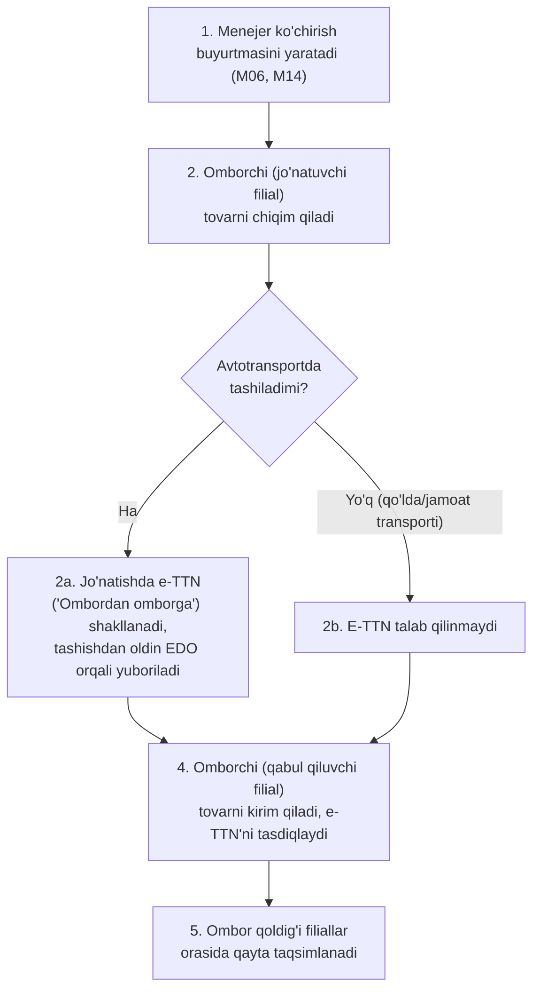

| Qadam | Rol | Modul | Hujjat | Davlat tizimi | Buxgalteriya effekti |
|---|---|---|---|---|---|
| 1 | Menejer | M06, M14 | Ko'chirish buyurtmasi | — | — |
| 2 | Omborchi | M06, M04 | Chiqim hujjati | — | Jo'natuvchi filial ombori kamayadi |
| 2a | Omborchi (jo'natuvchi) | M06 | E-TTN ("Ombordan omborga", `ettn_documents`, `transfers.transport_mode='vehicle'`, `transfers.ettn_ref`) — ko'chirish `post` qilinganda yaratiladi | E-TTN (EDO operatori), E-IMZO | — |
| 3 | — | M06 | Markirovkalangan tovar — Asl belgisiga xabar qilinmaydi (egalik o'zgarmaydi, VM 833) | — | — |
| 4 | Omborchi (qabul qiluvchi) | M06, M04 | Kirim hujjati; qabul qiluvchi e-TTN'ni tasdiqlaydi | E-TTN | — |
| 5 | Tizim | M04, M14 | Avtomatik provodka | — | Qabul qiluvchi filial ombori ortadi, jo'natuvchi filial kamayadi (moddiy javobgarlik o'zgaradi) |

Manba: VM 249 31-ilova (VM 168 tahriri) 13-band — "Ombordan omborga" tashish turi: jo'natuvchi bir vaqtda yuk oluvchi, EHF chiqarilmaydi; istisno — qo'lda yoki jamoat transportida tashish (24-band); VM 833 66–67-band (CRPT xabarnomasi faqat egalik o'tishida) — `research_notes/ochiq-savollar/P2-efaktura-markirovka.md` (OQ-021, OQ-026, OQ-027); qaror #63. **Ko'chirish offline rejimda yaratilishi mumkin** (jo'natish va qabul ikkisi ham, keyin sinxronlanadi, audit bilan), lekin avtotransportda tashish boshlanishidan oldin e-TTN rasmiylashtirilgan bo'lishi shart — e-TTN'siz tashish qonunbuzarlik (16-band) (`03-modullar-talablari.md`, M06).

---

## BP-10: Inventarizatsiya

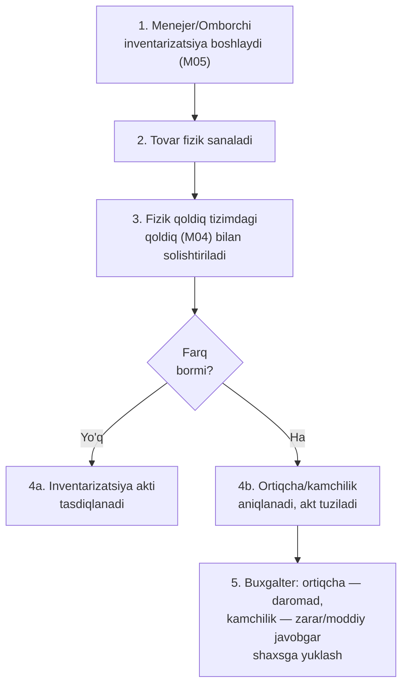

| Qadam | Rol | Modul | Hujjat | Davlat tizimi | Buxgalteriya effekti |
|---|---|---|---|---|---|
| 1 | Menejer/Omborchi | M05 | Inventarizatsiya buyrug'i | — | — |
| 2 | Omborchi | M05 | Fizik sanash varaqasi | — | — |
| 3 | Tizim | M05, M04 | Solishtirish hisoboti | — | — |
| 4a/4b | Omborchi/Menejer | M05 | Inventarizatsiya akti | — | — |
| 5 | Buxgalter | M11 | Avtomatik provodka | — | Ortiqcha aniqlansa — boshqa daromad ortadi; kamchilik aniqlansa — zarar yoki moddiy javobgar shaxsning qarzi ortadi |

Manba: `08-mahsulot-modullari.md` ro'yxatidagi M05 moduli. `expected` qoldiq har qator uchun sanash vaqtigacha bo'lgan harakatlar bilan hisoblanadi — sanash davomidagi sotuv/kirim farqqa kirmaydi (qaror #53). Kamomad bo'yicha hisobdan chiqarish (`write_offs`) — faqat online back-office (qaror #54). Markirovkalangan tovar kamomadini Asl belgisida hisobdan chiqarish CRPT API `writeoff` orqali (`MarkingPort`); metod va hujjat turi — Tashqi javob kerak: 26 #40 (OQ-025).

---

## BP-11: Nasiya qarzini undirish (debitorlikni yopish) (qaror #30)

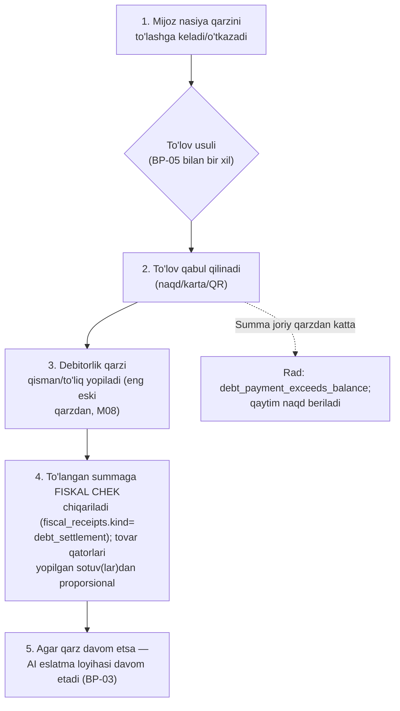

| Qadam | Rol | Modul | Hujjat | Davlat tizimi | Buxgalteriya effekti |
|---|---|---|---|---|---|
| 1 | Mijoz/Kassir | M08 | — | — | — |
| 2 | Kassir | M01, M08 | To'lov kvitansiyasi | Virtual kassa/OFD (BP-05 bilan bir xil) | Pul mablag'i ortadi (naqd — kassa; karta/QR — yo'ldagi pul mablag'lari; bank o'tkazmasi — bank hisobi; qaror #42) |
| 3 | Tizim | M08 | Avtomatik provodka | — | Debitorlik qarzi kamayadi |
| 4 | Tizim | M01, M08 | **Fiskal chek** (`debt_settlement`, qaror #30) — bitta to'lov = bitta chek, qatorlar yopilgan sotuvlardan proporsional (qaror #45); karta to'lovida `card_type`/`card_mask`/`rrn` (qaror #64) | Virtual kassa/OFD (VMQ-943 1-ilova 30-band — majburiy) | Effekt yo'q — savdo daromadi va QQS sotuv kuni (BP-03, 6-qadam) tan olingan (`13-provodka-qoidalari.md` §2.14, qaror #30); chek faqat to'langan summani fiskal rasmiylashtiradi |
| 5 | Tizim (AI) / Menejer | M08 | — | — | Effekt yo'q |

Manba: `research_notes/ochiq-savollar/P1-soliq-fiskal.md` (OQ-002); qaror #30, #42, #45: asl nasiya sotuvida fiskal chek to'lovgacha chiqarilmaydi (BP-03), **har bir qarz to'lovida fiskal chek chiqariladi**; daromad/QQS — sotuv kuni. Joriy qarzdan ortiq summa rad etiladi (`422 VALIDATION_ERROR`, `message_key=debt_payment_exceeds_balance`), mijoz avansi MVP'da yo'q (qaror #45). 48 soatlik offline blokda `debt_settlement` cheki ham chiqarilmaydi (qaror #43).

---

## BP-12: Yetkazib beruvchiga to'lov (kreditorlikni yopish)

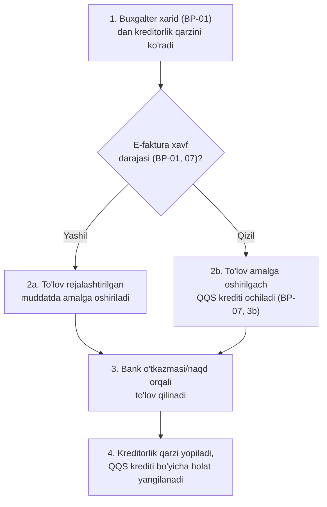

| Qadam | Rol | Modul | Hujjat | Davlat tizimi | Buxgalteriya effekti |
|---|---|---|---|---|---|
| 1 | Buxgalter | M07, M11 | Kreditorlik ro'yxati | — | — |
| 2a/2b | Buxgalter | M07, M10 | — | E-faktura (davlat xavf-baholashi) | — |
| 3 | Buxgalter/Egasi | M07 | To'lov topshirig'i/bank hujjati; qarzdan ortiq summa — ogohlantirish bilan ruxsat (`settings.supplier_overpay_policy='warn'`), `block` bo'lsa `422 SUPPLIER_OVERPAY_BLOCKED` (qaror #47) | Bank-klient (ixtiyoriy) | Pul mablag'i kamayadi; ortiqcha qism — yetkazib beruvchiga avans (4310) |
| 4 | Tizim | M07, M10, M11 | Avtomatik provodka | — | Kreditorlik qarzi kamayadi; "qizil" faktura bo'lsa — QQS krediti endi olinadi |

Manba: `03-efaktura-va-tolov.md` (1.2-band — QQS krediti to'lovdan keyin beriladi), `04-arxitektura-va-stack.md` (6-bo'lim).

---

## BP-13: Chek asosida keyinchalik e-faktura chiqarish

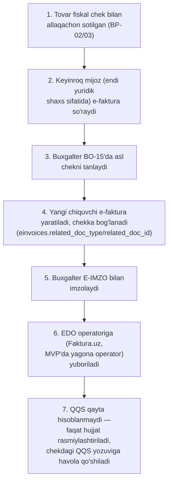

| Qadam | Rol | Modul | Hujjat | Davlat tizimi | Buxgalteriya effekti |
|---|---|---|---|---|---|
| 1 | Kassir/Tizim | M01 | Fiskal chek | Virtual kassa/OFD | Savdo daromadi va QQS allaqachon hisoblangan (BP-02 — chek kuni; BP-03 — sotuv kuni, `13-provodka-qoidalari.md` §2.14, qaror #30) |
| 2 | Mijoz | M01 | So'rov (tizimdan tashqari, masalan qo'ng'iroq) | — | — |
| 3 | Buxgalter | M01, M07 | Asl chek tanlovi | — | — |
| 4 | Tizim | M01, M10 | Chiquvchi e-faktura (`einvoices.related_doc_type`/`related_doc_id`) | — | Effekt yo'q — `ledger_entries`/`vat_moves`ga yangi yozuv qo'shilmaydi (append-only); bog'lanish faqat `einvoices.related_doc_type`/`related_doc_id` orqali (`13-provodka-qoidalari.md` §2.22) |
| 5 | Buxgalter | M01 | PKCS#7 imzo | E-IMZO | — |
| 6 | Tizim | M01 | Yuborilgan e-faktura | E-faktura (Faktura.uz — MVP'da yagona operator) | — |
| 7 | Tizim | M10, M11 | — | — | QQS **ikkinchi marta hisoblanmaydi** — registr yozuvlari o'zgarmaydi (append-only), bog'lanish faqat hujjat darajasida (`einvoices.related_doc_type`/`related_doc_id`, `13-provodka-qoidalari.md` §2.22) |

Manba: `spec/kod-uchun/03-modullar-talablari.md` (US-M01-06, M01 chekka holatlar). *Eslatma: bu jarayon B2C sotuvdan keyin mijoz maqomi B2B'ga aniqlanganda (yoki boshidanoq B2B bo'lib, e-faktura keyin so'ralganda) ishlaydi.* **E-faktura operatori — MVP'da faqat Faktura.uz** (ochiq API hujjati tekshirilgan, REGOS ham ishlatadi); `EInvoicePort` ikki adapterga tayyor (qaror #23 tavsiya #4); Didox'ni birinchi qilishni asoschi qayta ko'rishi tavsiya etiladi — 26 #167.

---

## BP-14: Kunni 1C ga yuborish (M19, MVP'dan keyin — Bosqich 7)

Faqat 1C bazasi ulangan tenant uchun (qaror #36–#41). ERP kun yopilgach shu kunning o'tkazilgan (`posted`) hujjatlarini do'kon kompyuteridagi 1C bazasiga («Бухгалтерия для Узбекистана 3.0») agent orqali, ketma-ket va takrorsiz yozadi; yo'nalish **ERP → 1C bir tomonlama**. Bitta partiya = bitta 1C bazasi × hisob kuni × revision (`onec_export_batches`). Holat mashinasi, tayyorlik qoidalari va dispetcher — `33-1c-integratsiya.md` §7; nima yuboriladi — §6.

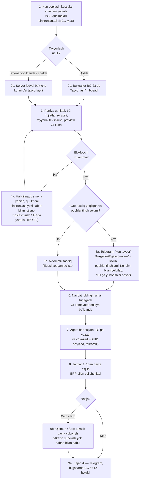

| Qadam | Rol | Modul | Hujjat | Davlat tizimi | Buxgalteriya effekti |
|---|---|---|---|---|---|
| 1 | Kassir / tizim | M01, M16 | Smena yopilishi, POS sinxroni (`16-offline-sync.md` §9) | — | — |
| 2a | Buxgalter / Egasi (`onec.export.prepare`) | M19 | Kun partiyasi (`onec_export_batches`, `draft`) | — | Effekt yo'q |
| 2b | Tizim (`schedule_mode`: `on_shift_close` / `at_time`) | M19 | Kun partiyasi (`draft`) | — | Effekt yo'q |
| 3 | Tizim | M19 | Preview: 1C hujjatlari (ОРП har kassa × kun, Реализация, kirim, qaytarish, ko'chirish, hisobdan chiqarish, inventarizatsiya, pul hujjatlari — rejim `full`/`sales_only`), tayyorlik, `preview_hash` | — | Effekt yo'q — ERP provodkalari o'zgarmaydi; provodka, QQS registri va tannarx 1C ga yuborilmaydi (qaror #39) |
| 4a | Buxgalter / Egasi | M19, M01 | Qurilma istisnosi (`onec.export.approve`, sabab), moslashtirish va 1C da yaratish tasdig'i (`onec.mapping.edit`, `onec.refs.create`) | — | Effekt yo'q |
| 5a | Buxgalter / Egasi (`onec.export.approve`) | M19 | Tasdiq (preview xeshi va ko'rilgan ogohlantirishlar bilan) | — | Effekt yo'q |
| 5b | Tizim (`auto_approve`, faqat Egasi yoqadi) | M19 | Avto-tasdiq (`approval_mode='auto'`) | — | Effekt yo'q |
| 6–7 | Tizim + 1C agenti | M19 | 1C hujjatlari (`Записать(Проведение)`), `onec_object_refs` | — | ERP'da effekt yo'q; 1C hujjatni o'zi o'tkazadi (1C buxgalteriyasi — haqiqat manbai shu tenant uchun) |
| 8 | Tizim | M19 | Solishtirish (`read_totals`, chegara 0.00) | — | — |
| 9a/9b | Tizim; Buxgalter / Egasi (`onec.export.correct`) | M19, M18 | Natija, Telegram xabari; qayta yuborish / o'tkazib yuborish / qabul / yangi revision / tuzatuvchi partiya | — | Effekt yo'q |

**Istisnolar:**

| Holat | Nima bo'ladi |
|---|---|
| Ochiq smena | `readiness_policy='all_shifts_closed'` (standart) — blok `ONEC_SHIFTS_OPEN`; `allow_open` — ogohlantirish |
| POS qurilmasi kun yopilgandan keyin sinxronlanmagan | Blok `ONEC_DEVICES_NOT_SYNCED`; qurilma sinxronlangach preview avtomatik qayta quriladi yoki qurilma sabab bilan istisno qilinadi (kech cheklar — yangi revision) |
| Moslanmagan tovar/kontragent/to'lov turi | Blok `ONEC_MAPPING_INCOMPLETE` — BO-22 «Moslash»; 1C da yangi element faqat tasdiq bilan yaratiladi (qaror #40), tashkilot va QQS stavkasi hech qachon yaratilmaydi |
| Oldingi kun tayyorlanmagan / yakunlanmagan | Blok `ONEC_PREVIOUS_DAY_NOT_DONE` yoki navbatda kutish (`ONEC_QUEUED_BEHIND`) — D kuni D−1 dan oldin yozilmaydi |
| Tasdiqdan keyin ERP ma'lumoti o'zgardi | `approved → preview` — qayta tasdiq kerak; tasdiq paytida o'zgarsa `ONEC_PREVIEW_CHANGED` |
| Kompyuter o'chiq | Partiya `approved` holatida muddatsiz kutadi; 2 soatdan keyin Telegram `onec_agent_offline`; qaytganda sana tartibida yuboriladi |
| 1C xatosi (qoldiq yetmaydi va h.k.) | Item `failed`, partiya `partial` — tuzatib «Faqat xatolarni qayta yuborish» yoki sabab bilan «O'tkazib yuborish» / «Qabul qilish» |
| 1C jamlari ERP'dan farq qiladi | Partiya `mismatch` — farq jadvali; sabab bilan qabul qilinmaguncha keyingi kunlar navbatga chiqmaydi |
| Yuborilgan kunga kech offline chek | `needs_resync` → yangi revision o'sha GUID'larni yangilaydi (avtomatik yoki qo'lda) |
| 1C da sana taqiqlangan | `ONEC_DATE_PROHIBITED` — hech narsa yozilmaydi, sana avtomatik almashtirilmaydi; buxgalter 1C da sanani ochadi yoki tuzatuvchi partiya (joriy ochiq sanada faqat farq) |
| ERP'da bekor qilingan hujjat 1C da bor | Yangi revisionda 1C hujjati o'tkazishdan chiqariladi va o'chirishga belgilanadi (`ONEC_UNPOST_REQUIRED`), jismoniy o'chirish yo'q |
| 1C da qo'lda o'zgartirilgan hujjat | `ONEC_CHANGED_IN_1C` — ustiga yozilmaydi; kunlik drift tekshiruvi Telegram va BO-22 jurnaliga yozadi |

Manba: `33-1c-integratsiya.md` (§3.2 kunlik oqim, §6 eksport hujjatlari, §7 holat mashinasi, §8 takrorsizlik va tuzatishlar, §13.3 Telegram), qaror #36–#42. Bog'liq: US-M19-06…-16, ekranlar BO-22, BO-23.

---

## BP-15: Bank tushumi tasdig'i (yo'ldagi pul → bank hisobi) (qaror #42)

Karta, UzQR, Click, Payme, Uzum tushumlari (BP-02, BP-05, BP-11) va inkassa (M16 «Pul olish → Inkasso») avval **yo'ldagi pul mablag'lari** (5710) ga yoziladi. Bank ko'chirmasi yoki ekvayer/to'lov tashkiloti hisob-kitob hisoboti kelganda Buxgalter bank tushumi tasdig'ini (`bank_settlements`) yaratib o'tkazadi — summa bank hisobiga (5110) o'tadi, bank/ekvayring va to'lov tizimi komissiyasi 9430, inkassa xizmati komissiyasi 9410 xarajatiga yoziladi (`13-provodka-qoidalari.md` §2.18a).

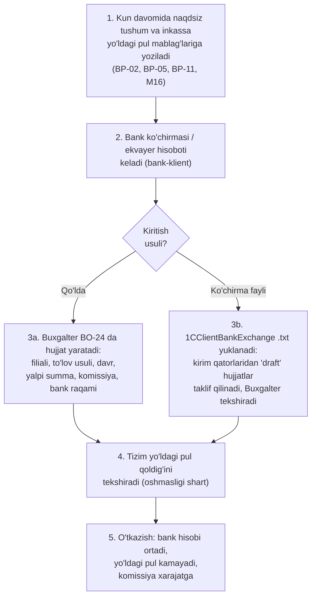

| Qadam | Rol | Modul | Hujjat | Davlat tizimi | Buxgalteriya effekti |
|---|---|---|---|---|---|
| 1 | Kassir / tizim | M01, M08, M16 | Sotuv, qarz to'lovi, inkassa (`cash_movements`, `reason='collection'`) | Virtual kassa/OFD (sotuvda) | Yo'ldagi pul mablag'lari ortadi (to'lov usuli bo'yicha) |
| 2 | Tashqi (bank, ekvayer) | — | Bank ko'chirmasi / hisob-kitob hisoboti | Bank-klient (tizimdan tashqari) | — |
| 3a/3b | Buxgalter / Egasi (`bank_settlements.manage`) | M11 | Bank tushumi tasdig'i (`bank_settlements`, `source='manual'`/`statement_import`, `draft`); import — `POST /api/v1/bank-settlements/imports` (1CClientBankExchange .txt: faqat kirimlar o'qiladi, `method` to'lovchi STIR va to'lov maqsadi bo'yicha aniqlanadi, `gross_amount`ni Buxgalter 5710 qoldig'idan tanlaydi, `commission_amount = gross − kirim`) | — | Effekt yo'q (qoralama) |
| 4 | Tizim | M11 | Tranzit qoldig'i (`GET /api/v1/bank-settlements/transit-balances` — usul × filial) | — | — |
| 5 | Buxgalter / Egasi | M11 | Bank tushumi tasdig'i (`posted`) | — | Bank hisobi `net_amount` ga ortadi, yo'ldagi pul `gross_amount` ga kamayadi, komissiya (`commission_amount`) 9430 xarajatiga (inkassa — 9410) yoziladi; `cash_moves` yozilmaydi |

**Istisnolar:**

| Holat | Nima bo'ladi |
|---|---|
| `gross_amount` filial va usul bo'yicha `doc_date` holatidagi yo'ldagi pul qoldig'idan katta | `422 VALIDATION_ERROR`, hujjat `draft` da qoladi |
| Komissiya yalpi summadan katta yoki teng | Validatsiya xatosi |
| Bitta ko'chirma bir nechta to'lov usulini qamraydi | Har usul uchun alohida hujjat (bitta hujjat — bitta usul) |
| Xato hujjat | `cancel` — storno, sabab majburiy; yopilgan davrga tegmaydi |
| Bank tushumi tasdiqlanmagan | Summa yo'ldagi pul qoldig'ida qoladi — BO-24 ro'yxatida usul va filial bo'yicha ochiq qoldiq ko'rinadi |
| Tenant 1C ga yuboradi (BP-14) | `bank_settlement` standart **yuborilmaydi** (`send_bank_settlements=false`) — buxgalter bank ko'chirmasini 1C ga bank-klientdan import qiladi; yoqilsa 1C da «Поступление на расчетный счет» bo'lib ketadi |

Manba: `13-provodka-qoidalari.md` §2.2, §2.18a; qaror #42; NSBU 21 Yo'riqnoma 237–239-band (5710 tranzit hisob, `Dt 5110 / Kt 5710`) va 410-band (bank komissiyasi — 9430) — `research_notes/ochiq-savollar/P3-tolovlar-bank.md` (OQ-034, OQ-038); buxgalter faqat tanishadi. Bog'liq: US-M11-04, ekran BO-24.

---

## Davlat tizimlari × jarayon matritsasi

| Jarayon | Virtual kassa/OFD | E-faktura | E-TTN | Asl belgisi | MXIK | E-IMZO | E-ishonchnoma (EDO operatori) | Soliq hisobotlari (my.soliq.uz) |
|---|---|---|---|---|---|---|---|---|
| BP-01 Xarid | — | ✓ | ✓ (e-faktura bilan birlashtirilgan) | ✓ (qabul xabarnomasi) | ✓ | ✓ | ✓ (xodim orqali qabulda) | — |
| BP-02 Sotuv (kassa) | ✓ | — | — | ✓ (chek orqali) | ✓ | — | — | — |
| BP-03 Sotuv (nasiya) | **— (BP-11'da, qaror #30)** | ✓ (B2B bo'lsa, asl sotuv vaqtida) | — | ✓ | ✓ | ✓ (B2B e-faktura) | — | — |
| BP-04 Qaytarish | ✓ | — | — | ✓ (chek orqali) | ✓ | — | — | — |
| BP-05 To'lov qabul qilish | ✓ | — | — | — | — | — | — | — |
| BP-06 Buxgalteriya provodkalari | — | — | — | — | — | — | — | — |
| BP-07 QQS ichki hisob-kitob | — | ✓ (davlat xavf-baholashi) | — | — | — | — | — | — |
| BP-08 Davlat hisobotini solishtirish | — | — | — | — | — | ✓ (kabinetda tasdiqlash/tuzatish) | — | ✓ |
| BP-09 Filiallararo ko'chirish | — | — | ✓ ("Ombordan omborga") | — (xabar qilinmaydi) | — | ✓ (e-TTN) | — | — |
| BP-10 Inventarizatsiya | — | — | — | ✓ (kamomadni hisobdan chiqarish) | — | — | — | — |
| BP-11 Nasiya qarzini undirish | ✓ (BP-05 bilan bir xil) | — | — | — | — | — | — | — |
| BP-12 Yetkazib beruvchiga to'lov | — | ✓ (holat kuzatish) | — | — | — | — | — | — |
| BP-13 Chek asosida keyinchalik e-faktura | — | ✓ (chiquvchi, chekka bog'langan) | — | — | — | ✓ | — | — |
| BP-14 Kunni 1C ga yuborish | — | — | — | — | — | — | — | — |
| BP-15 Bank tushumi tasdig'i | — | — | — | — | — | — | — | — |

Matritsa talab qilingan 6 majburiy davlat tizimining barchasini kamida bitta jarayonda qoplaydi: Virtual kassa/OFD (BP-02, 04, 05, 11), E-faktura (BP-01, 03, 07, 12, 13), E-TTN (BP-01, 09), Asl belgisi (BP-01…04, 10), MXIK (BP-01…04), E-IMZO (BP-01, 03, 08, 09, 13). Qo'shimcha ikki ustun — E-ishonchnoma (e-faktura operatori orqali, VM 249 3-ilova; qaror #63) va Soliq hisobotlari (my.soliq.uz).

---

## Ochiq savollar

Faqat tashqi javob kutayotgan bandlar (raqamlar barqaror):

- **4.** Tashqi javob kerak: markirovkalangan tovarni Asl belgisida hisobdan chiqarish (BP-10) va yetkazib beruvchiga qaytarish metodi/hujjat turi, oldindan onlayn tekshiruv majburiyligi — interim: `MarkingPort` stub, `MARKING_PRECHECK=warn` — 26 #40 (OQ-025).
- **7.** Tashqi javob kerak: virtual kassa reyestri — Kiberxavfsizlik markazi ekspertizasi va sertifikat narxi; muddat rejasi 35 ish kuni (eng yomon 45; VMQ-943 4-ilova 11, 12, 16-band — operator va KXM xulosalari arizadan oldin parallel, DSQ qarori 20 ish kuni) — interim: byudjetda zahira — 26 #42 (OQ-011).
- **11.** Tashqi javob kerak: Faktura.uz API'si e-faktura xavf darajasini qaytaradimi (Didox'da `scoring` bor) — interim: `risk_flag='unknown'`, QQS krediti qizil kabi kechiktiriladi, Buxgalter BO-15 da qo'lda belgilaydi (BP-01, 3-qadam) — 26 #47 (OQ-019).
- **12.** Tashqi javob kerak: nasiya sotuvi paytida "kredit" turidagi fiskal chek majburiymi va qarz to'lovi cheki OFD'ga qaysi tur kodi bilan ketadi — interim: `FiscalPolicy.credit_sale_receipt='none'` (BP-03, BP-11) — 26 #9 (OQ-002).
- **14.** Tashqi javob kerak: BP-14 dagi 1C rekvizit va hujjat nomlari, schyot to'ldirish va buxgalter siyosati — real «Бухгалтерия для Узбекистана 3.0.64» bazasida pilot oldi testlari bilan (`33-1c-integratsiya.md` §16) — 26 #94–#99, #132, #133 (OQ-049, OQ-050, OQ-057).

## Manbalar

- `research_notes/texnik/00-xulosa-va-ochiq-savollar.md`
- `research_notes/texnik/02-kassa-ofd-markirovka.md`
- `research_notes/texnik/03-efaktura-va-tolov.md`
- `research_notes/texnik/04-arxitektura-va-stack.md`
- `research_notes/texnik/09-soliq-integratsiyasi.md`
- `research_notes/texnik/10-bozorda-soliq-integratsiyasi.md`
- `spec/kod-uchun/09-ai-funksiyalar.md` (AI-06 — nasiya eslatma matni, odam tasdiqlaydi)
- [lex.uz/docs/4603329](https://lex.uz/docs/4603329) — VM 943-son qaror, 1-ilova 31-band (48 soat offline qoidasi)
- [lex.uz/docs/8012407](https://www.lex.uz/docs/8012407) — VM 23-son qaror (2026-01-23): o'simlik yog'i tajriba loyihasi (72 soat — egalik o'tishida); [lex.uz/docs/5205248](https://lex.uz/docs/5205248) — VM 833 (umumiy 3 ish kuni, 66–67-band)
- [lex.uz/uz/docs/-7962143](https://lex.uz/docs/-7962143) — VM Qarori №830-son, e-faktura davlat xavf-baholashi
- [lex.uz/docs/-7944527](https://lex.uz/docs/-7944527) — Soliq kodeksi 81-moddasi, O'RQ-1108-son Qonun (2025-12-25) — davlat hisobot shakllantirish, 5 ish kunlik tuzatish qoidasi (SK 5-modda 7-qism)
- [uz.kursiv.media, 2025-12-30](https://uz.kursiv.media/uz/2025-12-30/1-yanvardan-ayrim-soliq-hisobotlari-avtomatik-shakllantiriladi/) — 5 kunlik va avtomatik qabul qoidasi (ikkinchi darajali manba, endi birlamchi qonun bilan tasdiqlangan)
- `research_notes/texnik/tekshiruv-2026-10-14/` — fakt-tekshiruv natijalari
- `spec/kod-uchun/01-qarorlar.md` — qaror #18 (BP-13, chekdan keyingi e-faktura), #30 (BP-03/BP-11, qarzga sotuvda fiskal chek), #36–#41 (BP-14, 1C integratsiyasi), #42 (BP-15, yo'ldagi pul)
- `spec/kod-uchun/33-1c-integratsiya.md` — BP-14 yagona manbasi (§3.2, §6, §7, §8)
- `spec/tarix/tekshiruv/savollar-yakuniy-tavsiyalar.md` — tavsiya #5 (offline qaytarish/ko'chirish) va #6 (mustaqil terminal bilan karta)
- `research_notes/ochiq-savollar/` — P1 (OQ-001, 002, 004, 013, 014, 018), P2 (OQ-019, 021, 022, 024, 026, 027), P3 (OQ-032, 033, 034, 038), D-qarorlar (#43–#59)
