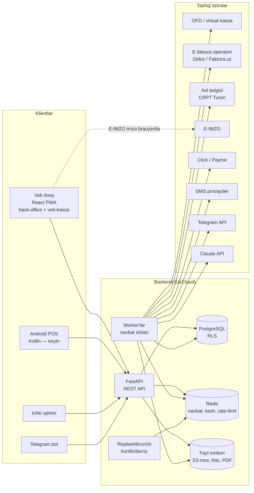

# Umumiy arxitektura

*2026-10-14 · Asos: `spec/kod-uchun/*`, `research_notes/texnik/04-arxitektura-va-stack.md`, foydalanuvchi qarorlari (stack, veb birinchi, Android keyin).*

## Asosiy xulosalar

1. **Bitta backend (Python + FastAPI) — modulli monolit**, mikroservislar emas: 18 modul bitta kod bazasida, lekin har modul o'z papkasi, o'z jadvallari va o'z ichki API'si bilan (`23-backend-arxitekturasi.md`). Kichik jamoa va SME yuklamasi uchun eng sodda va arzon yo'l; kerak bo'lsa keyin ajratiladi.
2. **Bitta PostgreSQL baza, ko'p tenant**: har jadvalda `tenant_id` + Row-Level Security (`15-xavfsizlik-va-audit.md`).
3. **Mijozlar (klientlar)**: (a) veb ilova — back-office + veb-kassa (birinchi bosqich), (b) Android POS — Kotlin (keyingi bosqich), (c) Telegram bot (Egasi), (d) ichki admin panel. Hammasi **bir xil REST API** dan foydalanadi.
4. **Davlat va tashqi tizimlar faqat backend orqali** ulanadi (OFD/virtual kassa, e-faktura operatori, e-TTN, Asl belgisi, E-IMZO, Click/Payme, SMS, Telegram, Claude API) — har biri alohida adapter (port/adapter naqshi), tashqi tizim ishlamasa navbatga tushadi va qayta uriniladi (`21-integratsiyalar.md`).
5. **Ikki xil "haqiqat"**: hujjatlar (chek, kirim, qaytarish, qarz, xarajat) — o'zgarmas, faqat teskari hujjat bilan bekor qilinadi; qoldiqlar, qarz balanslari, buxgalteriya — hujjatlardan **hisoblanadigan registrlar** (`11-malumotlar-modeli.md`, `13-provodka-qoidalari.md`).
6. **Offline-first kassa**: kassa avval o'z lokal bazasiga yozadi (veb: IndexedDB, Android: SQLite), keyin append-only outbox orqali serverga; server idempotent qabul qiladi (`16-offline-sync.md`).
7. **Fon ishlari** (OFD'ga yuborish, e-faktura, hisobot solishtirish, eslatmalar, Telegram xabarlar, AI) — alohida worker jarayonlar, Redis navbati orqali; API so'rovi tashqi tizimni kutib turmaydi.
8. **AI — chekka qatlam**: `AiProvider` porti (fake | cli | api), pul va soliqni hech qachon AI hisoblamaydi (`22-ai-qatlami.md`).
9. **Autentifikatsiya — o'z OAuth 2.0 implementatsiyamiz**: API komponenti ham AS, ham RS; mock yo'q (`14-autentifikatsiya-oauth2.md`). Google — tashqi OIDC identity-provider sifatida **qo'shimcha** (majburiy emas) kirish yo'li, telefon+parolni almashtirmaydi (§2.2, asoschi qarori Q7). Obuna muddati 24 soatlik imtiyozdan o'tganda kassa va kirish **to'liq to'xtaydi** (barcha sessiya/token bekor, faqat to'lov havolasi ochiq). *(2026-10-15: foydalanuvchi qarori)*
10. **Jamoa — asoschi + Claude (2 kishi)** *(2026-10-15: asoschi qarori, Q8)*: butun spec va backlog shu tarkibga mo'ljallangan — ketma-ket vertikal bo'laklar, qat'iy kalendar muddatlar yo'q, parallel ish oqimi yo'q (`27-backlog.md`); qo'llab-quvvatlash ham boshlang'ich bosqichda faqat asoschi (`25-nofunksional-talablar.md` §12).

---

## 1. Komponentlar

| Komponent | Texnologiya | Vazifa |
|---|---|---|
| Veb ilova | React + Vite + TS, FSD, Effector, shadcn/ui, PWA | Back-office va veb-kassa (`24-frontend-arxitekturasi.md`) |
| Android POS | Kotlin, SQLite (Room) | Keyingi bosqich (`28-android-pos.md`) |
| API | Python 3.13, FastAPI, Pydantic v2, SQLAlchemy 2 + Alembic | Barcha biznes amallar, huquqlar; **shuningdek o'z OAuth 2.0 Authorization Server + Resource Server** (`14-autentifikatsiya-oauth2.md`, foydalanuvchi qarori 2026-10-15) — uchinchi tomon auth xizmati yo'q |
| Worker'lar | Python, `SAQ` (Redis navbati; `23-backend-arxitekturasi.md`) *(2026-10-14: tekshiruv — arq o'rniga SAQ)* | Tashqi tizimlarga yuborish, qayta urinish, AI, xabarlar |
| Rejalashtiruvchi | worker ichida cron (masalan `SAQ` cron) | Kunlik hisobot, eslatmalar, obuna muddati, davlat hisobotini tekshirish |
| Baza | PostgreSQL 16+ (UzCloud DBaaS) | Hamma ma'lumot, RLS bilan tenant ajratish |
| Kesh/navbat | Redis | Navbat, rate-limit, sessiya keshi |
| Fayllar | S3-mos ombor | Xarajat cheki fotosi, OCR rasmlari, PDF hisobotlar |
| Telegram bot | Python (aiogram), API'ning mijozi sifatida | M18 |

**Nima uchun E-IMZO brauzerda:** E-IMZO kaliti foydalanuvchi kompyuterida (E-IMZO dasturi/plagin) — hujjatni imzolash brauzerda bajariladi, server faqat imzolangan hujjatni oladi va operatorga yuboradi (`research_notes/texnik/03-efaktura-va-tolov.md`).

## 2. Asosiy oqimlar

**Kassa sotuvi (onlayn):** veb-kassa → lokal yozuv (Dexie outbox, `client_event_id`) → `POST /sync/push` (darhol, bitta voqea) → backend: hujjat + qoldiq registri + qarz/kassa harakati + buxgalteriya provodkasi **bitta tranzaksiyada** → navbatga "OFD'ga yuborish" ishi → worker → OFD → fiskal belgi keyingi pull'da veb-kassaga qaytadi. POS uchun alohida `POST /sales` yo'q — onlayn va offline yo'l bitta (`16-offline-sync.md` §4.1). *(2026-10-14: tekshiruv)*

**Kassa sotuvi (offline):** lokal yozuv → outbox kutadi → internet qaytgach yuboriladi; 48 soat chegarasi kuzatiladi (`16-offline-sync.md`).

**Davlat hisobotini solishtirish (M10):** foydalanuvchi davlat hisobotini yuklaydi (API yo'q, MVP'da qo'lda/fayl) → backend ichki hisobdan xuddi shu ko'rsatkichni hisoblaydi → farq jadvali → AI-05 tushuntirish → 5 kalendar kunlik taymer va eslatmalar (M18).

## 3. Muhitlar va deploy

| Muhit | Maqsad | AI rejimi |
|---|---|---|
| local | Dasturchi kompyuteri, docker compose | `fake` yoki `cli` |
| staging | Sinov, davlat tizimlarining test muhitlari (bo'lsa) | `api` (alohida kalit, past limit) |
| production | Mijozlar | faqat `api` |

Deploy: Docker konteynerlar (api, worker, scheduler, web statik, bot) + boshqariladigan PostgreSQL va Redis; hosting — UzCloud (`research_notes/texnik/07-hosting-lokalizatsiya-xavfsizlik.md`). CI: testlar, lint, OpenAPI sxemasidan frontend tiplarini qayta generatsiya tekshiruvi.

## 4. Hujjatlar ro'yxati (`spec/kod-uchun/`)

| Fayl | Mazmuni | Holat |
|---|---|---|
| 10-umumiy-arxitektura.md | Shu hujjat | ✅ |
| 11-malumotlar-modeli.md | Jadvallar, hujjatlar, registrlar, holatlar, raqamlash | ✅ |
| 13-provodka-qoidalari.md | NSBU 21 hisoblar, har hujjat uchun Dt/Kt, FIFO/AVECO, davr yopish | ✅ — buxgalter tasdig'i kerak |
| 21-integratsiyalar.md | Har tashqi tizim: adapter, navbat, qayta urinish, test muhiti holati | ✅ |
| 16-offline-sync.md | Outbox protokoli, to'qnashuvlar, 48 soat, markirovka offline | ✅ |
| 15-xavfsizlik-va-audit.md | Auth, RLS, rollar/ruxsatlar, audit jurnali, backup | ✅ |
| 25-nofunksional-talablar.md | Tezlik, sig'im, uskunalar, mavjudlik | ✅ |
| 22-ai-qatlami.md | AiProvider, limitlar, xarajat, eval, ma'lumot to'plash | ✅ |
| 24-frontend-arxitekturasi.md | Veb: FSD, Effector, shadcn/ui, kutubxonalar | ✅ |
| 23-backend-arxitekturasi.md | FastAPI modulli monolit, qatlamlar, kutubxonalar | ✅ |
| 28-android-pos.md | Kotlin POS (keyingi bosqich) | ✅ |
| 27-backlog.md | Ketma-ket bosqichlar (2 kishilik jamoa — asoschi + Claude), tartib | ✅ *(2026-10-15: asoschi qarori, Q8)* |
| 14-autentifikatsiya-oauth2.md | OAuth 2.0 AS+RS, token, admin panel, obuna lokauti, offline litsenziya | ✅ *(2026-10-15: foydalanuvchi qarori)* |

## Ochiq savollar

1. ~~Navbat kutubxonasi~~ — hal qilindi: `SAQ` (`23-backend-arxitekturasi.md`, 4-bo'lim). *(2026-10-14: tekshiruv — arq o'rniga SAQ, python-arq/arq#510 texnik xizmat rejimi)*
2. Fayl ombori: UzCloud'da S3-mos xizmat bormi va narxi — tekshirish kerak (`07-hosting-...md`).
3. Ma'lumotlarni O'zbekistonda saqlash majburiy emas (faqat biometrik/genetik/telekom), lekin Claude API'ga yuboriladigan ma'lumot hajmini cheklash siyosati — `22-ai-qatlami.md`.

## Manbalar

- `spec/kod-uchun/14-autentifikatsiya-oauth2.md` — OAuth 2.0 AS/RS, obuna lokauti. *(2026-10-15: foydalanuvchi qarori)*
- `research_notes/texnik/04-arxitektura-va-stack.md` (multi-tenant, offline-first, event-log, Android, PostgreSQL).
- `research_notes/texnik/07-hosting-lokalizatsiya-xavfsizlik.md` (UzCloud, lokalizatsiya).
- `spec/kod-uchun/03-modullar-talablari.md` (M01–M18), `09-ai-funksiyalar.md` (5-bo'lim).
- `E:/Project/universal_ai_platform` — Python/FastAPI qatlamli tuzilma va AI porti namunasi.
