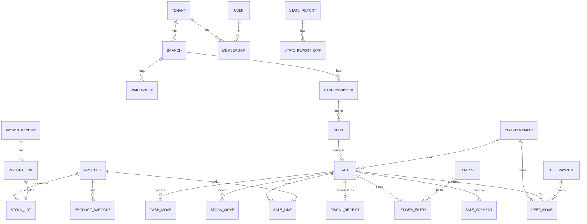

# Ma'lumotlar modeli

**Maqsad:** Jadvallar, hujjatlar, registrlar, holat mashinalari va raqamlash qoidalari — kodlashga tayyor ma'lumotlar modeli.
**Kim uchun:** Backend dasturchilar, DB sxemasi muallifi.
**Bog'liq fayllar:** `12-db-sxema.md`, `03-modullar-talablari.md`, `04-biznes-jarayonlar.md`, `13-provodka-qoidalari.md`, `14-autentifikatsiya-oauth2.md`.
**Holat:** joriy, 2026-10-15.

## Asosiy xulosalar

1. **Uch qatlam**: (a) **ma'lumotnomalar** (tovarlar, mijozlar, filiallar…) — tahrirlanadi, o'chirilmaydi (arxivlanadi); (b) **hujjatlar** (chek, kirim, qaytarish, qarz, xarajat…) — o'tkazilgandan keyin **o'zgarmaydi**, faqat teskari (storno) registr yozuvlari bilan bekor qilinadi (`status=cancelled`); (c) **registrlar** (qoldiq, partiyalar, qarz, kassa, buxgalteriya) — faqat hujjat o'tkazilganda yoziladigan **append-only harakatlar** + ulardan hisoblangan balanslar.
2. Har jadvalda `tenant_id` (RLS); filialga tegishli jadvallarda `branch_id`. Kalitlar — **UUIDv7** (vaqt bo'yicha tartiblangan, offline qurilmada ham yaratiladi — kassa serverni kutmasdan ID beradi).
3. Pul — `NUMERIC(18,2)` (so'm, tiyin bilan), miqdor — `NUMERIC(18,3)` (kg/l uchun), narx/tannarx — `NUMERIC(18,4)`. Float ishlatilmaydi.
4. Hujjat o'tkazish (posting) **bitta DB tranzaksiya**: hujjat holati + barcha registr harakatlari + buxgalteriya provodkasi birga yoziladi yoki birga bekor bo'ladi.
5. Tannarx uchun kirimlar har doim **partiya** (`stock_lots`) sifatida saqlanadi — FIFO ham, AVECO ham shu ma'lumotdan hisoblanadi (US-M04-05).
6. Offline'da yaratilgan har hujjatda `client_event_id` (qurilma generatsiya qilgan UUID) — server uni ikkinchi marta qabul qilmaydi (idempotentlik).
7. Hujjat raqamlari tenant + filial + hujjat turi + yil bo'yicha ketma-ket; fiskal chek raqami — kassa + smena ichida ketma-ket (OFD talabi).

---

## 1. Umumiy qoidalar

| Qoida | Tafsilot |
|---|---|
| Kalit | `id UUID` (v7). Offline qurilma o'zi yaratadi |
| Sxemalar | `app` (tenant biznes jadvallari), `auth` (login/token — faqat `SECURITY DEFINER`), `platform` (global: `plans`, `addons`, `units`, `label_templates`, `oauth_clients`, `signing_keys`, `platform_admins`) — DDL `12-db-sxema.md` §1 |
| Majburiy ustunlar | `tenant_id`, `created_at`, `updated_at` (o'zgaruvchan jadvallarda); `created_by` — hujjatlar, tarix jadvallari va audit talab qiladigan yozuvlarda (ma'lumotnomalarda o'zgarish izi — `audit_log`); hujjatlarda — 6-bo'limdagi umumiy sarlavha (yagona ro'yxat) |
| O'chirish | Ma'lumotnomalar: `archived_at` (soft). Hujjatlar: hech qachon — `status=cancelled` + registrlarda storno qatorlar (`reversal_of_id`). Registrlar: hech qachon |
| Vaqt | `TIMESTAMPTZ`, UTC saqlanadi; UI'da Toshkent vaqti (UTC+5). Hisob sanasi — `doc_date DATE` (Toshkent bo'yicha) |
| Matn | Nomlar lotin/kirill/rus aralash bo'lishi mumkin; qidiruv uchun `pg_trgm` indeks |
| Tenant izolyatsiyasi | Har jadvalda RLS siyosati: `tenant_id = current_setting('app.tenant_id')` (`15-xavfsizlik-va-audit.md`) |
| Versiya | Ma'lumotnomalarda `version INT` — optimistik qulflash (ikki kishi bir vaqtda tahrirlasa) |
| RLS istisnolari | `tenant_id`'siz global jadvallar: `plans`, **`addons`** (qaror #22), `units`, `platform_admins`, `oauth_clients`, `signing_keys` (ilova roliga faqat SELECT, `platform_admins`ga umuman yo'q). `tenants` — siyosat `id = app.tenant_id`. `users` — siyosat `id = app.user_id OR EXISTS(memberships m WHERE m.user_id = users.id AND m.tenant_id = app.tenant_id)`; login/tenant tanlash — `SECURITY DEFINER` funksiyalar `auth_find_user(phone)`, `auth_list_memberships(user_id)` orqali. **Auth-sxema jadvallari**: `user_credentials`, `otp_challenges`, `login_attempts`, `authorization_codes`, `refresh_tokens`, `sessions` — alohida PostgreSQL `auth` sxemasida, ilova roliga to'g'ridan-to'g'ri ruxsat yo'q, kirish faqat `SECURITY DEFINER` funksiyalar orqali (`auth_find_user`, `auth_consume_code`, `auth_rotate_refresh`, `auth_revoke_tenant`, `auth_suspend_tenant` — `14-autentifikatsiya-oauth2.md` §19). **`license_tokens`** — bundan mustasno, standart `tenant_id` RLS (10.1-bo'lim). **`user_identities`** (qaror #34) — `users` kabi `app` sxemasida, `tenant_id`siz; siyosat `user_id = app.user_id` (o'z bog'langan hisoblarini ko'radi) |

## 2. Platforma (M17)

| Jadval | Asosiy maydonlar | Izoh |
|---|---|---|
| `tenants` | id, name, activity_type, stir (null), phone, settings JSONB — kalitlar (Pydantic `TenantSettings` sxemasi): `ai_training_consent`, `negative_stock_policy` (`allow`/`forbid`), `scale_barcode_prefix`, `scale_barcode_version`, `low_stock_check_enabled`, `expiry_warning_days` (standart 7), `vat_diff_tolerance_amount` (standart `"1000.00"`, taxmin), `supplier_payment_strict` (bool). **Baholash usuli bu yerda emas** — `valuation_method_history` | Bitta do'kon/kompaniya. Obuna/hayot sikli holati bu yerda **emas** — `subscriptions.status`. **Bitta tenant = bitta yuridik shaxs** (STIR); bitta do'kon/kompaniya — ko'p filial, ko'p kassa, ko'p faoliyat turi (`branches.activity_type`) bitta tenant ichida qo'llab-quvvatlanadi; ko'p yuridik shaxsli egalar har biri uchun alohida tenant ochib, memberships orqali almashadi (qaror #31) |
| `plans` | id, code (**`standard`** — yagona tarif), price_month (**99 000 so'm**, hammasi kiradi), price_year (**950 400 so'm** = 99 000×12×0,8, −20% yillik chegirma), limits JSONB (`included_cash_registers`=1, `ai_monthly_tokens`, …) | Yagona tarif: barcha modul, 1 virtual kassa, AI oylik limiti, Telegram bot (`05-mvp-chegarasi.md` 3.3, boshqa agent yangilaydi) (qaror #22) |
| **`addons`** (qaror #22) | id, code (`extra_register` — qo'shimcha virtual kassa), name, price_month (**39 000 so'm/oy**, taxmin — fiskal modul ~35 000 + zahira, `tarix/tekshiruv/savollar-yakuniy-tavsiyalar.md` (b)/#2) | Global qo'shimcha xizmatlar katalogi, `plans` kabi tenant'siz (RLS istisnosi, §1) |
| **`tenant_addons`** (qaror #22) | tenant_id, addon_code (→ `addons.code`), quantity, price_month_snapshot, added_at, removed_at (null = faol) | Tenant tanlagan qo'shimchalar (masalan necha dona qo'shimcha kassa); billing hisob-kitobida `subscriptions.plan_id` narxi ustiga qo'shiladi |
| `subscriptions` | tenant_id (UNIQUE — bitta tenant, bitta qator), plan_id, period (`month`/`year`), current_period_end (trial'da = trial tugash sanasi, **30 kun**), grace_ends_at, status (`trial`/`active`/`grace`/`restricted`/`closed`) | Tenant hayot siklining **yagona** manbai; holat mashinasi 8-bo'limda |
| `billing_payments` | tenant_id, amount, provider (`click`/`payme`), provider_tx_id (null — checkout paytida; UNIQUE (provider, provider_tx_id)), status (`pending`/`success`/`failed`/`cancelled`), period (`month`/`year`), covers_from, covers_to, amount_breakdown JSONB, invoice_number, invoice_attachment_id, paid_at | Bizning daromad; `POST /billing/checkout` `pending` qator yaratadi, uning `id`si Click `merchant_trans_id`; webhook idempotent; kvitansiya PDF — `invoice_attachment_id`. Alohida `billing_invoices` jadvali — rad (ustun yetarli) |
| `platform_admins` | id, **user_id** (→ `users`), role, **mfa_secret_encrypted**, **allowed_ips** | Ichki admin (ADM-01), tenantlarga RLS'siz kiradi — faqat audit bilan. Kredensial endi `user_id` orqali `user_credentials`dan keladi, login'da majburiy TOTP (`14-autentifikatsiya-oauth2.md` §18.1) |
| **`tenant_tax_regimes`** | tenant_id, valid_from (oy 1-sanasi), regime (`vat`/`turnover`) | Tenant darajasidagi soliq rejimi tarixi — rejim faqat oy boshidan o'zgaradi, o'tgan davrlar qayta hisoblanmaydi; 1 mlrd so'm chegarasidan oshganini tizim ogohlantiradi, o'tishni Buxgalter belgilaydi (`13-provodka-qoidalari.md` §4.3 bilan birga ishlaydi) |

## 3. Tashkilot, foydalanuvchilar, huquqlar (M13, M14)

| Jadval | Asosiy maydonlar | Izoh |
|---|---|---|
| `branches` | tenant_id, **code** (hujjat raqamidagi filial kodi, `01`, UNIQUE per tenant), name, address, is_default, settlement_category (`city_100k_plus`/`other`/`remote_mountain`), activity_type (`retail`/`other`), archived_at, version | Filial (M14). `settlement_category` + `activity_type` aylanma solig'i stavkasini aniqlaydi (Soliq kodeksi 467-modda: chakana 4% / 2% / 1%; tamaki savdosi har doim 4%; boshqa faoliyat 4%; YTT/o'zini o'zi band qilgan 1% — tenant darajasida). `code` — **KRITIK**: `app.next_doc_number()` funksiyasi buni talab qiladi, DDL'da mavjud bo'lishi shart |
| `branch_tax_settings` | branch_id, valid_from, settlement_category, activity_type | Aylanma solig'i stavkasi tarixi — yangi qiymat faqat `valid_from` sanasidan qo'llanadi, oldingi davrlar qayta hisoblanmaydi |
| `warehouses` | tenant_id, branch_id, name, type (`store`/`stock`) | MVP: har filialda 1 ta ombor (avtomatik) |
| `cash_registers` | tenant_id, branch_id, name, kind (`web`/`android`), fiscal_module_id, ofd_status (`pending`/`registered`/`active`/`suspended`/`deregistered`), **archived_at** (qo'shimcha kassa kamaytirilganda), version | Kassa (virtual kassa ID shu yerda) |
| `devices` | tenant_id, cash_register_id, kind (`web`/`android`), revoked_at, revoked_by, last_seen_at, last_sync_at, app_version | Offline sync uchun. **`token_hash`/`token_expires_at` olib tashlandi** — endi `refresh_tokens.device_id`/`license_tokens.device_id` orqali bog'lanadi (`14-autentifikatsiya-oauth2.md` §19); **veb-kassa endi ham `devices` yozuviga ega** (litsenziya tokeni uchun, to'g'ridan-to'g'ri API chaqirmaydi — hamon cookie+BFF), faqat Android to'g'ridan-to'g'ri Bearer bilan API chaqiradi (qaror #14) |
| `users` | id, phone (unique global), name, locale | Bir odam bir nechta tenantda ishlashi mumkin. Parol/PIN heshlari — `user_credentials`ga ko'chirildi (quyida) (qaror #14) |
| `user_credentials` | user_id (PK/FK), password_hash, **password_algo** (= `argon2id`), password_updated_at, pin_hash, pin_updated_at, failed_login_count, locked_until, **must_change_password**, **must_change_pin** | Sirlarni `users`dan ajratish; to'liq tafsilot `14-autentifikatsiya-oauth2.md` §19. Oxirgi ikki ustun — Egasi `admin_reset`/`pin_reset` OTP bilan tiklaganda `true` (qaror #14) |
| `user_identities` (**yangi**) | user_id (→ `users`), provider (`google`), provider_user_id (Google `sub`), email, email_verified, linked_at, UNIQUE(provider, provider_user_id) | Google bilan kirish — tashqi OIDC identity provider bog'lash, tasdiqlangan email bo'yicha avtomatik bog'lanadi; `14-autentifikatsiya-oauth2.md` §2.2/§19 (qaror #34) |
| `memberships` | tenant_id, user_id, role_ids[], branch_ids[] (bo'sh = hammasi), status | Kim qaysi do'konda, qaysi filialda |
| `roles` | tenant_id, name, is_system (bool), system_code (`owner`/`manager`/`cashier`/`storekeeper`/`accountant`, faqat tizim rollarida), archived_at, version | Standart 5 rol + o'zinikini yaratish. **Egasi roli — barcha tenant ruxsatlarining (`platform.admin`dan tashqari) supersetiga ega**, limitlar cheksiz; to'liq matritsa `15-xavfsizlik-va-audit.md` §2.2 (qaror #28) |
| `role_permissions` | role_id, permission_code, limit_value (null) | **Standart limitlar** (qaror #23, tavsiya #1): Kassir uchun `discount.give` = **5%**, `returns.approve` (chek yo'q) = **100 000 so'm**, `cash.withdraw` = **50 000 so'm**; `sales.void` — limitsiz, lekin audit bilan. Egasi istalgan qiymatni o'zgartira oladi. To'liq jadval `15-xavfsizlik-va-audit.md` §2.2 |
| `permissions` (kod ichida, jadval emas) | `sales.create`, `returns.approve`, `debts.forgive`, `prices.edit`, … | Ro'yxat `15-xavfsizlik-va-audit.md` da |

## 4. Katalog va narxlar (M09)

| Jadval | Asosiy maydonlar | Izoh |
|---|---|---|
| `product_categories` | tenant_id, parent_id, name | Daraxt |
| `units` | code (`pcs`, `kg`, `l`, `m`, `box`), is_fractional | Global ro'yxat |
| `products` | tenant_id, name, **name_ru** (nullable, chek/UI ikkinchi til qatori), category_id, unit_code, mxik_code (17 raqam; **null ruxsat** — yaratishda bloklanmaydi, sotuvdan oldin shart), package_code, vat_rate (12/0, null) + vat_exemption_code (imtiyoz kodi) — kamida bittasi to'ldirilgan, is_marked (Asl belgisi), is_weighed, min_stock, archived_at, version | MXIK — chekning majburiy rekviziti, lekin katalog yaratishda emas. `name` — asosiy (o'zbek), `name_ru` — ixtiyoriy; chek qatorida `"{name} / {name_ru}"` (bo'lmasa faqat `name`) (qaror #29) |
| `product_barcodes` | tenant_id, product_id, barcode (unique per tenant), kind (`ean`/`internal`/`weighed_prefix`), units_per_barcode | Bir tovarga bir nechta kod (dona/quti) |
| `product_prices` | tenant_id, product_id, branch_id (null = hamma), price, valid_from (TIMESTAMPTZ; kun ichida o'zgarishi mumkin), set_by, price_change_doc_id | Tarix saqlanadi (US-M09-01); `price_change_lines.valid_from` (null = post paytidan) |
| `label_print_queue` | tenant_id, product_id, reason (`price_changed`/`new`), printed_at | US-M09-04 |
| `label_templates` (global) | code, name, width_mm, height_mm, fields JSONB | Standart yorliq shablonlari (US-M09-04), tenant o'zgartirmaydi, RLS istisnosi |
| `internal_barcode_seq` | tenant_id, next_value | Ichki kodlar diapazoni (masalan `2000000…`) — tashqi EAN bilan to'qnashmaydi |
| `discount_rules` | tenant_id, name, scope (`product`/`category`/`all`), target_ids[], kind (`percent`/`amount`/`n_plus_m`), value, branch_ids[] (bo'sh = hammasi), valid_from, valid_to, priority, archived_at | US-M03-02 (MVP'dan keyin); bitta chek qatoriga eng yuqori `priority`li bitta qoida (**taxmin**) |

**Birlik konversiyasi va yaxlitlash qoidasi**: qoldiq har doim `products.unit_code` (asosiy birlik)da saqlanadi. Qadoq/quti shtrix-kodi (`product_barcodes.units_per_barcode`) skanerlanganda miqdor shu koeffitsientga ko'paytirilib asosiy birlikka o'tkaziladi. `units.is_fractional=false` bo'lgan birlikda miqdor **butun son** bo'lishi majburiy (validatsiya — kasr kiritilsa rad etiladi); `is_fractional=true`da miqdor `NUMERIC(18,3)` to'liq aniqlik bilan. Qator summasi = narx × miqdor, natija **tiyingacha ROUND_HALF_UP** bilan yaxlitlanadi.

## 5. Kontragentlar (M07, M08)

| Jadval | Asosiy maydonlar | Izoh |
|---|---|---|
| `counterparties` | tenant_id, kind (`person`/`company`), name, phone, stir (yuridik), **legal_address**, **bank_account**, **bank_mfo**, **vat_payer BOOL**, **vat_payer_checked_at**, is_customer, is_supplier, credit_limit (null = limitsiz), **standing_discount_pct** (null = yo'q), notify_consent (bool + sana), telegram_chat_id, note | Mijoz ham, yetkazib beruvchi ham bitta jadvalda. Yangi ustunlar — B2B e-faktura uchun shart: STIR kiritilganda rekvizitlar EDO operatoridan (masalan Faktura.uz `CheckCompanyExist/:inn`) avto-to'ldiriladi; `legal_address`/`bank_account`/`bank_mfo`siz B2B chiquvchi e-faktura yaratilmaydi. `vat_payer=false` bo'lgan yetkazib beruvchi — AI-03 (hujjat OCR) qamrovini aniqlashda ishlatiladi. **`standing_discount_pct`** (qaror #23, tavsiya #8): MVP'da alohida optom narx jadvali yo'q — o'rniga mijozning doimiy chegirma foizi shu ustunda; bitta chekda `discount_rules` (4-bo'lim) bilan to'qnashsa, **faqat mijozga eng katta foyda beradigan bitta chegirma** qo'llanadi (yig'ilmaydi). |

**`counterparty_statement_links`**: tenant_id, counterparty_id, token_hash, expires_at (+30 kun, taxmin), revoked_at, last_accessed_at, created_by — mijozning ochiq qarz hisob-varag'i havolasi (US-M08-08); token o'zi saqlanmaydi, qidiruv `public_statement_by_token()` orqali.

**`debt_doubtful_flags`** (qaror #23, tavsiya #9): tenant_id, counterparty_id, flagged_by (**faqat Egasi**, `debts.forgive` huquqi bilan bir xil cheklov), reason (matn, majburiy), flagged_at, unflagged_at (null = faol). Bitta va'da sanasi yetarli deb qabul qilindi (bo'lib to'lash grafigi yo'q, `debt_openings`/`sale_payments.method=debt` o'zgarmaydi); tizim **avtomatik** "shubhali" deb belgilamaydi — faqat 60+ kunlik muddati o'tgan qarzlarni (`debt_moves.due_date < bugun − 60 kun`) BO-07'da eslatma sifatida ko'rsatadi, Egasi ko'rib chiqib sabab bilan qo'lda belgilaydi/bekor qiladi. Bu flag `debt_writeoffs` (haqiqiy kechirish, hisobdan chiqarish, 2.15-bo'lim provodkasi) bilan **bog'liq, lekin alohida** — flag faqat ko'rinish/ogohlantirish, qarz balansini o'zgartirmaydi; 4910-hisob (shubhali qarzlar zahirasi) bilan bog'lanishi `13-provodka-qoidalari.md`da.

## 6. Hujjatlar

Barcha hujjatlarda umumiy sarlavha (**yagona ro'yxat**, boshqa joyda takrorlanmaydi): `id, tenant_id, branch_id, number, temp_number` (offline vaqtinchalik raqam, `{qurilma}-{lokal seq}`; server yaratgan hujjatda null; UNIQUE (tenant_id, device_id, temp_number)), `doc_date, status, created_by, created_at, updated_at, posted_at, cancelled_at, cancelled_by, cancel_reason, client_event_id` (UNIQUE (tenant_id, client_event_id)), `device_id, comment`. Bekor qilish alohida teskari hujjat yaratmaydi: asl hujjat `cancelled` bo'ladi, registrlarga storno qatorlar yoziladi (7-bo'lim).

| Hujjat (jadval) | Qatorlar | Modul | Nimani o'zgartiradi (registrlar) |
|---|---|---|---|
| `shifts` | — | M01, M16 | shift_no (qurilma beradi, kassa ichida ketma-ket — OFD smena raqami), opened_by/at, closed_by/at, opening_cash, expected_cash (server), counted_cash, variance (= counted − expected), variance_note (farq bo'lsa majburiy), counted_card_total. Yopilishda farq 02 §2.19 bo'yicha provodka; Z-hisobot — `fiscal_receipts(kind='z_report')` |
| `sales` (chek) | sarlavha: shift_id, cash_register_id, counterparty_id (nasiya), total_amount, **is_offline**, **debt_limit_exceeded** (offline limitdan oshgan nasiya bayrog'i, tavsiya #7). `sale_lines` (product, qty, line_no, price (4 xona), discount_amount (+ **discount_pct**, **discount_source** `manual`/`standing_customer`/`rule`, **discount_rule_id**), vat_rate + **vat_exemption_code**, vat_amount, cost_amount, line_total, marking_code (markirovkalangan tovarda **qty = 1** majburiy — har kod alohida qator), lot_allocations JSONB), `sale_payments` (method: `cash`/`card`/`uzqr`/`click`/`payme`/`uzum`/`debt`, amount, provider_tx_id, **terminal_ref** (ixtiyoriy matn — mustaqil bank terminalining operatsiya raqami, `method='card'` bo'lganda qo'lda kiritiladi, online va offline'da), qr_type: `static`/`dynamic`/null — `uzqr` = bank tomonidan generatsiya qilingan yagona QR, PF-246 bo'yicha yuridik shaxslar uchun 2026-07-01'dan majburiy, **due_date** (`method='debt'` — va'da sanasi, `debt_moves.due_date` manbasi), **checkout_ref**) | M01, M03, M08 | qoldiq −, tannarx, kassa naqd +, qarz + (nasiya), QQS, buxgalteriya |
| `returns` | sarlavha: sale_id (null ruxsat), **shift_id, cash_register_id**, counterparty_id, **reason** (`defective`/`wrong_item`/`customer_changed_mind`/`other`), **refund_method** (`cash`/`card`/`debt_adjustment`), **is_offline**, approved_by/at. `return_lines` (sale_line_id (null = chek topilmagan qaytarish), product_id, qty, price, **vat_rate**, **vat_exemption_code**, vat_amount, cost_amount, line_total, **marking_code**) | M02 | qoldiq +, kassa −/qarz −, QQS −, buxgalteriya, fiskal qaytarish cheki |
| `purchase_orders` | sarlavha: + supplier_id, **warehouse_id**; `po_lines` (product, qty, price null) | M07 | — (rejalashtirish, registrga ta'sir yo'q) |
| `goods_receipts` (kirim) | sarlavha: supplier_id, warehouse_id, po_id, **source** (`manual`/`purchase_order`/`einvoice`/`ocr`), **einvoice_id** ("qizil" QQS kechiktirish shu orqali aniqlanadi), **ai_ocr_job_id**, paid_immediately (02 §2.6/§2.8 yo'li), **ettn_ref**, **poa_number**. `receipt_lines` (product, qty, cost (4 xona), vat_rate + **vat_exemption_code**, vat_amount, expiry_date) | M07 | yangi partiya (lot), qoldiq +, yetkazib beruvchiga qarz + (nasiya bo'lsa), kirish QQS |
| `supplier_returns` (yetkazib beruvchiga qaytarish) | sarlavhada **reason** (`expired`/`damaged`/`excess`/`other`); `supplier_return_lines` (receipt_line_id, lot_id, qty, cost, vat) | M07 | qoldiq − (asl partiyadan), yetkazib beruvchiga qarz − (yoki debitorlik), kiritiladigan QQS − |
| `transfers` | sarlavha: from/to_branch_id, from/to_warehouse_id, **sent_at/by, received_at/by**; `transfer_lines` (product, qty_sent, qty_received, **unit_cost**, **lot_allocations JSONB** — bir qator bir nechta partiyadan) | M06 | jo'natuvchi qoldiq −, yo'lda; qabul qiluvchi qoldiq + (tannarx partiya bilan ko'chadi) |
| `stock_counts` (inventarizatsiya) | `count_lines` (expected, counted **null** sanash tugamaguncha) | M05 | farq bo'yicha qoldiq ±, kamomad xarajat / ortiqcha daromad |
| `write_offs` (hisobdan chiqarish) | + **responsible_user_id** (02 §2.12: 4730); `write_off_lines` (product, lot_id, qty, reason: `expired`/`damaged`/`gift`/`other`) | M04, M05 | qoldiq −, xarajat |
| `price_changes` | `price_change_lines` | M09 | `product_prices`, yorliq navbati |
| `stock_openings` (boshlang'ich qoldiq) | `opening_lines` (product, qty, unit_cost, expiry_date) | M04 | yangi partiya, qoldiq + (chek/faktura yo'q, US-M04-04) |
| `debt_openings` (boshlang'ich qarz) | — (counterparty, amount, direction, **due_date**) | M08 | qarz registri (chek yo'q, US-M08-07) |
| `debt_payments` (qarz to'lovi) | method (`cash`/`card`/`uzqr`/`click`/`payme`/`uzum`/`bank`), cash_register_id+shift_id (naqd), terminal_ref, provider_tx_id, checkout_ref, **promise_date**; `allocations` → `debt_payment_allocations(target_doc_type, target_doc_id, amount)` | M08 | qarz −, kassa/bank +. **Har bir to'lovga fiskal chek chiqariladi** (`fiscal_receipts.kind='debt_settlement'`, summasi = to'langan summa, tovar qatorlari — allokatsiya qilingan sotuv(lar)dan proporsional) (qaror #30; qonuniylik — buxgalter+OFD operatori javobigacha `FiscalPolicy` ortida, 02-provodka §2.14, reestr #9) |
| `debt_writeoffs` (kechish) | counterparty, amount, **reason**, account_choice (`9430` standart / `4910`), approved_by (faqat Egasi) | M08 | qarz −, xarajat (shubhali qarz), faqat Egasi |
| `supplier_payments` | method (`cash`/`bank`), cash_register_id+shift_id (naqd); `allocations` → `supplier_payment_allocations(target_doc_type='goods_receipts', …)` | M07, M08 | yetkazib beruvchiga qarz −, kassa/bank − |
| `expenses` | — (category_id, amount, source: `cash`/`bank`/`card`, cash_register_id + shift_id (source=`cash` bo'lsa majburiy), attachment_id, recurring_rule_id) | M15 | kassa/bank −, xarajat |
| `cash_movements` (kassa pul harakati) | — (direction `in`/`out`, reason: `collection` (inkasso)/`deposit`/`owner_withdrawal`/`other`) | M16 | kassa naqd ±. Xarajat to'lovi bu hujjat **emas** — `ExpensePostingService` `cash_moves`ni o'zi yozadi |
| `ledger_adjustments` (qo'lda buxgalteriya tuzatishi) | — (account_dt, account_kt, amount, correction_of_period, comment majburiy) | M11 | `ledger_entries` +; faqat joriy ochiq davrda (02 §5.1, #15 qaror) |

**Qaytarish invarianti va chek topilmagan qaytarish**: `SUM(return_lines.qty) WHERE sale_line_id=X AND status=posted ≤ sale_lines.qty` — `ReturnPostingService` asl sotuv qatorini qulflab (`23-backend-arxitekturasi.md` §2.1 bilan bir xil qulflash tartibida) tekshiradi; oshib ketsa `RETURN_QTY_EXCEEDED` xato kodi (offline holatda POS ekranida rad etiladi, serverga yetganda qayta tekshiriladi). **Chek topilmagan qaytarish** (`sale_line_id=NULL`): faqat Menejer/Egasi PIN tasdig'i bilan, narx — qaytarish paytidagi joriy narx (asl chek narxi emas, chunki asl chek yo'q), alohida hisobotda ajratilgan holda ko'rsatiladi (oddiy qaytarishlar bilan aralashtirilmaydi).

Qo'shimcha: `expense_categories` (name, is_system, archived_at, version), `recurring_expenses` (branch_id, category_id, name, amount, period `month`/`quarter`/`year`, day_of_month 1–28, source, cash_register_id, next_due_date, last_triggered_at, is_active, created_by, version — avtomatik to'lanmaydi, eslatma + qo'lda tasdiq), `attachments` (s3_key, content_type, original_name, kind, size_bytes, sha256, uploaded_by).

## 6.1 Tasdiqlash va to'lov seanslari

**`approval_requests`** — masofaviy tasdiq navbati (BO-16): kind, permission_code, requested_value, context JSONB, linked_doc_type/id, status (`pending`/`approved`/`rejected`/`expired`/`consumed`), requested_by/at, expires_at (+15 daqiqa, taxmin), resolved_by/at, reject_reason; bitta so'rov bir hujjatda bir marta ishlatiladi (`consumed`).

**`doc_approvals`** — qo'llangan har tasdiqning append-only izi (`local_pin` yoki `remote_request`): doc_type, doc_id, line_id, kind, mode, approved_by, approval_request_id, pin_verified_locally, requested_value, approved_at.

Limitdan oshgan hujjat `pending_approval` holatiga **o'tmaydi** (istisno — `price_changes`): `draft`da qoladi, tasdiqlanganda server o'zi `post`ni bajaradi.

**`payment_checkouts`** — UzQR/Click/Payme/Uzum to'lov seansi chekdan oldin: checkout_ref (qurilma beradi), provider, qr_type, amount, provider_tx_id, status (`pending`/`confirmed`/`failed`/`expired`/`consumed`), expires_at; `sale_payments.checkout_ref`/`debt_payments.checkout_ref` bilan bog'lanadi.

## 7. Registrlar (append-only)

| Registr | Maydonlar | Balans qanday olinadi |
|---|---|---|
| `stock_moves` | tenant_id, warehouse_id, product_id, lot_id, qty (±), cost_amount (±), doc_type, doc_id, line_id, moved_at | `stock_balances` (warehouse, product) — trigger/ilova tomonidan yangilanadigan jamlama jadval; tekshirish uchun `SUM(stock_moves)` |
| `stock_lots` (partiyalar) | tenant_id, warehouse_id, product_id, **source_doc_type** (`goods_receipts`/`stock_openings`/`transfers`), source_doc_id, source_line_id, receipt_line_id (faqat kirimda), received_at, qty_in, qty_left, unit_cost, expiry_date | FIFO: `qty_left > 0` eng eskisidan; AVECO: `avg_costs` jadvali (warehouse, product, avg_cost, qty) har kirimda qayta hisoblanadi. **`doc_type` qiymati — hujjat jadvali nomi** (`sales`, `goods_receipts`, …) barcha registr/allokatsiya/bog'lanish ustunlarida |
| `valuation_method_history` | tenant_id, valid_from (yil 1-yanvari), method (`fifo`/`aveco`), created_by | Usul faqat yangi yil boshidan; joriy usul = eng oxirgi valid_from ≤ hujjat sanasi (US-M04-05) |
| `debt_moves` | tenant_id, counterparty_id, direction (`receivable` — bizga qarz / `payable` — bizning qarz), amount (±), due_date, **limit_exceeded** (bool, offline nasiya limitdan oshgan), doc_type, doc_id | `debt_balances` (counterparty, direction); qarz daftari = shu harakatlar ro'yxati. `counterparties.debt_due_date` — yagona joriy va'da sanasi (o'zgaruvchan ustun, `debt_moves` append-only bo'lgani uchun u yerda yangilanmaydi) |
| `cash_moves` | tenant_id, cash_register_id (naqdda majburiy), bank_account_id (**MVP'da doim null** — yagona bank hisobi 5110, ko'p hisob — backlog), shift_id, amount (±), method, doc_type, doc_id | Kutilgan naqd = smena bo'yicha `SUM` (US-M16-02) |
| `ledger_entries` (buxgalteriya) | tenant_id, entry_date, **branch_id** (filial hisobotlari uchun indeksli ustun), account_dt, account_kt, amount, doc_type, doc_id, analytics JSONB (product, counterparty) | Aylanma va qoldiq vedomosti; hisob raqamlari `13-provodka-qoidalari.md` |
| `vat_moves` | tenant_id, period (oy), kind (`output`/`input`), base_amount, vat_amount, doc_type, doc_id, einvoice_id | QQS ichki hisob (M10) va davlat hisoboti bilan solishtirish. `status` ustuni yo'q: "qizil" faktura bo'yicha kiruvchi QQS to'lovgacha **umuman yozilmaydi** (`13-provodka-qoidalari.md` 4.1) |

Barcha registrlarda umumiy ustunlar: `id, tenant_id, doc_type, doc_id, reversal_of_id` (storno qatorida — teskari qilinayotgan asl registr qatori, aks holda null), `created_at`. Storno qatori asl qatorning teskari belgili nusxasi; sanasi — bekor qilish sanasi (joriy ochiq davr). `debt_balances`: (tenant_id, counterparty_id, direction, balance, updated_at), UNIQUE (tenant_id, counterparty_id, direction). `stock_balances`: (tenant_id, warehouse_id, product_id, qty, value, updated_at), UNIQUE (tenant_id, warehouse_id, product_id) — FIFO/AVECO posting'ining qulflash nuqtasi (`23-backend-arxitekturasi.md` 2.1). Registrlar va hujjatlar hech qachon o'chirilmaydi; saqlash muddati **kamida 5 yil** (O'RQ-404, 29-modda).

**Tannarx hisoblash** (`stock_lots` + `tenants.settings.valuation_method`):
- Sotuv/chiqim o'tkazilganda: FIFO — eski partiyalardan `qty_left` kamaytiriladi, `sale_lines.lot_allocations` ga yoziladi; AVECO — joriy `avg_cost` olinadi (partiyalar ham FIFO tartibida kamaytiriladi — kelajakda usul almashtirish uchun). Qaytarish: asl qatordagi tannarxda (`sale_lines.cost_amount/qty`) qabul qilinadi; FIFO — `lot_allocations` bo'yicha asl partiyalarga; AVECO — kirim kabi o'rtachaga qo'shiladi: `avg = (qty_left×avg + ret_qty×asl_birlik_tannarx)/(qty_left+ret_qty)`. Ko'chirishning qabul tomoni AVECO'da ham shu formula bilan (jo'natuvchi tannarxida).
- **O'tgan sanali hujjat** kelganda (kech sinxron, kech kirim): shu sana va keyingi chiqimlar uchun tannarx **qayta hisoblash ishi** navbatga qo'yiladi (`recost_jobs`, 10-bo'lim). Yopilgan davr (`period_closings`) ga tegsa — rad etiladi.
- Manfiy qoldiqda sotuv (offline to'qnashuv): `stock_lots` dan yetmagan qism `pending_cost` sifatida oxirgi ma'lum narxda yoziladi va keyingi kirimda qayta hisoblanadi.

## 8. Holat mashinalari

| Obyekt | Holatlar |
|---|---|
| Chek (`sales`) | `draft` (faqat qurilmada) → `posted` → `cancelled`. Fiskal holat bu yerda **emas** — `fiscal_receipts.status`: `pending` → `sent` → `fiscalized` / `failed` (qayta urinish). Qaytarilganlik holati saqlanmaydi — `return_lines` yig'indisidan hisoblanadi; `draft` bekor qilinsa → `sale.draft_voided` audit voqeasi (registrga ta'sirsiz) |
| **Xaridnoma (`purchase_orders`)** | `draft` → `sent` → `partially_received` → `closed` / `cancelled`; holat **saqlanadigan** `status` ustuni — `GoodsReceiptPostingService` shu tranzaksiyada `partially_received`/`closed`ga yangilaydi; `closed`dan keyin tahrir taqiq |
| Kirim (`goods_receipts`) | `draft` → `posted` → (`cancelled` — storno yozuvlar bilan) |
| Yetkazib beruvchiga qaytarish | `draft` → `posted` → (`cancelled` — storno yozuvlar bilan) |
| Narx o'zgarishi (`price_changes`) | `draft` → `pending_approval` (limitdan katta, US-M09-02) → `posted` / `rejected` |
| Ko'chirish | `draft` → `sent` (jo'natuvchida chiqim) → `received` (qabul qiluvchida kirim) / `discrepancy` (farq bilan qabul) |
| Inventarizatsiya | `counting` → `review` → `posted`; `counting`/`review`dan → `cancelled` |
| Smena | `open` → `closing` (naqd sanalmoqda) → `closed` (Z-hisobot) |
| E-faktura | chiquvchi: `draft` → `signed` → `sent` → `accepted`/`rejected`/`cancelled`; kiruvchi: `received` → `signed` → `accepted`/`rejected`; xavf belgisi `green`/`red` (VM 830) |
| **`approval_requests`** | `pending` → `approved` → `consumed` / `rejected` / `expired` |
| **`payment_checkouts`** | `pending` → `confirmed` → `consumed` / `failed` / `expired` |
| **`ai_ocr_jobs`** | `processing` → `done` → `confirmed` / `expired`; `failed` |
| **`import_jobs`** | `uploaded` → `validating` → `validated` → `committing` → `committed`; har bosqichdan `failed` |
| Davlat hisoboti (`state_reports`) | `uploaded` → `compared` → `match` / `diff_found` → `correction_sent` / `auto_accepted` (5 kalendar kun o'tdi) |
| Obuna | `subscriptions.status` (yagona manba): `trial` → `active` → `grace` (**24 soat**, eslatmalar: −3 kun, −1 kun, to'lov kuni, 0 / 12 / 2 soat qolganda) → **`restricted` (kassa va barcha kirish TO'LIQ TO'XTAYDI — barcha sessiya/refresh-token `suspended` holatiga o'tadi (to'liq bekor emas), login rad etiladi, faqat to'lov havolasi va tor `sync.drain` drenaj yo'li ochiq; `14-autentifikatsiya-oauth2.md` §16.1.3, §16.4)** → `active` (to'lov, `suspended` tokenlar tozalanadi, kirish darhol tiklanadi) / `closed` (qaror #15) |
| **Nasiya qarzi** (har `debt_moves` receivable qatori, hisoblangan) | `open` → `partially_paid` → `paid`; `written_off` (`debt_writeoffs`, faqat Egasi); `overdue` — saqlanadigan holat emas, `due_date < bugun` bo'lganda hisoblangan bayroq |
| Integratsiya ishi (`outbox_jobs`) | `queued` → `running` → `done` / `retry` (backoff) → `failed` (qo'lda ko'rish) |

## 9. Fiskal, markirovka, e-hujjatlar, davlat hisoboti

| Jadval | Asosiy maydonlar |
|---|---|
| `fiscal_receipts` | tenant_id, **kind** (`sale`/`return`/`z_report`/**`debt_settlement`**), sale_id/return_id (kind'ga mos), debt_payment_id (`kind='debt_settlement'`da), cash_register_id, shift_id, receipt_seq (**qurilma beradi**; z_report'da null — raqami `shifts.shift_no`; UNIQUE (tenant_id, cash_register_id, shift_id, receipt_seq)), payload JSONB, fiscal_sign, qr_url, sent_at, offline_since, status (`pending`/`sent`/`fiscalized`/`failed`), attempts — Z-hisobot shu jadvalga yoziladi (`kind='z_report'`); qarz to'lovi cheki — `kind='debt_settlement'` (qaror #30) | chek matni/payload **ikki tilda** (o'zbek + ixtiyoriy rus, `products.name_ru`) — qaror #29, fiskal rekvizitlar OFD operatori formatida |
| `marking_codes` | tenant_id, code (DataMatrix), product_id, status (`in_stock`/`sold`/`returned`/`written_off`/`returned_to_supplier`/**`pending_verification`**), last_doc_id, verified_at |
| `einvoices` | tenant_id, direction (`in`/`out`), operator (`didox`/`faktura`), operator_doc_id, **related_doc_type + related_doc_id** (`sales`/`goods_receipts`/`supplier_returns`), **number, doc_date, total_amount, vat_amount, signed_by**, status, risk_flag, signed_at, payload — bitta hujjatga bitta faol chiquvchi faktura (UNIQUE, 02 §2.22) |
| `ettn_documents` | tenant_id, einvoice_id, status, operator_doc_id | 
| `state_reports` | tenant_id, tax_type (`vat`/`turnover`/`property`/`land`/`pit`/`social`), period, published_at, deadline_at (= min(published_at + 5 kalendar kun, filing deadline)), file_attachment_id, status, **+ state_amount, our_amount, diff_amount, compared_at, correction_sent_at, correction_signature, uploaded_by** |
| `state_report_diffs` | state_report_id, indicator, state_value, our_value, diff, explanation (AI-05), resolved |

## 10. Integratsiya navbati, sync, bildirishnoma, AI, audit

| Jadval | Asosiy maydonlar | Hujjat |
|---|---|---|
| `outbox_jobs` | tenant_id, kind (`ofd_send`, `einvoice_send`, `einvoice_accept`, `ettn_send`, `marking_verify`, `marking_sell`, `state_report_reminder`, `sms`, `telegram`, `ai`, **`report_export`**, **`label_pdf`**), payload, status, attempts, next_run_at, last_error, idempotency_key, **created_by, progress_pct, result_attachment_id, error_code** — eksport/yorliq PDF job'lari ham shu navbatda (API `job_id` = `outbox_jobs.id`); har job `tenant_id` bilan, worker `tenant_transaction(tenant_id)` ichida bajaradi | `21-integratsiyalar.md` |
| `sync_receipts` | tenant_id, device_id, client_event_id (UNIQUE (tenant_id, client_event_id)), received_at, result | `16-offline-sync.md` |
| `idempotency_keys` | tenant_id, key, request_hash, response_status, response_body, created_at; UNIQUE (tenant_id, key); 30 kundan keyin tozalanadi (buxgalteriya yozuvi emas) | Faqat back-office REST; POS — `sync_receipts` (`23-backend-arxitekturasi.md` 3-bo'lim) |
| `recost_jobs` | tenant_id, warehouse_id, product_id, from_date, status (`queued`/`running`/`done`/`failed`/`rejected_period_closed`), reason_doc_type, reason_doc_id, attempts, last_error, created_at, finished_at; qisman UNIQUE (tenant_id, warehouse_id, product_id) WHERE status='queued' — yangi so'rov mavjud navbatdagi job'ning `from_date`ini `LEAST` bilan yangilaydi | `13-provodka-qoidalari.md` 3.3, `23-backend-arxitekturasi.md` 2.4 |
| `import_jobs` | tenant_id, kind (`products`/`opening_stock`/`opening_debts`), attachment_id, status (`uploaded` → `validating` → `validated` → `committing` → `committed` / `failed`), total_rows, ok_rows, errors JSONB (qator, maydon, xato kodi), **result JSONB** (created_doc_ids), created_by | US-M04-04, US-M08-07; commit bitta tranzaksiyada `stock_openings`/`debt_openings` yaratadi |
| `ai_ocr_jobs` | tenant_id, created_by, attachment_id, doc_type_hint (`purchase`/`catalog`/`return`), status, fields JSONB (sarlavha + lines, har maydon value/confidence), low_confidence_fields[], error_code, ai_request_id, created_doc_type/id, expires_at (+7 kun) | AI-03 oraliq natijasi; AI hujjat yozmaydi — tasdiqdan keyin `goods_receipts` qoralamasi. `purchase_ocr_drafts` nomi ishlatilmaydi |
| `telegram_links` | tenant_id, user_id, chat_id, linked_at | M18 |
| `notification_settings` | tenant_id, user_id, kind, enabled, time | M18 |
| `notifications_log` | tenant_id, channel (`telegram`/`sms`), recipient, template, status, cost | M08, M18 |
| `ai_requests` | tenant_id, user_id, feature (`AI-01`…), model, prompt_version, input_tokens, output_tokens, cache_read_tokens, cost_usd, fx_rate_used, cost_uzs, latency_ms, guard_result, status | `22-ai-qatlami.md` |
| `ai_training_samples` (keyin) | tenant_id (anonimlashtirilgandan keyin olib tashlanadi), feature, input_redacted, output_corrected, consent_ref, created_at | Faqat rozilik bilan, kelajakdagi o'qitish uchun (`22-ai-qatlami.md`) |
| `ai_feedback` | ai_request_id, rating, correction (foydalanuvchi tuzatgan qiymat), consent_for_training | Kelajakdagi o'qitish uchun (rozilik bilan) |
| `tenant_glossary` | tenant_id, term, meaning ("kola" → mahsulot) | AI uchun do'kon "xotirasi" |
| `audit_log` | tenant_id, user_id, action, entity, entity_id, before JSONB, after JSONB, ip, device_id, at | `15-xavfsizlik-va-audit.md` |
| `period_closings` | tenant_id, period, closed_at, closed_by | Yopilgan davrga yozish taqiqlanadi. **Qayta ochish yo'q** (qaror #23, tavsiya #15): MVP'da bu yozuv hech qachon o'chirilmaydi/bekor qilinmaydi; xato joriy ochiq davrda tuzatuvchi hujjat bilan to'g'rilanadi (`13-provodka-qoidalari.md` §5.1) |

## 10.1 Autentifikatsiya jadvallari (OAuth 2.0) (qaror #14)

To'liq ustun ro'yxati va RLS holati — `14-autentifikatsiya-oauth2.md` §19. Qisqa ro'yxat:

| Jadval | Asosiy maydonlar | Izoh |
|---|---|---|
| `oauth_clients` | id, client_id, client_type (`confidential`/`public`), name, client_secret_encrypted, redirect_uris[], allowed_grant_types[], allowed_scopes[] | — |
| `authorization_codes` | code_hash, client_id, user_id, tenant_id, code_challenge, code_challenge_method, redirect_uri, scope, expires_at, used_at | — |
| `refresh_tokens` | id, token_hash, family_id, client_id, user_id, tenant_id, device_id, scope, issued_at, expires_at, used_at, replaced_by_id, revoked_at, revoked_reason, **suspended_at** | `suspended_at` — obuna lokautida (`revoked_reason='subscription'`), to'liq bekor emas, faqat `scope=sync.drain`ga toraytiradi; to'lovdan keyin tozalanadi |
| `sessions` | id (=`sid`), user_id, tenant_id, client_id, device_id, current_refresh_token_id, created_at, last_seen_at, idle_expires_at, absolute_expires_at, revoked_at | — |
| `signing_keys` | kid, algorithm (`EdDSA`/`ES256`), **purpose** (`access`/`license`), public_key, private_key_encrypted, status (`next`/`active`/`retired`) | `purpose` — access token va litsenziya tokeni endi alohida kalit bilan imzolanadi |
| `otp_challenges` | id, phone, purpose (`signup`/`recovery`/**`invite`**/**`admin_reset`**/**`pin_reset`**/**`data_export`**), **channel** (`telegram`/`sms`), code_hash, attempts, max_attempts, expires_at, verified_at | `channel` — Telegram bot birinchi, SMS (Eskiz) faqat zaxira (`14-autentifikatsiya-oauth2.md` §4.2, qaror #34) |
| `login_attempts` | id, phone, ip, success, failure_reason, created_at | — |
| `license_tokens` | id, tenant_id, device_id, issued_at, valid_until, jti, **server_time** | `server_time` — qurilmaning soat-orqaga-surish himoyasi uchun (O3) |

## 11. Raqamlash

| Nima | Format | Qayerda yaratiladi |
|---|---|---|
| Hujjat raqami | `{tur}-{filial kodi}-{yil}-{ketma-ket}` masalan `K-01-2026-000154` | Serverda (`doc_sequences`: tenant, branch, type, year → next). Offline hujjatga vaqtincha raqam: `{qurilma}-{lokal ketma-ket}`, sinxronda doimiy raqam beriladi, vaqtinchalik raqam saqlanadi. `{tur}` kodlari — `12-db-sxema.md` §2.9 (+ `BX`=ledger_adjustments); `{filial kodi}` = `branches.code` |
| Fiskal chek raqami | Kassa + smena ichida ketma-ket | Qurilmada (offline ham), OFD talabi (`research_notes/texnik/04-arxitektura-va-stack.md`, 2.2). Server raqam bermaydi va o'zgartirmaydi — faqat noyoblikni tekshiradi, takror → `RECEIPT_SEQ_CONFLICT`; uzilishlar smena yopilganda aniqlanadi. Bitta smena — bitta qurilma (`shifts.device_id`) |
| Smena raqami | Kassa ichida ketma-ket (`shifts.shift_no`) | Qurilmada (offline ham), server faqat UNIQUE tekshiradi |
| Ichki shtrix-kod | `2` + tenant ichidagi ketma-ket + EAN-13 nazorat raqami (taxmin — tarozi og'irlik kodlari bilan diapazon ajratiladi) | Serverda |

## 12. ER diagramma (soddalashtirilgan)

## Ochiq savollar

1. Bitta chekda bir nechta QQS stavkasi (12% va 0%/imtiyozli tovar) — chek va e-faktura formatida qanday ko'rsatiladi — OFD hujjatlari bilan tekshiriladi.
2. Kassa pul harakatini (M16) OFD'ga yuborish kerakmi — ochiq (M16).
3. Tarozi og'irlik shtrix-kodi formati (prefiks, og'irlik/narx joylashuvi) — pilot tarozilarida aniqlanadi.
4. Ko'p ombor bitta filialda (masalan alohida sklad) — MVP'da bitta, model esa bir nechtasini qo'llaydi.
5. `stock_balances` ni trigger bilanmi yoki ilova kodida yangilash — `23-backend-arxitekturasi.md` da qaror (taklif: ilova kodida, posting xizmati ichida, bitta tranzaksiyada).

## Manbalar

- `spec/kod-uchun/14-autentifikatsiya-oauth2.md` — OAuth 2.0 jadvallari (to'liq ustun ro'yxati), `devices`/`users` o'zgarishi, obuna lokauti.
- `spec/kod-uchun/03-modullar-talablari.md` — M01–M18, US-M04-05 (partiyalar, qayta hisoblash), US-M08-05…11 (qarz daftari).
- `spec/kod-uchun/04-biznes-jarayonlar.md` — BP-01…12 (hujjat oqimlari va buxgalteriya ta'siri).
- `research_notes/texnik/01-erp-modullar-va-malumot-modeli.md` — hujjat/registr modeli, MXIK, BHMS-4, NSBU 21.
- `research_notes/texnik/02-kassa-ofd-markirovka.md` — fiskal chek rekvizitlari, 48 soat, markirovka.
- `research_notes/texnik/04-arxitektura-va-stack.md` — multi-tenant RLS, event-log, fiskal ketma-ketlik.
