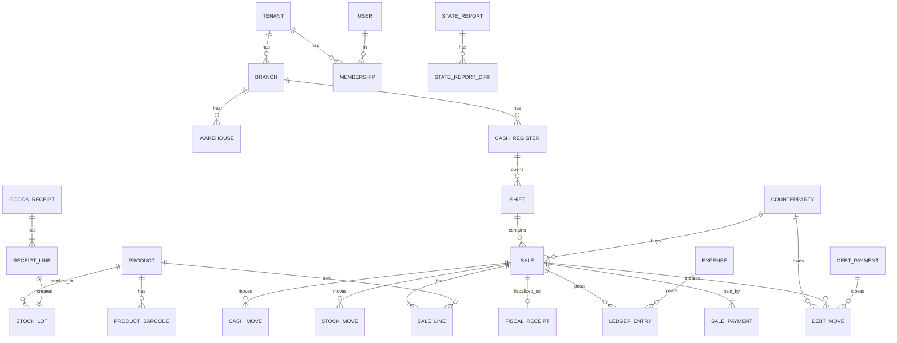

# Ma'lumotlar modeli

**Maqsad:** Jadvallar, hujjatlar, registrlar, holat mashinalari va raqamlash qoidalari — kodlashga tayyor ma'lumotlar modeli.
**Kim uchun:** Backend dasturchilar, DB sxemasi muallifi.
**Bog'liq fayllar:** `12-db-sxema.md`, `03-modullar-talablari.md`, `04-biznes-jarayonlar.md`, `13-provodka-qoidalari.md`, `14-autentifikatsiya-oauth2.md`, `33-1c-integratsiya.md` (§5 — `onec_*` jadvallari, 10.2-bo'lim).
**Holat:** joriy, 2026-10-16.

## Asosiy xulosalar

1. **Uch qatlam**: (a) **ma'lumotnomalar** (tovarlar, mijozlar, filiallar…) — tahrirlanadi, o'chirilmaydi (arxivlanadi); (b) **hujjatlar** (chek, kirim, qaytarish, qarz, xarajat…) — o'tkazilgandan keyin **o'zgarmaydi**, faqat teskari (storno) registr yozuvlari bilan bekor qilinadi (`status=cancelled`); (c) **registrlar** (qoldiq, partiyalar, qarz, kassa, buxgalteriya) — faqat hujjat o'tkazilganda yoziladigan **append-only harakatlar** + ulardan hisoblangan balanslar.
2. Har jadvalda `tenant_id` (RLS); filialga tegishli jadvallarda `branch_id`. Kalitlar — **UUIDv7** (vaqt bo'yicha tartiblangan, offline qurilmada ham yaratiladi — kassa serverni kutmasdan ID beradi).
3. Pul — `NUMERIC(18,2)` (so'm, tiyin bilan), miqdor — `NUMERIC(18,3)` (kg/l uchun), narx/tannarx — `NUMERIC(18,4)`. Float ishlatilmaydi.
4. Hujjat o'tkazish (posting) **bitta DB tranzaksiya**: hujjat holati + barcha registr harakatlari + buxgalteriya provodkasi birga yoziladi yoki birga bekor bo'ladi.
5. Tannarx uchun kirimlar har doim **partiya** (`stock_lots`) sifatida saqlanadi — FIFO ham, AVECO ham shu ma'lumotdan hisoblanadi (US-M04-05).
6. Offline'da yaratilgan har hujjatda `client_event_id` (qurilma generatsiya qilgan UUID) — server uni ikkinchi marta qabul qilmaydi (idempotentlik).
7. Hujjat raqamlari tenant + filial + hujjat turi + yil bo'yicha ketma-ket; chekning ichki raqami (`receipt_seq`) — kassa + smena ichida ketma-ket, qurilma beradi; fiskal modul bergan raqam (`fm_receipt_seq`) alohida saqlanadi.

---

## 1. Umumiy qoidalar

| Qoida | Tafsilot |
|---|---|
| Kalit | `id UUID` (v7). Offline qurilma o'zi yaratadi |
| Sxemalar | `app` (tenant biznes jadvallari), `auth` (login/token — faqat `SECURITY DEFINER`), `platform` (global: `plans`, `addons`, `units`, `label_templates`, `marking_product_groups`, `oauth_clients`, `signing_keys`, `platform_admins`, `fx_rates`, `terms_versions`, `turnover_tax_rates`, `card_bin_rules`) — DDL `12-db-sxema.md` §1 |
| Majburiy ustunlar | `tenant_id`, `created_at`, `updated_at` (o'zgaruvchan jadvallarda); `created_by` — hujjatlar, tarix jadvallari va audit talab qiladigan yozuvlarda (ma'lumotnomalarda o'zgarish izi — `audit_log`); hujjatlarda — 6-bo'limdagi umumiy sarlavha (yagona ro'yxat) |
| O'chirish | Ma'lumotnomalar: `archived_at` (soft). Hujjatlar: hech qachon — `status=cancelled` + registrlarda storno qatorlar (`reversal_of_id`). Registrlar: hech qachon |
| Vaqt | `TIMESTAMPTZ`, UTC saqlanadi; UI'da Toshkent vaqti (UTC+5). Hisob sanasi — `doc_date DATE` (Toshkent bo'yicha) |
| Matn | Nomlar lotin/kirill/rus aralash bo'lishi mumkin; qidiruv uchun `pg_trgm` indeks |
| Tenant izolyatsiyasi | Har jadvalda RLS siyosati: `tenant_id = current_setting('app.tenant_id')` (`15-xavfsizlik-va-audit.md`) |
| Versiya | Ma'lumotnomalarda `version INT` — optimistik qulflash (ikki kishi bir vaqtda tahrirlasa) |
| RLS istisnolari | `tenant_id`'siz global jadvallar: `plans`, **`addons`** (qaror #22), `units`, `label_templates`, `marking_product_groups`, `platform_admins`, `oauth_clients` (`status`: `active`/`pending_secret`/`disabled` — maxfiy mijoz sirsiz seed qilinadi, deploy'da faollashadi), `signing_keys`, `terms_versions`, `fx_rates`, `turnover_tax_rates` (aylanma solig'i stavkalari tarixi: `code`, `rate_pct`, `valid_from`; seed), `card_bin_rules` (karta BIN → `card_type`, qaror #71; 6.2-bo'lim) (ilova roliga faqat SELECT, `fx_rates`ga kurs scheduler'i uchun yozish ham; `platform_admins`ga umuman yo'q). `tenants` — siyosat `id = app.tenant_id`. `users` — siyosat `id = app.user_id OR EXISTS(memberships m WHERE m.user_id = users.id AND m.tenant_id = app.tenant_id)`; login/tenant tanlash — `SECURITY DEFINER` funksiyalar `auth_find_user_by_phone(phone)`, `auth_list_memberships(user_id)` orqali. **Auth-sxema jadvallari**: `user_credentials`, `otp_challenges`, `login_attempts`, `authorization_codes`, `refresh_tokens`, `sessions`, `onec_device_authorizations` (Do'kon agentini ulash, 10.2-bo'lim) — alohida PostgreSQL `auth` sxemasida, ilova roliga to'g'ridan-to'g'ri ruxsat yo'q, kirish faqat `SECURITY DEFINER` funksiyalar orqali (masalan `auth_find_user_by_phone`, `auth_issue_tokens`, `auth_consume_code`, `auth_rotate_refresh`, `auth_otp_verify`, `auth_record_login`, `auth_revoke_tenant`, `auth_suspend_tenant`; to'liq ro'yxat va imzolar — `12-db-sxema.md` §4.5, `14-autentifikatsiya-oauth2.md` §19). **`license_tokens`** — bundan mustasno, standart `tenant_id` RLS (10.1-bo'lim). **`user_identities`** (qaror #34) — `users` kabi `app` sxemasida, `tenant_id`siz; siyosat `user_id = app.user_id` (o'z bog'langan hisoblarini ko'radi) |

## 2. Platforma (M17)

| Jadval | Asosiy maydonlar | Izoh |
|---|---|---|
| `tenants` | id, name, activity_type, stir (null), phone, **legal_form** (`llc`/`jsc`/`private_enterprise`/`sole_proprietor` — "Egasi oldi" hisobi, `13-provodka-qoidalari.md` §2.18), **go_live_date** (ro'yxatdan o'tgan kun, Toshkent — signup yozadi; boshlang'ich qoldiqlar sanasi = go_live_date − 1, 13 §5.5), **accepted_terms_version/accepted_terms_at/accepted_terms_ip** (oferta aksepti, qaror #61), settings JSONB — kalitlar (Pydantic `TenantSettings` sxemasi): `ai_training_consent`, `ai_cross_border_enabled` (standart `false`, qaror #61), `negative_stock_policy` (`allow`/`block`, standart `allow`), `weight_barcode_templates[]` (`{prefixes[], item_code_len 4..6 (5), value_len 5, value_kind WEIGHT\|AMOUNT, decimals 0..3, enabled}`; standart 22=WEIGHT (gramm), 21=AMOUNT), `low_stock_check_enabled`, `expiry_warning_days` (standart 7), `vat_diff_tolerance_amount` (standart `"1000.00"`, qaror #50), `supplier_overpay_policy` (`warn`/`block`, standart `warn`, qaror #47), `marking_precheck` (`off`/`warn`/`block`, standart `warn`, qaror #62), `discount_posting` (`gross_9050`/`net`, standart `gross_9050`), `owner_withdrawal_account` (`4890`/`8720`, standart `legal_form`dan), `payment_org_commission_account` (`9430`/`9410`, standart `9430`), `turnover_tax_account` (`9430`/`9820`, standart `9430`), `fiscal_policy` {`debt_receipt_split` `single`/`per_sale` (standart `single`, qaror #45), `credit_sale_receipt` `none`/`credit_type` (standart `none`)}, `bank_account`, `bank_mfo` (yagona bank hisobi, qaror #49), `transfer_overdue_hours` (int 1..720, standart 48 — `sent` holatidagi ko'chirish shu soatdan keyin «kechikkan», QT-M06-05), `card_manual_fallback` (`allow`/`manager_approval`/`forbid` — karta rekvizitlarini qo'lda kiritish siyosati, qaror #71; kalit yo'q bo'lsa faol `card_terminals` bog'langan kassada `manager_approval`, boshqa kassada `allow`). **Baholash usuli bu yerda emas** — `valuation_method_history` | Bitta do'kon/kompaniya. Obuna/hayot sikli holati bu yerda **emas** — `subscriptions.status`. **Bitta tenant = bitta yuridik shaxs** (STIR); bitta do'kon/kompaniya — ko'p filial, ko'p kassa, ko'p faoliyat turi (`branches.activity_type`) bitta tenant ichida qo'llab-quvvatlanadi; ko'p yuridik shaxsli egalar har biri uchun alohida tenant ochib, memberships orqali almashadi (qaror #31) |
| `plans` | id, code (**`standard`** — yagona tarif), price_month (**99 000 so'm**, hammasi kiradi), price_year (**950 400 so'm** = 99 000×12×0,8, −20% yillik chegirma), limits JSONB (`included_cash_registers`=1, `ai_monthly_tokens`, …) | Yagona tarif: barcha modul, 1 virtual kassa, AI oylik limiti, Telegram bot (`05-mvp-chegarasi.md` 3.3, boshqa agent yangilaydi) (qaror #22) |
| **`addons`** (qaror #22) | id, code (`extra_register` — qo'shimcha virtual kassa), name, price_month (**39 000 so'm/oy** — fiskal modul ~35 000 + zahira; hamkor kassa narxi kelgach qayta ko'riladi — 26 #168, `tarix/tekshiruv/savollar-yakuniy-tavsiyalar.md` (b)/#2) | Global qo'shimcha xizmatlar katalogi, `plans` kabi tenant'siz (RLS istisnosi, §1) |
| **`tenant_addons`** (qaror #22) | tenant_id, addon_code (→ `addons.code`), quantity, price_month_snapshot, added_at, removed_at (null = faol) | Tenant tanlagan qo'shimchalar (masalan necha dona qo'shimcha kassa); billing hisob-kitobida `subscriptions.plan_id` narxi ustiga qo'shiladi |
| `subscriptions` | tenant_id (UNIQUE — bitta tenant, bitta qator), plan_id, period (`month`/`year`), current_period_end (trial'da = trial tugash sanasi, **30 kun**), grace_ends_at, status (`trial`/`active`/`grace`/`restricted`/`closed`) | Tenant hayot siklining **yagona** manbai; holat mashinasi 8-bo'limda |
| `billing_payments` | tenant_id, **kind** (`payment`/`manual_extension`/`refund`; `manual_extension` — amount `"0.00"`, provider null, reason + actor_user_id majburiy, qaror #56), amount, provider (`click`/`payme`), provider_tx_id (null — checkout paytida; UNIQUE (provider, provider_tx_id)), status (`pending`/`success`/`failed`/`cancelled`), period (`month`/`year`), covers_from, covers_to, amount_breakdown JSONB, invoice_number, invoice_attachment_id, paid_at | Bizning daromad; `POST /billing/checkout` `pending` qator yaratadi, uning `id`si Click `merchant_trans_id`; webhook idempotent; kvitansiya PDF — `invoice_attachment_id`. Alohida `billing_invoices` jadvali — rad (ustun yetarli) |
| `platform_admins` | id, **user_id** (→ `users`), role, **mfa_secret_encrypted**, **allowed_ips** | Ichki admin (ADM-01), tenantlarga RLS'siz kiradi — faqat audit bilan. Kredensial `user_id` orqali `user_credentials`dan keladi, login'da majburiy TOTP (`14-autentifikatsiya-oauth2.md` §18.1) |
| **`tenant_tax_regimes`** | tenant_id, valid_from (sana), regime (`vat`/`turnover`) | Tenant darajasidagi soliq rejimi tarixi — ixtiyoriy o'tish oy boshidan, 1 mlrd so'm chegarasiga yetilganda yoki import boshlanganda — shu kundan (Soliq kodeksi 462-modda 7, 13-qism); o'tgan davrlar qayta hisoblanmaydi; chegaraga yaqinlashishni tizim ogohlantiradi, o'tishni Buxgalter belgilaydi (`13-provodka-qoidalari.md` §4.3) |
| `fx_rates` (global, `platform`) | rate_date, currency, rate, source, fetched_at; PK (rate_date, currency) | Markaziy bank kunlik kursi, scheduler har kuni 09:30 (qaror #55); `ai_requests.fx_rate_used` manbasi |
| `terms_versions` (global, `platform`) | version (PK), kind (`terms`/`privacy`/`ai_cross_border`), text_url, text_sha256, effective_from, is_current | Foydalanish shartlari va rozilik matnlari versiyalari (qaror #61) |
| `consents` | tenant_id, subject (`tenant`/`user`), user_id, purpose (`terms`/`ai_cross_border`/`ai_training`), terms_version, accepted (bool), ip, at | Rozilik berish/qaytarib olishning append-only izi; joriy holat — `tenants.accepted_terms_*` va `settings.ai_cross_border_enabled` (`POST /tenant/consents`) |

## 3. Tashkilot, foydalanuvchilar, huquqlar (M13, M14)

| Jadval | Asosiy maydonlar | Izoh |
|---|---|---|
| `branches` | tenant_id, **code** (hujjat raqamidagi filial kodi, `01`, UNIQUE per tenant), name, address, is_default, settlement_category (`city_100k_plus`/`other`/`remote_mountain`), activity_type (`retail`/`other`), archived_at, version | Filial (M14). `settlement_category` + `activity_type` aylanma solig'i stavkasini aniqlaydi (Soliq kodeksi 467-modda: chakana 4% / 2% / 1%; tamaki savdosi har doim 4%; boshqa faoliyat 4%; YTT/o'zini o'zi band qilgan 1% — tenant darajasida). `code` — **KRITIK**: `app.next_doc_number()` funksiyasi buni talab qiladi, DDL'da mavjud bo'lishi shart |
| `branch_tax_settings` | branch_id, valid_from, settlement_category, activity_type | Aylanma solig'i stavkasi tarixi — yangi qiymat faqat `valid_from` sanasidan qo'llanadi, oldingi davrlar qayta hisoblanmaydi |
| `warehouses` | tenant_id, branch_id, name, type (`store`/`stock`), **inventory_account** (`2910`/`2920`; yaratishda `store` → 2920, `stock` → 2910; harakatdan keyin o'zgarmaydi) | MVP UI: har filialda 1 ta ombor (avtomatik), model ko'pini cheklamaydi (qaror #54). Tovar hisobi — `13-provodka-qoidalari.md` §1 `inv_acct` |
| `cash_registers` | tenant_id, branch_id, name, kind (`web`/`android`), fiscal_module_id, ofd_status (`pending`/`registered`/`active`/`suspended`/`deregistered` — soliq ro'yxati holati), **fm_state** (`ok`/`locked`/`ack_overdue`/`memory_full`/`unknown` — fiskal modul holati), **last_unacked_receipt_at**, **fm_receipts_pending**, **tax_registered_at**, **outlet_address_snapshot**, **txkm_contract_ref**, **fiscal_agent_id** (null; lokal fiskal ko'prik kassasiga xizmat qiluvchi Do'kon agenti → `onec_agents`, qaror #66), **fiscal_local_device_id** (null; agent `capabilities.fiscal.devices[].local_id`; `fiscal_agent_id` berilganda majburiy), **archived_at** (qo'shimcha kassa kamaytirilganda), version | Kassa (virtual kassa ID shu yerda). Har kassa savdodan oldin shoxobcha manzili bo'yicha TXKM orqali alohida ro'yxatdan o'tadi (VMQ-943 1-ilova 16–20-band); `ofd_status` `registered`/`active` bo'lmagan yoki `fm_state <> 'ok'` kassada fiskal chek chiqarilmaydi (`FISCAL_DEVICE_LOCKED`) |
| `devices` | tenant_id, cash_register_id (`onec_agent`da doim null — kassaga bog'lanish `cash_registers.fiscal_agent_id` orqali, qaror #66), kind (`web`/`android`/`onec_agent` — Do'kon agenti: fiskal ko'prik, printer, tarozi, 1C — qaror #36/#38/#60), revoked_at, revoked_by, last_seen_at, last_sync_at, app_version, **outbox_pending_count**, **outbox_oldest_pending_at**, **outbox_reported_at** (null; `/sync/push` `outbox_state`idan `last_sync_at` bilan bitta tranzaksiyada — faqat 1C eksporti tayyorligi uchun, `16-offline-sync.md` §3.1, `33-1c-integratsiya.md` §7.3) | Offline sync uchun. Tokenlar qurilmaga `refresh_tokens.device_id`/`license_tokens.device_id` orqali bog'lanadi (`devices`da token ustuni yo'q; `14-autentifikatsiya-oauth2.md` §19); **veb-kassa ham `devices` yozuviga ega** (litsenziya tokeni uchun, to'g'ridan-to'g'ri API chaqirmaydi — cookie+BFF), faqat Android to'g'ridan-to'g'ri Bearer bilan API chaqiradi (qaror #14) |
| `users` | id, phone (unique global), name, locale | Bir odam bir nechta tenantda ishlashi mumkin. Parol/PIN heshlari — `user_credentials`da (quyida) (qaror #14) |
| `user_credentials` | user_id (PK/FK), password_hash, **password_algo** (= `argon2id`), password_updated_at, pin_hash, pin_updated_at, failed_login_count, locked_until, **must_change_password**, **must_change_pin** | Sirlarni `users`dan ajratish; to'liq tafsilot `14-autentifikatsiya-oauth2.md` §19. Oxirgi ikki ustun — Egasi `admin_reset`/`pin_reset` OTP bilan tiklaganda `true` (qaror #14) |
| `user_identities` | user_id (→ `users`), provider (`google`), provider_user_id (Google `sub`), email, email_verified, linked_at, UNIQUE(provider, provider_user_id) | Google bilan kirish — tashqi OIDC identity provider bog'lash, tasdiqlangan email bo'yicha avtomatik bog'lanadi; `14-autentifikatsiya-oauth2.md` §2.2/§19 (qaror #34) |
| `memberships` | tenant_id, user_id, role_ids[], branch_ids[] (bo'sh = hammasi), status | Kim qaysi do'konda, qaysi filialda |
| `roles` | tenant_id, name, is_system (bool), system_code (`owner`/`manager`/`cashier`/`storekeeper`/`accountant`, faqat tizim rollarida), archived_at, version | Standart 5 rol + o'zinikini yaratish. **Egasi roli — barcha tenant ruxsatlarining (`platform.admin`dan tashqari) supersetiga ega**, limitlar cheksiz; to'liq matritsa `15-xavfsizlik-va-audit.md` §2.2 (qaror #28) |
| `role_permissions` | role_id, permission_code, limit_value (null) | **Standart limitlar** (qaror #23, tavsiya #1): Kassir uchun `discount.give` = **5%**, `returns.approve` (chek yo'q) = **100 000 so'm**, `cash.withdraw` = **50 000 so'm**; `sales.void` — limitsiz, lekin audit bilan. Egasi istalgan qiymatni o'zgartira oladi. To'liq jadval `15-xavfsizlik-va-audit.md` §2.2 |
| `permissions` (kod ichida, jadval emas) | `sales.create`, `returns.approve`, `debts.forgive`, `prices.edit`, … | Ro'yxat `15-xavfsizlik-va-audit.md` da |

## 4. Katalog va narxlar (M09)

| Jadval | Asosiy maydonlar | Izoh |
|---|---|---|
| `product_categories` | tenant_id, parent_id, name | Daraxt |
| `units` | code (`pcs`, `kg`, `l`, `m`, `box`), is_fractional | Global ro'yxat |
| `products` | tenant_id, name, **name_ru** (nullable, chek/UI ikkinchi til qatori), category_id, unit_code, mxik_code (17 raqam; **null ruxsat** — yaratishda bloklanmaydi, sotuvdan oldin shart), package_code (≤20 belgi, tasnif.soliq.uz; mxik_code kabi fiskal chekdan oldin shart), vat_rate (12/0, null) + vat_exemption_code (imtiyoz kodi) — kamida bittasi to'ldirilgan, is_marked (Asl belgisi), **marking_group_code** (→ `marking_product_groups`; `is_marked`da majburiy), is_weighed, min_stock, **turnover_tax_group** (`general`/`tobacco`, standart `general` — aylanma solig'i stavkasi guruhi, `13-provodka-qoidalari.md` §4.3), archived_at, version | MXIK — chekning majburiy rekviziti, lekin katalog yaratishda emas. `name` — asosiy (o'zbek), `name_ru` — ixtiyoriy; chek qatorida `"{name} / {name_ru}"` (bo'lmasa faqat `name`) (qaror #29) |
| `product_barcodes` | tenant_id, product_id, barcode (unique per tenant), kind (`ean`/`internal`/`weighed_prefix`), units_per_barcode | Bir tovarga bir nechta kod (dona/quti) |
| `product_prices` | tenant_id, product_id, branch_id (null = hamma), price, valid_from (TIMESTAMPTZ; kun ichida o'zgarishi mumkin), set_by, price_change_doc_id | Tarix saqlanadi (US-M09-01); `price_change_lines.valid_from` (null = post paytidan) |
| `label_print_queue` | tenant_id, product_id, reason (`price_changed`/`new`), printed_at | US-M09-04 |
| `label_templates` (global) | code, name, width_mm, height_mm, fields JSONB | Standart yorliq shablonlari (US-M09-04), tenant o'zgartirmaydi, RLS istisnosi |
| `marking_product_groups` (global, `platform`) | code (`general`/`water_beverages`/`medicines`/`vegetable_oil`), name, acceptance_deadline (`3_business_days`/`72_hours`), legal_ref | Markirovkali kirimda egalik o'tishi xabarnomasi muddati (umumiy 3 ish kuni, ayrim guruhlar 72 soat — qaror #63); RLS istisnosi, faqat SELECT |
| `internal_barcode_seq` | tenant_id, next_value (`40000000000`…`49999999999`) | Ichki kodlar diapazoni — EAN-13 `04` + 10 raqam + nazorat raqami (GS1 RCN 040–049); tashqi EAN bilan ham, tarozi prefikslari (20–29) bilan ham to'qnashmaydi |
| `discount_rules` | tenant_id, name, scope (`product`/`category`/`all`), target_ids[], kind (`percent`/`amount`/`n_plus_m`), value, branch_ids[] (bo'sh = hammasi), valid_from, valid_to, priority, archived_at | US-M03-02 (MVP'dan keyin); bitta chek qatoriga eng yuqori `priority`li bitta qoida (standart qoida; teng bo'lsa mijozga eng foydalisi) |

**Birlik konversiyasi va yaxlitlash qoidasi**: qoldiq har doim `products.unit_code` (asosiy birlik)da saqlanadi. Qadoq/quti shtrix-kodi (`product_barcodes.units_per_barcode`) skanerlanganda miqdor shu koeffitsientga ko'paytirilib asosiy birlikka o'tkaziladi. `units.is_fractional=false` bo'lgan birlikda miqdor **butun son** bo'lishi majburiy (validatsiya — kasr kiritilsa rad etiladi); `is_fractional=true`da miqdor `NUMERIC(18,3)` to'liq aniqlik bilan. Qator summasi = narx × miqdor, natija **tiyingacha ROUND_HALF_UP** bilan yaxlitlanadi.

## 5. Kontragentlar (M07, M08)

| Jadval | Asosiy maydonlar | Izoh |
|---|---|---|
| `counterparties` | tenant_id, kind (`person`/`company`), name, phone, stir (yuridik), **legal_address**, **bank_account**, **bank_mfo**, **vat_payer BOOL**, **vat_payer_checked_at**, is_customer, is_supplier, **is_founder** (ta'sischi — "Egasi oldi" 4890 analitikasi), credit_limit (null = limitsiz), **standing_discount_pct** (null = yo'q), notify_consent (bool + sana), telegram_chat_id, note | Mijoz ham, yetkazib beruvchi ham bitta jadvalda. Yangi ustunlar — B2B e-faktura uchun shart: STIR kiritilganda rekvizitlar EDO operatoridan (masalan Faktura.uz `CheckCompanyExist/:inn`) avto-to'ldiriladi; `legal_address`/`bank_account`/`bank_mfo`siz B2B chiquvchi e-faktura yaratilmaydi. `vat_payer=false` bo'lgan yetkazib beruvchi — AI-03 (hujjat OCR) qamrovini aniqlashda ishlatiladi. **`standing_discount_pct`** (qaror #23, tavsiya #8): MVP'da alohida optom narx jadvali yo'q — o'rniga mijozning doimiy chegirma foizi shu ustunda; bitta chekda `discount_rules` (4-bo'lim) bilan to'qnashsa, **faqat mijozga eng katta foyda beradigan bitta chegirma** qo'llanadi (yig'ilmaydi). |

**`counterparty_statement_links`**: tenant_id, counterparty_id, token_hash, expires_at (+30 kun, standart — qaror #54), revoked_at, last_accessed_at, created_by — mijozning ochiq qarz hisob-varag'i havolasi (US-M08-08); token o'zi saqlanmaydi, qidiruv `public_statement_by_token()` orqali.

**`debt_doubtful_flags`** (qaror #23, tavsiya #9): tenant_id, counterparty_id, flagged_by (**faqat Egasi**, `debts.forgive` huquqi bilan bir xil cheklov), reason (matn, majburiy), flagged_at, unflagged_at (null = faol). Bitta va'da sanasi yetarli deb qabul qilindi (bo'lib to'lash grafigi yo'q, `debt_openings`/`sale_payments.method=debt` o'zgarmaydi); tizim **avtomatik** "shubhali" deb belgilamaydi — faqat 60+ kunlik muddati o'tgan qarzlarni (`debt_moves.due_date < bugun − 60 kun`) BO-07'da eslatma sifatida ko'rsatadi, Egasi ko'rib chiqib sabab bilan qo'lda belgilaydi/bekor qiladi. Bu flag `debt_writeoffs` (haqiqiy kechirish, hisobdan chiqarish, 2.15-bo'lim provodkasi) bilan **bog'liq, lekin alohida** — flag faqat ko'rinish/ogohlantirish, qarz balansini o'zgartirmaydi; 4910-hisob (shubhali qarzlar zahirasi) bilan bog'lanishi `13-provodka-qoidalari.md`da.

## 6. Hujjatlar

Barcha hujjatlarda umumiy sarlavha (**yagona ro'yxat**, boshqa joyda takrorlanmaydi): `id, tenant_id, branch_id, number, temp_number` (offline vaqtinchalik raqam, `{qurilma}-{lokal seq}`; server yaratgan hujjatda null; UNIQUE (tenant_id, device_id, temp_number)), `doc_date, status, created_by, created_at, updated_at, posted_at, cancelled_at, cancelled_by, cancel_reason, client_event_id` (UNIQUE (tenant_id, client_event_id)), `device_id, comment`. Bekor qilish alohida teskari hujjat yaratmaydi: asl hujjat `cancelled` bo'ladi, registrlarga storno qatorlar yoziladi (7-bo'lim).

| Hujjat (jadval) | Qatorlar | Modul | Nimani o'zgartiradi (registrlar) |
|---|---|---|---|
| `shifts` | — | M01, M16 | status (`open`/`closed`), shift_no (qurilma beradi, kassa ichida ketma-ket — OFD smena raqami), opened_by/at, closed_by/at, opening_cash, expected_cash (server), counted_cash, variance (= counted − expected), variance_note (farq bo'lsa majburiy), counted_card_total. Yopilishda farq 13 §2.19 bo'yicha provodka; Z-hisobot — `fiscal_receipts(kind='z_report')` |
| `sales` (chek) | sarlavha: shift_id, cash_register_id, counterparty_id (nasiya), total_amount, **is_offline**, **debt_limit_exceeded** (offline limitdan oshgan nasiya bayrog'i, tavsiya #7). `sale_lines` (product, qty, line_no, price (4 xona), discount_amount (+ **discount_pct**, **discount_source** `manual`/`standing_customer`/`rule`, **discount_rule_id**), vat_rate + **vat_exemption_code**, vat_amount, cost_amount, line_total, marking_code (markirovkalangan tovarda **qty = 1** majburiy — har kod alohida qator), lot_allocations JSONB, **settled_amount** (qarz to'lovi va aralash to'lov cheklarida fiskallangan kumulyativ summa, standart 0)), `sale_payments` (method: `cash`/`card`/`uzqr`/`click`/`payme`/`uzum`/`debt`, amount, provider_tx_id (`click`/`payme`/`uzum` va dinamik UzQR'da majburiy), **terminal_ref** (ixtiyoriy — statik UzQR to'lov raqami; integratsiyalangan kartada server `card_result.tid`dan to'ldiradi; terminalsiz kartada NULL), **card_type** (`personal`/`corporate`/`social`/`unknown` — chek rekviziti, faqat `integrated`da va majburiy), **card_mask** (`NNNN****NNNN`), **rrn** (ikkalasi faqat `integrated`da, terminal natijasidan) (qaror #64), qr_type: `static`/`dynamic` — `uzqr`da majburiy (statik — kassir qo'lda tasdiqlaydi, seanssiz; dinamik — `UzqrPort` va `payment_checkouts`, faqat online); `uzqr` = bank yagona QR (yuridik shaxslar; YaTT uchun to'lov tashkiloti platformasi QR'i ham yetarli — PQ-247), **due_date** (`method='debt'` — va'da sanasi, `debt_moves.due_date` manbasi), **checkout_ref**; karta kiritish usuli (qaror #71): **card_entry_mode** (`integrated`/`manual` — `method='card'`da majburiy; `manual` — karta terminalsiz, ilovadan tashqarida qabul qilingan: faqat summa + `manual_reason`, barcha karta rekvizitlari NULL — ilovada karta ma'lumoti qo'lda kiritilmaydi), **card_terminal_transaction_id** (→ `card_terminal_transactions`; `integrated`da majburiy, `rrn`, `card_mask` va `card_type` ham majburiy; bitta tranzaksiya — bitta to'lov qatori), **approval_code**, **card_scheme** (`uzcard`/`humo`/`visa`/`mastercard`/`unionpay`/`mir`/`other`), **card_type_source** (`terminal`/`bin_table` — `card_type` bilan birga; `manual`da NULL), **manual_reason** (`terminal_offline`/`terminal_error`/`unknown_result`/`standalone_terminal` — `manual`da majburiy)) | M01, M03, M08 | qoldiq −, tannarx, kassa naqd +, qarz + (nasiya), QQS, buxgalteriya |
| `returns` | sarlavha: sale_id (null ruxsat), **shift_id, cash_register_id**, counterparty_id, **reason** (`defective`/`wrong_item`/`customer_changed_mind`/`other`), **refund_method** (`cash`/`card`/`uzqr`/`click`/`payme`/`uzum`/`debt_adjustment`; standart — asl to'lov usuli; qarzli sotuv qaytarilsa avval sotuvning ochiq qarzi kamayadi, qolgani pul bilan, fiskal qaytarish cheki faqat pul qismiga — `13-provodka-qoidalari.md` §2.5), karta qaytarish rekvizitlari (qaror #71, `refund_method='card'`da): **card_entry_mode** (`integrated` — asl terminalda `refund`, settlement'gacha `void`; `manual` — qaytarish terminalsiz, ilovadan tashqarida, rekvizitsiz), **card_terminal_transaction_id**, card_type, card_mask, rrn, approval_code, card_scheme (faqat `integrated`da), manual_reason (`sale_payments` bilan bir xil qoidalar), **is_offline**, approved_by/at. `return_lines` (sale_line_id (null = chek topilmagan qaytarish), product_id, qty, price, **vat_rate**, **vat_exemption_code**, vat_amount, cost_amount, line_total, **marking_code**, **restock** — muddati o'tgan tovarda majburan `false`, `returns.approve` bilan, avtomatik `write_offs` qoralamasi `expired_return` — qaror #48) | M02 | qoldiq +, kassa −/qarz −, QQS −, buxgalteriya, fiskal qaytarish cheki |
| `purchase_orders` | sarlavha: + supplier_id, **warehouse_id**; `po_lines` (product, qty, price null) | M07 | — (rejalashtirish, registrga ta'sir yo'q) |
| `powers_of_attorney` (e-ishonchnoma) | umumiy sarlavhasiz: branch_id, purchase_order_id (null), supplier_id, employee_user_id (ishonchli shaxs, odatda Omborchi), doc_date, valid_from, valid_to (`≥ valid_from`), number (operator bergan), operator_doc_id, status, last_error, signed_at, sent_at, responded_at, reject_reason, created_by, version; E-IMZO bilan imzolanib e-faktura operatoriga yuboriladi (`outbox_jobs.kind='poa_send'`) | M07 | — (registrga ta'sir yo'q); kirimda `goods_receipts.poa_id`/`poa_number` |
| `goods_receipts` (kirim) | sarlavha: supplier_id, warehouse_id, po_id, **kind** (`purchase`/`gratuitous` — tekin olingan, Dt inv_acct / Kt 8530, 13 §2.6a), **source** (`manual`/`purchase_order`/`einvoice`/`ocr`), **einvoice_id** ("qizil" QQS kechiktirish shu orqali aniqlanadi), **ai_ocr_job_id**, paid_immediately (13 §2.6/§2.8 yo'li), **ettn_ref**, **poa_id** (→ `powers_of_attorney`, null), **poa_number** (e-ishonchnoma raqami — `powers_of_attorney.number` dan yoki qo'lda). `receipt_lines` (product, qty, cost (4 xona), vat_rate + **vat_exemption_code**, vat_amount, expiry_date, **discrepancy_reason** (`short`/`excess`/`damaged`/`wrong_item`/`other`, null)) | M07 | yangi partiya (lot), qoldiq +, yetkazib beruvchiga qarz + (nasiya bo'lsa), kirish QQS |
| `supplier_returns` (yetkazib beruvchiga qaytarish) | sarlavhada **reason** (`expired`/`damaged`/`excess`/`other`); `supplier_return_lines` (receipt_line_id, lot_id, qty, cost, vat) | M07 | qoldiq − (asl partiyadan), yetkazib beruvchiga qarz − (yoki debitorlik), kiritiladigan QQS − |
| `transfers` | sarlavha: from/to_branch_id, from/to_warehouse_id, **sent_at/by, received_at/by**, **transport_mode** (`vehicle`/`on_foot_or_public`), **ettn_ref**, **vehicle_plate**, **driver_name** (e-TTN "Ombordan omborga" `vehicle`da majburiy — qaror #63); `transfer_lines` (product, qty_sent, qty_received, **unit_cost**, **lot_allocations JSONB** — bir qator bir nechta partiyadan) | M06 | jo'natuvchi qoldiq −, yo'lda; qabul qiluvchi qoldiq + (tannarx partiya bilan ko'chadi) |
| `stock_counts` (inventarizatsiya) | sarlavha: warehouse_id, **started_at** (snapshot vaqti), **responsible_user_id** (kamomad → 4730, bo'lmasa 5910). `count_lines` (**snapshot_qty**, expected, counted **null** sanash tugamaguncha, **counted_at** — kiritilgan vaqt, offline'da qurilma vaqti); `post`da `expected = snapshot_qty + Σ stock_moves(started_at < moved_at ≤ counted_at)` (qaror #53) | M05 | farq bo'yicha qoldiq ±, kamomad 4730/5910 / ortiqcha 9390 (13 §2.11) |
| `write_offs` (hisobdan chiqarish) | + **responsible_user_id** (13 §2.12: 4730), **promo_order_ref** (reklama aksiyasi buyrug'i), **source_return_id** (qaror #48); `write_off_lines` (product, lot_id, qty, reason: `expired`/`damaged`/`gift`/`expired_return`/`other`, **gift_kind** `promo_justified`/`other` — `gift`da majburiy). Faqat online back-office (qaror #54) | M04, M05 | qoldiq −, xarajat (9430/4730/9410), sovg'ada QQS (13 §2.12) |
| `price_changes` | `price_change_lines` | M09 | `product_prices`, yorliq navbati |
| `stock_openings` (boshlang'ich qoldiq) | `opening_lines` (product, qty, unit_cost, expiry_date) | M04 | yangi partiya, qoldiq + (chek/faktura yo'q, US-M04-04) |
| `debt_openings` (boshlang'ich qarz) | — (counterparty, amount, direction, **due_date**) | M08 | qarz registri (chek yo'q, US-M08-07) |
| `debt_payments` (qarz to'lovi) | method (`cash`/`card`/`uzqr`/`click`/`payme`/`uzum`/`bank`), cash_register_id + shift_id + **receipt_seq** (`bank`dan tashqari barcha usullarda majburiy — faqat POS `debt_payment.created` voqeasi; `bank` — kassasiz, uchalasi null, faqat back-office; qaror #67), **unallocated_amount** (offline ortiqcha summa, standart 0), terminal_ref, provider_tx_id, **card_type/card_mask/rrn**, **qr_type**, **card_entry_mode/card_terminal_transaction_id/approval_code/card_scheme/card_type_source/manual_reason** (qaror #71) (`sale_payments` bilan bir xil qoidalar), checkout_ref, **promise_date**; `allocations` → `debt_payment_allocations(target_doc_type` `sales`/`debt_openings`/`debt_writeoffs`, `target_doc_id, amount)` | M08 | qarz −, kassa (`cash`) / yo'ldagi pul 5710 (`card`/`uzqr`/`click`/`payme`/`uzum`, qaror #42) / bank (`bank`) +; hisobdan chiqarilgan qarzga to'lov — Kt 9390, qarz qayta ochilmaydi (13 §2.14). Online/REST'da `amount ≤ receivable_balance + Σ hisobdan chiqarilgan ochiq qarz`, oshsa rad etiladi (qaror #45); offline ortiqcha summa qabul qilinadi — `unallocated_amount`, Kt 6310 (qaror #67). **`bank`dan tashqari har to'lovga bitta fiskal chek** shu kassa FM'ida (`fiscal_receipts.kind='debt_settlement'`, summasi = olingan pul, tovar qatorlari to'lov yopgan sotuvlardan proporsional, `sale_lines.settled_amount` kumulyativ; qaror #30, #45, #67); bank o'tkazmasida chek yo'q |
| `debt_writeoffs` (kechish) | counterparty, amount, **reason**, account_choice (`9430` standart / `4910` — 4910 qoldig'i ≥ summa), **tax_writeoff_basis** (`court`/`bankruptcy`/`liquidation`/`death`/`limitation`/`none` — Soliq kodeksi 313-modda, hisobot uchun), approved_by (faqat Egasi) | M08 | qarz −, xarajat 9430 yoki rezerv 4910 (13 §2.15), faqat Egasi |
| `supplier_payments` | method (`cash`/`bank`), cash_register_id+shift_id (naqd); `allocations` → `supplier_payment_allocations(target_doc_type` `goods_receipts`/`debt_openings`, …)` | M07, M08 | yetkazib beruvchiga qarz −, kassa/bank −; qarzdan ortiq qism — avans 4310 (`supplier_overpay_policy`, qaror #47) |
| `expenses` | — (category_id, amount, source: `cash`/`bank`/`card`, **tax_type** (`vat`/`turnover`/`pit`/`social`/`property`/`land`/`other` — toifa `default_account='6410'` bo'lsa majburiy), cash_register_id + shift_id (source=`cash` bo'lsa majburiy), attachment_id, recurring_rule_id) | M15 | kassa/bank −, xarajat (`expense_categories.default_account`) yoki byudjetga soliq to'lovi (Dt 6410) |
| `cash_movements` (kassa pul harakati) | — (direction `in`/`out`, reason: `collection` (inkasso)/`deposit`/`owner_withdrawal`/`other`; juftlik: `collection`/`owner_withdrawal` → faqat `out`, `deposit` → faqat `in`, `other` → ikkalasi; **counterparty_id** — `owner_withdrawal`da ta'sischi, `other`da `account` `6310`/`4010` bo'lsa majburiy; **account** (faqat `other`: `9430`/`9390`/`6310`/`4010`/`4730`, null = standart — `out` 9430, `in` 9390); **employee_id** (`account='4730'`da majburiy)) | M16 | kassa naqd ±; inkasso (`collection`) — yo'ldagi pul 5710 + (bankka tushgani `bank_settlements` bilan, qaror #42); "Egasi oldi" — `legal_form` bo'yicha 4890 yoki 8720 (13 §2.18). Fiskal hujjat emas, OFD'ga yuborilmaydi. Xarajat to'lovi bu hujjat **emas** — `ExpensePostingService` `cash_moves`ni o'zi yozadi |
| `bank_settlements` (bank tushumi tasdig'i) | — (source `manual`/`statement_import`, **statement_import_id** (→ `bank_statement_imports`, import qoralamasida majburiy), method `card`/`uzqr`/`click`/`payme`/`uzum`/`collection`, settled_from, settled_to, gross_amount, commission_amount, **variance_amount** (faqat `collection`: <0 kamomad, >0 ortiqcha), net_amount (= gross − commission + variance), bank_ref, attachment_id) | M11, M16 | yo'ldagi pul (5710) −, bank (5110) +, komissiya xarajati (karta/UzQR 9430, Click/Payme/Uzum — `payment_org_commission_account`, inkasso 9410), inkassa farqi 5910/9390; faqat back-office (sync voqeasi yo'q), Buxgalter/Egasi bank ko'chirmasi bo'yicha yaratadi (`13-provodka-qoidalari.md` §2.18a, qaror #42) |
| `ledger_adjustments` (qo'lda buxgalteriya tuzatishi) | — (account_dt, account_kt, amount, **analytics** JSONB (counterparty_id, employee_id, tax_type …), correction_of_period, comment majburiy) | M11 | `ledger_entries` +; faqat joriy ochiq davrda (13 §5.1, qaror #23); 5910/4730 yopish, shubhali qarz rezervi, dividend, boshlang'ich balans (0000) |
| `tax_settlements` (soliq davr hisob-kitobi) | — (tax_kind `vat_offset`/`turnover_tax`, period (oy 1-sanasi), base_amount, rate (aylanma), amount, expense_account `9430`/`9820` (aylanma)); `vat_offset` — (tenant, davr) uchun bitta faol hujjat (`branch_id` = tenantning `is_default` filiali, qaror #31), `turnover_tax` — (filial, davr) uchun bitta; kod `ST` | M10, M11 | `vat_offset`: Dt 6410 / Kt 4410 (tenant bo'yicha `vat_moves`); `turnover_tax`: Dt 9430 yoki 9820 / Kt 6410, har filial alohida (13 §2.26, §4.3); faqat back-office |

**Qaytarish invarianti va chek topilmagan qaytarish**: `SUM(return_lines.qty) WHERE sale_line_id=X AND status=posted ≤ sale_lines.qty` — `ReturnPostingService` asl sotuv qatorini qulflab (`23-backend-arxitekturasi.md` §2.1 bilan bir xil qulflash tartibida) tekshiradi; oshib ketsa `RETURN_QTY_EXCEEDED` xato kodi (offline holatda POS ekranida rad etiladi, serverga yetganda qayta tekshiriladi). **Chek topilmagan qaytarish** (`sale_line_id=NULL`): faqat Menejer/Egasi PIN tasdig'i bilan, narx — qaytarish paytidagi joriy narx (asl chek narxi emas, chunki asl chek yo'q), alohida hisobotda ajratilgan holda ko'rsatiladi (oddiy qaytarishlar bilan aralashtirilmaydi).

Qo'shimcha: `expense_categories` (**code** (seed kodi, masalan `rent_store`, `payroll_admin`, `tax_payment`), name, **default_account** (`9410`/`9420`/`9430`/`6410`), **source_ref** (normativ asos), is_system, archived_at, version — seed xaritasi `13-provodka-qoidalari.md` §2.17), `bank_statement_imports` (attachment_id, file_sha256 (UNIQUE per tenant), format `1c_client_bank_exchange`, account, period_from/to, status `parsed`/`failed`, rows_total, drafts_created, duplicates, ignored_outgoing, unmatched_lines JSONB, parsed_at, created_by — `POST /bank-settlements/imports`, faqat `draft` yaratadi), `recurring_expenses` (branch_id, category_id, name, amount, period `month`/`quarter`/`year`, day_of_month 1–28, source, cash_register_id, next_due_date, last_triggered_at, is_active, created_by, version — avtomatik to'lanmaydi, eslatma + qo'lda tasdiq), `attachments` (s3_key, content_type, original_name, kind (`expense_receipt`/`ocr_source`/`state_report`/`import`/`export`/`label_pdf`/`billing_invoice`/`einvoice`/`onec_diagnostics`/`other`), size_bytes, sha256, uploaded_by).

## 6.1 Tasdiqlash va to'lov seanslari

**`approval_requests`** — masofaviy tasdiq navbati (BO-16): kind, permission_code, requested_value, context JSONB, linked_doc_type/id, status (`pending`/`approved`/`rejected`/`expired`/`consumed`), requested_by/at, expires_at (+15 daqiqa, standart, sozlanadi — 26 #87), resolved_by/at, reject_reason; bitta so'rov bir hujjatda bir marta ishlatiladi (`consumed`).

**`doc_approvals`** — qo'llangan har tasdiqning append-only izi (`local_pin` yoki `remote_request`): doc_type, doc_id, line_id, kind, mode, approved_by, approval_request_id, pin_verified_locally, requested_value, approved_at.

Limitdan oshgan hujjat `pending_approval` holatiga **o'tmaydi** (istisno — `price_changes`): `draft`da qoladi, tasdiqlanganda server o'zi `post`ni bajaradi.

**`payment_checkouts`** — dinamik UzQR/Click/Payme/Uzum to'lov seansi chekdan oldin (statik UzQR seanssiz — kassir qo'lda tasdiqlaydi): checkout_ref (qurilma beradi), provider, qr_type (`uzqr`da faqat `dynamic`), amount, provider_tx_id, status (`pending`/`confirmed`/`failed`/`expired`/`consumed`), expires_at; `sale_payments.checkout_ref`/`debt_payments.checkout_ref` bilan bog'lanadi.

**Karta terminali** (qaror #71) — POS summani bank karta terminaliga avtomatik yuboradi, kassir karta raqami/RRN'ni kiritmaydi; terminal bo'lmasa karta to'lovi faqat summa sifatida yoziladi (rekvizitsiz, qaror #64); kod `CardTerminalPort` orqali (`21` §9.4):

| Jadval | Asosiy maydonlar | Izoh |
|---|---|---|
| `card_terminals` (ma'lumotnoma) | branch_id, cash_register_id (null ruxsat), name, vendor, model, **adapter** (`agent_ecr` — Do'kon agenti orqali LAN/Wi-Fi / `cloud` — vendor bulut API / `android_intent` — Kotlin POS shu smart-terminaldagi vendor ilova / `softpos` — NFC SoftPOS SDK / `fake` — faqat dev/test/demo), driver (`rahmat_lan`, `humo_lan`, `era_lan`, `arcus2_tcp`, `sunmi_intent`, `mayasoft_softpos`, `fake` …), agent_id + local_id + host (`agent_ecr`da majburiy), port; host — faqat xususiy LAN IPv4, vendor_terminal_ref (`cloud`da majburiy), tid (faol real terminalda majburiy), mid, acquirer_counterparty_id, status (`active`/`disabled`/`archived` — boshqaruv holati), is_default (kassada bitta), capabilities JSONB, **health_status** (`online`/`busy`/`offline`/`error`/`unknown` — agent `card.status` vazifasi yoki POS `health()`), health_checked_at, version | BO-12 da boshqariladi (`cash_register.manage`); faol terminali bor kassada POS "Karta" tugmasi integratsiyalangan oqimni ochadi |
| `card_terminal_transactions` | **id = attempt_id** (UUIDv7, qurilma beradi — idempotentlik kaliti), card_terminal_id, cash_register_id, shift_id, device_id, **kind** (`purchase`/`refund`/`void`), original_transaction_id (`void`da majburiy, `refund`da asl xarid), amount, approved_amount, currency `UZS`, **status** (`pending`/`approved`/`declined`/`unknown`/`voided`), approval_code, rrn, stan, card_mask (4+4), card_scheme, card_type + card_type_source, entry_mode (`chip`/`contactless`/`magstripe`/`fallback`), tid, mid, acquirer, decline_code/message, resolved_by (`auto`/`status_query`/`manager`) + resolved_by_user_id, terminal_response JSONB (sanitizatsiyalangan, PAN'siz), slip_text, client_event_id, doc_type (`sales`/`returns`/`debt_payments`) + doc_id, settlement_id, requested_at, tx_at, resolved_at | Har urinish — bitta qator; holat so'rovi qatorni yangilaydi, yangi qator yaratmaydi. `approved` purchase/refund'da `approved_amount` majburiy, terminal natijasida `rrn` va `card_mask` ham (menejer yopgan `unknown` — `resolved_by='manager'` — rekvizitsiz); `(tenant, tid, rrn)` purchase uchun UNIQUE; terminalda bir vaqtda bitta `pending`. Offline natija voqea ichidagi `card_result`dan upsert qilinadi — `sale.created` → `payments[].card_result`, `return.created` → `refund_card.card_result`, `debt_payment.created` → `card_result` (16 §2.1). Sotuvsiz qolgan `approved` purchase avtomatik `void` qilinmaydi — `sync_exceptions(kind='card_orphan_transaction')` |
| `card_terminal_settlements` | card_terminal_id, shift_id, batch_no, business_date, settled_at, purchase_count/total, refund_count/total, net_total (hisoblangan), expected_count/total (server — integrated tranzaksiyalardan), variance (hisoblangan), status (`matched`/`mismatch`/`failed`), bank_settlement_id, terminal_response | Smena yopilishida terminal «сверка итогов»; `mismatch` — BO-14 ogohlantirishi; bank ko'chirmasi bilan moslashtirish — 13 §2.18a. Provodka yo'q |
| `card_bin_rules` (global, `platform`) | bin_prefix (6–8 raqam), card_type (`personal`/`corporate`/`social`), card_scheme, issuer, source, valid_from/valid_to | Terminal `card_type` bermaganda BIN bo'yicha aniqlash (eng uzun prefiks); topilmasa `unknown` (`card_type_source='bin_table'`); kassir karta turini tanlamaydi |

## 7. Registrlar (append-only)

| Registr | Maydonlar | Balans qanday olinadi |
|---|---|---|
| `stock_moves` | tenant_id, warehouse_id, product_id, lot_id, qty (±), cost_amount (±), doc_type, doc_id, line_id, moved_at | `stock_balances` (warehouse, product) — trigger/ilova tomonidan yangilanadigan jamlama jadval; tekshirish uchun `SUM(stock_moves)` |
| `stock_lots` (partiyalar) | tenant_id, warehouse_id, product_id, **source_doc_type** (`goods_receipts`/`stock_openings`/`transfers`/`stock_counts` — inventarizatsiya ortiqchasi), source_doc_id, source_line_id, receipt_line_id (faqat kirimda), received_at, qty_in, qty_left, **blocked_qty** (qaytgan muddati o'tgan tovar — sotuvga chiqmaydi, `0 ≤ blocked_qty ≤ qty_left`), unit_cost, expiry_date | FIFO: `qty_left − blocked_qty > 0` eng eskisidan (`ORDER BY received_at, id`); AVECO: `avg_costs` jadvali (warehouse, product, avg_cost, qty, **total_value**) har kirimda qayta hisoblanadi (13 §3.1). **`doc_type` qiymati — hujjat jadvali nomi** (`sales`, `goods_receipts`, …) barcha registr/allokatsiya/bog'lanish ustunlarida |
| `valuation_method_history` | tenant_id, valid_from (yil 1-yanvari), method (`fifo`/`aveco`), created_by | **Registr emas** — sozlama tarixi (umumiy registr ustunlari va storno qo'llanmaydi), tannarx bilan bog'liqligi uchun shu yerda. Usul faqat yangi yil boshidan; joriy usul = eng oxirgi valid_from ≤ hujjat sanasi (US-M04-05) |
| `debt_moves` | tenant_id, counterparty_id, direction (`receivable` — bizga qarz / `payable` — bizning qarz), amount (±), due_date, **limit_exceeded** (bool, offline nasiya limitdan oshgan), doc_type, doc_id | `debt_balances` (counterparty, direction); qarz daftari = shu harakatlar ro'yxati. `counterparties.debt_due_date` — yagona joriy va'da sanasi (o'zgaruvchan ustun, `debt_moves` append-only bo'lgani uchun u yerda yangilanmaydi) |
| `cash_moves` | tenant_id, cash_register_id (naqdda majburiy), bank_account_id (**MVP'da doim null** — yagona bank hisobi 5110, ko'p hisob — backlog), shift_id, amount (±), method, doc_type, doc_id | Kutilgan naqd = smena bo'yicha `SUM` (US-M16-02) |
| `ledger_entries` (buxgalteriya) | tenant_id, entry_date, **branch_id** (filial hisobotlari uchun indeksli ustun), account_dt, account_kt (4 raqamli kod), amount, doc_type, doc_id, analytics JSONB (product, counterparty, payment_method, tax_type, employee …) | Aylanma va qoldiq vedomosti; hisob raqamlari `13-provodka-qoidalari.md` §1 (BHMS №21; texnik `0000` — boshlang'ich qoldiqlar; tovar hisobi `warehouses.inventory_account`; naqdsiz tushum va inkassa uchun tranzit 5710 — `analytics.payment_method` bilan, qaror #42) |
| `vat_moves` | tenant_id, period (oy), kind (`output`/`input`), base_amount, vat_amount, doc_type, doc_id, einvoice_id | QQS ichki hisob (M10) va davlat hisoboti bilan solishtirish; oy yakunida kiruvchi QQS `tax_settlements(vat_offset)` bilan hisobga olinadi. `status` ustuni yo'q: `risk_flag` `red`/`unknown` faktura bo'yicha kiruvchi QQS to'lovgacha **umuman yozilmaydi** (`13-provodka-qoidalari.md` 4.1) |

Barcha registrlarda (`valuation_method_history` bundan mustasno — registr emas, sozlama tarixi) umumiy ustunlar: `id, tenant_id, doc_type, doc_id, reversal_of_id` (storno qatorida — teskari qilinayotgan asl registr qatori, aks holda null), `created_at`. Storno qatori: `ledger_entries` — Dt/Kt o'rni almashtiriladi, `amount` musbat; `stock_moves`/`debt_moves`/`cash_moves`/`vat_moves` — teskari ishorali miqdor/summa (13 §5.2); sanasi — bekor qilish sanasi (joriy ochiq davr). `debt_balances`: (tenant_id, counterparty_id, direction, balance, updated_at), UNIQUE (tenant_id, counterparty_id, direction). `stock_balances`: (tenant_id, warehouse_id, product_id, qty, value, updated_at), UNIQUE (tenant_id, warehouse_id, product_id) — FIFO/AVECO posting'ining qulflash nuqtasi (`23-backend-arxitekturasi.md` 2.1). Registrlar va hujjatlar hech qachon o'chirilmaydi; saqlash muddati **kamida 5 yil** (O'RQ-404, 29-modda).

**Tannarx hisoblash** (`stock_lots`; tannarx usuli — `valuation_method_history` (joriy = eng oxirgi `valid_from ≤ doc_date`)):
- Sotuv/chiqim o'tkazilganda: FIFO — eski partiyalardan `qty_left` kamaytiriladi, `sale_lines.lot_allocations` ga yoziladi; AVECO — joriy `avg_cost` olinadi (partiyalar ham FIFO tartibida kamaytiriladi — kelajakda usul almashtirish uchun). Qaytarish: asl qatordagi tannarxda (`sale_lines.cost_amount/qty`) qabul qilinadi; FIFO — `lot_allocations` bo'yicha asl partiyalarga; AVECO — kirim kabi o'rtachaga qo'shiladi: `avg = (qty_left×avg + ret_qty×asl_birlik_tannarx)/(qty_left+ret_qty)`. Ko'chirishning qabul tomoni AVECO'da ham shu formula bilan (jo'natuvchi tannarxida).
- **O'tgan sanali hujjat** kelganda (kech sinxron, kech kirim): shu sana va keyingi chiqimlar uchun tannarx **qayta hisoblash ishi** navbatga qo'yiladi (`recost_jobs`, 10-bo'lim). Yopilgan davr (`period_closings`) ga tegsa — tuzatish joriy ochiq davrda (13 §3.3).
- Manfiy qoldiqda sotuv (offline to'qnashuv): `stock_lots` dan yetmagan qism `lot_allocations` da `{lot_id: null, qty, unit_cost, pending: true}` elementi sifatida yoziladi; `unit_cost` = oxirgi partiya narxi → `last_purchase_cost` (hisoblanadigan qiymat, ustun emas: eng so'nggi `goods_receipts` partiyasining `stock_lots.unit_cost`) → `0` + `sync_exceptions(kind='cost_unknown')`; keyingi kirim `post`i `recost_jobs` qo'yadi (13 §3.1).

## 8. Holat mashinalari

| Obyekt | Holatlar |
|---|---|
| Chek (`sales`) | `draft` (faqat qurilmada) → `posted` → `cancelled`. Fiskal holat bu yerda **emas** — `fiscal_receipts.status`: `pending` → `sent` → `fiscalized` / `failed` (qayta urinish). Qaytarilganlik holati saqlanmaydi — `return_lines` yig'indisidan hisoblanadi; `draft` bekor qilinsa → `sale.draft_voided` audit voqeasi (registrga ta'sirsiz) |
| **Xaridnoma (`purchase_orders`)** | `draft` → `sent` → `partially_received` → `closed` / `cancelled`; holat **saqlanadigan** `status` ustuni — `GoodsReceiptPostingService` shu tranzaksiyada `partially_received`/`closed`ga yangilaydi; `closed`dan keyin tahrir taqiq |
| Kirim (`goods_receipts`) | `draft` → `posted` → (`cancelled` — storno yozuvlar bilan) |
| Yetkazib beruvchiga qaytarish | `draft` → `posted` → (`cancelled` — storno yozuvlar bilan) |
| Narx o'zgarishi (`price_changes`) | `draft` → `pending_approval` (limitdan katta, US-M09-02; `approval_requests` `expired` bo'lsa hujjat `draft` ga qaytadi) → `posted` / `rejected`; `draft` → `cancelled` |
| E-ishonchnoma (`powers_of_attorney`) | `draft` → `pending_signature` → `sending` → `sent` → `accepted` / `rejected`; `sending` → `failed` → `sending` (qayta imzo/yuborish); `draft` / `pending_signature` → `cancelled` |
| Ko'chirish | `draft` → `posted` (o'tkazildi, e-TTN yaratildi — qaror #63; qoldiq o'zgarmaydi) → `sent` (jo'natuvchida chiqim; `vehicle`da e-TTN `registered` shart) → `received` (qabul qiluvchida kirim) / `discrepancy` (farq bilan qabul); `draft`/`posted`/`sent`dan → `cancelled` |
| Inventarizatsiya | `counting` → `review` → `posted` → (`cancelled` — storno); `counting` / `review` → `cancelled` (registrsiz) |
| Smena | `open` → `closed` (Z-hisobot) |
| E-faktura | chiquvchi: `draft` → `signed` → `sent` → `accepted`/`rejected`/`cancelled`; kiruvchi: `received` → `signed` → `accepted`/`rejected`; xavf belgisi `green`/`red`/`unknown` (VM 830; `unknown` — QQS krediti qizil kabi kechiktiriladi) |
| E-TTN (`ettn_documents`) | chiquvchi: `pending_signature` → `sending` → `registered` → `accepted`/`rejected`; `sending` → `failed` → `sending` (qayta imzo/yuborish); kiruvchi: `received` → `accepted`/`rejected`; `cancelled` |
| Bank tushumi tasdig'i (`bank_settlements`) | `draft` → `posted` → (`cancelled` — storno); `source='statement_import'` qoralamalari avtomatik `post` qilinmaydi |
| **`approval_requests`** | `pending` → `approved` → `consumed` / `rejected` / `expired` |
| **`payment_checkouts`** | `pending` → `confirmed` → `consumed` / `failed` / `expired` |
| **`card_terminal_transactions`** (qaror #71) | `pending` → `approved` / `declined`; `pending` → `unknown` (taymaut/aloqa uzildi) → `approved` / `declined` (holat so'rovi yoki menejer terminal chekiga qarab yopadi — rekvizitsiz, `resolved_by='manager'`; to'lov qatori `manual`, `manual_reason='unknown_result'`); purchase `approved` → `voided` (shu kun, settlement'gacha `void` tranzaksiyasi `approved` bo'lganda). `purchase` hech qachon avtomatik takrorlanmaydi; `unknown` hal bo'lmaguncha shu terminalda yangi purchase bloklanadi |
| **`card_terminal_settlements`** | `matched` / `mismatch` / `failed` (yaratilganda belgilanadi; `bank_settlement_id` keyin to'ldiriladi) |
| **`ai_ocr_jobs`** | `processing` → `done` → `confirmed` / `expired`; `failed` |
| **`import_jobs`** | `uploaded` → `validating` → `validated` → `committing` → `committed`; har bosqichdan `failed` |
| Davlat hisoboti (`state_reports`) | `uploaded` → `compared` → `match` / `diff_found` → `correction_sent` / `confirmed` / `auto_accepted` (tuzatish my.soliq.uz kabinetida kiritiladi, tizim imzosiz qayd etadi; `auto_accepted` — 5 ish kuni yoki topshirish muddati o'tdi — Soliq kodeksi 5-modda 7-qism, 81-modda 6–7-qism) |
| Obuna | `subscriptions.status` (yagona manba): `trial` (30 kun) → `grace` (24 soat) → `restricted`; `trial` / `grace` / `restricted` → `active` (to'lov); `active` → `grace` (**24 soat**, eslatmalar: −3 kun, −1 kun, to'lov kuni, 0 / 12 / 2 soat qolganda) → **`restricted` (kassa va barcha kirish TO'LIQ TO'XTAYDI — barcha sessiya/refresh-token `suspended` holatiga o'tadi (to'liq bekor emas), login rad etiladi, faqat to'lov havolasi va tor `sync.drain` drenaj yo'li ochiq; `14-autentifikatsiya-oauth2.md` §16.1.3, §16.4)** → `active` (to'lov, `suspended` tokenlar tozalanadi, kirish darhol tiklanadi). `closed` — faqat platforma admini amali (avtomatik emas; US-M17-05, MVP'dan keyin); ma'lumot kamida 5 yil saqlanadi (qaror #15, #70) |
| **Nasiya qarzi** (har `debt_moves` receivable qatori, hisoblangan) | `open` → `partially_paid` → `paid`; `written_off` (`debt_writeoffs`, faqat Egasi); `overdue` — saqlanadigan holat emas, `due_date < bugun` bo'lganda hisoblangan bayroq |
| Integratsiya ishi (`outbox_jobs`) | `queued` → `running` → `done` / `retry` (backoff) → `failed` (qo'lda ko'rish) |
| 1C eksporti (`onec_export_batches`, `onec_export_items`, `onec_agent_tasks`, `onec_bases`, `onec_ref_create_requests`) | To'liq o'tishlar — `33-1c-integratsiya.md` §5.3, §5.10, §5.15, §7.1, §7.5; qiymatlar — 10.2-bo'lim |

## 9. Fiskal, markirovka, e-hujjatlar, davlat hisoboti

| Jadval | Asosiy maydonlar |
|---|---|
| `fiscal_receipts` | tenant_id, **kind** (`sale`/`return`/`z_report`/`debt_settlement`/`credit_sale`), sale_id/return_id (kind'ga mos), debt_payment_id (`kind='debt_settlement'`da), cash_register_id, shift_id, receipt_seq (**qurilma beradi**; z_report'da null — raqami `shifts.shift_no`; UNIQUE (tenant_id, cash_register_id, shift_id, receipt_seq)), **fm_terminal_id**, **fm_receipt_seq** (FM bergan raqam), **fiscal_at**, payload JSONB (har qatorda mxik, package_code, katalog o'lchov birligi, marking_codes[]), fiscal_sign, qr_url, **payment_form** (`cash`/`card`/`qr`/`mixed` — 2026-10-22 dan chek rekviziti), **delivery** (`printed` standart / `electronic` + delivery_reason — zahira), sent_at, **ofd_acked_at**, offline_since, status (`pending`/`sent`/`fiscalized`/`failed`), attempts — Z-hisobot shu jadvalga (`kind='z_report'`); qarz to'lovi cheki — `debt_settlement` (qaror #30, #45); "kredit" turidagi chek (QR/fiskal belgisiz) — `credit_sale`, faqat `fiscal_policy.credit_sale_receipt='credit_type'`da. **48 soatlik blok** (qaror #43): kassada `ofd_acked_at IS NULL` bo'lgan eng eski fiskal chekning `created_at`idan 48 soat o'tsa yangi fiskal chek yaratilmaydi (`FISCAL_OFFLINE_48H_BLOCKED`); ogohlantirishlar 24/40/46 soat. Chek matni/payload **ikki tilda** (o'zbek + ixtiyoriy rus, `products.name_ru`) — qaror #29; fiskal rekvizitlar OFD operatori formatida; fiskal adapter summani butun son tiyinda uzatadi |
| `marking_codes` | tenant_id, code (DataMatrix), product_id, status (`in_stock`/`sold`/`returned`/`written_off`/`returned_to_supplier`/**`pending_verification`**), last_doc_id, verified_at |
| `einvoices` | tenant_id, direction (`in`/`out`), operator (`didox`/`faktura`), operator_doc_id, **related_doc_type + related_doc_id** (`sales`/`goods_receipts`/`supplier_returns`), **number, doc_date, total_amount, vat_amount, signed_by**, status, risk_flag (`green`/`red`/`unknown`, standart `unknown`), **factura_type** (`standard`/`additional`/`corrected`), **related_einvoice_id** (qo'shimcha/tuzatuvchi EHF uchun asl EHF), signed_at, payload — bitta hujjatga bitta faol chiquvchi faktura (UNIQUE, 13 §2.22) |
| `ettn_documents` | tenant_id, einvoice_id (kiruvchi — EHF bilan birlashtirilgan), **transfer_id** (ichki ko'chirish — yozuvchi transfer `post`), **counterparty_id**, **receipt_id** (→ `goods_receipts`), **transport_type** (`warehouse_to_warehouse`/`seller_to_buyer`/`other`), **direction** (`in`/`out`; chiquvchida `einvoice_id` yoki `transfer_id` majburiy), **doc_date**, **payload** JSONB, status (`pending_signature`/`sending`/`registered`/`received`/`accepted`/`rejected`/`cancelled`/`failed` — 8-bo'lim), operator_doc_id, **signed_at**, **last_error** |
| `state_reports` | tenant_id, tax_type (`vat`/`turnover` — MVP qamrovi, `05-mvp-chegarasi.md`), period, published_at, deadline_at (= min(published_at + 5 ish kuni, topshirish muddati)), file_attachment_id, status, **+ state_amount, our_amount, diff_amount, compared_at, correction_sent_at, correction_comment, correction_portal_ref, confirmed_at, confirmed_by, uploaded_by**; status (`uploaded`/`compared`/`match`/`diff_found`/`correction_sent`/`confirmed`/`auto_accepted`) |
| `state_report_diffs` | state_report_id, indicator, state_value, our_value, diff, explanation (AI-05), resolved |

## 10. Integratsiya navbati, sync, bildirishnoma, AI, audit

| Jadval | Asosiy maydonlar | Hujjat |
|---|---|---|
| `outbox_jobs` | tenant_id, kind (`ofd_send`, `einvoice_send`, `einvoice_accept`, `ettn_send`, `ettn_accept`, `poa_send`, `marking_verify`, `marking_accept`, `marking_supplier_return`, `marking_writeoff`, `state_report_reminder`, `sms`, `telegram`, `ai`, `report_export`, `label_pdf`, `billing_webhook_reconcile`), payload, status, attempts, next_run_at, last_error, idempotency_key, **created_by, progress_pct, result_attachment_id, error_code** — eksport/yorliq PDF job'lari ham shu navbatda (API `job_id` = `outbox_jobs.id`); har job `tenant_id` bilan, worker `tenant_transaction(tenant_id)` ichida bajaradi | `21-integratsiyalar.md` |
| `sync_receipts` | tenant_id, device_id, client_event_id (UNIQUE (tenant_id, client_event_id)), received_at, result | `16-offline-sync.md` |
| `sync_exceptions` | tenant_id, device_id, client_event_id, kind (`price_mismatch`/`archived_product`/`stock_negative`/`debt_limit_exceeded_offline`/`approval_limit_exceeded_offline`/`receipt_seq_conflict`/`debt_overpayment_offline`/`debt_allocation_mismatch`/`late_in_closed_period`/`cost_unknown`/`count_late_move`/`card_result_mismatch`/`card_orphan_transaction` — ta'riflar `16-offline-sync.md` §5), doc_type, doc_id, details JSONB, **reviewed_at/reviewed_by/review_note** (izoh majburiy) | BO-14 "Sinxron istisnolari" (qaror #56); provodkaga ta'sir yo'q |
| `tenant_secrets` | tenant_id, branch_id (null = butun tenant), **cash_register_id** (faqat `uzqr` — dinamik QR API kaliti har kassa uchun), kind (`faktura_uz`/`crpt`/`click`/`payme`/`uzum`/`uzqr`/`fiscal_partner`/`eimzo`/`card_terminal_vendor` — bulut karta terminali adapteri, qaror #71), ciphertext (envelope shifrlash), key_version, rotated_at | Sotuv to'lovlari merchant kalitlari — tenant'niki (qaror #46); API hech qachon qaytarmaydi |
| `idempotency_keys` | tenant_id, key, request_hash, response_status, response_body, created_at; UNIQUE (tenant_id, key); 30 kundan keyin tozalanadi (buxgalteriya yozuvi emas) | Faqat back-office REST; POS — `sync_receipts` (`23-backend-arxitekturasi.md` 3-bo'lim) |
| `recost_jobs` | tenant_id, warehouse_id, product_id, from_date, status (`queued`/`running`/`done`/`failed`/`rejected_period_closed`), reason_doc_type, reason_doc_id, attempts, last_error, created_at, finished_at; qisman UNIQUE (tenant_id, warehouse_id, product_id) WHERE status='queued' — yangi so'rov mavjud navbatdagi job'ning `from_date`ini `LEAST` bilan yangilaydi | `13-provodka-qoidalari.md` 3.3, `23-backend-arxitekturasi.md` 2.4 |
| `import_jobs` | tenant_id, kind (`products`/`opening_stock`/`opening_debts`), attachment_id, status (`uploaded` → `validating` → `validated` → `committing` → `committed` / `failed`), total_rows, ok_rows, errors JSONB (qator, maydon, xato kodi), **result JSONB** (created_doc_ids), created_by | US-M04-04, US-M08-07; commit bitta tranzaksiyada `stock_openings`/`debt_openings` yaratadi |
| `ai_ocr_jobs` | tenant_id, created_by, attachment_id, doc_type_hint (`purchase`/`catalog`), status, fields JSONB (sarlavha + lines, har maydon value/confidence), low_confidence_fields[], error_code, ai_request_id, created_doc_type (`goods_receipts`/`stock_openings`)/created_doc_id, **created_product_ids** (`catalog` tasdig'ida yaratilgan mahsulotlar), expires_at (+7 kun) | AI-03 oraliq natijasi; AI hujjat yozmaydi — tasdiqdan keyin `goods_receipts` qoralamasi yoki mahsulotlar. `purchase_ocr_drafts` nomi ishlatilmaydi |
| `telegram_links` | tenant_id, user_id, chat_id, linked_at | M18 |
| `notification_settings` | tenant_id, user_id, kind, enabled, time | M18 |
| `notifications_log` | tenant_id, channel (`telegram`/`sms`), recipient, template, status, cost | M08, M18 |
| `ai_requests` | tenant_id, user_id, feature (`AI-01`…), model, prompt_version, input_tokens, output_tokens, cache_read_tokens, cost_usd, fx_rate_used, cost_uzs, latency_ms, guard_result, status | `22-ai-qatlami.md` |
| `ai_training_samples` (keyin) | tenant_id (anonimlashtirilgandan keyin olib tashlanadi), feature, input_redacted, output_corrected, consent_ref, created_at | Faqat rozilik bilan, kelajakdagi o'qitish uchun (`22-ai-qatlami.md`) |
| `ai_feedback` | ai_request_id, rating, correction (foydalanuvchi tuzatgan qiymat), consent_for_training | Kelajakdagi o'qitish uchun (rozilik bilan) |
| `tenant_glossary` | tenant_id, term, meaning ("kola" → mahsulot) | AI uchun do'kon "xotirasi" |
| `audit_log` | tenant_id, user_id, action, entity, entity_id, before JSONB, after JSONB, ip, device_id, at | `15-xavfsizlik-va-audit.md` |
| `period_closings` | tenant_id, period, closed_at, closed_by | Faqat eng eski ochiq oy yopiladi. Back-office hujjatini yopilgan davrga yozish taqiqlanadi; kech kelgan POS voqealari qabul qilinadi — registr sanalari birinchi ochiq davrda, `analytics.correction_of_period` (qaror #69). **Qayta ochish yo'q** (qaror #23, tavsiya #15): MVP'da bu yozuv hech qachon o'chirilmaydi/bekor qilinmaydi; xato joriy ochiq davrda tuzatuvchi hujjat bilan to'g'rilanadi (`13-provodka-qoidalari.md` §5.1) |

## 10.1 Autentifikatsiya jadvallari (OAuth 2.0) (qaror #14)

To'liq ustun ro'yxati va RLS holati — `14-autentifikatsiya-oauth2.md` §19. Qisqa ro'yxat:

| Jadval | Asosiy maydonlar | Izoh |
|---|---|---|
| `oauth_clients` | id, client_id, client_type (`confidential`/`public`), name, client_secret_encrypted, redirect_uris[], allowed_grant_types[], allowed_scopes[] | — |
| `authorization_codes` | code_hash, client_id, user_id, tenant_id, code_challenge, code_challenge_method, redirect_uri, scope, expires_at, used_at | — |
| `refresh_tokens` | id, token_hash, family_id, client_id, user_id, tenant_id, device_id, scope, issued_at, expires_at, used_at, replaced_by_id, revoked_at, revoked_reason, **suspended_at** | `suspended_at` — obuna lokautida (`revoked_reason='subscription'`), to'liq bekor emas, faqat `scope=sync.drain`ga toraytiradi; to'lovdan keyin tozalanadi |
| `sessions` | id (=`sid`), user_id, tenant_id, client_id, device_id, current_refresh_token_id, created_at, last_seen_at, idle_expires_at, absolute_expires_at, revoked_at | — |
| `signing_keys` | kid, algorithm (`EdDSA`/`ES256`), **purpose** (`access`/`license`/`onec_task`/`agent_update`), public_key, private_key_encrypted, status (`next`/`active`/`retired`) | `purpose` — har maqsad alohida kalit bilan imzolanadi: access token, litsenziya tokeni, 1C agentiga vazifa paketi (`onec_task`), 1C agenti yangilanish manifesti (`agent_update`) (qaror #38, `33-1c-integratsiya.md`) |
| `otp_challenges` | id, phone, purpose (`signup`/`recovery`/**`invite`**/**`admin_reset`**/**`pin_reset`**/**`data_export`**), **channel** (`telegram`/`sms`), code_hash, attempts, max_attempts, expires_at, verified_at | `channel` — Telegram bot birinchi, SMS (Eskiz) faqat zaxira (`14-autentifikatsiya-oauth2.md` §4.2, qaror #34) |
| `login_attempts` | id, phone, ip, success, failure_reason, created_at | — |
| `license_tokens` | id, tenant_id, device_id, issued_at, valid_until, jti, **server_time** | `server_time` — qurilmaning soat-orqaga-surish himoyasi uchun (O3) |

## 10.2 Do'kon agenti va 1C integratsiyasi (M19) (qaror #36–#42, #66)

Do'kon agentining umumiy registri — `onec_agents`, `onec_agent_tasks`, `onec_task_results`, `auth.onec_device_authorizations` (nom 33 bilan moslik uchun `onec_` prefiksli) — Bosqich 5, migratsiya `0028 store_agent` (qaror #66); qolgan 1C jadvallari — Bosqich 7, `0029 onec_integration`. ERP → 1C bir tomonlama kunlik eksport, do'kon PK'sidagi Windows agenti (COM) orqali. To'liq DDL — `12-db-sxema.md` §2.11, mantiq va holat mashinalari — `33-1c-integratsiya.md` §5, §7. Barcha `app.onec_*` jadvallarida `tenant_id` (oddiy RLS); `onec_export_items.doc_time`, `onec_object_refs.onec_date` — `TIMESTAMP` (zonasiz, Toshkent mahalliy vaqti, 1C `Дата`).

| Jadval | Asosiy maydonlar | Izoh |
|---|---|---|
| `onec_agents` | device_id (→ `devices`, `kind='onec_agent'`, 1:1), client_id (`onec-agent:{id}`), name, pc_name, machine_hash, os_version, agent_version, worker_bits[], platforms JSONB, public_jwk, public_key_thumbprint, **capabilities** JSONB (`34-1c-agent.md` §14.2 sxemasi; A-01 `hello` dan yangilanadi), status (`active`/`revoked`), update_channel (`stable`/`pilot`), paired_by/at/ip, last_hello_at, last_poll_at, last_ip, revoked_at/by, revoke_reason (`user`/`uninstall`/`key_compromised`/`replaced`), version | Har do'kon PK'si — bitta agent; faqat ochiq kalit saqlanadi (1C paroli ham, agent maxfiy kaliti ham yo'q) |
| `onec_bases` | agent_id, local_id, name, connect_kind (`file`/`server`), connect_fingerprint, connect_display (maskalangan), auth_kind (`password`/`os`), onec_user_name, config_name/synonym/version, platform_version/bits, profile_code (`bp30_uz`/`ut11_uz`/`roznica30_uz`/`uk30_uz`/`unknown`), **guid_namespace** (o'zgarmas), write_enabled (qulf №1), pc_write_enabled (qulf №2), status (`onboarding`/`ready`/`error`/`disabled`/`archived`), checks JSONB, date_prohibition, organization_guid, archived_at/by, version | Agent ulagan 1C bazasi; tenant ichida bitta faol yozuv bitta `connect_fingerprint`ga |
| `onec_settings` | base_id (PK, 1:1), mode (`full`/`sales_only`), start_date, orp_grouping (`register_day`/`branch_day`), same_day_returns (`orp_returns_section`/`separate_document`), card_refund_mode, schedule_mode (`manual`/`on_shift_close`/`at_time`), schedule_time, readiness_policy, **auto_approve** (+ set_by/at, faqat Egasi — qaror #40), ref_create_policy (`ask`/`deny`), stock_preflight (`always`/`on_error`/`off`), continue_money_on_stock_error, send_bank_payments, send_bank_settlements, send_shift_variance, notify_user_ids[], version | Baza bo'yicha eksport sozlamalari |
| `onec_branch_bindings` | branch_id, base_id, bound_from, created_by, archived_at/by | Filial → baza; bitta filial — bitta faol bog'lanish |
| `onec_metadata_snapshots` | base_id, config_name, config_version, metadata_hash, object_count, data JSONB, task_id (`ON DELETE SET NULL`) | 1C metadata nusxasi; oxirgi 5 tasi |
| `onec_catalog_items` | base_id, onec_type, onec_guid (yoki enum_value), code, name, full_name, name_norm, inn, pinfl, ikpu, article, barcodes[], parent_guid, owner_guid, is_folder, deletion_mark, extra JSONB, read_at | 1C ma'lumotnoma keshi (moslashtirish ustasi, auto-match) |
| `onec_mappings` | base_id, entity (`organization`/`branch`/`warehouse`/`cash_register`/`cash_desk`/`product`/`product_category`/`counterparty`/`counterparty_contract`/`expense_category`), erp_id, erp_role (`''`/`customer`/`supplier`), onec_type, onec_guid, status (`suggested`/`confirmed`), source (`auto_*`/`manual`/`created_by_erp`), match_quality, confidence, erp_version, confirmed_by/at; UNIQUE (base_id, entity, erp_id, erp_role) | Ref maps: ERP qatori ↔ 1C GUID; eksport faqat `confirmed`ni ishlatadi |
| `onec_value_mappings` | base_id, kind (`payment_method`/`vat_rate`/`unit`/`account`/`cash_flow_item`/`retail_customer`/`retail_customer_contract`/`bank_account`/`goods_kind`/`product_folder`/`debtor_folder`), erp_value, onec_type, onec_guid yoki onec_enum, source (`auto`/`manual`/`created_by_erp`), confirmed_by/at; UNIQUE (base_id, kind, erp_value) | Value maps: ERP qiymati/kaliti ↔ 1C elementi yoki sanoq qiymati |
| `onec_ref_create_requests` | base_id, entity, erp_id, erp_role, onec_type, onec_guid (deterministik), proposed_fields JSONB, op_spec, status (`proposed`/`approved`/`sending`/`created`/`failed`/`rejected`/`superseded`), source (`wizard`/`batch_preview`), batch_id, requested_by, approved_by/at, rejected_by/at, reject_reason, task_id, attempts | 1C'da element yaratish faqat shu orqali, inson tasdig'i bilan (qaror #40) |
| `onec_export_batches` | base_id, business_date, revision, kind (`regular`/`correction`), correction_date, is_current, supersedes_batch_id, status (`draft`/`preview`/`approved`/`queued`/`sending`/`verifying`/`done`/`partial`/`mismatch`/`failed`/`cancelled`), trigger (`manual`/`shift_close`/`schedule`/`late_data`/`correction`), mode, orp_grouping, branch_ids[], readiness, blocking_issues, warnings, excluded_devices, preview, preview_hash, expected_totals, actual_totals, item_counts, needs_resync, created_by, approved_by/at, approval_mode (`manual`/`auto`), approved_preview_hash, accepted_by, accepted_at, accept_reason, cancelled_by, cancelled_at, cancel_reason, error_code | Kun eksporti (baza × sana × revision); bazada bir vaqtda bitta faol partiya |
| `onec_export_items` | batch_id, base_id, seq, phase, kind (`retail_sales_report` … `shift_variance`, 25 tur), action (`create`/`update`/`unchanged`/`unpost_mark_delete`/`correction`), erp_key, idempotency_key, object_ref_id, depends_on_item_id, onec_type, onec_guid, doc_time, title, content_hash, op_spec (90 kun), op_spec_sha256, line_count, expected_amount/vat/qty, status (`pending`/`queued`/`sending`/`retry_wait`/`unknown`/`written`/`verified`/`failed`/`skipped`/`mismatch`), skip_reason, attempts, max_attempts, next_attempt_at, last_task_id, last_error, result, onec_number, onec_posted, written_at, verified_at, skipped_by, skipped_at, skip_note | Partiyadagi har 1C obyekti — bitta GUID, urinishlar zanjiri |
| `onec_export_item_sources` | item_id, batch_id, base_id, doc_type (ERP hujjat jadvali nomi: `sales`, `returns`, `goods_receipts`, …, `shifts`), doc_id, business_date | Item ↔ ERP manba hujjatlari («1C da» havolasi) |
| `onec_object_refs` | base_id, kind, erp_key, onec_type, onec_guid, origin (`created`/`adopted`), onec_number, onec_date, onec_data_version, content_hash, content_snapshot, posted, deletion_mark, state (`active`/`unposted`/`marked_deleted`/`missing_in_1c`/`changed_in_1c`), last_batch_id, last_item_id, first/last_written_at, last_checked_at; UNIQUE (base_id, kind, erp_key), UNIQUE (base_id, onec_guid) | ERP yozgan har 1C obyektining doimiy daftari |
| `onec_agent_tasks` | agent_id, base_id (agent darajasida null), batch_id, item_id, ref_create_request_id, reconciliation_id, kind (`probe`/`discover_bases`/`read_metadata`/`read_refs`/`read_date_prohibition`/`read_totals`/`read_stock_balances`/`preview_object`/`write_object`/`post_object`/`unpost_object`/`mark_delete_object`/`collect_diagnostics`; xizmat vazifalari `fiscal.status`/`fiscal.resend_unsent`/`fiscal.zreport`/`print.raw`/`scale.plu_upload` — `purpose='device_service'`, `base_id` null), purpose (`onboarding`/`mapping`/`export`/`reconcile`/`correction`/`ref_create`/`diagnostics`/`user_test`/`device_service`), is_write (hisoblangan), priority, payload, payload_sha256, status (`queued`/`leased`/`done`/`failed`/`expired`/`cancelled`), attempt, timeout_s, not_before, expires_at, lease_id, leased_at, lease_until, heartbeat_at, progress, signing_kid, signature, outcome (`done`/`failed`/`unknown`), error_code, finished_at, created_by | Agent pull navbati (lease, imzo `signing_keys.purpose='onec_task'`); bazada bir vaqtda bitta lease |
| `onec_task_results` | task_id, lease_id, attempt, outcome, data, data_trimmed, error, duration_ms, agent_version, worker_bits, late, received_at | Har urinishning xom natijasi (faqat INSERT; o'qish natijalari 30 kundan keyin o'chiriladi) |
| `onec_reconciliations` | base_id, batch_id, kind (`batch_totals`/`drift`/`stock_balance`/`opening_stock`), as_of_date, status (`pending`/`running`/`match`/`mismatch`/`failed`), task_id (`ON DELETE SET NULL`), expected, actual, diffs, diff_count, diff_amount, requested_by, finished_at | Solishtirish natijalari |
| `onec_events` | base_id, agent_id, batch_id, item_id, task_id (`ON DELETE SET NULL` — o'qish vazifalari 30 kunda tozalanadi), level (`info`/`warning`/`error`), code, message_key, params, actor_user_id, at | BO-22/BO-23 voqealar lentasi (1 yil); `audit_log` o'rnini bosmaydi |
| `onec_agent_logs` | agent_id, client_log_id (dedupe), base_id, task_id, at, level (`debug`/`info`/`warn`/`error`), code, message (≤ 4000), context, received_at | Agentdan kelgan maskalangan loglar (30 kun) |
| `onec_device_authorizations` (`auth` sxemasi) | device_code_hash, user_code, client_id (`onec-agent`), scope (`onec.agent`), public_jwk, public_key_thumbprint, machine_hash, pc_name, os_version, agent_version, request_ip, status (`pending`/`approved`/`denied`/`consumed`/`expired`), tenant_id, approved_by/at, agent_id, poll_interval_s, last_poll_at, expires_at (+10 daqiqa) | RFC 8628 device grant (agentni ulash); `tenant_id`siz boshlanadi, kirish faqat `SECURITY DEFINER` `onec_device_auth_start/lookup/approve/poll/deny` orqali; agent tokeni — `onec_agent_credentials`, cron fan-out — `onec_tenants_due` (`12-db-sxema.md` §4.5) |

Mavjud jadvallardagi 1C qismlari: `devices.kind='onec_agent'` va `devices.outbox_*` (3-bo'lim), `signing_keys.purpose` `onec_task`/`agent_update` (10.1), `attachments.kind='onec_diagnostics'` (6-bo'lim), `oauth_clients` qatori `onec-agent` (public; device code + `client_credentials`/`private_key_jwt`, scope `onec.agent`), `notification_settings.kind` `onec_export_result`/`onec_problems`, `cash_registers.fiscal_agent_id`/`fiscal_local_device_id` (kassa ↔ agent bog'lanishi, 3-bo'lim).

## 11. Raqamlash

| Nima | Format | Qayerda yaratiladi |
|---|---|---|
| Hujjat raqami | `{tur}-{filial kodi}-{yil}-{ketma-ket}` masalan `K-01-2026-000154` | Serverda (`doc_sequences`: tenant, branch, type, year → next). Offline hujjatga vaqtincha raqam: `{qurilma}-{lokal ketma-ket}`, sinxronda doimiy raqam beriladi, vaqtinchalik raqam saqlanadi. `{tur}` kodlari — `12-db-sxema.md` §2.9 (+ `BX`=ledger_adjustments, `BT`=bank_settlements, `ST`=tax_settlements; qaror #54); `{filial kodi}` = `branches.code` |
| Chek raqami (`receipt_seq`) | Kassa + smena ichida ketma-ket | Qurilmada (offline ham, qaror #12). Server raqam bermaydi va o'zgartirmaydi — faqat noyoblikni tekshiradi, takror → `RECEIPT_SEQ_CONFLICT`; uzilishlar smena yopilganda aniqlanadi. Bitta smena — bitta qurilma (`shifts.device_id`) |
| Fiskal chek raqami (`fm_receipt_seq`) | Fiskal modul ichida ketma-ket (OFD `ReceiptSeq`) | Fiskal modul (FM) beradi, `FiscalResult`dan yoziladi; UNIQUE (tenant_id, fm_terminal_id, fm_receipt_seq) |
| Smena raqami | Kassa ichida ketma-ket (`shifts.shift_no`) | Qurilmada (offline ham), server faqat UNIQUE tekshiradi |
| Ichki shtrix-kod | EAN-13: `04` + tenant ichidagi 10 raqamli ketma-ket (`internal_barcode_seq`) + nazorat raqami (GS1 RCN 040–049 — kompaniya ichida ishlatish); tarozi prefikslari (`weight_barcode_templates`, 20–29) bilan kesishmaydi | Serverda |

## 12. ER diagramma (soddalashtirilgan)

## Ochiq savollar

1. Fiskal hamkor holat kodlarining `cash_registers.ofd_status`/`fm_state` qiymatlariga xaritasi va FM blokini aniqlash usuli (webhook yoki polling) — fiskal hamkor javobi; vaqtinchalik standart — joriy enum'lar, hamkor kodlari adapterda xaritalanadi (26 #89 (OQ-008)).

## Manbalar

- `spec/kod-uchun/14-autentifikatsiya-oauth2.md` — OAuth 2.0 jadvallari (to'liq ustun ro'yxati), `devices`/`users` o'zgarishi, obuna lokauti.
- `spec/kod-uchun/03-modullar-talablari.md` — M01–M18, US-M04-05 (partiyalar, qayta hisoblash), US-M08-05…11 (qarz daftari).
- `spec/kod-uchun/04-biznes-jarayonlar.md` — BP-01…15 (hujjat oqimlari va buxgalteriya ta'siri).
- `research_notes/texnik/01-erp-modullar-va-malumot-modeli.md` — hujjat/registr modeli, MXIK, BHMS-4, NSBU 21.
- `research_notes/texnik/02-kassa-ofd-markirovka.md` — fiskal chek rekvizitlari, 48 soat, markirovka.
- `research_notes/texnik/04-arxitektura-va-stack.md` — multi-tenant RLS, event-log, fiskal ketma-ketlik.
- `research_notes/ochiq-savollar/P1-soliq-fiskal.md`, `P2-efaktura-markirovka.md`, `P3-tolovlar-bank.md`, `P7-buxgalteriya.md`, `D-qarorlar-va-E-standartlar.md` — chek rekvizitlari, karta/UzQR, e-TTN, hisoblar rejasi, qarorlar #43–#65.
