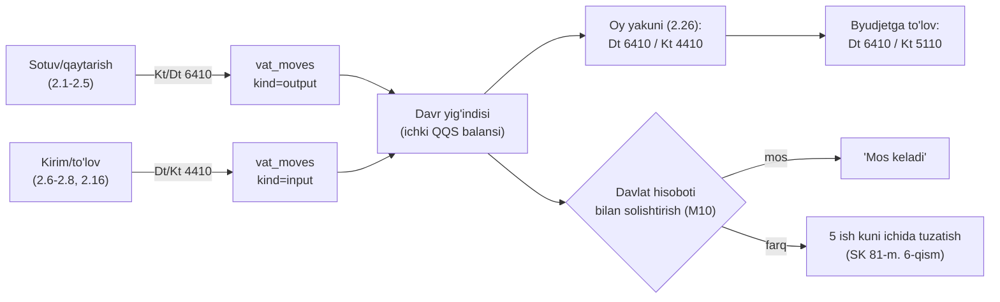
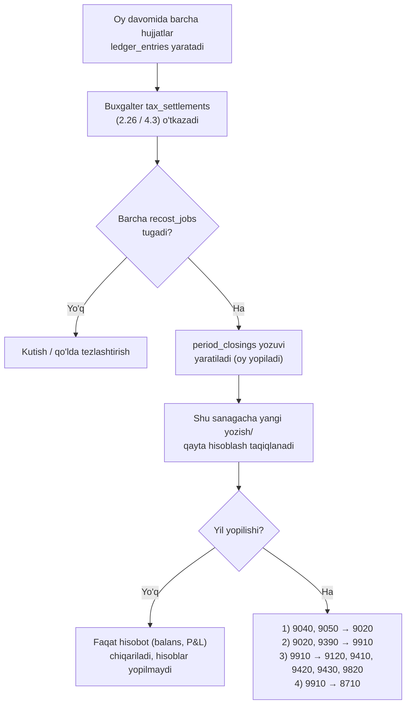

# Provodka qoidalari (NSBU №21, 2024/2025)

**Maqsad:** Har bir hujjat turi uchun buxgalteriya provodkasi (Dt/Kt), COGS (FIFO/AVECO), QQS/aylanma solig'i registri va davr yopish qoidalarini belgilash.
**Kim uchun:** Backend dasturchilar (posting xizmatlari), Buxgalter.
**Bog'liq fayllar:** `10-umumiy-arxitektura.md`, `11-malumotlar-modeli.md` (hujjatlar 6-bo'lim, registrlar 7-bo'lim), `12-db-sxema.md`, `03-modullar-talablari.md` (M04, M05, M07, M08, M10, M11, M15, M16), `04-biznes-jarayonlar.md` (BP-01…15), `research_notes/ochiq-savollar/P7-buxgalteriya.md`.
**Holat:** joriy, 2026-10-16.

> **Manba va tasdiq.** Hisob kodlari, nomlari va korrespondensiyalar BHMS №21 «Hisobvaraqlar rejasi va uni qo'llash bo'yicha yo'riqnoma» ning to'liq rasmiy matni ([lex.uz/docs/7282737](https://lex.uz/docs/7282737), 1-ilova — reja, 2-ilova — yo'riqnoma §1–436; joriy tahrir 16.03.2026, 282-son (24.09.2025) va 336-son (16.03.2026) buyruqlar o'zgartirishlari bilan) bo'yicha solishtirilgan. Xarajat tasnifi — VMQ-54 (Xarajatlar tarkibi to'g'risidagi Nizom, 05.04.2022 tahriri). Buxgalter yakuniy ko'rib chiqadi — bloklamaydi; tanlov talab qiladigan joylar tenant sozlamasi ortida (`tenants.settings`, `11-malumotlar-modeli.md` §2).

## Asosiy xulosalar

1. Hisob rejasi manbasi — **BHMS №21** (191-son buyruq, 14.11.2024, ro'yxat 3593; eski 2002-yilgi reja 2025-01-01'dan amal qilmaydi). MVP subsetidagi barcha kodlar rasmiy rejada bor (§1).
2. MVP buxgalteriyasi faqat **savdo/ombor/kassa/qarz/xarajat/soliq hisob-kitobi** operatsiyalarini avtomatlashtiradi — asosiy vositalar, ish haqi hisoblash (faqat to'lov, qaror #52), to'liq kapital harakati MVP'dan tashqarida.
3. Har hujjat o'tkazilganda **bitta tranzaksiyada** `ledger_entries` (Dt/Kt/summa/analitika) yoziladi; hujjat bekor qilinganda yangi, teskari (storno) yozuv qo'shiladi — hech qachon tahrirlanmaydi (`11-malumotlar-modeli.md`, 1-band).
4. Tannarx (COGS, 9120) **FIFO** yoki **AVECO** (tenant sozlamasi, US-M04-05) bo'yicha `stock_lots`dan hisoblanadi; o'tgan sanali hujjat kelsa — qayta hisoblash (`recost_jobs`), yopilgan davrga tegmaydi.
5. QQS (12% standart, 0%/imtiyozli) har sotuv/xaridda ajratiladi; ichki QQS yig'indisi (`vat_moves`) davlat tuzgan hisobot bilan **5 ish kuni** ichida, hisobot topshirish muddatidan kechiktirmay solishtiriladi (Soliq kodeksi 5-modda 7-qism, 81-modda 6–7-qism). Oy yakunida kiruvchi QQS chiquvchi QQS bilan hisobga olinadi — `Dt 6410 / Kt 4410` (§2.26). QQS to'lamaydigan biznes uchun **aylanma solig'i** (Soliq kodeksi 467-modda: umumiy 4%; chakana savdo — 100 ming+ aholili shaharda 4%, boshqa aholi punktida 2%, borish qiyin/tog'li tumanda 1%; tamaki 4%; YaTT va o'zini o'zi band qilganlar 1%), provodkasi `Dt 9430 / Kt 6410` (§4.3). **Ikkala rejim — teng darajada birinchi toifali** (qaror #32).
6. Oy yopish (`period_closings`) — shundan keyingi sanaga yozish/qayta hisoblash taqiqlanadi; yillik yopishda 9040/9050 → 9020, so'ng daromad/xarajat hisoblari 9910 ga, 9910 → 8710 (§5.1).
7. Ko'p filial: har `ledger_entry`da `branch_id` analitika; filiallararo ko'chirish **2970 (Yo'ldagi tovarlar)** oraliq hisobi orqali o'tadi. Tovar hisobi har ombor uchun sozlanadi: savdo zali — **2920**, ombor — **2910** (`warehouses.inventory_account`, pastda `inv_acct`).
8. Naqdsiz tushumlar (karta, UzQR, Click, Payme, Uzum) va inkassa avval **5710 (Yo'ldagi pul mablag'lari)** ga yoziladi; bank tushumi tasdig'i (`bank_settlements`, §2.18a) ularni 5110 ga o'tkazadi; bank/ekvayring komissiyasi — **9430**, inkassatsiya xizmati — **9410** (qaror #42; S1 §237–239, §410).
9. Qarzga sotuvda daromad (9020) va QQS (6410) **faqat sotuv kuni** tan olinadi (BHMS №2 16-band, Soliq kodeksi 242, 78-moddalar); fiskal chek esa to'lov kunida (qaror #30, #45) — provodka sanasi ≠ fiskal chek sanasi (§2.14).
10. Boshlang'ich qoldiqlar texnik yordamchi hisob **0000** bilan kiritiladi va barcha qoldiqlar kiritilgach u nolga teng bo'lishi shart (§2.13, §2.21, §5.5).

---

## 1. Hisoblar rejasi — MVP subset

Tur belgilari (S1 1-ilova): **A** — aktiv, **P** — passiv, **KA** — kontr-aktiv, **T** — tranzit (9000-guruh, yil oxirida yopiladi), **Texnik** — NSBU'dan tashqari yordamchi hisob. Manba: S1 = BHMS №21 rasmiy matni ([lex.uz/docs/7282737](https://lex.uz/docs/7282737)).

| Kod | Nomi (rasmiy) | Tur | Analitika (MVP) | Manba |
|---|---|---|---|---|
| 0000 | Boshlang'ich qoldiqlar (yordamchi) | Texnik | hujjat | NSBU'dan tashqari, 1C amaliyotidagi "000" analogi; barcha qoldiqlar kiritilgach nolga yopilishi shart (§5.5) |
| 2910 | Ombordagi tovarlar | A | ombor, mahsulot, partiya (lot) | S1 |
| 2920 | Chakana savdodagi tovarlar | A | ombor (savdo zali), mahsulot, partiya | S1 §146 |
| 2970 | Yo'ldagi tovarlar | A | jo'natuvchi/qabul qiluvchi filial, mahsulot, partiya | S1 §151 |
| 4010 | Xaridorlar va buyurtmachilardan olinadigan to'lovlar | A | kontragent, filial, hujjat (chek) | S1 |
| 4310 | Tovar-moddiy zaxiralar uchun mol yetkazib beruvchilar va pudratchilarga berilgan bo'naklar | A | kontragent | S1 (qaror #47) |
| 4410 | Byudjetga soliqlar va yig'imlar bo'yicha bo'nak to'lovlari (turlari bo'yicha) | A | soliq turi (QQS), hujjat | S1 §190–191 |
| 4730 | Moddiy zararni qoplash bo'yicha xodimlarning qarzi | A | xodim, hujjat | S1 §154, §223 |
| 4890 | Boshqa debitorlik qarzlar | A | kontragent (ta'sischi) | S1 §215 |
| 4910 | Shubhali qarzlar bo'yicha rezerv | KA | kontragent, hujjat | S1 §217–221 |
| 5010 | Milliy valyutadagi pul mablag'lari | A | kassa (`cash_register_id`), smena | S1 |
| 5110 | Hisob-kitob hisobvarag'i | A | bank hisobi | S1 |
| 5710 | Yo'ldagi pul mablag' (o'tkazma)lari | A (tranzit) | to'lov usuli (`payment_method`), filial, hujjat | S1 §237–239 (qaror #42) |
| 5910 | Kamomadlar va qiymatliklarning buzilishidan yo'qotishlar | A | hujjat | S1 §154, §247; aybdor aniqlangunga qadar ham ishlatiladi (BHMS №4 92-band) |
| 6010 | Mol yetkazib beruvchilar va pudratchilarga to'lovlar | P | kontragent, filial | S1 |
| 6310 | Xaridor va buyurtmachilardan olingan bo'naklar | P | kontragent | S1 |
| 6410 | Byudjetga to'lovlar bo'yicha qarzlar (turlari bo'yicha) | P | soliq turi (`tax_type`: QQS / aylanma solig'i / boshqa) | S1 §274–275, §378 |
| 6610 | To'lanadigan dividendlar | P | ta'sischi | S1 |
| 6710 | Ish haqi bo'yicha xodimlar bilan hisob-kitoblar | P | xodim | S1 — MVP'da ishlatilmaydi (qaror #52) |
| 8330 | Ulushlar va paylar (ustav kapitali) | P | ta'sischi | S1 — faqat boshlang'ich balansda (§5.5, `ledger_adjustments`) |
| 8530 | Tekinga olingan mulk | P | hujjat | S1 §154 |
| 8710 | Hisobot davrining taqsimlanmagan foydasi (qoplanmagan zarari) | P | — | S1 |
| 8720 | Jamg'arilgan foyda (qoplanmagan zarar) | P | — | S1 §364–365 |
| 9020 | Tovarlarni sotishdan daromadlar | T | mahsulot, filial, kontragent | S1 §378 |
| 9040 | Sotilgan tovarlar (mahsulotlar)ning qaytishi | T (kontr-passiv) | mahsulot, filial, hujjat | S1 §381 |
| 9050 | Xaridorlar va buyurtmachilarga berilgan chegirmalar | T (kontr-passiv) | hujjat | S1 §382–383 |
| 9120 | Sotilgan tovarlarning tannarxi | T | mahsulot, partiya, filial | S1 |
| 9390 | Boshqa operatsion daromadlar | T | hujjat, filial | S1 §154, §221, §405 |
| 9410 | Sotish xarajatlari | T | xarajat toifasi, filial | S1 §407; VMQ-54 2.1 |
| 9420 | Ma'muriy xarajatlar | T | xarajat toifasi, filial | S1 §409; VMQ-54 2.2 |
| 9430 | Boshqa operatsion xarajatlar | T | hujjat, filial, xarajat toifasi | S1 §410, §412; VMQ-54 2.3 |
| 9820 | Foydadan hisoblangan boshqa soliq majburiyatlari bo'yicha xarajatlar | T | soliq turi | S1 — faqat `turnover_tax_account='9820'` tanlansa (§4.3) |
| 9910 | Yakuniy moliyaviy natija (foyda yoki zarar) | T | davr | S1 |

Hisob kodlari ilova konstanta ro'yxatida saqlanadi (`ledger_entries.account_dt/account_kt` — 4 raqamli `TEXT`, `12-db-sxema.md` §2.7); yangi kod — append-only.

**Analitika o'lchamlari** (barcha `ledger_entries.analytics` JSONB ichida): `product_id`, `counterparty_id`, `branch_id`, `cash_register_id` (5010), `payment_method` (5710: `card`/`uzqr`/`click`/`payme`/`uzum`/`collection`), `warehouse_id` (tovar hisobi), `expense_category_id` (94xx), `tax_type` (4410/6410: `vat`/`turnover`/…), `employee_id` (4730).

**`inv_acct(warehouse)`** — omborning tovar hisobi: `warehouses.inventory_account` (`2910` yoki `2920`). Standart: `type='store'` (savdo zali) → **2920**, `type='stock'` (ombor) → **2910** (S1 §146). Quyidagi jadvallarda tovar hisobi har doim `inv_acct` deb yoziladi. Hisob omborda harakat bo'lgandan keyin o'zgartirilmaydi.

---

## 2. Har hujjat turi uchun Dt/Kt jadvallari

Umumiy qoida: narxga QQS **kiritilgan** holda saqlanadi (chek/faktura summasi). QQS ajratish formulasi: `QQS_summasi = Narx × stavka / (100 + stavka)` (12% uchun `× 12/112`); 0%/imtiyozli tovarda QQS = 0. Yaxlitlash — §5.3. Daromad (9020) QQSsiz yoziladi (BHMS №2 11-band).

### 2.1 Sotuv (chek) — naqd

| # | Dt | Kt | Summa | Analitika | QQS |
|---|---|---|---|---|---|
| 1 | 5010 | 9020 | Chek summasi − QQS (sof daromad) | mahsulot, filial, kassa | 12%: ajratilgan; 0%/imtiyozli: 0 |
| 2 | 5010 | 6410 | QQS summasi (qator-qator yaxlitlangan yig'indi) | tax_type=vat | — |
| 3 | 9120 | inv_acct | Sotilgan tovar tannarxi (FIFO/AVECO) | mahsulot, partiya, filial | — |

*Eslatma*: 1- va 2-qator bitta chek summasiga (5010 debiti) ikki kredit yozuvi sifatida birlashadi: `Dt 5010 = Kt 9020 + Kt 6410` (S1 §378).

### 2.1a Chegirmali chek (barcha sotuv turlari uchun)

QQS bazasi — chegirmadan **keyingi** narx (Soliq kodeksi 248-modda 2-qism). Tenant sozlamasi `discount_posting`: **`gross_9050`** (standart) yoki `net`.

`gross_9050` (S1 §382–383):

| # | Dt | Kt | Summa |
|---|---|---|---|
| 1 | 5010/5710/4010 | 9020 | Ro'yxat narxi − shu narxdagi QQS |
| 1a | 9050 | 5010/5710/4010 | `(list_total − list_vat) − (net_total − net_vat)` — ro'yxat narxidagi sof summa minus chegirmali sof summa (qatorlar yig'indisidan; 1-, 1a- va 2-qatorlar tiyingacha muvozanatlashadi) |
| 2 | 5010/5710/4010 | 6410 | QQS **chegirmali** summadan (qator-qator) |
| 3 | 9120 | inv_acct | Tannarx |

`net`: 1a-qator yo'q, 9020 = chegirmali sof summa. Ikkala variantda `Dt pul = to'langan summa`, `vat_moves.base_amount` = chegirmali baza.

**Misol** (`gross_9050`, naqd, 12%): ro'yxat narxi `"112000.00"`, chegirma 10% = `"11200.00"`, to'langan `"100800.00"`. Chegirmali QQS = 100 800 × 12/112 = `"10800.00"`. 1-qator: 112 000 − 12 000 = `Dt 5010 / Kt 9020 "100000.00"`; 1a-qator: (112 000 − 12 000) − (100 800 − 10 800) = `Dt 9050 / Kt 5010 "10000.00"`; 2-qator: `Dt 5010 / Kt 6410 "10800.00"`. Tekshiruv: 100 000 − 10 000 + 10 800 = 100 800 = kassaga tushgan.

**"2+1" va "N+M" aksiyalari** (`discount_rules.kind='n_plus_m'`, US-M03-02, MVP'dan keyin): tekin birlik emas — aksiya qatorlariga **taqsimlangan chegirma** (har birlik narxi × N/(N+M)), 1a-qator bilan 9050 ga; QQS bazasi haqiqatda to'langan summa. Import tovarida QQS bazasi import QQS bazasidan past bo'la olmaydi (Soliq kodeksi 248-modda 5-qism) — `customs_vat_base` bo'yicha tekshiruv MVP'dan keyin (sxemada yo'q).

### 2.2 Sotuv — karta / UzQR / Click / Payme / Uzum

Xuddi 2.1, lekin 1–2-qatorlarda `Dt 5010` o'rniga **`Dt 5710`** (analitika: `payment_method` = `card`/`uzqr`/`click`/`payme`/`uzum`, `provider_tx_id`; `rrn` — faqat integratsiyalangan terminal to'lovida (`card_entry_mode='integrated'`), terminalsiz karta to'lovida (`manual`) `rrn` yo'q) — pul ekvayer/to'lov tashkiloti hisob-kitobidan o'tib bankka keyinroq, komissiya ushlangan holda tushadi (S1 §237: "pul o'tkazish orqali mahsulot sotishdan olingan daromad"). 5110 ga o'tkazish — faqat bank tushumi tasdig'i (`bank_settlements`, 2.18a) bilan (qaror #42).

### 2.3 Sotuv — nasiya (qarzga, debt)

| # | Dt | Kt | Summa | Analitika |
|---|---|---|---|---|
| 1 | 4010 | 9020 | Sof daromad | kontragent, mahsulot, filial |
| 2 | 4010 | 6410 | QQS summasi | kontragent, tax_type=vat |
| 3 | 9120 | inv_acct | Tannarx | mahsulot, partiya |

Provodka sotuv `posted` bo'lgan kuni yoziladi (§2.14). Qo'shimcha: `debt_moves` registriga `direction=receivable, amount=+` yoziladi (buxgalteriya yozuvi bilan bir xil summa, bitta tranzaksiyada).

### 2.4 Sotuv — aralash to'lov (qisman naqd + qisman karta ± nasiya)

2.1–2.3 bilan bir xil, faqat 1–2-qatorlar `sale_payments` bo'yicha **har to'lov usuli uchun alohida qator** sifatida bo'linadi (masalan `Dt 5010 = 40 000` (naqd), `Dt 5710 = 30 000` (karta, qaror #42), `Dt 4010 = 30 000` (nasiya)), yig'indisi chek summasiga teng bo'lishi shart. QQS to'lov usullari bo'yicha bo'linadi: har to'lov `p` uchun `vat_p = ROUND_HALF_UP(vat_total × p.amount / total, 2)` (oxirgi to'lov — qoldiq, `vat_total − Σ oldingi vat_p`); `Dt acct(p) / Kt 9020 = p.amount − vat_p`, `Dt acct(p) / Kt 6410 = vat_p` (`acct`: `cash` → 5010, naqdsiz → 5710, `debt` → 4010). Tannarx qatori bitta (chek darajasida).

**Misol** (12%, chek `"100000.00"`, `vat_total` = 100 000 × 12/112 = `"10714.29"`): naqd 40 000 → `vat_p` = 10 714,29 × 0,4 = `"4285.72"`, `Dt 5010 / Kt 9020 "35714.28"`, `Dt 5010 / Kt 6410 "4285.72"`; karta 30 000 → `"3214.29"`, `Dt 5710 / Kt 9020 "26785.71"`, `Dt 5710 / Kt 6410 "3214.29"`; nasiya 30 000 (oxirgi) → 10 714,29 − 4 285,72 − 3 214,29 = `"3214.28"`, `Dt 4010 / Kt 9020 "26785.72"`, `Dt 4010 / Kt 6410 "3214.28"`. Tekshiruv: Kt 9020 = 89 285,71, Kt 6410 = 10 714,29, jami 100 000,00 = Dt yig'indisi.

### 2.5 Qaytarish (return)

| # | Dt | Kt | Summa | Analitika |
|---|---|---|---|---|
| 1 | 9040 | 5010/5710/4010 (`refund_method`ga qarab) | Sof summa (QQSsiz) | mahsulot, hujjat (asl chekka bog'liq) |
| 2 | 6410 | 5010/5710/4010 | QQS summasi | tax_type=vat |
| 3 | inv_acct | 9120 | Qaytarilgan tovar tannarxi (asl partiyaga qaytadi, §3.2a) | mahsulot, partiya |

Manba: S1 §381. **Kredit hisobi** `refund_method` bo'yicha: `cash` → `Kt 5010`; `card`/`uzqr`/`click`/`payme`/`uzum` → `Kt 5710` (`payment_method` = `refund_method`) — qaytarilgan summa ekvayer/to'lov tashkiloti hisob-kitobida tushumdan ushlanadi (qaror #42; Click/Payme/Uzum pulini qaytarish provayder kabinetida qo'lda, tizim qayd etadi); `debt_adjustment` → `Kt 4010`. **Qarzli sotuv qaytarilsa** avval shu sotuvning ochiq qarzi kamayadi: `debt_part = min(return_amount, open_debt_of_sale)` → `Kt 4010` (chek yo'q); qolgan `money_part = return_amount − debt_part` — `refund_method` bo'yicha pul bilan, faqat shu qismga `fiscal_receipts.kind='return'` cheki (`money_part = 0` bo'lsa chek yo'q). Qator qaytarish summasi (chegirmali qatorda ham): `refund_line = ROUND_HALF_UP(sale_line.line_total × ret_qty / sale_line.qty, 0)`, qatorning oxirgi qaytarilishi qoldiqni oladi (`line_total − Σ oldingi refund_line`).

**Muddati o'tgan tovar qaytarilsa** (qaror #48): qator `return_lines.restock=false` majburiy; 1–3-qatorlar o'zgarmaydi: `+qty` asl partiyaga va shu miqdor `stock_lots.blocked_qty` ga; FIFO/sotuv `qty_left − blocked_qty` dan; shu tranzaksiyada `write_offs` qoralamasi (`write_off_lines.reason='expired_return'`, `write_offs.source_return_id`) yaratiladi; `write_offs` (`expired_return`) `post`ida `blocked_qty` va `qty_left` kamayadi; provodka 2.12 bo'yicha `Dt 9430 / Kt inv_acct`.

### 2.6 Omborga kirim (goods_receipt) — QQS bilan, nasiyaga

| # | Dt | Kt | Summa | Analitika |
|---|---|---|---|---|
| 1 | inv_acct | 6010 | Tovar narxi (QQSsiz, yangi partiya) | mahsulot, yetkazib beruvchi, yangi `stock_lot` |
| 2 | 4410 | 6010 | QQS summasi (kiritiladigan) | tax_type=vat, yetkazib beruvchi |

Umumiy: `Kt 6010` = faktura summasi (QQS bilan) = 1+2-qatorlar yig'indisi (S1 §191 1-qator). Aylanma solig'i rejimidagi tenantda (`regime='turnover'`) — §4.3 qoidasi: 1-qator QQS bilan, 2-qator yozilmaydi.

**Yetkazib beruvchida avans bo'lsa** (6010 qarzi manfiy — 4310 qoldig'i, §2.16): shu tranzaksiyada `Dt 6010 / Kt 4310 = min(avans qoldig'i, faktura summasi)` (qaror #47).

**Yetkazib beruvchining bir fakturadagi "bonus" birliklari** — tekin olish emas, narx chegirmasi: partiya tannarxi = faktura summasi / umumiy miqdor (BHMS №4); provodka shu 2.6.

### 2.6a Tekin olingan tovar (`goods_receipts.kind='gratuitous'`)

| # | Dt | Kt | Summa |
|---|---|---|---|
| 1 | inv_acct | 8530 | Bozor qiymati (kirim qatori `cost`) |

S1 §154 6-qator. QQS va `vat_moves` yo'q, kreditorlik ochilmaydi (`paid_immediately=false`, `debt_moves` yozilmaydi). Soliqda — daromad (Soliq kodeksi 299-modda; aylanma solig'i to'lovchida jami daromadga kiradi, 463-modda).

### 2.7 Omborga kirim — QQSsiz (0%/imtiyozli tovar yoki QQS to'lamaydigan yetkazib beruvchi)

| # | Dt | Kt | Summa |
|---|---|---|---|
| 1 | inv_acct | 6010 | To'liq faktura summasi |

### 2.8 Omborga kirim — darhol naqd/bank to'langan (nasiyasiz)

2.6/2.7 bilan bir xil, faqat `Kt 6010` o'rniga `Kt 5010` yoki `Kt 5110` to'g'ridan-to'g'ri (kreditorlik ochilmaydi).

**"Qizil" e-faktura qoidasi** (VM Qarori №830): faktura `einvoices.risk_flag` = `red` **yoki `unknown`** bo'lsa (operator xavf darajasini qaytarmagan — Buxgalter BO-15'da qo'lda belgilaguncha qizil kabi), 2-qator (`Dt 4410`) **to'lov amalga oshirilgunga qadar yozilmaydi** — QQS krediti faqat `supplier_payment` o'tkazilganda (2.16) qo'shiladi (US-M07-04, US-M10-03). `vat_moves(kind=input)` ham shu paytgacha yozilmaydi (4.1). Buxgalter kabinetda tekshirib `PATCH /einvoices/{id}/risk-flag` bilan `green` belgilasa — bog'langan `posted` kirimlarning hali yozilmagan QQS qismi shu tranzaksiyada `Dt 4410 / Kt 6010` va `vat_moves(kind=input)` bilan yoziladi; `green` → `red` o'zgarishi yozilgan QQS'ni avtomatik qaytarmaydi (Buxgalter `ledger_adjustments` bilan tuzatadi). `green` belgilashdagi `Dt 4410 / Kt 6010` yozuvi: `doc_type='goods_receipts'`, `doc_id` = bog'langan kirim, `entry_date` = belgilash kuni (joriy ochiq davr).

### 2.9 Ko'chirish — jo'natish (filiallararo)

| # | Dt | Kt | Summa | Analitika |
|---|---|---|---|---|
| 1 | 2970 | inv_acct (jo'natuvchi ombor) | Tannarx | mahsulot, partiya, jo'natuvchi filial |

### 2.10 Ko'chirish — qabul qilish

| # | Dt | Kt | Summa | Analitika |
|---|---|---|---|---|
| 1 | inv_acct (qabul qiluvchi ombor) | 2970 | Tannarx (partiya saqlanadi) | mahsulot, partiya, qabul qiluvchi filial |
| 2 (farq bo'lsa) | 5910 | 2970 | Yo'qotilgan/kam kelgan qism | hujjat |

5910 keyinroq rahbar qarori bilan yopiladi: aybdor aniqlansa `Dt 4730 / Kt 5910`, aks holda `Dt 9430 / Kt 5910` (`ledger_adjustments`, 2.23; S1 §247, §249).

### 2.11 Inventarizatsiya — kamomad / ortiqcha

Farq `counted − expected` har `count_lines` qatori uchun `post` paytida hisoblanadi; `expected` formulasi — X-02 (qaror #53).

| Holat | Dt | Kt | Summa | Manba |
|---|---|---|---|---|
| Kamomad, javobgar shaxs ko'rsatilgan (`stock_counts.responsible_user_id`) | 4730 | inv_acct | Balans tannarxi (FIFO/AVECO) | S1 §154 14-qator; analitika `employee_id` |
| Kamomad, javobgar shaxs ko'rsatilmagan | 5910 | inv_acct | Balans tannarxi | S1 §154 11-qator; BHMS №4 92-band |
| 5910 ni yopish (keyinroq, rahbar qarori) | 9430 **yoki** 4730 | 5910 | Qaror summasi | S1 §247, §249; `ledger_adjustments` (2.23) |
| Ortiqcha | inv_acct | **9390** | Joriy qiymat: mahsulotning oxirgi kirim narxi (`last_purchase_cost` — eng so'nggi `goods_receipts` partiyasi `stock_lots.unit_cost`), yo'q bo'lsa `avg_costs.avg_cost` (BHMS №4 32-band "aniqlangan sanadagi joriy qiymat") | S1 §154 7-qator, §405 14-qator |

Ortiqcha yangi partiya (`stock_lots`, `source_doc_type='stock_counts'`) sifatida shu qiymatda kirim qilinadi. Tabiiy kamayish me'yorlari MVP'da kuzatilmaydi — barcha kamomad me'yordan ortiq deb hisoblanadi.

### 2.12 Hisobdan chiqarish (write-off)

| `write_off_lines.reason` | Dt | Kt | Summa |
|---|---|---|---|
| `expired`, `damaged`, `expired_return` (qaror #48), `other` — javobgar shaxs yo'q | 9430 | inv_acct | Tannarx |
| shu sabablar — `write_offs.responsible_user_id` ko'rsatilgan | 4730 | inv_acct | Tannarx |
| `gift`, `gift_kind='promo_justified'` (reklama aksiyasi, buyruq bilan — `write_offs.promo_order_ref` majburiy) | 9410 | inv_acct | Tannarx; QQS obyekti emas (Soliq kodeksi 239-modda 1-qism 2-band, 3-qism; VMQ-54 2.1.2.8) |
| `gift`, `gift_kind='other'` (standart) | 9430 | inv_acct | Tannarx (S1 §141 16-qator) |
| — shu qatorga qo'shimcha | 9430 | 6410 | QQS = bozor qiymati (QQSsiz) × stavka / 100 (Soliq kodeksi 248-modda 3-qism 2-band); bozor qiymati — joriy chakana narx QQSsiz; `vat_moves(kind=output, base_amount=bozor qiymati)` |

`gift_kind` standarti `other` — QQS bilan, eng xavfsiz; `promo_justified` faqat buyruq raqami bilan. Aylanma solig'i rejimidagi tenantda sovg'a QQS qatori (`Dt 9430 / Kt 6410`) va `vat_moves` yozilmaydi (§4.3). Soliq kodeksi 239-moddaning 12.12.2026 dan kuchga kiradigan tahriri ("iqtisodiy asoslangan" shartlari) shu qoidaga qayta solishtiriladi.

### 2.13 Boshlang'ich qarz balansi (debt_openings)

| Yo'nalish | Dt | Kt | Summa |
|---|---|---|---|
| Mijoz bizga qarzdor (receivable) | 4010 | **0000** | Boshlang'ich summa |
| Biz yetkazib beruvchiga qarzdor (payable) | **0000** | 6010 | Boshlang'ich summa |

Tovar tarkibisiz, chek chiqarilmaydi (US-M08-07). `entry_date` = `tenants.go_live_date − 1 kun` (avvalgi davrning oxirgi kuni). 0000 ni yopish — §5.5.

### 2.14 Qarz to'lovi (debt_payment, mijozdan)

| # | Dt | Kt | Summa |
|---|---|---|---|
| 1 | 5010 (`cash`) / 5710 (`card`/`uzqr`/`click`/`payme`/`uzum`, qaror #42) / 5110 (`bank`) | 4010 | To'langan summaning `target_doc_type` `sales`/`debt_openings` allokatsiyalariga tushgan qismi (`debt_payment_allocations`) |
| 1a (allokatsiya `target_doc_type='debt_writeoffs'` — hisobdan chiqarilgan qarz qaytdi) | 5010/5710/5110 | **9390** | Shu allokatsiya summasi (S1 §405 11-qator); `debt_moves` yozilmaydi (qarz qayta ochilmaydi) |
| 1b (offline ortiqcha qism, `debt_payments.unallocated_amount > 0`) | 5010/5710 | **6310** | `unallocated_amount` — olingan bo'nak, analitika `counterparty_id` (qaror #67) |

**Allokatsiya tartibi** (server va qurilmada yagona funksiya): avval `sales` va `debt_openings` ochiq qoldiqlari `ORDER BY COALESCE(due_date, doc_date), doc_date, doc_id`; keyin `debt_writeoffs` (eng eskisi birinchi) — 1a-qator. Server registrlarni (`debt_payment_allocations`, `debt_moves`, `sale_lines.settled_amount`) DB holatidan qayta hisoblangan allokatsiya bo'yicha yozadi; qurilma allokatsiyasidan farq bo'lsa voqea rad etilmaydi — `sync_exceptions(kind='debt_allocation_mismatch')`.

**Chegara**: `amount ≤ receivable_balance + Σ written_off_open` (online/REST; oshsa `422 VALIDATION_ERROR`, `message_key=debt_payment_exceeds_balance`, qaytim naqd beriladi — qaror #45). Offline (`is_offline=true`) voqeada FM chekni allaqachon imzolagan — ortiqcha summa qabul qilinadi: chegaragacha allokatsiya, qolgani `debt_payments.unallocated_amount` → 1b-qator, `sync_exceptions(kind='debt_overpayment_offline')`, Egasiga xabar. Hal qilish (Buxgalter/Egasi): (a) qaytarish — `cash_movements` `reason='other'`, `direction='out'`, `account='6310'`, `counterparty_id` (2.18 → `Dt 6310 / Kt 5010`); (b) keyingi qarzga hisoblash — `ledger_adjustments` `Dt 6310 / Kt 4010` (`analytics.counterparty_id`).

**Misol** (offline, naqd): mijoz qarzi `"300000.00"` (hisobdan chiqarilgan qarz yo'q), offline to'lov `"350000.00"` → `Dt 5010 / Kt 4010 "300000.00"`, `Dt 5010 / Kt 6310 "50000.00"`; `unallocated_amount = "50000.00"`. Keyingi qarzga hisoblansa: `Dt 6310 / Kt 4010 "50000.00"`.

**`method='bank'`** — kassasiz, fiskal chek yo'q (`cash_register_id`, `shift_id`, `receipt_seq` NULL), faqat back-office (qaror #67). Qolgan usullar — faqat POS kassasi orqali, chek bilan.

**Daromad/QQS tan olish vaqti**: qarzga sotuvda daromad (9020) va QQS (6410) **sotuv (jo'natish) kuni** tan olinadi — provodka (2.3) sotuv `posted` bo'lgan kuni yoziladi. Asos: BHMS №2 16-band (xatar va afzalliklar o'tganda), Soliq kodeksi 242-modda 1-qism (tovar jo'natilgan sana), 78-modda (hisoblash usuli), 239-modda 1-qism 4-band (bo'lib to'lash ham realizatsiya), 463 + 297-moddalar (aylanma solig'i). To'lov kunida faqat pul harakati (1-qator) va fiskal chek. Provodka sanasi ≠ fiskal chek sanasi.

**Fiskal chek (qaror #30, #45)**: qarzga sotuvda (`sale_payments.method='debt'`) to'lov fiskal cheki sotuv vaqtida chiqarilmaydi (`fiscal.status="deferred"`). **Har bir kassa orqali qarz to'lovida** (`debt_payments.method ≠ 'bank'`) to'langan summaga **bitta** fiskal chek chiqariladi — `fiscal_receipts.kind='debt_settlement'`, summasi = olingan pul, tovar qatorlari to'lov yopgan barcha sotuvlardan **proporsional** (`FiscalPolicy.debt_receipt_split`: `single` standart / `per_sale`; qator summasi/miqdori/QQS formulasi va yaxlitlash — `18-api-kassa.md` §12.2); server posting'da `sale_lines.settled_amount` kumulyativ yangilanadi. Bank o'tkazmasi orqali qarz to'lovida chek yo'q. Qarz to'lovidagi chek VMQ-943 1-ilova 30-band bo'yicha majburiy. Aralash to'lov (qisman naqd/karta + qisman qarz) — naqd/karta qismiga **darhol** `kind='sale'` chek, qarz qismiga to'langanda `debt_settlement` chek (`18-api-kassa.md` §4.5/§12.2). VMQ-943 1-ilova 7-band "kredit" to'lov turidagi chekni (QR-kod va fiskal belgisiz) nazarda tutadi — `FiscalPolicy.credit_sale_receipt`: `none` (standart) / `credit_type` (sotuv paytida `fiscal_receipts.kind='credit_sale'`). Bu sozlamalar faqat fiskal chekni boshqaradi, provodka va QQS vaqtini emas.

### 2.15 Qarzni kechish (debt_writeoff)

| # | Dt | Kt | Summa | Shart |
|---|---|---|---|---|
| 1a | 9430 | 4010 | Kechirilgan summa | `account_choice='9430'` (standart) — to'g'ridan-to'g'ri hisobdan chiqarish (VMQ-54 2.3.15.7, BHMS №2 17-band) |
| 1b | 4910 | 4010 | Kechirilgan summa | `account_choice='4910'`; server tekshiradi: shu kontragent bo'yicha 4910 qoldig'i ≥ summa (S1 §219, §221) |

Faqat Egasi tasdig'i bilan (US-M08-10), audit jurnaliga yoziladi. **Bosqichlar farqi**: (1) `debt_doubtful_flags` (`11-malumotlar-modeli.md` §5) — faqat Egasi, sabab bilan, qarzni "shubhali" deb **belgilaydi**; provodka yaratmaydi (BO-07, 60+ kunlik qarzlar eslatmasi — tizim avtomatik belgilamaydi). (2) `debt_writeoffs` — qarzni haqiqatan **hisobdan chiqarish**, yuqoridagi provodka bilan. `debt_writeoffs.tax_writeoff_basis` (`court`/`bankruptcy`/`liquidation`/`death`/`limitation`/`none`) — Buxgalter belgilaydi: foyda solig'ida umidsiz qarz faqat Soliq kodeksi 313-modda shartlarida chegiriladi, QQS bazasi tuzatishi — 257-modda 3-qism; aylanma solig'i bazasini kamaytirmaydi (466-modda). Kodda faqat hisobotga chiqadi. Hisobdan chiqarilgan qarz bo'yicha keyingi to'lov — 2.14 1a-qatori. MVP'da bitta va'da sanasi — bo'lib to'lash grafigi yo'q.

### 2.15a Shubhali qarz rezervi (yil oxiri, qo'lda)

| # | Dt | Kt | Summa |
|---|---|---|---|
| 1 | 9430 | 4910 | Buxgalter bahosi, har kontragent/hujjat bo'yicha alohida (`analytics.counterparty_id`, `doc_id`) |
| 2 (keyingi yil oxirigacha ishlatilmagan qism) | 4910 | 9390 | Qoldiq |

S1 §217–221: rezerv **hisobot yili oxirida**, debitorlik qarzlari inventarizatsiyasi asosida, har shubhali qarz bo'yicha alohida tuziladi. MVP'da `ledger_adjustments` (2.23, `analytics` bilan) orqali bajariladi. Foyda solig'ida rezerv chegirilmaydi (Soliq kodeksi 315-modda — faqat banklar, NBKT, sug'urtachilar).

### 2.16 Yetkazib beruvchiga to'lov (supplier_payment)

| # | Dt | Kt | Summa |
|---|---|---|---|
| 1 | 6010 | 5010/5110 | Kreditorlik qarzi doirasidagi qism (`supplier_payment_allocations`) |
| 2 (qarzdan ortiq qism) | **4310** | 5010/5110 | `amount − to'lov paytidagi kreditorlik qoldig'i` |

Qarzdan ortiq to'lov ogohlantirish bilan **ruxsat**, ortig'i avans 4310 (qaror #47); `tenants.settings.supplier_overpay_policy='block'` bo'lsa `422 SUPPLIER_OVERPAY_BLOCKED`. `debt_moves(direction=payable)` to'liq `−amount` bilan yoziladi — manfiy payable balans = avans; keyingi kirimda `Dt 6010 / Kt 4310` bilan hisobga olinadi (2.6).

Agar faktura "qizil"/`unknown` bo'lsa — shu tranzaksiyada 2.8'dagi kechiktirilgan `Dt 4410 / Kt 6010` QQS yozuvi ham yoziladi (QQS krediti shu paytda ochiladi). Qisman to'lovda QQS krediti allokatsiya summasiga proporsional ochiladi: `vat_i = ROUND_HALF_UP(invoice_vat × alloc_i / invoice_total, 2)`, faktura bo'yicha yopuvchi to'lov qoldiqni oladi (`invoice_vat − Σ oldingi vat_i`); bir vaqtda `vat_moves(kind=input)` yoziladi. Avans qismiga QQS krediti ochilmaydi.

**Misol** (avans): kreditorlik `"800000.00"`, to'lov `"1000000.00"` bankdan → `Dt 6010 / Kt 5110 "800000.00"`, `Dt 4310 / Kt 5110 "200000.00"`; payable balans `"-200000.00"`. Keyingi kirim `"500000.00"` (QQSsiz, 2.7) → `Dt inv_acct / Kt 6010 "500000.00"` va `Dt 6010 / Kt 4310 "200000.00"`; payable balans `"300000.00"`, 4310 qoldig'i `"0.00"`.

### 2.17 Xarajat (expense)

| Manba (`expenses.source`) | Dt | Kt | Summa |
|---|---|---|---|
| `cash` (kassa naqdi) | `expense_categories.default_account` | 5010 | Xarajat summasi |
| `bank` | `default_account` | 5110 | Xarajat summasi |
| `card` (tenantning korporativ kartasi) | `default_account` | 5110 | Xarajat summasi — chiquvchi to'lov bank hisobidan (5710 faqat kiruvchi tushum uchun, qaror #42) |

*Kassa naqdi*: `ExpensePostingService` shu tranzaksiyada `cash_moves(−, doc_type='expenses', cash_register_id, shift_id)` ham yozadi; `cash_movements` hujjati yaratilmaydi.

**Toifa → hisob seed xaritasi** (`expense_categories(code, default_account, source_ref)`, tenant o'zgartira oladi; `12-db-sxema.md` §5.2):

| `code` | Toifa | Hisob | Asos |
|---|---|---|---|
| `rent_store` | Ijara — savdo zali/do'kon/ombor | 9410 | VMQ-54 2.1.2.3 |
| `rent_office` | Ijara — ofis | 9420 | VMQ-54 2.2.8; S1 §409, §412 7-qator |
| `utilities_store` | Kommunal (elektr, gaz, yoqilg'i) — do'kon | 9410 | VMQ-54 2.1.2.6 |
| `utilities_office` | Kommunal — ofis | 9420 | VMQ-54 2.2.4 |
| `communication` | Aloqa, internet, telefon | 9420 | VMQ-54 2.2.6, 2.2.7 |
| `transport_delivery` | Transport — tovar tashish/yetkazish | 9410 | VMQ-54 2.1.1; S1 §407, §412 1-qator |
| `transport_admin` | Transport — xizmat avtomobili | 9420 | VMQ-54 2.2.3 |
| `payroll_sales` | Ish haqi — sotuvchi/kassir/omborchi | 9410 | VMQ-54 2.1.2.1 |
| `payroll_admin` | Ish haqi — boshqaruv (direktor, buxgalter) | 9420 | VMQ-54 2.2.1; S1 §412 5-qator |
| `advertising` | Reklama, marketing | 9410 | VMQ-54 2.1.2.8, 2.1.3; S1 §412 2-qator |
| `repair_store` | Ta'mirlash — savdo binosi/jihozlari | 9410 | VMQ-54 2.1.2.3 |
| `repair_admin` | Ta'mirlash — ma'muriy | 9420 | VMQ-54 2.2.9 |
| `packaging` | Tara, qadoqlash | 9410 | VMQ-54 2.1.2.10 |
| `supplies` | Inventar, xo'jalik buyumlari | 9410 | VMQ-54 2.1.2.5 |
| `bank_services` | Bank xizmatlari (hisob raqam xizmati, RKO) | 9430 | S1 §410, §412 12-qator; VMQ-54 2.3.12 |
| `collection_service` | Inkassatsiya xizmati | 9410 | VMQ-54 2.1.2.18 |
| `period_taxes` | Davr xarajatiga taalluqli soliq/yig'imlar | 9430 | S1 §275 1-qator |
| `fines` | Jarimalar, penyalar | 9430 | S1 §412 16, 21-qatorlar; VMQ-54 2.3.15 |
| `audit_consulting` | Audit, maslahat, o'qitish | 9430 | S1 §410 |
| `tax_payment` | Soliq to'lovi (byudjetga) | **6410** | S1 §275 7-qator — xarajat emas, majburiyatni yopadi; `expenses.tax_type` majburiy (§2.26) |
| `other` | Boshqa | 9430 | S1 §410 |

**Ish haqi** (qaror #52): to'lov kuni to'g'ridan-to'g'ri `Dt 9410|9420 / Kt 5010|5110` (`payroll_sales`/`payroll_admin`); 6710 orqali ikki bosqichli yozuv va INPS/JShDS ushlanmalari — ish haqi moduli bilan (MVP'dan keyin), hozir buxgalter/1C'da.

### 2.18 Kassa pul harakati (cash_movement, M16)

| `reason` | Dt | Kt | Izoh |
|---|---|---|---|
| `collection` (inkasso) | 5710 | 5010 | S1 §239 1-qator; `payment_method='collection'`; bankka tushgani `bank_settlements` (2.18a) bilan `Dt 5110 / Kt 5710` (qaror #42) |
| `deposit` (bankdan/maydalash puli) | 5010 | 5110 | — |
| `owner_withdrawal` — `tenants.legal_form ∈ {llc, jsc, private_enterprise}` | **4890** | 5010 | analitika `counterparty_id` = ta'sischi (`counterparties.is_founder`); dividend e'lon qilinsa `Dt 6610 / Kt 4890` (`ledger_adjustments`); XK egasiga to'lov dividendga tenglashtiriladi (Soliq kodeksi 41-modda 4-qism) |
| `owner_withdrawal` — `legal_form = sole_proprietor` (YaTT) | 8720 | 5010 | Boshqaruv hisobi — YaTT buxgalteriya hisobi subyekti emas («Buxgalteriya hisobi to'g'risida»gi Qonun 6-modda) |
| `other` (`direction='out'`) | `account` (standart **9430**) | 5010 | Masalan, mijozga ortiqcha to'lovni qaytarish (`account='6310'`, 2.14) |
| `other` (`direction='in'`) | 5010 | `account` (standart **9390**) | — |

`other` uchun `account` ∈ `9430`, `9390`, `6310`, `4010`, `4730` (Buxgalter/Egasi tanlaydi); `6310`/`4010` da `counterparty_id`, `4730` da `employee_id` majburiy. `reason↔direction` juftligi: `collection`/`owner_withdrawal` → faqat `out`; `deposit` → faqat `in`; `other` → ikkalasi (buzilsa `422 VALIDATION_ERROR`).

`tenants.settings.owner_withdrawal_account` standarti `legal_form` qoidasidan olinadi (`4890` yoki `8720`), Egasi BO-14 da o'zgartiradi (`settings.tenant`). Kassadan to'langan xarajat — M16 hujjati emas, M15 `expenses` (source=`cash`, 2.17). Kassa pul harakati fiskal hujjat emas, OFD'ga yuborilmaydi (VMQ-943 2-ilova 11-band).

### 2.18a Bank tushumi tasdig'i (`bank_settlements`) (qaror #42)

5710 dagi tranzit summani bank hisobiga (5110) o'tkazuvchi **yagona** hujjat. Trigger — Buxgalter (yoki Egasi) bank ko'chirmasi / ekvayer hisob-kitob hisobotini olganda back-office'da yaratadi va `post` qiladi (`source='manual'`); `source='statement_import'` — bank ko'chirmasi fayli (1CClientBankExchange) importidan `draft` holatida yaratilgan, Buxgalter tekshirib `post` qiladi. Bitta hujjat — bitta to'lov usuli (`method`: `card`/`uzqr`/`click`/`payme`/`uzum`/`collection`) va bitta bank tushumi (bir nechta kunlik tushumni qamrashi mumkin — `settled_from`…`settled_to`).

| # | Dt | Kt | Summa | Analitika |
|---|---|---|---|---|
| 1 | 5110 | 5710 | `net_amount` = `gross_amount − commission_amount + variance_amount` (bankka haqiqatda tushgan; DDL'da generated ustun, `> 0` CHECK) | `payment_method`, filial, `bank_ref` |
| 2 (`commission_amount > 0`) | `commission_account(method)` | 5710 | `commission_amount` | `payment_method`, filial |
| 3 (`variance_amount < 0`, faqat `collection`) | 5910 | 5710 | `|variance_amount|` — inkassa kamomadi; keyin `Dt 4730 / Kt 5910` (aybdor) yoki `Dt 9430 / Kt 5910` | hujjat |
| 4 (`variance_amount > 0`, faqat `collection`) | 5710 | 9390 | `variance_amount` — inkassa ortiqchasi | hujjat |

`commission_account(method)`: `card`, `uzqr` → **9430** (bank va ekvayring xizmati, S1 §410, §412 12-qator; VMQ-54 2.3.12); `click`/`payme`/`uzum` → `tenants.settings.payment_org_commission_account` (standart **9430**; `9410` ni Egasi BO-14 da tanlaydi (`settings.tenant`) — VMQ-54 2.1.2.18); `collection` → **9410** (inkassatsiya, VMQ-54 2.1.2.18). Provayder komissiyasiga QQS bo'lsa (provayder QQS bilan e-faktura bersa) — MVP'da hisobga olinmaydi, komissiya QQSsiz.

- `Kt 5710` jami (minus 4-qator `Dt 5710`) = `gross_amount`; server `gross_amount` shu filial va `payment_method` bo'yicha `doc_date` holatidagi 5710 qoldig'idan oshmasligini tekshiradi (oshsa `422 VALIDATION_ERROR`). Tranzit qoldiqlari — `GET /bank-settlements/transit-balances`.
- `cash_moves` yozilmaydi — pul harakati sotuv/qarz to'lovi/inkassa paytida allaqachon `cash_moves`da qayd etilgan; 5710 → 5110 o'tkazmasi faqat `ledger_entries`da.
- `cancel` — storno qatorlar (5.2); yopilgan davrga tegmaydi (5.1).
- **Integratsiyalangan terminal settlement'i bilan solishtirish (qaror #71)** — provodka qoidasi o'zgarmaydi (karta tushumi `Dt 5710`, bankka o'tkazish `Dt 5110 / Kt 5710`, ekvayring komissiyasi `Dt 9430 / Kt 5710`); faqat `gross_amount`ni tanlash avtomatlashadi:
  - smena yopilishida terminal settlement'i («сверка итогов») `card_terminal_settlements`ga yoziladi: terminal jami (`purchase_total − refund_total`) bizning `approved` integrated tranzaksiyalarimiz jami (`expected_total`) bilan solishtiriladi; farq bo'lsa `status='mismatch'` va BO-14 ogohlantirishi (provodka yo'q — hisob har doim `sale_payments`/`returns`/`debt_payments` bo'yicha);
  - `bank_settlements(method='card')` yaratishda (BO-24, qo'lda yoki ko'chirma importidan) server shu filialning `bank_settlement_id IS NULL` settlement partiyalarini taklif qiladi: ko'chirma qatori ekvayer reestrini (RRN ro'yxati) bersa — `card_terminal_transactions.rrn` bo'yicha, bermasa — TID (`card_terminals.tid`) + `business_date` + partiya jami bo'yicha moslashtiriladi; tanlangan partiyalar `net_total` yig'indisi `gross_amount` sifatida taklif qilinadi, bank tushgan summa bilan farqi `commission_amount` (9430);
  - `post`da tanlangan partiyalarga `bank_settlement_id` yoziladi (`cancel`da tozalanadi); moslashtirilmagan qolgan 5710 (`card`) qoldig'i — terminalsiz (rekvizitsiz, `card_entry_mode='manual'`) karta to'lovlari va qaytarishlari: ularda `rrn`/`card_mask` yo'q, shuning uchun ular hech qachon RRN bo'yicha moslashtirilmaydi — faqat summa va sana (`business_date`) bo'yicha, ko'chirmadagi filial/merchant (MID) ma'lumoti bilan yopiladi.

**Misol** (karta, 1 kun): kun davomida karta bilan `"1000000.00"` sotuv (`Dt 5710 / Kt 9020 + Kt 6410`), `"50000.00"` kartaga qaytarish (`Dt 9040 + Dt 6410 / Kt 5710`) → 5710 (`card`) qoldig'i `"950000.00"`. Ertasi kuni bank ko'chirmasida ekvayerdan `"940500.00"` tushdi (komissiya 1% = `"9500.00"`). `bank_settlements(method='card', gross_amount="950000.00", commission_amount="9500.00", variance_amount="0.00")` → `Dt 5110 / Kt 5710 = "940500.00"`, `Dt 9430 / Kt 5710 = "9500.00"`; 5710 (`card`) qoldig'i `"0.00"`.

### 2.19 Smena ochilishi/yopilishi (shift)

Smena ochilishi provodka yaratmaydi — boshlang'ich naqd `shifts.opening_cash`da qayd etiladi. Smena yopilganda aniqlangan farq (`shifts.variance`, US-M16-02):

| Holat | Dt | Kt | Summa | Manba |
|---|---|---|---|---|
| Kamomad (`variance < 0`) | 4730 | 5010 | `|variance|`, analitika `employee_id` = smena kassiri | S1 §223 20-qator, §206 10-qator |
| Ortiqcha (`variance > 0`) | 5010 | 9390 | `variance` | S1 §404 |
| Kamomad kechirilsa (keyinroq, rahbar qarori) | 9430 | 4730 | Kechirilgan summa | `ledger_adjustments` (2.23) |

Soliq oqibatlari (kechirilgan summa — xodim daromadi; ortiqcha — aylanma solig'i bazasiga kiradi) — Buxgalter vazifasi.

### 2.20 Yetkazib beruvchiga qaytarish (`supplier_return`)

`invoice` = qty × asl kirim qatori `cost` (yetkazib beruvchi bilan hisob-kitob summasi), `book` = qaytarilayotgan tovarning balans tannarxi (FIFO — asl partiya tannarxi, `invoice` ga teng; AVECO — qty × joriy `avg_cost`).

| # | Dt | Kt | Summa | Analitika |
|---|---|---|---|---|
| 1 | 6010 | inv_acct | `min(invoice, book)` | yetkazib beruvchi, mahsulot, partiya |
| 2 | 6010 | 4410 | Shu qismga to'g'ri keladigan kiritiladigan QQS (asl kirim QQS bilan bo'lsa) | tax_type=vat, yetkazib beruvchi |
| 3a (`invoice > book`, faqat AVECO) | 6010 | 9390 | `invoice − book` | hujjat |
| 3b (`invoice < book`, faqat AVECO) | 9430 | inv_acct | `book − invoice` | hujjat |

Tekshiruv: `Dt 6010` (QQSsiz qism) = `invoice`, `Kt inv_acct` = `book`. Kirim allaqachon to'langan bo'lsa, 6010 debet qoldig'i hosil bo'ladi; pul qaytarilganda `Dt 5010/5110 / Kt 6010`.

**QQS kamaytirish vaqti**: 2-qator va `vat_moves(kind=input)` (manfiy) qaytarish o'tkazilganda emas, yetkazib beruvchining **qo'shimcha (salbiy) e-fakturasi qabul qilinganda** yoziladi (alohida voqea `supplier_return.vat_adjusted`, `einvoices(direction=in, factura_type='additional', related_einvoice_id=asl EHF)`; Soliq kodeksi 257, 269-moddalar; VM 489 40-band). Asl faktura "qizil"/`unknown` va QQS hali yozilmagan bo'lsa (2.8), 2-qator yozilmaydi. Asl kirimdan 12 oy o'tgan (kafolatli tovarda — kafolat muddati o'tgan) yoki shartnomada qaytarish asosi yo'q bo'lsa — 2.20 o'rniga **teskari realizatsiya**: do'konning yetkazib beruvchiga sotuvi (2.1 shaklida `Dt 4010 / Kt 9020 + Kt 6410`, tannarx `Dt 9120 / Kt inv_acct`), chiquvchi EHF bilan, Buxgalter tasdig'i bilan.

### 2.21 Boshlang'ich tovar qoldig'i (`stock_openings`)

| # | Dt | Kt | Summa |
|---|---|---|---|
| 1 | inv_acct | **0000** | Kiritilgan tannarx (yangi partiya) |

QQS yozilmaydi. `entry_date` = `tenants.go_live_date − 1 kun`. 0000 ni yopish — §5.5.

### 2.22 Chek asosida keyinroq chiquvchi e-faktura (`einvoice_from_receipt`) (US-M01-06, BP-13)

Provodka **yo'q**: `ledger_entries` va `vat_moves`ga **yangi qator yozilmaydi** — daromad va chiquvchi QQS 2.1–2.4 bo'yicha **chek paytida** yozilgan; e-faktura QQS'ni ikkinchi marta hisoblamaydi. Bog'lanish faqat **hujjat darajasida**: `einvoices(direction=out, related_doc=receipt)`. `vat_moves` qatori **o'zgartirilmaydi** (append-only, `11-malumotlar-modeli.md` §1/§7) — "chek ↔ e-faktura" ko'rinishi `einvoices.related_doc` orqali JOIN bilan quriladi. **Cheklov**: bitta chekka bitta faol (`cancelled` bo'lmagan) chiquvchi e-faktura; e-faktura summasi chek summasidan (qaytarishlar ayirilgan holda) oshmaydi. BO-10 solishtirishida chekka bog'langan chiquvchi e-fakturalar alohida belgilanadi — davlat hisobotida aylanma ikki marta ko'rinsa, bu holat farq sababi sifatida ko'rsatiladi (`27-backlog.md` 0-bosqich (d)).

### 2.23 Qo'lda buxgalteriya tuzatishi (`ledger_adjustments`)

| # | Dt | Kt | Summa |
|---|---|---|---|
| 1 | `account_dt` (foydalanuvchi kiritadi) | `account_kt` (foydalanuvchi kiritadi) | `amount` (+ `analytics`: `counterparty_id`, `employee_id`, `doc_id` …) |

Bir bosqichli hujjat (`POST /ledger-adjustments` darhol `status=posted` qaytaradi); `comment` majburiy. `entry_date = doc_date`, faqat **joriy ochiq davrda** (§5.1, qaror #23 — tavsiya #15) — yopilgan davrga tegishli tuzatish `correction_of_period` bilan belgilanadi, yozuv joriy ochiq davr sanasida qoladi. **Istisno**: `account_dt` yoki `account_kt` = `0000` bo'lgan boshlang'ich balans yozuvi — `doc_date = tenants.go_live_date − 1` ruxsat (shu davr yopilmagan bo'lsa; §5.5). `account_dt ≠ account_kt` (DDL CHECK). `cancel` — storno (5.2). Qo'llanishlar: 5910/4730 yopish (2.10, 2.11, 2.19), shubhali qarz rezervi (2.15a), dividend (`Dt 6610 / Kt 4890`), boshlang'ich balansni yopish (§5.5).

### 2.24 Chiquvchi e-faktura API yo'li — eslatma

`POST /api/v1/einvoices` (`direction=out`) va `POST /api/v1/einvoices/from-receipt` (`{sale_id, counterparty_id}`) — **provodka yo'q**, 2.22 bilan bir xil qoida. Farqi faqat manba: 2.22 — chekdan **keyin** qo'lda yaratilgan e-faktura; bu band — B2B nasiya sotuvdan server avtomatik `draft` yaratadi. Ikkisi ham `einvoices.related_doc_type/related_doc_id` orqali bog'lanadi, `uq_einvoice_out_per_doc` bilan "bitta chekka bitta faol" cheklovi saqlanadi.

### 2.25 Posting qamrovi — hujjat (DDL) ↔ API post yo'li

| Band | Hujjat (DDL) | API post yo'li | Holat |
|---|---|---|---|
| 2.1–2.4, 2.1a | `sales` | `sale.created` (sync) | ✓ (`receipt_seq` payload'da) |
| 2.5 | `returns` | `return.created` | ✓ (`shift_id`/`cash_register_id`/`refund_method`, `restock`) |
| 2.6–2.8, 2.6a | `goods_receipts` | `POST /goods-receipts/{id}/post` | ✓ (`paid_immediately`, `einvoice_id`, `kind`) |
| 2.9–2.10 | `transfers` | `/send`, `/receive` + `transfer.sent`/`transfer.received` | ✓ |
| 2.11 | `stock_counts` | `POST /stock-counts/{id}/post` | ✓ |
| 2.12 | `write_offs` | `POST /write-offs/{id}/post` (faqat online back-office) | ✓ |
| 2.13 | `debt_openings` | `POST /debt-openings/{id}/post` + import | ✓ |
| 2.14 | `debt_payments` | `debt_payment.created` + `POST /debt-payments/{id}/post` | ✓ (`method` to'liq ro'yxat) |
| 2.15 | `debt_writeoffs` | `POST /debt-writeoffs/{id}/post` | ✓ |
| 2.16 | `supplier_payments` | `POST /supplier-payments` (bir bosqichli) | ✓ |
| 2.17 | `expenses` | `POST /expenses/{id}/post` + `expense.created` | ✓ |
| 2.18 | `cash_movements` | `cash_movement.created` + `POST /cash-movements` | ✓ |
| 2.18a | `bank_settlements` | `POST /bank-settlements/{id}/post` (faqat back-office, sync voqeasi yo'q) | ✓ (qaror #42) |
| 2.19 | `shifts` (farq provodkasi) | `shift.closed` | ✓ — X-01 pastda |
| 2.20 | `supplier_returns` | `POST /supplier-returns/{id}/post` (+ `supplier_return.vat_adjusted`) | ✓ |
| 2.21 | `stock_openings` | `POST /stock-openings/{id}/post` + import | ✓ |
| 2.22/2.24 | `einvoices(out)` (provodkasiz) | `POST /einvoices`, `/einvoices/from-receipt` | ✓ |
| 2.23 | `ledger_adjustments` | `POST /ledger-adjustments` | ✓ |
| 2.26, 4.3 | `tax_settlements` | `POST /tax-settlements` + `POST /tax-settlements/{id}/post` | ✓ (faqat back-office) |
| — | `price_changes` (registr: `product_prices`) | `POST /price-changes/{id}/post` | ✓ |
| — | `purchase_orders` | registrga ta'sir yo'q (`send`/`cancel`) | ✓ |

### 2.26 Soliq davr hisob-kitobi (`tax_settlements`)

Oy yakunida Buxgalter yaratadi (server qoralamani hisoblab beradi) va `post` qiladi. Bitta (tenant, davr) uchun bitta faol `vat_offset`; bitta (filial, davr) uchun bitta faol `turnover_tax`. `vat_offset` tenant bo'yicha `vat_moves` dan yig'iladi (qaror #31 — 1 tenant = 1 STIR), `branch_id` — tenantning `is_default` filiali (server qo'yadi). Oy yopishdan oldin (§5.1) o'tkazilgan bo'lishi tavsiya etiladi — yopishda yo'qligi ogohlantirish bilan ko'rsatiladi.

**`tax_kind='vat_offset'` — QQS hisobga olish** (QQS to'lovchi tenant; S1 §190, §191 3-qator, §275 8-qator):

| # | Dt | Kt | Summa | Analitika |
|---|---|---|---|---|
| 1 | 6410 | 4410 | `SUM(vat_moves.vat_amount WHERE kind='input', period)` — hisobga olinadigan kiruvchi QQS ("qizil"/`unknown` fakturaning to'lanmagan qismi `vat_moves`ga yozilmagani uchun kirmaydi, §4.1) | tax_type=vat |

**`tax_kind='turnover_tax'`** — §4.3.

**Byudjetga soliq to'lovi**: `expenses` (toifa `tax_payment`, `default_account='6410'`, `tax_type` majburiy) → `Dt 6410 / Kt 5110` (S1 §275 7-qator). Bu xarajat emas — majburiyatni yopadi.

**Misol** (QQS, bir oy): chiquvchi QQS (`Kt 6410`) jami `"120000.00"`, kiruvchi QQS (`Dt 4410`) jami `"84000.00"`. `tax_settlements(tax_kind='vat_offset', amount="84000.00")` → `Dt 6410 / Kt 4410 "84000.00"`; 6410 (QQS) qoldig'i `"36000.00"`. To'lov: `expenses(category=tax_payment, tax_type='vat', amount="36000.00", source='bank')` → `Dt 6410 / Kt 5110 "36000.00"`; 6410 (QQS) qoldig'i `"0.00"`.

### X-01 · Smena yopilganda farq provodkasi aniqlashtirish

2.19-bandga aniqlik: "Smena yopilganda aniqlangan farq" — `doc_type='shifts'`, `doc_id=shifts.id`; farq qiymati `shifts.variance` (= `counted_cash − expected_cash`, generated ustun — `12-db-sxema.md`) dan olinadi, qayta hisoblanmaydi. **Muhim**: `cash_moves`ga smena **ochilishida** `opening_cash` qatori **yozilmaydi** — aks holda `expected_cash = opening_cash + Σcash_moves` formulasi (`18-api-kassa.md` §3.2) ikki marta hisoblab qo'yadi.

### X-02 · Inventarizatsiya davomidagi sotuv/kirim (qaror #53)

`post` paytida har `count_lines` qatori uchun `expected = snapshot_qty(started_at) + Σ stock_moves.qty(product, warehouse, started_at < moved_at ≤ counted_at)`; `snapshot_qty` — `stock_counts.started_at` holatidagi qoldiq (`count_lines.snapshot_qty`), `counted_at` — qator kiritilgan vaqt (`count_lines.counted_at`; offline sanashda qurilma vaqti, `server_time` ofseti bilan tuzatilgan). Farq `counted − expected` 2.11 provodkasiga tushadi. Misol: `started_at=T0`, snapshot 10 dona; T1 da 2 dona sotildi; qator T2 (>T1) da `counted=8` kiritilsa — `expected=8`, farq 0, provodka yo'q; qator T0<T2<T1 da kiritilgan bo'lsa — `expected=10`, keyingi sotuv farqqa kirmaydi.

**Kech kelgan harakat**: `stock_counts` `post`dan keyin kelgan (kech sinxronlangan), `started_at < moved_at ≤ line.counted_at` bo'lgan harakat → avtomatik tuzatuvchi inventarizatsiya qatori (2.11 provodkasi bilan, `doc_type='stock_counts'`, `entry_date` = joriy ochiq davr) + `sync_exceptions(kind='count_late_move')`. `stock_moves.moved_at` — hujjat biznes vaqti (POS voqeasida `effective_created_at`, `16-offline-sync.md` §8; back-office hujjatda `posted_at`).

---

## 3. COGS: FIFO va AVECO

### 3.1 Qoida

- **FIFO**: chiqimda eng eski `stock_lot`dan boshlab yechiladi — `WHERE qty_left − blocked_qty > 0 ORDER BY received_at, id`; bitta chek bir nechta partiyaga bo'linishi mumkin.
- **AVECO** (ombor+mahsulot bo'yicha `avg_costs`: `qty`, `avg_cost`, `total_value`): kirim — `total_value += qty × cost`, `avg_cost = total_value / qty_after`; chiqim — `cogs = ROUND_HALF_UP(qty × avg_cost, 2)`, `total_value −= cogs`. `qty_after ≤ 0` bo'lsa `avg_cost` o'zgarmaydi, `total_value = 0`, chiqim `pending` (pastda).
- **Manfiy qoldiqdagi chiqim** (offline to'qnashuv): `lot_allocations` elementi `{lot_id: null, qty, unit_cost, pending: true}`; `unit_cost` = oxirgi partiya narxi → `last_purchase_cost` (hisoblanadigan qiymat, ustun emas: eng so'nggi `goods_receipts` partiyasining `stock_lots.unit_cost`) → `0` + `sync_exceptions(kind='cost_unknown')`. Keyingi kirim `post`i `recost_jobs(from_date = eng eski pending chiqim sanasi)` qo'yadi (3.3).
- **FIFO ↔ AVECO almashtirish** (yil boshida, provodkasiz): FIFO→AVECO — har (ombor, mahsulot) uchun `avg_cost = Σ qty_left × unit_cost / Σ qty_left`, `total_value = Σ qty_left × unit_cost`; AVECO→FIFO — har (ombor, mahsulot) uchun bitta partiya `unit_cost = avg_cost`, `qty = avg_costs.qty`. Tannarx usuli manbasi — `valuation_method_history` (joriy = eng oxirgi `valid_from ≤ doc_date`).
- Ikkalasi ham BHMS №4 (Moliya vaziri buyrug'i №24, 28.05.2020, AV 30.06.2020 №3259, 7-bob 62-band, [lex.uz/docs/-4890446](https://lex.uz/docs/-4890446)) ga mos — LIFO taqiqlangan.

### 3.2 Misol (ikki kirim, turli narxda + bitta sotuv)

| Hodisa | Miqdor | Birlik narx | Jami |
|---|---|---|---|
| Kirim 1 | 100 dona | 8 000 so'm | 800 000 |
| Kirim 2 | 50 dona | 9 000 so'm | 450 000 |
| Sotuv | 120 dona | — | — |

**FIFO**: 100 dona × 8 000 = 800 000 (Kirim 1 to'liq) + 20 dona × 9 000 = 180 000 (Kirim 2'dan) → **COGS = 980 000 so'm**; qoldiq = 30 dona × 9 000 = 270 000 so'm (Kirim 2'dan qolgan).

**AVECO**: kirim 2'dan keyin `avg_cost = (100×8 000 + 50×9 000) / 150 = 1 250 000/150 = 8 333,3333 so'm` (`NUMERIC(18,4)`, 5.3). Sotuv: 120 × 8 333,3333 = 999 999,996 → **COGS = 1 000 000,00 so'm** (tiyingacha). Qoldiq qiymati = 1 250 000,00 − 1 000 000,00 = **250 000,00 so'm** (30 dona; tekshiruv: 30 × 8 333,3333 = 249 999,999 ≈ 250 000,00). Qoldiq qiymati har doim `eski qiymat − COGS` sifatida yuritiladi (`qty × avg` emas) — yaxlitlash qoldig'i to'planmasligi uchun.

Provodka (ikkala usulda bir xil shaklda, faqat summasi farqli): `Dt 9120 / Kt inv_acct` = yuqoridagi COGS summasi.

### 3.2a Qaytarish tannarxi

- Qaytarish **asl chek qatoridagi tannarxda** qabul qilinadi (`sale_lines.cost_amount / qty`), joriy `avg_cost` yoki joriy FIFO partiya narxida **emas**.
- **FIFO**: `lot_allocations` bo'yicha asl partiyalarga teskari tartibda qaytariladi — `qty_left` ortadi, `unit_cost` o'zgarmaydi.
- **AVECO**: qaytarish kirim kabi o'rtacha narxga qo'shiladi: `total_value += ret_qty × asl_birlik_tannarx`, `avg_cost = total_value / qty_after` (3.1 formulasi).
- Ko'chirishda qabul qiluvchi ombor ham shu formulani qo'llaydi: unit cost sifatida jo'natuvchining tannarxi olinadi (2.10).

### 3.3 O'tgan sanali hujjat va qayta hisoblash

- Kech kirim yoki kech sinxronlangan offline sotuv kelganda — shu sanadan keyingi barcha chiqimlar uchun `recost_jobs` navbatga qo'yiladi (tenant, warehouse, product, from_date). Chiqimlar `ORDER BY moved_at, created_at, id` tartibida qayta hisoblanadi; tegishli `ledger_entries` (9120/inv_acct) uchun eski qator storno (`reversal_of_id`) + yangi qator yoziladi (eski yozuv o'chirilmaydi): `doc_type`/`doc_id` = asl chiqim hujjati, `analytics.recost_job_id`, `entry_date` = asl sana (davr ochiq bo'lsa).
- **Yopilgan davrga (`period_closings`) tegsa** — yopilgan davr yozuvlari o'zgartirilmaydi; farq joriy ochiq davrda tuzatuvchi yozuv bilan (`analytics.correction_of_period`) yoziladi (3.4).
- Manfiy qoldiqda sotuv (offline to'qnashuv) — 3.1 dagi `pending` chiqim qoidasi; keyingi kirimda `recost_jobs` orqali tuzatiladi.
- **Qaytarish tannarxi** — 3.2a.

### 3.4 Davr yopish va COGS

Oy yopilganda (`period_closings`): shu oygacha bo'lgan barcha `recost_jobs` tugallanishi shart; 9120 hisobining oy bo'yicha aylanmasi P&L hisobotiga (US-M11-02) kiradi. Yopilgan oyga tegishli recost yopilgan oy yozuvlarini o'zgartirmaydi — tuzatish faqat **joriy ochiq davrda**, aniq izoh bilan (audit-trail).

---

## 4. QQS registri va davlat hisoboti bilan solishtirish

### 4.1 Chiquvchi (output) va kiruvchi (input) QQS

- Har sotuv/qaytarish `ledger_entries`dagi 6410-yozuvi bilan bir vaqtda `vat_moves(kind=output, base_amount, vat_amount, doc_type, doc_id, einvoice_id)` yoziladi (S1 §275 2-qator, §378, §381).
- Har xarid (QQS bilan) 4410-yozuvi bilan bir vaqtda `vat_moves(kind=input, ...)` yoziladi (S1 §190, §191 1-qator); faktura `risk_flag` `red`/`unknown` bo'lsa, `vat_moves` **to'lov o'tkazilmaguncha yozilmaydi** (2.8/2.16, VM Qarori №830). Kutilayotgan kiruvchi QQS `einvoices`dan hisoblanadi (`risk_flag IN ('red','unknown')`, to'liq to'lanmagan) — alohida holat ustuni yo'q (append-only).
- E-faktura bilan bog'lanish: `einvoices.id` → `vat_moves.einvoice_id` (chiquvchi — B2B sotuv, kiruvchi — xarid fakturasi).
- 6410 analitikasi har soliq turi bo'yicha alohida (S1 §274) — `tax_type`.

### 4.2 Ichki QQS figurasi (davlat hisoboti bilan solishtirish uchun, M10)

`Ichki_QQS = SUM(vat_moves.vat_amount WHERE kind=output, period) − SUM(vat_moves.vat_amount WHERE kind=input, period)`

Davlat (Soliq qo'mitasi) 6 ta soliq bo'yicha hisobotni o'zi tuzadi va shaxsiy kabinetga joylashtiradi — yuridik shaxslarning mol-mulk solig'i, yer solig'i, JShDS, ijtimoiy soliq, QQS, aylanma solig'i (foyda solig'i — yo'q). QQS hisoboti topshirish muddatigacha (keyingi oyning 20-sanasi, Soliq kodeksi 273-modda) shaxsiy kabinetga joylashtiriladi. Farq topilsa, joylashtirilgan kundan keyingi kundan **5 ish kuni** ichida, hisobot topshirish muddatidan kechiktirmay, kabinetda tuzatish kiritib taqdim etiladi (Soliq kodeksi 5-modda 7-qism, 81-modda 6–7-qism; VM №736 3¹-ilova 11-band, [lex.uz/docs/-5115911](https://lex.uz/docs/-5115911)); tuzatilmasa — topshirish muddati tugagan kun davlat shakllantirgan ko'rinishda taqdim etilgan hisoblanadi (`state_reports` holat mashinasi, `11-malumotlar-modeli.md` 8-bo'lim). Muddat o'tgach — aniqlashtirilgan hisobot (Soliq kodeksi 83-modda).

### 4.3 Aylanma solig'i (QQS to'lamaydigan biznes uchun)

QQS to'lamaydigan tenant uchun 4410/6410(QQS)/`vat_moves` yozuvlari yaratilmaydi (9020 = to'liq sotuv summasi).

**QQSli kirim** (`regime='turnover'` tenant): 2.6 1-qatori = faktura summasi **QQS bilan** (`stock_lots.unit_cost` QQS bilan), 2-qator (`Dt 4410`) yozilmaydi; 2.12 dagi sovg'a QQS qatori (`Dt 9430 / Kt 6410`) yozilmaydi; `vat_moves` yozilmaydi.

Oy yakunida:

`baza(filial, davr) = (9020 − 9040 − 9050) + 9390 + 8530` — daromad tuzatishi narx o'zgarishi va chegirmada (Soliq kodeksi 466-modda); boshqa operatsion daromad va tekinga olingan mulk jami daromadga kiradi (463-modda).

`Aylanma_solig'i(filial) = Σ baza_guruh × stavka_guruh`. Stavka manbasi — global `platform.turnover_tax_rates` (`code`, `rate_pct`, `valid_from`; `doc_date` holatidagi amaldagi qator):
- `tenants.legal_form='sole_proprietor'` → `sole_proprietor` (1%) — butun baza;
- tamaki — `products.turnover_tax_group='tobacco'` mahsulotlariga tegishli 9020/9040/9050 qismi (`analytics.product_id`) → `tobacco` (4%);
- qolgan baza — chakana: `retail_` + `branches.settlement_category` (`retail_city_100k_plus` 4%, `retail_other` 2%, `retail_remote_mountain` 1%); chakana bo'lmagan faoliyat — `general` (4%).

Stavkalar — Soliq kodeksi **467-modda 1-qism** (O'RQ-1108 tahriri, 2026-01-01'dan): umumiy **4%**; chakana savdo **4% / 2% / 1%** (100 ming+ aholili shahar / boshqa aholi punkti / borish qiyin va tog'li tuman — `branches.settlement_category`, `branch_tax_settings`), tamaki **4%** (joyidan qat'i nazar); YaTT va o'zini o'zi band qilganlar **1%**. Turli aholi punktlaridagi filiallar bo'yicha hisob alohida (468-modda 2-qism) — har filial uchun alohida `tax_settlements` hujjati. Davr — oy (469-modda); hisobot va to'lov — keyingi oyning 15-sanasigacha (470-modda). Davlat hisobotida aylanma — faqat yig'indi, daromad manbalari bo'yicha (0101 e-faktura, 0102 onlayn NKM, 0103 marketplace, 0104 eksport, 0105 boshqa); ichki hisobot ham shu bo'linishda (fiskal chek → 0102, e-faktura → 0101) va 5 ish kunlik tartibda solishtiriladi (US-M10-04).

**Provodka** (`tax_settlements(tax_kind='turnover_tax')`, S1 §275 1-qator):

| # | Dt | Kt | Summa | Analitika |
|---|---|---|---|---|
| 1 | `turnover_tax_account` (standart **9430**; `9820` ni Egasi BO-14 da tanlaydi (`settings.tenant`)) | 6410 | Oylik aylanma solig'i | tax_type=turnover, filial |

To'lov — 2.26 (`expenses` toifa `tax_payment`, `tax_type='turnover'`).

**Misol**: filial (shahar, `retail_city_100k_plus` 4%, tamaki yo'q) oyi: 9020 = `"50000000.00"`, 9040 = `"1000000.00"`, 9050 = `"500000.00"`, 9390 = `"200000.00"`, 8530 = `"300000.00"` → baza = 50 000 000 − 1 000 000 − 500 000 + 200 000 + 300 000 = `"49000000.00"` × 4% = `"1960000.00"` → `Dt 9430 / Kt 6410 "1960000.00"`.

**0102 bilan farq**: davlat hisobotidagi 0102 = Σ `fiscal_receipts` (`sale`/`return`/`debt_settlement`) chek sanasi bo'yicha; ledger daromadi esa sotuv kuni bo'yicha (qaror #30). Qarzga sotuv va uning to'lovi turli oylarga tushsa farq hosil bo'ladi — solishtirish hisobotida «qarzga sotuv vaqt farqi» izoh qatori bilan ko'rsatiladi.

**Rejim (QQS vs aylanma)**: `tenant_tax_regimes(tenant_id, valid_from, regime)` tarix bilan. Aylanma solig'i to'lovchi bo'lish chegarasi — jami daromad 1 mlrd so'mgacha (461-modda); chegaraga yetgan **kundan** QQS to'lovchiga o'tiladi (462-modda 7-qism), import qiluvchi — import sanasidan (461-modda 2-qism 1-band, 462-modda 13-qism) — shuning uchun `valid_from` istalgan sana bo'lishi mumkin; ixtiyoriy o'tish — keyingi davr boshidan (462-modda 2-qism, ≥10 kun oldin xabar). Tizim chegaraga yaqinlashishni ogohlantiradi, o'tishni Buxgalter belgilaydi; o'tgan sanalar qayta hisoblanmaydi — o'tish oyida aylanma solig'i `valid_from`gacha bo'lgan aylanmadan hisoblanadi.

---

## 5. Davr yopish, storno, yaxlitlash, ko'p filial, boshlang'ich balans

### 5.1 Oy/yil yopish

- **Oylik yopish** (MVP, US-M11-02): faqat `period_closings` orqali **bloklash** + balans/foyda-zarar hisoboti; hisoblar jismoniy nolga tushirilmaydi.
- **Yillik yopish** tartibi (S1 §383 10–12-qatorlar): (1) `Dt 9020 / Kt 9040` va `Dt 9020 / Kt 9050` — kontr-passiv hisoblar 9020 ga yopiladi; (2) `Dt 9020 / Kt 9910`, `Dt 9390 / Kt 9910`; (3) `Dt 9910 / Kt 9120, 9410, 9420, 9430, 9820`; (4) qoldiq — foyda `Dt 9910 / Kt 8710` yoki zarar `Dt 8710 / Kt 9910`; taqsimlangandan keyin 8710 → 8720 (S1 §364).
- Moliyaviy hisobot shakllari — MEF №181 (08.10.2024, ro'yxat №3567) 1-ilova (balans), 2-ilova (moliyaviy natijalar); kichik korxona uchun yillik. MVP'da faqat tayyorlov eksporti, topshirish — Buxgalter kabinetda.
- Yopilgan davrga tegishli har qanday tuzatish — faqat joriy ochiq davrdagi storno + tuzatuvchi yozuv bilan.
- **Qayta ochish siyosati** (qaror #23 — tavsiya #15): MVP'da yopilgan davr **qayta ochilmaydi** — tuzatish joriy ochiq davrda, tuzatuvchi hujjat orqali (`correction_of_period`) + audit yozuvi bilan.
- **Yopilgan davrga kech kelgan POS voqealari** (qaror #69): `/sync/push` orqali keladigan voqealar (`shift.*`, `sale.created`, `return.created`, `debt_payment.created`, `cash_movement.created`, `expense.created`, `transfer.*`, `stock_count.line_recorded`) `PERIOD_CLOSED` bilan rad etilmaydi. Hujjat `doc_date` — asl (fiskal haqiqat). `doc_date` yopilgan davrda bo'lsa: registr sanalari = birinchi ochiq davrning 1-kuni (`ledger_entries.entry_date`, `vat_moves.period`, `cash_moves`/`debt_moves` sanasi); `stock_moves.moved_at` = asl biznes vaqti (qoldiq tarixi buzilmaydi, tannarx tuzatishi recost bilan joriy davrda); `ledger_entries.analytics.correction_of_period = "YYYY-MM"` (asl oy); `sync_exceptions(kind='late_in_closed_period', details:{period, doc_date})`; Buxgalterga xabar. Back-office REST hujjatlari uchun `PERIOD_CLOSED` qoidasi saqlanadi (`doc_date` yopilgan davrda → rad).
- **Yopish tayyorligi** (`GET /period-closings/{period}/readiness`): blokerlar — `recost_pending` (`recost_jobs.status IN ('queued','running','failed') AND from_date ≤ period_end`), `fiscal_pending` (davr cheklari `fiscal_receipts.status IN ('pending','sent','failed')`), `devices_unsynced` (`devices.kind IN ('web','android') AND revoked_at IS NULL AND outbox_pending_count > 0 AND outbox_oldest_pending_at < period_end + 1 kun`; hal qilish — sinxronlash yoki qurilmani bekor qilish); ogohlantirishlar — `tax_settlement_missing`, `opening_0000_nonzero`, `open_shifts`, `drafts_in_period`, `devices_not_synced_after_period_end` (faol qurilmaning `last_sync_at < period_end + 1 kun`).
- **Ketma-ketlik**: `POST /period-closings` faqat **eng eski ochiq oy**ni yopadi, aks holda `409 PERIOD_CLOSE_OUT_OF_ORDER`.

### 5.2 Teskari (storno) qoidasi

Hujjat bekor qilinganda (`status=cancelled`, `cancelled_at`, `cancelled_by`, `cancel_reason`): asl `ledger_entries` qatorlari **o'zgartirilmaydi**; har asl qator uchun Dt/Kt o'rni almashtirilgan yangi qator qo'shiladi: `doc_id` = **asl** hujjat, `reversal_of_id` = teskari qilinayotgan asl registr qatori, sana = bekor qilish sanasi (joriy ochiq davr). Asl hujjat yopilgan davrda bo'lsa ham `cancel` ruxsat — storno joriy ochiq davr sanasida. Alohida teskari hujjat yaratilmaydi. Bu qoida `stock_moves`, `debt_moves`, `cash_moves`, `vat_moves` uchun ham bir xil (append-only).

### 5.3 Yaxlitlash

- Pul: `NUMERIC(18,2)` (tiyingacha), miqdor: `NUMERIC(18,3)`, narx/tannarx: `NUMERIC(18,4)` (`11-malumotlar-modeli.md`, band 3).
- QQS: har chek qatori uchun `ROUND_HALF_UP(line_total × r/(100+r), 2)`, chek QQSi = qatorlar yig'indisi. Soliq kodeksi (247–265-moddalar) va VMQ-943 da yaxlitlash qoidasi yo'q — bu muhandislik qarori (formula 248- va 258-moddalardan), OFD `Item.VAT`/`TotalVAT` (tiyin) formatiga mos. Chek qatori `line_total` so'mgacha yaxlitlanadi (tiyin tangalar 01.03.2020 dan muomalada emas, eng kichik tanga 50 so'm — CBU). Fiskal adapter OFD/hamkorga summani butun son tiyinda uzatadi (`int(amount×100)`, faqat adapter chegarasida).
- AVECO `avg_cost`: `NUMERIC(18,4)` saqlanadi, COGS yakuniy summasi tiyingacha yaxlitlanadi.

### 5.4 Ko'p filial

- Har `ledger_entry`da `branch_id` majburiy analitika — konsolidatsiya `SUM(...) GROUP BY branch_id` yoki filtrsiz.
- Filiallararo ko'chirish — inv_acct (jo'natuvchi) → 2970 (oraliq) → inv_acct (qabul qiluvchi), moddiy javobgarlik filial bo'yicha o'tadi (2.9–2.10). 2970 — bitta yuridik shaxs ichidagi tranzit (S1 §151); 4110/6110 faqat alohida balansli bo'linmalar uchun, MVP modelida yo'q.
- Bitta tenant ichidagi barcha filiallar **bitta** yuridik shaxs hisob-kitobi (bitta 6410/4410/8710) ostida. **Bitta tenant = bitta yuridik shaxs** (STIR) — ko'p filial, ko'p kassa, ko'p faoliyat turi bitta tenant ichida; ko'p yuridik shaxsli egalar har shaxs uchun alohida tenant ochadi va `memberships` orqali almashadi (qaror #31).

### 5.5 Boshlang'ich balansni yopish (0000)

Boshlang'ich qoldiqlar (2.13 qarzlar, 2.21 tovar) 0000 ga yoziladi; qolgan balans moddalari — kassa (`Dt 5010 / Kt 0000`), bank (`Dt 5110 / Kt 0000`), kapital (`Dt 0000 / Kt 8330|8720`), boshqa majburiyatlar — Buxgalter `ledger_adjustments` (2.23) bilan `entry_date = tenants.go_live_date − 1` sanasida kiritadi; yopuvchi `ledger_adjustments` ham §2.23 istisnosi bilan `go_live_date − 1` sanasida. Barcha qoldiqlar kiritilgach 0000 qoldig'i **nolga teng** bo'lishi shart. Balans hisoboti (US-M11) `0000 ≠ 0` bo'lsa ogohlantiradi: "Boshlang'ich qoldiqlar to'liq kiritilmagan"; `period_closings` birinchi oyni bu holatda bloklamaydi, faqat ogohlantiradi. 0000 yozuvlari Bosqich 7 da 1C ga yuborilmaydi (`33-1c-integratsiya.md` §6.12); keyin — `ВводНачальныхОстатков` hujjati orqali.

---

## Ochiq savollar

1. Sotuvdagi "kredit" turidagi chek majburiyligi va qarz to'lovi chekining OFD chek turi kodi — fiskal hamkor/OFD javobi (Xat 1); vaqtinchalik standart — `FiscalPolicy.credit_sale_receipt='none'`, `debt_receipt_split='single'` (26 #9 (OQ-002)). Provodka va QQS vaqtiga ta'sir qilmaydi (§2.14).

## Manbalar

- **S1** — BHMS №21 «Hisobvaraqlar rejasi va uni qo'llash bo'yicha yo'riqnoma» (191-son buyruq, 14.11.2024, ro'yxat 3593, 27.12.2024; tahrir 16.03.2026) — [lex.uz/docs/7282737](https://lex.uz/docs/7282737) (1-ilova — reja, 2-ilova — yo'riqnoma §1–436); buyruq — [lex.uz/ru/docs/7282759](https://lex.uz/ru/docs/7282759).
- BHMS №2 «Asosiy xo'jalik faoliyatidan daromadlar» (ro'yxat 3542) — [lex.uz/ru/docs/7051181](https://lex.uz/ru/docs/7051181) (11, 16, 17-bandlar).
- BHMS №4 «Tovar-moddiy zaxiralar» (ro'yxat 3259) — [lex.uz/docs/-4890446](https://lex.uz/docs/-4890446) (32, 62, 91, 92-bandlar).
- Soliq kodeksi — [lex.uz/docs/4674902](https://lex.uz/docs/4674902) (5, 41, 78, 81, 83, 239, 242, 248, 257, 273, 297, 299, 313, 315, 461–470-moddalar); O'RQ-1108 — [lex.uz/docs/-7944527](https://lex.uz/docs/-7944527).
- VMQ-54 «Xarajatlar tarkibi to'g'risidagi Nizom» (05.04.2022 tahriri) — [lex.uz/ru/docs/265675](https://lex.uz/ru/docs/265675).
- VM №736 3¹-ilova (VM №154, 09.04.2026 tahriri) — [lex.uz/docs/-5115911](https://lex.uz/docs/-5115911).
- VMQ-943 (onlayn NKM va virtual kassa) — [lex.uz/docs/4603329](https://lex.uz/docs/4603329) (1-ilova 7, 30-band; 2-ilova 11-band).
- «Buxgalteriya hisobi to'g'risida»gi Qonun (6-modda) — [lex.uz/docs/2931251](https://lex.uz/docs/2931251).
- MEF №181 (08.10.2024, ro'yxat №3567) — moliyaviy hisobot shakllari — [lex.uz/docs/-7194594](https://lex.uz/docs/-7194594).
- `research_notes/ochiq-savollar/P7-buxgalteriya.md`, `P1-soliq-fiskal.md`, `P3-tolovlar-bank.md`, `P2-efaktura-markirovka.md`, `D-qarorlar-va-E-standartlar.md`.
