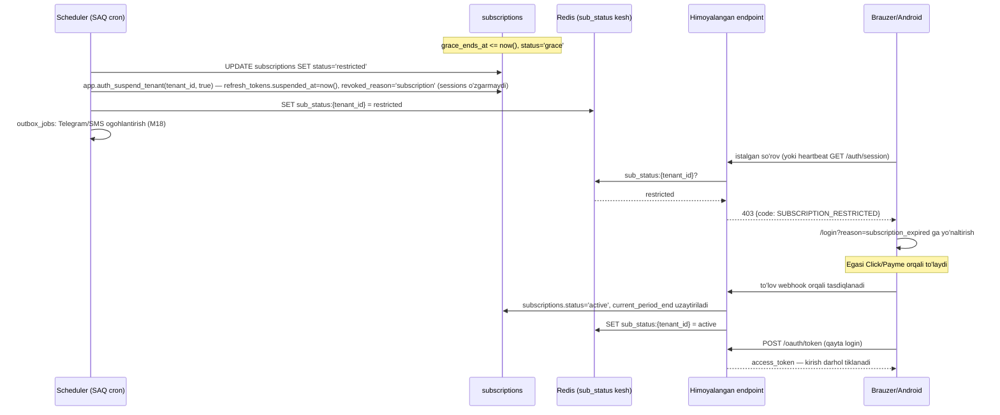

# Autentifikatsiya — OAuth 2.0 (o'z implementatsiyamiz)

**Maqsad:** Backendning o'z OAuth 2.0 Authorization Server (AS) + Resource Server (RS) sifatidagi autentifikatsiya arxitekturasi — mijozlar, grant turlari, token formatlari, kirish usullari, bekor qilish/introspeksiya, tenant almashtirish, scope↔permission_code, obuna lokauti, offline litsenziya tokeni, admin panel API'lari.
**Kim uchun:** Backend (`modules/auth`), frontend (BFF/SPA), Android, Telegram bot ishlab chiquvchilari.
**Bog'liq fayllar:** `10-umumiy-arxitektura.md`, `11-malumotlar-modeli.md` (users, memberships, roles, devices, platform_admins, subscriptions), `15-xavfsizlik-va-audit.md`, `16-offline-sync.md`, `17-api-umumiy.md`, `23-backend-arxitekturasi.md`, `24-frontend-arxitekturasi.md`, `01-qarorlar.md` (#3, #13), `03-modullar-talablari.md` (M13, M17 — US-M17-03), `06-ekranlar-umumiy.md` (BO-11, BO-21, ADM-01), `33-1c-integratsiya.md` §9 (1C agenti protokoli — ulash va token uchun kanonik), §5.18, §11, `34-1c-agent.md`, `01-qarorlar.md` #36, #38, #40.
**Holat:** joriy, 2026-10-16.

## Asosiy xulosalar

1. **Bitta backend — ham AS, ham RS** (qaror #14): FastAPI ilovasi o'zi OAuth 2.0 Authorization Server (token/kod beradi) va Resource Server (API so'rovlarini tekshiradi) vazifasini bajaradi — tashqi auth xizmati (Keycloak, Auth0, Firebase Auth va h.k.) ishlatilmaydi. Protokol skeleti uchun **Authlib** (RFC 6749/7636/7009/7662/8414/9068 ga mos generic grant/endpoint sinflari) ishlatiladi, lekin foydalanuvchi saqlash, parol/PIN tekshirish, token rotatsiyasi, qurilma bog'lash, obuna tekshiruvi — **hammasi bizning kod va bizning Postgres jadvallarimiz**; Authlib hech qachon tashqi tarmoqqa so'rov yubormaydi, bizning jarayonimiz ichida ishlaydi (1-bo'lim).
2. **Besh turdagi OAuth mijoz**: veb SPA (back-office + veb-kassa) — **BFF** (Backend-for-Frontend) naqshi orqali, token hech qachon brauzer JS'iga chiqmaydi (HttpOnly cookie); Android POS — **public native client**, Authorization Code + PKCE, to'g'ridan-to'g'ri Bearer bilan API chaqiradi; Telegram bot — **confidential client**, Client Credentials; ichki admin panel (ADM-01) — BFF orqali boshqa veb SPA, alohida `client_id`; **1C agenti** (`onec-agent`, do'kon PK'sidagi Windows agenti) — **public client**, birinchi ulash RFC 8628 Device Authorization Grant, keyin `client_credentials` + `private_key_jwt` (RFC 7523), faqat `/api/v1/onec-agent/*` (§2.3).
3. **Ruxsat etilgan grant turlari**: Authorization Code + PKCE (RFC 7636, S256) — veb (BFF ichida) va Android uchun majburiy; Refresh Token — **rotatsiya + qayta ishlatish aniqlash (reuse detection)** bilan; Client Credentials — faqat ichki xizmatlar/bot va 1C agenti (`private_key_jwt` bilan) uchun; Device Authorization Grant (RFC 8628) — faqat 1C agentini ulash uchun. **Implicit va Resource Owner Password Credentials (parol) grant'lari umuman yo'q** — OAuth 2.1 tavsiyasiga mos, xavfsizroq.
4. **Kirish usullari — to'rt**: telefon+parol (back-office rollari); **Google bilan kirish** (OIDC, tashqi identity provider — hisob bog'lash tasdiqlangan email/telefon bo'yicha, §2.2); telefon+OTP (**faqat ro'yxatdan o'tish, parolni tiklash va h.k.**, kundalik kirish usuli emas — asosiy kanal **Telegram bot**, SMS (Eskiz) faqat zaxira, §4.2); kassir **PIN — OAuth grant emas**, qurilmada mahalliy (hatto offline) tezkor almashish/tasdiqlash vositasi (4-bo'lim).
5. **Access token — JWT, RFC 9068 profili**, 15 daqiqa (qaror #44), EdDSA bilan imzolanadi, `JWKS` orqali ochiq kalit e'lon qilinadi; **refresh token — opaque, bazada faqat hash holida**, qurilmaga bog'langan, rotatsiya va oila (`family_id`) bo'yicha qayta ishlatish aniqlanadi (7-bo'lim).
6. **Obuna muddati — qattiq to'xtatish** (qaror #15): 24 soatlik imtiyoz tugagach tenant **barcha** refresh tokenlari to'xtatiladi (`suspended`, 16.1.3-bo'lim), har bir mijoz login sahifasiga yo'naltiriladi, login **rad etiladi** (faqat to'lov havolasi ochiq qoladi, 16-bo'lim). Fiskal oqibat: chek chiqarib bo'lmaydi — bu do'konning mas'uliyati, foydalanish shartlarida alohida qayd etiladi.
7. **Offline qurilmalar — imzolangan litsenziya tokeni** (`license`, JWT): `tenant_id`, `device_id`, `valid_until = min(grace_ends_at, issued_at + 7 kun)`; qurilma (veb-kassa ham, Android ham) internet bo'lmasa ham shu tokenni mahalliy tekshiradi va muddat o'tganda **o'zini mahalliy bloklaydi** — serverga murojaat shart emas (17-bo'lim).
8. **Veb-kassaning 48 soatlik offline oynasi** (fiskal, VM 943) va **24 soatlik obuna imtiyozi** (ichki qaror) — **ikki mustaqil muddat**, bir-biriga bog'liq emas; qurilmaga bog'langan refresh token muddati ikkisidan ham ancha uzun qilib loyihalanadi (sliding 14 kun / mutlaq 180 kun — 26 #73, qaror #44) — shu sababli 48 soatlik offline davrda mahalliy PIN, outbox yozish va `actor_user_id` bilan ishlash to'xtamaydi (8-bo'lim).
9. **Admin panel ikki qatlamda**: platforma admin (`platform_admins`) — tenant/Egasi darajasida boshqaradi (obuna uzaytirish, sessiyalarni majburiy bekor qilish, AI sarfi); tenant Egasi — o'z xodimlarini qo'shadi/bloklaydi, rol/filial tayinlaydi, **PIN'ni qayta o'rnatadi**, sessiya/qurilmalarni bekor qiladi (18-bo'lim).
10. **Scope — permission_code'dan hisoblanadi, qo'shimcha katalog kerak emas**: token `scope` claimi — foydalanuvchi rollarining joriy `role_permissions.permission_code` to'plamidagi noyob prefikslar ro'yxati (token yaratilganda hisoblanadi); bu faqat tezkor module-darajasidagi birinchi filtr, yakuniy ruxsat hamon `require_permission` + `limit_value` orqali tekshiriladi — ikkilanish yo'q (10-bo'lim).
11. **Xavfsizlik testlari — mock yo'q**: haqiqiy PostgreSQL va Redis (`testcontainers`) ustida to'liq Authorization Code+PKCE oqimi, refresh rotatsiyasi/reuse, revoke/introspect, obuna lokaut sinovlari ishga tushiriladi (21-bo'lim).
12. **Google bilan kirish + Telegram OTP** (qaror #34): Google OIDC — bizning OAuth AS'imizga ulangan **tashqi identity provider** (hisob bog'lash — tasdiqlangan email yoki telefon bo'yicha, `user_identities` jadvali, §2.2, §19). Tasdiqlash kodi (OTP), parolni tiklash, xodim taklifi, eksport tasdig'i, qarz eslatmalari — **asosiy kanal Telegram bot** (foydalanuvchi botga telefonini "share contact" orqali ulagandan keyin); **SMS (Eskiz) faqat zaxira** — Google ham, Telegram ham ulanmagan foydalanuvchi uchun (Google'ning o'z SMS'i — Firebase phone auth — pullik, shuning uchun ishlatilmaydi). Har kanal uchun alohida rate limit (§12).

---

## 1. AS va RS rollari

Bitta FastAPI ilovasi (`app/modules/auth/`) ikki roli bajaradi:

| Rol | Vazifa | Endpoint'lar |
|---|---|---|
| **Authorization Server (AS)** | Foydalanuvchini autentifikatsiya qiladi, kod/token beradi, bekor qiladi, introspeksiya qiladi, kalitlarni e'lon qiladi | `/oauth/authorize`, `/oauth/token`, `/oauth/device_authorization` (faqat `onec-agent`, §2.3), `/oauth/revoke`, `/oauth/introspect`, `/.well-known/oauth-authorization-server`, `/.well-known/jwks.json` |
| **Resource Server (RS)** | Har bir biznes so'rovida `Authorization: Bearer` (Android, 1C agenti) yoki BFF sessiyasi (veb) orqali tokenni tekshiradi, `tenant_id`/`sid`/obuna holatini dependency orqali chiqaradi | `/api/v1/*` barcha modul endpoint'lari; `/api/v1/onec-agent/*` — faqat `aud=urn:erp:onec-agent` tokeni (§2.3) |

AS va RS **bitta jarayon, bitta DB** bo'lgani uchun token imzosini tashqi tarmoq orqali tekshirish shart emas — lekin RFC 8414/9068 formatiga qat'iy rioya qilinadi, chunki kelajakda RS modul(lar)i alohida xizmatga ajratilishi mumkin (`10-umumiy-arxitektura.md`, 1-xulosa — modulli monolitni keyin bo'lish rejasi) va Telegram bot/boshqa ichki xizmatlar allaqachon "tashqi" mijoz sifatida ishlaydi.

**Nega Authlib**: PKCE `code_verifier`/`code_challenge` solishtirish, redirect_uri qat'iy tekshiruvi, grant dispatch, RFC 8414 metadata formati — xavfsizlik jihatidan nozik primitivlar, qo'lda yozilsa xato qilish xavfi yuqori. Authlib (MIT, faol qo'llab-quvvatlanadi, FastAPI/Starlette bilan ishlatiladigan `authlib.oauth2.rfc6749` abstrakt grant/klient sinflari) shu primitivlarni beradi; **storage hook**'lari (`query_client`, `save_token`, `authenticate_user` va h.k.) orqali bizning SQLAlchemy repozitorilarimiz ulanadi — Authlib hech qanday ma'lumotni o'zida saqlamaydi, tashqariga yubormaydi. JWT/JWS/JWK operatsiyalari (imzolash, JWKS) — **joserfc** (Authlib muallifining zamonaviy kutubxonasi, EdDSA/ES256 ikkisini ham qo'llab-quvvatlaydi); muqobil — `PyJWT` + `cryptography`.

---

## 2. Mijozlar (OAuth clients)

| Mijoz (`oauth_clients.client_id`) | Turi | Oqim | Tafsilot |
|---|---|---|---|
| `web-bff` | **Confidential** (client_secret serverda, brauzerga hech qachon chiqmaydi) | Authorization Code + PKCE | Back-office va veb-kassa SPA'si **BFF naqshi** orqali: brauzer hech qachon access/refresh tokenni ko'rmaydi, faqat `sid` (sessiya ID) bilan imzolangan HttpOnly cookie oladi (3-bo'lim). PKCE confidential mijozda ham ishlatiladi (OAuth 2.1 tavsiyasi — qo'shimcha himoya qatlami, kod o'g'irlanishiga qarshi). |
| `admin-bff` | Confidential | Authorization Code + PKCE | ADM-01 ichki admin panel — alohida `client_id`/`scope` (`platform.admin`), login faqat `platform_admins` jadvaliga qarshi (18-bo'lim). |
| `android-pos` | **Public** (client_secret yo'q — APK ichida sir saqlab bo'lmaydi) | Authorization Code + PKCE | Android ilovasi to'g'ridan-to'g'ri `/oauth/authorize`+`/oauth/token` bilan gaplashadi, keyin API'ga **to'g'ridan-to'g'ri `Authorization: Bearer <access_token>`** bilan so'rov yuboradi (BFF orasida yo'q). Redirect — App Links bilan tasdiqlangan `https://<domen>/android/callback` (RFC 8252 — "OAuth 2.0 for Native Apps" tavsiyasi, custom scheme'ga qaraganda fishingga chidamliroq). Token qurilmada Android Keystore bilan himoyalangan saqlashda (`28-android-pos.md`da batafsil). |
| `telegram-bot` | Confidential | **Client Credentials** | Bot xizmati (aiogram) o'zining xizmat darajasidagi tokenini oladi (`scope: bot.internal`); muayyan foydalanuvchi/tenant konteksti **token orqali emas**, mavjud `telegram_links` (tenant_id, user_id, chat_id) jadvali orqali uzatiladi — bot va API bir xil ichki tarmoqda, ishonch chegarasi bir xil (`15-xavfsizlik-va-audit.md` §1.4 bilan izchil). |
| `onec-agent` | **Public** (client_secret yo'q — sir faqat PK'dagi Ed25519 maxfiy kalit, DPAPI) | **Device Authorization Grant** (RFC 8628, birinchi ulash) → **Client Credentials + `private_key_jwt`** (RFC 7523, doimiy) | Do'kon PK'sidagi «ERP 1C Agent» (qaror #36, #38). Har ulangan agent o'z `client_id`siga ega: `onec-agent:<agent_id>` (`onec_agents.client_id`); `oauth_clients` da yagona seed yozuvi `onec-agent` (`client_type='public'`, `allowed_grant_types={'urn:ietf:params:oauth:grant-type:device_code','client_credentials'}`, `allowed_scopes={'onec.agent'}`, `redirect_uris={}`). Refresh token **berilmaydi**. To'liq tafsilot — §2.3. |

**Bot so'rovlari uchun majburiy tekshiruvlar**: `bot.internal` tokeni faqat `/internal/bot/*` endpoint'lariga kiradi (boshqa hech qanday `/api/v1/*` yo'lini chaqirolmaydi — confused deputy oldini olish). Har so'rovda server `chat_id` → `telegram_links` (tenant_id, user_id) ni o'zi aniqlaydi va **foydalanuvchi so'rovi kabi** quyidagilarni tekshiradi: (1) `require_subscription_ok(tenant_id)` — `restricted`/`closed` bo'lsa faqat obuna/to'lov eslatmasi yuboriladi, AI-01 va hisobotlar botda yopiladi (butun tenant yopiladi qoidasiga mos, bot orqali ham amal qiladi); (2) `memberships.status='active'` — bloklangan foydalanuvchiga (US-M13-05) javob berilmaydi, uning `telegram_links` yozuvi bekor qilinadi (`15-xavfsizlik-va-audit.md` §1.4); (3) `require_permission` (masalan AI-01 uchun `ai.chat.use`, hisobot uchun `reports.sales.view`). Har chaqiruv `tenant_transaction(tenant_id)` ichida RLS bilan ochiladi — bot hech qachon `tenant_id`siz so'rov yubormaydi. Scope jadvali (10-bo'lim) `bot.internal`ni ham o'z ichiga oladi: `bot.internal` — Telegram bot xizmati, faqat `/internal/bot/*`, foydalanuvchi huquqlari har safar `telegram_links` orqali qayta tekshiriladi.

**NO**: implicit grant yo'q (token URL fragmentda ochiq qoladi, refresh yo'q — OAuth 2.1 olib tashlagan), parol (ROPC) grant yo'q. Telefon+parol/OTP login **AS'ning o'z `/oauth/authorize` sahifasi/`/auth/login` BFF endpoint'i** orqali, ya'ni birinchi tomon login shakli parolni to'g'ridan-to'g'ri AS'ning o'ziga beradi — bu ROPC emas, chunki parol hech qachon alohida "token" endpoint'iga mustaqil parametr sifatida kelmaydi va uchinchi tomon mijoziga aylanmaydi (standart birinchi-tomon AS naqshi).

### 2.1 Login oqimi (haqiqiy Authorization Code + PKCE, front-channel redirect)

Parol faqat brauzerdan **to'g'ridan-to'g'ri AS login sahifasiga** (bitta domen, birinchi-tomon) POST qilinadi, hech qachon BFF orqali oraliq uzatilmaydi.

```mermaid
sequenceDiagram
    participant Br as Brauzer (SPA)
    participant BFF as Backend — BFF qatlami
    participant AS as OAuth AS (/oauth/authorize, /oauth/token)
    participant DB as PostgreSQL

    Br->>BFF: GET /auth/login/start
    BFF->>BFF: state + PKCE: code_verifier (Redis, sid'ga bog'langan, qisqa TTL), code_challenge = S256(verifier)
    BFF-->>Br: 302 Location: /oauth/authorize?client_id=web-bff&code_challenge=...&state=...&redirect_uri=/auth/callback
    Br->>AS: GET /oauth/authorize (brauzer AS login sahifasini ko'rsatadi, bitta domen)
    Br->>AS: POST (login sahifasidan) {phone, password} — parol faqat shu yerda, hech qachon BFF orqali emas
    AS->>DB: app.auth_find_user_by_phone(phone) (SECURITY DEFINER) + argon2id tekshirish
    AS->>DB: app.auth_record_login(phone, ip, success, failure_reason) — xato/muvaffaqiyat qaydi, progressiv blok
    DB-->>AS: user_id, memberships (tenant tanlash kerak bo'lsa alohida qadam)
    AS->>DB: app.auth_issue_code(code_hash, client_id, user_id, tenant_id, code_challenge, redirect_uri, scope, 60) — bir martalik
    AS-->>Br: 302 /auth/callback?code=...&state=...
    Br->>BFF: GET /auth/callback?code=...&state=...
    BFF->>BFF: state mosligini tekshiradi (login-CSRF/session-fixation'ga qarshi)
    BFF->>AS: POST /oauth/token {grant_type=authorization_code, code, code_verifier, client_secret}
    AS->>AS: S256(code_verifier) == code_challenge? redirect_uri mos?
    AS->>DB: app.auth_consume_code(code_hash); access_token (JWT) + refresh_token (opaque) — app.auth_issue_tokens(..., p_with_session=true) (yangi sid)
    AS-->>BFF: access_token (15 daqiqa), refresh_token
    BFF->>DB: sessions.id = sid — token'lar serverda saqlanadi, brauzerga chiqmaydi
    BFF-->>Br: Set-Cookie: __Host-sid=... (HttpOnly, Secure, Path=/, Domain yo'q, SameSite=Lax)
```

PKCE bu oqimda haqiqiy himoya beradi: `code` front-channel redirect orqali o'tadi (brauzer tarixi/referrer orqali oshkor bo'lishi mumkin), lekin `code_verifier` hech qachon brauzerga chiqmaydi (BFF Redis'da, `sid`ga bog'langan) — kodni ushlab olgan uchinchi tomon `code_verifier`siz uni almashtira olmaydi.

**Qo'shimcha himoya**: (1) login so'rovida `Origin`/`Sec-Fetch-Site` tekshiruvi (login-CSRF'ga qarshi, boshqa sayt bu formani o'z nomidan yubora olmasligi uchun); (2) muvaffaqiyatli login va tenant almashtirishda `sid` **har doim yangilanadi** (session fixation'ga qarshi — eski `sid` bilan yangi sessiyaga "yopishib qolish" mumkin emas); (3) cookie nomi **`__Host-sid`** (Secure, Path=/, Domain atributi yo'q — brauzer bu cookie faqat aynan shu domenda, faqat HTTPS orqali yaratilishini kafolatlaydi).

API so'rovlarida: brauzer cookie yuboradi → BFF `sid` bo'yicha joriy access_token'ni topadi (kerak bo'lsa 7-bo'lim bo'yicha avtomatik refresh) → ichki chaqiruv (bir xil jarayon ichida) RS dependency'siga claims'ni uzatadi — bu "forward" tarmoq orqali emas, funksiya chaqiruvi darajasida. CSRF mexanizmi (sinxronizator-token, `GET /api/v1/auth/csrf`) — shu cookie OAuth tokeniga bog'langan sessiyani bildiradi (`15-xavfsizlik-va-audit.md` §1.3 bilan izchil).

### 2.2 Google bilan kirish — tashqi OIDC identity provider (qaror #34)

Google — bizning OAuth AS'imizdan **mustaqil, qo'shimcha** kirish yo'li, uni almashtirmaydi: foydalanuvchi login sahifasida "Telefon+parol" yoki "Google bilan kirish" tanlaydi, ikkisi ham bir xil `web-bff`/`android-pos` mijozi orqali bizning `sessions`/token'imizga olib keladi (brauzerga/qurilmaga Google token hech qachon chiqmaydi — bu ham BFF/public-client naqshiga mos).

**Oqim** (OIDC Authorization Code, PKCE):
1. `GET /auth/google/start` (BFF) — `state`+PKCE yaratadi, Google'ning `https://accounts.google.com/o/oauth2/v2/auth?client_id=<bizning Google OAuth client>&scope=openid email profile&redirect_uri=/auth/google/callback&state=...` manziliga `302` qiladi.
2. Foydalanuvchi Google'da login/rozilik beradi → Google `GET /auth/google/callback?code=...&state=...`ga qaytaradi.
3. BFF Google'ning `/token` endpoint'iga `code`ni almashtiradi, ID token (JWT, Google imzosi bilan) oladi, `email`/`email_verified`/`sub` (Google user id) claim'larini chiqaradi.
4. **Hisob bog'lash (account linking)**: `email_verified=true` bo'lsa, `email`ga (yoki, agar Google konfiguratsiyasida telefon claim mavjud bo'lsa — tasdiqlangan telefon raqamiga) mos `users` qatori qidiriladi:
   - Mavjud foydalanuvchi topilsa va avval `user_identities`da bog'lanmagan bo'lsa — yangi `user_identities(provider='google', provider_user_id=sub, user_id, email)` yozuvi yaratiladi (birinchi marta Google bilan kirganda avtomatik bog'lanadi, qo'shimcha tasdiqlash so'ralmaydi — email allaqachon Google tomonidan tasdiqlangan).
   - Mavjud foydalanuvchi topilmasa — yangi `users` + odatiy `/auth/signup` provisioning (`15-xavfsizlik-va-audit.md` §1.5) ishga tushadi, keyin `user_identities` yoziladi.
   - `email_verified=false` — rad etiladi (`GOOGLE_EMAIL_NOT_VERIFIED`), xavfsiz standart sifatida.
5. AS o'z ichida oddiy login kabi `sessions`/`refresh_tokens` yaratadi (2.1-bo'limdagi so'nggi qadamlar bilan bir xil), BFF cookie qaytaradi.

**Ma'lumot bazasi**: `user_identities` jadvali (`11-malumotlar-modeli.md` §1, `12-db-sxema.md` — `id, user_id, provider` (`google`), `provider_user_id` (Google `sub`), `email`, `email_verified`, `linked_at`, `created_at`, UNIQUE(provider, provider_user_id)). Bitta `user`ga bir nechta provider bog'lanishi mumkin (kelajakda); bitta Google hisobi faqat bitta `user`ga.

**Android**: `android-pos` mijozi uchun Google Sign-In SDK (native) orqali olingan ID tokenni backend tasdiqlaydi (`POST /auth/google/token` — Google'ning server-side tasdiqlash kutubxonasi bilan, xuddi shu `user_identities` oqimi); bu veb oqimidan farqli, chunki native ilovada brauzer redirect shart emas.

**Xatolar**: `GOOGLE_EMAIL_NOT_VERIFIED`, `GOOGLE_AUTH_FAILED` (Google tomondan xato/bekor qilingan), `VALIDATION_ERROR`.

---

### 2.3 1C agenti — `onec-agent` mijozi (qaror #36, #38, #40)

Kanonik protokol — `33-1c-integratsiya.md` §9.1–9.2 (parametrlar, javob shakllari, ketma-ketlik diagrammasi); bu bo'lim AS/RS tomonidagi qoidalarni belgilaydi.

| Bosqich | Qoida |
|---|---|
| 1. Ulash so'rovi | Agent Ed25519 kalit juftligini yaratadi (maxfiy — DPAPI `CurrentUser`, serverga chiqmaydi) va `POST /oauth/device_authorization` (`application/x-www-form-urlencoded`: `client_id=onec-agent`, `scope=onec.agent`, `public_jwk`, `machine_hash`, `pc_name`, `os_version`, `agent_version`) yuboradi. AS `auth.onec_device_authorizations` ga `pending` yozuv qo'yadi (`app.onec_device_auth_start`, `device_code`ning faqat xeshi saqlanadi) va `{device_code (256 bit), user_code (8 belgi, alifbo BCDFGHJKLMNPQRSTVWXZ, ko'rinishi XXXX-XXXX), verification_uri, verification_uri_complete, expires_in: 600, interval: 5}` qaytaradi. Rate limit — IP bo'yicha 10/soat (§12). |
| 2. Tasdiq | Egasi (yoki `onec.settings.manage` egasi) back-office'da (BO-22) kodni kiritadi: W-03 PK nomi/IP/OS/versiyani ko'rsatadi (fishingga qarshi), W-04 `POST /api/v1/onec-agents/pair` bitta tranzaksiyada `onec_agents` + `devices(kind='onec_agent')` yaratadi va `app.onec_device_auth_approve` bilan `pending → approved` qiladi; audit `onec.agent.paired`, Telegram xabari. Tenant shu yerda — tasdiqlovchining joriy tenanti — aniqlanadi. |
| 3. Device grant | Agent har `interval` soniyada `POST /oauth/token` (`grant_type=urn:ietf:params:oauth:grant-type:device_code`, `device_code`, `client_id=onec-agent`). RFC 8628 xatolari `400 {"error": …}`: `authorization_pending`, `slow_down` (agent `interval += 5`), `expired_token`, `access_denied`. Tasdiqlangach bir martalik (`approved → consumed`, `app.onec_device_auth_poll`) javob: `{access_token, token_type: "Bearer", expires_in: 600, scope: "onec.agent", agent_id, agent_client_id: "onec-agent:<agent_id>", tenant_name, task_keyset}`. |
| 4. Doimiy token | Har ~8 daqiqada `POST /oauth/token`: `grant_type=client_credentials`, `client_id=onec-agent:<agent_id>`, `client_assertion_type=urn:ietf:params:oauth:client-assertion-type:jwt-bearer`, `client_assertion` (EdDSA JWT: header `kid` = ochiq kalit thumbprint; `iss = sub = client_id`, `aud = https://<domen>/oauth/token`, `jti`, `iat`, `exp ≤ iat + 60`), `scope=onec.agent`. AS ochiq kalitni `app.onec_agent_credentials(client_id)` (tenant kontekstisiz SECURITY DEFINER) orqali oladi; `jti` Redis `onec:jti:{jti}` 120 s — qayta ishlatilsa rad. Agent `revoked` bo'lsa `401 {"error":"invalid_client","error_description":"agent_revoked"}`. |
| Access token | JWT `typ=at+jwt`, `signing_keys.purpose='access'`, **10 daqiqa**; `aud = "urn:erp:onec-agent"`, `sub = client_id`, `client_id`, `tenant_id`, `agent_id`, `device_id`, `scope = "onec.agent"`, `iss`, `iat`, `exp`, `jti`. `sid`, `roles`, `branch_ids` **yo'q** — agent foydalanuvchi emas, `require_permission` qo'llanmaydi; ruxsat — faqat scope `onec.agent`. |
| Auditoriya ajratish | Tenant API (`aud=urn:erp:api`) `urn:erp:onec-agent` tokenini rad etadi, `/api/v1/onec-agent/*` esa `urn:erp:api` (foydalanuvchi) tokenini rad etadi (confused deputy'ga qarshi) — `aud=urn:erp:platform` bilan bir xil naqsh (§18.1). Agent yo'llarida CSRF yo'q (Bearer), `Idempotency-Key` talab qilinmaydi (`17-api-umumiy.md` §1). |
| Bekor qilish (revocation) | (a) Back-office W-05 `POST /api/v1/onec-agents/{id}/revoke` (`onec.settings.manage`) yoki (b) agentdan A-10 `POST /api/v1/onec-agent/unpair` (uninstall/«Uzish»): `onec_agents.status='revoked'` (yakuniy), `devices.revoked_at` o'rnatiladi, Redis `onec:agent_status:{agent_id}` (60 s kesh) darhol o'chiriladi. RS har agent so'rovida shu keshni tekshiradi — `revoked` → `403 ONEC_AGENT_REVOKED`; amaldagi access token ≤ 60 s ichida kuchini yo'qotadi; yangi token berilmaydi (`invalid_client`). Qayta ulash — yangi device grant va yangi `onec_agents` yozuvi. Audit `onec.agent.revoked` / `onec.agent.unpaired`. |
| Login bloklash istisnosi | Agent parol/OTP bilan kirmaydi — §12 dagi telefon/IP bo'yicha progressiv **login bloklash** va `ACCOUNT_LOCKED` unga qo'llanmaydi; o'rniga: `/oauth/device_authorization` IP bo'yicha 10/soat, device grant polling `slow_down`, assertion `jti` qayta ishlatish taqiqi, `client_id` bo'yicha `/oauth/token` rate limit. |
| Obuna lokauti istisnosi | §16.1 qoidasidan farqli: `restricted`/`closed` tenant agentiga **token beriladi** (lease'dagi 1C yozuvi yarim qolmasligi uchun); cheklovni RS qo'llaydi — lokautda A-01 `hello`, A-02, A-03 `poll` → `403 SUBSCRIPTION_RESTRICTED` (yangi vazifa berilmaydi); A-04…A-10 — ruxsat (`33-1c-integratsiya.md` §9.1). |

### 2.4 Do'kon agenti lokal API (POS ↔ agent) — OAuth tashqarisida (qaror #60, #66, #71)

POS (veb-kassa) shu PK'dagi Do'kon agentiga `http://127.0.0.1:47110/v1/*` orqali murojaat qiladi — fiskal ko'prik (`/v1/fiscal/*`), xom printer (`/v1/print/*`) va **bank karta terminali (`/v1/card/*`, qaror #71)**. Bu kanal OAuth emas: AS token bermaydi, RS tekshirmaydi, server lokal tokenni ko'rmaydi va saqlamaydi. Protokol va sxemalar — `21-integratsiyalar.md` §16/§16.1; bu bo'lim himoya qoidalarini belgilaydi. Barcha `/v1/*` yo'llari uchun **bir xil** — karta yo'llariga alohida token yoki istisno yo'q:

| Qoida | Tafsilot |
|---|---|
| Faqat loopback | Agent faqat `127.0.0.1` da tinglaydi; tashqi interfeysda port ochilmaydi (LAN'dagi boshqa qurilma `/v1/card/purchase` ni chaqira olmaydi) |
| `Origin` oq ro'yxati | Faqat `https://app.<domen>` (dev'da `http://localhost:<vite-port>`); boshqa `Origin` yoki `Origin`siz so'rov → `403`; CORS preflight va Private Network Access javobi (`Access-Control-Allow-Private-Network: true`) faqat ro'yxatdagi `Origin` uchun |
| Qurilmaga bog'langan lokal token | `Authorization: Bearer <local_token>` har so'rovda; POS-16 da agent tray'idagi 6 raqamli bir martalik kod (5 daqiqa) bilan `POST /v1/pair {code, device_id}` → 256-bit token, agentda POS `devices.id` bilan juft holda DPAPI ostida, POS'da Dexie'da. Boshqa `device_id` bilan ishlamaydi; tray'dan bog'lanish o'chiriladi; POS qurilmasi serverda bekor qilinsa (`POST /devices/{id}/revoke`) POS o'zi qulflanadi. Token yo'q/noto'g'ri → `401` |
| Foydalanuvchi huquqi | Lokal API foydalanuvchini bilmaydi — ruxsat **POS tomonida**, OAuth sessiyasi/PIN bilan kirgan kassirning keshdagi `permission_code` to'plami bo'yicha tekshiriladi: `/v1/card/purchase` — `sales.create` yoki `debts.payment.accept`; `/v1/card/refund`, `/v1/card/void` — `returns.create` (sotuvni bekor qilishda avtomatik `void` — `sales.void`); `/v1/card/settlement` — `shift.close`. Natija server tomonida qayta tekshiriladi: `card_terminal_transactions` yozuvi `POST /card-terminal-transactions` yoki `sale.created`/`return.created`/`debt_payment.created` bilan keladi va odatdagi RS ruxsati (`require_permission`) qo'llanadi (`18-api-kassa.md` §4.1, §18) |
| Karta ma'lumoti | Lokal API karta rekvizitini **qabul qilmaydi** — so'rovda faqat `attempt_id`, `local_id`, summa (tiyin), `cash_register_id`, `client_event_id`; javobda faqat niqob/RRN/avtorizatsiya kodi/sxema (`15-xavfsizlik-va-audit.md` §9.3) |
| Terminal manzili | Agent faqat `card_terminals` dagi ro'yxatdagi xususiy LAN manzilga (`host`/`port`, RFC 1918) ulanadi; POS so'rovida host berilmaydi — `local_id` bo'yicha agent konfiguratsiyasidan olinadi (ixtiyoriy host'ga ulanish/SSRF yo'q) |
| Qo'lda kiritish tasdig'i | `card_manual_fallback='manager_approval'` da terminal natijasisiz karta rekvizitini kiritish yoki `unknown` tranzaksiyani yopish — Menejer/Egasi PIN (`card.manual_entry.approve`, tasdiq turi `card_manual_entry`); PIN OAuth grant emas (§4.3), offline'da lokal tekshiriladi, server `doc_approvals` bo'yicha qayta tekshiradi (`15-xavfsizlik-va-audit.md` §2.3) |
| Obuna lokauti | Lokautda (`restricted`) POS sotuvni bloklaydi (§16) — demak yangi karta `purchase` ham yuborilmaydi; agent mustaqil ravishda karta amalini boshlamaydi |

---

## 3. Grant turlari — jadval

| Grant | Kim ishlatadi | Muhim qoidalar |
|---|---|---|
| `authorization_code` + PKCE (S256) | `web-bff`, `admin-bff`, `android-pos` | Kod bir martalik, 60 soniya TTL; `code_challenge_method=S256` majburiy (`plain` qabul qilinmaydi) |
| `refresh_token` | `onec-agent`dan tashqari hammasi (tokenni qayta olish) | Har ishlatishda **rotatsiya**; eski token qayta kelsa — butun oila (`family_id`) bekor qilinadi (7-bo'lim) |
| `client_credentials` | `telegram-bot`, kelajakdagi ichki xizmatlar | Foydalanuvchi konteksti yo'q, faqat xizmat darajasidagi scope |
| `client_credentials` + `private_key_jwt` (RFC 7523) | `onec-agent:<agent_id>` | `client_secret` o'rniga EdDSA client assertion (`exp ≤ iat + 60`, `jti` bir martalik); token 10 daqiqa, refresh yo'q (§2.3) |
| `urn:ietf:params:oauth:grant-type:device_code` (RFC 8628) | `onec-agent` | Faqat birinchi ulash; `device_code` 10 daqiqa, bir martalik, polling `interval` 5 s (`slow_down` → +5 s); tasdiq — back-office'da `onec.settings.manage` bilan (§2.3) |
| `implicit` | **Yo'q** | OAuth 2.1 bo'yicha olib tashlangan — token URL fragmentda, refresh yo'q, XSS xavfi yuqori |
| `password` (ROPC) | **Yo'q** | Parolni uchinchi tomon mijoziga ishonib topshirish modeli — BFF izolyatsiyasi maqsadiga zid |

---

## 4. Kirish usullari (login methods)

### 4.1 Telefon + parol

Back-office rollari (Egasi, Menejer, Buxgalter) uchun asosiy usul. Parol — **argon2id** (`passlib[argon2]`/`argon2-cffi`), parametrlar OWASP tavsiyasi bo'yicha: m=19 MiB, t=2, p=1 (26 #76; server resursiga qarab sozlanadi).

**Parol siyosati:** uzunligi 8–128 belgi; heshlash — argon2id (`07` BO-21 validatsiyasi bilan bir xil). Yozish — `app.auth_set_credentials` orqali (§19).

### 4.2 Telefon + OTP — faqat ro'yxatdan o'tish va tiklash; kanal — Telegram bot birinchi, SMS zaxira (qaror #34)

**Kanal tanlovi**: OTP yetkazish uchun ikki kanal mavjud —
1. **Telegram bot (standart, birinchi)**: foydalanuvchi avval botga telefon raqamini "share contact" tugmasi orqali ulagan bo'lsa (`telegram_links`, `15-xavfsizlik-va-audit.md` §1.4 bilan bir xil jadval/oqim; tenant kontekstisiz qidiruv — `app.auth_telegram_chat_by_phone(phone)` (SECURITY DEFINER, `12` §4.5): `users.phone` → faol `telegram_links` dagi eng oxirgi `chat_id`), OTP kodi botdan xabar sifatida keladi — bepul, tezkor. Xodim/Egasi uchun ulash tugmasi — back-office BO-20 ekranida (`06`, qaror #56); bir martalik `link_code` 10 daqiqa amal qiladi (qaror #54).
2. **SMS (Eskiz) — faqat zaxira**: `telegram_links`da shu telefon uchun yozuv yo'q (hali ulanmagan) yoki Telegram yetkazib berish muvaffaqiyatsiz bo'lsa, server avtomatik SMS'ga o'tadi. Kanal tanlovi `OtpPort` ortida (Telegram → `EskizSmsAdapter`); Eskiz shartnomasi va real yetkazish tezligi — tashqi javob (26 #45, OQ-102), shu paytgacha `ESKIZ_TEST_MODE=true`. Google bilan kirgan foydalanuvchi uchun OTP umuman kerak emas (§2.2).

- **Ro'yxatdan o'tish** (US-M17-01, BO-21): telefon → OTP (Telegram ulangan bo'lsa bot orqali, bo'lmasa SMS) → 6 xonali kod (5 daqiqa TTL — standart, sozlanadi, qaror #54) → tasdiqlangach `users` yaratiladi. Ro'yxatdan o'tish bosqichida Telegram hali ulanmagan bo'lishi odatiy holat — bu holda SMS ishlatiladi, keyin profilda Telegram ulash tavsiya qilinadi.
- **Parolni tiklash**: telefon → OTP (kanal yuqoridagi qoida bilan tanlanadi) → OTP tasdiqlangan qisqa muddatli "tiklash seansi" → yangi parol o'rnatiladi.
- OTP — **kundalik login usuli emas**: har kuni kirish parol, Google yoki PIN (quyida) bilan.
- Qoidalar: 6 raqam, bir martalik, heshlangan holda saqlanadi (`otp_challenges.code_hash`), maksimal 5 tekshirish urinishi (keyin challenge bekor, yangi OTP talab qilinadi); `otp_challenges.channel` (`telegram`/`sms`) — qaysi kanal orqali yuborilgani audit/retry uchun saqlanadi. Yuborish cheklovi — 12-bo'limdagi to'liq limitlar jadvaliga qarang, **kanal bo'yicha alohida**.
- **Taklif va Egasi tomonidan tiklash**: `otp_challenges.purpose` qiymatlari — `signup`/`recovery`/`invite`/`admin_reset`/`pin_reset`/`data_export`. `invite` — Egasi yangi xodimni qo'shganda (BO-11), `admin_reset` — Egasi xodimning parolini majburiy tiklaganda (`POST /admin/users/{id}/reset-password`, 18.2-bo'lim). Ikkala holatda ham: eski kredensial (parol/PIN) **avval bekor qilinadi**, xodimning barcha sessiya/refresh-token oilasi revoke qilinadi, so'ng xodimga (Telegram ulangan bo'lsa bot orqali, aks holda SMS) **bir martalik taklif/tiklash kodi** yuboriladi (hech qachon parol/PIN ochiq matnda emas) — xodim shu kod bilan **o'zi** yangi parol/PIN o'rnatadi; kod token qaytarmaydi, faqat qisqa muddatli "credential-set seansi" ochadi. `pin_reset` — xuddi shunday, faqat PIN uchun (mavjud `POST /admin/users/{id}/reset-pin` oqimi bilan birlashtiriladi).
- **Xatolar**: `OTP_CHANNEL_UNAVAILABLE` — na Telegram, na SMS yuborib bo'lmadi (provayder xatosi); `TELEGRAM_NOT_LINKED` — faqat ma'lumot/ogohlantirish sifatida qaytadi (xato emas, chunki SMS'ga avtomatik o'tiladi) — `/auth/otp/request` javobida `channel_used` maydoni qaysi kanal ishlatilganini bildiradi (`17-api-umumiy.md` xato kodlari katalogi).

### 4.3 Kassir PIN — OAuth grant emas, aniq ta'rif

PIN — token olish vositasi emas, balki **allaqachon OAuth orqali autentifikatsiya qilingan qurilmada** mahalliy, tezkor amal bajaruvchini aniqlash/tasdiqlash vositasi:

1. Qurilma (veb-kassa brauzeri yoki Android POS) kuniga bir marta (yoki smena boshida) **to'liq OAuth Authorization Code+PKCE login** qiladi — bu qurilmaga bog'langan `sessions`/`refresh_tokens` yozuvini yaratadi (`scope` ichida `pos` bor).
2. Shundan keyin kassir almashganda **yangi OAuth login kerak emas** — PIN mahalliy keshlangan `user_credentials.pin_hash` (sync orqali tushadi, `16-offline-sync.md` §1 `permissions` jadvali) bilan solishtiriladi, offline ham ishlaydi.
3. PIN natijasi **token emas** — u outbox voqeasining `actor_user_id` maydonini to'ldiradi (allaqachon `16-offline-sync.md` §2'da bor naqsh); server sinxronlashda `actor_user_id`ning shu `created_at` paytida faol `membership`i borligini qayta tekshiradi.
4. **Step-up tasdiqlash PIN** (limitdan yuqori chegirma/qaytarish/nasiya, `15-xavfsizlik-va-audit.md` §2.3): Menejer/Egasi PIN kiritadi → bu ham token emas, balki voqea payload'iga qo'shiladigan tasdiqlovchi maydon (`approved_by_user_id`, `approved_by_pin_verified_at`), server qayta tekshiradi (limit, faollik). Mahalliy noto'g'ri PIN limiti — mavjud qoida (5 urinish — standart, sozlanadi, qaror #54; `16-offline-sync.md` §12) o'zgarmaydi, bu yerda faqat OAuth bilan bog'liq emasligi aniqlashtiriladi.
5. Online holatda PIN qurilma-almashtirish uchun qo'shimcha server tasdig'i kerak bo'lsa — `POST /auth/pin/verify` (20-bo'lim) chaqiriladi, lekin bu ham yangi OAuth token qaytarmaydi, faqat `actor_user_id`ni serverda tasdiqlaydi va audit yozadi.

**Xulosa**: PIN hech qachon mustaqil ravishda API chaqirish huquqini bermaydi — bu huquq faqat qurilmaning OAuth access/refresh tokenidan keladi. PIN — "kim bosdi" savoliga javob, "ruxsat bor-yo'qligi" savoliga emas.

---

## 5. Access token (JWT, RFC 9068)

| Jihat | Qaror |
|---|---|
| Format | JWT, header `typ: "at+jwt"` (RFC 9068) |
| Muddat | **15 daqiqa** (qaror #44) |
| Standart claim'lar | `iss`, `aud` (`urn:erp:api`), `sub` (user_id), `client_id`, `iat`, `exp`, `jti` |
| Boshqa auditoriyalar | `urn:erp:platform` — platforma admin (§18.1); `urn:erp:onec-agent` — 1C agenti (10 daqiqa, `sub = client_id`, `agent_id`/`device_id` claim'lari, `scope=onec.agent`, §2.3). Har RS faqat o'z `aud`ini qabul qiladi |
| Bizning claim'lar | `tenant_id`, `branch_ids` (bo'sh = hammasi), `roles` (rol kodlari), `scope` (10-bo'lim), `sid` (sessiya ID — pastda), `device_id` (bo'lsa), `sub_status` |
| `sub_status` ma'nosi | Token yaratilgan paytdagi `subscriptions.status` **keshi** — faqat UI tezkor ko'rsatish uchun, **hal qiluvchi emas**: har so'rovda Redis'dagi joriy holat tekshiriladi (16-bo'lim), token ichidagi eski qiymatga ishonilmaydi |

**`sid` — revoke uchun kalit**: JWT o'zi stateless, lekin "barcha sessiyalarni bekor qilish" (18-bo'lim) va obuna to'xtatilganda **darhol** ta'sir qilishi uchun har bir himoyalangan so'rovda `sid` Redis'dagi bekor qilingan-sessiyalar to'plamiga (yoki `sessions.revoked_at`) qarshi tekshiriladi (qisqa TTL kesh, 30–60 soniya). Shu sababli 15 daqiqalik token muddati amalda "eng yomon holatda shuncha vaqt kutish" degani emas — bekor qilish keshi orqali deyarli zudlik bilan ishlaydi.

**`branch_ids`/`roles` eskirishi**: token ichidagi `branch_ids`/`roles` token yaratilgan paytdagi qiymat, demak token muddati davomida (≤15 daqiqa) eskirgan bo'lishi mumkin. Shu sababli filial doirasi (`current_branch_scope` dependency, `15-xavfsizlik-va-audit.md` §2.4) har so'rovda token claim'iga emas, **DB/Redis'dagi joriy `memberships.branch_ids`ga** qarshi tekshiriladi. A'zolik (rol/filial) o'zgarganda `settings.users` amali shu foydalanuvchining `sid`ini majburiy refresh qilinadigan deb belgilaydi (keyingi so'rovda access token yangi claim bilan qayta chiqariladi) — bu 18.2-bo'limdagi "Sessiya/qurilmalarni bekor qilish" bilan bir xil mexanizm, faqat to'liq revoke o'rniga yengil "claims stale" belgisi.

---

## 6. Imzolash kalitlari va JWKS

- **Algoritm: EdDSA (Ed25519)** — tezkor, qisqa imzo, zamonaviy; **ES256** — moslik zaxirasi (agar kelajakda alohida RS chiqarilsa va uning kutubxonasi EdDSA'ni qo'llamasa). HMAC (simmetrik) ishlatilmaydi — JWKS orqali ochiq kalit e'lon qilish faqat asimmetrik kalit bilan xavfsiz.
- **`GET /.well-known/jwks.json`** — joriy + oldingi (overlap davridagi) ochiq kalitlar, `kid` bilan.
- **Rotatsiya**: `signing_keys` jadvalida (19-bo'lim) `next → active → retired` holat zanjiri; rejalashtirilgan rotatsiya — **90 kun** (26 #74); favqulodda rotatsiya (shubhali buzilish) — darhol, mos ravishda ommaviy sessiya/refresh-token bekor qilish bilan birga. Eski kalit shu kalit bilan imzolangan eng uzoq muddatli tokenning amal qilish muddati tugaguncha (access token max + clock skew bufer, ≈30 daqiqa) JWKS'da qoladi, keyin olib tashlanadi.
- **`signing_keys.purpose`**: `access` (access tokenlar, shu jumladan agent tokeni), `license` (offline litsenziya tokeni, §17), `onec_task` (1C agentiga beriladigan vazifalar imzosi — compact JWS `typ=onec-task+jwt`, xuddi shu `next → active → retired` rotatsiyasi, 90 kun), `agent_update` (agent yangilanish manifesti va `onec_task` ochiq kalitlari to'plami — ildiz kalit, **oflayn** saqlanadi, avtomatik rotatsiyaga kirmaydi). `onec_task`/`agent_update` kalitlari JWKS'da e'lon qilinmaydi — agent ularni imzolangan `task_keyset` va binariga joylangan ildiz kalit orqali oladi (`33-1c-integratsiya.md` §9.4).
- Xususiy kalit — `signing_keys.private_key_encrypted`, `15-xavfsizlik-va-audit.md` §4.2'dagi **DEK/KEK envelope encryption** sxemasi bilan bir xil mexanizmda saqlanadi (qayta ixtiro qilinmaydi).

---

## 7. Refresh token: rotatsiya va oila (family)

| Jihat | Qaror |
|---|---|
| Format | **Opaque** (tasodifiy, yuqori entropiya), JWT emas — oshkor bo'lsa claim oshkor qilmaydi |
| Saqlash | Faqat **hash** (`refresh_tokens.token_hash`, SHA-256 — token o'zi yuqori entropiyali bo'lgani uchun argon2 shart emas) |
| Rotatsiya | Har ishlatilganda **yangi** refresh token chiqariladi, eskisi `used_at` bilan belgilanadi (qayta ishlatib bo'lmaydi) |
| Oila (`family_id`) | Bitta login'dan tarqalgan barcha ketma-ket refresh tokenlar bir xil `family_id`ga ega |
| **Qayta ishlatishni aniqlash** | Allaqachon `used_at`li token qayta kelsa → **butun oila** (barcha avlod tokenlar + `sessions`) darhol bekor qilinadi, `audit_log`ga `refresh_token_reuse_detected`, foydalanuvchiga qayta login talab qilinadi |
| **Parallellik va tarmoq uzilishi** | (1) BFF bitta `sid` bo'yicha refresh so'rovini **single-flight** qiladi: Redis lock `refresh:{sid}` (TTL 5 soniya — standart, sozlanadi) olinadi, shu lock ostida kelgan boshqa parallel so'rovlar birinchisi tugashini **kutadi** va uning natijasini qaytaradi (qayta `/oauth/token` chaqirmaydi) — SPA'ning bir vaqtda 3–6 so'rov yuborishi oilani bekor qilmaydi. (2) **Imtiyoz oynasi (reuse grace window)**: agar RT1 qayta kelsa va `now − RT1.used_at ≤ 30 soniya` (standart, sozlanadi — `REFRESH_REUSE_GRACE_S=30`) hamda undan tug'ilgan RT2 **hali ishlatilmagan** bo'lsa — bu "reuse" deb hisoblanmaydi (tarmoq uzilib javob yetmagan holat), oila bekor qilinmaydi, RT2 (idempotent, qayta yaratilmaydi) qaytariladi. Shu oynadan tashqarida yoki RT2 allaqachon ishlatilgan bo'lsa — odatdagi reuse detection (yuqoridagi qator) to'liq kuchda qoladi. |
| Muddat (veb, qurilmasiz) | Sirpanuvchi bo'sh turish 12 soat / mutlaq **7 kun** (`15-xavfsizlik-va-audit.md` §1.3 bilan izchil) |
| Muddat (qurilmaga bog'langan — Android, veb-kassa) | Sirpanuvchi **14 kun** / mutlaq **180 kun** (26 #73; Android POS uchun alohida muddat yo'q — qaror #44) — 48 soatlik offline oynadan ancha uzun, shu bilan 8-bo'limdagi talabni qondiradi |
| Bog'lanish | `client_id`, `user_id`, `tenant_id`, `device_id` (qurilma konteksti bo'lsa) |
| **Obuna tekshiruvi** | Har bir refresh so'rovi ham (nafaqat har API so'rovi) obuna holatini tekshiradi (16-bo'lim) — `restricted` tenant uchun hali amal qiladigan refresh token ham yangi access token olishga yaroqsiz |

### 7.1 Refresh rotatsiyasi va reuse detection diagrammasi

```mermaid
sequenceDiagram
    participant D as Qurilma/BFF
    participant AS as /oauth/token
    participant DB as refresh_tokens

    D->>AS: grant_type=refresh_token, refresh_token=RT1
    AS->>DB: RT1 topildi, used_at IS NULL?
    DB-->>AS: ha — amal qiladi
    AS->>DB: RT1.used_at=now; RT2 INSERT (family_id bir xil, RT1.replaced_by=RT2)
    AS-->>D: yangi access_token + RT2

    Note over D,AS: ...keyinroq, kimdir eski RT1'ni qayta yuboradi (o'g'irlangan nusxa)
    D->>AS: grant_type=refresh_token, refresh_token=RT1 (allaqachon ishlatilgan)
    AS->>DB: RT1.used_at IS NOT NULL — qayta ishlatish aniqlandi!
    AS->>DB: family_id bo'yicha BARCHA tokenlar + sessions.revoked_at=now
    AS->>AS: audit_log: refresh_token_reuse_detected
    AS-->>D: 400 invalid_grant — qayta login talab qilinadi
```

**Eslatma**: yuqoridagi diagramma "haqiqiy o'g'irlash" holatini ko'rsatadi. Agar RT1 qaytib kelgan payt `now − RT1.used_at ≤ 30 soniya` va RT2 hali ishlatilmagan bo'lsa (BFF single-flight qulfi ostida yoki tarmoq uzilib javob yetmagan holat) — bu oila bekor qilinmaydi, 7-bo'lim jadvalidagi "Parallellik va tarmoq uzilishi" qoidasi qo'llanadi.

---

## 8. Offline va ikki mustaqil muddat

**Muhim aniqlik** (ikkisini aralashtirmaslik): 48 soat va 24 soat — ikki har xil, bog'liqsiz hisob-kitob:

| Muddat | Nima uchun | Qayerda hisoblanadi | Tugaganda nima bo'ladi |
|---|---|---|---|
| **48 soat** | Fiskal qonun (VMQ-943, 2-ilova 6-band, VMQ-23 tahririda) — offline chek OFD'ga yetib borish muddati | OFD tasdig'i olinmagan (`fiscal_receipts.ofd_acked_at IS NULL`) eng eski fiskal chekdan (`16-offline-sync.md` §6) | Ogohlantirish shkalasi 24/40/46 soat; **48 soatda kassa bloklanadi** — yangi fiskal chek chiqarilmaydi (`409 FISCAL_OFFLINE_48H_BLOCKED`), faqat sinxron/yuborish ruxsat (qaror #43, `16-offline-sync.md` §6) |
| **24 soat** | Ichki obuna qarori — to'lov imtiyozi | `subscriptions.current_period_end`'dan (`grace_ends_at`) | **Qattiq to'xtatish**: barcha refresh tokenlar `suspended`, login rad etiladi, offline qurilma mahalliy bloklanadi (16–17-bo'lim) |

Bu ikkisi mustaqil bo'lgani uchun, masalan, obuna muddati tugashi 48 soatlik fiskal taymerni "qisqartirmaydi" va aksincha — lekin amaliyotda obuna `restricted` bo'lgan tenant allaqachon yangi sotuv qila olmaydi (17-bo'lim), shu sababli yangi fiskal taymer boshlanmaydi; **lokautdan oldin** qonuniy yaratilgan, hali OFD'ga yetmagan cheklar esa yo'qolmasligi kerak (fiskal 48 soat, VM 943) — bu **tor, cheklangan** `sync.drain` yo'li orqali ta'minlanadi, batafsil **16.4-bo'lim**. Bu cheklov emas, faqat **yangi** amal (`sale.created` va h.k.) mahalliy litsenziya tekshiruvidan o'tmaydi.

**Qurilmaga bog'langan refresh token muddati** (7-bo'lim, sliding 14 kun/mutlaq 180 kun) ikkala muddatdan ham ancha uzun qilib tanlangan — shu sababli 48 soatlik offline davr davomida: (a) mahalliy PIN bilan kassir almashish davom etadi (4.3-bo'lim, serverga bog'liq emas), (b) outbox'ga yozish va `actor_user_id` biriktirish davom etadi (4.3-bo'lim, `16-offline-sync.md` §2 o'zgarmaydi), (c) internet qaytganda, agar 15 daqiqalik access token eskirgan bo'lsa, qurilma **jim** (foydalanuvchidan so'ramasdan) refresh token bilan yangi access token oladi va keyin push qiladi — faqat shu refresh so'rovi ham 16-bo'limdagi obuna tekshiruvidan o'tishi kerak.

---

## 9. Tenant almashtirish

Bitta `users.id` bir nechta tenantda `memberships`ga ega bo'lishi mumkin (mavjud model). **Qaror: bir tenant — bir token**: JWT'dagi `tenant_id` claim fiksirlangan, bir token boshqa tenantga "ko'chmaydi". **Bitta brauzer — bitta `__Host-sid` cookie — bitta faol tenant**: ikki tenant sessiyasi bitta cookie ichida parallel bo'lishi **mumkin emas** (bitta `__Host-sid` faqat bitta `sessions` yozuvini ko'rsatadi). Tenant almashtirish — maxsus `tenant_id` parametri bilan **yangi** Authorization Code+PKCE oqimi: foydalanuvchining shu tenant'da `membership`i borligi tekshiriladi, **eski sessiya (eski `sid`, eski refresh-token oilasi) almashtirishda bekor qilinadi**, yangi `access_token`/`refresh_token`/`sid` juftligi beriladi. Parallel ishlash (masalan ikki tenant bir vaqtda ochiq turishi) faqat **alohida brauzer profilida/qurilmada** mumkin — bu ikkisi mustaqil cookie-muhitlar, shuning uchun model buzilmaydi. Frontend'dagi `$tenant` tanlovchisi (`24-frontend-arxitekturasi.md`) ichki `POST /bff/switch-tenant` chaqiradi, bu AS bilan to'liq kod almashinuvini qayta bajaradi, eski `sid`ni revoke qiladi va **bitta** cookie'dagi `sid`ni yangi sessiyaga ko'rsatadi.

---

## 10. Scope ↔ ruxsat kodlari (permission_code)

Alohida scope katalogi **yaratilmaydi** — token yaratilganda foydalanuvchining joriy `role_permissions.permission_code` to'plamidan **noyob prefikslar** (nuqtadan oldingi qism) hisoblab chiqariladi va `scope` claim'iga (bo'sh joy bilan ajratilgan ro'yxat, RFC 6749) qo'yiladi:

| Prefiks (= scope) | Manba modul (`15-xavfsizlik-va-audit.md` §2.1) |
|---|---|
| `sales`, `shift`, `cash_register` | M01 |
| `returns` | M02 |
| `discount` | M03 |
| `stock` | M04, M05 |
| `transfer` | M06 |
| `purchases`, `einvoice` | M07 |
| `debts` | M08 |
| `prices`, `labels` | M09 |
| `tax` | M10 |
| `accounting` | M11 |
| `reports` | M12 |
| `settings` | M13, M14 |
| `expenses` | M15 |
| `cash` | M16 |
| `card` | M01, M02, M08 (`card.manual_entry.approve`, qaror #71) |
| `billing` | M17 |
| `notifications`, `telegram` | M18 |
| `onec` | M19 (1C integratsiyasi, `onec.*` — `15-xavfsizlik-va-audit.md` §2.1) |
| `bank_settlements` | M11, M16 (`bank_settlements.manage`) |
| `ai` | AI-xx |
| `platform` | `platform.admin` |
| `sync` | `/sync/push`, `/sync/pull` — Android/veb-kassa uchun implicit |
| `pos` | PIN-asosli tezkor amallar uchun implicit (4.3-bo'lim) |
| `onec.agent` | Faqat `onec-agent` mijozi tokenida (permission_code'dan hisoblanmaydi, `role_permissions`da yo'q) — faqat `/api/v1/onec-agent/*`; foydalanuvchi scope'lari bilan aralashmaydi (§2.3) |

**Qoida**: `scope` — RS'da DB so'rovisiz tezkor, **birinchi** (kesishtiruvchi) filtr: agar kerakli prefiks token `scope`ida yo'q bo'lsa, so'rov darhol `403` (DB'ga borilmaydi). Lekin **yakuniy** ruxsat — hamon bugungidek `require_permission("sales.create")` dependency orqali `role_permissions` (limit bilan) tekshiriladi, o'zgarmaydi. Scope hech qachon permission tekshiruvining o'rnini bosmaydi, faqat tezkorlashtiradi.

---

## 11. Step-up/tasdiqlash PIN — cross-ref

4.3-bo'limda ta'riflangan. Limit/tasdiqlash mantiqi (`15-xavfsizlik-va-audit.md` §2.3) o'zgarmaydi — bu bo'lim faqat uning OAuth bilan bog'liq emasligini aniqlashtiradi.

---

## 12. Brute-force himoyasi va rate limit

| Kanal | Limit | Natija |
|---|---|---|
| Login (telefon+parol) | 5 ketma-ket xato / **(telefon, IP/qurilma) juftligi** / 15 daqiqa (standart, sozlanadi — qaror #54) | Progressiv bloklash: 1 → 5 → 15 → 60 daqiqa (qaror #54); `audit_log: account_locked`. Bloklash juftlik bo'yicha, shuning uchun hujumchi bitta telefon raqamini **boshqa manbadan to'g'ri parol bilan** kirishni istalgan vaqt bloklay olmaydi (lockout-DoS'ga qarshi); qo'shimcha himoya — progressiv kechikishdan keyin CAPTCHA. Xato xabari har doim umumiy: "telefon yoki parol noto'g'ri" (qaysi qism xato ekanini oshkor qilmaydi) |
| Login (IP bo'yicha, mustaqil) | 20 xato / IP / soat (standart, sozlanadi — qaror #54) | Credential stuffing'ga qarshi, telefon limitidan mustaqil |
| OTP yuborish — **Telegram kanal** | 10 / telefon / sutka; 20 / IP / soat; faqat `+998` raqamlar qabul qilinadi | `429`; bot API xatosi (foydalanuvchi botni bloklagan va h.k.) — avtomatik SMS'ga fallback, alohida hisoblanadi |
| OTP yuborish — **SMS kanal (zaxira)** | 5 / telefon / sutka (Telegram'dan past — toll-fraud xavfi yuqori, xarajat bor); 20 / IP / soat; global sutkalik byudjet (alert bilan) | `429`; global byudjetdan oshganda qo'shimcha CAPTCHA talab qilinadi (SMS pumping/toll-fraud'ga qarshi) |
| OTP tekshirish | 5 urinish / challenge | Challenge bekor qilinadi, yangi OTP talab qilinadi |
| **Enumeratsiya** | — | `recovery`/login javobi telefon ro'yxatda bor-yo'qligidan qat'i nazar **bir xil** ("Agar raqam ro'yxatda bo'lsa, kod yuborildi") — javob vaqti ham barqarorlashtiriladi (timing oracle'ga qarshi) |
| PIN (mahalliy/`/auth/pin/verify`) | 5 urinish (qaror #54, `16-offline-sync.md` §12 bilan bir xil) | Qurilmada shu foydalanuvchi uchun vaqtincha bloklanadi (15 daqiqa — qaror #54, progressiv shkala 1→5→15→60 daqiqa) |
| `/oauth/token` (refresh) | Client_id/device bo'yicha cheklangan (`slowapi`) | Refresh-token-grinding hujumiga qarshi |
| `/oauth/device_authorization` (1C agenti) | 10 / IP / soat | `429 RATE_LIMITED`; `user_code` 10 daqiqa amal qiladi |
| `/oauth/token` (device grant polling) | `interval` (5 s) dan tez so'rov | RFC 8628 `slow_down`, agent `interval`ni 5 s ga oshiradi |
| W-03 `GET /onec-agents/pairing-requests/{user_code}` | 10 / foydalanuvchi / daqiqa | `429 RATE_LIMITED` — `user_code` tanlab ko'rishga qarshi |
| `POST /ai/chat` (AI-01) | 10 / foydalanuvchi / daqiqa; 300 / tenant / kun; ustidan oylik token budjeti (26 #54) | `429 RATE_LIMITED` (qaror #55) |
| Telegram ulash kodi (`link_code`, §4.2, `15-xavfsizlik-va-audit.md` §1.4) | 10 daqiqa amal qiladi, bir martalik | Muddati o'tgan kod rad etiladi, yangi kod olinadi (qaror #54) |

Barchasi `slowapi` (Redis backend) orqali, `23-backend-arxitekturasi.md` §5'dagi tanlov bilan izchil.

---

## 13. Parol/PIN heshlash, hisob bloklash — xulosa

- Parol: **argon2id** (4.1-bo'lim).
- PIN: `user_credentials.pin_hash` (19-bo'lim) — alohida, qisqa (4–6 raqam — qaror #54), tuz bilan heshlangan, faqat tenant/qurilma kontekstida tekshiriladi.
- Hisob bloklash ikki xil: (a) **avtomatik, vaqtinchalik** — brute-force limitidan (12-bo'lim), o'zi tugaydi; (b) **qo'lda, doimiy** — Egasi "Bloklash" tugmasi (`memberships.status='blocked'`, BO-11, 18-bo'lim) — faqat Egasi qayta ocha oladi.

---

## 14. Audit voqealari (qo'shimcha ro'yxat)

`15-xavfsizlik-va-audit.md` §6.1'dagi ro'yxatga quyidagilar qo'shiladi: `login_success`, `login_failed`, `account_locked`, `otp_requested`, `otp_verified`, `otp_failed`, `password_changed`, `password_reset`, `pin_changed`, `pin_reset_forced`, `refresh_token_reuse_detected`, `session_revoked`, `all_sessions_revoked`, `tenant_switched`, `device_registered`, `device_revoked` (mavjud), `subscription_lockout_triggered`, `subscription_restored`, `signing_key_rotated`. 1C agenti ulash/uzish voqealari (`onec.agent.paired`, `onec.agent.revoked`, `onec.agent.unpaired`, `onec.agent.machine_changed`) va karta terminali voqealari (`card.purchase.approved`/`declined`/`unknown`, `card.void.auto`, `card.void.failed`, `card.refund`, `card.manual_entry`, `card.outcome.resolved_manual`, `card.settlement.mismatch` — qaror #71) — `15-xavfsizlik-va-audit.md` §6.1.

---

## 15. Kalitlar va sirlar boshqaruvi

- Imzolash xususiy kaliti (6-bo'lim) va `oauth_clients.client_secret_encrypted` (confidential mijozlar: `web-bff`, `admin-bff`, `telegram-bot`) — `15-xavfsizlik-va-audit.md` §4.2'dagi **DEK/KEK envelope encryption** sxemasi orqali saqlanadi, qayta ixtiro qilinmaydi.
- `onec-agent` — `client_secret` yo'q; serverda faqat agent ochiq kaliti (`onec_agents.public_jwk`). Kalit buzilgan gumonida — agentni revoke qilib qayta ulash (§2.3); maxfiy kalit va 1C paroli serverga hech qachon kelmaydi.
- `client_secret` rotatsiyasi — favqulodda holatda (kod bazasi buzilgan gumon) darhol, rejalashtirilgan — yillik (standart, sozlanadi — qaror #54).

---

## 16. Obuna muddati bo'yicha kirish nazorati

**Qaror** (qaror #15): 24 soatlik imtiyoz tugagach — kassa **to'liq** to'xtaydi. Barcha refresh tokenlar to'xtatiladi (`suspended`, 16.1.3), har bir mijoz login sahifasiga yo'naltiriladi, login rad etiladi (faqat to'lov yo'li ochiq).

**Obuna holatlari** (qaror #70): `trial` (30 kun) tugasa yoki to'langan davr tugasa → `grace` (24 soat) → `restricted`; to'lov → `active`. `closed` — faqat platforma admini (`platform_admins`) amali bilan, avtomatik `restricted → closed` o'tishi yo'q; ma'lumot ≥ 5 yil saqlanadi.

### 16.1 Mexanizm

#### 16.1.1 Har bir himoyalangan so'rov

`require_subscription_ok` dependency Redis'dan `sub_status:{tenant_id}` o'qiydi (qisqa TTL kesh, masalan 60 soniya fallback bilan — asosiy yangilanish cron/webhook orqali darhol). `restricted`/`closed` bo'lsa → `403 {code: SUBSCRIPTION_RESTRICTED}`, **faqat** quyidagilar bundan mustasno: `/auth/*` (login rad javobi, parol/PIN tiklash OTP oqimi), `/.well-known/*`, to'lov sahifasi yo'li (`/billing/pay`, 16.3-bo'lim), **`GET /billing/plan`, `GET /billing/subscription`, `GET /billing/addons`, `GET /billing/payments`** (o'qish — tenant qancha qarzi borligini ko'rishi uchun), **`POST /billing/checkout`** (16.1.1a-bo'lim — oddiy sessiya o'rniga `pay_token` bilan ishlaydi) va **`/billing/webhooks/*`** (provayder o'z imzosi bilan tasdiqlaydi, sessiyadan mustaqil, 9-bo'lim). Eksport **yopiq** (US-M17-03/US-M17-05) — faqat to'lov sahifasidan alohida, cheklangan yo'l bilan mumkin (16.5-bo'lim), `/billing/export-my-data` shu sabab yuqoridagi istisno ro'yxatiga **kiritilmaydi** o'z OTP shartisiz. `/sync/push` bundan alohida: faqat `scope=sync.drain` bilan, faqat lokautdan oldingi voqealar uchun ochiq (16.4-bo'lim). Bu ro'yxat `23-backend-arxitekturasi.md` §3 middleware tartibida ham bir xil — `POST /billing/checkout` shu ro'yxatda bo'lishi shart, aks holda `restricted` tenant hech qanday yo'l bilan to'lay olmaydi.
- **Redis ishlamasa yoki kalit topilmasa**: `require_subscription_ok` **fail-to-DB** qiladi — `subscriptions.status` to'g'ridan-to'g'ri Postgres'dan o'qiladi (fail-closed emas, soft-fail — Redis uzilishi butun tizimni to'xtatmaydi), natija qisqa muddatga qayta Redis'ga yoziladi.

#### 16.1.1a `pay_token` — `restricted` holatda `POST /billing/checkout`ni ochish

`restricted`/`closed` holatda oddiy OAuth sessiya/access-token berilmaydi (16.1.3-bo'lim), lekin tenant aynan shu holatda to'lov qilishi kerak — `POST /billing/checkout`ning o'zi himoyalangan endpoint, demak sessiyasiz chaqirilmaydi. Yechim — checkout uchun **alohida, juda tor** autentifikatsiya artefakti:

1. `/login?reason=subscription_expired` sahifasida foydalanuvchi telefon+parol bilan tasdiqlanadi (16.1.2-bandidagi kabi, to'liq login emas — oddiy OAuth token berilmaydi).
2. Tasdiqlangandan keyin server qisqa muddatli (15 daqiqa — standart, sozlanadi), opaque **`pay_token`** qaytaradi (Redis'da, `tenant_id`+`user_id` bilan bog'langan, faqat **bitta** maqsad uchun).
3. `POST /billing/checkout` so'rovi bu token bilan `Authorization: PayToken <token>` sarlavhasida chaqiriladi. RS bu sxemani alohida taniydi: `require_subscription_ok`ni **chetlab o'tadi** (aynan shu sabab checkout ishlashi kerak), lekin **faqat** `POST /billing/checkout` yo'lini ochadi — boshqa hech qanday `/api/v1/*` yoki `/billing/*` endpoint `PayToken` bilan ishlamaydi (403).
4. Checkout muvaffaqiyatli yaratilgach (yoki foydalanuvchi to'lovni yakunlagach, webhook orqali), `pay_token` **bir martalik** sifatida iste'mol qilinadi (consumed) — qayta ishlatib bo'lmaydi.
5. To'lov webhook orqali tasdiqlangach — 16.1.5-band bo'yicha oddiy holat tiklanadi, qayta login (parol) shart emas.

Bu mexanizm `active`/`grace` holatida ishlatilmaydi — u yerda oddiy sessiya orqali `POST /billing/checkout` chaqiriladi, `pay_token` faqat `restricted`/`closed`ga xos.

#### 16.1.2 Har bir `/oauth/token` (kod almashtirish yoki refresh)

Xuddi shu tekshiruv — `restricted` tenant uchun token **berilmaydi** (bundan mustasno — 16.4-bo'limdagi `sync.drain` va 1C agenti `onec-agent`: unga token beriladi, cheklovni `/api/v1/onec-agent/*` qo'llaydi — §2.3), lekin javobda `tenant_id`, `plan_id`, `amount_due`, `pay_url` qaytariladi — shunda BFF/login sahifasi generik xato o'rniga "Obuna muddati tugagan" + to'lov havolasi ko'rsatadi (`24-frontend-arxitekturasi.md`da bu holat). **`pay_url`** — hisob-faktura/to'lov havolasi uchun alohida, **token bermaydigan** qisqa muddatli havola (hech qanday OAuth scope yoki sessiya bermaydi, faqat Click/Payme checkout'ga olib boradi); u faqat parol muvaffaqiyatli tasdiqlangandan (yoki mavjud sessiya tasdiqlangandan) keyin qaytariladi — anonim so'rovchiga tenant to'lov holati oshkor qilinmaydi.

#### 16.1.3 Zudlik bilan ta'sir — `suspended`, to'liq `revoked` emas

Grace tugashi bilan scheduler (SAQ cron, `23-backend-arxitekturasi.md` §4) `app.auth_suspend_tenant(tenant_id, true)` ni chaqiradi: `refresh_tokens.suspended_at = now()`, `revoked_reason = 'subscription'`; `sessions` o'zgarmaydi — kirish Redis `sub_status` orqali to'xtaydi. Bu **xavfsiz-sodda tanlov**: to'liq `revoked_at` emas, chunki keyin to'lov qilinganda token zanjirini qaytadan yaratish (qayta login) shart bo'lmasin, oddiy kassir faqat PIN biladi va parol bilan qayta kira olmaydi. `suspended` refresh token **oddiy** (`scope` to'liq) access token olishga yaroqsiz — faqat `scope=sync.drain` bilan cheklangan access token olishi mumkin (16.4-bo'lim). Redis `sub_status`/`sid`-revoke keshi darhol yangilanadi — shu sababli hali amal qilishi kerak bo'lgan (15 daqiqalik) access tokenlar ham keyingi so'rovda rad etiladi, tabiiy `exp`ni kutish shart emas.

#### 16.1.4 Frontend javobi

Mavjud 401/403 interceptor (`24-frontend-arxitekturasi.md` §3) `SUBSCRIPTION_RESTRICTED` kodini tanib, `/login?reason=subscription_expired` ga yo'naltiradi. **Bu logout emas** — Dexie/outbox o'chirilmaydi (16.4-bo'lim bilan izchil). Ekran ochiq, lekin foydalanuvchi hech narsa bosmasa ham tezroq sezish uchun — yengil davriy "heartbeat" (`GET /auth/session`, ~30 soniya) tavsiya etiladi; "zudlik" uchun oddiy polling + ixtiyoriy SSE heartbeat yetarli, WebSocket kanali MVP'da yo'q (26 #75).

#### 16.1.5 To'lov qaytganda

Click/Payme webhook → `billing_payments` yoziladi → `subscriptions.status='active'`, `current_period_end` uzayadi → Redis kesh **darhol** yangilanadi → shu tenant bo'yicha barcha `suspended_at`/`revoked_reason='subscription'` yozuvlar **tozalanadi** (tokenlar odatdagi holatga qaytadi, qayta login shart emas — 16.1.3 va 17.2.4 bilan izchil) → kirish darhol tiklanadi.

### 16.2 Diagramma



### 16.3 Fiskal oqibat (qisqa qayd)

Kassa to'liq to'xtagach **chek chiqarib bo'lmaydi** — bu holatda savdo davom ettirilmasligi kerak (chekssiz sotuv — alohida huquqiy xavf). Bu **do'konning mas'uliyati**: foydalanish shartlarida (Terms of Service) aniq yozilishi kerak — "obuna muddati o'tganda tizim foydalanishni to'xtatadi; shu davrda sotuv davom ettirilsa, fiskal javobgarlik mijozning zimmasida".

### 16.4 Lokautdan oldingi offline cheklarni yuborish (drain) (qaror #19)

**Muammo**: imtiyoz davrida (lokautgacha) offline yaratilgan, lekin hali serverga yetmagan cheklar bor bo'lishi mumkin (`outbox_jobs`, Dexie/IndexedDB'da). Lokaut ularni "qamab qo'ysa" — qonuniy yaratilgan fiskal hujjat 48 soatlik muddatda (VM 943) OFD'ga yetmay qoladi, bu **bizning tizim sababli** yuzaga keladigan buzilish bo'lardi. Bu **tor, aniq chegaralangan istisno** — "faqat to'lov yo'li ochiq" qoidasini buzmaydi, chunki yangi savdo/login/o'qish ochilmaydi, faqat eskirgan fiskal voqealarni drenaj qilish.

**Mexanizm**:

1. Lokautda qurilmaga bog'langan refresh tokenlar **o'chirilmaydi** — 16.1.3-bo'limdagi kabi `revoked_reason='subscription'` bilan **`suspended`** holatiga o'tadi (bitta umumiy mexanizm).
2. `suspended` refresh token bilan `/oauth/token` so'rovi qilinganda AS **faqat** cheklangan scope — `scope=sync.drain` — bilan qisqa muddatli (5 daqiqa — standart, sozlanadi) access token qaytaradi. Bu token boshqa hech qanday scope so'rolsa rad etiladi.
3. `sync.drain` scope'li access token bilan **faqat** `POST /sync/push` ishlaydi, u ham faqat `created_at <= grace_ends_at` bo'lgan voqealar uchun (qurilma `seq` va `license.jti` bo'yicha server tekshiradi, §8 clamp qo'llanadi). Lokautdan **keyin** yaratilgan har qanday voqea (`created_at > grace_ends_at`) `rejected: SUBSCRIPTION_RESTRICTED` bilan rad etiladi — yangi sotuv imkonsiz. **Boshqa hech qanday endpoint** (`/sync/pull`, `GET /reports/*`, login, boshqa yozuvchi amallar) `sync.drain` token bilan ochilmaydi — 403.
4. Frontend/Android worker `SUBSCRIPTION_RESTRICTED` holatini **logout deb hisoblamaydi**: Dexie/outbox **o'chirilmaydi**, login sahifasi ko'rsatiladi (foydalanuvchi uchun UI — "obuna tugagan"), lekin fon rejimida (service worker/Android background job) drain davom etadi — qolgan offline voqealar jim yuboriladi.
5. To'lovdan keyin (16.1.5-bo'lim) `suspended` tokenlar odatdagi holatga qaytadi — to'liq scope bilan ishlaydi, drain alohida bosqich sifatida tugaydi (agar hali yuborilmagan voqea qolmagan bo'lsa).
6. Audit: `sync_drain_started`, `sync_drain_completed` (tenant_id, device_id, qancha voqea yuborildi) — 14-bo'limdagi ro'yxatga qo'shiladi.

```mermaid
sequenceDiagram
    participant D as Qurilma (suspended)
    participant AS as /oauth/token
    participant API as /sync/push

    D->>AS: grant_type=refresh_token (suspended refresh token)
    AS->>AS: suspended_at bor — faqat scope=sync.drain beriladi
    AS-->>D: access_token (scope=sync.drain, ~5 daqiqa)
    D->>API: POST /sync/push (voqealar, created_at <= grace_ends_at bo'lganlar)
    API->>API: scope tekshiradi: sync.drain — faqat shu turdagi voqea qabul qilinadi
    API-->>D: qabul qilindi (lokautdan keyingi voqea bo'lsa — rejected)
    Note over D: UI hamon login sahifasini ko'rsatadi; drain fonda ishlaydi
```

### 16.5 Ma'lumotlarni eksport qilish — faqat to'lov sahifasidan (qaror #20)

**Qaror**: `restricted` holatda oddiy `/reports/export` yopiq (16.1.1-bo'lim). Buning o'rniga login/to'lov sahifasida alohida, tor tugma: **"Ma'lumotlarimni yuklab olish"**. Eksport faqat `billing.manage` ruxsati egasiga (Egasi); boshqa rolga `403 FORBIDDEN`.

1. Foydalanuvchi `/login?reason=subscription_expired` sahifasida telefon+parol bilan tasdiqlanadi (to'liq login emas — token berilmaydi, faqat identifikatsiya).
2. Tasdiqlangandan keyin OTP (`purpose=data_export`) bilan qo'shimcha tasdiqlash talab qilinadi — Telegram birinchi, SMS zaxira (qaror #34); ikki faktorli, chunki bu amal to'liq tenant ma'lumotini tashqariga chiqaradi.
3. OTP tasdiqlangach, bir martalik eksport tokeni beriladi; to'liq eksport (`POST`/`GET /billing/export-my-data?token=...`, `20-api-moliya-admin.md` 65a) — ZIP: har jadval CSV (UTF-8) + `manifest.json`, ≤ 24 soatda tayyorlanadi, yuklab olish havolasi (signed URL) 24 soat amal qiladi (qaror #51).
4. **Rate limit**: tenant bo'yicha 1 marta / 24 soat (qaror #51) — qayta-qayta to'liq ma'lumot bazasini yuklab olishning oldini olish uchun.
5. **Audit**: `data_export_during_restriction` (tenant_id, user_id, ip, created_at) — 14-bo'limdagi ro'yxatga qo'shiladi, `15-xavfsizlik-va-audit.md` §6.1'dagi "ma'lumot eksporti" talabining lokaut-maxsus holati.
6. Bu yo'l faqat `restricted`/`closed` holatida ko'rinadi; `active` holatda oddiy `/reports/export` (BO-09) ishlatiladi.

---

## 17. Offline litsenziya tokeni

### 17.1 Muammoning aniq ta'rifi

BFF naqshida token brauzer JS'iga chiqmaydi (3-bo'lim) — lekin veb-kassa **to'liq offline** (server bilan hech qanday aloqasiz) ishlashi kerak (8-bo'lim) va shu holatda ham obuna muddati o'tganini **mahalliy** (serversiz) bilishi kerak. Bu ikki talab orasidagi ziddiyat quyidagicha hal qilinadi: **ikki mustaqil artefakt**:

| Artefakt | Qayerda | Nima uchun | Kim ko'radi |
|---|---|---|---|
| OAuth access/refresh token | Faqat serverda (BFF), yoki Android'da Keystore'da | API chaqirish huquqi | Hech qachon oddiy JS kod/IndexedDB'da ochiq |
| **`license` token** | Qurilmada (Dexie `settings`, Android lokal fayl) | Faqat **mahalliy o'z-o'zini tekshirish** — API chaqirmaydi, huquq bermaydi | Qurilma JS/Kotlin kodi o'zi, offline ham |

`license` — **imzolangan JWT**, lekin 6-bo'limdagi access-token kalitidan **ajratilgan, alohida** kalit juftligi bilan imzolanadi (`signing_keys.purpose='license'`, o'z `kid`i, o'z rotatsiyasi). Header `typ: "license+jwt"` (access token'ning `at+jwt`idan qat'iy farqli — RS har qanday `typ != at+jwt` yoki `aud != urn:erp:api` tokenni **avtomatik rad etadi**, shuning uchun litsenziya tokenini API chaqiruvida almashtirib ishlatish imkonsiz). Claim'lari: `iss`, `aud: "urn:erp:device-license"`, `sub=device_id`, `tenant_id`, `plan_id`, `limits` (ma'lumot uchun), `iat`, **`valid_until`** (`exp` sifatida ham takrorlanadi), `jti`, **`server_time`** (litsenziya berilgan paytdagi server soati). Qurilma `GET /auth/license` javobida litsenziya kalitining **alohida JWKS**'ini (`/.well-known/license-jwks.json`) ham oladi va saqlaydi; eski litsenziya kaliti eng uzoq `valid_until` tugaguncha JWKS'da qoladi.

**Muddat**: `valid_until = min(grace_ends_at, issued_at + 7 kun)` (standart, sozlanadi — `LICENSE_MAX_TTL=7 kun`). Bu qoida qasddan qisqa qilib tanlangan: xom `valid_until = subscription_end + 24 soat` (amalda butun obuna davri, ~30 kun) xavfsizlik nuqtai nazaridan xato bo'lardi — o'g'irlangan yoki bekor qilingan (`devices.revoked_at`) qurilma internetsiz bir oycha sotuv qila olardi, chunki bekor qilish faqat online paytda kuchga kiradi. Obuna qarori o'zgarmaydi (server obuna faol bo'lsa har sync'da litsenziyani yangilaydi) — faqat **uzoq vaqt (7 kundan ko'p) internetsiz qolgan yoki bekor qilingan** qurilma o'zini qulflaydi, bu fiskal 48 soatlik online-bo'lish talabiga ham mos (qurilma baribir ancha tez-tez onlayn bo'lishi kerak).

### 17.2 Oqim

1. **Jim (silent) yangilanish**: qurilma online bo'lgan har safar (sync paytida, `GET /auth/license` yoki `/sync/pull`ga biriktirilgan) — amalda **har sync tsiklida** (delta sync har 60 soniyada va `online` hodisasida — qaror #54) — yangi `license` oladi, eskisini almashtiradi; foydalanuvchidan hech narsa so'ralmaydi. Shu sababli 7 kunlik muddat amaliyotda doim "yangilanib turadi" — faqat uzoq (>7 kun) offline qolganda haqiqiy chegara ishga tushadi.
2. Qurilma (web-kassa service worker / Android) har ilova ochilganda va davriy (har 5 daqiqada — standart, sozlanadi) + har yangi outbox yozishdan oldin: lokal keshlangan **litsenziya JWKS** (yuqoridagi, access-token JWKS'idan alohida) bilan imzoni tekshiradi (JS/Kotlin kodini o'zgartirmasdan soxtalashtirib bo'lmasligi uchun — IndexedDB qiymatini qo'lda tahrirlash yetarli emas, imzo buziladi) va `now <= valid_until`ni tekshiradi.
3. Muddat o'tgan bo'lsa — qurilma **o'zi** (serversiz) yangi sotuv/amalni bloklaydi, "Obuna muddati tugagan" xabarini ko'rsatadi; ekranlar yopiladi (ko'rish/eksport **ochiq qolmaydi**), faqat sinxronlanmagan outbox saqlanadi va internet qaytganda 16.4-bo'lim (drain) bo'yicha yuboriladi; ma'lumot eksporti faqat 16.5-bo'limdagi to'lov-sahifa yo'li orqali.
4. To'lov qilinganda, qurilma keyingi onlayn bo'lishida **`suspended` refresh token odatdagi holatga qaytgani uchun** (16.1.3/16.1.5-bo'lim) yangi (uzaytirilgan `valid_until`) litsenziya oladi va **darhol** qayta ishlay boshlaydi — qayta login (parol) shart emas, kassir PIN bilan davom etadi.
5. **Soatni orqaga surishdan himoya (qurilmada)**: `16-offline-sync.md` §8'dagi clamp **serverda**, sinxronlash paytida ishlaydi — bu offline qurilmada foydasiz, chunki qurilma soatini orqaga surish `now <= valid_until` tekshiruvini cheksiz aylanib o'tishga imkon berardi. Qoida — **qurilmaning o'zida**: qurilma litsenziya bilan birga olingan `server_time`ni doimiy saqlaydi va har tekshiruvda `last_trusted_time = max(last_trusted_time, now, server_time)` yangilanadi (monoton — faqat o'sadi, hech qachon kamaymaydi). Agar qurilma soati (`now`) `last_trusted_time − 10 daqiqa` (standart, sozlanadi)dan kichik bo'lsa — soat orqaga surilgan deb hisoblanadi, qurilma bloklanadi ("Qurilma soatini to'g'rilang va internetga ulaning"). Android'da qo'shimcha signal — `SystemClock.elapsedRealtime()` (qayta ishga tushirishlar orasida monoton, tizim soatidan mustaqil) + qurilma qayta yuklanishlar soni, ikkisi orasidagi mos kelmaslik qo'shimcha signal beradi. Server sinxronlashda hamon §8 clamp'ini qo'llaydi (ikkinchi, mustaqil qatlam). Veb-kassada bu himoya JS darajasida — qasddan o'zgartirilgan brauzerga qarshi qat'iy kafolat emas, faqat oddiy soat-orqaga-surish stsenariysidan himoya (qaror shuni ongli ravishda qabul qiladi).

---

## 18. Admin panel

### 18.1 Platforma admin (bizning jamoa) — `platform_admins`

**Izolyatsiya**: `platform_admins` jadvalida haqiqiy kredensial `users` hisobidan keladi, `aud` claim tenant API'dan farqli, va `/platform/*` prefiksi tenant Egasining o'z `/admin/users` yo'lidan ajratilgan — bu barcha tenantga RLS bypass huquqi bo'lgan rol uchun yetarli izolyatsiyani ta'minlaydi:

- `platform_admins` (id, **`user_id` → `users`**, role, **`mfa_secret_encrypted`**, **`allowed_ips`** (ixtiyoriy, CIDR ro'yxati)) — platforma admini oddiy `users` hisobiga bog'lanadi (parol — `user_credentials.password_hash`, boshqa foydalanuvchilar bilan bir xil argon2id), lekin `admin-bff` login'da **majburiy ikkinchi faktor — TOTP** (RFC 6238, 30 s, 6 raqam — standart; WebAuthn — MVP'dan keyin) talab qilinadi; `allowed_ips` berilgan bo'lsa, shundan tashqari IP'dan login rad etiladi.
- Admin token: `aud: "urn:erp:platform"` (tenant API'nikidan — `urn:erp:api` — **qat'iy farqli**), `scope: platform.admin`, **`tenant_id`siz**. Tenant API'lari `aud=urn:erp:platform` tokenni avtomatik rad etadi, va aksincha — platforma endpoint'lari `aud=urn:erp:api` tokenni rad etadi.
- Platforma endpoint'lari **`/platform/*`** prefiksida (tenant `/admin/users` dan alohida).
- `admin-bff` — alohida `client_id` (mavjud), access token muddati **5 daqiqa** (standart, sozlanadi; tenant tokenidan qisqa — yuqori huquqli rol), refresh — **8 soat mutlaq** (sliding yo'q — har smena boshida qayta login).

Mavjud ADM-01 (`06-ekranlar-umumiy.md`) ustiga qo'shiladi:

| Ekran/bo'lim | Nima qiladi |
|---|---|
| Tenantlar ro'yxati (mavjud) | Obuna holati, to'lov tarixi, AI sarfi, faol kassalar |
| **"Xavfsizlik" tab** | Tenant bo'yicha faol sessiya/qurilmalar soni (faqat ko'rish), **"Barcha sessiyalarni tugatish"** tugmasi (insident javobi uchun, `15-xavfsizlik-va-audit.md` §10) |
| Obuna muddatini qo'lda uzaytirish (mavjud) | Pilot do'konlar uchun |
| **"Egasi hisobi" bo'limi** (US-M13-08) | Egasi a'zoligini bloklash/blokdan chiqarish, parolini SMS orqali tiklash, sessiyalarini ko'rish/bekor qilish — **faqat Egasi hisobiga tegishli**, oddiy xodimlar (Kassir/Menejer/Buxgalter) ma'lumotiga platforma admini kirmaydi |

API'lar:

| Endpoint | Vazifa |
|---|---|
| `GET /platform/tenants` | Ro'yxat, filtr (holat, tarif) |
| `GET /platform/tenants/{id}` | Tafsilot: obuna, to'lov, AI sarfi, qurilmalar |
| `POST /platform/tenants/{id}/extend-subscription` | Muddatni qo'lda uzaytirish |
| `POST /platform/tenants/{id}/revoke-all-sessions` | Insident javobi — tenant bo'yicha barcha sessiya/token bekor |
| `GET /platform/tenants/{id}/ai-usage` | AI sarfi |
| `POST /platform/tenants/{id}/owner/block`, `/unblock` | Egasi a'zoligini bloklash/blokdan chiqarish (bloklashda sessiyalar bekor) |
| `POST /platform/tenants/{id}/owner/reset-password` | Egasiga SMS orqali bir martalik tiklash havolasi/OTP yuboriladi (`purpose=admin_reset`) — **hech qachon parol matni emas** |
| `GET /platform/tenants/{id}/owner/sessions`, `POST …/owner/sessions/{sid}/revoke` | Egasi sessiyalari — ko'rish va bekor qilish |

Barcha amallar `audit_log`ga `platform_admin_access` turi bilan (`15-xavfsizlik-va-audit.md` §3.4).

### 18.2 Tenant Egasi — xodimlar boshqaruvi (BO-11)

Mavjud BO-11 ("Foydalanuvchilar va huquqlar" + "Qurilmalar" tab) ustiga quyidagi amallar qo'shiladi:

| Amal | Ekran | API |
|---|---|---|
| Xodimlar ro'yxati | BO-11 | `GET /admin/users` → `{items:[{user_id, name, phone, role_ids, branch_ids, status, last_login_at}], next_cursor}` (`17` §4 cursor sahifalash) |
| Xodim qo'shish | BO-11 | `POST /admin/users` — tana `{phone, name, role_ids, branch_ids}` → `memberships(status='active')` + taklif OTP (`purpose=invite`, 4.2-bo'lim) — xodim kod bilan o'z parol/PIN'ini o'rnatadi; telefon `users` da bo'lsa mavjud `user_id` bog'lanadi |
| Xodimni bloklash | BO-11 | `PATCH /admin/users/{id}` (`status`) — **`status='blocked'` qo'yilganda shu foydalanuvchining barcha `sessions`/`refresh_tokens` oilasi darhol revoke qilinadi + Redis `sid`-revoke keshi yangilanadi** (US-M13-05 talabi, keyingi so'rov emas — hozir) |
| Rol/filial tayinlash (mavjud) | BO-11 | `PATCH /admin/users/{id}` (`role_ids`, `branch_ids`) — tayinlashdan keyin foydalanuvchining `sid`i "claims stale" deb belgilanadi (5-bo'lim) |
| **PIN'ni qayta o'rnatish** | BO-11, xodim qatoridagi "PIN'ni qayta o'rnatish" tugmasi | `POST /admin/users/{id}/reset-pin` — eski `pin_hash` bekor, xodim keyingi kirishda yangi PIN o'rnatishga majburlanadi (`16-offline-sync.md` §9'dagi qurilma-bekor-qilish PIN majburiy almashtirish bilan bir xil naqsh); `otp_challenges.purpose='pin_reset'` (4.2-bo'lim) |
| **Parolni tiklash (Egasi tomonidan)** | BO-11, xodim qatoridagi "Parolni tiklash" tugmasi | `POST /admin/users/{id}/reset-password` — eski `password_hash` bekor qilinadi, barcha sessiya/refresh-token oilasi revoke qilinadi, xodimga SMS orqali **bir martalik tiklash kodi** (`purpose=admin_reset`) yuboriladi; xodim kod bilan o'zi yangi parol o'rnatadi — **parol hech qachon SMS'da ochiq matnda yuborilmaydi** |
| **Sessiya/qurilmalarni bekor qilish** | BO-11, xodim qatoridagi "Seanslarni tugatish" tugmasi | `POST /admin/users/{id}/revoke-sessions`, `GET /admin/users/{id}/sessions`, `GET /admin/users/{id}/devices` |

Bu amallar `settings.users` ruxsat kodi ostida (`15-xavfsizlik-va-audit.md` §2.1), **faqat Egasi** (`15-xavfsizlik-va-audit.md` §2.2 standart matritsasida `settings.users` faqat Egasida; agar kelajakda Menejerga ham berilsa, bu ikki hujjat birgalikda yangilanadi). `user_credentials`ga `must_change_password`, `must_change_pin` bool ustunlari qo'shiladi (19-bo'lim) — `admin_reset`/`pin_reset` OTP tasdiqlanganda `true`, yangi kredensial o'rnatilganda `false`.

---

## 19. Ma'lumotlar bazasi jadvallari

`11-malumotlar-modeli.md`ga qo'shiladigan/o'zgartiriladigan yangi jadvallar (ustunlar — asosiylari, to'liq ro'yxat emas):

| Jadval | Asosiy ustunlar | Izoh |
|---|---|---|
| `users` | id, phone (unique), name, locale | Parol/PIN heshlari `user_credentials` da |
| `user_credentials` | user_id (PK/FK), password_hash, password_algo, password_updated_at, pin_hash, pin_updated_at, failed_login_count, locked_until, **must_change_password**, **must_change_pin** | Sirlarni `users`dan ajratish — oddiy ro'yxat so'rovida heshlar oshkor bo'lmasin. Oxirgi ikki ustun — `admin_reset`/`pin_reset`/`invite` OTP tasdiqlangandan keyin `true`, yangi kredensial o'rnatilganda `false` (18.2-bo'lim) |
| `memberships` (mavjud) | — | O'zgarmaydi |
| `oauth_clients` | id, client_id, client_type (`confidential`/`public`), name, client_secret_encrypted (NULL = `public` mijoz yoki `status='pending_secret'`), redirect_uris[], allowed_grant_types[], allowed_scopes[] | 2-bo'limdagi 5 mijoz shu yerda ro'yxatga olinadi (`onec-agent` — bitta seed yozuvi; har agentning `onec-agent:<agent_id>` client_id'si `onec_agents.client_id`da, §2.3) |
| `authorization_codes` | code_hash, client_id, user_id, tenant_id, code_challenge, code_challenge_method, redirect_uri, scope, expires_at (60s), used_at | Bir martalik |
| `refresh_tokens` | id, token_hash, family_id, client_id, user_id, tenant_id, device_id (null), scope, issued_at, expires_at, used_at, replaced_by_id, revoked_at, **revoked_reason**, **suspended_at** | 7-bo'lim. `suspended_at` — `revoked_at`dan **farqli**: `revoked_reason='subscription'` bilan birga qo'yiladi (16.1.3-bo'lim), to'liq bekor qilish emas, faqat `scope=sync.drain`ga toraytiradi (16.4-bo'lim); to'lovdan keyin tozalanadi (`NULL`) — token qayta yaratilmaydi |
| `sessions` | id (=`sid`), user_id, tenant_id, client_id, device_id (null), current_refresh_token_id, created_at, last_seen_at, idle_expires_at, absolute_expires_at, revoked_at, revoked_reason, ip, user_agent | BFF cookie shu yozuvga ishora qiladi |
| `signing_keys` | kid, algorithm, **purpose** (`access`/`license`/`onec_task`/`agent_update`), public_key, private_key_encrypted, status (`next`/`active`/`retired`), created_at, activated_at, retired_at | 6-bo'lim va 17.1-bo'lim. `purpose` ustuni — access token, litsenziya tokeni va 1C vazifa/yangilanish imzolari **alohida** kalit juftligi bilan imzolanadi, aralashmasligi uchun (6-bo'lim) |
| `otp_challenges` | id, phone, purpose (`signup`/`recovery`/`invite`/`admin_reset`/`pin_reset`/`data_export`), **channel** (`telegram`/`sms`), code_hash, attempts, max_attempts, expires_at, verified_at | 4.2-bo'lim, 16.5-bo'lim |
| `user_identities` | id, user_id (FK → users), provider (`google`), provider_user_id (Google `sub`), email, email_verified, linked_at, created_at, UNIQUE(provider, provider_user_id) | §2.2 — tashqi OIDC identity provider bog'lash (hisob bog'lash tasdiqlangan email/telefon bo'yicha) |
| `login_attempts` | id, phone, ip, success, failure_reason, created_at | Qisqa saqlash (90 kun — standart, sozlanadi, qaror #54) — `audit_log`dan farqli, yuqori hajm |
| `license_tokens` | id, tenant_id, device_id, issued_at, valid_until, jti, **server_time** | 17-bo'lim — server tomoni bookkeeping, haqiqiy artefakt qurilmada; saqlash 90 kun, keyin tozalanadi (26 #80). `server_time` — litsenziya berilgan paytdagi server soati (qurilma `last_trusted_time` hisoblashi uchun) |
| `devices` | tenant_id, cash_register_id, kind (`web`/`android`/`onec_agent`), revoked_at, revoked_by, last_seen_at, last_sync_at, outbox_pending_count, outbox_oldest_pending_at, outbox_reported_at, app_version | Qurilma tokeni `devices`da saqlanmaydi — `refresh_tokens.device_id`/`license_tokens.device_id` orqali bog'lanadi. **Veb-kassa ham `devices` yozuviga ega** (faqat litsenziya tokeni uchun — to'g'ridan-to'g'ri API chaqirmaydi, hamon cookie+BFF); faqat Android to'g'ridan-to'g'ri Bearer bilan API chaqiradi — qurilma tokeni (device_id biriktirilgan refresh token) shu bilan **faqat Android**da to'g'ridan-to'g'ri ishlatiladi, veb-kassada esa litsenziya tokeni uchun. `kind='onec_agent'` — 1C agenti (`onec_agents` bilan 1:1; token `device_id`, revoke; CHECK qiymati Bosqich 0 migratsiyasida qo'shiladi — qaror #58c); `outbox_*` — `/sync/push` `outbox_state`dan (`16-offline-sync.md` §3.1) |
| `onec_device_authorizations` (`auth` sxemasi) | id, device_code_hash, user_code, client_id, scope, public_jwk, public_key_thumbprint, machine_hash, pc_name, os_version, agent_version, request_ip, status (`pending`/`approved`/`denied`/`consumed`/`expired`), tenant_id, approved_by, approved_at, agent_id, poll_interval_s, last_poll_at, expires_at | §2.3 — RFC 8628 holati; to'liq DDL va SECURITY DEFINER funksiyalar — `33-1c-integratsiya.md` §5.18 |
| `platform_admins` | id, **user_id** (→ `users`), role, **mfa_secret_encrypted**, **allowed_ips** | Kredensial `user_id` orqali `user_credentials`dan keladi, MFA majburiy |

**RLS**: `user_credentials` (foydalanuvchi global, hali tenant tanlanmagan bo'lishi mumkin), `otp_challenges` (ro'yxatdan o'tishda tenant hali yo'q), `login_attempts` (phone/ip — tenant kontekstidan tashqari), `authorization_codes`/`refresh_tokens`/`sessions` (tenant kontekstidan **oldin** `code_hash`/`token_hash` bo'yicha qidiriladi) — bu jadvallarda oddiy `tenant_id` RLS **ishlamaydi yoki AS'ni sindiradi** (login paytida `app.tenant_id` hali o'rnatilmagan). Shuning uchun: `oauth_clients`, `signing_keys` — platforma darajasida global (`plans`/`units` kabi istisno, faqat SELECT ilova roliga). **`user_credentials`, `otp_challenges`, `login_attempts`, `authorization_codes`, `refresh_tokens`, `sessions`, `onec_device_authorizations`** — **auth-sxema jadvallari**: alohida PostgreSQL `auth` sxemasida, ilova (`app`) roliga to'g'ridan-to'g'ri `SELECT`/`INSERT`/`UPDATE` ruxsati **yo'q**, kirish faqat `SECURITY DEFINER` funksiyalar orqali (to'liq ro'yxat — quyida, imzolar `12` §4.5 bilan aynan) — bu funksiyalar o'z ichida kerakli `tenant_id`/`user_id` tekshiruvini bajaradi. **`license_tokens`** — bu alohida: tenant/qurilma konteksti login'dan **keyin** mavjud, shuning uchun standart `tenant_id` RLS siyosati qo'llaniladi. CI RLS testi (`15-xavfsizlik-va-audit.md` §3.3) auth-sxema jadvallarini **istisno** sifatida (RLS o'rniga SECURITY DEFINER funksiya qamrovi tekshiriladi), `license_tokens`ni esa **standart** ro'yxatda tekshiradi.

**Auth `SECURITY DEFINER` funksiyalari** (sxema `app`, egasi `erp_system`, `REVOKE ALL … FROM PUBLIC`, `GRANT EXECUTE … TO erp_app`; `12` §4.5):

| Funksiya | Imzo | Mazmuni |
|---|---|---|
| `auth_find_user_by_phone` | `(p_phone text)` | Login: telefon bo'yicha foydalanuvchi va kredensial (argon2id tekshiruvi ilovada) |
| `auth_list_memberships` | `(p_user_id uuid)` | Login: foydalanuvchining tenant a'zoliklari (tenant tanlash) |
| `auth_issue_code` | `(p_code_hash text, p_client_id uuid, p_user_id uuid, p_tenant_id uuid, p_code_challenge text, p_redirect_uri text, p_scope text, p_ttl_s int) RETURNS void` | `authorization_codes` INSERT, `expires_at = now() + p_ttl_s` (standart 60) |
| `auth_consume_code` | `(p_code_hash text)` | Kodni bir martalik iste'mol qilish (`used_at`) |
| `auth_issue_tokens` | `(p_user_id uuid, p_tenant_id uuid, p_client_id uuid, p_device_id uuid, p_refresh_token_hash text, p_refresh_expires_at timestamptz, p_scope text, p_with_session boolean, p_idle_expires_at timestamptz, p_absolute_expires_at timestamptz, p_ip inet, p_user_agent text) RETURNS TABLE (session_id uuid, refresh_token_id uuid, family_id uuid)` | Bitta tranzaksiyada yangi `family_id = app.uuidv7()` bilan birinchi `refresh_tokens` qatori; `p_with_session=true` (BFF mijozlari) — `sessions` qatori (`current_refresh_token_id` = shu token); Android (public client) — `false`, `session_id = NULL` |
| `auth_rotate_refresh` | `(p_token_hash text, p_new_token_hash text, p_new_expires_at timestamptz)` | Refresh rotatsiyasi va qayta ishlatishni aniqlash (7-bo'lim) |
| `auth_session_by_id` | `(p_session_id uuid) RETURNS TABLE (session_id uuid, user_id uuid, tenant_id uuid, client_id uuid, device_id uuid, current_refresh_token_id uuid, idle_expires_at timestamptz, absolute_expires_at timestamptz, revoked_at timestamptz)` | BFF `__Host-sid` bo'yicha sessiyani o'qiydi (Redis keshi bo'sh bo'lganda) |
| `auth_touch_session` | `(p_session_id uuid, p_idle_expires_at timestamptz) RETURNS void` | `last_seen_at = now()`, sliding `idle_expires_at` |
| `auth_otp_create` | `(p_phone text, p_purpose text, p_channel text, p_code_hash text, p_ttl_s int) RETURNS uuid` | `otp_challenges` INSERT (TTL standart 300, qaror #54); shu `(phone, purpose)` dagi oldingi tasdiqlanmagan challenge'lar `expires_at = now()` |
| `auth_otp_verify` | `(p_challenge_id uuid, p_code_hash text) RETURNS text` | `'ok'` (`verified_at = now()`), `'invalid'` (`attempts += 1`), `'expired'`, `'locked'` (`attempts >= max_attempts`), `'used'` (`verified_at` bor) |
| `auth_record_login` | `(p_phone text, p_ip inet, p_success boolean, p_failure_reason text) RETURNS TABLE (failed_login_count int, locked_until timestamptz)` | `login_attempts` INSERT; foydalanuvchi topilsa `user_credentials`: muvaffaqiyatda `failed_login_count = 0, locked_until = NULL`; xatoda `+1`, 5 xato/15 daq oynasida progressiv blok 1→5→15→60 daqiqa (qaror #54) |
| `auth_set_credentials` | `(p_user_id uuid, p_password_hash text, p_pin_hash text) RETURNS void` | UPSERT `user_credentials`; NULL argument — o'sha maydon o'zgarmaydi; berilganda `*_updated_at = now()`, mos `must_change_* = false` |
| `auth_reset_credentials` | `(p_user_id uuid, p_reset_password boolean, p_reset_pin boolean) RETURNS void` | Tanlangan hash `NULL`, `must_change_* = true`; `p_reset_password=true` bo'lsa foydalanuvchining barcha sessiya/refresh oilasi revoke (`revoked_reason='credential_reset'`) |
| `auth_get_pin_hash` | `(p_user_id uuid) RETURNS TABLE (pin_hash text, must_change_pin boolean)` | `/auth/pin/verify` uchun |
| `auth_revoke_session` | `(p_session_id uuid, p_reason text) RETURNS void` | Sessiya + uning `current_refresh_token_id` oilasi revoke |
| `auth_revoke_user` | `(p_user_id uuid, p_tenant_id uuid, p_reason text) RETURNS int` | Foydalanuvchining (`p_tenant_id` berilsa — faqat shu tenantdagi) barcha sessiya/refresh tokenlari revoke; qaytaradi — revoke qilingan sessiyalar soni |
| `auth_list_user_sessions` | `(p_user_id uuid, p_tenant_id uuid) RETURNS TABLE (session_id uuid, client_id uuid, device_id uuid, created_at timestamptz, last_seen_at timestamptz, ip inet, user_agent text)` | `GET /admin/users/{id}/sessions` (faol, revoke qilinmagan) |
| `auth_revoke_tenant` | `(p_tenant_id uuid, p_reason text)` | Tenant bo'yicha barcha sessiya/refresh tokenlar revoke (insident, 18.1) |
| `auth_suspend_tenant` | `(p_tenant_id uuid, p_suspend boolean)` | `true` — `refresh_tokens.suspended_at = now()`, `revoked_reason = 'subscription'` (`sessions` o'zgarmaydi); `false` — tozalash (16.1.3, 16.1.5) |
| `auth_telegram_chat_by_phone` | `(p_phone text) RETURNS text` | `app.users.phone = p_phone` → `app.telegram_links` (`revoked_at IS NULL`), eng oxirgi `linked_at` dagi `chat_id`; topilmasa NULL (4.2-bo'lim) |
| `onec_device_auth_start`, `onec_device_auth_lookup`, `onec_device_auth_approve`, `onec_device_auth_poll`, `onec_device_auth_deny`, `onec_agent_credentials` | `12` §4.5 / `33-1c-integratsiya.md` §5.18 | 1C/do'kon agenti device grant va `private_key_jwt` (§2.3); `onec_device_auth_approve` natijasi — `approved|not_found|expired|used` |

---

## 20. API endpoint ro'yxati

| Endpoint | Metod | Qatlam | Vazifa |
|---|---|---|---|
| `/.well-known/oauth-authorization-server` | GET | AS | RFC 8414 metadata |
| `/.well-known/jwks.json` | GET | AS | Ochiq kalitlar |
| `/oauth/authorize` | GET/POST | AS | Kod berish, birinchi-tomon login shaklini ko'rsatadi/qayta ishlaydi |
| `/oauth/token` | POST | AS | `authorization_code`/`refresh_token`/`client_credentials` (shu jumladan `private_key_jwt`)/`urn:ietf:params:oauth:grant-type:device_code` |
| `/oauth/device_authorization` | POST | AS | RFC 8628 — faqat `client_id=onec-agent` (§2.3) |
| `/oauth/revoke` | POST | AS | RFC 7009 |
| `/oauth/introspect` | POST | AS | RFC 7662 (faqat confidential mijozlar) |
| `/auth/login` | POST | BFF | Telefon+parol → ichki kod+token almashinuvi → cookie |
| `/auth/signup` | POST | BFF | `{phone, otp_challenge_id (purpose=signup, verified), password, owner_name (2–100), store_name, business_type, legal_form (llc|jsc|private_enterprise|sole_proprietor), accepted_terms_version (majburiy — joriy `platform.terms_versions` (`kind='terms'`, `is_current`) bilan mos bo'lmasa `422 VALIDATION_ERROR`), ai_cross_border_consent? (bool)}`; server `tenants.accepted_terms_at`, `accepted_terms_ip` ni yozadi → bitta tranzaksiyada `15-xavfsizlik-va-audit.md` §1.5 provisioning (tenant, `subscriptions(status=trial, 30 kun)`, Egasi membership, 5 rol, standart filial/ombor/kassa, `doc_sequences`, standart xarajat toifalari) + login cookie; xatolar `OTP_INVALID`, `VALIDATION_ERROR` (telefon allaqachon ro'yxatda), `RATE_LIMITED` |
| `/auth/otp/request` | POST | BFF/AS | Signup/recovery OTP yuborish — kanal avtomatik tanlanadi (Telegram birinchi, SMS zaxira, §4.2); javobda `channel_used` |
| `/auth/otp/verify` | POST | BFF/AS | OTP tasdiqlash |
| `/auth/google/start` | GET | BFF | Google OIDC redirect boshlash (§2.2) |
| `/auth/google/callback` | GET | BFF | Google'dan qaytish, hisob bog'lash/login (§2.2) |
| `/auth/google/token` | POST | RS | Android native Google Sign-In — ID token tasdiqlash (§2.2) |
| `/auth/logout` | POST | BFF | Joriy sessiya bekor, cookie tozalanadi |
| `/auth/sessions/revoke-all` | POST | BFF | O'z-o'zini — "barcha seanslarimni tugat" |
| `/auth/pin/verify` | POST | RS | Online PIN tasdiqlash (4.3-bo'lim) |
| `/auth/session` | GET | BFF | "Men kimman" + heartbeat (16.1-bo'lim) |
| `/auth/license` | GET | RS | Offline litsenziya tokenini olish (17-bo'lim) |
| `/billing/pay` | GET | BFF | To'lov sahifasi yo'li — `SUBSCRIPTION_RESTRICTED` holatida ham ochiq (16.1.1-bo'lim) |
| `/billing/checkout` | POST | BFF/RS | `active`/`grace`da oddiy sessiya; `restricted`/`closed`da `pay_token` (`Authorization: PayToken ...`) bilan — ikkisida ham lokaut ro'yxatida ochiq, aks holda tenant to'lov qila olmay qoladi (16.1.1a-bo'lim) |
| `GET /billing/plan`, `/subscription`, `/addons`, `/payments` | GET | BFF/RS | Lokaut holatida ham ochiq (o'qish, 16.1-bo'lim) |
| `/billing/webhooks/{provider}` | POST | RS | Provayder imzosi bilan, sessiyadan mustaqil — lokautda ham ochiq |
| `/billing/export-my-data` | POST/GET | BFF | Login + OTP (`purpose=data_export`) — Telegram birinchi, SMS zaxira (qaror #34) — tasdiqlangandan keyin bir martalik eksport havolasi; faqat `billing.manage` (Egasi) (16.5-bo'lim) |
| `/platform/tenants...` | GET/POST | RS (platform, `aud=urn:erp:platform`) | 18.1-bo'lim |
| `/platform/tenants/{id}/owner/...` | GET/POST | RS (platform) | US-M13-08, Egasi hisobi boshqaruvi (18.1-bo'lim) |
| `/admin/users...` | GET/POST/PATCH | RS (tenant) | 18.2-bo'lim |
| `/admin/users/{id}/reset-password` | POST | RS (tenant) | Egasi tomonidan xodim parolini tiklash — `admin_reset` OTP (18.2-bo'lim) |
| `/api/v1/onec-agent/*` (A-01…A-10) | GET/POST | RS (agent, `aud=urn:erp:onec-agent`, `scope=onec.agent`) | 1C agenti protokoli — to'liq `33-1c-integratsiya.md` §9.3 |
| `/api/v1/onec-agents/pairing-requests/{user_code}`, `/api/v1/onec-agents/pair`, `/api/v1/onec-agents/{id}/revoke` | GET/POST | RS (tenant, `onec.settings.manage`) | Device grant tasdig'i va agentni uzish (W-03, W-04, W-05 — `33-1c-integratsiya.md` §10) |

---

## 21. Xavfsizlik test rejasi — mock yo'q

Vazifa talabi: **hech qanday mock** — haqiqiy PostgreSQL va Redis (`testcontainers`, `23-backend-arxitekturasi.md` §6'dagi mavjud strategiya bilan izchil). Vaqt (soat) uchun boshqariladigan klok (`pendulum` orqali in-process inject qilinadi) ishlatiladi — bu I/O mock emas, haqiqiy real vaqtni kutib o'tirmaslik uchun standart texnika.

| Test | Tekshiradi |
|---|---|
| To'liq Authorization Code+PKCE oqimi | `code_verifier`/`code_challenge` mos kelmasa rad; `redirect_uri` mos kelmasa rad; kod bir martalik (ikkinchi marta ishlatilsa rad) |
| Refresh rotatsiyasi | Bir marta ishlatilgan RT yangi RT beradi; eski RT qayta kelsa — butun oila bekor, keyingi legitim refresh ham muvaffaqiyatsiz |
| Revoke | `/oauth/revoke` dan keyin shu `sid`li, hali `exp`i tugamagan JWT bilan so'rov rad etiladi (Redis `sid`-revoke tekshiruvi orqali, nafaqat `exp`) |
| Introspect | Revoke'dan keyin `active: false` |
| **Obuna lokaut** | `grace` → `restricted` o'tganda: (a) refresh so'rovi rad etiladi (`sync.drain`dan tashqari), (b) hali amal qiladigan eski access token bilan so'rov Redis kesh orqali rad etiladi, (c) to'lov kelgach kesh darhol yangilanadi va login muvaffaqiyatli bo'ladi |
| **Lokaut drain (16.4-bo'lim)** | `suspended` refresh token faqat `scope=sync.drain` access token oladi; shu token bilan `created_at <= grace_ends_at` voqea qabul qilinadi, undan keyingisi rad etiladi; boshqa endpoint (masalan `/sync/pull`, `GET /reports`) shu token bilan 403; to'lovdan keyin `suspended_at` tozalanadi va token odatdagi scope bilan ishlaydi |
| **Parallel refresh (7-bo'lim)** | Bitta `sid` uchun 5 ta parallel refresh so'rovi — sessiya saqlanadi (single-flight); uzilgan javobdan keyin RT1 takrori (≤30 soniya, RT2 ishlatilmagan) — oila bekor bo'lmaydi; oynadan tashqari takror — oila bekor bo'ladi |
| Brute-force | N+1 xato login progressiv bloklashni ishga tushiradi (haqiqiy Redis counter); (telefon, IP) juftligi bo'yicha — boshqa IP'dan to'g'ri parol bilan kirish bloklanmaydi |
| Qurilma bekor qilish | `devices.revoked_at` o'rnatilgach, shu qurilmaning refresh/access tokenlari rad etiladi, PIN majburiy almashtiriladi |
| **Litsenziya tokeni** | `license` tokeni access-token JWKS bilan tasdiqlanmaydi (boshqa `kid`/`purpose`); `typ != at+jwt` bo'lgan litsenziya tokeni API endpoint'ida rad etiladi; `valid_until` muddati tugagach qurilma mahalliy bloklanadi; online bo'lganda jim yangilanadi |
| **Platforma admin MFA** | TOTP kodi noto'g'ri bo'lsa login rad etiladi; `aud=urn:erp:platform` token bilan tenant API so'rovi 403, va aksincha |
| **Tenant almashtirish (9-bo'lim)** | Tenant almashtirilganda eski `sid`/refresh-token oilasi bekor bo'ladi; bitta cookie bilan ikki tenant parallel ishlay olmaydi |
| RLS | Yangi jadvallar (19-bo'lim) `15-xavfsizlik-va-audit.md` §3.3'dagi "har jadvalda RLS" CI testiga kiradi; cross-tenant leak testi. Auth-sxema jadvallari — `SECURITY DEFINER` funksiya qamrovi alohida tekshiriladi |
| **1C agenti (§2.3)** | Device grant: `authorization_pending` → tasdiqdan keyin bir martalik token (ikkinchi poll rad); `slow_down`; W-04 `app.onec_device_auth_approve` natijalari `approved|not_found|expired|used` (`12` §4.5) — `expired` → `ONEC_PAIRING_CODE_EXPIRED`. `private_key_jwt`: noto'g'ri imzo, `exp > iat + 60`, takror `jti` — rad. Agent tokeni bilan `/api/v1/*` tenant endpoint'i rad, foydalanuvchi tokeni bilan `/api/v1/onec-agent/*` rad. Revoke'dan keyin ≤ 60 s ichida `403 ONEC_AGENT_REVOKED` va `invalid_client`. `restricted` tenant: token beriladi, `hello`/`poll` 403, `result` qabul qilinadi |
| Kalit rotatsiyasi | Eski `kid` bilan imzolangan token rotatsiyadan keyin ham retirement oynasi ichida tasdiqlanadi; yangi tokenlar yangi `kid` bilan; JWKS ikkisini ham ko'rsatadi overlap davrida |

---

## Ochiq savollar

1. **Tashqi javob kerak** — Eskiz.uz bilan rasmiy shartnoma, yuboruvchi nomi (`4546`) va 4 operator bo'yicha OTP yetkazish tezligi (p50/p95), Eskiz.uz (yuridik shaxs — OQ-046 dan keyin) — interim: OTP asosiy kanali Telegram bot (01 #34), SMS — `OtpPort` ortidagi `EskizSmsAdapter`, `ESKIZ_TEST_MODE=true`; Bosqich 1 ni bloklamaydi, SMS zaxira pilotdan oldin (Bosqich 6) kerak — 26 #45 (OQ-102).

## Manbalar

- `spec/kod-uchun/10-umumiy-arxitektura.md`, `11-malumotlar-modeli.md`, `15-xavfsizlik-va-audit.md`, `16-offline-sync.md`, `24-frontend-arxitekturasi.md`, `23-backend-arxitekturasi.md`.
- `spec/kod-uchun/03-modullar-talablari.md` (M13, M17 — US-M17-03), `06-ekranlar-umumiy.md` (BO-11, BO-21, ADM-01).
- `spec/kod-uchun/01-qarorlar.md` (#14 veb-kassa autentifikatsiyasi, #3 — 401 qayta kirish qismi, #4 CSRF, #13 obuna holati).
- RFC 6749 (OAuth 2.0), RFC 7636 (PKCE), RFC 8628 (Device Authorization Grant), RFC 7523 (JWT client authentication — `private_key_jwt`), RFC 7638 (JWK Thumbprint), RFC 7009 (Token Revocation), RFC 7662 (Token Introspection), RFC 8414 (Authorization Server Metadata), RFC 9068 (JWT Profile for OAuth 2.0 Access Tokens), RFC 8252 (OAuth 2.0 for Native Apps).
- Authlib (https://authlib.org), joserfc — kutubxona tanlovi asosi.
- `research_notes/ochiq-savollar/D-qarorlar-va-E-standartlar.md` (qarorlar #44, #54–#56), `01-qollash-yoriqnomasi.md` A.1, A.16.
