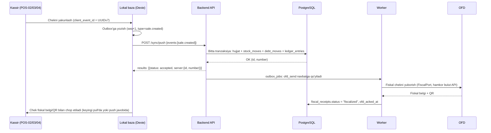
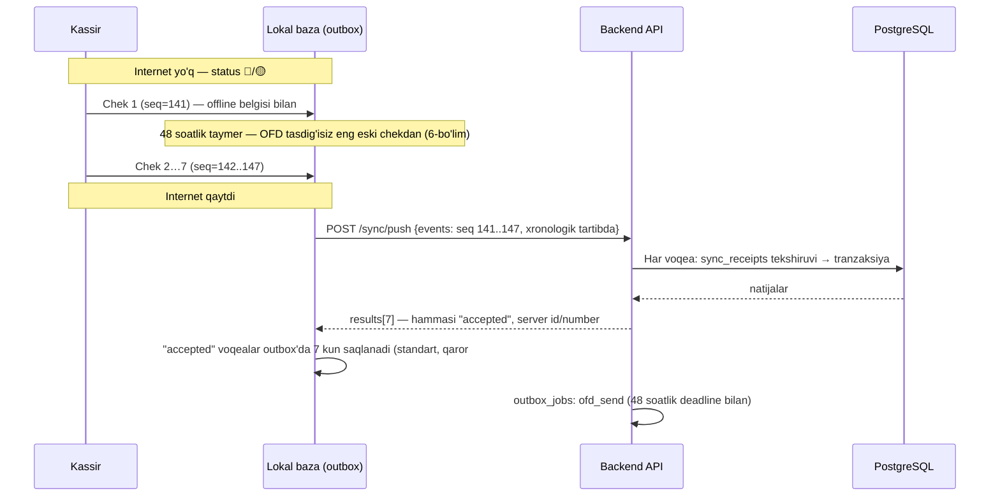
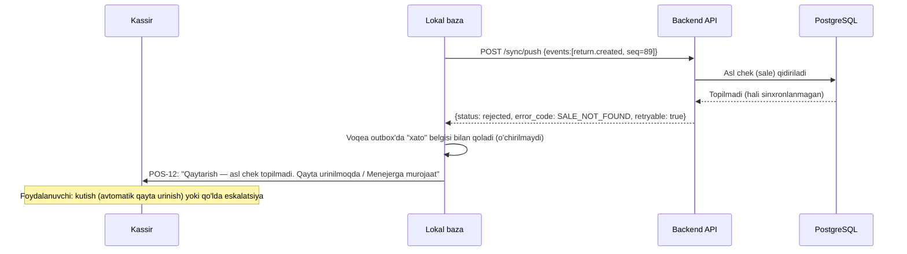

# Offline sinxronizatsiya

**Maqsad:** Qurilma (veb-kassa/Android POS) offline rejimda ishlashi, outbox-asosida sinxronizatsiya protokoli, to'qnashuv (konflikt) qoidalari, fiskal 48 soatlik muddat va obuna/litsenziya bilan bog'liq offline cheklovlarni belgilash.
**Kim uchun:** Frontend (PWA/veb-kassa), Android ishlab chiquvchilar, backend (`modules/sync`).
**Bog'liq fayllar:** `research_notes/texnik/04-arxitektura-va-stack.md` (2-, 6-bo'lim), `research_notes/texnik/02-kassa-ofd-markirovka.md` (1-ilova 31-band), `research_notes/ochiq-savollar/P1-soliq-fiskal.md` (OQ-004 — 48 soatlik blok), `research_notes/ochiq-savollar/P2-efaktura-markirovka.md` (OQ-021, OQ-026, OQ-027), `research_notes/ochiq-savollar/P3-tolovlar-bank.md` (OQ-032 — UzQR), `11-malumotlar-modeli.md` (`client_event_id`, `sync_receipts`, `devices`, `stock_lots`, `recost_jobs`), `14-autentifikatsiya-oauth2.md`, `24-frontend-arxitekturasi.md` (Dexie, vite-plugin-pwa, Idempotency-Key), `03-modullar-talablari.md` (M01, M02, M04, M08, M16), `06-ekranlar-umumiy.md` (POS-02…POS-15), `33-1c-integratsiya.md` §5.22, §7.3 (1C eksporti tayyorligi, `outbox_state`).
**Holat:** joriy, 2026-10-16.

## Asosiy xulosalar

1. Sinxronizatsiya **append-only event-log (outbox naqshi)** asosida, CRDT emas — fiskal chek raqami smena ichida qat'iy ketma-ket bo'lishi shart, bu CRDT'ning "istalgan tartibda birlashish" modeliga mos kelmaydi (`research_notes/texnik/04-arxitektura-va-stack.md`, §2.2).
2. Qurilma (veb-kassa/Android POS) **katalog, narx, mijoz+qarz, limit/huquq va smena** ma'lumotlarini lokal saqlaydi; dastlabki to'liq nusxa (snapshot) + keyin `updated_at`/`version` kursori bo'yicha o'sib boruvchi (delta) yangilanish bilan yangilanadi (1-bo'lim).
3. Har bir lokal amal **outbox voqeasi** (JSON: `client_event_id`, `device_id`, `actor_user_id`, `type`, `created_at`, `payload`, `seq`) sifatida yoziladi; yuklash — `POST /sync/push` (partiyali, idempotent, har voqea uchun alohida natija), yuklab olish — `GET /sync/pull?cursor=` (2-, 3-bo'lim).
4. Rad etilgan voqea **o'chirilmaydi** — lokal outbox'da xato belgisi bilan qoladi, foydalanuvchi uni ko'radi (POS-12) va amal qiladi (qayta urinish, qo'lda tuzatish yoki Menejerga eskalatsiya); boshqa (bog'liq bo'lmagan) voqealar bu orada davom etadi.
5. To'qnashuvlar **delta (harakat) qo'shish** tamoyili bilan hal qilinadi, qiymatni to'g'ridan-to'g'ri almashtirish bilan emas: ombor qoldig'i manfiy bo'lsa ham sotuv **ruxsat etiladi**, qarz limiti oshsa ham sotuv **ruxsat etiladi** — ikkisi ham bayroq (flag) bilan belgilanadi va Egasi/Menejerga bildirishnoma boradi; faqat ma'lumotnoma (reference) maydonlari — ism, telefon, izoh kabilar — `version` ustuni bilan **last-writer-wins** (5-bo'lim).
6. **48 soatlik fiskal blok — majburiy** (VMQ-943 2-ilova 6-band 6-xatboshi, VMQ-23 23.01.2026 tahriri; qaror #43): taymer — shu `cash_register`da `fiscal_receipts.ofd_acked_at IS NULL` bo'lgan **eng eski** fiskal chekning `created_at`i (har kassa uchun alohida). Bosqichlar: 24 soat — 🟡 sariq, 40 soat — 🔴 qizil + Egasiga Telegram (M18), 46 soat — har chek oldidan modal (sotuv to'xtamaydi), **48 soat — blok**: shu kassada yangi fiskal chek chiqarilmaydi (`FISCAL_OFFLINE_48H_BLOCKED`), faqat sinxronizatsiya/qayta yuborish ishlaydi, audit yoziladi; to'plangan cheklar OFD tasdig'ini olgach blok avtomatik yechiladi. Fiskal modulning o'z bloki (`fm_state`, `FISCAL_DEVICE_LOCKED`) bundan mustaqil (6-bo'lim).
7. Markirovkalangan tovar offline siyosati (qaror #17, #62): **sotish** — narx qurilmada **ma'lum** bo'lsa ruxsat; kod **fiskal chek ichida** fiskal modulda imzolanib OFD orqali Asl belgisiga boradi (CRPT'ga alohida "sotdim" chaqiruvi yo'q), lokal dublikat-kod tekshiruvi majburiy; narx noma'lum bo'lsa **taqiq** (US-M01-03, `03-modullar-talablari.md`; `21-integratsiyalar.md` §4); **ko'chirish** (o'z filiallar/omborlar orasida) — **ruxsat**, sinxronlanadi, audit bilan, lekin avtotransportda tashishdan oldin **e-TTN majburiy** (qaror #63); **qaytarish** — **faqat internet bor paytda** (ichki tanlov, qonundan qat'iyroq). To'liq tafsilot 7-bo'limda. To'lov: mustaqil bank terminali bilan "karta"ni qo'lda belgilash (`terminal_ref`, karta rekvizitlari — qaror #64) — online va offline'da ruxsat (`21-integratsiyalar.md` §9.2); UzQR — faqat online (2-bo'lim; server tekshiruvi — `18-api-kassa.md` §4.1: `is_offline=true` va `method='uzqr'` → `VALIDATION_ERROR`).
8. Veb-kassada bir nechta tab ochilishi xavfli (ikki tab bitta lokal `seq` raqamini ikki marta bersa) — **Web Locks API** bilan yagona yozuvchi tab saylanadi, **BroadcastChannel** bilan holat (online/offline, yangi ma'lumot) boshqa tablarga tarqatiladi (10-bo'lim).
9. Lokal ma'lumot shifrlanishi brauzerda OS darajasida (disk shifrlash tavsiyasi) + chiqishda (logout) foydalanuvchi/tenant ma'lumotlari bazasi (`erp-pos`) to'liq tozalanadi, qurilma sozlamalari bazasi (`erp-device` — printer, katalog ko'rinishi) saqlanadi; hal qilinmagan karta urinishi (`card_attempts`) bo'lsa logout bloklanadi; Android'da (keyingi bosqich) SQLCipher bilan butun Room bazasini shifrlash tavsiya etiladi (`28-android-pos.md`) (12-bo'lim).
10. Test strategiyasi — tarmoq xatosi, soat farqi, ikki qurilmaning bir vaqtda to'qnashuvi, qayta yuborilgan voqea (duplicate), qurilma bekor qilinishi kabi stsenariylar uchun **chaos/tarmoq testlari** (Playwright network emulation, MSW) (12-bo'lim).
11. **Autentifikatsiya OAuth 2.0 asosida** (`14-autentifikatsiya-oauth2.md`): sync uchun token — veb-kassada BFF cookie, Androidda to'g'ridan-to'g'ri Bearer access token, ikkisi ham qurilmaga bog'langan refresh token bilan (muddati 48 soatlik offline oynadan ancha uzun); kassir **PIN — OAuth grant emas**, mahalliy `actor_user_id` biriktiruvchi vosita (§2 va §3.4). Obuna muddati tugagan tenant uchun qurilma imzolangan litsenziya tokeni bilan **serversiz** mahalliy bloklanadi (§3.5).

---

## 1. Qurilmada saqlanadigan ma'lumotlar va yangilash

| Ma'lumot toifasi | Lokal jadval (Dexie, veb) | Dastlabki yuklash | Yangilanish usuli |
|---|---|---|---|
| Katalog (`products`, `product_categories`, `units`) | `catalog` | To'liq snapshot, login/qurilma ro'yxatdan o'tganda | Delta: `GET /sync/pull?scope=catalog&cursor=<updated_at,id>` |
| Shtrix-kodlar (`product_barcodes`) | `barcodes` | To'liq snapshot | Delta, `cursor` bo'yicha |
| Narxlar (`product_prices`, faqat amaldagi) | `prices` | To'liq snapshot (faqat joriy, tarix emas) | Delta |
| Mijozlar + qarz balansi (`counterparties`, `debt_balances`) + `open_debt_docs[]` (faqat `receivable_balance > 0` mijozlar) | `customers` | To'liq snapshot (shu filialga tegishli/umumiy) | Delta (`scope=customers`) — balans qiymati serverda hisoblanadi, qurilma faqat o'qiydi; `open_debt_docs[]` sxemasi pastda |
| Qoldiq (`stock_balances`, shu filial omborlari) | `stock` | Katalog bilan birga | Delta (`scope=stock`), faqat ko'rsatish |
| Limitlar (kredit limiti, chegirma/qaytarish limiti — `role_permissions.limit_value`, `counterparties.credit_limit`) | `limits` | Katalog bilan birga | Delta |
| Huquqlar (`role_permissions`, `memberships`) | `permissions` | Login paytida to'liq | Delta; o'zgarsa darhol pull (login session yangilanishi) |
| Joriy smena (`shifts`) | `shift` | Smena ochilganda yaratiladi (lokal) | Push orqali serverga, server tasdiqlagandan keyin doimiy holatga o'tadi |
| Outbox (chek, qaytarish, qarz to'lovi, kassa harakati) | `outbox` | — | Faqat push (2-bo'lim) |
| Markirovka kodlari keshi (`marking_codes`, holati `sold`/`pending_verification`, shu filial bo'yicha) | `marking_codes` | Katalog bilan birga | Delta — lokal dublikat-kod tekshiruvi uchun (7-bo'lim) |
| Fiskal holat (`cash_registers.fm_state`, `last_unacked_receipt_at`, `fm_receipts_pending`; chekning `fiscal_receipts.ofd_acked_at`) | `fiscal` | Smena ochilganda | Push javobi va delta pull; 48 soat taymeri uchun (6-bo'lim) |
| Do'kon sozlamalari va qoidalar (`tenants.settings`: tarozi shtrix-kod formati va uning versiyasi, `card_manual_fallback`; faol `discount_rules`; obuna holati `subscriptions.status`; shu filialning faol `card_terminals` qatorlari — PAN/kalitlarsiz, qaror #71) | `settings` | Login/snapshot bilan | Delta; tarozi formati versiyasi o'zgarsa majburiy pull |
| Karta terminali urinishlari (qaror #71) — hal qilinmagan va hali voqeaga tushmagan urinishlar: `attempt_id`, `card_terminal_id`, `amount`, `kind`, `status` (`pending`/`approved`/`declined`/`unknown`/`voided`), `started_at`, oxirgi natija (`CardResult`, PAN'siz), `client_event_id` | `card_attempts` | — (faqat lokal) | Serverdan pull qilinmaydi; tozalash qoidasi — 2.1-bo'lim. Sahifa qayta yuklansa ham saqlanadi — `pending`/`unknown` yozuv bor ekan shu terminalda yangi `purchase` bloklanadi |
| Qurilma sozlamalari (`printer.*` — transport, qog'oz kengligi, kod sahifasi, chop rejimi, LAN/bulut printer manzili; `pos.catalog_view` — `24-frontend-arxitekturasi.md` §5.1/§6.1, `07-ekran-tafsilotlari.md` POS-16) | `device_settings` — **alohida** Dexie bazasi `erp-device` (qolgan barcha jadvallar — `erp-pos` bazasida) | — (faqat lokal) | Serverga yuborilmaydi va sinxronlanmaydi; shaxsiy/tenant ma'lumoti saqlamaydi, shuning uchun logout'da o'chirilmaydi (12-bo'lim) |

**`customers[].open_debt_docs[]`** (qaror #67) — qurilma offline qarz to'lovini allokatsiya qilishi va `debt_settlement` chek qatorlarini hisoblashi uchun (`18-api-kassa.md` §12.2):

```
{doc_type: "sales"|"debt_openings"|"debt_writeoffs", doc_id, doc_date, due_date|null, open_amount,
 lines: [{sale_line_id, product_id, name, name_ru, mxik_code, unit_code, barcode, qty, price, line_total,
          vat_rate, vat_exemption_code, settled_amount, marking_code|null}]}
```

`lines` faqat `doc_type="sales"` uchun. Allokatsiya tartibi: avval `sales` + `debt_openings` ochiq qoldiqlari `ORDER BY COALESCE(due_date, doc_date), doc_date, doc_id`; keyin `debt_writeoffs` (eng eskisi birinchi). Yagona funksiya — TS `shared/lib/debt-allocation` va Python `app/shared/debt_allocation.py` (umumiy test-vektorlar `shared/debt-allocation-vectors.json`); server postingda qayta hisoblaydi (§5, `debt_allocation_mismatch`).

**Dastlabki to'liq nusxa (snapshot)**: qurilma birinchi marta ro'yxatdan o'tganda (`devices` yozuvi yaratilganda) yoki lokal baza tozalanganda (`GET /sync/pull?scope=all&cursor=` bo'sh kursor bilan) — sahifalab (`page_size=500` qator/sahifa — standart, sozlanadi, qaror #54) yuklanadi, `has_more=true` bo'lsa davom etiladi.

**Delta yangilanish**: har bir jadvalda `updated_at` (yoki ma'lumotnomalarda `version`) bo'yicha kursor; qurilma oxirgi ko'rgan `(updated_at, id)` juftligini saqlaydi va keyingi so'rovda yuboradi (sahifalashda barqaror tartib uchun ikkilik kursor — faqat `updated_at` bilan bir xil millisekundda bir nechta yozuv bo'lsa tartib buzilmasligi uchun). Chastota — veb-kassa fon rejimida har **60 soniyada** + `online` hodisasida (internet qaytganda) darhol (standart, sozlanadi — qaror #54) + `pageMounted`/smena ochilganda majburiy.

---

## 2. Outbox voqea formati (JSON schema)

```json
{
  "client_event_id": "018f2c3a-9b7e-7a41-8e2f-6b1a2c3d4e5f",
  "device_id": "018f2c2e-11aa-7b00-9c3d-aa11bb22cc33",
  "seq": 142,
  "type": "sale.created",
  "created_at": "2026-10-14T04:12:03.482Z",
  "actor_user_id": "018f2c3a-aa11-7b00-9c3d-aa11bb22cc33",
  "payload": { "...": "hujjat turiga mos tuzilma, quyida" }
}
```

| Maydon | Tur | Izoh |
|---|---|---|
| `client_event_id` | UUIDv7 | Qurilmada yaratiladi (`11-malumotlar-modeli.md` §2 — vaqt bo'yicha tartiblangan); `sync_receipts.client_event_id` bilan idempotentlik ta'minlanadi |
| `device_id` | UUIDv7 | `devices` jadvaliga mos, ro'yxatdan o'tgan qurilma |
| `seq` | integer | Qurilma ichidagi lokal monoton ketma-ket raqam (restart/qayta ishga tushirishda ham davom etadi, lokal bazada saqlanadi) — server global tartib emas, faqat shu qurilma ichidagi nisbiy tartibni tasdiqlash uchun ishlatadi |
| `type` | enum | **Yakuniy ro'yxat**: `shift.opened`, `shift.closed`, `sale.created`, `sale.draft_voided` (to'lovdan oldin chek/qator bekor qilish — audit, registrga ta'sir yo'q), `receipt.reprinted` (chekni qayta chop etish — audit), `return.created`, `debt_payment.created`, `cash_movement.created`, `counterparty.created` (tezkor mijoz, US-M08-05), `transfer.sent` (o'z filiallari orasida ko'chirish jo'natilishi — offline'da qoralama mazmunsiz, jo'natish bilan bir voqea), `transfer.received` (ko'chirishni qabul qilish), `stock_count.line_recorded` (M05, bitta qurilma), `expense.created` (POS-14 «Xarajat», `source=cash`; payload — `18-api-kassa.md` §13.2) — payload sxemalari `18-api-kassa.md` (§3–§13), `19-api-ombor.md` (§13, §14), `20-api-moliya-admin.md` (#42)da aniqlangan |
| `created_at` | ISO 8601 UTC (`Z`), qurilma soati | Fiskal 48-soat hisobi va buxgalteriya sanasi shu maydondan server hisoblagan `effective_created_at` bo'yicha olinadi (8-bo'lim, soat farqi) |
| `actor_user_id` | UUID | Amalni bajargan kassir (offline PIN bilan kirgan); server uning `created_at` paytida faol membership'ini tekshiradi; push qilgan sessiya foydalanuvchisi farq qilsa, ikkalasi audit'ga yoziladi |
| `payload` | object | Hujjat turiga mos (masalan `sale.created` uchun `sales` + `sale_lines` + `sale_payments`, `11-malumotlar-modeli.md` §6 tuzilishiga mos); `sale.created`/`return.created`/`debt_payment.created`da `receipt_seq` — payload **ildizida** (ichma-ich `fiscal` obyekti emas), `integer|null`, qurilma beradi (qaror #12) — fiskal chek yaratilmaydigan faqat-qarz sotuvda (va pul bilan qaytarilgan qismi 0 bo'lgan qaytarishda) `null`; xuddi shu ildizda `fiscal_result` (`18-api-kassa.md` §4.1); integratsiyalangan karta to'lovi qatorida (`payments[]` / `debt_payments` / qaytarish) — `card_result` (terminal natijasi, qaror #71, 2.1-bo'lim); `shift.opened`da xuddi shunday `shift_no` — qurilma beradi, kassa ichida ketma-ket (3.3-bo'lim) |

Qarzga sotish alohida voqea turi emas — `sale.created` ichida `sale_payments.method = "debt"` sifatida yuboriladi (US-M08-01, US-M08-05); qarz daftaridagi tezkor yozuv (POS-13) ham shu yo'l bilan amalga oshadi.

Hisobdan chiqarish (write-off) — **faqat online** back-office, outbox voqea turi yo'q (qaror #54).

**To'lov usullari offline** (`sale_payments`, `debt_payments`):

- `cash` — online va offline.
- `card` — online va offline, ikki kiritish usuli (`card_entry_mode`, qaror #71) — 2.1-bo'lim:
  - `integrated` (kassaga faol `card_terminals` bog'langan) — POS summani terminalga yuboradi, natija avtomatik; `card_terminal_transaction_id`, `rrn`, `card_mask` majburiy;
  - `manual` (mustaqil bank terminali yoki zaxira) — `card_type` (`personal`/`corporate`/`social`/`unknown`) majburiy, `card_mask` va `rrn` — `card_type='social'` bo'lsa majburiy, `terminal_ref` ixtiyoriy, `manual_reason` majburiy (qaror #64; `21-integratsiyalar.md` §9.2); siyosat `tenants.settings.card_manual_fallback`.
  Chekda to'lov shakli (`fiscal_receipts.payment_form`: `cash`/`card`/`qr`/`mixed`) va karta turi 2026-10-22 dan majburiy rekvizit (VMQ-943 1-ilova 7-band, VMQ-393 tahriri).
- `uzqr` **dinamik** (`qr_type='dynamic'`) va `click`/`payme`/`uzum` — **faqat online** (provayder tranzaksiyasi `provider_tx_id` majburiy).
- `uzqr` **statik** (`qr_type='static'`, kassir qo'lda tasdiqlaydi) — **faqat online** (qaror #64): kassir to'lovni bank ilovasi/SMS'da ko'rib qo'lda tasdiqlaydi, bu tekshiruv internetsiz mumkin emas; offline rejimda POS UzQR to'lov usulini yopadi (`21-integratsiyalar.md` §9.1).

### 2.1 Integratsiyalangan karta terminali offline (qaror #71)

**Ishlash sharti — do'kon interneti emas, lokal zanjir**: `AgentEcrAdapter` (Windows veb-kassa) zanjiri POS → `127.0.0.1:47110/v1/card/*` → Do'kon agenti → LAN/Wi-Fi'dagi terminal; terminal bankka **o'z kanali** (4G/Wi-Fi/SIM) bilan chiqadi. Shuning uchun do'kon interneti uzilganda ham integratsiyalangan karta ishlaydi; `android_intent`/`softpos` adapterlari ham qurilma ichida ishlaydi. Faqat `CloudTerminalAdapter` serverga bog'liq — server yo'q bo'lsa integratsiyalangan yo'l yopiladi.

| Holat | Xatti-harakat |
|---|---|
| Internet yo'q, agent + terminal ishlayapti | Integratsiyalangan karta **ishlaydi**; natija Dexie/Room'da `card_attempts` lokal jadvalida (`attempt_id` kalit) va sotuv bilan birga outbox'ga tushadi |
| Terminal `offline`/`error`, agent javob bermaydi (`$agentStatus != online`), `cloud` adapterda server yo'q | POS integratsiyalangan yo'lni yopadi, sababni ko'rsatadi (`CARD_TERMINAL_UNREACHABLE`); zaxira — qo'lda kiritish `card_manual_fallback` bo'yicha (pastda) |
| Taymaut/aloqa uzildi — natija noma'lum | Lokal urinish `unknown`; POS darhol `GET /v1/card/tx/{attempt_id}` (agent jurnali yoki terminal holat so'rovi). Hal bo'lmaguncha **shu terminalda va shu chekda yangi `purchase` bloklanadi** (`CARD_OUTCOME_UNKNOWN`) — offline'da ham; `purchase` hech qachon avtomatik takrorlanmaydi |

**Lokal urinish yozuvi** (Dexie `card_attempts`, `24-frontend-arxitekturasi.md` §6.5 / Room `card_attempts`): `attempt_id` (UUIDv7, terminalga yuborishdan **oldin** yoziladi — POS tab yopilsa yoki sahifa qayta yuklansa ham yo'qolmaydi), `card_terminal_id`, `local_id`, `kind`, `amount` (Money), `client_event_id` (bog'lanadigan sotuv/qarz to'lovi/qaytarish), `status` (`pending`/`approved`/`declined`/`unknown`/`voided`), `started_at`, oxirgi natija (`CardResult`, `18-api-kassa.md` §2.7, PAN'siz). Ilova qayta ochilganda `pending`/`unknown` yozuvlar uchun avval holat so'rovi bajariladi — ular hal qilinmaguncha shu terminalda yangi karta to'lovi boshlanmaydi.

**`card_attempts` tozalash** — yozuv faqat natijasi boshqa joyda **chidamli** saqlangach o'chiriladi (bitta Dexie tranzaksiyasida):
- `approved` (purchase/refund) — natija `card_result` sifatida hujjat voqeasiga (`sale.created`/`return.created`/`debt_payment.created`) yozilib, shu voqea `outbox`ga qo'yilgan tranzaksiyada o'chiriladi (outbox endi natijaning yagona lokal manbai; server tasdig'i kutilmaydi);
- `declined` — natija ekranda ko'rsatilgach o'chiriladi (to'lov qatori yaratilmaydi); online bo'lsa avval `POST /card-terminal-transactions` (ixtiyoriy, audit uchun);
- `voided` va `void` urinishining o'zi — sotuv bekor qilingach: online — `POST /card-terminal-transactions` muvaffaqiyatli bo'lgach o'chiriladi; offline — yozuv `voided` holatida qoladi va internet qaytganda shu endpoint bilan yuborilib o'chiriladi (sotuvsiz `approved` urinish serverga yetmay qolmasligi uchun — aks holda `card_orphan_transaction`);
- `pending`/`unknown` — **hech qachon avtomatik o'chirilmaydi**: faqat holat so'rovi yoki menejer yopishi (`resolved_by`) natijasi `approved`/`declined` bo'lgach yuqoridagi qoidalar bo'yicha;
- logout (12-bo'lim) `card_attempts` bo'sh bo'lmaguncha **bloklanadi** — har bir yozuv avval yuqoridagi qoidalar bo'yicha hal qilinadi (holat so'rovi, menejer yopishi, internet qaytgach yuborish); hal qilinmagan urinish bilan `erp-pos` bazasi o'chirilmaydi.

**Outbox'ga yozish** — alohida voqea turi yo'q (2-bo'lim `type` ro'yxati o'zgarmaydi). Natija tegishli hujjat voqeasi ichida, to'lov qatorida keladi (#68 dagi `fiscal_result` naqshi):
- `sale.created` → `payments[i].card_result`; `debt_payment.created` → payload ildizida `card_result`; `return.created` → `refund_card.card_result`;
- `card_result` — `CardResult` sxemasi (`18-api-kassa.md` §2.7): `{attempt_id, card_terminal_id, kind, original_attempt_id?, status, amount (Money), approval_code, rrn, stan, card_mask, card_scheme, card_type, card_type_source, entry_mode, tid, mid, acquirer, tx_at, resolved_by, decline_code?, decline_message?, slip_text?}`;
- server shu tranzaksiyada `card_terminal_transactions` qatorini `id = attempt_id` bo'yicha **upsert** qiladi (online'da POS uni `POST /card-terminal-transactions` bilan oldinroq yozgan bo'lishi mumkin — idempotent), `doc_type`/`doc_id`ni bog'laydi va to'lov qatoriga `card_terminal_transaction_id` qo'yadi;
- sotuvga bog'lanmagan tasdiqlangan urinish (masalan sotuv bekor qilinib `void` ham o'tmagan) — qurilma uni `card_attempts`dan `POST /card-terminal-transactions` bilan alohida yuboradi; server `doc_id IS NULL` `approved` purchase'ni 24 soatdan keyin `sync_exceptions(kind='card_orphan_transaction')` ga chiqaradi.

**Tartib (offline'da ham bir xil)**: karta `approved` → fiskal chek (FM, lokal ko'prik — `payment_form='card'`, `card_type`, `card_mask`, `rrn`) → `sale.created` outbox'ga. Karta tasdiqlanib chek chiqmasa sotuv "to'lov qabul qilingan, chek kutilmoqda" holatida qoladi; kassir bekor qilsa — avtomatik `void` (`card.void.auto`), uning natijasi ham lokal urinish sifatida saqlanadi va voqea bilan yuboriladi. 48 soatlik fiskal blok (6-bo'lim) karta yo'lini ham yopadi — chek chiqmaydigan kassada `purchase` boshlanmaydi.

**Zaxira (qo'lda kiritish) offline**: `card_manual_fallback` qiymati qurilmadagi `tenant` keshidan (1-bo'lim) olinadi; `manager_approval` — Menejer/Egasi PIN **lokal** tekshiriladi (`card.manual_entry.approve`, tasdiq turi `card_manual_entry`), voqeada `approvals[]` (`doc_approvals`, `mode='local_pin'`); `forbid` — offline'da ham bloklanadi. Server qayta tekshiradi: siyosat talab qilgan tasdiq yo'q bo'lsa voqea rad etilmaydi (sotuv va fiskal chek bo'lib o'tgan) — `sync_exceptions(kind='approval_limit_exceeded_offline')` + M18.

**Server tekshiruvi** (rad etmaydi — sotuv allaqachon bo'lgan): `card_result.amount` ≠ to'lov summasi, takroriy `(tid, rrn)`, `attempt_id` boshqa hujjatga allaqachon bog'langan yoki serverdagi holat (`POST /card-terminal-transactions` yoki `cloud` webhook'idan) qurilmanikidan farq qilsa — `sync_exceptions(kind='card_result_mismatch')` (`CARD_TRANSACTION_MISMATCH`), BO-14; registrlar voqeadagi to'lov bo'yicha yoziladi.

---

## 3. Yuklash protokoli

### 3.1 `POST /sync/push`

```json
// So'rov
{
  "device_id": "018f2c2e-...",
  "events": [
    { "client_event_id": "...", "device_id": "018f2c2e-...", "actor_user_id": "...", "seq": 141, "type": "sale.created", "created_at": "...", "payload": {...} },
    { "client_event_id": "...", "device_id": "018f2c2e-...", "actor_user_id": "...", "seq": 142, "type": "return.created", "created_at": "...", "payload": {...} }
  ],
  "outbox_state": { "pending_count": 0, "oldest_pending_created_at": null }
}
```

`outbox_state` — **majburiy** (yo'q bo'lsa `422 VALIDATION_ERROR`): qurilma outbox'ining shu so'rovga **kiritilmagan** qismi holati — `pending_count` (integer ≥ 0) — server natijasi hali `accepted`/`duplicate` bo'lmagan voqealar soni (yuborilishini kutayotgan, partiyaga sig'magan va avval `rejected` bo'lib qayta yuborilishi kutilayotganlar), `oldest_pending_created_at` (timestamptz yoki `null`, `pending_count = 0` da majburiy `null`) — ulardan eng eskisining `created_at`i (qurilma soati, §8). Server so'rovni qayta ishlagach **bitta tranzaksiyada** `devices` ni yangilaydi: `last_sync_at = now()`, `last_seen_at = now()`, `outbox_reported_at = now()`, `outbox_pending_count = outbox_state.pending_count + shu so'rovda rad etilgan voqealar soni`, `outbox_oldest_pending_at = min(oldest_pending_created_at, rad etilgan voqealarning created_at)` (`12-db-sxema.md` `devices.outbox_*`). `outbox_*` qiymatlari 1C eksporti tayyorligi (§9, `33-1c-integratsiya.md` §7.3) va davr yopish tayyorligi (`20-api-moliya-admin.md` #16, `devices_unsynced`) uchun ishlatiladi. Push va pull'ning har so'rovida `devices.last_seen_at = now()` (push'da `last_sync_at` bilan bitta tranzaksiyada). Shu sababli onlayn qurilma outbox'i bo'sh bo'lsa ham davriy (har 5 daqiqada — standart, sozlanadi) `"events": []` bilan push yuboradi — javob `{"results": []}`.

```json
// Javob
{
  "results": [
    { "client_event_id": "...", "status": "accepted", "server": { "id": "...", "number": "K-01-2026-000154" }, "warnings": [] },
    { "client_event_id": "...", "status": "rejected", "error_code": "SALE_NOT_FOUND", "message": "Asl chek hali sinxronlanmagan", "retryable": true, "warnings": [] }
  ]
}
```

`warnings` — har bir natija (entry) darajasida, string massivi (katalog kodlari, masalan `STOCK_NEGATIVE`, `DEBT_LIMIT_EXCEEDED`) — hujjat qabul qilingan, lekin diqqatga loyiq holat bor ekanini bildiradi (xato emas).

- **Partiya hajmi**: **≤ 100 voqea/so'rov** (standart, sozlanadi — qaror #54; `sync_config`).
- **Backpressure**: server — qurilma boshiga **5 so'rov/soniya**, tenant boshiga bir vaqtda **4 ta** parallel `/sync/push` (standart, sozlanadi — qaror #54); bu chegaralardan oshsa `429 Too Many Requests` + `Retry-After` qaytariladi. Qurilma — eksponensial backoff + jitter bilan qayta uriniladi (ofline sinxronlashda to'lib-toshgan outbox'ni birdan yuborishning oldini olish uchun).
- **Idempotentlik**: server har bir `client_event_id`ni `sync_receipts`da tekshiradi (`11-malumotlar-modeli.md` §10). Oldin qabul qilingan voqea qayta yuborilsa — `status: "duplicate"`, bir xil natija (server raqami) qaytariladi, ikkinchi marta yozilmaydi.
- **Fiskal raqam**: `receipt_seq` qurilmadan keladi (`integer|null` — fiskal chek yaratilmaydigan faqat-qarz sotuvda `null`); server uni `UNIQUE (tenant_id, cash_register_id, shift_id, receipt_seq)` bilan tekshiradi. Takror bo'lsa: voqeada `fiscal_result` bor (FM imzolagan) — qabul, server `receipt_seq` ni shu smenadagi `max(receipt_seq) + 1` ga qayta raqamlaydi, qurilma qiymati `fiscal_receipts.payload.device_receipt_seq` da saqlanadi, `sync_exceptions(kind='receipt_seq_conflict')`; `fiscal_result` yo'q — `rejected`, `error_code: RECEIPT_SEQ_CONFLICT`, `retryable: false` (eskalatsiya) (qaror #68). Fiskal modul bergan raqam alohida — `fiscal_receipts.fm_receipt_seq` (`fm_terminal_id`, `fiscal_at` bilan; 6-bo'lim).
- **48 soatlik blok**: shu kassa 48 soatlik blokda bo'lgan paytda (`created_at` blok boshlanganidan keyin) yaratilgan yangi fiskal hujjat voqeasi — `rejected`, `error_code: FISCAL_OFFLINE_48H_BLOCKED`, `retryable: false` (POS buni lokal bloklagani uchun amalda faqat buzilgan/eski klientdan keladi; audit). Blokdan oldin yaratilgan voqealar odatdagidek qabul qilinadi (6-bo'lim).
- **Partiya "hammasi yoki hech narsa" emas** — har voqea alohida tranzaksiyada qayta ishlanadi; bittasi rad etilsa, qolganlari (bog'liq bo'lmasa) baribir qabul qilinadi (`results` massivi buni ko'rsatadi).

### 3.2 `GET /sync/pull?cursor=<token>&scope=catalog,prices,customers,permissions&page_size=500`

```json
{
  "cursor": "eyJ1cGRhdGVkX2F0IjoiMjAyNi0xMC0xNFQw...",
  "has_more": false,
  "catalog": [ { "id": "...", "name": "...", "updated_at": "..." } ],
  "prices": [ ... ],
  "customers": [ { "id": "...", "name": "...", "receivable_balance": "350000.00", "credit_limit": "500000.00", "version": 4 } ]
}
```

`receivable_balance` = `debt_balances.balance WHERE direction='receivable'` (yozuv bo'lmasa `"0.00"`; musbat qiymat mijoz bizga qarzdor ekanini bildiradi). `payable` kassaga yuborilmaydi.

| `scope` | Javob kaliti | Manba |
|---|---|---|
| `catalog` | `catalog` | `products`, `product_categories`, `units` |
| `barcodes` | `barcodes` | `product_barcodes` |
| `prices` | `prices` | `product_prices` (amaldagi) |
| `customers` | `customers` | `counterparties`, `debt_balances` (+ `open_debt_docs[]`, §1) |
| `limits` | `limits` | `role_permissions.limit_value`, `counterparties.credit_limit` |
| `permissions` | `permissions` | `role_permissions`, `memberships` |
| `marking_codes` | `marking_codes` | `marking_codes` (shu filial, `sold`/`pending_verification`) |
| `fiscal` | `fiscal` | `cash_registers.fm_state`, `last_unacked_receipt_at`, `fm_receipts_pending`; `fiscal_receipts.ofd_acked_at` |
| `settings` | `settings` | `tenants.settings`, faol `discount_rules`, `subscriptions.status` |
| `stock` | `stock` | `stock_balances` (shu filial omborlari) |
| `all` | hammasi | yuqoridagi barcha scope'lar |

### 3.3 Tartib kafolatlari

- Bitta qurilma ichida voqealar **har doim `seq` tartibida** yuboriladi va shu tartibda serverga yetib boradi (bir partiya ichida massiv tartibi saqlanadi).
- **Bog'liq voqealar** (masalan `return.created` o'zi tegishli `sale.created`ga bog'liq, agar asl chek hali sinxronlanmagan bo'lsa): server `SALE_NOT_FOUND` + `retryable: true` qaytaradi; qurilma bu voqeani keyingi push'da qayta yuboradi, lekin undan **keyingi, bog'liq bo'lmagan** voqealarni bloklamaydi. Boshqa (`sale.created`dan farqli) bog'liqliklar — masalan `counterparty.created`dan oldin kelgan sotuv boshqa qurilmadan, yoki `transfer.received` tegishli `transfer.sent` sinxronidan oldin kelsa — umumiy `DEPENDENCY_NOT_SYNCED` kodi (`retryable: true`, `params.entity` — `counterparties`/`transfers`/`shifts`) bilan qaytariladi, xuddi shu "qayta urinish, boshqalarni bloklamaydi" qoidasi bilan.
- Qoldiq/qarz kabi **delta-asosida** registrlar (`stock_moves`, `debt_moves`) uchun qat'iy global tartib shart emas — harakatlar qo'shiladi, tartib natijaga ta'sir qilmaydi (`04-arxitektura-va-stack.md`, §2.3).
- Fiskal chek raqami (`fiscal_receipts.receipt_seq`) — **qurilma beradi** (offline ham), outbox `seq` bilan bir Web Lock ichida; kassa + smena ichida ketma-ket. **Bitta smena — bitta qurilma** (`shifts.device_id`): boshqa qurilmadan shu smenaga voqea `rejected SHIFT_DEVICE_MISMATCH`.

### 3.4 Server validatsiyasi va rad etish

Server har bir voqeani: (1) sxema (JSON shakli, majburiy maydonlar), (2) qurilma/tenant autentifikatsiyasi (`device_id` faol va shu tenant'ga tegishlimi), (3) idempotentlik (`sync_receipts`), (4) biznes qoidalari (5-bo'lim to'qnashuv jadvali) bo'yicha tekshiradi.

**Rad etilganda**: voqea serverga yozilmaydi, lekin **qurilmadagi outbox'dan o'chirilmaydi** — `rejected` holatida, xato kodi va xabar bilan saqlanadi. POS-12 ekranida ("Sinxronlanmagan hujjatlar") bu voqea qizil belgi va aniq xato matni bilan ko'rinadi. Foydalanuvchi amali: (a) `retryable: true` bo'lsa — avtomatik/qo'lda qayta urinish, (b) `retryable: false` (masalan doimiy validatsiya xatosi) — qo'lda tuzatish yoki Menejerga/qo'llab-quvvatlashga eskalatsiya; hujjat hech qachon jim o'chirilmaydi (audit yaxlitligi uchun).

**Yopilgan davr** (qaror #69): POS voqealari (`shift.*`, `sale.created`, `return.created`, `debt_payment.created`, `cash_movement.created`, `expense.created`, `transfer.*`, `stock_count.line_recorded`) `PERIOD_CLOSED` bilan rad etilmaydi. Hujjat `doc_date` asl qoladi (fiskal haqiqat); `doc_date` yopilgan davrda bo'lsa registr sanalari (`ledger_entries.entry_date`, `vat_moves.period`, `cash_moves`/`debt_moves` sanasi) — birinchi ochiq davrning 1-kuni, `stock_moves.moved_at` — asl biznes vaqti (§8), `ledger_entries.analytics.correction_of_period = "YYYY-MM"` (asl oy); `sync_exceptions(kind='late_in_closed_period', details:{period, doc_date})` + Buxgalterga M18. Back-office REST hujjatlari uchun `PERIOD_CLOSED` qoidasi amal qiladi (`17-api-umumiy.md` §15).

**401 (access token/sessiya tugagan)** — rad etish emas: voqealar `pending` holatida qoladi, `rejected` bo'lmaydi; push to'xtatiladi. Avval qurilma **jim** (foydalanuvchidan so'ramasdan) OAuth refresh token bilan yangi access token olishga urinadi (`14-autentifikatsiya-oauth2.md` §7–8 — refresh token muddati qurilmaga bog'langan holda 48 soatdan ancha uzun); muvaffaqiyatli bo'lsa push davom etadi, foydalanuvchi hech narsa sezmaydi. Refresh ham muvaffaqiyatsiz bo'lsa (masalan mutlaq muddat tugagan yoki obuna `restricted`, pastda) — POS ustida qayta kirish oynasi ochiladi: **parol** bilan (Egasi/Menejer), shundan keyin kassir odatdagidek PIN bilan davom etadi — OTP kundalik login usuli emas, faqat ro'yxatdan o'tish/parol tiklashda ishlatiladi (`14-autentifikatsiya-oauth2.md` §4.2). Bunda **Dexie tozalanmaydi** — bu logout emas. Qayta kirishda server yangi sessiyani avvalgi `device_id`ga bog'laydi (boshqa tenant/qurilma bo'lsa push'ga ruxsat yo'q), keyin push `seq` tartibida davom etadi. `403 DEVICE_REVOKED` — 9-bo'lim. Veb-kassa — BFF orqali cookie-autentifikatsiya (token brauzerga chiqmaydi), Android — to'g'ridan-to'g'ri Bearer access token; qurilma tokeni (device_id biriktirilgan OAuth token) shu bilan **faqat Android**da to'g'ridan-to'g'ri ishlatiladi — veb-kassa hamon to'g'ridan-to'g'ri Bearer bilan chaqirmaydi, lekin veb-kassa ham `devices` yozuviga ega (litsenziya tokeni uchun, pastdagi "Obuna va offline litsenziya" bandi). Veb-kassaning cookie-autentifikatsiyali so'rovlari (shu jumladan `/sync/push`/`/sync/pull`) `X-CSRF-Token` talab qiladi (`15-xavfsizlik-va-audit.md` §1.3).

### 3.5 Obuna va offline litsenziya

Obuna muddati (24 soatlik imtiyoz) tugagan tenant uchun kassa **to'liq to'xtaydi** (qaror #15). Mexanizm: har qurilma online bo'lganda imzolangan **litsenziya tokeni** (`license`, JWT: `tenant_id`, `device_id`, `valid_until = min(grace_ends_at, issued_at + 7 kun)`) oladi va mahalliy saqlaydi (Dexie `settings`); qurilma har ilova ochilganda/davriy va har yangi outbox yozishdan oldin bu tokenni **serversiz** tekshiradi — muddat o'tgan bo'lsa yangi sotuv/amalni mahalliy bloklaydi va **barcha ekranlar (ko'rish va eksport ham) yopiladi**.

Ikki tor istisno:

- **D1 — lokaut drain** (qaror #19): lokautdan oldin, imtiyoz davrida qurilmada yaratilgan va hali serverga yuborilmagan fiskal voqealar (cheklar) yo'qolmasligi uchun (48 soatlik fiskal muddat, 6-bo'lim) qurilmaning bekor qilinmagan refresh tokeni cheklangan **`sync.drain`** scope bilan access token oladi. Shu token bilan **faqat** `POST /sync/push` ishlaydi, u ham **faqat** `created_at <= grace_ends_at` (lokaut boshlangan payt) bo'lgan voqealar uchun — undan keyingi/yangi voqealar `rejected: SUBSCRIPTION_RESTRICTED` bilan qaytariladi. Boshqa hech qanday endpoint, ekran yoki yangi login ochilmaydi. Frontend bu holatni **logout deb hisoblamaydi** — Dexie/outbox o'chirilmaydi, fon rejimida drain davom etadi.
- **D2 — faqat to'lov sahifasidan eksport** (qaror #20): lokaut davrida ma'lumot eksporti **faqat** to'lov (billing) sahifasidan, ro'yxatdagi telefon raqamiga yuborilgan OTP (`purpose=data_export`) tasdig'i bilan — Telegram birinchi, SMS zaxira (qaror #34) — faqat Egasi (`billing.manage`) uchun ruxsat etiladi; boshqa barcha ekran (kassa va back-office) yopiq qoladi.

Bu ikkisi — fiskal 48 soatlik taymerdan (6-bo'lim) **mustaqil, alohida** muddat: ikkisi bir-biriga bog'liq emas, biri tugashi ikkinchisiga ta'sir qilmaydi. To'liq mexanizm, token formati va sequence diagramma — `14-autentifikatsiya-oauth2.md` §16–17 (drain — §16.4, foydalanuvchi tasdig'i so'ralsin).

---

## 4. Diagrammalar

### 4.1 Onlayn sotuv



Diagramma `FiscalPort`ning hamkor bulut API adapterini ko'rsatadi. **Do'kon agenti** (lokal ko'prik, qaror #60) adapterida chek yakunlanganda POS uni agent orqali fiskal modulda (FM) imzolatadi, FM chekni OFD'ga o'zi yuboradi (tarmoq bo'lmasa — keyin `resend`), server esa natijani (`fm_receipt_seq`, `fiscal_at`, `ofd_acked_at`) push/agent orqali oladi (6-bo'lim).

### 4.2 Offline sotuv + keyinroq sinxron



### 4.3 Rad etilgan voqea



---

## 5. To'qnashuv (konflikt) qoidalari

| Stsenariy | Qoida | Manba |
|---|---|---|
| Ombor qoldig'ida overselling (ikki qurilma oxirgi donani oflaynda sotgan) | Sotuv **ruxsat etiladi**; qoldiq manfiy bo'lishi mumkin, `stock_balances`ga manfiy qiymat yoziladi, BO-03'da "⚠ manfiy qoldiq" belgisi; tannarx `pending_cost` sifatida oxirgi ma'lum narxda, keyingi kirimda qayta hisoblanadi | `11-malumotlar-modeli.md` §7; `04-arxitektura-va-stack.md` §2.3 |
| Qarz limiti offline oshib ketgan | Sotuv **ruxsat etiladi** (allaqachon bo'lib o'tgan — sotuv va fiskal chek bekor qilinmaydi); qurilma oxirgi ma'lum qoldiq bo'yicha ogohlantiradi, kassir baribir sotsa qarz shundayligicha qoladi; server qayta tekshiradi, `sync_exceptions(kind='debt_limit_exceeded_offline')` yoziladi, internet qaytganda Egasi/Menejerga M18 orqali bildirishnoma (qaror #23 — tavsiya #7) | US-M08-01; `04-arxitektura-va-stack.md` §2.3 |
| Narx offline o'zgargan (server narxi yangilangan, qurilma eski narxda sotgan) | Chekdagi narx **"qotiriladi"** — avtomatik tuzatilmaydi; farq Buxgalter ko'rib chiqadigan **istisno** sifatida belgilanadi | M09 chekka holatlar (`03-modullar-talablari.md`); `04-arxitektura-va-stack.md` §2.3 |
| Mahsulot offline sotuv vaqtida arxivlangan (serverda keyin arxivlangan, qurilma bilmagan) | Hujjat **qabul qilinadi** (tovar sotuv vaqtida faol edi); "arxivlangan tovar bilan yozilgan" bayrog'i, Menejerga ko'rinadi, bloklanmaydi; sinxron istisnosi sifatida Buxgalter ko'rib chiqadi (pastda) | qaror #56 |
| Bir xil mijoz ikki joyda tahrirlangan (ism/telefon/izoh) | **Last-writer-wins**, `counterparties.version` bilan optimistik qulflash; kech kelgan `client_event_id` server qabul vaqti bo'yicha g'olib, eski qiymat `audit_log`ga | `11-malumotlar-modeli.md` §1 (`version INT`) |
| Mijoz qarz balansi/kredit limiti | **Hech qachon LWW emas** — balans faqat `debt_moves` delta sifatida qo'shiladi (konflikt yo'q, hisoblanadigan registr); limit maydoni (reference) — LWW + version | `11-malumotlar-modeli.md` §7 |
| Smena bir vaqtda ikki joyda yopilmoqchi (nazariy) | Server tomonida `shifts.status` optimistik tekshiruv bilan himoyalanadi — ikkinchisi "smena allaqachon yopilgan" xatosi oladi | Amaliyotda kam uchraydi (bitta smena — bitta qurilma) |
| Qaytarish yoki chegirma limiti offline oshgan | Sotuvdan farqli — **lokal Menejer/Egasi PIN'isiz yakunlanmaydi** (BO-16 offline ishlamaydi); PIN bilan tasdiqlangan bo'lsa server qabul qiladi va qayta tekshiradi; limitdan oshgan bo'lsa `sync_exceptions(kind='approval_limit_exceeded_offline')` + `doc_approvals` + M18 | `15-xavfsizlik-va-audit.md` §2.3 |

**`sync_exceptions.kind` ro'yxati** (yagona; `12-db-sxema.md` CHECK bilan bir xil):

| `kind` | Ta'rif | Manba |
|---|---|---|
| `price_mismatch` | Chekdagi narx server amaldagi narxidan farq qiladi (narx "qotirilgan") | §5 (narx offline o'zgargan) |
| `archived_product` | Hujjat qurilma bilmagan holda arxivlangan tovar bilan yozilgan | §5; qaror #56 |
| `stock_negative` | Offline sotuv natijasida qoldiq manfiy bo'lgan | §5 (overselling) |
| `debt_limit_exceeded_offline` | Offline qarzga sotuv mijoz kredit limitidan oshgan | §5; US-M08-01 |
| `approval_limit_exceeded_offline` | Offline qaytarish/chegirma lokal PIN bilan rol limitidan oshib tasdiqlangan (`doc_approvals` bilan) | §5; `15-xavfsizlik-va-audit.md` §2.3 |
| `receipt_seq_conflict` | FM imzolagan chekning `receipt_seq` takrori — server qayta raqamlagan | §3.1; qaror #68 |
| `debt_overpayment_offline` | Offline qarz to'lovi qarzdan katta — ortig'i `debt_payments.unallocated_amount` (`Kt 6310`) | `18-api-kassa.md` §12.2; qaror #67 |
| `debt_allocation_mismatch` | Qurilma va server qarz allokatsiyasi farq qiladi (registrlar server bo'yicha) | §1; `18-api-kassa.md` §12.2 |
| `late_in_closed_period` | POS voqeasining `doc_date` i yopilgan davrda — registrlar birinchi ochiq davrda | §3.4; qaror #69 |
| `cost_unknown` | Manfiy qoldiqdagi chiqim tannarxi noma'lum (`unit_cost = 0`) | `13-provodka-qoidalari.md` §3 |
| `count_late_move` | Inventarizatsiya `post`idan keyin sanash oralig'iga tushgan harakat — avtomatik tuzatuvchi qator | `13-provodka-qoidalari.md` X-02; §8 |
| `card_result_mismatch` | Voqeadagi `card_result` serverdagi `card_terminal_transactions` yoki to'lov qatori bilan mos emas (summa, takroriy `tid`+`rrn`, boshqa hujjatga bog'langan `attempt_id`, holat farqi) — `CARD_TRANSACTION_MISMATCH` | §2.1; qaror #71 |
| `card_orphan_transaction` | Tasdiqlangan (`approved`) karta xaridi 24 soat ichida hech qaysi hujjatga bog'lanmadi va `void` qilinmadi — pul olingan, sotuv yo'q | §2.1; qaror #71 |

**Sinxron istisnolarini ko'rib chiqish** (qaror #56 b): server qabul qilgan, lekin bayroq qo'yilgan holatlar (yuqoridagi ro'yxat) `sync_exceptions` jadvaliga yoziladi va BO-14 **"Sinxron istisnolari"** ro'yxatida ko'rinadi. Buxgalter har qatorni "Ko'rib chiqildi" deb belgilaydi — izoh majburiy, `sync_exceptions.reviewed_at`/`reviewed_by`/`review_note` to'ldiriladi, audit yoziladi; endpoint `POST /sync-exceptions/{id}/review` (`20-api-moliya-admin.md`). Ko'rib chiqish provodkaga ta'sir qilmaydi (hujjat allaqachon qabul qilingan).

---

## 6. Fiskal 48 soat qoidasi

- **Huquqiy asos**:
  - VMQ-943 1-ilova 31-band — offline rejimda shakllangan birinchi chek **48 soat ichida** operatorga (OFD) uzatilishi shart.
  - VMQ-943 **2-ilova 6-band 6-xatboshi** (virtual kassa; onlayn-NKM uchun 3-band 19-xatboshi), VMQ-23 (23.01.2026) tahriri: «48 соат оффлайн режимида ишлагандан сўнг автоматик блоклаш тизимига ўтиш». Bu kassa dasturining texnik talabi (Davlat reyestriga kiritish sharti); faqat ogohlantirish bilan ishlaydigan kassa talabga mos emas (SK 221-modda 4-qism — jarima) (`research_notes/ochiq-savollar/P1-soliq-fiskal.md`, OQ-004).
- **Fiskal arxitektura** (qaror #60): chek `FiscalPort` orqali fiskal modulda (FM) imzolanadi; adapter — (a) fiskal hamkorning bulut API'si yoki (b) do'kon Windows kompyuteridagi **Do'kon agenti** (lokal ko'prik). FM chekni tarmoqsiz imzolaydi, yuborilmagan cheklar ro'yxatini saqlaydi va internet qaytganda OFD'ga qayta yuboradi (`resend`). Qurilma raqami `receipt_seq` (qaror #12) saqlanadi; FM bergan raqam — alohida `fiscal_receipts.fm_receipt_seq` (`fm_terminal_id`, `fiscal_at` bilan). OFD tasdig'i (ack) kelganda `fiscal_receipts.ofd_acked_at` to'ldiriladi. MVP'da `FISCAL_PROVIDER=fake` (`21-integratsiyalar.md` §1).
- **Do'kon agenti lokal API'si** (qaror #60; yagona ta'rif — `21-integratsiyalar.md` §16): POS agentga `http://127.0.0.1:<port>/v1/*` orqali internetsiz murojaat qiladi (`/v1/status`, `/v1/pair`, `/v1/fiscal/*`, `/v1/print/raw`, `/v1/card/*` — karta terminali, 2.1-bo'lim). Himoya uchalasi birga majburiy: faqat loopback (`127.0.0.1`), `Origin` oq ro'yxati (`https://app.<domen>`; boshqa yoki `Origin`siz so'rov → `403`), har so'rovda **qurilmaga bog'langan lokal token** (POS-16 da agent tray'idagi 6 raqamli kod bilan `POST /v1/pair {code, device_id}`; token Dexie'da, serverga yuborilmaydi). Agent lokal API'si server navbatiga (outbox) tushmaydi — natija (`fiscal_result`: `fm_terminal_id`, `fm_receipt_seq`, `fiscal_sign`, `qr_url`, `fiscal_at`) chek voqeasi bilan `/sync/push` ga boradi (`18-api-kassa.md` §4.1; qaror #68). Server `fiscal_receipts` ni `status='fiscalized'` bilan to'ldiradi, `ofd_acked_at` NULL qoladi; OFD tasdig'i agentning `fiscal.status` vazifasi natijasidagi `acked[]` bo'yicha `(tenant_id, fm_terminal_id, fm_receipt_seq)` orqali yoziladi.
- **«Fiskal modul ulanmagan»** (lokal ko'prik rejimi, `FISCAL_PROVIDER` = `multikassa_local`/`fiscaldrive_local`): `GET /v1/status` javob bermasa, lokal token rad etilsa yoki `fm_state` noma'lum bo'lsa — POS (`$agentStatus != online`, `24-frontend-arxitekturasi.md` §6.4) chekni **yopmaydi**, savatni saqlaydi va agentni qayta ishga tushirish yo'riqnomasini ko'rsatadi; fiskal cheksiz sotuv yo'q (SK 221-modda 1-qism). Bu holat 48 soatlik taymerdan mustaqil: FM imzolagan, lekin OFD'ga yetmagan cheklar taymerga kiradi; FM'ga yetmagan chek umuman yaratilmaydi.
- **Taymer** (har `cash_register` uchun alohida): shu kassada `fiscal_receipts.ofd_acked_at IS NULL` bo'lgan **eng eski** fiskal chekning `created_at`i — "chek yaratilgan payt, OFD'ga yetib borish payti emas". Serverda — `cash_registers.last_unacked_receipt_at` va `fm_receipts_pending`; qurilmada — lokal `fiscal` keshi va outbox'dagi hali ack olmagan fiskal cheklar (`sale.created`, `return.created`, `debt_payment.created`) bo'yicha, qurilma serversiz hisoblaydi. Eng eski chek ack olgach taymer keyingi ack'siz chekdan hisoblanadi; ack'siz chek qolmasa taymer to'xtaydi. Soat farqi himoyasi — 8-bo'lim.
- **Bosqichlar** (qaror #43; konstantalar `OFFLINE_WARN_HOURS = (24, 40, 46)`, `OFFLINE_BLOCK_HOURS = 48`):

| Taymer | Holat | Amal |
|---|---|---|
| 24 soat | 🟡 sariq | POS status panelida ma'lumot (`06-ekranlar-umumiy.md` §1.3) |
| 40 soat | 🔴 qizil | POS'da kuchli ogohlantirish + Egasiga M18 (Telegram) xabari |
| 46 soat | modal | Har yangi chek oldidan yopib bo'lmaydigan modal ("2 soatdan keyin kassa bloklanadi — internetga ulaning", "Tushundim" bilan yopiladi); **sotuv to'xtamaydi** |
| 48 soat | ⛔ blok | Pastdagi band |

- **48 soatda blok** (majburiy): shu `cash_register`da yangi fiskal chek (sotuv, qaytarish, kredit cheki, `debt_settlement`) **shakllantirilmaydi**, toki to'plangan cheklar OFD'ga yetib bormaguncha:
  - POS blokni lokal (serversiz) qo'llaydi — "Sotish", "Qaytarish", "Qarz to'lovi" amallari yopiladi, ekranda "⛔ Kassa bloklangan — 48 soat ichida cheklar OFD'ga yetib bormadi" va "Sinxronlash/Qayta yuborish" tugmasi (`06-ekranlar-umumiy.md` §1.3).
  - Server ham shu kassa uchun yangi fiskal hujjatni `409 FISCAL_OFFLINE_48H_BLOCKED` bilan rad etadi (sync voqeasi uchun — §3.1).
  - **Ruxsat etilgan**: sinxronizatsiya (`/sync/push`, `/sync/pull`), FM/OFD'ga qayta yuborish, fiskal bo'lmagan amallar (qoldiqni ko'rish, smenani yopish, naqd sanash).
  - Egasi/admin uchun qo'lda chetlab o'tish **yo'q**.
  - Blok boshlanishi va yechilishi `audit_log`ga yoziladi, Egasiga M18 xabari; back-office'da kassa "bloklangan" holatda ko'rinadi.
  - Blok **avtomatik yechiladi** — shu kassadagi barcha ack'siz cheklar OFD tasdig'ini (`ofd_acked_at`) olgach.
  - Boshqa kassalar bloklanmaydi — taymer kassa bo'yicha.
- **FM o'zi ham bloklaydi**: FM eng eski tasdiqlanmagan chek 48 soatdan oshsa (yoki xotira to'lsa, OFD bloklasa) chek imzolamaydi. Holat `cash_registers.fm_state` (`ok`/`locked`/`ack_overdue`/`memory_full`/`unknown`) da; `fm_state != 'ok'` bo'lsa sotuv `409 FISCAL_DEVICE_LOCKED` bilan to'xtaydi (26 #89, OQ-008). Ilova bloki va FM bloki mustaqil — ikkisidan biri faol bo'lsa yangi chek chiqmaydi.
- **Obuna lokauti** (§3.5) bu taymerdan mustaqil.

---

## 7. Markirovkalangan tovar — offline siyosati

**Huquqiy asos**: offline chek VMQ-943 1-ilova 31-band bilan ruxsat (48 soat, keyin kassa bloklanadi — 6-bo'lim). Chakana sotuvda markirovka kodi **fiskal chek ichida** (`fiscal_receipts.items[].marking_codes`) FM imzosi bilan OFD'ga, OFD esa Asl belgisiga uzatadi (VM 833 75–77-band; qaror #62) — sotuvchi CRPT'ni alohida "sotdim" deb chaqirmaydi. CRPT Turon API (`MarkingPort`) faqat kirim qabul qilish, kodni tekshirish (`verify_code`), yetkazib beruvchiga qaytarish va hisobdan chiqarish uchun ishlatiladi. Sotuvdan oldin majburiy online tekshiruv ("ruxsat beruvchi rejim") O'zbekistonda yo'q. Kassaning majburiy cheklovlari (VMQ-943 2-ilova, PQ-190 7(в)(ii)): kodsiz markirovkali qator bilan chek yo'q; bitta chekda dublikat kod yo'q; avval ishlatilgan kod bilan chek yo'q.

Siyosat (qaror #17, #62; `03-modullar-talablari.md` US-M01-03, `21-integratsiyalar.md` §4):

- **Sotuvdan oldingi tekshiruv** — `MARKING_PRECHECK=off|warn|block`, standart **`warn`**. Online'da `verify_code` chaqiriladi; `warn` rejimida tekshiruv muvaffaqiyatsiz yoki CRPT mavjud bo'lmasa sotuv davom etadi, javobda `MARKING_PRECHECK_WARNING` (200, `warnings[]`) + audit. `block` rejimida — `MARKING_VERIFY_FAILED`/`MARKING_VERIFY_UNAVAILABLE` bilan rad etiladi, shu sababli `block` rejimida markirovkali tovar offline sotilmaydi. Offline'da (`warn`) precheck bajarilmaydi — sotuv lokal tekshiruvlar bilan davom etadi.
- **Lokal dublikat-kod tekshiruvi** — har rejimda majburiy: qurilma kodni (1) shu chekdagi boshqa qatorlar, (2) lokal outbox'dagi sotilgan kodlar, (3) sinxronlangan `marking_codes` keshi (holati `sold`/`pending_verification`, 1-bo'lim) bilan solishtiradi; takror bo'lsa qator qo'shilmaydi, kassir chetlab o'ta olmaydi.
- **Narx qurilmada ma'lum** (tovar va uning amaldagi narxi Dexie `catalog`/`prices`da bor) — sotuvga **ruxsat**. DataMatrix kod skanerlanadi, qurilmada mahalliy format/nazorat raqami va dublikat tekshiriladi, kod chek qatoriga (FM imzolaydigan `items[].marking_codes`) va outbox `sale.created` payload'iga yoziladi, `marking_codes.status='pending_verification'`; chekka "⚠ Offlayn sotildi, OFD tasdig'i kutilmoqda" belgisi qo'yiladi (POS-02/08/09/10, `06-ekranlar-umumiy.md` §1.7, §1.3).
- **Narx qurilmada noma'lum** (tovar hali sinxronlanmagan) — sotuv **ruxsat etilmaydi**, POS "Offlaynda sotib bo'lmaydi, narx noma'lum" xabarini ko'rsatadi. Kassir qarorni chetlab o'ta olmaydi.
- **Internet qaytganda**: chek FM orqali OFD'ga yetadi, OFD kodni Asl belgisiga uzatadi; chek OFD tasdig'ini (`ofd_acked_at`) olgach `marking_codes.status='sold'`. `MARKING_PRECHECK != off` bo'lsa worker offline sotilgan kodni keyin `verify_code` bilan tekshiradi; noto'g'ri/takroriy kod yoki CRPT/OFD rad etsa Egasi/Buxgalterga M18 ogohlantirish (tovar allaqachon sotilgan, orqaga qaytarib bo'lmaydi — qayd va keyingi tuzatish uchun belgi). Server sinxronda tenant bo'yicha takror kodni aniqlasa ham shunday.
- **Audit voqealari** (`15-xavfsizlik-va-audit.md` §6.1 ro'yxatiga ham kiritiladi): `marking.offline_sold` (actor_user_id, device_id, code, sale_id, price_source=`cache`, created_at), `marking.offline_refused_no_price` (kassir taqiqqa uchragan urinish), `marking.verify_failed` (sinxrondan keyingi noto'g'ri/takroriy kod, CRPT yoki OFD rad etishi — M18 orqali Egasiga).
- **Offline ko'chirish (M06) va qaytarish (M02)** (qaror #23 — tavsiya #5):
  - **Ko'chirish** — o'z filiallar/omborlar orasida markirovkalangan tovarni offline ko'chirish **ruxsat etiladi** (jo'natuvchi chiqim, qabul qiluvchi kirim — ikkisi ham offline qayd etilishi mumkin), internet qaytganda sinxronlanadi va audit yoziladi. CRPT: VM 833 Qoidalarida ichki ko'chirish uchun CRPT xabarnomasi talabi yo'q — xabarnomalar egalik o'tishiga bog'liq (66–67-band), bitta tenant ichida egalik o'zgarmaydi; ichki ko'chirish uchun CRPT muddati ham yo'q.
  - **E-TTN** — o'z filiallari orasidagi ko'chirishda ham **majburiy** ("Ombordan omborga" rejimi; VM 249 31-ilova, VM 168 tahriri, 13-, 16-band; qaror #63): avtotransportda tashish (`transfers.transport_mode='vehicle'`) e-TTN rasmiylashtirilmaguncha boshlanmaydi; `on_foot_or_public` (qo'lda/jamoat transporti) uchun e-TTN talab qilinmaydi. E-TTN faqat online (EDO operatori) rasmiylashtiriladi: offline yaratilgan ko'chirish uchun e-TTN internet qaytgach, **tashish boshlanishidan oldin** rasmiylashtirilishi va `transfers.ettn_ref` to'ldirilishi kerak. POS/back-office ko'chirish kartasida "e-TTN kutilmoqda — tashishni boshlamang" belgisi turadi; `vehicle` ko'chirishni e-TTN'siz jo'natish urinishi `409 ETTN_REQUIRED` (`19-api-ombor.md`).
  - **Qaytarish** — markirovkalangan tovarni **faqat internet bor paytda** qaytarish mumkin; offline holatda POS'da qaytarish tugmasi markirovkalangan tovar qatorlari uchun **bloklanadi** (oddiy, markirovkasiz tovar qaytarishiga bu cheklov tegmaydi). Bu **ichki ehtiyot tanlovi**, qonundan qat'iyroq: qonun offline qaytarish chekini taqiqlamaydi (VM 833 84-, 90-band), lekin kod holatini tekshirish va firibgarlik xavfi sababli qaytarish online-only.

---

## 8. Soat farqi (clock skew)

- Qurilma soati noto'g'ri bo'lishi mumkin (batareya, qo'lda o'zgartirish). Server har API javobida `Date` sarlavhasini yuboradi; qurilma internetga ulanganda o'z soatini server bilan solishtiradi.
- Farq **5 daqiqadan** (standart, sozlanadi — `CLOCK_SKEW_WARN_S=300`) oshsa — qurilma UI'da ogohlantirish ko'rsatadi ("Qurilma soati noto'g'ri, sinxronlang") va `audit_log`ga yoziladi.
- **48 soatlik hisob-kitobda firibgarlikdan himoya**: server qurilma `created_at`ini ikki tomondan cheklaydi — `effective_created_at = clamp(created_at, received_at − OFFLINE_CLAMP_WINDOW, received_at + CLOCK_SKEW_WARN_S)` (`OFFLINE_CLAMP_WINDOW` = 7 kun — litsenziya tokenining eng uzun muddati, qurilma bundan uzoq offline ishlay olmaydi, `14-autentifikatsiya-oauth2.md` §17; standart, sozlanadi). Hujjat `doc_date`, 48 soat hisobi va `stock_moves.moved_at` `effective_created_at` dan olinadi; chegaraga qisqartirilgan holat audit uchun belgilanadi, shunda qurilma soatini o'zgartirib 48 soatlik muddatni cho'zib yoki hujjatni boshqa davrga surib bo'lmaydi.
- **Qurilmadagi 48 soat taymeri** (6-bo'lim) soat orqaga surilsa ham kamaymaydi: qurilma eng katta ko'rilgan vaqtni (oxirgi server `Date` sarlavhasi va lokal soat maksimumi) saqlaydi va taymerni shundan hisoblaydi; lokal soat shu qiymatdan orqada bo'lsa — ogohlantirish va `audit_log` yozuvi (yuqoridagi kabi).
- Ikki yo'nalishda ham (orqaga va oldinga surish) xom `created_at` `sync_receipts.result.client_created_at` da, tuzatilgan qiymat (`effective_created_at`) hujjatda saqlanadi — tekshiruv/audit uchun.

---

## 9. Qurilmani ro'yxatdan o'tkazish va bekor qilish

- Qurilma birinchi marta login qilganda `devices` yozuvi avtomatik yaratiladi (`tenant_id`, `cash_register_id`, `kind`, `app_version`) — kichik do'kon uchun qo'shimcha tasdiqlash qadam qo'shilmaydi (tezkor ishga tushirish).
- Egasi/Menejer qurilmalar ro'yxatini ko'radi va kerak bo'lsa **bekor qiladi** (masalan o'g'irlangan/eskirgan qurilma). UX — BO-11 **"Qurilmalar"** tabi (qaror #56 a; `06-ekranlar-umumiy.md`, `07-ekran-tafsilotlari.md` BO-11): ro'yxat — `cash_register_name` (bog'langan kassa nomidan hisoblanadi), `kind`, `app_version`, `last_sync_at`, sinxronlanmagan voqealar soni (`devices.outbox_pending_count`); "Bekor qilish" amali (`devices.revoke`) — Egasi/Menejer; qurilmada sinxronlanmagan voqea bo'lsa ogohlantirish va avval `sync.drain` orqali yuborishni kutish taklifi.
- **Bekor qilingan qurilma**: `devices.revoked_at` o'rnatilishi bilan shu qurilmaga bog'langan **barcha OAuth refresh/access token va litsenziya tokeni** bekor qilinadi (`14-autentifikatsiya-oauth2.md` §7, §17) — keyingi `POST /sync/push` va `GET /sync/pull` so'rovlari `403 DEVICE_REVOKED` bilan rad etiladi. Lokal outbox'dagi hali yuborilmagan hujjatlar **jim yo'qolmaydi** — UI "Qurilma bloklandi, ma'lumotlarni eksport qiling" xabarini ko'rsatadi va Excel eksport imkoniyatini beradi (qog'oz chekka tushgan savdoni yo'qotmaslik uchun), shundan keyingina lokal bazalar (`erp-pos` va `erp-device`) tozalanadi.
- Qurilma bekor qilinganda shu qurilmada oxirgi 30 kun (standart, sozlanadi — `PIN_REVOKE_LOOKBACK_DAYS=30`) ichida PIN bilan kirgan barcha xodimlarning PIN'i serverda bekor qilinadi va keyingi kirishda yangi PIN majburiy (lokal 4–6 raqamli PIN hashlari offline buzilishi oson; PIN uzunligi — qaror #54). Ro'yxat va "Bekor qilish" — BO-11 "Qurilmalar" tabi.
- **1C eksporti tayyorligi** (qaror #36/#39; aniq qoida — `33-1c-integratsiya.md` §7.3 `devices_synced`): `day_end(D) = (D + 1) 00:00 Asia/Tashkent`. Hisobga olinadigan **faol POS qurilmasi** `d`: `d.kind IN ('web','android')` (`onec_agent` hisobga olinmaydi), `d.revoked_at IS NULL`, `d.cash_register_id` kassasi bog'langan filialda, `d.last_seen_at >= day_end(D) − 8 kun` va partiyada qo'lda istisno qilinmagan. Har shunday qurilma uchun shart: `d.last_sync_at > day_end(D)` **va** `d.outbox_reported_at >= d.last_sync_at` **va** (`d.outbox_pending_count = 0` **yoki** `d.outbox_oldest_pending_at > day_end(D)`) — ya'ni D kuni yopilgandan keyin push bo'lgan va shu push'dan keyin outbox'da D kuni oxiridan oldin yaratilgan yuborilmagan voqea qolmagan (`devices.outbox_*` — §3.1 `outbox_state`). Shart bajarilmasa partiya `ONEC_DEVICES_NOT_SYNCED` bilan bloklanadi; qurilma keyin sinxronlansa (`/sync/push` qayta ishlangach `OneCChangeTracker.device_synced`) partiya avtomatik qayta quriladi. Qo'lda istisno (`onec.export.approve`, sabab majburiy) va kech kelgan chek yo'li — `33-1c-integratsiya.md` §7.3, §8.6.

---

## 10. Saqlash chegaralari va tozalash

- **Hajm hisobi**: bitta outbox voqeasi ≈ 2 KB (JSON); 1 000 chek/kun × 2 kun offline ≈ 4 MB — kichik do'kon uchun amalda ahamiyatsiz. `navigator.storage.estimate()` orqali kvota kuzatiladi: 80%ga yetganda UI ogohlantiradi, 95%da chek tarixi keshi (UI ko'rsatish uchun, 90 kunlik oyna, pastda) qisqartiriladi — **`pending`/yuborilmagan outbox hech qachon o'chirilmaydi** (fiskal/audit yaxlitligi ustunlik qiladi).
- Katalog/narx/mijoz keshlari — delta-sync bilan doimiy yangilanadi, qo'lda tozalash shart emas (hajm tenant ma'lumot hajmiga bog'liq).
- Outbox voqealari — `accepted`/`duplicate` natija olgandan keyin darhol o'chirilmaydi, **7 kun** xavfsizlik buferi bilan saqlanadi (standart, sozlanadi — qaror #54; foydalanuvchi ko'rib chiqishi/eksport qilishi uchun), keyin avtomatik tozalanadi. OFD tasdig'ini (`ofd_acked_at`) olmagan fiskal chek voqeasi bu muddatdan qat'i nazar saqlanadi (6-bo'lim).
- Sotuv/chek tarixi (UI ko'rsatish uchun lokal kesh) — **90 kunlik** aylanma oyna (standart, sozlanadi — qaror #54); eskisi serverdan talab bo'yicha olinadi (online bo'lganda).
- Veb-kassa Chrome/Edge/Android Chrome'da va **iPhone/iPad'da o'rnatilgan PWA** sifatida ishlaydi; ishga tushganda `navigator.storage.persist()` so'raladi; iOS'da faqat o'rnatilgan PWA (o'rnatilmagan sayt ma'lumoti tozalanishi mumkin) va chop etish faqat bulutli printer yoki elektron chek orqali (`24-frontend-arxitekturasi.md` §6, `25-nofunksional-talablar.md` §6).

---

## 11. Ko'p-tab xavfsizligi (veb)

- Bitta foydalanuvchi veb-kassani ikki tab'da ochishi mumkin — bu lokal `seq` raqamini ikki marta berish va outbox'ga ikki marta yozish xavfini keltiradi.
- **Yechim**: `navigator.locks.request("erp-outbox-writer", async () => { ... })` (Web Locks API) bilan outbox'ga yozish + `seq` oshirish + sync push triggeri **yagona qulf** ichida bajariladi — faqat bitta tab bir vaqtda yozuvchi bo'ladi, boshqalari navbatda kutadi (yozish tezkor bo'lgani uchun UI kechikishi sezilmaydi).
- **`BroadcastChannel("erp-sync")`** — barcha tablarga: online/offline holat o'zgarishi, yangi pull natijasi (katalog/narx yangilandi — UI qayta render qilsin), outbox holati o'zgarishi (boshqa tab POS-12'da ko'rsatadigan ro'yxatni yangilash uchun) xabar qiladi.
- Faqat o'qish (masalan BO-03 qoldiqni ko'rish) alohida qulf talab qilmaydi — IndexedDB o'qish operatsiyalari tabiatan xavfsiz.

---

## 12. Lokal ma'lumot xavfsizligi

- **Veb (Dexie/IndexedDB)**: brauzer IndexedDB'ni o'zi shifrlamaydi — maxfiylik asosan OS/profil darajasidagi sandboxing va **OS disk shifrlashi** (BitLocker/FileVault, tashkiliy siyosat sifatida tavsiya) orqali ta'minlanadi, ilova darajasidan majburlab bo'lmaydi.
- **Logout** — ikki Dexie bazasi bilan ishlaydi:
  - `erp-pos` (1-bo'lim jadvalidagi `device_settings`dan boshqa barcha jadvallar: katalog, mijoz telefon raqami, qarz balansi keshi, huquqlar, outbox, `card_attempts` va b.) — to'liq o'chiriladi (`Dexie.delete()` / `indexedDB.deleteDatabase("erp-pos")`);
  - `erp-device` (`device_settings` — `printer.*` sozlamalari, `pos.catalog_view`) — **saqlanadi**: unda shaxsiy yoki tenant ma'lumoti yo'q, keyingi kassir uskunani qayta sozlamaydi. Qurilma bekor qilinganda (9-bo'lim) ikkala baza ham o'chiriladi;
  - tartib: (1) `card_attempts` bo'sh bo'lmasa — logout **bloklanadi** («Hal qilinmagan karta to'lovi bor — avval natijasini aniqlang», POS-03 dagi `unknown` oynasiga o'tish), 2.1-bo'lim; (2) outbox'da sinxronlanmagan voqea bo'lsa — ogohlantirish va eksport taklifi (9-bo'limdagi kabi), foydalanuvchi tasdiqlasa davom etadi; (3) `erp-pos` o'chiriladi.
- **Offline PIN login** (internet yo'qligida kassaga kirish) — faqat salt bilan heshlangan PIN lokal saqlanadi, muvaffaqiyatsiz urinishlar soni cheklanadi (**5 urinish** — standart, sozlanadi, qaror #54), oshsa qurilma vaqtincha bloklanadi.
- **Android (keyingi bosqich)** — `28-android-pos.md`da batafsil: butun Room bazasini **SQLCipher** bilan shifrlash tavsiya etiladi (yoki Android Keystore asosida maydon darajasida shifrlash, agar SQLCipher xarajati ortiqcha topilsa).
- Karta/to'lov ma'lumotlari (to'liq PAN, CVV) hech qachon qurilmada saqlanmaydi — to'lov terminali/bank SDK'si orqali to'g'ridan-to'g'ri ishlanadi; tizim faqat tranzaksiya natijasi va chek rekvizitlari — `card_type`, maskalangan `card_mask` (birinchi va oxirgi 4 raqam), `rrn`, `approval_code`, `card_scheme` — bilan ishlaydi (qaror #64, #71). Lokal `card_attempts` yozuvlari ham faqat shu maydonlarni saqlaydi; BIN (birinchi 6–8 raqam) `card_bin_rules` qidiruvidan keyin tashlanadi.

---

## 13. Testlash strategiyasi

| Test turi | Nima tekshiriladi | Vosita |
|---|---|---|
| Tarmoq emulyatsiyasi (chaos) | Online↔offline↔online tez almashinuvi, sekin 3G, uzilish o'rtada | Playwright network conditions (`24-frontend-arxitekturasi.md` testlar ro'yxati) |
| Idempotentlik | Bir xil `client_event_id` ikki marta yuborilsa — ikkinchi marta yozilmasligi, `duplicate` natija | MSW bilan backend simulyatsiyasi + backend integratsion test |
| Ikki qurilma to'qnashuvi | Ikki kassa bir vaqtda oxirgi donani oflaynda sotadi — ikkisi ham qabul qilinadi, qoldiq manfiy va bayroqlanadi | Backend integratsion test (parallel push) |
| 48 soat chegarasi | Simulyatsiya qilingan 50 soatlik offline davr: 24 soatda 🟡, 40 soatda 🔴 + M18, 46 soatda har chek oldidan modal (sotuv o'tadi); 48 soatda shu kassada yangi sotuv/qaytarish/qarz to'lovi cheki rad etiladi (`FISCAL_OFFLINE_48H_BLOCKED`), sinxronlash ishlaydi, audit + M18; boshqa kassa bloklanmaydi; barcha cheklar `ofd_acked_at` olgach keyingi sotuv o'tadi; `fm_state='locked'` bo'lsa `FISCAL_DEVICE_LOCKED` | Vaqtni soxtalashtiruvchi (fake clock) unit/integratsion test, `FakeFiscalAdapter` |
| Markirovka offline | Bitta chekda yoki outbox/keshdagi sotilgan kod takror skanerlansa — qator qo'shilmaydi; `MARKING_PRECHECK=warn`da CRPT mavjud bo'lmasa sotuv `MARKING_PRECHECK_WARNING` bilan o'tadi, `block`da rad etiladi; markirovkali qaytarish offline bloklanadi | Unit + Playwright (offline) |
| Soat farqi | Qurilma soati +3 kun qilib qo'yilganda, server `created_at`ni to'g'ri "clamp" qilishi | Backend unit test |
| Ko'p-tab | Ikki tab ochilganda faqat bittasi yozuvchi bo'lishi, `seq` takrorlanmasligi | Playwright (ikki context, bitta profil) |
| Qurilma bekor qilinishi | Push/pull sinxronida qurilma bekor qilinsa `403` va UI eksport taklifi | E2E test + backend test |
| `outbox_state` va 1C tayyorligi | Push'dan keyin `devices.outbox_*`/`last_sync_at` bitta tranzaksiyada yangilanadi; rad etilgan voqea `outbox_pending_count`ga qo'shiladi; `outbox_state`siz so'rov `422`; bo'sh `events: []` push `last_sync_at`ni yangilaydi; `devices_synced` shartining har bandi (D kuni oxiridan oldin/keyin) | Backend integratsion test |
| Integratsiyalangan karta offline (qaror #71) | `FakeCardTerminalAdapter` bilan: internet o'chiq, agent ishlayapti — `purchase` o'tadi, `sale.created`da `payments[].card_result` bilan push'da server `card_terminal_transactions` ni upsert qiladi; taymaut → `unknown` → holat so'rovi; `unknown` hal bo'lmaguncha yangi `purchase` bloklanadi; bir xil `attempt_id` qayta yuborilsa ikkinchi qator yaratilmaydi; summa farqi → `card_result_mismatch`; bog'lanmagan `approved` → 24 soatdan keyin `card_orphan_transaction`; `card_manual_fallback='manager_approval'` offline'da lokal PIN talab qiladi | Playwright (offline) + backend integratsion test |
| Rad etilgan voqea oqimi | `retryable`/`non-retryable` xatolar UI'da to'g'ri ko'rsatilishi, boshqa voqealarni bloklamasligi | Playwright + MSW |

Backend tomonida `/sync/push` va `/sync/pull` uchun OpenAPI sxemasiga mos kontrakt testlari (`23-backend-arxitekturasi.md`da belgilanadi) va worker→OFD orasidagi kechikish/uzilishni simulyatsiya qiluvchi chaos-vosita (masalan toxiproxy) tavsiya etiladi — aniq vosita tanlovi backend hujjatida.

---

## Ochiq savollar

1. **Tashqi javob kerak** — FM'ning OFD tasdig'i (ack) va yuborilmagan cheklar holatini qanday olish (webhook yoki polling), PWA'ni lokal agent (Do'kon agenti) orqali FM'ga ulashga ruxsat, bulut rejimi borligi, fiskal hamkor (Multikassa/E-POS) va "Yangi texnologiyalar" (Xat 9, Xat 1) — interim: `FiscalPort` + `FakeFiscalAdapter` (`FISCAL_PROVIDER=fake`), 48 soat taymeri `fiscal_receipts.ofd_acked_at` bo'yicha (6-bo'lim) — 26 #109 (OQ-012).
2. **Tashqi javob kerak** — FM/kassa holat kodlari (bloklangan, ack muddati o'tgan, xotira to'lgan, ro'yxatdan chiqarilgan) va ularni API'da aniqlash, fiskal hamkor — interim: `cash_registers.fm_state` (`ok`/`locked`/`ack_overdue`/`memory_full`/`unknown`), `fm_state != 'ok'` → `FISCAL_DEVICE_LOCKED` — 26 #89 (OQ-008).
3. **Tashqi javob kerak** — offline chekda "avval ishlatilgan kod" tekshiruvi qanday ishlaydi (kassa tomonida yoki OFD/CRPT keyin rad etadimi), offline qaytarishda VM 833 84-band ma'lumoti alohida kiritiladimi, ichki ko'chirishni CRPT'ga xabar qilish majburiyati yo'qligini tasdiqlash, CRPT Turon (Xat 2) — interim: lokal dublikat-kod tekshiruvi + `MARKING_PRECHECK=warn`, markirovkali qaytarish faqat online, ichki ko'chirish CRPT'ga xabar qilinmaydi (7-bo'lim) — 26 #40 (OQ-025).

## Manbalar

- `spec/kod-uchun/14-autentifikatsiya-oauth2.md` — OAuth 2.0 token, refresh rotatsiyasi, offline litsenziya tokeni, obuna lokauti.
- `research_notes/texnik/04-arxitektura-va-stack.md` — §2 (offline-first, event-log, konflikt), §6 (davlat hisoboti, bevosita bog'liq emas, lekin arxitektura uslubi).
- `research_notes/texnik/02-kassa-ofd-markirovka.md` — §1 (1-ilova 31-band; OFD, fiskal modul).
- `research_notes/ochiq-savollar/P1-soliq-fiskal.md` — OQ-004 (48 soatlik blok, VMQ-943 2-ilova 6-band, VMQ-23), OQ-009 (chek rekvizitlari, to'lov shakli).
- `research_notes/ochiq-savollar/P2-efaktura-markirovka.md` — OQ-021 (e-TTN ichki ko'chirishda), OQ-026 (markirovka offline huquqiy asosi), OQ-027 (72 soat / 3 ish kuni).
- `research_notes/ochiq-savollar/P3-tolovlar-bank.md` — OQ-032 (UzQR statik/dinamik).
- `research_notes/ochiq-savollar/D-qarorlar-va-E-standartlar.md` — qaror #43, #54, #56; OQ-008, OQ-012, OQ-025 interim standartlari.
- `research_notes/texnik/06-raqobatchilar-texnik-va-uskunalar.md` — uskunalar, ESC/POS, HID skaner (Android hujjatiga ham tegishli).
- `spec/kod-uchun/10-umumiy-arxitektura.md`, `11-malumotlar-modeli.md` (`client_event_id`, `sync_receipts`, `devices`, `stock_lots`, `recost_jobs`, `fiscal_receipts`).
- `spec/kod-uchun/24-frontend-arxitekturasi.md` (Dexie, vite-plugin-pwa, Idempotency-Key, Web Locks/BroadcastChannel yondashuvi).
- `spec/kod-uchun/03-modullar-talablari.md` — M01, M02, M04, M08, M16 offline bo'limlari.
- `spec/kod-uchun/06-ekranlar-umumiy.md` — POS-02…POS-15, offline indikator qoidasi (§1.3).
