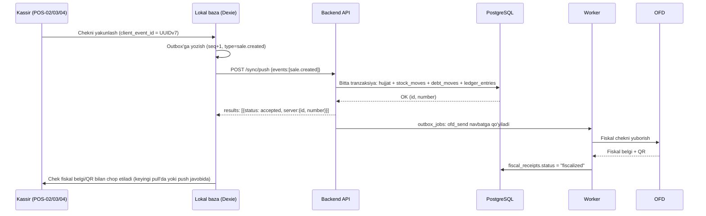
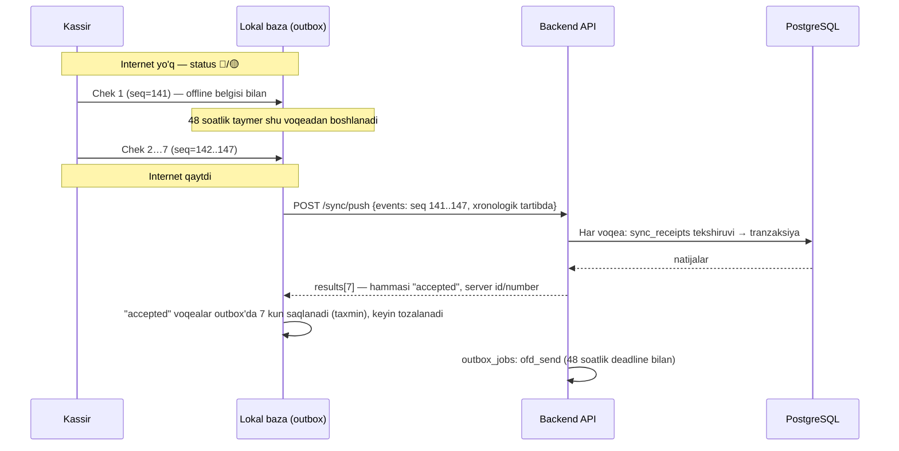
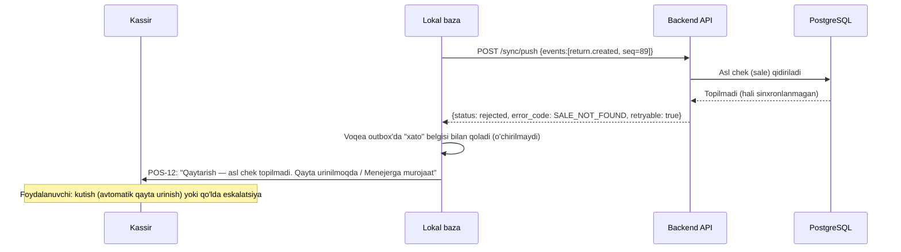

# Offline sinxronizatsiya

**Maqsad:** Qurilma (veb-kassa/Android POS) offline rejimda ishlashi, outbox-asosida sinxronizatsiya protokoli, to'qnashuv (konflikt) qoidalari, fiskal 48 soatlik muddat va obuna/litsenziya bilan bog'liq offline cheklovlarni belgilash.
**Kim uchun:** Frontend (PWA/veb-kassa), Android ishlab chiquvchilar, backend (`modules/sync`).
**Bog'liq fayllar:** `research_notes/texnik/04-arxitektura-va-stack.md` (2-, 6-bo'lim), `research_notes/texnik/02-kassa-ofd-markirovka.md` (48 soat, 1-ilova 31-band), `research_notes/texnik/12-taxminlar-va-murojaatlar.md` (6-band), `11-malumotlar-modeli.md` (`client_event_id`, `sync_receipts`, `devices`, `stock_lots`, `recost_jobs`), `14-autentifikatsiya-oauth2.md`, `24-frontend-arxitekturasi.md` (Dexie, vite-plugin-pwa, Idempotency-Key), `03-modullar-talablari.md` (M01, M02, M04, M08, M16), `06-ekranlar-umumiy.md` (POS-02…POS-15).
**Holat:** joriy, 2026-10-15.

## Asosiy xulosalar

1. Sinxronizatsiya **append-only event-log (outbox naqshi)** asosida, CRDT emas — fiskal chek raqami smena ichida qat'iy ketma-ket bo'lishi shart, bu CRDT'ning "istalgan tartibda birlashish" modeliga mos kelmaydi (`research_notes/texnik/04-arxitektura-va-stack.md`, §2.2).
2. Qurilma (veb-kassa/Android POS) **katalog, narx, mijoz+qarz, limit/huquq va smena** ma'lumotlarini lokal saqlaydi; dastlabki to'liq nusxa (snapshot) + keyin `updated_at`/`version` kursori bo'yicha o'sib boruvchi (delta) yangilanish bilan yangilanadi (1-bo'lim).
3. Har bir lokal amal **outbox voqeasi** (JSON: `client_event_id`, `device_id`, `type`, `created_at`, `payload`, `seq`) sifatida yoziladi; yuklash — `POST /sync/push` (partiyali, idempotent, har voqea uchun alohida natija), yuklab olish — `GET /sync/pull?cursor=` (2-, 3-bo'lim).
4. Rad etilgan voqea **o'chirilmaydi** — lokal outbox'da xato belgisi bilan qoladi, foydalanuvchi uni ko'radi (POS-12) va amal qiladi (qayta urinish, qo'lda tuzatish yoki Menejerga eskalatsiya); boshqa (bog'liq bo'lmagan) voqealar bu orada davom etadi.
5. To'qnashuvlar **delta (harakat) qo'shish** tamoyili bilan hal qilinadi, qiymatni to'g'ridan-to'g'ri almashtirish bilan emas: ombor qoldig'i manfiy bo'lsa ham sotuv **ruxsat etiladi**, qarz limiti oshsa ham sotuv **ruxsat etiladi** — ikkisi ham bayroq (flag) bilan belgilanadi va Egasi/Menejerga bildirishnoma boradi; faqat ma'lumotnoma (reference) maydonlari — ism, telefon, izoh kabilar — `version` ustuni bilan **last-writer-wins** (5-bo'lim).
6. 48 soatlik fiskal muddat (`02-kassa-ofd-markirovka.md`, 1-ilova 31-band) — taymer birinchi offline voqea yaratilgan paytdan boshlanadi; 24/40 soatda ogohlantirish (**taxmin**, aniq soat manbada yo'q) qo'yilgan, lekin 48 soatda **yangi sotuvni bloklash qonunda topilmadi** — shu sabab bloklash emas, majburiy eskalatsiya + audit belgisi taklif qilinadi (6-bo'lim, ochiq savol).
7. Markirovkalangan tovar offline siyosati **to'liq**: **sotish** — narx qurilmada **ma'lum** bo'lsa ruxsat (kod mahalliy yoziladi, internet qaytganda CRPT Turon'ga tekshirish/yuborish yuboriladi), noma'lum bo'lsa **taqiq** (US-M01-03, `03-modullar-talablari.md`; `21-integratsiyalar.md` §4); **ko'chirish** (o'z filiallar/omborlar orasida) — **ruxsat**, keyin sinxronlanadi, audit bilan; **qaytarish** — **faqat internet bor paytda** (offline'da bloklanadi). To'liq tafsilot 7-bo'limda. Mustaqil bank terminali bilan "karta"ni qo'lda belgilash (`terminal_ref`) — online va offline'da ikkisida ham ruxsat (`21-integratsiyalar.md` §9.2).
8. Veb-kassada bir nechta tab ochilishi xavfli (ikki tab bitta lokal `seq` raqamini ikki marta bersa) — **Web Locks API** bilan yagona yozuvchi tab saylanadi, **BroadcastChannel** bilan holat (online/offline, yangi ma'lumot) boshqa tablarga tarqatiladi (10-bo'lim).
9. Lokal ma'lumot shifrlanishi brauzerda OS darajasida (disk shifrlash tavsiyasi) + chiqishda (logout) Dexie bazasi to'liq tozalanadi; Android'da (keyingi bosqich) SQLCipher bilan butun Room bazasini shifrlash tavsiya etiladi (`28-android-pos.md`) (11-bo'lim).
10. Test strategiyasi — tarmoq xatosi, soat farqi, ikki qurilmaning bir vaqtda to'qnashuvi, qayta yuborilgan voqea (duplicate), qurilma bekor qilinishi kabi stsenariylar uchun **chaos/tarmoq testlari** (Playwright network emulation, MSW) (12-bo'lim).
11. **Autentifikatsiya OAuth 2.0 asosida** (`14-autentifikatsiya-oauth2.md`): sync uchun token — veb-kassada BFF cookie, Androidda to'g'ridan-to'g'ri Bearer access token, ikkisi ham qurilmaga bog'langan refresh token bilan (muddati 48 soatlik offline oynadan ancha uzun); kassir **PIN — OAuth grant emas**, mahalliy `actor_user_id` biriktiruvchi vosita (§2 va §3.4). Obuna muddati tugagan tenant uchun qurilma imzolangan litsenziya tokeni bilan **serversiz** mahalliy bloklanadi (§3.5).

---

## 1. Qurilmada saqlanadigan ma'lumotlar va yangilash

| Ma'lumot toifasi | Lokal jadval (Dexie, veb) | Dastlabki yuklash | Yangilanish usuli |
|---|---|---|---|
| Katalog (`products`, `product_categories`, `units`) | `catalog` | To'liq snapshot, login/qurilma ro'yxatdan o'tganda | Delta: `GET /sync/pull?scope=catalog&cursor=<updated_at,id>` |
| Shtrix-kodlar (`product_barcodes`) | `barcodes` | To'liq snapshot | Delta, `cursor` bo'yicha |
| Narxlar (`product_prices`, faqat amaldagi) | `prices` | To'liq snapshot (faqat joriy, tarix emas) | Delta |
| Mijozlar + qarz balansi (`counterparties`, `debt_balances`) | `customers` | To'liq snapshot (shu filialga tegishli/umumiy) | Delta — balans qiymati serverda hisoblanadi, qurilma faqat o'qiydi |
| Limitlar (kredit limiti, chegirma/qaytarish limiti — `role_permissions.limit_value`, `counterparties.credit_limit`) | `limits` | Katalog bilan birga | Delta |
| Huquqlar (`role_permissions`, `memberships`) | `permissions` | Login paytida to'liq | Delta; o'zgarsa darhol pull (login session yangilanishi) |
| Joriy smena (`shifts`) | `shift` | Smena ochilganda yaratiladi (lokal) | Push orqali serverga, server tasdiqlagandan keyin doimiy holatga o'tadi |
| Outbox (chek, qaytarish, qarz to'lovi, kassa harakati) | `outbox` | — | Faqat push (2-bo'lim) |
| Do'kon sozlamalari va qoidalar (`tenants.settings`: tarozi shtrix-kod formati va uning versiyasi; faol `discount_rules`; obuna holati `subscriptions.status`) | `settings` | Login/snapshot bilan | Delta; tarozi formati versiyasi o'zgarsa majburiy pull |

**Dastlabki to'liq nusxa (snapshot)**: qurilma birinchi marta ro'yxatdan o'tganda (`devices` yozuvi yaratilganda) yoki lokal baza tozalanganda (`GET /sync/pull?scope=all&cursor=` bo'sh kursor bilan) — sahifalab (`page_size`, **taxmin: 500 qator/sahifa**) yuklanadi, `has_more=true` bo'lsa davom etiladi.

**Delta yangilanish**: har bir jadvalda `updated_at` (yoki ma'lumotnomalarda `version`) bo'yicha kursor; qurilma oxirgi ko'rgan `(updated_at, id)` juftligini saqlaydi va keyingi so'rovda yuboradi (sahifalashda barqaror tartib uchun ikkilik kursor — faqat `updated_at` bilan bir xil millisekundda bir nechta yozuv bo'lsa tartib buzilmasligi uchun). Chastota — veb-kassa fon rejimida har **5 daqiqada** (taxmin) + internet qaytganda darhol + `pageMounted`/smena ochilganda majburiy.

---

## 2. Outbox voqea formati (JSON schema)

```json
{
  "client_event_id": "018f2c3a-9b7e-7a41-8e2f-6b1a2c3d4e5f",
  "device_id": "018f2c2e-11aa-7b00-9c3d-aa11bb22cc33",
  "seq": 142,
  "type": "sale.created",
  "created_at": "2026-10-14T09:12:03.482+05:00",
  "actor_user_id": "018f2c3a-aa11-7b00-9c3d-aa11bb22cc33",
  "payload": { "...": "hujjat turiga mos tuzilma, quyida" }
}
```

| Maydon | Tur | Izoh |
|---|---|---|
| `client_event_id` | UUIDv7 | Qurilmada yaratiladi (`11-malumotlar-modeli.md` §2 — vaqt bo'yicha tartiblangan); `sync_receipts.client_event_id` bilan idempotentlik ta'minlanadi |
| `device_id` | UUIDv7 | `devices` jadvaliga mos, ro'yxatdan o'tgan qurilma |
| `seq` | integer | Qurilma ichidagi lokal monoton ketma-ket raqam (restart/qayta ishga tushirishda ham davom etadi, lokal bazada saqlanadi) — server global tartib emas, faqat shu qurilma ichidagi nisbiy tartibni tasdiqlash uchun ishlatadi |
| `type` | enum | **Yakuniy ro'yxat**: `shift.opened`, `shift.closed`, `sale.created`, `sale.draft_voided` (to'lovdan oldin chek/qator bekor qilish — audit, registrga ta'sir yo'q), `receipt.reprinted` (chekni qayta chop etish — audit), `return.created`, `debt_payment.created`, `cash_movement.created`, `counterparty.created` (tezkor mijoz, US-M08-05), `transfer.sent` (o'z filiallari orasida ko'chirish jo'natilishi — offline'da qoralama mazmunsiz, jo'natish bilan bir voqea), `transfer.received` (ko'chirishni qabul qilish), `stock_count.line_recorded` (M05, bitta qurilma), `expense.created` (faqat `source=cash`, POS-14 "Xarajat" sababi) — payload sxemalari `18-api-kassa.md` (§3–§13), `19-api-ombor.md` (§13, §14), `20-api-moliya-admin.md` (#42)da aniqlangan |
| `created_at` | ISO 8601, qurilma soati | Fiskal 48-soat hisobi va buxgalteriya sanasi shu maydondan olinadi (8-bo'lim, soat farqi) |
| `actor_user_id` | UUID | Amalni bajargan kassir (offline PIN bilan kirgan); server uning `created_at` paytida faol membership'ini tekshiradi; push qilgan sessiya foydalanuvchisi farq qilsa, ikkalasi audit'ga yoziladi |
| `payload` | object | Hujjat turiga mos (masalan `sale.created` uchun `sales` + `sale_lines` + `sale_payments`, `11-malumotlar-modeli.md` §6 tuzilishiga mos); `sale.created`/`return.created`da `receipt_seq` — payload **ildizida** (ichma-ich `fiscal` obyekti emas), int, qurilma beradi (qaror #12); `shift.opened`da xuddi shunday `shift_no` — qurilma beradi, kassa ichida ketma-ket (3.3-bo'lim) |

Qarzga sotish alohida voqea turi emas — `sale.created` ichida `sale_payments.method = "debt"` sifatida yuboriladi (US-M08-01, US-M08-05); qarz daftaridagi tezkor yozuv (POS-13) ham shu yo'l bilan amalga oshadi.

---

## 3. Yuklash protokoli

### 3.1 `POST /sync/push`

```json
// So'rov
{
  "device_id": "018f2c2e-...",
  "events": [
    { "client_event_id": "...", "seq": 141, "type": "sale.created", "created_at": "...", "payload": {...} },
    { "client_event_id": "...", "seq": 142, "type": "return.created", "created_at": "...", "payload": {...} }
  ]
}
```

```json
// Javob
{
  "results": [
    { "client_event_id": "...", "status": "accepted", "server": { "id": "...", "number": "K-01-2026-000154" }, "warnings": [] },
    { "client_event_id": "...", "status": "rejected", "error_code": "SALE_NOT_FOUND", "message": "Asl chek hali sinxronlanmagan", "retryable": true, "warnings": [] }
  ]
}
```

`warnings` — har bir natija (entry) darajasida, string massivi (katalog kodlari, masalan `STOCK_NEGATIVE`, `DEBT_LIMIT_EXCEEDED`) — hujjat qabul qilingan, lekin diqqatga loyiq holat bor ekanini bildiradi (xato emas).

- **Partiya hajmi**: taxmin — 50 voqea/so'rov (katta hujjat ro'yxatlari uchun kam, tarmoq kechikishi uchun ko'p emas); aniq raqam yuklama sinovida tasdiqlanadi.
- **Backpressure**: server — qurilma boshiga **5 so'rov/soniya**, tenant boshiga bir vaqtda **4 ta** parallel `/sync/push` (taxmin); bu chegaralardan oshsa `429 Too Many Requests` + `Retry-After` qaytariladi. Qurilma — eksponensial backoff + jitter bilan qayta uriniladi (ofline sinxronlashda to'lib-toshgan outbox'ni birdan yuborishning oldini olish uchun).
- **Idempotentlik**: server har bir `client_event_id`ni `sync_receipts`da tekshiradi (`11-malumotlar-modeli.md` §10). Oldin qabul qilingan voqea qayta yuborilsa — `status: "duplicate"`, bir xil natija (server raqami) qaytariladi, ikkinchi marta yozilmaydi.
- **Fiskal raqam**: `receipt_seq` qurilmadan keladi; server uni o'zgartirmaydi, faqat `UNIQUE (tenant_id, cash_register_id, shift_id, receipt_seq)` bilan tekshiradi. Takror — `rejected`, `error_code: RECEIPT_SEQ_CONFLICT`, `retryable: false` (eskalatsiya).
- **Partiya "hammasi yoki hech narsa" emas** — har voqea alohida tranzaksiyada qayta ishlanadi; bittasi rad etilsa, qolganlari (bog'liq bo'lmasa) baribir qabul qilinadi (`results` massivi buni ko'rsatadi).

### 3.2 `GET /sync/pull?cursor=<token>&scope=catalog,prices,customers,permissions&page_size=500`

```json
{
  "cursor": "eyJ1cGRhdGVkX2F0IjoiMjAyNi0xMC0xNFQw...",
  "has_more": false,
  "catalog": [ { "id": "...", "name": "...", "updated_at": "..." } ],
  "prices": [ ... ],
  "customers": [ { "id": "...", "name": "...", "receivable_balance": 350000, "credit_limit": 500000, "version": 4 } ]
}
```

`receivable_balance` = `debt_balances.balance WHERE direction='receivable'` (yozuv bo'lmasa 0; musbat son mijoz bizga qarzdor ekanini bildiradi). `payable` kassaga yuborilmaydi.

### 3.3 Tartib kafolatlari

- Bitta qurilma ichida voqealar **har doim `seq` tartibida** yuboriladi va shu tartibda serverga yetib boradi (bir partiya ichida massiv tartibi saqlanadi).
- **Bog'liq voqealar** (masalan `return.created` o'zi tegishli `sale.created`ga bog'liq, agar asl chek hali sinxronlanmagan bo'lsa): server `SALE_NOT_FOUND` + `retryable: true` qaytaradi; qurilma bu voqeani keyingi push'da qayta yuboradi, lekin undan **keyingi, bog'liq bo'lmagan** voqealarni bloklamaydi. Boshqa (`sale.created`dan farqli) bog'liqliklar — masalan `counterparty.created`dan oldin kelgan sotuv boshqa qurilmadan, yoki `transfer.received` tegishli `transfer.sent` sinxronidan oldin kelsa — umumiy `DEPENDENCY_NOT_SYNCED` kodi (`retryable: true`, `params.entity` — `counterparties`/`transfers`/`shifts`) bilan qaytariladi, xuddi shu "qayta urinish, boshqalarni bloklamaydi" qoidasi bilan.
- Qoldiq/qarz kabi **delta-asosida** registrlar (`stock_moves`, `debt_moves`) uchun qat'iy global tartib shart emas — harakatlar qo'shiladi, tartib natijaga ta'sir qilmaydi (`04-arxitektura-va-stack.md`, §2.3).
- Fiskal chek raqami (`fiscal_receipts.receipt_seq`) — **qurilma beradi** (offline ham), outbox `seq` bilan bir Web Lock ichida; kassa + smena ichida ketma-ket. **Bitta smena — bitta qurilma** (`shifts.device_id`): boshqa qurilmadan shu smenaga voqea `rejected SHIFT_DEVICE_MISMATCH`.

### 3.4 Server validatsiyasi va rad etish

Server har bir voqeani: (1) sxema (JSON shakli, majburiy maydonlar), (2) qurilma/tenant autentifikatsiyasi (`device_id` faol va shu tenant'ga tegishlimi), (3) idempotentlik (`sync_receipts`), (4) biznes qoidalari (5-bo'lim to'qnashuv jadvali) bo'yicha tekshiradi.

**Rad etilganda**: voqea serverga yozilmaydi, lekin **qurilmadagi outbox'dan o'chirilmaydi** — `rejected` holatida, xato kodi va xabar bilan saqlanadi. POS-12 ekranida ("Sinxronlanmagan hujjatlar") bu voqea qizil belgi va aniq xato matni bilan ko'rinadi. Foydalanuvchi amali: (a) `retryable: true` bo'lsa — avtomatik/qo'lda qayta urinish, (b) `retryable: false` (masalan doimiy validatsiya xatosi) — qo'lda tuzatish yoki Menejerga/qo'llab-quvvatlashga eskalatsiya; hujjat hech qachon jim o'chirilmaydi (audit yaxlitligi uchun).

**401 (access token/sessiya tugagan)** — rad etish emas: voqealar `pending` holatida qoladi, `rejected` bo'lmaydi; push to'xtatiladi. Avval qurilma **jim** (foydalanuvchidan so'ramasdan) OAuth refresh token bilan yangi access token olishga urinadi (`14-autentifikatsiya-oauth2.md` §7–8 — refresh token muddati qurilmaga bog'langan holda 48 soatdan ancha uzun); muvaffaqiyatli bo'lsa push davom etadi, foydalanuvchi hech narsa sezmaydi. Refresh ham muvaffaqiyatsiz bo'lsa (masalan mutlaq muddat tugagan yoki obuna `restricted`, pastda) — POS ustida qayta kirish oynasi ochiladi: **parol** bilan (Egasi/Menejer), shundan keyin kassir odatdagidek PIN bilan davom etadi — OTP kundalik login usuli emas, faqat ro'yxatdan o'tish/parol tiklashda ishlatiladi (`14-autentifikatsiya-oauth2.md` §4.2). Bunda **Dexie tozalanmaydi** — bu logout emas. Qayta kirishda server yangi sessiyani avvalgi `device_id`ga bog'laydi (boshqa tenant/qurilma bo'lsa push'ga ruxsat yo'q), keyin push `seq` tartibida davom etadi. `403 device_revoked` — 9-bo'lim. Veb-kassa — BFF orqali cookie-autentifikatsiya (token brauzerga chiqmaydi), Android — to'g'ridan-to'g'ri Bearer access token; qurilma tokeni (device_id biriktirilgan OAuth token) shu bilan **faqat Android**da to'g'ridan-to'g'ri ishlatiladi — veb-kassa hamon to'g'ridan-to'g'ri Bearer bilan chaqirmaydi, lekin veb-kassa endi ham `devices` yozuviga ega (litsenziya tokeni uchun, pastdagi "Obuna va offline litsenziya" bandi). Veb-kassaning cookie-autentifikatsiyali so'rovlari (shu jumladan `/sync/push`/`/sync/pull`) `X-CSRF-Token` talab qiladi (`15-xavfsizlik-va-audit.md` §1.3).

### 3.5 Obuna va offline litsenziya

Obuna muddati (24 soatlik imtiyoz) tugagan tenant uchun kassa **to'liq to'xtaydi** (qaror #15). Mexanizm: har qurilma online bo'lganda imzolangan **litsenziya tokeni** (`license`, JWT: `tenant_id`, `device_id`, `valid_until = min(grace_ends_at, issued_at + 7 kun)`) oladi va mahalliy saqlaydi (Dexie `settings`); qurilma har ilova ochilganda/davriy va har yangi outbox yozishdan oldin bu tokenni **serversiz** tekshiradi — muddat o'tgan bo'lsa yangi sotuv/amalni mahalliy bloklaydi va **barcha ekranlar (ko'rish va eksport ham) yopiladi**.

Ikki tor istisno:

- **D1 — lokaut drain** (qaror #19): lokautdan oldin, imtiyoz davrida qurilmada yaratilgan va hali serverga yuborilmagan fiskal voqealar (cheklar) yo'qolmasligi uchun (48 soatlik fiskal muddat, 6-bo'lim) qurilmaning bekor qilinmagan refresh tokeni cheklangan **`sync.drain`** scope bilan access token oladi. Shu token bilan **faqat** `POST /sync/push` ishlaydi, u ham **faqat** `created_at <= grace_ends_at` (lokaut boshlangan payt) bo'lgan voqealar uchun — undan keyingi/yangi voqealar `rejected: SUBSCRIPTION_RESTRICTED` bilan qaytariladi. Boshqa hech qanday endpoint, ekran yoki yangi login ochilmaydi. Frontend bu holatni **logout deb hisoblamaydi** — Dexie/outbox o'chirilmaydi, fon rejimida drain davom etadi.
- **D2 — faqat to'lov sahifasidan eksport** (qaror #20): lokaut davrida ma'lumot eksporti **faqat** to'lov (billing) sahifasidan, ro'yxatdagi telefon raqamiga yuborilgan SMS OTP tasdig'i bilan ruxsat etiladi; boshqa barcha ekran (kassa va back-office) yopiq qoladi.

Bu ikkisi — fiskal 48 soatlik taymerdan (6-bo'lim) **mustaqil, alohida** muddat: ikkisi bir-biriga bog'liq emas, biri tugashi ikkinchisiga ta'sir qilmaydi. To'liq mexanizm, token formati va sequence diagramma — `14-autentifikatsiya-oauth2.md` §16–17 (drain — §16.4, foydalanuvchi tasdig'i so'ralsin).

---

## 4. Diagrammalar

### 4.1 Onlayn sotuv



### 4.2 Offline sotuv + keyinroq sinxron



### 4.3 Rad etilgan voqea



---

## 5. To'qnashuv (konflikt) qoidalari

| Stsenariy | Qoida | Manba |
|---|---|---|
| Ombor qoldig'ida overselling (ikki qurilma oxirgi donani oflaynda sotgan) | Sotuv **ruxsat etiladi**; qoldiq manfiy bo'lishi mumkin, `stock_balances`ga manfiy qiymat yoziladi, BO-03'da "⚠ manfiy qoldiq" belgisi; tannarx `pending_cost` sifatida oxirgi ma'lum narxda, keyingi kirimda qayta hisoblanadi | `11-malumotlar-modeli.md` §7; `04-arxitektura-va-stack.md` §2.3 |
| Qarz limiti offline oshib ketgan | Sotuv **ruxsat etiladi** (allaqachon bo'lib o'tgan — sotuv va fiskal chek bekor qilinmaydi); qurilma oxirgi ma'lum qoldiq bo'yicha ogohlantiradi, kassir baribir sotsa qarz shundayligicha qoladi; server qayta tekshiradi, `limit_exceeded=true` bayrog'i qo'yiladi, internet qaytganda Egasi/Menejerga M18 orqali bildirishnoma (qaror #23 — tavsiya #7) | US-M08-01; `04-arxitektura-va-stack.md` §2.3 |
| Narx offline o'zgargan (server narxi yangilangan, qurilma eski narxda sotgan) | Chekdagi narx **"qotiriladi"** — avtomatik tuzatilmaydi; farq Buxgalter ko'rib chiqadigan **istisno** sifatida belgilanadi | M09 chekka holatlar (`03-modullar-talablari.md`); `04-arxitektura-va-stack.md` §2.3 |
| Mahsulot offline sotuv vaqtida arxivlangan (serverda keyin arxivlangan, qurilma bilmagan) | Hujjat **qabul qilinadi** (tovar sotuv vaqtida faol edi); "arxivlangan tovar bilan yozilgan" bayrog'i, Menejerga ko'rinadi, bloklanmaydi | Qat'iy siyosat **ochiq savol** (pastda) |
| Bir xil mijoz ikki joyda tahrirlangan (ism/telefon/izoh) | **Last-writer-wins**, `counterparties.version` bilan optimistik qulflash; kech kelgan `client_event_id` server qabul vaqti bo'yicha g'olib, eski qiymat `audit_log`ga | `11-malumotlar-modeli.md` §1 (`version INT`) |
| Mijoz qarz balansi/kredit limiti | **Hech qachon LWW emas** — balans faqat `debt_moves` delta sifatida qo'shiladi (konflikt yo'q, hisoblanadigan registr); limit maydoni (reference) — LWW + version | `11-malumotlar-modeli.md` §7 |
| Smena bir vaqtda ikki joyda yopilmoqchi (nazariy) | Server tomonida `shifts.status` optimistik tekshiruv bilan himoyalanadi — ikkinchisi "smena allaqachon yopilgan" xatosi oladi | Amaliyotda kam uchraydi (bitta smena — bitta qurilma) |
| Qaytarish yoki chegirma limiti offline oshgan | Sotuvdan farqli — **lokal Menejer/Egasi PIN'isiz yakunlanmaydi** (BO-16 offline ishlamaydi); PIN bilan tasdiqlangan bo'lsa server qabul qiladi va qayta tekshiradi, `limit_exceeded=true` bayrog'i + M18 xabar | `15-xavfsizlik-va-audit.md` §2.3 |

---

## 6. Fiskal 48 soat qoidasi

- **Huquqiy asos**: VM 943-son qarori, 1-ilova, 31-band — offline rejimda shakllangan birinchi chek **48 soat ichida** OFD'ga yetib borishi shart (`research_notes/texnik/02-kassa-ofd-markirovka.md`, §1).
- **Taymer**: birinchi offline voqea (`created_at`, qurilma soati) yaratilgan paytdan boshlanadi — "chek yaratilgan payt, OFD'ga yetib borish payti emas" (`04-arxitektura-va-stack.md`, §2.2, 3-band). Har bir uzluksiz offline davr uchun alohida taymer; internet qaytib hammasi sinxronlanganda taymer to'xtaydi.
- **Ogohlantirishlar**: 24 soatda birinchi signal, 40 soatda ikkinchi (kuchli) signal (**taxmin** — aniq soat manbada yo'q, `06-ekranlar-umumiy.md` §1.3 ham shu holatni "taxmin" deb belgilagan; maqsad — muddat tugashidan oldin kamida ikki marta ogohlantirish, M18 orqali Egasiga ham).
- **48 soatda yangi sotuvni bloklash — ochiq savol**: qonun matnida (1-ilova 31-band) faqat "chek 48 soat ichida yetib borishi zarur" deyilgan, yangi sotuvni to'xtatish talabi **topilmadi**. **Taklif**: yangi sotuvni **bloklamaslik** (do'kon ishini to'xtatish mijozga xizmat ko'rsatish va boshqa huquqiy/biznes xavflarni kuchaytiradi), lekin 48 soat chegarasi buzilganda: (1) audit_log'ga qat'iy huquqiy-xavf yozuvi, (2) Egasiga Telegram orqali zudlik bilan xabar (M18), (3) back-office'da doimiy ko'rinadigan "huquqiy xavf" bayrog'i. Bu band — `research_notes/texnik/12-taxminlar-va-murojaatlar.md` (6-band) kabi — yakuniy huquqiy maslahat bilan tasdiqlanishi kerak.
- **Hisob-kitob asosi**: taymer qiymati `created_at` (qurilma soati) asosida hisoblanadi, lekin 8-bo'limdagi soat farqi qoidalari bilan himoyalanadi (soatni "orqaga surish" orqali muddatni cho'zishga urinishning oldini olish uchun).

---

## 7. Markirovkalangan tovar — offline siyosati

CRPT Turon'da kodni real vaqtda tekshirish offline holatda **mumkin emas** (markaziy tizimga bog'liq). Siyosat (qaror #17; `03-modullar-talablari.md` US-M01-03, `21-integratsiyalar.md` §4):

- **Narx qurilmada ma'lum** (tovar va uning amaldagi narxi Dexie `catalog`/`prices`da bor) — sotuvga **ruxsat**. DataMatrix kod skanerlanadi, qurilmada faqat mahalliy format/nazorat raqami tekshiriladi, kod `marking_codes.status='pending_verification'` bilan (hamda outbox `sale.created` voqeasi payload'ida) yoziladi, chekka "⚠ Offlayn sotildi, CRPT tekshiruvi kutilmoqda" belgisi qo'yiladi (POS-02/08/09/10, `06-ekranlar-umumiy.md` §1.7, §1.3).
- **Narx qurilmada noma'lum** (tovar hali sinxronlanmagan) — sotuv **ruxsat etilmaydi**, POS "Offlaynda sotib bo'lmaydi, narx noma'lum" xabarini ko'rsatadi. Kassir qarorni chetlab o'ta olmaydi.
- Internet qaytganda worker `outbox_jobs(kind="marking_sell")` orqali CRPT Turon'ga `verify_code` + `sell` yuboradi; muvaffaqiyatli bo'lsa `marking_codes.status=sold`; `verify_failed` bo'lsa (noto'g'ri/takroriy kod yoki CRPT xatosi) Egasi/Buxgalterga ogohlantirish beriladi (tovar allaqachon sotilgan, orqaga qaytarib bo'lmaydi — faqat qayd va keyingi tuzatish uchun belgi).
- **Audit voqealari** (`15-xavfsizlik-va-audit.md` §6.1 ro'yxatiga ham kiritiladi): `marking.offline_sold` (actor_user_id, device_id, code, sale_id, price_source=`cache`, created_at), `marking.offline_refused_no_price` (kassir taqiqqa uchragan urinish), `marking.verify_failed` (sync'dan keyingi noto'g'ri/takroriy kod yoki CRPT xatosi — M18 orqali Egasiga).
- **Offline ko'chirish (M06) va qaytarish (M02)** (qaror #23 — tavsiya #5):
  - **Ko'chirish** — o'z filiallar/omborlar orasida markirovkalangan tovarni offline ko'chirish **ruxsat etiladi** (jo'natuvchi chiqim, qabul qiluvchi kirim — ikkisi ham offline bajarilishi mumkin), internet qaytganda sinxronlanadi va audit yoziladi. Nega: egalik (owner) o'zgarmaydi (bitta tenant ichida), 72 soatlik CRPT muddati odatda **subyektlar o'rtasidagi** ko'chirishga tegishli ko'rinadi (ichki ko'chirishga emas — bu taxmin, huquqiy xat bilan tasdiqlanadi).
  - **Qaytarish** — markirovkalangan tovarni **faqat internet bor paytda** qaytarish mumkin; offline holatda POS'da qaytarish tugmasi markirovkalangan tovar qatorlari uchun **bloklanadi** (oddiy, markirovkasiz tovar qaytarishiga bu cheklov tegmaydi). Nega: rasmiy qaytarish uchun kod yozilgan maxsus qaytarish cheki kerak (`buxgalter.uz`, F10 tasdiqlangan) va offline firibgarlik xavfi yuqori baholanadi.
  - Bu mahsulot qarori; huquqshunos tasdig'i tavsiya etiladi (ayniqsa ko'chirish bo'yicha — CRPT'ga xabar qilish majburiyati va e-TTN zarurligi, `21-integratsiyalar.md` §3, Ochiq savol 5), lekin spec darajasidagi qaror allaqachon qabul qilingan.

---

## 8. Soat farqi (clock skew)

- Qurilma soati noto'g'ri bo'lishi mumkin (batareya, qo'lda o'zgartirish). Server har API javobida `Date` sarlavhasini yuboradi; qurilma internetga ulanganda o'z soatini server bilan solishtiradi.
- Farq **taxmin: 5 daqiqadan** oshsa — qurilma UI'da ogohlantirish ko'rsatadi ("Qurilma soati noto'g'ri, sinxronlang") va `audit_log`ga yoziladi.
- **48 soatlik hisob-kitobda firibgarlikdan himoya**: agar `created_at` (qurilma soati) server qabul qilish vaqtidan (`received_at`) ancha oldin bo'lsa va bu farq amaldagi offline sessiya davomiyligidan katta bo'lsa (ya'ni soat "orqaga surilgan" bo'lishi mumkin) — server `created_at`ni **qisqartiradi** (clamp: `max(created_at, received_at - taxminiy_offline_oyna)`) va holatni audit uchun belgilaydi, shunda qurilma soatini o'zgartirib 48 soatlik muddatni cho'zib bo'lmaydi.
- Ikki yo'nalishda ham (orqaga va oldinga surish) xom `created_at` va tuzatilgan qiymat alohida saqlanadi — tekshiruv/audit uchun.

---

## 9. Qurilmani ro'yxatdan o'tkazish va bekor qilish

- Qurilma birinchi marta login qilganda `devices` yozuvi avtomatik yaratiladi (`tenant_id`, `cash_register_id`, `kind`, `app_version`) — kichik do'kon uchun qo'shimcha tasdiqlash qadam qo'shilmaydi (tezkor ishga tushirish).
- Egasi/Menejer qurilmalar ro'yxatini ko'radi va kerak bo'lsa **bekor qiladi** (masalan o'g'irlangan/eskirgan qurilma) — aniq ekran hozircha `06-ekranlar-umumiy.md`da yo'q, **ochiq savol** (pastda).
- **Bekor qilingan qurilma**: `devices.revoked_at` o'rnatilishi bilan shu qurilmaga bog'langan **barcha OAuth refresh/access token va litsenziya tokeni** bekor qilinadi (`14-autentifikatsiya-oauth2.md` §7, §17) — keyingi `POST /sync/push` va `GET /sync/pull` so'rovlari `403 device_revoked` bilan rad etiladi. Lokal outbox'dagi hali yuborilmagan hujjatlar **jim yo'qolmaydi** — UI "Qurilma bloklandi, ma'lumotlarni eksport qiling" xabarini ko'rsatadi va Excel eksport imkoniyatini beradi (qog'oz chekka tushgan savdoni yo'qotmaslik uchun), shundan keyingina lokal baza tozalanadi. Aniq UX oqimi **ochiq savol**.
- Qurilma bekor qilinganda shu qurilmada oxirgi 30 kun (taxmin) ichida PIN bilan kirgan barcha xodimlarning PIN'i serverda bekor qilinadi va keyingi kirishda yangi PIN majburiy (lokal 4 raqamli PIN hashlari offline buzilishi oson). Ro'yxat va "Bekor qilish" — BO-11 "Qurilmalar" tabi.

---

## 10. Saqlash chegaralari va tozalash

- **Hajm taxmini**: bitta outbox voqeasi ≈ 2 KB (JSON); 1 000 chek/kun × 2 kun offline ≈ 4 MB — kichik do'kon uchun amalda ahamiyatsiz. `navigator.storage.estimate()` orqali kvota kuzatiladi: 80%ga yetganda UI ogohlantiradi, 95%da chek tarixi keshi (UI ko'rsatish uchun, 90 kunlik oyna, pastda) qisqartiriladi — **`pending`/yuborilmagan outbox hech qachon o'chirilmaydi** (fiskal/audit yaxlitligi ustunlik qiladi).
- Katalog/narx/mijoz keshlari — delta-sync bilan doimiy yangilanadi, qo'lda tozalash shart emas (hajm tenant ma'lumot hajmiga bog'liq).
- Outbox voqealari — `accepted`/`duplicate` natija olgandan keyin darhol o'chirilmaydi, **taxmin: 7 kun** xavfsizlik buferi bilan saqlanadi (foydalanuvchi ko'rib chiqishi/eksport qilishi uchun), keyin avtomatik tozalanadi.
- Sotuv/chek tarixi (UI ko'rsatish uchun lokal kesh) — **taxmin: 90 kunlik** aylanma oyna; eskisi serverdan talab bo'yicha olinadi (online bo'lganda).
- Veb-kassa Chrome/Edge/Android Chrome'da va **iPhone/iPad'da o'rnatilgan PWA** sifatida ishlaydi; ishga tushganda `navigator.storage.persist()` so'raladi; iOS'da faqat o'rnatilgan PWA (o'rnatilmagan sayt ma'lumoti tozalanishi mumkin) va chop etish faqat bulutli printer yoki elektron chek orqali (`24-frontend-arxitekturasi.md` §6, `25-nofunksional-talablar.md` §6).

---

## 11. Ko'p-tab xavfsizligi (veb)

- Bitta foydalanuvchi veb-kassani ikki tab'da ochishi mumkin — bu lokal `seq` raqamini ikki marta berish va outbox'ga ikki marta yozish xavfini keltiradi.
- **Yechim**: `navigator.locks.request("erp-outbox-writer", async () => { ... })` (Web Locks API) bilan outbox'ga yozish + `seq` oshirish + sync push triggeri **yagona qulf** ichida bajariladi — faqat bitta tab bir vaqtda yozuvchi bo'ladi, boshqalari navbatda kutadi (yozish tezkor bo'lgani uchun UI kechikishi sezilmaydi).
- **`BroadcastChannel("erp-sync")`** — barcha tablarga: online/offline holat o'zgarishi, yangi pull natijasi (katalog/narx yangilandi — UI qayta render qilsin), outbox holati o'zgarishi (boshqa tab POS-12'da ko'rsatadigan ro'yxatni yangilash uchun) xabar qiladi.
- Faqat o'qish (masalan BO-03 qoldiqni ko'rish) alohida qulf talab qilmaydi — IndexedDB o'qish operatsiyalari tabiatan xavfsiz.

---

## 12. Lokal ma'lumot xavfsizligi

- **Veb (Dexie/IndexedDB)**: brauzer IndexedDB'ni o'zi shifrlamaydi — maxfiylik asosan OS/profil darajasidagi sandboxing va **OS disk shifrlashi** (BitLocker/FileVault, tashkiliy siyosat sifatida tavsiya) orqali ta'minlanadi, ilova darajasidan majburlab bo'lmaydi.
- **Logout** — Dexie bazasi to'liq o'chiriladi (`Dexie.delete()` / `indexedDB.deleteDatabase`), shu jumladan mijoz telefon raqami, qarz balansi keshi va outbox (agar hammasi sinxronlangan bo'lsa; sinxronlanmagan bo'lsa ogohlantirish bilan eksport taklif qilinadi, 9-bo'limdagi kabi).
- **Offline PIN login** (internet yo'qligida kassaga kirish) — faqat salt bilan heshlangan PIN lokal saqlanadi, muvaffaqiyatsiz urinishlar soni cheklanadi (**taxmin: 5 urinish**), oshsa qurilma vaqtincha bloklanadi.
- **Android (keyingi bosqich)** — `28-android-pos.md`da batafsil: butun Room bazasini **SQLCipher** bilan shifrlash tavsiya etiladi (yoki Android Keystore asosida maydon darajasida shifrlash, agar SQLCipher xarajati ortiqcha topilsa).
- Karta/to'lov ma'lumotlari (PAN, CVV) hech qachon qurilmada saqlanmaydi — to'lov terminali/bank SDK'si orqali to'g'ridan-to'g'ri ishlanadi, bu tizim faqat tranzaksiya natijasi (muvaffaqiyat/summasi) bilan ishlaydi.

---

## 13. Testlash strategiyasi

| Test turi | Nima tekshiriladi | Vosita |
|---|---|---|
| Tarmoq emulyatsiyasi (chaos) | Online↔offline↔online tez almashinuvi, sekin 3G, uzilish o'rtada | Playwright network conditions (`24-frontend-arxitekturasi.md` testlar ro'yxati) |
| Idempotentlik | Bir xil `client_event_id` ikki marta yuborilsa — ikkinchi marta yozilmasligi, `duplicate` natija | MSW bilan backend simulyatsiyasi + backend integratsion test |
| Ikki qurilma to'qnashuvi | Ikki kassa bir vaqtda oxirgi donani oflaynda sotadi — ikkisi ham qabul qilinadi, qoldiq manfiy va bayroqlanadi | Backend integratsion test (parallel push) |
| 48 soat chegarasi | Simulyatsiya qilingan 50 soatlik offline davr — 24/40 soat ogohlantirish, 48 soatda audit bayrog'i to'g'ri ishga tushishi | Vaqtni soxtalashtiruvchi (fake clock) unit/integratsion test |
| Soat farqi | Qurilma soati +3 kun qilib qo'yilganda, server `created_at`ni to'g'ri "clamp" qilishi | Backend unit test |
| Ko'p-tab | Ikki tab ochilganda faqat bittasi yozuvchi bo'lishi, `seq` takrorlanmasligi | Playwright (ikki context, bitta profil) |
| Qurilma bekor qilinishi | Push/pull sinxronida qurilma bekor qilinsa `403` va UI eksport taklifi | E2E test + backend test |
| Rad etilgan voqea oqimi | `retryable`/`non-retryable` xatolar UI'da to'g'ri ko'rsatilishi, boshqa voqealarni bloklamasligi | Playwright + MSW |

Backend tomonida `/sync/push` va `/sync/pull` uchun OpenAPI sxemasiga mos kontrakt testlari (`23-backend-arxitekturasi.md`da belgilanadi) va worker→OFD orasidagi kechikish/uzilishni simulyatsiya qiluvchi chaos-vosita (masalan toxiproxy) tavsiya etiladi — aniq vosita tanlovi backend hujjatida.

---

## Ochiq savollar

1. 48 soatda yangi sotuvni bloklash yoki faqat ogohlantirish — qonunda aniq topilmadi, taklif (6-bo'lim) huquqiy maslahat bilan tasdiqlanishi kerak.
2. Qurilmani bekor qilish UX oqimi (qaysi ekranda, kim bekor qiladi, eksport jarayoni) — mahsulot ekranlarida hali yo'q (9-bo'lim).
3. Aniq partiya hajmi (`/sync/push` necha voqea), `page_size` (`/sync/pull`), delta-sync chastotasi, outbox saqlash muddati (7 kun), chek tarixi oynasi (90 kun), PIN urinish soni (5) — barchasi **taxmin**, yuklama sinovida/pilotda aniqlanadi.
4. Chekdagi narx yoki arxivlangan tovar istisnolarini Buxgalter qanday "yopish" (tasdiqlash) jarayoni — UI darajasida hali loyihalashtirilmagan.

## Manbalar

- `spec/kod-uchun/14-autentifikatsiya-oauth2.md` — OAuth 2.0 token, refresh rotatsiyasi, offline litsenziya tokeni, obuna lokauti.
- `research_notes/texnik/04-arxitektura-va-stack.md` — §2 (offline-first, event-log, konflikt), §6 (davlat hisoboti, bevosita bog'liq emas, lekin arxitektura uslubi).
- `research_notes/texnik/02-kassa-ofd-markirovka.md` — §1 (48 soat, 1-ilova 31-band; OFD, fiskal modul).
- `research_notes/texnik/12-taxminlar-va-murojaatlar.md` — 6-band (markirovka offline taxmini).
- `research_notes/texnik/06-raqobatchilar-texnik-va-uskunalar.md` — uskunalar, ESC/POS, HID skaner (Android hujjatiga ham tegishli).
- `spec/kod-uchun/10-umumiy-arxitektura.md`, `11-malumotlar-modeli.md` (`client_event_id`, `sync_receipts`, `devices`, `stock_lots`, `recost_jobs`, `fiscal_receipts`).
- `spec/kod-uchun/24-frontend-arxitekturasi.md` (Dexie, vite-plugin-pwa, Idempotency-Key, Web Locks/BroadcastChannel yondashuvi).
- `spec/kod-uchun/03-modullar-talablari.md` — M01, M02, M04, M08, M16 offline bo'limlari.
- `spec/kod-uchun/06-ekranlar-umumiy.md` — POS-02…POS-15, offline indikator qoidasi (§1.3).
