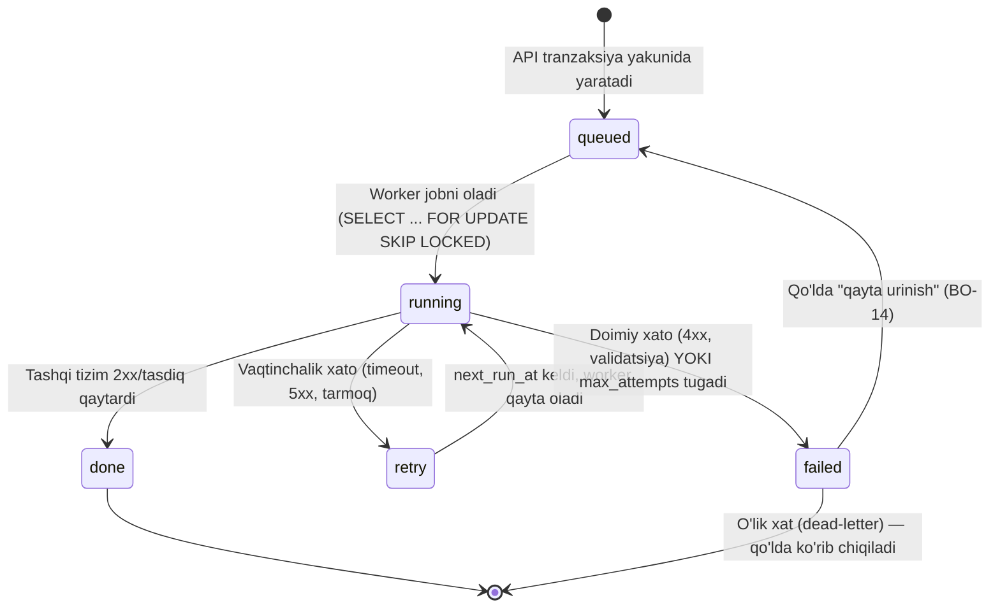
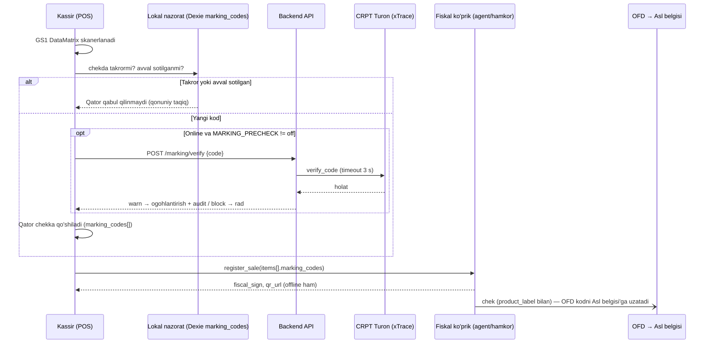

# Integratsiyalar

**Maqsad:** Barcha tashqi tizim integratsiyalari (OFD, e-faktura, markirovka, to'lov, bank karta terminali, autentifikatsiya kanallari, AI, 1C) uchun adapter interfeysi, ma'lumot moslashtirish, retry/SLA siyosati va MVP bosqichini belgilash.
**Kim uchun:** Backend ishlab chiquvchi, arxitektor.
**Bog'liq fayllar:** `10-umumiy-arxitektura.md`, `11-malumotlar-modeli.md`, `03-modullar-talablari.md`, `04-biznes-jarayonlar.md`, `16-offline-sync.md`, `22-ai-qatlami.md`, `23-backend-arxitekturasi.md`, `24-frontend-arxitekturasi.md` (§6 chop etish), `33-1c-integratsiya.md` va `34-1c-agent.md` (Do'kon agenti asosi — 16-bo'lim, 1C — 15-bo'lim), `01-qarorlar.md` #36–#65, #71; `research_notes/ochiq-savollar/P8-karta-terminal-integratsiya.md` (karta terminali).
**Holat:** joriy, 2026-10-16.

## Asosiy xulosalar

1. **14 tashqi tizim** (12 + Google OIDC, qaror #34 — 11-band; + bank karta terminali, qaror #71 — 14-band), bank karta terminalidan tashqari barchasi **backend worker'lar orqali** ulanadi (Google OIDC — interaktiv login redirect, worker emas, lekin bir xil "tashqi tizim" ro'yxatida). Har biri bitta umumiy **outbox/navbat naqshi** (`outbox_jobs`, 0-bo'lim) orqali ishlaydi — API so'rovi tashqi tizimni hech qachon kutmaydi. To'rtta istisno do'kon ichidagi lokal kanal orqali ishlaydi: (a) **E-IMZO** — brauzerda, lokal E-IMZO ilovasi bilan (5-bo'lim); (b) **fiskal modul lokal rejimda** — POS → **Do'kon agenti** (do'kon Windows PK'sidagi lokal dastur, qaror #60) → fiskal modul (FM) → OFD (1-bo'lim, 16-bo'lim); (c) **1C** (MVP'dan keyin, Bosqich 7, 15-bo'lim) — backend 1C'ga umuman ulanmaydi, Do'kon agenti vazifani bulutdan tortib oladi; (d) **bank karta terminali** — POS → Do'kon agenti → LAN/Wi-Fi'dagi terminal (§9.4, 16-bo'lim).
2. **Ochiq hujjat/test muhiti** (2026-10-16 holati): **Faktura.uz** (ochiq API, sandbox ommaviy emas), **Didox** (ochiq API hujjati, partner token, test muhiti `testapi3.didox.uz`), **Payme** (`test.paycom.uz`), **Click** (rasmiy Playground + Postman to'plami), **Uzum** (Checkout test muhiti; Merchant API test kredensiali menejerdan), **E-IMZO** (TestCA, `testvpn.e-imzo.uz`), **MXIK**, **Telegram**, **Claude API**. Ommaviy API'si yo'qlari: **OFD** (bulutdan chek yuboradigan ochiq API yo'q — fiskal hamkor yoki lokal FM orqali), **UzQR POS API** (API kalit mexanizmi ma'lum, spetsifikatsiya ochiq emas), **my.soliq.uz** (yagona kanal — shaxsiy kabinet). **CRPT Turon** — xTrace Open API mavjud (kabinetdagi API kalit bilan), ommaviy Swagger va test muhiti yo'q.
3. **Qonuniy muddatlar** worker darajasida taymer va eskalatsiya bildirishnomasi sifatida amalga oshiriladi: **OFD offline chegarasi 48 soat** — undan keyin kassa **avtomatik bloklanadi** (VMQ-943, 1-ilova 31-band; 2-ilova 6-band), ogohlantirish shkalasi 24/40/46/48 soat (qaror #43); **markirovkalangan tovar egalik o'tishi xabarnomasi** — umumiy **3 ish kuni**, ayrim tovar guruhlarida (suv/ichimlik, dori, o'simlik yog'i pilot) **72 soat** (VM 833 66–67-band; VM 631, VM 149, VM 23) — bu M07 qabulga tegishli, ichki ko'chirishga emas; **davlat hisobotini tuzatish — 5 ish kuni**, topshirish muddatidan kechiktirmay (Soliq kodeksi 5-modda 7-qism, 81-modda 6–7-qism).
4. **my.soliq.uz uchun ommaviy API yo'q** (VM 736 3¹-ilova 10-band — yagona kanal shaxsiy kabinet) — davlat hisobotini solishtirish (M10/BP-08) foydalanuvchi yuklagan fayl (PDF/Excel) bilan ishlaydi; ichki my.soliq.uz endpoint'lari ishlatilmaydi.
5. **Markirovka (qaror #62)**: chakana sotuv va xaridordan qaytarishda markirovka kodi Asl belgisi'ga **fiskal chek ichida OFD orqali** boradi (VM 833 75–77, 90-band) — sotuv uchun CRPT API chaqirilmaydi; CRPT API faqat kirim qabuli, kod tekshiruvi, yetkazib beruvchiga qaytarish va hisobdan chiqarish uchun. Sotuvdan oldingi tekshiruv standarti `MARKING_PRECHECK=warn` + lokal takror-kod nazorati (bitta chekda va avval sotilgan kod — qonuniy taqiq, PQ-190 7(в)(ii)). Offline: **sotuv** — ruxsat (FM chekni offline imzolaydi, 48 soat ichida OFD'ga), **ichki ko'chirish** — ruxsat (CRPT xabarnomasi talab qilinmaydi, lekin e-TTN majburiy — qaror #63), **qaytarish** — faqat online (ichki ehtiyot tanlovi).
6. **Click, Payme, Uzum, UzQR ikki alohida vazifada**: (a) do'kon to'lovlari — har tenant **o'z merchant hisobi** va kalitlari, pul to'g'ridan-to'g'ri do'konga tushadi; (b) bizning obuna billing'imiz (M17) — platformaning o'z merchant hisobi (qaror #46). Platforma faqat texnologik vositachi — to'lov tashkiloti litsenziyasi kerak emas (O'RQ-578 14-modda). Do'kondagi har qanday to'lovda fiskal chekni **faqat bizning kassamiz** chiqaradi (VMQ-943 1-ilova 6-band; 1a-ilova 2-band), provayder tomonidagi avto-fiskallashtirish **o'chiq** bo'lishi shart (9-bo'lim).
7. Har bir integratsiya kredensiali (API kalit, sertifikat, merchant ID, operator login/secret) **tenant darajasida shifrlangan** saqlanadi (`tenant_secrets` jadvali, shifrlangan ustun; tafsilot `15-xavfsizlik-va-audit.md`). Do'kon PK'sidagi sirlar (FM ulanish siri, 1C paroli, agent maxfiy kaliti) — faqat PK'da (DPAPI), serverga chiqmaydi.
8. **BO-14 "Integratsiyalar holati"** ekrani — har bir tashqi tizim va Do'kon agenti uchun: ulanganmi, oxirgi muvaffaqiyatli chaqiruv vaqti, navbatdagi/muvaffaqiyatsiz ishlar soni, qo'lda qayta urinish tugmasi.
9. Qurilish tartibi (14-bo'lim): **FiscalPort + FakeFiscalAdapter → MXIK → E-IMZO/e-faktura (+ kiruvchi e-TTN) → Payme/Click (billing + do'kon) → Telegram/SMS → Claude API → Asl belgisi (verify/qabul/hisobdan chiqarish) → ichki e-TTN → real fiskal adapter va Do'kon agenti (Bosqich 5) → 1C (Bosqich 7)**.
10. Tashqi javobni kutayotgan har bir band port + stub/flag ortida kodlanadi (interim standart bilan) va "Ochiq savollar" bo'limida `26-ochiq-savollar-reestri.md` raqami bilan ko'rsatilgan; MVP kodini (Bosqich 0–6) to'xtatadigan band yo'q, real fiskal adapter — Bosqich 5.
11. **Google bilan kirish + Telegram OTP (qaror #34)**: Google OIDC — bizning OAuth AS'imizga ulangan tashqi identity provider (§9.3); OTP/parol tiklash/taklif/eksport/qarz eslatmalari — asosiy kanal **Telegram bot** (telefon "share contact" orqali ulanadi, §11.1), **SMS (Eskiz) faqat zaxira** (§10, `OtpPort` ortida).
12. **1C integratsiyasi (qaror #36–#42, 15-bo'lim)**: kanal — **faqat COM**, Do'kon agentining 1C imkoniyati orqali, **pull** (faqat chiquvchi HTTPS); yo'nalish ERP → 1C bir tomonlama; kunlik sotuv (kassa × kun bitta «Отчет о розничных продажах») va boshqa birlamchi hujjatlar 1C'ga ketma-ket, takrorsiz yoziladi; provodka/QQS/tannarx yuborilmaydi. To'liq spetsifikatsiya — `33-1c-integratsiya.md`, agent — `34-1c-agent.md`.
13. **Do'kon agenti (qaror #60, 16-bo'lim)** — bitta Windows agenti (C#/.NET Framework 4.8, `34-1c-agent.md` dagi bilan bir xil asos): fiskal modul ko'prigi, xom TCP 9100 LAN printerlar, tarozi, bank karta terminali va 1C. Brauzer xom TCP/UDP ocha olmaydi va FM'ga to'g'ridan-to'g'ri ulana olmaydi — shu uchun bu uskunalar faqat agent orqali.
14. **Integratsiyalangan karta terminali (qaror #71, §9.4)**: kassir karta raqami/RRN'ni yozmaydi — POS summani bank terminaliga tarmoq (LAN/Wi-Fi) orqali yuboradi va natijani avtomatik oladi. Yagona `CardTerminalPort`, bir nechta adapter: MVP — `FakeCardTerminalAdapter`; Windows veb-kassa — `AgentEcrAdapter` (Do'kon agenti `/v1/card/*`, Bosqich 5), vendor drayveri birinchi hamkor shartnomasidan keyin; bulut va Android adapterlari — vendor bersa / MVP'dan keyin. `purchase` avtomatik takrorlanmaydi; tartib — karta tasdig'i → fiskal chek → `sale.created`. Terminal ishlamasa — qo'lda kiritish (#64) zaxira, `card_manual_fallback` siyosati bilan.

---

## 0. Umumiy naqsh: outbox, holat mashinasi, o'lik xat, BO-14

Barcha integratsiyalar (Claude API va MXIK qidiruvidan tashqari — ular ko'pincha sinxron/kesh bilan ishlaydi, pastda izohlangan) **bitta umumiy mexanizm** orqali o'tadi:

1. Biznes amali (sotuv, faktura imzolash, ro'yxatdan o'tish to'lovi...) **bitta DB tranzaksiyada** hujjat + registr + `outbox_jobs` yozuvini yaratadi (`11-malumotlar-modeli.md`, 10-bo'lim).
2. API darhol javob qaytaradi (tashqi tizimni kutmaydi) — foydalanuvchi "yuborilmoqda" holatini ko'radi.
3. Worker (Redis navbatidan) ishni oladi, adapter orqali tashqi tizimga chaqiradi, natijani yozadi.

### Holat mashinasi (`outbox_jobs.status`)



- **Jadval**: `outbox_jobs(tenant_id, kind, payload, status, attempts, next_run_at, last_error, idempotency_key)` (`11-malumotlar-modeli.md`, 10-bo'lim). `kind` ro'yxati (17 ta): `ofd_send` (faqat `partner_cloud` rejimida — lokal ko'prikda chekni FM imzolaydi va natija POS voqeasi bilan keladi; 1-bo'lim), `einvoice_send`, `einvoice_accept`, `ettn_send`, `ettn_accept`, `poa_send` (e-ishonchnoma, 6-bo'lim), `marking_verify`, `marking_accept` (kirim qabul xabarnomasi), `marking_supplier_return`, `marking_writeoff`, `state_report_reminder`, `sms`, `telegram`, `ai`, `report_export`, `label_pdf`, `billing_webhook_reconcile`. Chakana sotuv/qaytarish uchun alohida markirovka job'i yo'q — kod fiskal chek bilan ketadi (qaror #62). Ro'yxat `11-malumotlar-modeli.md` 10-bo'limida rasmiylashtiriladi.
- **Qayta urinish siyosati (umumiy formula)**: eksponensial backoff + jitter: `next_run_at = now() + min(cap, base * 2^attempts) + random(0, jitter)`. Har integratsiya o'z `base`/`cap`/`max_attempts`ini SLA'siga qarab belgilaydi (pastda har bo'limda).
- **O'lik xat (dead-letter)**: `max_attempts` tugagach `status=failed`; job **o'chirilmaydi**, `last_error` va to'liq `payload` saqlanadi — qo'lda tekshirish/qayta urinish/bekor qilish uchun. Fiskal va e-faktura kabi huquqiy oqibati bor ishlarda `failed` holati **audit_log**ga ham yoziladi.
- **Idempotentlik**: har job `idempotency_key` bilan (odatda `client_event_id` + `kind`, yoki tashqi tizim talab qilgan `merchant_trans_id`/`provider_tx_id`). Worker va tashqi tizim ikkisi ham qayta yuborilgan so'rovni xavfsiz rad etishi/bir xil natija qaytarishi kerak — bu ayniqsa offline sinxronlashda (bir xil chek ikki marta yuborilishi) va to'lov webhook'larida (bank ikki marta qayta yuborishi) muhim.
- **Circuit-breaker**: har adapter uchun alohida, tenant'dan mustaqil (bitta tenant bitta integratsiyani "buzmasligi" uchun) — 1 daqiqa ichida 5 ketma-ket vaqtinchalik xato (`transient`, pastda) kelsa breaker **ochiladi** (shu adapterga yangi chaqiruv yo'q, job'lar `retry` holatida navbatda qoladi), 5 daqiqadan keyin **half-open** holatida bitta sinov so'rovi yuboriladi — muvaffaqiyatli bo'lsa yopiladi, yo'q bo'lsa yana 5 daqiqa. Breaker ochiq holati BO-14'da 🔴 va M18 orqali ogohlantirish bilan ko'rinadi. **OFD'ning 48 soatlik qonuniy taymeri** (1-bo'lim, `16-offline-sync.md` §6) breaker holatidan **mustaqil** — breaker ochiq bo'lsa ham 48 soat birinchi yuborilmagan chekning vaqtidan hisoblanishda davom etadi.
- **Umumiy xato tasnifi**: `transient` (timeout/5xx/429 → `retry`, backoff bilan qayta uriniladi), `auth` (401/403 → `failed`, BO-14'da "kredensial muammosi" matni bilan), `validation` (4xx, sxema/biznes qoida xatosi → `failed`, foydalanuvchiga tarjima qilingan matn), `duplicate` (tashqi tizim "allaqachon qabul qilingan" deb javob bersa → idempotent muvaffaqiyat, xato emas). Har integratsiyaning vendor-xos xato kodlari (masalan OFD 704031) ilova sifatida, hujjat kelganda qo'shiladi.

### BO-14 — "Integratsiyalar holati" ekrani (talab)

`spec/kod-uchun/06-ekranlar-umumiy.md` BO-14'ni "Tenant/do'kon sozlamalari" (integratsiyalar holati bilan) deb belgilagan; bu yerda texnik talab aniqlashtiriladi:

| Ustun | Mazmun |
|---|---|
| Tizim | OFD/fiskal modul (har kassa: `cash_registers.fm_state`, yuborilmagan cheklar soni va eng eski yuborilmagan chek yoshi), Didox/Faktura.uz, Asl belgisi, E-IMZO, MXIK, my.soliq.uz, Click, Payme, Uzum, UzQR, SMS, Telegram, Claude API; **Do'kon agenti** (onlayn/oflayn, versiya, yoqilgan imkoniyatlar — fiskal ko'prik, printer, tarozi, karta terminali; 16-bo'lim); **karta terminallari** (har `card_terminals` qatori: holat `online`/`busy`/`offline`/`error`, oxirgi settlement va Z-hisobot bilan farq, hal qilinmagan `unknown` urinishlar, so'nggi 7 kunda qo'lda kiritilgan karta to'lovlari ulushi — §9.4); **onboarding tekshiruvi**: har ulangan to'lov provayderi kabinetida avto-fiskallashtirish o'chirilganligi tasdiqlangan (9-bo'lim); **1C** (faqat 1C bazasi bog'langan tenantda, `onec.view` — manba `outbox_jobs` emas, `GET /onec-status` (W-55): agent onlayn/oflayn, oxirgi yakunlangan kun, muammoli partiyalar; «Tafsilot» → BO-23, 15-bo'lim) |
| Holat | 🟢 ulangan va ishlayapti / 🟡 ogohlantirish (retry ko'p) / 🔴 uzilgan (failed job bor) / ⚪ sozlanmagan |
| Oxirgi muvaffaqiyat | vaqt (`outbox_jobs` so'nggi `done` yozuvi) |
| Navbatda / Muvaffaqiyatsiz | `queued+running` soni / `failed` soni (so'nggi 7 kun) |
| Amal | "Qayta urinish" (bitta jobni yoki hammasini `queued`ga qaytaradi), "Tafsilot" (xato matni, payload) |

Bu ekran bo'lmasa, Egasi/Buxgalter OFD yoki e-faktura 48 soatdan ko'p muvaffaqiyatsiz bo'lib turganini bilmay qoladi — M18 (Telegram bot) bildirishnomalari shu jadvaldan oziqlanadi (US-M18-03).

---

## 1. OFD / fiskal modul / virtual kassa ("Yangi texnologiyalar" DUK, VMQ-943)

**Maqsad va modullar**: har bir sotuv/qaytarish/qarz to'lovi va smena yopilishini (Z-hisobot) fiskal chek sifatida fiskal modul orqali davlat OFD'siga yetkazish — qonuniy majburiy, M01, M02, M08 (qarz to'lovi), M16 (Z-hisobot). Kassaga pul kiritish/olish (M16) OFD'ga yuborilmaydi — fiskal modulga faqat sotuv va qaytarish boradi (VMQ-943 2-ilova 11-band).

**Arxitektura (qaror #60)**: bulutdan OFD'ga chek yuboradigan ochiq API **yo'q**. Chekni **fiskal modul (FM)** — JavaCard applet (USB-ridyer yoki Android SAM/NFC) — imzolaydi va do'kondagi lokal xizmat (masalan Multikassa `localhost:8080`, FiscalDriveService `127.0.0.1:3449`) OFD'ga paket bilan yuboradi; FM tarmoqsiz ham imzolaydi va yuborilmagan cheklar ro'yxatini yuritadi. Shu sababli `FiscalPort` ikki turdagi real adapterni qo'llaydi:

| Rejim | `FISCAL_PROVIDER` | Oqim | Qachon |
|---|---|---|---|
| **Lokal ko'prik** (asosiy kutilgan yo'l) | `multikassa_local`, `fiscaldrive_local` | POS (veb-kassa) → **Do'kon agenti** lokal API (`127.0.0.1`, 16-bo'lim) → hamkorning lokal xizmati → FM → OFD | Do'konda Windows PK + FM bo'lsa |
| **Hamkor bulut** | `partner_cloud` | POS → `/sync/push` → backend → `outbox_jobs(kind=ofd_send)` → worker → hamkor bulut API → OFD | Faqat fiskal hamkorda PK'siz bulut rejimi bo'lsa (Xat 1/Xat 9 savoli) |
| **Fake** (dev/CI, MVP kodi) | `fake` | `FakeFiscalAdapter` (backend) va `FakeLocalBridge` (frontend) | Bosqich 0–4; real adapter — Bosqich 5, hamkor javobidan keyin |

Ikkala real rejimda ham port, payload va natija bir xil — adapter almashtirish biznes kodini o'zgartirmaydi. **iPhone/iPad (qaror #21)**: lokal ko'prik iOS'da yo'q — iOS'da fiskal kassa faqat hamkor bulut rejimida; aks holda iOS — faqat back-office va elektron chek zaxirasi. **Android POS** (Kotlin, MVP'dan keyin) — xuddi shu `FiscalPort`ning Kotlin adapterlari (`AndroidIntentFiscalAdapter`, `ApduFiscalAdapter`, `FakeFiscalAdapter`; `28-android-pos.md`).

**Fiskal kodni ajratish**: fiskal ma'lumotlar yoki ularni operatorga yuborish tartibi o'zgarsa, operator va Kiberxavfsizlik markazidan **qayta xulosa** olinadi (VMQ-943 2-ilova 6-band). Shuning uchun fiskal qism alohida, kam o'zgaradigan paket (`app/modules/integrations/fiscal/`, frontendda `@shared/lib/fiscal`, agentda alohida modul) — boshqa reliz sikllari unga tegmaydi (`23-backend-arxitekturasi.md` §1).

**Yo'nalish va trigger**: sotuv/qaytarish yopilganda, qarz to'lovi `post` bo'lganda va smena ochilganda/yopilganda. **Qarz to'lovi** (qaror #30, #45): bitta `debt_payments` = bitta `fiscal_receipts(kind='debt_settlement')` chek, summasi = olingan pul, tovar qatorlari to'lov yopgan sotuvlardan proporsional; `FiscalPolicy.debt_receipt_split = 'single'` (standart) | `'per_sale'`. Qarzga sotuvda daromad va QQS **sotuv kuni** tan olinadi (BHMS 2, SK 242, 78); sotuv paytida "kredit" turidagi chek (`FiscalPolicy.credit_sale_receipt`, standart `none`) majburiymi va uning OFD chek turi kodi — hamkordan (Ochiq savollar).

**API holati**: OFD protokoli ommaviy emas — integratsiya fiskal hamkor (Multikassa, E-POS va b.) yoki FiscalDriveService uslubidagi lokal xizmat orqali. Ma'lum payload (Multikassa `POST /api/v1/operations`): `module_operation_type` (1 — smena ochish, 3 — sotuv, 4 — qaytarish), `receipt_sum` (**tiyinda**), `receipt_gnk_receivedcash/card`, `receipt_gnk_time`, `items[]`: `classifier_class_code` (MXIK), `product_package` (`PackageCode`, majburiy), `product_barcode`, `product_price`, `product_vat_percent`, `product_discount`, `count`, `product_mark`, `product_label` (markirovka kodi); qaytarishda `RefundInfo{TerminalID, ReceiptSeq, DateTime, FiscalSign}`. Javob: `TerminalID`, `ReceiptSeq`, `DateTime` (`YYYYMMDDHHMMSS`), `FiscalSign` (12 raqam), `QRCodeURL` = `https://ofd.soliq.uz/check?t={TerminalID}&r={ReceiptSeq}&c={DateTime}&s={FiscalSign}`. Chek turi `Type`: 0 — xarid, 1 — avans, 2 — kredit. Test: CI'da FiscalDriveService emulyatori (`devtool fiscal-drive-emulator`, port 4387); test FM (`ZZ…`) — hamkordan. Manbalar: [github.com/qo0p/fiscal-drive-service](https://github.com/qo0p/fiscal-drive-service), [docs-virtual-kassa.multibank.uz](https://docs-virtual-kassa.multibank.uz), [docs.ovel.uz/fiskal](https://docs.ovel.uz/fiskal).

**Port interfeysi** (backend — Python; frontend `@shared/lib/fiscal` — xuddi shu shakldagi TypeScript interfeys):
```python
class FiscalPort(Protocol):
    async def open_shift(self, register: CashRegisterRef) -> FiscalShiftResult: ...
    async def close_shift(self, register: CashRegisterRef) -> ZReport: ...
    async def register_sale(self, receipt: FiscalReceiptPayload) -> FiscalResult: ...   # kind: sale | debt_settlement | credit_sale
    async def register_refund(self, receipt: FiscalReceiptPayload, refund_ref: RefundInfo) -> FiscalResult: ...
    async def get_device_status(self, register: CashRegisterRef) -> FiscalDeviceStatus: ...   # fm_state, pending, oldest_unacked_at
    async def list_unsent(self, register: CashRegisterRef) -> list[UnsentReceipt]: ...
    async def resend_unsent(self, register: CashRegisterRef) -> ResendResult: ...

# FiscalResult{terminal_id, fm_receipt_seq, fiscal_at, fiscal_sign, qr_url}
# RefundInfo{terminal_id, receipt_seq, datetime, fiscal_sign} — asl chekning FM rekvizitlari
```
Port chegarasida pul — **tiyin `int64`**; ichki o'nlik satrdan (qaror #26) konvertatsiya bitta funksiyada (`money_to_tiyin`). `FakeFiscalAdapter`: `terminal_id="ZZ000000000000"`, oshib boruvchi `fm_receipt_seq`, tasodifiy 12 raqamli `fiscal_sign`, haqiqiy formatdagi `qr_url`.

**Ma'lumot moslashtirish**: `fiscal_receipts(kind: sale/return/z_report/debt_settlement/credit_sale, sale_id/return_id/debt_payment_id, cash_register_id, shift_id, receipt_seq, fm_terminal_id, fm_receipt_seq, fiscal_at, ofd_acked_at, fiscal_sign, qr_url, payment_form, delivery, delivery_reason, payload JSONB, sent_at, offline_since, status, attempts)`; `kind='credit_sale'` — qarzga sotuv paytidagi "kredit" turidagi chek, faqat `tenants.settings.fiscal_policy.credit_sale_receipt='credit_type'` bo'lsa (standart `'none'`). `receipt_seq` — qurilma beradigan ichki raqam (qaror #12), `fm_receipt_seq` — FM bergan raqam (alohida maydon). `cash_registers` — `fm_state` (`ok`/`locked`/`ack_overdue`/`memory_full`/`unknown`), `last_unacked_receipt_at`, `fm_receipts_pending`; hamkor holat kodlari adapterda shu enumga xaritalanadi. `payload` rekvizitlari (VMQ-943 1-ilova 7-band): tovar nomi (`products.name`, ixtiyoriy `products.name_ru` — qaror #29), MXIK (17 raqam), `PackageCode`, miqdor, narx, chegirma, QQS stavkasi va summasi (tiyinda, chek QQSi = Σ qator QQS), markirovka kodlari (`items[].marking_codes[]`, GS ajratgichi bilan aynan skanerlangandek — qaror #62), to'lov shakli va karta rekvizitlari (pastda). Fiskal rekvizitlar operator formatida, tarjima qilinmaydi.

**To'lov shakli xaritasi** (`fiscal_receipts.payment_form`, 1-ilova 7-band, 2026-10-22 dan majburiy; qaror #64): `cash` → naqd (`cash`); `card` → bank kartalari (`card`) + `card_type` (`personal`/`corporate`/`social`/`unknown`), ijtimoiy kartada `card_mask` (birinchi va oxirgi 4 raqam, `^[0-9]{4}\*+[0-9]{4}$`) va `rrn` (tranzaksiya unikal raqami) majburiy; `uzqr`/`click`/`payme`/`uzum` → QR-kodli to'lov (`qr`); bir chekda bir nechta shakl → aralash (`mixed`).

**Chek yetkazish (`fiscal_receipts.delivery`)**: standart — **bosma** chek (`printed`). Elektron chek (ekranda `ofd.soliq.uz` QR havolasi, Telegram yoki SMS havola, `electronic`) — faqat (a) printer ishlamay qolganda yoki (b) xaridor o'zi so'raganda, kassir tasdig'i bilan; `delivery_reason` audit qilinadi (VMQ-943 1-ilova 2-band; do'kon savdosi uchun "faqat elektron" ruxsati 2026-01-23 tahririda olib tashlangan).

**Idempotentlik kaliti**: `cash_register_id + shift_id + receipt_seq` (qurilma ichida ketma-ket, offline ham beriladi); FM tomonida `fm_terminal_id + fm_receipt_seq` UNIQUE — bir xil sotuv ikki marta fiskallashtirilmaydi (agent FM'ga yuborishdan oldin `receipt_seq` bo'yicha lokal jurnalni tekshiradi).

**48 soat va bloklash (qaror #43)**: hisob `ofd_acked_at IS NULL` bo'lgan eng eski fiskal chekning vaqtidan. **24 soat** — POS status panelida 🟡 sariq; **40 soat** — 🔴 qizil + Egasiga M18 (Telegram); **46 soat** — har yangi chek oldidan yopib bo'lmaydigan modal ("2 soatdan keyin kassa bloklanadi — internetga ulaning", "Tushundim" bilan yopiladi; sotuv to'xtamaydi); **48 soat** — **kassa bloklanadi**: yangi fiskal chek (sotuv, qaytarish, kredit cheki, `debt_settlement`) shakllantirilmaydi, sotuv to'xtaydi (`FISCAL_OFFLINE_48H_BLOCKED`); ruxsat etilgan — sinxronizatsiya (`/sync/push`, `/sync/pull`), FM/OFD'ga qayta yuborish, fiskal bo'lmagan amallar (qoldiqni ko'rish, smenani yopish, naqd sanash) (`16-offline-sync.md` §6); `audit_log` + Egasiga zudlik xabari; to'plangan cheklar OFD'ga yetgach blok yechiladi (VMQ-943 2-ilova 6-band — "48 соат оффлайн режимида ишлагандан сўнг автоматик блоклаш"). Konstantalar `OFFLINE_WARN_HOURS = (24, 40, 46)`, `OFFLINE_BLOCK_HOURS = 48`. FM'ning o'zi bloklansa (`fm_state='locked'` — OFD bloklagan yoki tasdiqlanmagan chek muddati o'tgan) — `FISCAL_DEVICE_LOCKED`, sotuv to'xtaydi (FM imzolamaydi).

**Qayta urinish/backoff**: *lokal ko'prik* — yuborishni FM/hamkor xizmati o'zi bajaradi; Do'kon agenti har 5 daqiqada `get_device_status` va kerak bo'lsa `resend_unsent` chaqiradi va holatni serverga hisobot qiladi (`fiscal.status` vazifasi, 16-bo'lim). *Hamkor bulut* — `outbox_jobs(kind=ofd_send)`: `base=30s, factor=2, cap=15 daqiqa`, 40 soatdan keyin har 2 daqiqa; job 48 soatlik oyna davomida to'xtamaydi.

**Xato UX**: 48 soatgacha kassir chekni normal chop etadi ("offline" belgisi bilan), sotuv to'xtamaydi. Lokal ko'prik rejimida fiskal modul yoki Do'kon agenti umuman javob bermasa — POS "Fiskal modul ulanmagan" holatini ko'rsatadi va chekni yopmaydi (fiskal cheksiz savdo — SK 221-modda 1-qism, 5 mln so'm jarima); kassir agentni qayta ishga tushirish yo'riqnomasini ko'radi.

**Offline**: lokal ko'prik rejimida FM chekni **tarmoqsiz imzolaydi** — chekdagi fiskal belgi va QR darhol haqiqiy, OFD'ga yetkazish internet qaytganda; `fiscal_receipts` sinxron orqali `fiscalized` holatda keladi, yetkazilganlik `cash_registers.fm_receipts_pending`/`last_unacked_receipt_at` orqali kuzatiladi. Lokal ko'prikda FM natijasi (`fm_terminal_id`, `fm_receipt_seq`, `fiscal_sign`, `qr_url`, `fiscal_at`) POS voqeasidagi `fiscal_result` bilan keladi (`18-api-kassa.md` §4.1; qaror #68); OFD tasdig'i — `fiscal.status` agent vazifasi natijasidagi `acked[]` → `fiscal_receipts.ofd_acked_at` (16-bo'lim). Hamkor bulut rejimida offline chek `status=pending`, `offline_since` bilan qoladi va internet qaytganda worker yuboradi. **Offline qarz to'lovi cheki** (`debt_settlement`, qaror #67): tovar qatorlarini qurilma lokal keshdagi `open_debt_docs[]` bo'yicha `shared/lib/debt-allocation` bilan hisoblaydi (allokatsiya tartibi, proporsiya va yaxlitlash — `18-api-kassa.md` §12.2); server postingda allokatsiyani qayta hisoblaydi, FM imzolagan chek payload'i o'zgarmaydi, farq — `sync_exceptions(kind='debt_allocation_mismatch')`. **Lokaut (obuna to'xtagan)** holatida lokautdan oldin yaratilgan chek cheklangan `sync.drain` scope orqali serverga topshiriladi (`16-offline-sync.md` §3.5, D1); FM'dagi yuborilmagan cheklarni yuborish lokautda ham ishlaydi (fiskal majburiyat do'konda, qaror #15).

**SLA**: **48 soat**, keyin avtomatik blok (VMQ-943, 1-ilova 31-band; 2-ilova 6-band, [lex.uz/docs/4603329](https://lex.uz/docs/4603329)).

**Xavfsizlik**: lokal ko'prik siri (masalan `X-POS-Auth = SHA-256(SecretKey + challenge)`) — faqat Do'kon agentida (DPAPI), serverga chiqmaydi; hamkor bulut kredensiali — `tenant_secrets`da shifrlangan. Agent lokal API'si faqat `127.0.0.1`, `Origin` oq ro'yxati va qurilma tokeni bilan (16-bo'lim).

**Monitoring**: BO-14 + har kassa uchun `fm_state`, yuborilmagan cheklar soni, eng eski yuborilmagan chek yoshi; 24/40/46/48 soat bosqichlarida ogohlantirish (M18) — cron `fiscal_unacked_monitor` (`23-backend-arxitekturasi.md` §4).

**MVP bosqichi va fiskal yo'l**:
1. **Kod**: Bosqich 0–4 — `FISCAL_PROVIDER=fake`; real adapter (lokal ko'prik yoki hamkor bulut) — **Bosqich 5**, hamkor javobi (Xat 1, Xat 9) va arxitektura tanlovidan keyin. Lokal ko'prik tanlansa, Do'kon agentining fiskal moduli ham Bosqich 5 da (qaror #60).
2. **O'z virtual kassamizni Davlat reyestriga kiritish** — Bosqich 0 da boshlanadi: fiskal ma'lumotlar operatori xulosasi (**10 ish kuni**, 4-ilova 12-band) va Kiberxavfsizlik markazi ekspertizasi (**15 ish kuni**, 11-band) arizadan **oldin**, parallel olinadi; DSQ qarori ariza kunidan **20 ish kuni** (16-band), texnik tartibga solish agentligi va "O'zeltexsanoat" xulosasi (5 ish kuni, 12¹-band) shu ichida. Reja — **35 ish kuni** (ketma-ket bo'lsa 45) + hujjat tayyorlash. Virtual kassa uchun **zaxira mablag' talab qilinmaydi** (4-ilova 11-band; 1-ilova 4-band). ЗРУ-764 bo'yicha sertifikatlash bizga majburiy emas — faqat shu reyestr ekspertizasi kerak. Reyestr talablari (2-ilova 6-band, VMQ-393): barcha bank kartalari va QR-kodlar orqali to'lovni qurilmaning o'zida qabul qilish imkoniyati, UzQR va elektron to'lov tizimlariga ulanish (9-bo'lim).
3. **1 BHM/yil** (440 000 so'm, 2026-09-01 dan) — reyestr narxi emas: **do'kon** (kassa foydalanuvchisi) operatorga to'laydigan fiskal modul xizmati haqi (1-ilova 55-band); interim — har kassa uchun.
4. **Pilot (10–20 do'kon)** — reyestr tasdiqlanguncha bitta fiskal hamkor orqali, `FiscalPort` ortida; pilot davridagi hamkor haqini biz to'laymiz (ommaviy chakana narx: Rahmat virtual kassa **123 600 so'm/oy**, ulgurji narx so'raladi; 20 kassa × 3 oy ≈ 7,4 mln so'm + ulanish). **Xavf (VMQ-393, 2026-10-22 dan, 3-ilova 25-band)**: reyestrdagi onlayn-NKT'larga "ikkilamchi" axborot tizimlarini QR chek chop etish uchun integratsiya qilish — TXKM'ni reyestrdan chiqarish asosi; "ERP + hamkor kassa" pilot modeliga ta'siri Xat 1 da so'raladi.
5. **Narx**: 1 virtual kassa yagona 99 000 so'm/oy tarifga kiradi; qo'shimcha kassa narxi (`addons.extra_register`, +39 000 so'm/oy) hamkor narxi va FM haqi aniqlangach qayta ko'riladi (`25-nofunksional-talablar.md` §11).
6. **Zaxira yo'l**: reyestr 6 oydan ortiq cho'zilsa yoki rad etilsa — hamkor orqali davom etiladi, hamkor narxi mijozga ochiq "o'tkaziladigan to'lov" sifatida ko'rsatiladi; reyestrda bor vendor (E-POS, UZKASSA, Rahmat POS) bilan OEM hamkorlik.

### 1.1 Mermaid: sotuv → fiskalizatsiya (lokal ko'prik va hamkor bulut)

```mermaid
sequenceDiagram
    participant POS as Veb-kassa (brauzer)
    participant AG as Do'kon agenti (127.0.0.1)
    participant FM as FM + hamkor lokal xizmati
    participant OFD as OFD
    participant API as Backend API
    participant W as Fiskal worker

    POS->>POS: Lokal yozuv (Dexie), client_event_id, receipt_seq
    alt Lokal ko'prik (multikassa_local / fiscaldrive_local)
        POS->>AG: register_sale(payload, tiyinda)
        AG->>FM: chekni imzolash (tarmoqsiz ham)
        FM-->>AG: terminal_id, fm_receipt_seq, fiscal_sign, qr_url
        AG-->>POS: FiscalResult → chek chop etiladi (QR bilan)
        FM-)OFD: paket yuborish (internet bo'lganda; yuborilmaganlar ro'yxati)
        POS->>API: POST /sync/push {sale.created + fiscal_result}
        API-->>POS: accepted (fiscal_receipts.status=fiscalized, ofd_acked_at=NULL)
        AG->>API: fiscal.status natijasi (fm_state, pending_count, oldest_unacked_at, acked[])
        API->>API: acked[] → fiscal_receipts.ofd_acked_at (tenant_id, fm_terminal_id, fm_receipt_seq)
    else Hamkor bulut (partner_cloud)
        POS->>API: POST /sync/push {sale.created}
        API->>API: hujjat + registrlar + outbox_jobs(kind=ofd_send)
        API-->>POS: accepted (fiscal_receipts.status=pending)
        W->>OFD: hamkor bulut API orqali
        OFD-->>W: fiscal_sign, qr_url → fiscalized (keyingi /sync/pull'da)
    end
    Note over POS,API: Yuborilmagan chek yoshi: 24 soat sariq, 40 soat qizil + M18,<br/>46 soat modal, 48 soat — FISCAL_OFFLINE_48H_BLOCKED
```

---

## 2. E-faktura operatorlari — Faktura.uz va Didox (+ VM 830 xavf-baholash)

**Maqsad va modullar**: yetkazib beruvchidan kiruvchi faktura qabul qilish va imzolash (M07), B2B sotuvda chiquvchi faktura chiqarish (M08/BP-03), QQS kreditini hisoblash (M10), e-ishonchnoma (6-bo'lim) va e-TTN (3-bo'lim) — bir xil operator kanali.

**Yo'nalish va trigger**: ikki yo'nalishli. Kiruvchi — operator → backend, **faqat poll** (ikkala operatorda webhook yo'q, `UpdatedFrom` bo'yicha inkremental); chiquvchi — backend → operator (faktura imzolanganda).

**API holati** (2026-10-16 tekshirildi):
- **Faktura.uz** — ochiq API hujjati ([api.faktura.uz/help/](https://api.faktura.uz/help/)): OAuth2 password grant `POST account.faktura.uz/token` — **tenantning o'z** Faktura.uz login/paroli + o'z kabinetida ("Доступ к API → Настройки клиентов") yaratgan `client_id/client_secret` (integrator kredensiali va hamkor dasturi hujjatda yo'q); token 7 kun, `refresh_token` bilan. Ko'p kompaniya — faqat "мультиаккаунт" (`?companyInn=`), tarif bilan cheklangan. Imzo: `Api/Sign/GetDocumentsHashCodes` → brauzerda E-IMZO PKCS#7 → `Api/Sign/SignDocument` (`UniqueId`, `SignedContent`, `CertificateSerial`). Kiruvchi — `GET Api/Document/GetDocuments?IsInbox=true&UpdatedFrom=…` (`CompanyInn` majburiy). Hujjat turlari ichida `PowerOfAttorney` (20). Sandbox ommaviy emas (test xostlari 403), narx — sotuv bo'limidan.
- **Didox** — ochiq API hujjati ([api-docs.didox.uz](https://api-docs.didox.uz/ru/home), login shart emas). Kirish — Didox akkaunt-menejeridan **platforma partner tokeni** (`Partner-Authorization` sarlavhasi). Test `testapi3.didox.uz`, prod `api-partners.didox.uz`. Tenant foydalanuvchisi E-IMZO (yoki parol) bilan 360 daqiqalik `user-key` oladi — tenant parolini saqlash shart emas. Imzo — hujjat JSON base64 → E-IMZO `create_pkcs7` + timestamp → `POST /v1/documents/{id}/sign` (birinchi imzodan oldin oferta imzolanadi). Kiruvchi — `GET /v2/documents?owner=0`. Xavf darajasi — `scoring` maydoni. Hujjat turlari: "ТТН (новый)", `Empowerment` (e-ishonchnoma). Partner shartnomasi/narxi — tijorat so'rovi.
- **VM 830 xavf-baholash**: xavf darajasi EHF rasmiylashtirilayotganda avtomatik shakllanadi va EDO oqimida ko'rsatiladi; QQS to'lovi va xavf reyestri — my.soliq.uz kabinetida (3, 14, 25-band). Yuqori xavfli ("qizil") fakturalar ulushi davr uchun ≤10%, bunday fakturaning QQS krediti faqat to'lovdan keyin (6- va 8-band). Operator API'sida: Didox — `scoring` (`0` yashil, `1` qizil, `null` — ma'lumot yo'q); Faktura.uz — hujjatda maydon yo'q. Shuning uchun `risk_flag` uch qiymatli: `green` / `red` / `unknown`; `unknown` — QQS krediti **qizil kabi** (to'lovgacha kechiktiriladi), Buxgalter BO-15'da my.soliq kabinetiga qarab qo'lda `green` qila oladi (audit bilan).

**Operator tanlovi**: MVP operatori — **Faktura.uz** (qaror #23, tavsiya #4); `EInvoicePort` ikki adapterga tayyor yoziladi. Didox'ning multi-tenant ustunliklari (platforma partner tokeni — tenant parolini saqlamaymiz, test muhiti, `scoring` maydoni) sababli asoschi operator tanlovini qayta ko'rib chiqishi tavsiya etiladi (26 #167). Faktura.uz'da tenantning login/paroli va `client_id/secret`i `tenant_secrets`da shifrlangan saqlanadi.

**Port interfeysi**:
```python
class EInvoicePort(Protocol):
    async def fetch_incoming(self, updated_from: datetime) -> list[IncomingInvoice]: ...   # factura_type, related_operator_doc_id bilan
    async def sign_and_accept(self, einvoice_id: UUID, signature: Pkcs7Signature) -> EInvoiceResult: ...
    async def send_outgoing(self, einvoice_id: UUID, signature: Pkcs7Signature) -> EInvoiceResult: ...
    async def get_status(self, operator_doc_id: str) -> EInvoiceStatus: ...
    async def get_risk_flag(self, operator_doc_id: str) -> RiskFlag: ...   # green|red|unknown; Didox: scoring, Faktura.uz: unknown
    async def send_power_of_attorney(self, poa_id: UUID, signed_payload: Pkcs7Signature) -> PoaResult: ...   # 6-bo'lim; powers_of_attorney dan o'qiydi
    async def send_ettn(self, ettn_id: UUID, signature: Pkcs7Signature) -> ETtnResult: ...   # 3-bo'lim
```

**Ma'lumot moslashtirish**: `einvoices(tenant_id, direction, operator, operator_doc_id, factura_type, related_einvoice_id, counterparty_id, related_doc, status, risk_flag, signed_at, payload)`; `factura_type` — `standard`/`additional`/`corrected`/…, `risk_flag` CHECK `('green','red','unknown')`, standart `'unknown'`. Qizil yoki `unknown` faktura → kiruvchi QQS `vat_moves`ga **to'lovgacha yozilmaydi** (append-only registr, qaror #5). BO-07/BO-10'dagi "kutilayotgan QQS krediti" `risk_flag IN ('red','unknown')` va to'lanmagan qoldiqdan hisoblanadi (US-M07-03/US-M10-03). Yetkazib beruvchiga qaytarishda QQS kamaytirish — yetkazib beruvchining **qo'shimcha (salbiy) EHF**i qabul qilingan davrda (`factura_type='additional'`, `related_einvoice_id` — asl EHF; SK 257, 269; VM 489 40–42-band).

**Idempotentlik kaliti**: `operator_doc_id` + `tenant_id`; chiquvchi fakturada `client_event_id`.

**Chiquvchi e-faktura oqimi (qaror #18 — chekdan keyin e-faktura, BP-13/BP-03)**:

1. `POST /api/v1/einvoices` — `{direction:"out", source:"sale"|"manual", sale_id|null, counterparty_id, lines[]}`. Server **avtomatik** `draft` yaratadi, agar `counterparty.kind IN ('company','individual_entrepreneur')` **yoki** to'lov usuli `bank_transfer` bo'lsa (jismoniy shaxs bank orqali to'lasa — ikki tomonlama EHF ogohlantirishi). Jismoniy shaxsga kassa cheki bilan savdoda e-faktura talab qilinmaydi (SK 47-modda 3-qism; VM 489 3-band). Ruxsat — **`einvoice.create`**.
2. `POST /api/v1/einvoices/from-receipt` — `{sale_id, counterparty_id}`; chekdan keyin alohida chiquvchi faktura so'ralsa (BP-13), `related_doc` orqali asl chekka bog'lanadi, **QQS ikki marta hisoblanmaydi va provodka yozilmaydi** (`13-provodka-qoidalari.md` 2.22) — xatolar `EINVOICE_ALREADY_LINKED`, `EINVOICE_AMOUNT_EXCEEDS_RECEIPT`, `EINVOICE_COUNTERPARTY_INCOMPLETE`.
3. Imzolash/yuborish — kiruvchi fakturadagi bilan **bir xil** `sign-challenge`/`submit-signed` oqimi (E-IMZO, 5-bo'lim), ruxsat `einvoice.sign` (Buxgalter); yuborish `outbox_jobs(kind=einvoice_send)` orqali tenantning tanlangan operatori adapteri bilan.
4. DB cheklovi — bitta hujjatga (chek/kirim) bitta **faol** chiquvchi faktura (`uq_einvoice_out_per_doc`).

**Qayta urinish/backoff**: `base=1 daqiqa, factor=2, cap=1 soat, max_attempts=24` (taxminan 1 kun); `failed` bo'lganda Buxgalterga ogohlantirish, avtomatik to'xtatish yo'q. Poll — har 10 daqiqada (`updated_from` = oxirgi muvaffaqiyatli poll − 5 daqiqa).

**Xato UX**: Buxgalter BO-15 (e-faktura markazi) ekranida ko'radi, qo'lda qayta yuboradi/E-IMZO bilan qayta imzolaydi. Faktura kelmasa/yuborilmasa boshqa modul (sotuv, ombor) to'xtamaydi — faqat QQS krediti/kreditorlik holati "kutilmoqda" qoladi.

**Offline**: yo'q — M07 odatda internet mavjud joyda; offline bo'lsa qabul hujjati mahalliy saqlanadi, faktura ulashi internet qaytganda.

**SLA**: qattiq davlat muddati yo'q; amaliy maqsad — QQS hisobotigacha (oylik davr) yetib kelishi.

**Xavfsizlik**: Faktura.uz — tenant login/parol va `client_id/secret` `tenant_secrets`da shifrlangan; Didox — platforma partner tokeni platforma sirlari ichida, tenant `user-key` faqat qisqa muddat keshda; imzolash kaliti serverga chiqmaydi (E-IMZO brauzerda, 5-bo'lim).

**Monitoring**: BO-14 + BO-15; "qizil" faktura ulushi 10%ga yaqinlashganda Buxgalterga ogohlantirish (M10).

**MVP bosqichi**: MVP — Faktura.uz adapteri; Didox adapteri — operator tanlovi qayta ko'rilsa birinchi (test muhiti tayyor). **Zaxira yo'l**: operator kechiksa — qo'lda hujjat yuklash (PDF/skan) bilan vaqtincha.

### 2.1 Mermaid: kiruvchi e-faktura qabul qilish va imzolash

```mermaid
sequenceDiagram
    participant OP as Faktura.uz/Didox
    participant W as E-faktura Worker
    participant DB as PostgreSQL
    participant UI as Back-office (brauzer, BO-15)
    participant EI as E-IMZO (lokal)
    participant BUX as Buxgalter

    W->>OP: poll (UpdatedFrom bo'yicha inkremental; webhook yo'q)
    OP-->>W: Yangi kiruvchi fakturalar
    W->>DB: einvoices(direction=in, status=draft, risk_flag=green|red|unknown)
    W->>DB: outbox_jobs(kind=telegram) → Buxgalterga ogohlantirish
    BUX->>UI: BO-15 ochadi, fakturani ko'rib chiqadi
    UI->>EI: imzolash so'rovi (hash/hujjat)
    EI->>BUX: kalit tanlash (PFX/ID-karta), parol
    EI-->>UI: PKCS#7 imzo
    UI->>DB: einvoices.status=signed, outbox_jobs(kind=einvoice_accept, status=queued)
    DB->>W: job claimed
    W->>OP: imzolangan tasdiqlash (accept) yuborish
    alt Operator qabul qildi
        OP-->>W: status=accepted
        W->>DB: einvoices.status=accepted; risk_flag=green bo'lsa — vat_moves(kind=input)
    else Rad etildi/xato
        OP-->>W: status=rejected/error
        W->>DB: outbox_jobs.status=retry yoki failed; Buxgalterga ko'rinadi (BO-15)
    end
```

---

## 3. E-TTN (tovar-transport yuk xati)

**Maqsad va modullar**: tovar tashilganda elektron yuk xati — M06 (filiallar/omborlar orasidagi ko'chirish) va M07 (kirim). **Ichki ko'chirishda ham majburiy** — "Ombordan omborga" rejimi (VM 249 31-ilova, VM 168 tahriri, 13-band): jo'natuvchi bir vaqtda yuk oluvchi, EHF chiqarilmaydi; istisno — qo'lda yoki jamoat transportida tashish (24-band). Asos: VM 249 31-ilova, VM 673 (muddatlar). Qaror #63.

**Yo'nalish va trigger**: (a) **kiruvchi** — sotuv bilan bir vaqtda jo'natishda e-TTN e-faktura bilan **birlashtirilgan** (12, 33-band): kirimda alohida e-TTN emas, EHF payload'idan o'qiladi; (b) **chiquvchi (ichki)** — ko'chirish hujjati `post` qilinganda `ettn_documents(transport_type='warehouse_to_warehouse', status=draft)` yoziladi, jo'natuvchi Omborchi E-IMZO bilan imzolaydi → `outbox_jobs(kind=ettn_send)`; qabul qiluvchi filial tasdiqlaydi. `transfers.transport_mode='on_foot_or_public'` bo'lsa e-TTN talab qilinmaydi (standart `vehicle`).

**API holati**: kanal — faqat EDO operatori: Didox — "ТТН (новый)"; Faktura.uz — ommaviy hujjat turlari ro'yxatida aniq tur yo'q (Xat 4 bilan aniqlanadi). Alohida mustaqil e-TTN API yo'q.

**Port**: `EInvoicePort.send_ettn` (2-bo'lim) + kiruvchi uchun `fetch_incoming` natijasidagi TTN qismi — alohida adapter yo'q.

**Ma'lumot moslashtirish**: `ettn_documents(tenant_id, einvoice_id NULL, transfer_id NULL, transport_type ('warehouse_to_warehouse'|'seller_to_buyer'|…), direction ('in'|'out'), status, operator_doc_id, signed_at)` — yozuvchilar: e-faktura importi (kiruvchi) va transfer `post` (ichki).

**Idempotentlik kaliti**: `operator_doc_id` + `tenant_id`; chiquvchida `transfer_id`.

**Qayta urinish/backoff**: e-faktura bilan bir xil (`base=1 daqiqa, cap=1 soat, max_attempts=24`).

**Xato UX**: avtotransportda ko'chirish uchun e-TTN **tashish boshlanishidan oldin** rasmiylashtirilishi shart (16-band). Operator adapteri tayyor bo'lmasa yoki yuborish muvaffaqiyatsiz bo'lsa — Omborchi operator kabinetida rasmiylashtiradi va hujjatga `transfers.ettn_ref` + "e-TTN operator kabinetida rasmiylashtirildi" belgisini kiritadi; bo'sh qolsa ogohlantirish va M12 xavf ro'yxati. Ko'chirish posting'i bloklanmaydi.

**Offline**: offline yaratilgan ko'chirish uchun e-TTN internet qaytgach, **tashishdan oldin** rasmiylashtiriladi (`16-offline-sync.md` §7).

**SLA**: tashish boshlanishidan oldin; 5 yil saqlash (O'RQ-404, 29-modda).

**Xavfsizlik/Monitoring**: e-faktura bilan bir xil kanal/kredensial; BO-14, BO-15.

**MVP bosqichi**: kiruvchi (EHF+TTN) — e-faktura bilan MVP'da; ichki ko'chirish e-TTN'i — MVP'da `ettn_documents` yozuvi + operator adapteri (Didox "ТТН (новый)"), Faktura.uz'da tur aniqlanguncha qo'lda `ettn_ref` zaxirasi.

---

## 4. Asl belgisi / CRPT Turon markirovkasi

**Maqsad va modullar**: markirovkalangan tovar (suv, ichimlik, tamaki, alkogol, maishiy texnika, dori va b.) bo'yicha kod nazorati — M01 (sotuv), M02 (qaytarish), M05/M15 (hisobdan chiqarish), M07 (kirim qabuli, yetkazib beruvchiga qaytarish). Qaror #17, #62.

**Yo'nalish va trigger**:
- **Chakana sotuv va xaridordan qaytarish** — kod **fiskal chek ichida** (`items[].marking_codes[]` → OFD `product_label`) ketadi; OFD uni Asl belgisi'ga real vaqtda uzatadi (VM 833 75–77, 90-band; chekda kod majburiy — VM 23 4(б), 2026-07-01 dan). Sotuvchi CRPT'ni alohida "sotdim" deb chaqirmaydi.
- **CRPT API** (backend → CRPT, `outbox_jobs`) — faqat: kod tekshiruvi (`marking_verify`), kirim qabul xabarnomasi (`marking_accept`), yetkazib beruvchiga qaytarish (`marking_supplier_return`), hisobdan chiqarish (`marking_writeoff`).
- **Ichki ko'chirish** — CRPT xabarnomasi talab qilinmaydi (egalik o'tmaydi, VM 833 66–67-band); e-TTN esa majburiy (3-bo'lim).

**API holati**: xTrace Open API v1.45.0 (PDF, RU/EN) — 2025-08-25 dan kabinetdagi "API keys" orqali bearer kalit, yuridik ahamiyatli hujjatlar uchun ERI; amallar: kodlar ro'yxati, kod ma'lumoti (`public/api/cod/private/codes`, egasi bo'lmasa `/public/codes`), kontragent tekshiruvi, transfer, agregatsiya — [help.crpt-turon.uz/…/36078638174481](https://help.crpt-turon.uz/hc/ru/articles/36078638174481). Ommaviy Swagger va test muhiti yo'q. "Ruxsat beruvchi rejim" (sotuvdan oldin majburiy online tekshiruv) normativ hujjatlarda topilmadi.

**Port interfeysi**:
```python
class MarkingPort(Protocol):
    async def verify_code(self, code: str) -> MarkingVerifyResult: ...                     # ixtiyoriy sifat tekshiruvi
    async def accept(self, codes: list[str], receipt_id: UUID) -> MarkingAcceptResult: ...  # kirim qabul xabarnomasi (EHF shaklida)
    async def supplier_return(self, codes: list[str], return_id: UUID) -> MarkingResult: ...
    async def write_off(self, codes: list[str], write_off_id: UUID) -> MarkingResult: ...
```
Adapterlar: `CrptXtraceAdapter` (real, Bosqich 5), `FakeMarkingAdapter` (GS1 parse, dev/CI). Tenant siri — `crpt_api_key` (`tenant_secrets`).

**Sotuvdan oldingi tekshiruv — `MARKING_PRECHECK=off|warn|block`**, standart **`warn`** (qaror #62): online bo'lsa `verify_code` chaqiriladi; "yaroqsiz" javobda kassirga ogohlantirish + `audit_log`, sotuv davom etadi (`block` rejimida rad). **Majburiy, rejimdan qat'i nazar** (VM 943 2-ilova; PQ-190 7(в)(ii)): kodsiz markirovkali qator — chek yo'q; bitta chekda takroriy kod — chek yo'q; **avval sotilgan kod** — chek yo'q → offline'da ham **lokal takror-kod nazorati** (qurilma va tenant bo'yicha sinxronlangan `marking_codes`).

**Ma'lumot moslashtirish**: `marking_codes(tenant_id, code, product_id, status, last_doc_id, verified_at)`; `status`: `in_stock` → `sold` (fiskal chek bilan) / `returned` / `written_off` / `returned_to_supplier`; `marking_product_groups.acceptance_deadline` (seed: `3_business_days` / `72_hours`).

**Idempotentlik kaliti**: `code` (GS1 DataMatrix, global noyob) + `doc_id`.

**Qayta urinish/backoff**: `verify_code` — sinxron, `timeout=3s`, `max_attempts=1` (natija bo'lmasa `warn` rejimida ogohlantirish, `block` rejimida rad); `accept`/`supplier_return`/`write_off` — asinxron outbox, `base=1 daqiqa, cap=30 daqiqa`, guruh muddati oynasida.

**Xato UX**: takroriy yoki avval sotilgan kod bilan chek shakllantirish **qonun bo'yicha taqiqlangan** — POS qatorni qabul qilmaydi. Kirim qabul xabarnomasi muddati yaqinlashsa/o'tsa — Omborchi/Buxgalterga ogohlantirish, kirim bloklanmaydi.

**Offline**: **sotuv** — ruxsat (narx qurilmada ma'lum bo'lsa; kod chekka yoziladi, FM offline imzolaydi, chek 48 soat ichida OFD orqali Asl belgisi'ga yetadi; lokal takror-kod nazorati majburiy; narx noma'lum tovar offline sotilmaydi); **ichki ko'chirish** — ruxsat (audit bilan); **qaytarish** — **faqat online** (ichki ehtiyot tanlovi: kod holatini tekshirish, firibgarlik; qonun offline qaytarish chekini taqiqlamaydi — VM 833 84/90-band — kelajakda `FiscalPolicy.marking_offline_return=allow` bilan yumshatilishi mumkin). To'liq siyosat — `16-offline-sync.md` §7, qaror #17.

**SLA**: kirim/yetkazib beruvchiga qaytarishda egalik o'tishi xabarnomasi (EHF shaklida) — **3 ish kuni**, lekin tovar uchinchi shaxsga berilgunga qadar (VM 833 66–67-band); suv/ichimlik (VM 631), dori (VM 149) va o'simlik yog'i pilot (VM 23) sxemalarida — **72 soat** (VM 631 dagi 3 ish kuni ↔ 72 soat ziddiyatida qat'iyrog'i — 72 soat). Muddat — `platform.marking_product_groups.acceptance_deadline` (`'3_business_days'|'72_hours'`; mahsulot `products.marking_group_code` orqali). Ichki ko'chirish uchun CRPT muddati yo'q.

**Xavfsizlik**: CRPT API kaliti **tenant darajasida** (`tenant_secrets`, shifrlangan).

**Monitoring**: BO-14 + kirim qabul xabarnomasi muddati hisoblagichi; `MARKING_PRECHECK=warn` ogohlantirishlari soni.

**MVP bosqichi**: sotuv/qaytarish — fiskal chek bilan (`FakeFiscalAdapter` orqali MVP kodida), lokal takror-kod nazorati, `FakeMarkingAdapter`; real `CrptXtraceAdapter` (`verify`, `accept`, `supplier_return`, `write_off`) — Bosqich 5, Xat 2 javobidan keyin.

### 4.1 Mermaid: markirovkalangan tovar sotuvi



---

## 5. E-IMZO (elektron raqamli imzo, brauzerda)

**Maqsad va modullar**: e-faktura/e-TTN/e-ishonchnoma imzolash (M06, M07), B2B chiquvchi faktura (M08), davlat hisobotiga tuzatish (M10/BP-08), M13 (audit — kim imzolagan).

**Yo'nalish va trigger**: imzolashning o'zi **brauzerda, lokalda** — server faqat tayyor PKCS#7 imzoni qabul qiladi, tekshiradi va operatorga yuboradi.

**API holati**: rasmiy dasturchi portali yo'q; amaldagi qo'llanma — [qo0p/e-imzo-doc](https://github.com/qo0p/e-imzo-doc) (2026-10-09). JS kutubxonalari — `test.e-imzo.uz/demo/` dagi `e-imzo.js`, `e-imzo-client.js` (`CAPIWS`). Prod uchun НИЦ "Yangi texnologiyalar"dan (yt.uz, (71) 202-32-32, info@yt.uz) **uch komplekt**: (1) **API-KEY** — bitta prod domen uchun (har subdomen — alohida kalit; IP uchun berilmaydi; E-IMZO v6 kalitni domen bo'yicha o'zi yuklay oladi); (2) **VPN-kalit** E-IMZO-SERVER uchun (`vpn.e-imzo.uz:3443`, faqat O'zbekiston IP'laridan — server UzCloud'da); (3) SiteID (faqat ID-karta/mobil). **E-IMZO-SERVER** (Java 8) — litsenziya + yozma shartnoma bilan, yopiq Telegram kanal orqali. Test: `testvpn.e-imzo.uz:2443`, TestCA («CN=TestCA,O=test.e-imzo.uz»), `test.e-imzo.uz/demo/`, ID-karta emulyatori `wss://test.e-imzo.uz/idcard-emulator`, dev uchun E-IMZO tray-menyusidagi "Режим разработчика". Qonun asosi: O'RQ-793 (2022-10-12).

**Imzolash domeni**: imzolash sahifasi **yagona umumiy domenda** — `sign.<domen>`; tenantlarga alohida subdomen ishlatilmaydi (har biriga API-KEY kerak bo'lardi). Yangi imzolash domeni qo'shish = yangi API-KEY arizasi (ops chek-listi). Didox ham `Origin:https://{sayt}` ni talab qiladi — shu domen.

**Port interfeysi** (backend; brauzer ↔ lokal E-IMZO gaplashuvi frontendda):
```python
class SignatureVerificationPort(Protocol):
    async def verify_pkcs7_attached(self, signed_blob: bytes) -> SignatureVerifyResult: ...
    async def verify_pkcs7_detached(self, document_hash: str, signature: bytes) -> SignatureVerifyResult: ...
    async def get_timestamp(self, pkcs7: bytes) -> TimestampedPkcs7: ...
```
Server tomonidagi PKCS#7 tekshiruvi — E-IMZO-SERVER (shartnoma bo'yicha) orqali.

**Ma'lumot moslashtirish**: `einvoices.signed_at`, `audit_log(action=sign, entity, user_id)`; PKCS#7 blob hujjat bilan bog'lanib saqlanadi (S3/`attachments`).

**Idempotentlik kaliti**: imzolanadigan hujjatning `document_hash` (oxirgi imzo amal qiladi, eskilari audit uchun saqlanadi).

**Qayta urinish/backoff**: imzolash — foydalanuvchi amali; backend tekshiruvi vaqtinchalik xato bo'lsa `base=10s, cap=1 daqiqa, max_attempts=5`.

**Xato UX**: parol xato, sertifikat muddati o'tgan, E-IMZO o'rnatilmagan — aniq xabar, hujjat `draft` holatida qoladi.

**Offline**: imzolash online talab qiladi (OCSP/TSA); offline'da kechiktiriladi.

**SLA**: hujjat muddatlariga bog'liq (masalan davlat hisobotiga tuzatish — 5 ish kuni ichida).

**Xavfsizlik**: xususiy kalit **hech qachon serverga yuborilmaydi**; server faqat PKCS#7 natijasini tekshiradi.

**Monitoring**: imzolash muvaffaqiyatsizligi `audit_log` + BO-15.

**MVP bosqichi**: MVP — majburiy. **Bosqich 0 da yt.uz bilan shartnoma arizasi** (API-KEY `sign.<domen>` uchun + VPN-kalit + E-IMZO-SERVER litsenziyasi) — reyestr arizasi bilan parallel; dev/test — "Режим разработчика", TestCA va `testvpn` bilan, bloklanmaydi; prod jadvalida ~1 oy bufer.

---

## 6. E-ishonchnoma (EDO operatori orqali)

**Maqsad va modullar**: tovar-moddiy zaxirani olish uchun ishonchnoma — **do'kon o'z xodimiga (Omborchi) beradi**, e-fakturadan **oldin**; yetkazib beruvchi uni tekshirib tasdiqlaydi va EHF'ni ishonchnoma asosida shakllantiradi; EHF'ni ishonchli shaxs E-IMZO bilan imzolaydi (VM 249 3-ilova 4, 14, 15-band). M07/BP-01 1a-qadam. Qaror #63.

**API holati**: TMZ ishonchnomasi — EDO operatori hujjati (Faktura.uz `PowerOfAttorney` = 20, Didox `Empowerment`) — `EInvoicePort.send_power_of_attorney` (2-bo'lim); alohida adapter yo'q. Vakolat.uz (VM 825) — davlat xizmatlari uchun, yuridik shaxslar uchun ixtiyoriy, TMZ qabulida talab qilinmaydi; Vakolat reyestri faqat ommaviy veb-qidiruv (`vakolat.adliya.uz/search`) — integratsiya yo'q.

**Yo'nalish va trigger**: chiquvchi — ishonchnoma `POST /powers-of-attorney` bilan yaratiladi (yetkazib beruvchi, ixtiyoriy xarid buyurtmasi, muddat, ishonchli shaxs — odatda Omborchi; ruxsat `purchases.create`) → `pending_signature`; `einvoice.sign` ruxsati egasi (Egasi/Buxgalter) E-IMZO bilan imzolaydi (`sign-challenge` → `submit-signed`) → `sending`, `outbox_jobs(kind='poa_send')` → `EInvoicePort.send_power_of_attorney(poa_id, signed_payload)`; operator qabul qilgach `sent` (`number`, `operator_doc_id`), yetkazib beruvchi javobi poll orqali → `accepted`/`rejected` (`19-api-ombor.md` §8a).

**Ma'lumot moslashtirish**: `powers_of_attorney(tenant_id, branch_id, purchase_order_id, supplier_id, employee_user_id, doc_date, valid_from, valid_to, number, operator_doc_id, status, signed_at, sent_at, responded_at, reject_reason)`; holatlar `draft → pending_signature → sending → sent → accepted | rejected`, `sending → failed → sending`, `draft | pending_signature → cancelled` (`11-malumotlar-modeli.md`); `goods_receipts.poa_id` → `powers_of_attorney`, `goods_receipts.poa_number` (poa'dan to'ldiriladi yoki qo'lda); EHF'da `doverennost_number`, `doverennost_date`.

**Idempotentlik kaliti**: `powers_of_attorney.id + tenant_id`.

**Qayta urinish/backoff**: e-faktura bilan bir xil.

**Xato UX**: ishonchnomasiz e-faktura vakil tomonidan imzolanmaydi — uni Buxgalter (direktor ERI bilan) imzolaydi; tizim kirimni bloklamaydi. Boshqa tashkilot Vakolat.uz ishonchnomasini ko'rsatsa — raqam va tekshiruv kodi qo'lda tekshiriladi, izoh maydoniga yoziladi.

**Offline**: yo'q.

**SLA**: EHF shakllantirilishidan oldin.

**Xavfsizlik/Monitoring**: e-faktura bilan bir xil kanal/kredensial; BO-15.

**MVP bosqichi**: MVP — operator adapterida (Faktura.uz `PowerOfAttorney`); past chastota bo'lsa ham kod yo'li bir xil.

---

## 7. MXIK/IKPU klassifikatori (tasnif.soliq.uz)

**Maqsad va modullar**: har bir tovar uchun 17 raqamli MXIK kodini qidirish/tanlash — chekning va fakturaning majburiy rekviziti, M09 (narxlar/katalog), M01 (chek), M10 (QQS stavkasi kod bilan bog'liq).

**Yo'nalish va trigger**: chiquvchi, **sinxron** so'rov (tovar yaratilganda/tahrirlanganda, Menejer MXIK qidiradi) — bu outbox job emas, to'g'ridan-to'g'ri (kesh bilan) chaqiruv.

**API holati**: `tasnif.soliq.uz` — ochiq veb, bepul qidiruv. Rasmiy API emas, lekin jamoatchilik SDK'lari bor: [mxik-js](https://github.com/azabroflovski/mxik-js), [ikpu-mxik](https://github.com/aslbekkucharov/ikpu-mxik). MXIK kod tuzilishi tasdiqlangan: 17 raqam (2–3 tovar guruhi, 4–5 sinf, 6–8 pozitsiya, 9–11 subpozitsiya, 12–14 brend, 15–17 atribut).

**Adapter interfeysi**:
```python
class ClassifierAdapter(Protocol):
    async def search(self, query: str, limit: int = 20) -> list[MxikCandidate]: ...
    async def validate(self, mxik_code: str) -> bool: ...
    async def get_vat_category(self, mxik_code: str) -> VatCategory: ...
```

**Ma'lumot moslashtirish**: `products.mxik_code` (17 belgi), `products.vat_rate`. Natija **lokal kesh** jadvalida (`mxik_cache(code, name, vat_hint, cached_at)`) saqlanadi — tez-tez o'zgarmaydigan ma'lumot, offline/tez qidiruv uchun.

**Idempotentlik**: kerak emas (faqat o'qish, side-effect yo'q).

**Qayta urinish/backoff**: `base=5s, cap=30s, max_attempts=3`; muvaffaqiyatsiz bo'lsa **lokal keshdan** oxirgi ma'lum natija ko'rsatiladi.

**Xato UX**: qidiruv ishlamasa, Menejer kodni **qo'lda** kiritadi (agar oldin biladi) yoki tovar vaqtincha MXIK'siz saqlanadi (chek chiqarishdan oldin to'ldirilishi shart bo'ladi — bloklovchi validatsiya sotuv vaqtida).

**Offline**: kesh orqali qisman ishlaydi (oldin qidirilgan kodlar); yangi qidiruv internet talab qiladi.

**SLA**: yo'q, foydalanuvchi tajribasi darajasidagi talab (tez javob).

**Xavfsizlik**: kredensial kerak emas (ochiq, autentifikatsiyasiz).

**Monitoring**: kesh hit-rate, qidiruv xatolari soni (BO-14'da kam muhim, ichki metrikaga yetarli).

**MVP bosqichi**: MVP — majburiy, past texnik xavf (eng oson integratsiya). **Zaxira yo'l**: API butunlay ishlamasa — tasnif.soliq.uz sahifasini qo'lda ochib, kodni qo'lda topib kiritish (hamma vaqt mavjud variant).

---

## 8. my.soliq.uz — davlat hisobotlari (QQS, aylanma va boshqalar)

**Maqsad va modullar**: davlat (Soliq qo'mitasi) tuzgan QQS/aylanma solig'i hisobotini ichki hisob bilan solishtirish — markaziy qiymat taklifi, M10, M12, BP-08.

**Yo'nalish va trigger**: mantiqan kiruvchi (davlat → biz), lekin **texnik jihatdan push/pull API yo'q** — foydalanuvchi (Buxgalter) my.soliq.uz shaxsiy kabinetiga E-IMZO bilan kirib, hisobotni **qo'lda yuklab oladi** (PDF/Excel) va tizimga yuklaydi.

**API holati**: ommaviy dasturiy (API) o'qish yo'li **yo'q** — soliq to'lovchi uchun yagona kanal shaxsiy kabinet (VM 736 3¹-ilova 10-band); ichki my.soliq.uz endpoint'lari ishlatilmaydi. Soliq organi 6 ta soliq bo'yicha hisobotni (shu jumladan **QQS** va **aylanma solig'i**) avtomatik tuzib kabinetga joylaydi: QQS — keyingi oyning 15-sanasigacha (topshirish — 20-sana), aylanma — 10-sanagacha (topshirish — 15-sana). Granulyarlik: QQS — faktura darajasidagi reyestrlar + yig'indi; aylanma — faqat yig'indi. Soliq to'lovchi kabinetda **tasdiqlaydi** yoki **tuzatib taqdim etadi**; javob bermasa — rozilik (SK 81-modda 6–7-qism). Muddat o'tgach — aniqlashtirilgan hisobot (SK 83-modda).

**Adapter interfeysi** (MVP — faylga asoslangan "adapter", tashqi tizimga chaqiruv emas):
```python
class StateReportAdapter(Protocol):
    async def import_report(
        self, file: UploadedFile, tax_type: TaxType, period: str
    ) -> StateReportImportResult: ...
    # MVP: API yo'q — faqat fayldan parsing (AI-05 yordamida) + qo'lda tasdiqlash.
    # Kelajakda (API ochilsa): async def fetch_report(self, tax_type, period) -> StateReport: ...
```

**Ma'lumot moslashtirish**: `state_reports(tenant_id, tax_type, period, published_at, deadline_at, file_attachment_id, status)`, `state_report_diffs(state_report_id, indicator, state_value, our_value, diff, explanation, resolved)` (`11-malumotlar-modeli.md`, 9-bo'lim). Ichki qiymat `vat_moves` (M10) registridan hisoblanadi.

**Idempotentlik kaliti**: `tenant_id + tax_type + period` — bir davr uchun bitta hisobot import qilinadi, qayta yuklash eskisini almashtiradi (versiyalash bilan).

**Qayta urinish/backoff**: integratsiya yo'q — **retry tushunchasi qo'llanilmaydi**; o'rniga **eslatma job'lari** (`outbox_jobs(kind=state_report_reminder)`) hisobot kelgan kundan 1-, 3-, 4-kunlarda Telegram/UI orqali Buxgalter/Egasiga yuboriladi (qaror #50).

**Xato UX**: fayl formatini tizim tanimasa — Buxgalter qiymatlarni **qo'lda** kiritadi (zahira yo'l); hisobot kelmasa ham ichki QQS hisob-kitobi (M10) normal davom etadi, faqat solishtirish `kutilmoqda` holatida qoladi.

**Offline**: yo'q (shaxsiy kabinetga kirish, fayl yuklash — online amal).

**SLA**: **5 ish kuni** — joylashtirilgan kundan keyingi kundan, lekin hisobot topshirish muddatidan kechiktirmay (SK 5-modda 7-qism, 81-modda); javob berilmasa hisobot "davlat tuzgan holida topshirilgan" hisoblanadi.

**Xavfsizlik**: yuklangan fayl (soliq hisoboti) `attachments`da shifrlangan S3'da; tizimda saqlanadigan shaxsiy/moliyaviy ma'lumot sifatida alohida ruxsat (faqat Buxgalter/Egasi).

**Monitoring**: BO-14'da "qo'lda jarayon" sifatida belgilanadi (avtomatik ulanish yo'q); 5 ish kunlik taymer holati asosiy ko'rsatkich (M10 holat mashinasi: `kutilmoqda` → `mos keladi`/`farq topildi` → `tuzatish yuborildi`/`avtomatik qabul qilingan`).

**MVP bosqichi**: MVP — fayl yuklash + AI-05 tushuntirish (yakuniy MVP yo'li). API ochilsa — `StateReportAdapter.fetch_report` qo'shiladi, solishtirish mantiqi o'zgarmaydi.

---

## 9. Click, Payme, Uzum, UzQR — do'kon to'lovlari VA bizning obuna billing'imiz (M17)

**Maqsad va modullar**: (a) mijozning do'konga to'lovi (M01; `sale_payments.method` = `click`/`payme`/`uzum`/`uzqr`/`card`; `card` — bank terminali orqali, §9.2 va §9.4); (b) platformamizning obuna to'lovi — do'kon Egasi bizga oylik/yillik to'laydi (M17, `billing_payments`).

**Merchant modeli (qaror #46)**: (a) — har tenant **o'z** Click/Payme/Uzum/UzQR merchant hisobi va kalitlari (tenant kredensiali, `tenant_secrets`), pul to'g'ridan-to'g'ri do'konga tushadi; (b) — platformaning bitta merchant hisobi (platforma kredensiali). Split/marketplace modeli yo'q. Platforma faqat texnologik vositachi — to'lov xizmati hisoblanmaydi, **to'lov tashkiloti litsenziyasi kerak emas** (O'RQ-578 14-modda, istisno ro'yxati); begona pulni yig'ish modeliga o'tish litsenziya talabini keltirib chiqaradi (taqiq). Adapter interfeysi bir xil, konfiguratsiya kontekst (`shop` vs `billing`) orqali ajratiladi.

**Fiskalizatsiya qoidasi**: do'kon sotuvida har bir to'lov usulida chekni **faqat bizning kassamiz** chiqaradi (VMQ-943 1-ilova 6-band; 1a-ilova 2-band 3–4-xatboshi, VMQ-393 tahriri — UzQR uchun ham). Provayderga faqat tayyor chek havolasi yuboriladi: Click — `POST /v2/merchant/payment/ofd_data/submit_qrcode`, Payme — `receipts.set_fiscal_data`, Uzum — `/dynamic-qr/.../fiscal` va FastPay `/fiscal`. **Provayder tomonidagi avtomatik fiskallashtirish o'chiq bo'lishi shart** — aks holda ikki marta fiskalizatsiya; tenant onboarding'ida har provayder kabineti uchun bu BO-14 tekshiruv bandi (Egasi tasdiqlaydi). Provayder fiskalizatsiyasi (`SetFiscalData`, `submit_items`, Uzum Fiscalization API) — faqat masofaviy savdo (1a-ilova 4–5-band) uchun; POS oqimida ishlatilmaydi. Platforma billingida (M17) chekni kim chiqarishi — `FiscalPolicy.issuer` (standart `merchant`).

**Yo'nalish va trigger**: chiquvchi (checkout/dinamik QR yaratish) + kiruvchi (webhook yoki holat so'rovi).

**API holati** (2026-10-16 tekshirildi):
- **Payme** — Merchant API (`developer.help.paycom.uz`, JSON-RPC uslubida): `CheckPerformTransaction/CreateTransaction/PerformTransaction/CancelTransaction/CheckTransaction/GetStatement/SetFiscalData`; Subscribe API (obuna billing): `cards.*` + `receipts.*`. Test — `test.paycom.uz`, `checkout.test.paycom.uz/api`. Komissiya 1–2%.
- **Click** — SHOP API (Prepare/Complete, MD5 imzo) + Merchant API (REST `https://api.click.uz/v2/merchant/…`, `Auth: merchant_user_id:sha1(timestamp+secret_key):timestamp`): invoys, holat, reversal, **karta tokeni** (obuna uchun), **Click Pass** (kassir mijoz QR'ini skanerlaydi), fiskal ma'lumot (`ofd_data/submit_items` | `submit_qrcode`). **Rasmiy sandbox**: docs.click.uz "Тестовая площадка" + 15 ssenariyli Postman to'plami. Komissiya: QR/Click Pass Uzcard/Humo 1%, Visa 2%.
- **Uzum** — Merchant API: Uzum'dan merchant serveriga **JSON vebxuklar** `/check`, `/create`, `/confirm`, `/reverse`, `/status` (OpenAPI 3.1, **Basic Auth**; JSON-RPC emas); `/confirm` javobsiz qolsa `/status` 10 martagacha qayta so'raladi; 30 daqiqada `/confirm` kelmasa tranzaksiya `FAILED`. Kassa uchun — **Dynamic QR** (`/api/dynamic-qr/merchant/payment/*`) va **FastPay**. Checkout test kartalari bor (HUMO 9860 0901 0121 9724, 3-DS 777777); Merchant API test kredensiali Uzum menejeridan; Fiscalization test xosti `test-ofd.ipt-merch.com`. Komissiya: Uzum karta 0%, boshqa karta 0,4%.

**Port interfeysi**:
```python
class PaymentPort(Protocol):
    async def create_checkout(self, amount: Money, order_id: str, context: Literal["shop", "billing"]) -> CheckoutResult: ...
    async def handle_webhook(self, payload: dict, headers: dict) -> WebhookResult: ...
    async def check_transaction(self, provider_tx_id: str) -> TransactionStatus: ...
    async def cancel(self, provider_tx_id: str) -> CancelResult: ...
    async def submit_fiscal_link(self, provider_tx_id: str, qr_url: str) -> None: ...   # Click submit_qrcode / Payme set_fiscal_data / Uzum /fiscal
```

**Ma'lumot moslashtirish**:
- Do'kon sotuvi: `sale_payments(method, amount, provider_tx_id, qr_type, card_type, card_mask, rrn, card_entry_mode, card_terminal_transaction_id, approval_code, card_scheme, manual_reason, card_type_source)` (qaror #64, #71); `card_type` CHECK `('personal','corporate','social','unknown')`; `provider_tx_id` — `click`/`payme`/`uzum` va **dinamik** UzQR'da majburiy, statik UzQR'da yo'q (CHECK: `method NOT IN ('uzqr','click','payme','uzum') OR provider_tx_id IS NOT NULL OR (method='uzqr' AND qr_type='static')`).
- Naqdsiz tushum avval **5710** ga, bank tasdig'i (`bank_settlements`) bilan 5110 ga (qaror #42); ekvayring/bank komissiyasi — **9430**.
- Bizning billing: `billing_payments(tenant_id, kind, amount, provider, provider_tx_id UNIQUE, status, paid_at)`.

**Idempotentlik kaliti**: `provider_tx_id` (UNIQUE `billing_payments`da); webhook ikki marta kelsa — no-op.

**Qayta urinish/backoff**: `checkout` — foydalanuvchi kutadi, retry yo'q; webhook — darhol 200 (aks holda provayder qayta yuboradi); ichki reconcile (`billing_webhook_reconcile`) `base=1 daqiqa, cap=10 daqiqa, max_attempts=10`; `submit_fiscal_link` — outbox, `base=1 daqiqa, cap=1 soat, max_attempts=24` (chekning o'zi allaqachon berilgan, bu faqat provayderga xabar).

**Xato UX**:
- Do'kon sotuvida: to'lov muvaffaqiyatsiz bo'lsa kassir boshqa usul (naqd/karta) taklif qiladi — sotuv to'xtamaydi.
- Bizning billingda: to'lov o'tmasa — 24 soatlik imtiyozdan keyin (US-M17-03) tenant uchun kirish **to'liq to'xtaydi**: barcha faol sessiya/tokenlar bekor qilinadi, har bir ochiq ekran login sahifasiga qaytariladi, login sahifasida "Obuna muddati tugagan" xabari + Click/Payme to'lov havolasi, yangi login rad etiladi. To'lov kelgach darhol qayta ochiladi. Offline qurilma — mahalliy imzolangan litsenziya (`subscription_end + 24 soat`) muddati tugaganda o'zi qulflanadi. Xizmat shartlarida do'konning kirish to'xtatilgan davrdagi fiskal/soliq majburiyatlari uchun o'zi javobgar ekani yoziladi (qaror #15). Ikki tor istisno (`16-offline-sync.md` §3.5): **D1** — lokautdan oldin yaratilgan fiskal voqealar cheklangan `sync.drain` scope orqali baribir yetkaziladi (1-bo'lim); **D2** — lokautda ma'lumot eksporti faqat to'lov sahifasidan, OTP tasdig'i bilan (Telegram birinchi, SMS zaxira — qaror #34).

**Offline**: Click/Payme/Uzum va UzQR (statik ham, dinamik ham) — **faqat online** (qaror #64; `16-offline-sync.md` — to'lov turlarining offline siyosati). Karta (`card`) — online va offline'da ruxsat: integratsiyalangan terminal Do'kon agenti orqali internetsiz ham ishlaydi (§9.4), qo'lda kiritish (§9.2) — har doim.

**SLA**: qat'iy muddat yo'q; to'lov holati soniyalar ichida (Uzum — 30 daqiqalik tranzaksiya oynasi).

**Xavfsizlik**: tenant kalitlari `tenant_secrets`da shifrlangan (qaror #46); platforma kaliti alohida, faqat billing worker'ga ko'rinadi. Webhook imzosi (Click MD5/SHA1, Payme Basic Auth, Uzum Basic Auth) har safar tekshiriladi — soxta webhook rad etiladi.

**Monitoring**: BO-14 (do'kon darajasida — qaysi to'lov usuli ulangan, avto-fiskallashtirish o'chirilganligi tasdiqlanganmi) + ADM-01 (platforma billing holati).

**MVP bosqichi**: MVP — Payme va Click parallel (ikkalasida test muhiti bor), billing va do'kon to'lovi; Uzum — Checkout test muhiti bilan, Merchant API menejer kredensiali bilan.

### 9.1 UzQR (bank yagona QR)

**Maqsad va modullar**: yuridik shaxslar uchun bank UzQR orqali to'lov qabul qilish majburiy (PF-246 3-band "b"; CBU 5/11-son qoidalari, reg. 3817, 16.04.2026 dan; VMQ-75 189-band VMQ-393 tahriri). **Yakka tartibdagi tadbirkor va o'zini o'zi band qilganlar uchun ham** QR majburiy — to'lov tashkiloti raqamli platformasida generatsiya qilingan maxsus QR (PQ-247 7-band "a", 2026-01-01 dan; yo'qligi NKT qo'llamaslikka tenglashtiriladi) — tizimda `click`/`payme`/`uzum` QR'i bilan bajariladi, bank UzQR shart emas. UzQR Click/Payme/Uzum'ni almashtirmaydi — ular ham qoladi. M01, `sale_payments.method=uzqr`. Qaror #64.

**API holati**: operator — Markaziy bankning **MUNIS** tizimi; ekvayer — merchantning hisob raqami ochilgan bank. Merchant kabineti **`uzqr.uz`** (E-IMZO bilan kirish): statik/dinamik QR yaratish, bloklash, tranzaksiyalar tarixi (oraliq ≤ 35 kun), **qaytarish (refund)**, CSV eksport, statik QR uchun Telegram-bot xabarnomasi. **Dinamik QR** — kassa dasturi kabinetda yaratilgan **API kalit** bilan ulanadi (kalit faqat dinamik QR'ga, bir marta ko'rsatiladi; CBU tavsiyasi: 1 kassa = 1 dinamik QR = 1 API kalit); kassa summa bilan QR'ni o'zi chiqaradi, mijoz skanerlaydi, kassa holatni oladi. **POS API texnik spetsifikatsiyasi ochiq emas** — CBU/MUNIS (1835) yoki ekvayer bankdan so'raladi. **Statik QR** — kassa bilan integratsiyasiz, to'lov faktini kassir mijoz telefonidan ko'rib qo'lda tasdiqlaydi. Merchant tarifi 0,65%, hisob raqamga ≤ 24 soat, faqat Uzcard/Humo. Virtual kassa UzQR tizimiga majburiy ulangan bo'lishi kerak — reyestr talabi (1-bo'lim).

**Port interfeysi**:
```python
class UzqrPort(Protocol):
    async def create_dynamic_qr(self, register_id: UUID, amount: Money, order_id: str) -> CheckoutResult: ...
    async def check_transaction(self, provider_tx_id: str) -> TransactionStatus: ...
    async def refund(self, provider_tx_id: str, amount: Money) -> RefundResult: ...
```
Adapterlar: `UzqrStubAdapter` (MVP — dinamik QR o'chiq), real adapter — POS API hujjati olingach. Statik QR port talab qilmaydi.

**Ma'lumot moslashtirish**: `sale_payments(method='uzqr', qr_type='static'|'dynamic', provider_tx_id, terminal_ref)`; statik QR'da `provider_tx_id` yo'q, kassir ixtiyoriy ravishda to'lov raqamini `terminal_ref`ga kiritadi. `uzqr_api_key` — `tenant_secrets`da **kassa darajasida** (`tenant_secrets.cash_register_id`).

**Idempotentlik kaliti**: dinamik — `provider_tx_id`; statik — `client_event_id`.

**Qayta urinish/backoff**: dinamik QR yaratish — foydalanuvchi kutadi, retry yo'q; holat so'rovi — har 2 s, QR amal qilish muddatigacha (muddati o'tgan QR bo'yicha to'lov qabul qilinmaydi — CBU qoidalari 32-band).

**Xato UX**: dinamik QR tasdig'i kelmasa — chek "to'lov kutilmoqda" holatida, kassir boshqa usulga o'tishi yoki bekor qilishi mumkin.

**Offline**: UzQR — **faqat online**, statik ham (qaror #64; `16-offline-sync.md` — to'lov turlarining offline siyosati): offline'da POS `uzqr` to'lov turini o'chirib ko'rsatadi. Statik QR'da kassir to'lovni mijoz telefonidan ko'rib qo'lda tasdiqlaydi; tushum 5710 orqali `bank_settlements` bilan solishtiriladi (qaror #42).

**SLA**: hisob raqamga tushish ≤ 24 soat.

**Xavfsizlik**: `uzqr_api_key` shifrlangan, kassa darajasida.

**Monitoring**: BO-14, Click/Payme/Uzum bilan bitta qatorda.

**MVP bosqichi**: (1) **statik UzQR — qo'lda tasdiqlanadigan to'lov turi** hozir; (2) dinamik UzQR — `UzqrPort` stub, POS API hujjati olingach real adapter. Ikkala holatda ham fiskal chekni kassamiz chiqaradi, chekda to'lov shakli "QR-kodli to'lov".

### 9.2 Karta: integratsiyalangan terminal (qaror #71) va qo'lda belgilash (qaror #64)

**Maqsad**: karta to'lovining ikki yo'li. (1) **Integratsiyalangan terminal** (§9.4) — kassaga `card_terminals` orqali faol terminal bog'langan bo'lsa asosiy yo'l: POS summani terminalga yuboradi, `rrn`, `card_mask`, `approval_code`, `card_scheme` natijadan avtomatik yoziladi (`card_entry_mode='integrated'`). (2) **Qo'lda belgilash** (`card_entry_mode='manual'`) — terminal bog'lanmagan kassada **asosiy** yo'l (mustaqil bank POS-terminali, `manual_reason='standalone_terminal'`), bog'langan kassada — **zaxira** (terminal ulanmagan, xato yoki natija noma'lum).

**Huquqiy asos**: VMQ-943 1-ilova 6-band — terminal cheki + kassa fiskal cheki qonuniy model. Chekda majburiy (7-band, 2026-10-22 dan): to'lov shakli "bank kartalari" va **karta turi** (shaxsiy/korporativ/ijtimoiy); ijtimoiy kartada — karta niqobi (birinchi va oxirgi 4 raqam) va tranzaksiya unikal raqami (VMQ-610). Noto'g'ri belgilash (masalan karta to'lovini "naqd") — MJtK 175-modda (mansabdor shaxslarga 100 BHM).

**Qo'lda belgilash qoidasi (qaror #64)**: ruxsat etiladi, **online va offline'da**. Kassir terminal chekidan kiritadi: `card_type` (majburiy; standart qiymat yo'q — kassir har to'lovda terminal chekiga qarab tanlaydi; aniqlab bo'lmasa `unknown`; `card_type_source='cashier'`), ijtimoiy kartada `card_mask` (`^[0-9]{4}\*+[0-9]{4}$`) va `rrn` — majburiy; `manual_reason` (`terminal_offline` | `terminal_error` | `unknown_result` | `standalone_terminal`) majburiy. Siyosat — `tenants.settings.card_manual_fallback`: `allow` — tasdiqsiz; `manager_approval` — tasdiq turi `card_manual_entry`, ruxsat `card.manual_entry.approve` (Egasi, Menejer; lokal PIN yoki BO-16 masofaviy tasdiq), tasdiqsiz → `CARD_MANUAL_APPROVAL_REQUIRED`; `forbid` — `CARD_MANUAL_NOT_ALLOWED` (faqat Egasi tanlaydi — qo'lda kiritish qonuniy bo'lgani uchun standart sifatida bloklanmaydi). Sozlama yo'q bo'lsa — faol terminal bog'langan kassada `manager_approval`, boshqa kassada `allow`. Siyosat faqat faol integratsiyalangan terminal bog'langan kassadagi zaxira yo'liga qo'llanadi; terminal bog'lanmagan kassada qo'lda kiritish (`manual_reason='standalone_terminal'`, #64) siyosatdan qat'i nazar har doim ruxsat etiladi. Har qo'lda kiritish — audit `card.manual_entry`.

**Hisob**: Z-hisobotda (M16) "Karta (integratsiyalangan)" va "Karta (qo'lda)" alohida qatorda; tushum 5710 → `bank_settlements` (BO-24) bilan solishtiriladi (qaror #42), integratsiyalangan tushum `rrn` bo'yicha avtomatik moslashtiriladi; qo'lda kiritilganlar ulushi BO-14 da ko'rinadi.

**Nega ikki yo'l**: ko'p kichik do'konda integratsiyalanmagan alohida bank terminali bor — bu standart amaliyot va qonuniy; integratsiya esa vendor hamkor shartnomasiga bog'liq (ochiq ECR standarti yo'q, P8). Reyestr talabi (VMQ-393: karta/QR to'lovini "shu qurilma orqali" qabul qilish **imkoniyati**) — mahsulot darajasidagi talab, har do'konda integratsiyalangan terminalni majburlamaydi (26 #170, #177).

---

## 9.3 Google OIDC — Google bilan kirish (qaror #34)

**Maqsad va modullar**: ro'yxatdan o'tish/kirish uchun qo'shimcha usul — telefon+parolni almashtirmaydi, bizning OAuth AS'imizga **tashqi identity provider** sifatida ulanadi (M17, `14-autentifikatsiya-oauth2.md` §2.2).

**Yo'nalish va trigger**: kiruvchi — foydalanuvchi "Google bilan kirish" tugmasini bosganda (`GET /auth/google/start` → Google → `GET /auth/google/callback`).

**API holati**: Google OpenID Connect — **to'liq ochiq, rasmiy, bepul** (`accounts.google.com/.well-known/openid-configuration`); bizning tomondan faqat Google Cloud Console'da bitta OAuth 2.0 client (`web`+`android` uchun) ro'yxatdan o'tkaziladi, hech qanday to'lov yo'q.

**Adapter interfeysi**:
```python
class GoogleOidcAdapter(Protocol):
    async def build_auth_url(self, state: str, code_challenge: str) -> str: ...
    async def exchange_code(self, code: str) -> GoogleIdToken: ...        # email, email_verified, sub
    async def verify_id_token(self, id_token: str) -> GoogleIdToken: ...   # Android native oqimi uchun
```

**Ma'lumot moslashtirish**: `user_identities(user_id, provider='google', provider_user_id, email, email_verified, linked_at)` (`11-malumotlar-modeli.md` §1, `12-db-sxema.md`).

**Idempotentlik kaliti**: `provider + provider_user_id` (UNIQUE) — bir xil Google hisobi ikkinchi marta bog'lanmaydi, mavjud bog'lanish ishlatiladi.

**Qayta urinish/backoff**: yo'q — bu interaktiv login oqimi (foydalanuvchi xato bo'lsa qayta bosadi), fon ishi emas.

**Xato UX**: `GOOGLE_EMAIL_NOT_VERIFIED` — "Google hisobingiz email tasdiqlanmagan, boshqa usul bilan kiring"; `GOOGLE_AUTH_FAILED` — "Google orqali kirish amalga oshmadi, qayta urinib ko'ring yoki telefon+parol bilan kiring".

**Offline**: yo'q — Google login har doim internet talab qiladi (ROPC/offline variant yo'q, bu normal OIDC cheklovi); offline qurilmalarda allaqachon login qilingan sessiya/litsenziya tokeni ishlaydi (`14-autentifikatsiya-oauth2.md` §17).

**SLA**: interaktiv, soniyalar ichida (Google o'z tomonidan).

**Xavfsizlik**: Google OAuth client_secret platforma darajasida shifrlangan; ID token imzosi Google JWKS orqali tekshiriladi; `email_verified=false` har doim rad etiladi.

**Monitoring**: `user_identities` orqali Google bilan bog'langan foydalanuvchilar ulushi — pilot ko'rsatkichi (qancha foydalanuvchi SMS zaxirasidan umuman voz kechadi).

**MVP bosqichi**: MVP'da ixtiyoriy qo'shimcha usul sifatida qo'shiladi (`27-backlog.md`); telefon+parol — asosiy, majburiy yo'l o'zgarishsiz qoladi.

---

## 9.4 Bank karta terminali — `CardTerminalPort` (qaror #71)

**Maqsad va modullar**: karta to'lovida kassir karta raqami/RRN'ni yozmasligi — POS summani do'kondagi bank terminaliga (Uzcard/Humo/Visa/Mastercard) **tarmoq orqali (LAN/Wi-Fi)** yuboradi, natijani avtomatik oladi va chekka (fiskal rekvizitlar bilan) yozadi. M01 (sotuv, aralash to'lov), M02 (qaytarish), M08 (qarz to'lovi), M16 (smena yopish, settlement), M11 (BO-24 solishtirish). Qaror #71.

**API holati** (2026-10-16, P8):
- O'zbekistonda POS → bank terminali uchun **ochiq, yagona ECR standarti yo'q** ("Uzcard ECR"/"Humo ECR" hujjati topilmadi); har integratsiya terminalga to'lov ilovasini o'rnatgan tomon (bank, Arca/ERA, Rahmat, Smart Business, SmartOne, mkassa) bilan **shartnoma/NDA** asosida.
- **Bulut "terminal ID bo'yicha xarid" API'si ommaviy holda yo'q** (Click, Payme, Uzum, Atmos, Octo, GlobalPay, Multicard, Paynet — faqat e-commerce/QR/hamyon). Eng yaqin nomzod — ERA "ERP moduli" HTTPS API'si (karta to'lovini tashqaridan boshlash tasdiqlanmagan — 26 #173).
- **Wi-Fi** amalda faqat Android smart-terminallarda (Sunmi P2/P3, PAX A930/A930 RTX/A910S, SmartOne P1000/P2000L, NEXGO N82, A-PAY P10); Humo'ning kassa integratsiyasi uchun Smart PIN Pad'i Ingenico Lane/3600 — faqat Ethernet/USB/RS232 (26 #174).
- Vendorlar "ochiq API" ni reklama qiladi (Rahmat, Humo, NEXGO, Smart Business), hujjat yopiq — 26 #172.
- SoftPOS: MayaSoft (MARTA) SDK — hamkor bank/PSP orqali (26 #175).

**Hamkor nomzodlari** (birinchi real drayver — birinchi imzolangan shartnoma bilan):

| Hamkor | Qurilma | Integratsiya kanali (taxmin) | Adapter / drayver | 26 |
|---|---|---|---|---|
| Rahmat (Multicard) | Sunmi P3 | "Ochiq API" — LAN HTTP/TCP yoki bulut; 1C/iiko/R-Keeper pretsedenti | `AgentEcrAdapter` + `rahmat_lan` (yoki `CloudTerminalAdapter`) | #172 |
| Humo (НМПЦ) | Sunmi P2/P3, NEXGO N82; Ingenico Lane/3600 | "Open API"; Lane/3600 — LAN ECR (Arcus2 ehtimoli) | `AgentEcrAdapter` + `humo_lan` / `arcus2_tcp` | #172, #174 |
| Arca Group / ERA (Uzcard, Kapitalbank, Ipoteka) | PAX A930 / A930 RTX / A910S | ERA "ERP moduli" HTTPS API (karta-push tasdiqlanmagan) | `CloudTerminalAdapter` yoki `AgentEcrAdapter` + `era_lan` | #173 |
| MayaSoft (MARTA) | NFC'li Android telefon/planshet | In-app SoftPOS SDK | `SoftPosAdapter` (Kotlin POS) | #175 |

Vendor terminalining o'z onlayn-kassasi **o'chiq** yoki faqat to'lov rejimida bo'lishi shart — fiskal chekni har doim bizning kassamiz chiqaradi (9-bo'lim fiskalizatsiya qoidasi; aks holda ikki marta fiskalizatsiya va "ikkilamchi tizim" xavfi — 26 #169, #173).

**Port interfeysi** (kontrakt tilga bog'liq emas: veb-kassada TypeScript — `24` §6, serverda Python — bulut adapteri va server vazifalari uchun, Android'da Kotlin — `28`):
```python
class CardTerminalPort(Protocol):
    async def purchase(self, req: CardPurchaseRequest) -> CardTxResult: ...          # hech qachon avtomatik takrorlanmaydi
    async def refund(self, req: CardRefundRequest) -> CardTxResult: ...              # original_rrn | original_attempt_id, amount_tiyin
    async def void(self, req: CardVoidRequest) -> CardTxResult: ...                  # shu kunning, settlementgacha
    async def get_status(self, attempt_id: UUID) -> CardTxResult: ...                # "unknown"ni hal qilish
    async def get_last_transaction(self, terminal: TerminalRef) -> CardTxResult | None: ...
    async def settlement(self, terminal: TerminalRef) -> SettlementResult: ...       # «сверка итогов» / kunni yopish
    async def health(self, terminal: TerminalRef) -> TerminalHealth: ...             # online | busy | offline | error
```
- `CardPurchaseRequest {attempt_id (UUIDv7), terminal: TerminalRef {card_terminal_id, local_id}, amount_tiyin: int64, currency='UZS', cash_register_id, client_event_id, receipt_seq?}`; `attempt_id` terminalga ERN/order ref sifatida beriladi.
- `CardTxResult {attempt_id, kind (purchase|refund|void), status (approved|declined|cancelled|timeout|unknown|error), amount_tiyin, approval_code, rrn (`^[0-9A-Za-z]{6,32}$`, odatda 12 belgi), stan, card_mask, card_scheme (uzcard|humo|visa|mastercard|unionpay|mir|other), card_type (personal|corporate|social|unknown|null), entry_mode (chip|contactless|magstripe|fallback), tid, mid, acquirer, tx_at, decline_code, decline_message, slip_text?}`.
- `card_mask` — `^[0-9]{4}\*+[0-9]{4}$` ga normallashtiriladi (terminal `860031******1234` bersa ham — BIN `card_bin_rules` uchun shu yerdan olinadi, saqlashda birinchi 4 + oxirgi 4); `amount_tiyin` so'ralgan summa bilan solishtiriladi, farq → `CARD_AMOUNT_MISMATCH` (to'lov qabul qilinmaydi, avtomatik `void`).
- `SettlementResult {tid, batch_no, count, total_tiyin, by_scheme[], settled_at}`; `TerminalHealth {status, tid, last_tx_at, message?}`.

**Adapterlar**:

| Adapter | Qayerda | Transport | Bosqich |
|---|---|---|---|
| `FakeCardTerminalAdapter` | veb-kassa, Android, agent emulyatori, CI | — (summa oxiri bo'yicha deterministik natija: tasdiq, rad, taymaut→`unknown`, busy) | **MVP (Bosqich 3)**; prod'da real to'lov uchun yoqilmaydi |
| `ManualCardEntry` (§9.2) | hamma joyda | kassir kiritadi | doim — zaxira / terminalsiz kassa |
| `AgentEcrAdapter` | Windows PK veb-kassa | POS → `127.0.0.1:47110/v1/card/*` → agent `card_terminal` imkoniyati → vendor drayveri → terminal (LAN/Wi-Fi, TCP yoki terminalning lokal HTTP API'si) | Bosqich 5 (agent infratuzilmasi bilan); real drayver — birinchi hamkordan keyin |
| `CloudTerminalAdapter` | server ↔ vendor bulut API (terminal ID bo'yicha) | HTTPS + webhook/poll | faqat vendor bunday API bersa; Android Chrome/iOS veb-kassa uchun yagona yo'l |
| `AndroidIntentCardAdapter` | Kotlin POS shu smart-terminalda (Sunmi P3/PAX A930) | vendor to'lov ilovasi Intent/AIDL/SDK | MVP'dan keyin (`28`) |
| `SoftPosAdapter` | Kotlin POS, NFC telefon/planshet | MayaSoft SDK | MVP'dan keyin, hamkor bank/PSP bilan |

Brauzer (https PWA) LAN'dagi terminalga to'g'ridan-to'g'ri ulana olmaydi (xom TCP yo'q, `http://192.168.x.x` ga `fetch` — mixed content va Local Network Access bloki, terminalda CORS yo'q) — shuning uchun Windows veb-kassada faqat agent orqali (16-bo'lim). Adapter tanlovi — kassa bo'yicha (`is_default`) `card_terminals.adapter` (`agent_ecr` | `cloud` | `android_intent` | `softpos` | `fake`) va `driver` (`rahmat_lan` | `era_lan` | `arcus2_tcp` | `era_cloud` | `sunmi_intent` | `mayasoft_softpos` | `fake` | …); `fake` faqat dev/test/staging va demo-tenantda (prod guard). POS faqat `card_terminals.capabilities` da `true` bo'lgan amallarni taklif qiladi (`refund`, `void`, `status_query`, `last_transaction`, `settlement`, …).

**Holatlar** (`card_terminal_transactions.status` ∈ `pending` | `approved` | `declined` | `unknown` | `voided`): `pending` — terminalga yuborildi, javob kutilmoqda (bitta terminalda bittadan ortiq emas); `unknown` — taymaut/aloqa uzildi, natija noma'lum (yangi `purchase` bloklanadi) → `get_status`/`get_last_transaction` → `approved` yoki `declined`; `voided` — tasdiqlangan `purchase` keyin `void` bilan bekor qilingan. `CardTxResult.status` xaritasi: `approved` → `approved`; `declined`/`cancelled`/`error` → `declined` (`decline_code` = bank kodi / `cancelled` / `error`); `timeout`/`unknown` → `unknown`; holat so'rovida `not_found` → `declined` (`decline_code='not_found'`). `resolved_by` ∈ `auto` (terminal javobi) | `status_query` | `manager` — natija qanday aniqlangani.

**Taymautlar**: ulanish — 5 s; `purchase` umumiy kutish — **120 s** (mijoz PIN kiritadi; vendor maksimumiga moslashtiriladi); `refund`/`void` — 60 s; `health` — 3 s; agent lokal API uzun so'rovi — ≤ 125 s.

**Idempotentlik kaliti**: `attempt_id` (= `card_terminal_transactions.id`, UUIDv7) — agent jurnalida ham, serverda ham UNIQUE; bir xil `attempt_id` bilan qayta so'rov saqlangan natijani qaytaradi (terminalga ikkinchi marta bormaydi). Tasdiqlangan tranzaksiyalar uchun UNIQUE `(tenant_id, tid, rrn)`. Aralash to'lovda har karta urinishi — alohida `sale_payments` qatori, alohida `attempt_id`.

**Qayta urinish/backoff**: **`purchase` hech qachon avtomatik takrorlanmaydi** (fiskal amal kabi). `timeout`/aloqa uzilishi → `unknown` → POS darhol `get_status(attempt_id)`, keyin `get_last_transaction`; `approved` bo'lsa — to'lov qabul qilingan. Natija aniqlanmaguncha shu chekda yangi `purchase` bloklanadi (`CARD_OUTCOME_UNKNOWN`), kassirga "Terminal javobini tekshiring"; terminal chekida tasdiq bo'lsa — menejer tasdig'i (`card_manual_entry`) bilan `resolved_by='manager'`. Bir terminalga bir vaqtda bitta tranzaksiya — agentda `DeviceLane` FIFO, band bo'lsa `CARD_TERMINAL_BUSY`. `get_status`, `health`, `settlement` — xavfsiz, qayta so'raladi (3 marta, 2 s oraliq).

**Sotuv ketma-ketligi**:
1. Karta `approved` (`card.purchase.approved`; rad — `card.purchase.declined`, `CARD_DECLINED`; noma'lum — `card.purchase.unknown`).
2. Fiskal chek (`FiscalPort.register_sale`) — `payments.payment_form='card'` (aralashda `mixed`), `card_tiyin`, `card_type`, `card_mask`, `rrn` avtomatik; terminal cheki (slip) — terminalning o'zi chop etadi, `slip_text` bo'lsa ixtiyoriy ravishda bizning chek ostiga ham (VMQ-943 1-ilova 6-band — ikkala chek beriladi).
3. `sale.created` — `payments[].card_result` (`CardTxResult` qisqa shakli) bilan. Online POS natijani darhol `POST /api/v1/card-terminal-transactions` bilan ham yozadi (`attempt_id` idempotent); offline'da server `card_terminal_transactions` qatorini shu voqeadan upsert qiladi (qaror #68 dagi `fiscal_result` naqshi). Natija server qatoriga mos kelmasa — `CARD_TRANSACTION_MISMATCH` (`sync_exceptions(kind='card_result_mismatch')`, rad etilmaydi); hujjatga bog'lanmagan `approved` purchase — 24 soatdan keyin `sync_exceptions(kind='card_orphan_transaction')`, qo'lda ko'rib chiqiladi (avtomatik `void` qilinmaydi).

Karta tasdiqlangan, fiskal chek chiqmagan bo'lsa: sotuv "to'lov qabul qilingan, chek kutilmoqda" holatida qoladi (savat yo'qolmaydi), fiskal qayta urinish 1-bo'lim qoidalari bo'yicha; kassir sotuvni bekor qilsa — **avtomatik `void`** (settlementgacha, `card.void.auto`) yoki `refund`; `void` ham bajarilmasa — `CARD_VOID_FAILED` (`card.void.failed`), sotuv bekor qilinmaydi, BO-14 va Egasiga M18, qo'lda hal qilinadi. Avtomatik `void` faqat shu holatda va `CARD_AMOUNT_MISMATCH`da; boshqa hech qachon.

**Qaytarish (M02)**: asl to'lov `integrated` bo'lsa — shu terminalda `refund(original_rrn, amount)` (settlementgacha shu kunniki — `void`), natija qaytarish to'loviga xuddi shu maydonlar bilan (`card.refund`); terminal boshqa yoki ishlamasa — `manual` (§9.2 siyosati bilan).

**Settlement va solishtirish**: smena yopilganda POS (agent orqali) `settlement()` chaqiradi; POS yopiq bo'lsa — server vazifasi `card.settlement` (16-bo'lim). Natija `POST /api/v1/card-terminal-settlements` → `card_terminal_settlements` (`batch_no`, `business_date`, `settled_at`, `purchase_count`/`purchase_total`, `refund_count`/`refund_total`; server `expected_count`/`expected_total` va `variance` ni hisoblaydi, `status` ∈ `matched` | `mismatch` | `failed`); farq — ogohlantirish va `card.settlement.mismatch`; bank ko'chirmasi bilan moslashtirilgach `bank_settlement_id`. `bank_settlements` (BO-24, qaror #42) importida `rrn` bo'yicha 5710 → 5110 avtomatik moslashtiriladi; komissiya — 9430 (o'zgarmaydi).

**`card_type`**: ommaviy ECR'lar shaxsiy/korporativ/ijtimoiy kartani ajratmaydi — tartib: natijada bo'lsa (`card_type_source='terminal'`) → `platform.card_bin_rules` (BIN prefiksi → `corporate`/`social`, `bin_table`) → topilmasa POS bitta bosishda tanlashni so'raydi (`cashier`; bu "yozish" emas). BIN ro'yxati manbasi — 26 #176.

**Ma'lumot moslashtirish** (to'liq DDL — `12`, ustun manba): `app.card_terminals (id, tenant_id, branch_id, cash_register_id, name, vendor, model, adapter, driver, agent_id, local_id, host, port, vendor_terminal_ref, tid, mid, acquirer_counterparty_id, status, is_default, capabilities, health_status, health_checked_at)` — `status` (`active`/`disabled`/`archived`) — boshqaruv holati, `health_status` (`online`/`busy`/`offline`/`error`/`unknown`) — jonli holat; CHECK `adapter='agent_ecr' → agent_id, local_id, host NOT NULL`, `adapter='cloud' → vendor_terminal_ref NOT NULL`, `host` faqat RFC 1918; boshqaruv BO-12 (`cash_register.manage`; `GET/POST /api/v1/card-terminals`, `PATCH /api/v1/card-terminals/{id}`). `app.card_terminal_transactions (id = attempt_id, card_terminal_id, cash_register_id, shift_id, kind, original_transaction_id, amount, approved_amount, status, approval_code, rrn, stan, card_mask, card_scheme, card_type, card_type_source, entry_mode, tid, mid, acquirer, decline_code, decline_message, resolved_by, terminal_response, slip_text, client_event_id, doc_type, doc_id, settlement_id, requested_at, tx_at, resolved_at)` — `POST /api/v1/card-terminal-transactions`, `GET /api/v1/card-terminal-transactions/{id}`. `app.card_terminal_settlements` — `POST /api/v1/card-terminal-settlements`. `platform.card_bin_rules (bin_prefix, card_type, card_scheme, issuer, source, valid_from, valid_to)`. To'lov jadvallariga (`sale_payments`, `debt_payments`, `returns`) `card_entry_mode`, `card_terminal_transaction_id`, `approval_code`, `card_scheme`, `manual_reason`; `card_type_source` — `sale_payments` va `debt_payments` da (endpointlar — `18`).

**Xato UX** (xato kodlari — `17` §15):

| Holat | Kod | POS xatti-harakati |
|---|---|---|
| Terminal/agent ulanmagan, terminal xatosi | `CARD_TERMINAL_UNREACHABLE` | "Karta" tugmasida sabab; integratsiyalangan yo'l o'chiq; zaxira siyosati (§9.2) |
| Terminal band | `CARD_TERMINAL_BUSY` | "Terminal band — kuting" (oldingi tranzaksiya tugashini kutish) |
| Taymaut | `CARD_TERMINAL_TIMEOUT` | holat `unknown` → avtomatik `get_status` |
| Natija noma'lum | `CARD_OUTCOME_UNKNOWN` | yangi urinish bloklanadi; "Terminal chekini tekshiring" + menejer tasdig'i bilan yopish |
| Rad etildi | `CARD_DECLINED` | `decline_message` ko'rsatiladi; boshqa usul yoki qayta urinish (yangi `attempt_id`) |
| Summa mos emas | `CARD_AMOUNT_MISMATCH` | avtomatik `void`, to'lov qabul qilinmaydi |
| `void` bajarilmadi | `CARD_VOID_FAILED` | menejerga signal, BO-14 |
| Qo'lda kiritish taqiqlangan / tasdiq kerak | `CARD_MANUAL_NOT_ALLOWED` / `CARD_MANUAL_APPROVAL_REQUIRED` | §9.2 |
| Server natijasi qurilmaniki bilan mos emas | `CARD_TRANSACTION_MISMATCH` | `sync_exceptions`, BO-14 |

**Offline**: Do'kon interneti yo'q, agent + terminal ishlayapti — integratsiyalangan karta **ishlaydi** (terminal bankka o'z kanali bilan chiqadi), natija `sale.created` bilan keyin yuboriladi; `unknown` holati offline'da ham bloklaydi. Agent ishlamayapti — "Karta terminali ulanmagan" (lokal holat, `$agentStatus`) va zaxira siyosati. Bulut adapteri, server yo'q — integratsiyalangan karta yo'q, zaxira siyosati.

**SLA**: `purchase` — mijoz PIN kiritishi bilan ≤ 120 s; settlement — har smena yopilishida.

**Xavfsizlik (PCI)**: to'liq PAN, track va CVV hech qachon portdan, agent jurnalidan, serverdan yoki logdan o'tmaydi — adapter faqat niqob qaytaradi (`15` §9.3). Terminal manzili faqat ro'yxatdagi xususiy LAN IP (ixtiyoriy host yo'q, printer qoidasi kabi). Vendor kredensiallari (bo'lsa) — agentda DPAPI ostida yoki bulut adapterida `tenant_secrets`.

**Monitoring**: BO-14 "Karta terminallari" qatori (0-bo'lim); agent `card.status` vazifasi (har 5 daqiqa) → `card_terminals.health_status`; `card.settlement.mismatch` va `CARD_VOID_FAILED` — Egasiga M18.

**MVP bosqichi**: **Bosqich 3** — `CardTerminalPort` kontrakti (TS + Python), `FakeCardTerminalAdapter`, POS UI holatlari ("Kartani terminalga qo'ying", hisoblagich, natija, `unknown`), `card_entry_mode`/`manual_reason`/`card_type_source`, zaxira siyosati va `card_manual_entry` tasdig'i, Z-hisobot bo'linishi. **Bosqich 5** — agentning `card_terminal` imkoniyati (`/v1/card/*`, `DeviceLane`, jurnal, `card.status`/`card.settlement`), BO-12 terminal sozlamasi, BO-24 `rrn` bo'yicha moslashtirish; **birinchi real vendor drayveri — birinchi hamkor shartnomasidan keyin** (26 #172–#174; Bosqich 5 ni bloklamaydi). **MVP'dan keyin** — `AndroidIntentCardAdapter`, `SoftPosAdapter` (`28`). O'z virtual kassamiz reyestr arizasidan (26 #25) oldin kamida bitta real adapter (26 #170).

---

## 10. SMS provayder — faqat zaxira kanal (qaror #34)

**Maqsad va modullar** (qaror #34): OTP (ro'yxatdan o'tish, tiklash, taklif, eksport tasdig'i), mijozga qarz/to'lov eslatmasi — **faqat zaxira kanal**, asosiy kanal — Telegram bot (§11.1). SMS ishlatiladi faqat: (a) foydalanuvchi Telegramga ulanmagan **va** Google bilan kirmagan, (b) Telegram yetkazib berish muvaffaqiyatsiz bo'lgan holatlarda.

**Yo'nalish va trigger**: chiquvchi, `outbox_jobs(kind=sms)` — odatda faqat Telegram urinishi muvaffaqiyatsiz bo'lgandan keyin navbatga qo'yiladi.

**API holati**: standart provayder — **Eskiz.uz** (`notify.eskiz.uz`): `POST /api/auth/login` → token 30 kun, `PATCH /api/auth/refresh`; `POST /api/message/sms/send` (`mobile_phone`, `message`, `from="4546"`, `callback_url`), `/sms/status_by_id/:id`, balans `/api/user/get-limit`; shablonlar `POST /api/user/template` (moderatsiya); statuslar `DELIVRD`/`UNDELIV`/`EXPIRED`/`REJECTD`. Narx 95 so'm/SMS, 100 ta bepul test SMS; test rejimida faqat ruxsat etilgan test matni yuboriladi. **Eskiz faqat O'zbekiston yuridik shaxslariga** xizmat qiladi — shartnoma kompaniya yuridik shaxsi tashkil etilgandan keyin. Muqobil: Telegram Gateway API (`sendVerificationMessage`, $0,01 yetkazilgan kod uchun) — `OtpPort` ortida keyin qo'shilishi mumkin.

**Port interfeysi** (`OtpPort` — kanal tanlovi: Telegram bot → SMS):
```python
class OtpPort(Protocol):
    async def send_otp(self, phone: str, code: str, purpose: str) -> OtpSendResult: ...   # channel: telegram | sms

class SmsAdapter(Protocol):   # OtpPort ichidagi SMS kanali; adapterlar: EskizSmsAdapter, FakeSmsAdapter
    async def send(self, phone: str, text: str) -> SmsSendResult: ...
    async def get_status(self, provider_message_id: str) -> SmsStatus: ...
```
Sozlamalar: `sms.sender="4546"`, `ESKIZ_TEST_MODE=true` (faqat ruxsat etilgan test matni), token keshi har 25 kunda yangilanadi; OTP shabloni: "Kod: {code}. [Brend] tizimiga kirish. Hech kimga bermang."

**Ma'lumot moslashtirish**: `notifications_log(tenant_id, channel=sms, recipient, template, status, cost)` (`11-malumotlar-modeli.md`, 10-bo'lim).

**Idempotentlik kaliti**: `client_event_id + template + recipient` (bir xil eslatma ikki marta yuborilmasligi uchun).

**Qayta urinish/backoff**: `base=30s, factor=2, cap=10 daqiqa, max_attempts=5` (OTP uchun qisqaroq oyna — `max_attempts=3, cap=1 daqiqa`, chunki foydalanuvchi kutadi).

**Xato UX**: OTP kelmasa — "qayta yuborish" tugmasi (BO-21, US-M17-01 Xato: "SMS kelmadi"); qarz eslatmasi yetib bormasa — Telegram orqali zahira (agar ulangan) yoki ekranda ko'rsatish.

**Offline**: yo'q.

**SLA**: OTP — soniyalar ichida (foydalanuvchi tajribasi talabi); eslatma — soat ichida yetarli.

**Xavfsizlik**: provayder API kaliti platforma darajasida shifrlangan; mijoz telefon raqami shaxsiy ma'lumot — faqat rozilik bilan yuboriladi (US-M08-08).

**Monitoring**: `notifications_log` orqali yetkazilish foizi, xarajat (`cost`); BO-14'da "SMS" qatori.

**MVP bosqichi**: Bosqich 1 — Telegram OTP (asosiy) + `FakeSmsAdapter`; `EskizSmsAdapter` real rejimi — pilotdan oldin (Bosqich 6), shartnoma tuzilgach.

---

## 11. Telegram Bot API

**Maqsad va modullar**: Egasi uchun kunlik hisobot va ogohlantirishlar (M18), AI-01 savol-javob bot orqali, mijozga qarz xabari (M08, alohida bot/kanal — Egasi boti bilan aralashtirilmaydi).

**Yo'nalish va trigger**: ikki yo'nalishli — chiquvchi (kunlik hisobot, ogohlantirish, `outbox_jobs(kind=telegram)`) va kiruvchi (foydalanuvchi botga savol yozadi, webhook).

**API holati**: Telegram Bot API — **to'liq ochiq, rasmiy, bepul** (`core.telegram.org/bots/api`); tadqiqot fayllarida alohida tekshirilmagan, chunki bu global, keng tanilgan API (davlat tizimi emas). Test uchun alohida bot yaratish bepul va cheklovsiz.

**Adapter interfeysi**:
```python
class TelegramAdapter(Protocol):
    async def send_message(self, chat_id: str, text: str, buttons: list[Button] | None = None) -> TelegramSendResult: ...
    async def handle_update(self, update: TelegramUpdate) -> None: ...
    async def link_account(self, one_time_code: str, chat_id: str) -> LinkResult: ...
```

**Ma'lumot moslashtirish**: `telegram_links(tenant_id, user_id, chat_id, linked_at)`, `notification_settings(tenant_id, user_id, kind, enabled, time)`, `notifications_log(channel=telegram, ...)` (`11-malumotlar-modeli.md`, 10-bo'lim).

**Idempotentlik kaliti**: `chat_id + template + period` (kunlik hisobot bir kunda bir marta); `update_id` (Telegram'ning o'zi beradi) — takroriy webhook'ni rad etish uchun.

**Qayta urinish/backoff**: `base=10s, factor=2, cap=5 daqiqa, max_attempts=10` (Telegram API odatda barqaror, lekin rate-limit bo'lishi mumkin).

**Xato UX**: xabar yetib bormasa (bot bloklangan, chat o'chirilgan) — `telegram_links` holati `inactive` belgilanadi, Egasi UI'da qayta ulash so'raladi.

**Offline**: server tomonida ishlaydi; kassa offline bo'lsa, ma'lumotlar sinxronlangach xabarlar yangilanadi (M18 chekka holat).

**SLA**: qattiq muddat yo'q; kunlik hisobot belgilangan vaqtda (masalan kun yopilganda) yuboriladi.

**Xavfsizlik**: bot tokeni platforma darajasida shifrlangan; `chat_id` faqat o'z tenant/user kontekstida ishlatiladi (RLS bilan mos).

**Monitoring**: yetkazilish foizi, `telegram_links` faol/nofaol soni; BO-14 + BO-20 (Telegram sozlamalari).

**MVP bosqichi**: MVP — majburiy (M18). **Zaxira yo'l**: Telegram butunlay ishlamasa (masalan mintaqaviy bloklanish xavfi) — faqat ekrandagi bildirishnoma + SMS (agar ulangan) zahira sifatida.

### 11.1 Telegram orqali OTP yetkazish — asosiy kanal (qaror #34)

**Oqim**: foydalanuvchi botga `/start` qiladi → bot "📱 Telefon raqamni ulashish" (Telegram native "share contact") tugmasini ko'rsatadi → foydalanuvchi bosganda Telegram o'zi tasdiqlangan telefon raqamini (foydalanuvchi akkauntiga bog'langan) botga yuboradi → bot `phone ↔ chat_id` juftligini `telegram_links`ga yozadi (bu yerda `tenant_id`/`user_id` **shart emas** — ro'yxatdan o'tishdan oldin ham ishlaydi, faqat telefon-chat bog'lanishi; tenant/user kontekst keyin login/signup paytida mavjud bo'lgan `telegram_links` yozuviga ulanadi).

**OTP yuborish**: `POST /auth/otp/request` chaqirilganda server avval `telegram_links`da shu telefon uchun faol (`chat_id`) yozuv bor-yo'qligini tekshiradi:
- **Bor** → bot orqali `send_message(chat_id, "Tasdiqlash kodingiz: {code}")` — bepul, odatda 1-2 soniyada yetib boradi.
- **Yo'q** yoki bot xabari yuborilmadi (foydalanuvchi botni bloklagan, `chat not found` va h.k.) → avtomatik SMS'ga (Eskiz, §10) o'tiladi, `otp_challenges.channel='sms'` deb belgilanadi.

**Ma'lumot moslashtirish**: `otp_challenges.channel` (`telegram`/`sms`), mavjud `telegram_links(tenant_id NULL mumkin, user_id NULL mumkin, chat_id, phone, linked_at)` — ro'yxatdan o'tishdan oldingi bog'lanish uchun `tenant_id`/`user_id` ustunlari bu bosqichda `NULL` bo'lishi mumkin (keyin signup/login paytida to'ldiriladi).

**Xatolar** (`14-autentifikatsiya-oauth2.md` §4.2 bilan bir xil): `OTP_CHANNEL_UNAVAILABLE` (na Telegram, na SMS ishladi), `TELEGRAM_NOT_LINKED` (ma'lumot sifatida — xato emas, SMS'ga avtomatik o'tiladi).

**Rate limit**: Telegram kanali uchun SMS'dan yuqoriroq (bepul, past xavf) — `14-autentifikatsiya-oauth2.md` §12 jadvaliga qarang.

---

## 12. Claude API

**Maqsad va modullar**: AI-01 (savol-javob/chat, Telegram bot ichida ham), AI-03 (OCR — boshlang'ich katalog/qoldiq fotosi), AI-05 (davlat hisobot farqini tushuntirish), AI-06 (nasiya eslatma matni) — `spec/kod-uchun/09-ai-funksiyalar.md`. Pul va soliqni AI hech qachon hisoblamaydi — faqat kod hisoblagan raqamni tushuntiradi ("code computes, AI explains", `10-umumiy-arxitektura.md`).

**Yo'nalish va trigger**: chiquvchi, foydalanuvchi so'rovi yoki fon ishi (masalan kunlik qarz eslatmasi tayyorlash) trigger qiladi; `outbox_jobs(kind=ai)` orqali (AI chaqiruvi ham asinxron — UI "yozilmoqda..." holatini kutadi yoki natija tayyor bo'lganda yangilanadi).

**API holati**: Claude API — tijorat shartlari bo'yicha ruxsat etilgan, rasmiy hujjat (`platform.claude.com/docs`). Standart model **Claude Haiku 5.5** (`claude-haiku-5-5`: $0,10 kirish / $0,50 chiqish per 1M token, prompt ≤ 100 000 token bo'lganda; undan uzun promptda $0,50/$2,50; kesh o'qish $0,01; Batch −50%; rasm kirishini qo'llab-quvvatlaydi), murakkab tahlil va past ishonchli OCR uchun **Claude Sonnet 5.5** (`claude-sonnet-5-5`: $2/$10, kesh o'qish 0,05×) — narxlar 2026-10-16 da tekshirilgan, model jadvali `22-ai-qatlami.md` §2. Claude Code CLI/claude.ai login orqali obuna ishlatish mahsulotda **ruxsat etilmaydi** — faqat API kaliti.

**Port interfeysi** — `AiProvider` (`complete`, `complete_structured`, `vision_extract`, `submit_batch`), to'liq ta'rif va adapterlar (`FakeProvider`, `CliProvider` — faqat dev, `AnthropicApiProvider`, ixtiyoriy `BedrockEuProvider`) — `22-ai-qatlami.md` §1.

**OCR — yagona yo'l**: AI-03 (qog'oz hujjat OCR) **`ai_ocr_jobs`** jadvali va **`POST /api/v1/ai/ocr/jobs`** (`doc_type_hint=purchase`) orqali bitta yagona manba sifatida ta'riflangan: fayl avval `POST /attachments` orqali yuklanadi, natija `poll GET /ai/ocr/jobs/{id}`, tasdiq `POST /ai/ocr/jobs/{id}/confirm` (`purchases.receive` + `ai.ocr.use`). To'liq oqim va ishonch chegaralari — `22-ai-qatlami.md` §10.

**Ma'lumot moslashtirish**: `ai_requests(tenant_id, user_id, feature, model, input_tokens, output_tokens, cost_usd, latency_ms, status)`, `ai_feedback(ai_request_id, rating, correction, consent_for_training)` (`11-malumotlar-modeli.md`, 10-bo'lim).

**Idempotentlik kaliti**: `client_event_id` (bir xil so'rov ikki marta hisoblanmasligi uchun, masalan foydalanuvchi tugmani ikki marta bossa).

**Qayta urinish/backoff**: `base=2s, factor=2, cap=30s, max_attempts=3` (API vaqtinchalik xato/rate-limit uchun); OCR (AI-03) kabi ko'proq token ishlatuvchi so'rovlarda `max_attempts=2` (xarajatni nazorat qilish uchun kamroq urinish).

**Xato UX**: AI javob bermasa — foydalanuvchiga "hozircha javob bera olmadim, keyinroq urinib ko'ring" + standart shablon (masalan AI-06 nasiya eslatmasi uchun oldindan tayyor matn) zahira sifatida ishlatiladi; **hech qanday biznes amal AI javobini kutib turmaydi** (sotuv, buxgalteriya AI'siz ham to'liq ishlaydi).

**Offline**: yo'q — AI chaqiruvi online talab qiladi; offline paytda AI funksiyalari (chat, OCR) vaqtincha ishlamaydi, bu UI'da aniq ko'rsatiladi.

**SLA**: qattiq muddat yo'q; foydalanuvchi tajribasi darajasida tezlik kutiladi (bir necha soniya).

**Xavfsizlik va shaxsiy ma'lumot (qaror #61)**: Claude API kaliti platforma darajasida shifrlangan (bitta platforma kaliti, tenant limiti `ai_requests` orqali kuzatiladi). Lokalizatsiya majburiyati faqat biometrik/genetik/telekom ma'lumotga tegishli (ZRU-547 27-1-modda), lekin **chet elga uzatish** alohida qoida bilan tartibga solinadi (15-modda, VMQ-415): AQSh faqat EU-US DPF ishtirokchilari uchun "teng himoya" ro'yxatida, Anthropic esa DPF ishtirokchisi emas. Shuning uchun: (a) promptga yuborishdan oldin jismoniy shaxs maydonlari **majburiy maskalanadi** (tenant o'chira olmaydi, `22-ai-qatlami.md` §7); (b) maskalab bo'lmaydigan AI-03 rasmlari `tenants.settings.ai_cross_border_enabled=true` (tenant foydalanish shartlarida chegaradan tashqari uzatishga rozilik bergan) bo'lgandagina yuboriladi; standart yo'l — rozilik + Anthropic API. Muqobil — VMQ-415 ro'yxatidagi davlatda ishlov beradigan endpoint (AWS Bedrock EU Geo profili, `AiProvider` ning `BedrockEuProvider` adapteri, `AI_PII_ROUTE` sozlamasi) — asoschi tanlovi. Shaxsiy ma'lumotga AI yordamida qonunga xilof ishlov berish — MJtK 46-2-modda 2-qism.

**Monitoring**: `ai_requests` orqali xarajat/latency/xato darajasi; tenant oylik limiti (`plans.limits.ai_monthly_tokens`) tugaganda ogohlantirish (M17/M18); `POST /ai/chat` rate-limit — 10 so'rov/daqiqa/foydalanuvchi, 300 so'rov/kun/tenant → `429 RATE_LIMITED` (qaror #55).

**MVP bosqichi**: MVP — majburiy (asosiy AI qatlami). **Zaxira yo'l**: Claude API vaqtincha ishlamasa (tashqi uzilish) — barcha AI funksiyalari "hozircha mavjud emas" holatiga o'tadi, standart shablon matnlar (AI-06) va kod-hisoblangan raqamlar (AI-05'siz ham) ishlashda davom etadi; lokal/fine-tune model — faqat keyingi bosqich, MVP'da yo'q (tadqiqotda o'zbek tilida zaif/sekin deb baholangan).

---

## 13. Test muhitiga kirish holati

| Tizim | Hozirgi holat | Sandbox/test muhiti | Nima so'raladi | Murojaat |
|---|---|---|---|---|
| OFD / fiskal modul | Ommaviy bulut API yo'q; FM + lokal xizmat yoki hamkor bulut API | FiscalDriveService emulyatori (CI); test FM — hamkordan | Lokal ko'prik ruxsati, bulut rejimi, autentifikatsiya, sertifikatlash, test stend/FM, ulgurji narx, "ikkilamchi tizim" xavfi, "kredit" chek turi | **Xat 1** (Soliq qo'mitasi / "Yangi texnologiyalar" DUK), **Xat 9** (fiskal hamkor) |
| Virtual kassa reyestri | Muddat va bosqichlar ma'lum (35–45 ish kuni), zaxira mablag' talab qilinmaydi | — | Kiberxavfsizlik markazi ekspertizasi narxi, virtual kassaga muvofiqlik sertifikati shartmi, 1 BHM birligi | **Xat 1**, **Xat 10**, csec.uz narx so'rovi |
| Asl belgisi / CRPT Turon | xTrace Open API (kabinet API kaliti), ommaviy Swagger yo'q | Yo'q | Sotuvdan oldingi tekshiruv majburiyligi, `label` formati, hisobdan chiqarish metodi, SaaS uchun tenant kaliti, offline "avval ishlatilgan kod" | **Xat 2** (CRPT Turon) |
| Faktura.uz | Ochiq API hujjati; hisob/shartnoma yo'q | Ommaviy emas (test xostlari 403) | Sandbox, narx, xavf darajasi maydoni, e-TTN hujjat turi | **Xat 4** |
| Didox | Ochiq API hujjati; partner token — akkaunt-menejerdan | ✅ `testapi3.didox.uz` | Partner shartnomasi va narxi | Tijorat so'rovi |
| E-TTN | Operator kanali orqali (Didox "ТТН (новый)") | Operator test muhiti bilan | Faktura.uz'dagi tur | Xat 4 bilan birga |
| E-IMZO | Hujjat (`qo0p/e-imzo-doc`), TestCA, `testvpn` | ✅ Bor | Prod API-KEY (`sign.<domen>`), VPN-kalit, E-IMZO-SERVER litsenziyasi — narx va muddat | yt.uz shartnoma arizasi (Bosqich 0) |
| E-ishonchnoma | EDO operatori hujjati (Faktura.uz `PowerOfAttorney`, Didox `Empowerment`) | Operator test muhiti bilan | — | — |
| MXIK (tasnif.soliq.uz) | Ochiq veb, jamoatchilik SDK | ✅ (prod ochiq) | — | — |
| my.soliq.uz | Ommaviy API yo'q — fayl yuklash | Yo'q | — | — |
| Payme | Merchant + Subscribe API | ✅ `test.paycom.uz`, `checkout.test.paycom.uz` | Prod merchant hisobi (har tenant + platforma) | — |
| Click | Merchant + SHOP API | ✅ Playground + Postman to'plami | Prod merchant hisobi | — |
| Uzum | Merchant API (JSON vebxuk, Basic Auth), Checkout | ✅ Checkout / Merchant API — menejer kredensiali | Merchant API test kredensiali | Uzum menejeri |
| UzQR (bank yagona QR) | Normativ va kabinet (`uzqr.uz`) ma'lum; POS API ochiq emas | Yo'q | Dinamik QR POS API spetsifikatsiyasi | CBU/MUNIS (1835) yoki ekvayer bank |
| SMS (Eskiz.uz, zaxira) | API hujjati ochiq; faqat yuridik shaxslarga | ✅ Test rejimi (100 bepul SMS) | Shartnoma, OTP shabloni moderatsiyasi, operatorlar bo'yicha yetkazish | Eskiz (yuridik shaxsdan keyin) |
| Telegram Bot API | Ochiq | ✅ | — | — |
| Claude API | Tijorat shartlari, API kalit | ✅ | — | — |
| Kiberxavfsizlik (ЗРУ-764) | Majburiy emas (KAI emas); virtual kassa reyestri uchun csec ekspertiza xulosasi — yuqoridagi qatorda | — | Ixtiyoriy tasdiq | **Xat 3** (ixtiyoriy) |

---

## 14. Qurilish tartibi (birinchi bosqichlar)

Tanlov mezoni: (a) ochiq API/test muhiti birinchi, (b) qonuniy bosim (48 soat OFD) ustunlik beradi, (c) tashqi javobni kutayotganlar port + stub ortida, real adapter javobdan keyin.

1. **`FiscalPort` + `FakeFiscalAdapter`/`FakeLocalBridge`** — Bosqich 3 dan; offline-first, 48 soatlik shkala va blok, `fm_state` shu atrofda quriladi. Reyestr arizasi va yt.uz arizasi — Bosqich 0.
2. **MXIK (tasnif.soliq.uz)** — chekning oldingi sharti.
3. **E-IMZO** — brauzer ↔ E-IMZO ↔ backend oqimi (TestCA).
4. **Faktura.uz** (e-faktura, kiruvchi EHF+TTN, e-ishonchnoma) — `EInvoicePort`; Didox adapteri — operator tanlovi qayta ko'rilsa.
5. **Payme va Click** (billing + do'kon to'lovi) — parallel, ikkalasida test muhiti bor; **Uzum** — Checkout test muhiti bilan; statik UzQR va qo'lda karta (`card_type`/`card_mask`/`rrn`); **`CardTerminalPort` + `FakeCardTerminalAdapter`** (Bosqich 3, §9.4).
6. **Telegram Bot API** — M18, OTP asosiy kanal, BO-14 ogohlantirishlari.
7. **Claude API** — AI qatlami (`22-ai-qatlami.md`), maskalash va `ai_cross_border_enabled` bilan.
8. **SMS (zaxira)** — `OtpPort` ichida `FakeSmsAdapter`, real Eskiz — pilotdan oldin.
9. **Markirovka** — fiskal chek ichida kod + lokal takror-kod nazorati (MVP kodi), `FakeMarkingAdapter`.
10. **Ichki e-TTN** — transfer `post` → `ettn_documents` → operator.
11. **Bosqich 5**: real fiskal adapter (lokal ko'prik — Do'kon agentining fiskal moduli, yoki hamkor bulut), `CrptXtraceAdapter`, dinamik UzQR (hujjat kelsa), Do'kon agentining printer/tarozi vazifalari va `card_terminal` imkoniyati (16-bo'lim, §9.4); birinchi real karta terminali drayveri — birinchi hamkor shartnomasidan keyin (26 #172–#174).
12. **my.soliq.uz** — fayl yuklash + AI-05, birinchi relizdan.
13. **1C integratsiyasi** — MVP'dan keyin, **Bosqich 7** (qaror #37), Do'kon agentining 1C imkoniyati; kirish shartlari (P-01…P-22, OV kod-imzolash sertifikati) — `33-1c-integratsiya.md` §17.1.

---

## 15. 1C integratsiyasi (COM agent)

**Qarorlar:** #36–#42. **To'liq spetsifikatsiya (yagona manba):** `33-1c-integratsiya.md` (server moduli `onec_integration`, DB, eksport hujjatlari, holat mashinasi, protokol, API, ruxsatlar, xato kodlari, ekranlar BO-22/BO-23); agent ichki tuzilishi — `34-1c-agent.md`. Bu bo'lim — qisqa xulosa.

| Jihat | Qaror |
|---|---|
| Qamrov va bosqich | MVP'dan keyin, **Bosqich 7** (qaror #37); **99 000 tarif ichida** (qaror #41). Birinchi va yagona profil — `bp30_uz` («Бухгалтерия для Узбекистана», 3.0.64+); УТ UZ 11 / Розница UZ 3.0 — keyin. ERP yadrosi 1C'siz to'liq ishlaydi (qaror #36) |
| Kanal | **Faqat COM** (`V83.COMConnector`): do'kon PK'sidagi **Do'kon agenti**ning 1C imkoniyati (C#/.NET Framework 4.8, per-user tray, 32/64-bit COM worker jarayonlari, qaror #38, #60; 16-bo'lim). **OData ishlatilmaydi**, mijoz 1C'dan hech narsa publish qilmaydi (veb-server, HTTP/web-servis yo'q), 1C ichiga `.epf`/kengaytma o'rnatilmaydi (qaror #41) |
| Yo'nalish | **ERP → 1C bir tomonlama yozish** (qaror #37); 1C'dan faqat moslashtirish, tekshiruv va solishtirish uchun o'qiladi — 1C ma'lumoti ERP'ga hech qachon yozilmaydi |
| Transport | **Pull**: agent bulutdan vazifani faqat chiquvchi HTTPS long-poll bilan tortadi (`/api/v1/onec-agent/*`), do'kon PK'sida kiruvchi port yo'q. Backend 1C'ga **o'zi chaqirmaydi**: `outbox_jobs` va 0-bo'limdagi worker/adapter/circuit-breaker naqshi o'rniga agent vazifalari navbati `onec_agent_tasks` (lease, heartbeat, qayta urinish, Ed25519 imzoli vazifalar — `33-1c-integratsiya.md` §9). Telegram xabarlari esa odatdagi `outbox_jobs(kind='telegram')` orqali |
| Autentifikatsiya | OAuth mijozi `onec-agent`: ulash — RFC 8628 device grant (Egasi BO-22'da kodni tasdiqlaydi), keyin `client_credentials` + `private_key_jwt`; token `aud=urn:erp:onec-agent`, `scope=onec.agent` (`14-autentifikatsiya-oauth2.md` §2.3) |
| Nima yuboriladi | Kunlik partiya (baza × hisob kuni): kunlik chakana sotuv — **har kassa × kun bitta «Отчет о розничных продажах»** (filial × kun — sozlama); qarzga va yuridik shaxsga sotuv — har chek alohida «Реализация товаров и услуг»; rejim standart **`full`** — kirim, yetkazib beruvchiga qaytarish, ko'chirish, hisobdan chiqarish, inventarizatsiya, qaytarishlar, qarz to'lovlari, kassa/pul hujjatlari ham; `sales_only` — faqat buxgalter so'rasa (qaror #39). Bank tushumi tasdig'i (`bank_settlements`, 5710 → 5110) va bank orqali to'lovlar — standart **o'chiq** (qaror #42). Tur katalogi — `33-1c-integratsiya.md` §6.2 |
| Nima yuborilmaydi | Provodka, QQS registri, tannarx — 1C hujjatni o'zi o'tkazadi, buxgalteriya haqiqat manbai 1C'da (qaror #39). 1C ma'lumotnomalari jim yaratilmaydi — yangi tovar/kontragent faqat tasdiq bilan (`onec.refs.create`); Организация va QQS stavkasi hech qachon yaratilmaydi (qaror #40) |
| Takrorsizlik va tasdiq | Har 1C obyektiga GUID'ni ERP beradi (`УстановитьСсылкуНового`) + `Комментарий` markeri + `onec_object_refs` daftari; partiya preview xeshi bilan `onec.export.approve` orqali tasdiqlanadi, avto-tasdiq standart o'chiq (faqat Egasi yoqadi, qaror #40). Uch qulf: server `write_enabled`, PK'dagi `pc_write_enabled`, partiya tasdig'i |
| Tayyorlik | Smenalar yopilgan, filialning barcha faol POS qurilmalari kun yopilgandan keyin sinxronlangan (`/sync/push` `outbox_state` — `16-offline-sync.md` §3.1, §9), oldingi kunlar tugagan, 1C'da sana taqiqlanmagan, moslashtirish to'liq (`33-1c-integratsiya.md` §7.3) |
| Qamrovdan tashqari | «Базовая» versiyalar (COM yo'q), bulutdagi 1C (1С:Фреш, ijara), sotish narxida hisob (2920/2980) bazalari — onboarding tekshiruvi aniq aytadi (qaror #41) |
| Sirlar | 1C paroli va agent maxfiy kaliti faqat PK'da (DPAPI `CurrentUser`); server ularni hech qachon olmaydi (`15-xavfsizlik-va-audit.md` §4.1) |
| Xatolar va monitoring | 81 ta `ONEC_*` kod (`17-api-umumiy.md` §15, «1C integratsiyasi» domeni) — sinf `transient`/`unknown`/`config`/`validation` qayta urinishni belgilaydi; BO-14 «1C» qatori, BO-23 kunlar kalendari, Telegram shablonlari (`onec_export_result`, `onec_problems`) |
| Test muhiti | Rasmiy sandbox yo'q — pilot oldi testlari real «Бухгалтерия для Узбекистана 3.0.64.x» bazada (P-01…P-22, `33-1c-integratsiya.md` §16.1); 1C rekvizit nomlari *taxmin* — profil faylidan, metadata snapshot bilan tekshiriladi |

---

## 16. Do'kon agenti (qaror #60)

**Nima**: do'kon Windows kompyuteridagi **bitta** lokal dastur — C#/.NET Framework 4.8, per-user tray-ilova, admin huquqisiz o'rnatiladi, faqat chiquvchi HTTPS — asosi `34-1c-agent.md` (supervisor, worker jarayonlari, DPAPI, o'rnatish, avto-yangilanish, kod-imzolash). Brauzer (PWA) quyidagilarni o'zi qila olmaydi, shuning uchun ular agentning imkoniyatlari:

| Imkoniyat | Nima uchun brauzer qila olmaydi | Agentdagi vazifa | Bosqich |
|---|---|---|---|
| **Fiskal ko'prik** | FM'ga va hamkorning lokal xizmatiga to'g'ridan-to'g'ri ulanish yo'q | POS'ning `FiscalPort` chaqiruvlarini hamkor lokal xizmatiga (Multikassa `localhost:8080`, FiscalDriveService `127.0.0.1:3449`) uzatadi; `get_device_status`/`resend_unsent` davriy; holatni serverga hisobot qiladi | Bosqich 5 (lokal ko'prik tanlansa) |
| **Xom TCP 9100 printerlar** | Brauzer xom TCP ocha olmaydi (Direct Sockets faqat Isolated Web Apps uchun) | ESC/POS baytlarini LAN printerga (`host:9100`) yuboradi | Bosqich 5 |
| **Tarozi** | Yorliqli tarozilarga PLU yuklash — CAS TCP 20304, Shtrih-Print UDP 1111; brauzer xom TCP/UDP ocha olmaydi | PLU ro'yxatini tarozi protokoli bilan yuklaydi; MVP'da — CSV eksport (vendor dasturi bilan import). Kassadagi jonli og'irlik — desktop Chrome'da Web Serial (agentsiz), MVP'dan keyin | MVP'dan keyin |
| **Karta terminali** | https PWA LAN'dagi terminalga xom TCP yoki `http://` orqali ulana olmaydi (mixed content, Local Network Access, terminalda CORS yo'q) | POS'ning `CardTerminalPort` chaqiruvlarini (`/v1/card/*`) vendor drayveri orqali LAN/Wi-Fi'dagi terminalga uzatadi; holat va settlement (§9.4) | Bosqich 5 (real drayver — birinchi hamkordan keyin) |
| **1C** | COM faqat Windows jarayonidan | `33-1c-integratsiya.md` §9.5 vazifalari | Bosqich 7 |

**Ikki kanal**:
1. **Lokal API (POS ↔ agent)** — `http://127.0.0.1:47110/v1/*` (standart port `47110`, agent sozlamasida o'zgaradi, POS-16 «Uskunalar sozlamasi»da ko'rsatiladi), faqat loopback interfeysida tinglaydi. Kim ishlatadi: veb-kassa — sotuv paytidagi fiskal chek, karta terminali to'lovi va xom printerga chop etish; internetsiz ham ishlaydi (offline savdoning asosiy sharti). Yo'llar (so'rov/javob sxemalari, xato shakli va HTTP kodlari — §16.1):

   | Yo'l | Vazifa |
   |---|---|
   | `GET /v1/status` | Agent versiyasi, yoqilgan imkoniyatlar (`fiscal`, `print`, `card_terminal` — `34-1c-agent.md` §14.2 dagi nomlar), fiskal provayder va FM holati (`fm_state`), karta terminallari holati |
   | `POST /v1/pair` | POS qurilmasini agentga bog'lash (pastda) |
   | `POST /v1/fiscal/open-shift`, `/close-shift`, `/sale`, `/refund` | `FiscalPort` amallari (`open_shift`, `close_shift`, `register_sale`, `register_refund`) — payload va natija 1-bo'limdagi port bilan bir xil, summalar tiyinda |
   | `GET /v1/fiscal/device-status`, `GET /v1/fiscal/unsent`, `POST /v1/fiscal/resend` | `get_device_status`, `list_unsent`, `resend_unsent` |
   | `POST /v1/print/raw` | ESC/POS baytlarini ro'yxatdagi LAN printerga (`host:9100`) uzatish |
   | `GET /v1/card/terminals`, `POST /v1/card/purchase`, `/refund`, `/void`, `GET /v1/card/tx/{attempt_id}`, `POST /v1/card/cancel-pending`, `/settlement`, `GET /v1/card/health` | `CardTerminalPort` amallari (§9.4) — summalar tiyinda, `attempt_id` idempotent |

   **Himoya** (uchalasi birga majburiy): (a) faqat `127.0.0.1` — tashqi interfeysda port ochilmaydi; (b) **`Origin` oq ro'yxati** — faqat `https://app.<domen>` (dev'da `http://localhost:<vite-port>`), boshqa `Origin` yoki `Origin`siz so'rov → `403`; CORS preflight va Private Network Access javobi (`Access-Control-Allow-Private-Network: true`) faqat ro'yxatdagi `Origin` uchun; (c) **qurilmaga bog'langan lokal token** — `Authorization: Bearer <local_token>` har so'rovda. Bog'lash: agent tray'da 6 raqamli bir martalik kodni ko'rsatadi (5 daqiqa amal qiladi), kassir POS-16 da kiritadi → `POST /v1/pair {code, device_id}` → agent tasodifiy 256-bit `local_token` qaytaradi va uni POS `devices.id` bilan juft qilib DPAPI ostida saqlaydi; POS tokenni Dexie'da saqlaydi. Token boshqa `device_id` bilan ishlamaydi; tray «Ulangan kassalar» ro'yxatidan bog'lanish o'chiriladi; POS qurilmasi serverda bekor qilinsa (`POST /devices/{id}/revoke`) POS o'zi qulflanadi. Server bu tokenni ko'rmaydi va saqlamaydi. Chrome 142+ da sahifa loopback'ga birinchi murojaatda foydalanuvchidan ruxsat so'raydi (Local Network Access) — onboarding yo'riqnomasida.

   **POS holati «Karta terminali ulanmagan»**: agent yoki terminal javob bermasa — integratsiyalangan karta yo'li o'chiriladi (`CARD_TERMINAL_UNREACHABLE`, lokal holat), qo'lda kiritish §9.2 siyosati bilan; sotuvning boshqa to'lov usullari to'xtamaydi.

   **POS holati «Fiskal modul ulanmagan»**: lokal ko'prik rejimida (`FISCAL_PROVIDER` = `multikassa_local`/`fiscaldrive_local`) `GET /v1/status` javob bermasa, token rad etilsa yoki `fm_state` noma'lum bo'lsa — POS (`$agentStatus != online`, `24-frontend-arxitekturasi.md` §6.4) chekni **yopmaydi**, savatni saqlaydi va agentni qayta ishga tushirish yo'riqnomasini ko'rsatadi; bu lokal holat, server xato kodi emas. `fm_state='locked'` → `FISCAL_DEVICE_LOCKED`, 48 soat → `FISCAL_OFFLINE_48H_BLOCKED` (1-bo'lim).
2. **Bulut kanali (agent ↔ server)** — `33-1c-integratsiya.md` §9 dagi **bir xil** identifikatsiya va protokol: OAuth mijozi `onec-agent` (RFC 8628 device grant bilan ulash, keyin `client_credentials` + `private_key_jwt`, access token 10 daqiqa), yo'llar `/api/v1/onec-agent/*` (long-poll pull, Ed25519 imzoli vazifalar, lease/heartbeat). Bitta do'kon PK'si — bitta agent yozuvi (`devices.kind='onec_agent'`), imkoniyatlar sozlamada yoqiladi. **Agent infratuzilmasi — Bosqich 5** (qaror #66): agent ro'yxati, ulash, token, vazifa navbati va imzo — umumiy registr jadvallari `onec_agents` (`capabilities JSONB`), `onec_agent_tasks`, `onec_task_results`, `auth.onec_device_authorizations`, migratsiya `0028 store_agent`; 1C ga xos qism — Bosqich 7 (`0029 onec_integration`). A-01 `hello` so'rovi `capabilities` ni yuboradi (`34-1c-agent.md` §14.2 sxemasi, `X-Agent-Protocol: 2`), server uni `onec_agents.capabilities` ga yozadi.
   - **Kassa bog'lanishi**: lokal ko'prik kassasi `cash_registers.fiscal_agent_id` (xizmat qiluvchi agent) + `fiscal_local_device_id` (agent `capabilities.fiscal.devices[].local_id`) orqali bog'lanadi; `fiscal_agent_id` berilsa `fiscal_local_device_id` majburiy. Sozlash — BO-12 kassa qatorida "Fiskal agent" (`PATCH /cash-registers/{id}`, ruxsat `settings.branches`).
   - **Imkoniyat tekshiruvi**: vazifa faqat agent `capabilities` da yoqilgan (`capabilities.<oila>.enabled = true`) oilaga qo'yiladi, aks holda `AgentTaskPort.enqueue` → `409 AGENT_CAPABILITY_DISABLED`.

**Bulut vazifa turlari — Bosqich 5** (`33` §9.5 oq ro'yxatida; `purpose='device_service'`, `base_id = null`, 1C bazasi talab qilinmaydi):

| `kind` | Vazifa | Payload | Natija | Bosqich |
|---|---|---|---|---|
| `fiscal.status` | FM holati va OFD tasdiqlari (har 5 daqiqada) | `{cash_register_id}` | `{cash_register_id, fm_state, pending_count, oldest_unacked_at, acked:[{fm_terminal_id, fm_receipt_seq, acked_at}]}` → `cash_registers.fm_state`, `fm_receipts_pending`, `last_unacked_receipt_at`; `acked[]` → `fiscal_receipts.ofd_acked_at` (`tenant_id, fm_terminal_id, fm_receipt_seq` bo'yicha) | Bosqich 5 |
| `fiscal.resend_unsent` | Yuborilmagan cheklarni qayta yuborish (40 soatdan keyin server avtomatik qo'yadi, BO-14'da qo'lda ham) | `{cash_register_id}` | `ResendResult {sent, failed, acked[]}` (`acked[]` — `fiscal.status` dagidek) | Bosqich 5 |
| `fiscal.zreport` | Smena yopilishida Z-hisobotni FM'dan olish (POS yopiq bo'lsa) | `{cash_register_id, shift_id}` | `ZReport` → `fiscal_receipts(kind='z_report')` | Bosqich 5 |
| `print.raw` | Back-office'dan LAN printerga chop etish (masalan qayta chek nusxasi, kassa hisoboti) | `{printer_local_id, data_base64, encoding: "cp866"\|"raster"}` | yuborildi / printer xatosi | Bosqich 5 |
| `scale.plu_upload` | PLU ro'yxatini yorliqli taroziga yuklash | `{scale_local_id, items:[{plu, name, price, barcode_prefix}]}` | yuklangan qatorlar soni / xato | MVP'dan keyin |
| `card.status` | Karta terminallari holati va hal qilinmagan `unknown` urinishlar (har 5 daqiqada) | `{card_terminal_ids?:[]}` | `{terminals:[{card_terminal_id, local_id, status, tid, last_tx_at}], unresolved:[CardTxResult]}` → `card_terminals.health_status`; `unresolved[]` — agent jurnalidan hal qilingan natijalar `card_terminal_transactions` ga (`resolved_by='status_query'`) | Bosqich 5 |
| `card.settlement` | Smena POS'siz yopilganda yoki kun oxirida terminal settlement'i («сверка итогов») | `{card_terminal_id, shift_id?}` | `SettlementResult` → `card_terminal_settlements` (`status`, `variance`); farq — `card.settlement.mismatch` | Bosqich 5 |

Bu ro'yxat `23-backend-arxitekturasi.md` §4.2, `33-1c-integratsiya.md` §9.5 va `34-1c-agent.md` §14 bilan aynan bir xil. Imkoniyat yoqilmagan agentga bu turdagi vazifa berilmaydi; agent noma'lum turni `33` §9.11 qoidasi bo'yicha rad etadi. Sotuv paytidagi fiskallashtirish, karta to'lovi (`purchase`/`refund`/`void`) va chek chop etish **bulut vazifasi emas** — POS ularni lokal API orqali bajaradi (internetga bog'liq emas). `card.*` vazifasining payload'idagi `card_terminal_id` — `card_terminals.agent_id` shu agent bo'lgan terminal; agent uni `card_terminals.local_id` qurilmasida bajaradi. 1C protokoli (`33` §9) o'zgarmaydi — bu turlar o'sha imzoli vazifa konvertida keladi.

**Sirlar**: FM/hamkor lokal xizmat siri, karta terminali vendor kredensiali (bo'lsa), 1C paroli, agent Ed25519 maxfiy kaliti — faqat PK'da (DPAPI `CurrentUser`); serverga chiqmaydi.

**Kod-imzolash**: agent `.exe` va o'rnatuvchi Authenticode OV sertifikati bilan imzolanadi (`34-1c-agent.md` §4.5); lokal ko'prik tanlansa — Bosqich 5/6 pilot tarqatishidan oldin (qaror #38).

**Platforma oqibati**: lokal ko'prik rejimida veb-kassa — **Windows PK (Chrome/Edge) + Do'kon agenti**; Android Chrome va iOS'da fiskal kassa faqat hamkor bulut rejimida (1-bo'lim). Integratsiyalangan karta terminali ham veb-kassada faqat Windows PK + agent orqali (yoki vendor bulut API'si bo'lsa `CloudTerminalAdapter`); aks holda — qo'lda kiritish (§9.2).

### 16.1 Lokal API sxemalari

Standart port `47110` (agent sozlamasida o'zgaradi). Barcha so'rov/javob JSON, pul — butun son tiyin (`int64`), vaqt — ISO 8601 UTC.

| Yo'l | So'rov | Javob |
|---|---|---|
| `GET /v1/status` | — | `{agent_version, capabilities:{fiscal:{enabled, provider}, print:{enabled}, card_terminal:{enabled}}, fiscal_devices:[{local_id, fm_state, pending_count, oldest_unacked_at}], card_terminals:[{local_id, driver, tid, status}]}` |
| `POST /v1/pair` | `{code, device_id}` | `{local_token, expires_at:null}` |
| `POST /v1/fiscal/open-shift` | `{cash_register: CashRegisterRef, shift_no, cashier_name}` | `FiscalShiftResult {fm_terminal_id, opened_at}` |
| `POST /v1/fiscal/close-shift` | `{cash_register, shift_no}` | `ZReport {fm_terminal_id, z_number, totals:{sale, return, by_payment_form}, closed_at}` |
| `POST /v1/fiscal/sale`, `/refund` | `FiscalReceiptPayload {cash_register, receipt_seq, kind, items:[{name, mxik, package_code, unit_code, qty_milli, price_tiyin, amount_tiyin, vat_rate, vat_tiyin, marking_codes[]}], payments:{payment_form, cash_tiyin, card_tiyin, qr_tiyin, card_type, card_mask, rrn}, refund_info?:{fm_terminal_id, fm_receipt_seq, fiscal_sign}}` | `FiscalResult {fm_terminal_id, fm_receipt_seq, fiscal_sign, qr_url, fiscal_at}` |
| `GET /v1/fiscal/device-status` | `?local_id=` | `FiscalDeviceStatus {fm_state, pending_count, oldest_unacked_at}` |
| `GET /v1/fiscal/unsent` | `?local_id=` | `{items: [UnsentReceipt {fm_receipt_seq, fiscal_at, amount_tiyin}]}` |
| `POST /v1/fiscal/resend` | `{local_id}` | `ResendResult {sent, failed, acked:[{fm_terminal_id, fm_receipt_seq, acked_at}]}` |
| `POST /v1/print/raw` | `{printer_local_id, data_base64, encoding}` | `{status:"sent"}` |
| `GET /v1/card/terminals` | — | `{items:[{local_id, driver, host, tid, status}]}` (`status` ∈ `online`, `busy`, `offline`, `error`) |
| `GET /v1/card/health` | `?local_id=` | `TerminalHealth {status, tid, last_tx_at, message?}` (≤ 3 s) |
| `POST /v1/card/purchase` | `{attempt_id, local_id, amount_tiyin, currency:"UZS", cash_register_id, client_event_id, receipt_seq?}` | `CardTxResult` (uzun so'rov ≤ 125 s) yoki `202 {attempt_id}` → `GET /v1/card/tx/{attempt_id}` poll |
| `POST /v1/card/refund`, `/v1/card/void` | `{attempt_id, local_id, amount_tiyin, original_rrn \| original_attempt_id}` | `CardTxResult` (≤ 60 s) |
| `GET /v1/card/tx/{attempt_id}` | — | `CardTxResult` (agent jurnalidan; jurnalda `unknown` bo'lsa — terminaldan holat/oxirgi tranzaksiya so'rovi) |
| `POST /v1/card/cancel-pending` | `{attempt_id}` | `{status:"cancelled"\|"not_cancellable"}` — terminaldagi kutish ekranini bekor qilish (drayver qo'llasa) |
| `POST /v1/card/settlement` | `{local_id}` | `SettlementResult {tid, batch_no, count, total_tiyin, by_scheme:[{card_scheme, count, total_tiyin}], settled_at}` |

`CashRegisterRef = {cash_register_id, local_id}`. `CardTxResult = {attempt_id, kind, status, amount_tiyin, approval_code, rrn, stan, card_mask, card_scheme, card_type, entry_mode, tid, mid, acquirer, tx_at, decline_code, decline_message, slip_text?}` (§9.4). Xato shakli `{code, message_key, params?}`; HTTP: `401` (lokal token yo'q/noto'g'ri), `403` (`Origin` ro'yxatda yo'q), `409` (`FISCAL_SHIFT_STATE`, `FISCAL_DEVICE_LOCKED`, `CARD_TERMINAL_BUSY`, `CARD_OUTCOME_UNKNOWN`), `422` (`CARD_AMOUNT_MISMATCH`), `423` (`FISCAL_OFFLINE_48H_BLOCKED`), `502` (`FISCAL_PROVIDER_ERROR`, `CARD_VOID_FAILED`), `503` (`CARD_TERMINAL_UNREACHABLE`), `504` (`CARD_TERMINAL_TIMEOUT` — POS holatni `unknown` deb oladi). Rad etilgan karta — `200` va `status:"declined"` (POS `CARD_DECLINED` matnini ko'rsatadi). Hamkorga/vendorga xos maydonlar adapter yoki drayver ichida qoladi. `FakeLocalBridge` va `FakeCardTerminalAdapter` shu sxemalarga tayanadi.

---

## Ochiq savollar

Faqat tashqi javob kerak bo'lgan bandlar; har biri port + stub/flag ortida interim standart bilan kodlanadi.

1. **Fiskal hamkor** — lokal ko'prik (PWA ↔ localhost) ruxsati, PK'siz bulut rejimi (iOS/Android yo'li shunga bog'liq), autentifikatsiya, dasturimizni sertifikatlash talabi, test stend va test FM, holat kodlari (`fm_state` xaritasi) — 26 #109 (OQ-012), 26 #89 (OQ-008). Interim: `FISCAL_PROVIDER=fake`; blok — Bosqich 5 real adapter.
2. **"Kredit" turidagi chek** — qarzga sotuvda majburiymi va OFD chek turi kodi — 26 #9 (OQ-002). Interim: `FiscalPolicy.credit_sale_receipt='none'`.
3. **"Ikkilamchi tizim" xavfi** (VMQ-393, 3-ilova 25-band) — "ERP + hamkor kassa" pilot modeliga ta'siri — 26 #169. **Karta/UzQR integratsiyasi reyestr sharti** — reyestr ekspertizasi "shu qurilma orqali" talabini qanday tekshiradi (SoftPOS yoki tashqi terminal integratsiyasi yetarlimi) — 26 #170; VMQ-943 1-ilova 6-band 2-xatboshi har do'konga majburiyatmi — 26 #177. Interim: o'z reyestr arizasidan oldin kamida bitta real karta terminali adapteri; do'konda qo'lda kiritish qonuniy (§9.2).
4. **Reyestr xarajatlari** — Kiberxavfsizlik markazi ekspertizasi narxi, virtual kassaga muvofiqlik sertifikati shartmi, 1 BHM birligi (modul yoki subyekt) — 26 #42 (OQ-011).
5. **Hamkor kassa narxi va qo'shimcha kassa narxi** — hamkor ulgurji narxi (chakana ~123 600 so'm/oy) va `extra_register` +39 000 so'm/oy — 26 #168.
6. **CRPT Turon** — sotuvdan oldingi online tekshiruv majburiyligi, `label` formati, hisobdan chiqarish metodi, SaaS uchun tenant kaliti, offline chekda "avval ishlatilgan kod" tekshiruvi — 26 #40 (OQ-025). Interim: `MARKING_PRECHECK=warn`, `FakeMarkingAdapter`.
7. **Faktura.uz** — xavf darajasi maydoni, sandbox, narx, e-TTN hujjat turi — 26 #47 (OQ-019). Interim: `risk_flag='unknown'` (qizil kabi).
8. **E-IMZO** — API-KEY va E-IMZO-SERVER shartnomasi narxi va muddati — 26 #118 (OQ-028). Interim: TestCA + "Режим разработчика".
9. **Dinamik UzQR POS API** spetsifikatsiyasi — 26 #49 (OQ-032). Interim: statik UzQR, `UzqrStubAdapter`.
10. **Faqat elektron chek** (qog'ozsiz) do'kon savdosida ruxsat etiladimi — 26 #112 (OQ-018). Interim: standart bosma, elektron — zaxira.
11. **Eskiz.uz** shartnomasi, OTP shabloni moderatsiyasi, operatorlar bo'yicha yetkazish — 26 #45 (OQ-102); yuridik shaxsdan keyin — 26 #130 (OQ-046).
12. **AI'ga chegaradan tashqari uzatish** — rozilik matni va oferta bandi (yurist) — 26 #127 (OQ-042). Interim: maskalash majburiy, `ai_cross_border_enabled=false`.
13. **Agent kod-imzolash OV sertifikati** (CA, yuridik shaxs) — 26 #105.
14. **Karta terminali vendor API'lari** — Rahmat/Humo Sunmi "Open API" (transport, natija maydonlari, test qurilma, shartnoma/NDA/narx) — 26 #172; Arca/ERA ERP API orqali karta to'lovini boshlash va ERA onlayn-kassasini faqat to'lov rejimida ishlatish — 26 #173; Humo Ingenico Lane/3600 ECR protokoli (Arcus2?) — 26 #174; MayaSoft SoftPOS SDK shartlari — 26 #175. Interim: `FakeCardTerminalAdapter`, qo'lda kiritish (§9.2).
15. **Karta turi manbasi** — terminal shaxsiy/korporativ/ijtimoiy turini qaytaradimi yoki BIN ro'yxati (Uzcard/Humo/ekvayer bank) bormi — 26 #176. Interim: bo'sh `card_bin_rules`, kassir bitta bosishda tanlaydi.

## Manbalar

- `spec/kod-uchun/10-umumiy-arxitektura.md`, `11-malumotlar-modeli.md`, `16-offline-sync.md`, `24-frontend-arxitekturasi.md`, `01-qarorlar.md` (#17, #21, #36–#65, #71)
- `spec/kod-uchun/33-1c-integratsiya.md` (§9 agent protokoli), `34-1c-agent.md` (agent asosi); `research_notes/1c-integratsiya/00-xulosa.md`
- `research_notes/ochiq-savollar/P1-soliq-fiskal.md` (OFD, 48 soat, reyestr, chek rekvizitlari, elektron chek, ikkilamchi tizim), `P2-efaktura-markirovka.md` (Faktura.uz, Didox, e-TTN, e-ishonchnoma, markirovka, E-IMZO), `P3-tolovlar-bank.md` (Click, Payme, Uzum, UzQR, karta, litsenziya), `P4-huquq-hosting.md` (AI chegaradan tashqari uzatish, ЗРУ-764), `P6-uskuna-ai-narx.md` (printer, tarozi, AI narxi), `P8-karta-terminal-integratsiya.md` (karta terminali: ECR, vendorlar, SoftPOS, VMQ-393), `D-qarorlar-va-E-standartlar.md` (E-bandlar interim standartlari)
- [lex.uz/docs/4603329](https://lex.uz/docs/4603329) — VMQ-943 (OFD, 48 soat va blok, reyestr, chek rekvizitlari); [lex.uz/docs/8343102](https://lex.uz/docs/8343102) — VMQ-393 (karta/QR "shu qurilma orqali" texnik talabi)
- [lex.uz/docs/5205248](https://lex.uz/docs/5205248) — VM 833 (markirovka qoidalari); [lex.uz/docs/7540338](https://lex.uz/docs/7540338) — PQ-190
- [lex.uz/docs/-5394977](https://lex.uz/docs/-5394977) — VM 249 (e-TTN 31-ilova, e-ishonchnoma 3-ilova)
- [lex.uz/docs/-7962143](https://lex.uz/docs/-7962143) — VM 830 (e-faktura xavf-baholash)
- [lex.uz/docs/-7944527](https://lex.uz/docs/-7944527) — O'RQ-1108 (davlat hisobotlari); [lex.uz/docs/-5115911](https://lex.uz/docs/-5115911) — VM 736
- [lex.uz/docs/8139307](https://lex.uz/docs/8139307) — CBU 5/11 (UzQR); [lex.uz/docs/-7681520](https://lex.uz/docs/-7681520) — PQ-247; [lex.uz/docs/-4575786](https://lex.uz/docs/-4575786) — O'RQ-578
- [lex.uz/docs/4396419](https://lex.uz/docs/4396419) — ZRU-547; [lex.uz/docs/8369688](https://lex.uz/docs/8369688) — VMQ-415
- [api.faktura.uz/help/](https://api.faktura.uz/help/), [api-docs.didox.uz](https://api-docs.didox.uz/ru/home), [developer.help.paycom.uz](https://developer.help.paycom.uz/), [docs.click.uz](https://docs.click.uz/), [developer.uzumbank.uz](https://developer.uzumbank.uz/en/)
- [github.com/qo0p/e-imzo-doc](https://github.com/qo0p/e-imzo-doc), [github.com/qo0p/fiscal-drive-service](https://github.com/qo0p/fiscal-drive-service), [docs-virtual-kassa.multibank.uz](https://docs-virtual-kassa.multibank.uz), [tasnif.soliq.uz](https://tasnif.soliq.uz/)
- Karta terminali vendorlari: [rhmt.uz/pos/integration](https://rhmt.uz/pos/integration), [humocard.uz/ru/business/terminals](https://humocard.uz/ru/business/terminals/), [pos.era.uz/ru/erp](https://pos.era.uz/ru/erp), [uzcard.uz/business?tab=3](https://uzcard.uz/business?tab=3), [mayasoft.uz](https://mayasoft.uz/)
- [developer.chrome.com/docs/iwa/direct-sockets](https://developer.chrome.com/docs/iwa/direct-sockets), [developer.chrome.com/blog/local-network-access](https://developer.chrome.com/blog/local-network-access)
