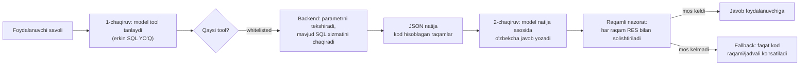
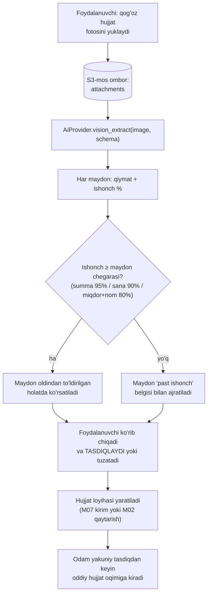

# AI qatlami

**Maqsad:** AI qatlamining port/adapter arxitekturasi, model routing, "kod hisoblaydi — AI tushuntiradi" majburlash mexanizmi, budjet/baholash siyosati.
**Kim uchun:** Backend ishlab chiquvchi, AI/prompt muhandisi.
**Bog'liq fayllar:** `09-ai-funksiyalar.md`, `05-mvp-chegarasi.md`, `10-umumiy-arxitektura.md`, `11-malumotlar-modeli.md`, `15-xavfsizlik-va-audit.md` (§5.2, §10), `21-integratsiyalar.md` (§12), `23-backend-arxitekturasi.md`, `25-nofunksional-talablar.md` (§11), `01-qarorlar.md` #55, #61.
**Holat:** joriy, 2026-10-16.

## Asosiy xulosalar

1. **AI — chekka qatlam, ajratilgan interfeys orqali**: butun backend `AiProvider` porti (Python `Protocol`: `complete`, `complete_structured`, `vision_extract`, `submit_batch`) bilan ishlaydi; adapter — `fake` (test), `cli` (faqat dev/demo, Anthropic qoidasi bo'yicha obuna mahsulot ichida ishlatilmaydi), `api` (production, rasmiy `anthropic` Python SDK), ixtiyoriy `bedrock_eu` (qaror #61, 7-bo'lim) — `10-umumiy-arxitektura.md`, `09-ai-funksiyalar.md` 5-bo'lim.
2. **Model routing**: oddiy tushuntirish/matn (AI-01 standart, AI-06) va **AI-03 OCR** — **Claude Haiku 5.5** (`claude-haiku-5-5`, $0,10 kirish / $0,50 chiqish per 1M token, prompt ≤ 100 000 token bo'lganda; rasm kirishini qo'llab-quvvatlaydi); murakkab ko'p hujjatli tahlil (AI-05, AI-01'ning ko'p-modulli holati) va **past ishonchli OCR maydonlari** — **Claude Sonnet 5.5** (`claude-sonnet-5-5`, $2/$10) — narxlar platform.claude.com/docs/en/about-claude/pricing, 2026-10-16 (2-bo'lim).
3. **"Kod hisoblaydi, AI tushuntiradi" kod darajasida majburlanadi**, prompt qoidasi bilan emas: AI-01 faqat oldindan ro'yxatlangan (whitelisted) o'qish-uchun-tool'larni chaqiradi (hech qachon erkin SQL yozmaydi), tool natijasi kod tomonidan SQL orqali hisoblanadi; javob matni chiqqandan keyin **raqamli nazorat (`numeric_guard`)** har bir raqamni tool natijasi bilan solishtiradi.
4. **Qatlam standartlari**: port naqshi (`AiProvider`), CLI/API adapterining himoyalari (timeout, retry+backoff, circuit breaker), token/xarajat hisob-kitob modeli, DI'dagi rejim almashtirish naqshi (`fake | cli | api`), readiness tekshiruvi naqshi (gating vs reported). Transport ERP'da **API kalit** orqali bo'ladi (CLI faqat dev/demo).
5. **Xarajat — tarif narxining kichik ulushi** (13-bo'lim, rasmiy narxlar va rasm tokeni formulasi bilan qayta hisoblangan): yengil tenant ~900 so'm/oy (~0,9%), o'rta ~4 700 so'm (AI-03 Haiku bilan; Sonnet bilan ~6 900), og'ir ~13 900 so'm (Sonnet bilan ~21 200) — yagona tarifning ~1–21%i; oylik token budjeti (5-bo'lim) og'ir profilni qattiq to'xtatish bilan cheklaydi. So'rovlar soni va matn token hajmi — taxmin, pilotda `ai_requests` bilan almashtiriladi.
6. **Maxfiylik (qaror #61)**: lokalizatsiya majburiyati faqat biometrik/genetik/telekom ma'lumotga tegishli (ZRU-547 27-1-modda), lekin chet elga uzatish alohida qoida bilan tartibga solinadi (15-modda, VMQ-415) — Anthropic (AQSh) DPF ishtirokchisi emas. Shuning uchun Claude'ga faqat **maskalangan yoki agregat** ma'lumot yuboriladi: shaxsiy maydonlarni maskalash **majburiy, tenant o'chira olmaydi**; maskalab bo'lmaydigan AI-03 rasmlari faqat `tenants.settings.ai_cross_border_enabled=true` (tenant rozilik bergan) bo'lsa yuboriladi (7-bo'lim). O'qitish uchun mijoz ma'lumotidan aniq roziliksiz foydalanilmaydi.
7. **Baholash o'zbek tili uchun rasmiy benchmark yo'qligi sababli to'liq ichki**: har funksiya uchun 50–100 taxminiy holatli eval to'plam (lotin/kirill/rus aralash), CI'da regression gate, pilot davrida haqiqiy o'lchov — bu hujjatning markaziy yangiligi, chunki `09-ai-funksiyalar.md`da faqat "pilot kerak" deyilgan, usul ko'rsatilmagan.
8. **Tenant oylik token budjeti tarifga bog'liq** (`plans.limits.ai_monthly_tokens`, `11-malumotlar-modeli.md` 2-bo'lim); limit tugaganda yoki Claude API ishlamaganda **faqat AI funksiyalari o'chadi, kassa/hisob to'liq ishlayveradi** — bu qoida `10-umumiy-arxitektura.md`dan meros.

---

## 1. `AiProvider` interfeysi

Butun tizim AI bilan **bitta** portga murojaat qiladi — `AiProvider` (Python `Protocol`, ERP ehtiyojiga moslashtirilgan: raqamli tushuntirish, tuzilgan chiqish, vision). To'rt metod:

| Metod | Imzo (konseptual) | Vazifa | Kim chaqiradi |
|---|---|---|---|
| `complete` | `complete(system, user, *, model=None, stream=False) -> str \| AsyncIterator[str]` | Erkin matn generatsiyasi (tushuntirish, eslatma matni); `stream=True` — AI-01 chat UI uchun token-oqim | AI-01, AI-06 |
| `complete_structured` | `complete_structured(system, user, schema: BaseModel, *, model=None) -> BaseModel` | Tuzilgan JSON chiqish (Anthropic "structured outputs"/tool-use orqali) — javobni frontend to'g'ridan-to'g'ri render qiladi, erkin matnni parse qilish kerak emas | AI-05 (tafovut tushuntirish + manba hujjat ro'yxati), AI-01 (tool-chaqiruv formati) |
| `vision_extract` | `vision_extract(image: bytes, schema: BaseModel, instructions, *, model=None) -> BaseModel` | Rasmdan tuzilgan maydon chiqarish, har maydon uchun ishonch (confidence) darajasi bilan | AI-03 (OCR) |
| `submit_batch` | `submit_batch(items: list[AiBatchItem]) -> batch_id`; natija `get_batch_results(batch_id)` | Shoshilinch bo'lmagan so'rovlarni Batch API orqali (−50% narx); `FakeProvider`/`CliProvider`da oddiy `complete`ga tushadi | AI-05, AI-06 (MVP'dan keyin, ixtiyoriy) |

Qo'shimcha: har metod `AiRequestContext` (tenant_id, user_id, feature kodi `AI-01`…, til) qabul qiladi — bu `ai_requests` yozuviga va budjet/rate-limit tekshiruviga ishlatiladi (8-bo'lim). Xato holatlari bitta umumiy `AiProviderUnavailable` istisno orqali ko'tariladi — chaqiruvchi tomon (worker) buni "AI vaqtincha ishlamaydi" holatiga aylantiradi, foydalanuvchiga xato chiqmaydi, faqat AI javobi kutilmoqda/mavjud emas ko'rinadi.

### 1.1 Adapterlar

| Adapter | Muhit | Tavsif |
|---|---|---|
| `FakeProvider` | test, CI | Deterministik, oldindan belgilangan javoblar; token/xarajat 0; eval suite va unit testlar shu bilan ishlaydi |
| `CliProvider` | **faqat local/dev/demo** | `claude -p --output-format json` subprocess, dasturchi/demo operatorining shaxsiy obunasi orqali (`CLAUDE_CODE_OAUTH_TOKEN`). Hech qachon production tenant trafigini ko'tarmaydi (Anthropic shartlari, `09-ai-funksiyalar.md` 5-bo'lim) |
| `AnthropicApiProvider` | **staging, production** (standart) | Rasmiy `anthropic` Python SDK, API kalit orqali. Streaming (`complete(stream=True)` uchun), prompt caching (takrorlanuvchi system prompt/tenant glossary qismi; kesh o'qish Haiku 5.5 da 0,1×, Sonnet 5.5 da 0,05× kirish narxi), structured outputs (`complete_structured`), **Batch API** (−50% narx, shoshilinch bo'lmagan AI-05/AI-06 uchun) |
| `BedrockEuProvider` | **ixtiyoriy** (asoschi tanlovi) | Claude'ni AWS Bedrock EU Geo profili orqali chaqirish — ishlov VMQ-415 ro'yxatidagi davlatlarda (Germaniya, Irlandiya va b.). `ERP_AI_PII_ROUTE` sozlamasi bilan AI-03 rasmlari (va PII ehtimoli bor promptlar) shu adapterga yo'naltiriladi; tanlanmasa standart yo'l — tenant roziligi + `AnthropicApiProvider` (7-bo'lim) |
| `LocalModelProvider` | **kelajak** | Markaziy GPU serverda o'zimiz o'qitgan/moslashtirgan model; faqat sinov to'plamida sifat Claude'ga yaqinlashganda yoqiladi (`09-ai-funksiyalar.md` 5-bo'lim, "Lokal modelni o'zimiz o'qitish" qatori) |

Muhit → rejim xaritasi (`10-umumiy-arxitektura.md`, 3-bo'lim bilan bir xil): local → `fake`/`cli`; staging → `api` (alohida kalit, past limit); production → faqat `api`.

### 1.2 Qatlam naqshlari

AI qatlamining standart naqshlari — ushbu loyihaning o'z arxitektura qarorlari:

- **Port naqshi**: "AI aniq nima qila oladi"ni toraytiruvchi yagona interfeys (to'rt metod: `complete`, `complete_structured`, `vision_extract`, `submit_batch`) — ilovaning qolgan qismi konkret provayderni bilmaydi (`AiProvider`, 1-bo'lim).
- **CLI/API adapterining himoyalari**: (a) **isolyatsiya** — chaqiruv konteksti har doim minimal/tozalangan bo'ladi (tenant ma'lumoti faqat kerakli qismi yuboriladi, 9-bo'lim); (b) **bounded retry + exponential backoff**; (c) **circuit breaker** (N marta ketma-ket xato → vaqtincha to'xtash, keyin bitta sinov) — ikkisi ham `AnthropicApiProvider` ichida saqlanadi.
- **Token/xarajat modeli**: `AiCallUsage` (input/output/cache token), narx jadvalidan USD hisoblash, **USD→UZS** konvertatsiya konfiguratsiyalanadigan kurs bilan, per-turn akkumulyator (`TurnUsage`, bir nechta AI chaqiruvi — masalan AI-01'da tool-chaqiruv + yakuniy javob — bitta so'rov sifatida yig'iladi) → `ai_requests` yozish mantiqi (8-bo'lim).
- **DI rejim almashtirish**: muhitga qarab provayder tanlash (`fake | cli | api`), xizmatlarni (titler, extractor va h.k.) rejimga qarab moslashtirish naqshi — DI konteynerida `AiProvider` tanlovi (1.1-bo'lim jadvali).
- **Readiness: gating vs reported**: asosiy xizmat (DB) tayyor bo'lmasa `/health/ready` 200 bermaydi, lekin tashqi/ixtiyoriy xizmat (AI, Redis) faqat **hisobot** qilinadi, tayyorlikni bloklamaydi; CLI holatini tekshirish (credential bor-yo'qligi, versiya) — hech qachon pul to'lanadigan chaqiruv qilmasdan, keshlangan (60 soniya) → `GET /health/ready`'da `ai: ok/degraded/down` — 14-bo'lim.
- **Raqamli nazorat (`numeric_guard`)**: deterministik tekshiruv — matndagi har bir raqamni ruxsat etilgan qiymatlar ro'yxati (fakt, foiz, davr sanasi, kichik son) bilan solishtirish, "boshqa bo'limga tegishli raqam" / "faktlarda yo'q raqam" turlariga ajratish, texnik token (identifikator, kalit nomi) sizib chiqishini aniqlash (3-bo'lim).

---

## 2. Model routing

| Funksiya | Standart model | Routing qoidasi | Sabab |
|---|---|---|---|
| AI-01 (oddiy savol — bitta modul, bitta agregatsiya) | Haiku 5.5 | Default | Oddiy qayta ifodalash, past xato narxi (`09-ai-funksiyalar.md`, AI-01) |
| AI-01 (ko'p-modulli/kesishma tahlil — 2+ tool chaqiruvi yoki aniq "nega"/"sabab" so'rovi) | Sonnet 5.5 | Heuristika: tool-chaqiruvlar soni > 1 **yoki** savol murakkabligi belgisi (foydalanuvchi "nega", "sababi", "solishtir" kalit so'zlari) | `09-ai-funksiyalar.md`: "murakkabroq ko'p bosqichli tahlil... Sonnet 5.5" |
| AI-03 (OCR, vision) | Haiku 5.5 | Standart Haiku 5.5; maydon ishonchi chegaradan past bo'lsa (summa < 95%, sana < 90%, miqdor/nom < 80%) — o'sha rasm **Sonnet 5.5** ga bir marta qayta yuboriladi (eskalatsiya), har maydon uchun ishonchi yuqori natija olinadi | Barcha joriy Claude modellari rasm kirishini qo'llab-quvvatlaydi; rasm narxi rasmiy: vizual token × kirish narxi (10-bo'lim). Haiku 5.5 aniqligi AI-03 chegaralariga pilotda tekshiriladi — o'tmasa standart Sonnet 5.5 bo'ladi |
| AI-05 (davlat hisoboti tafovuti) | Sonnet 5.5 | Har doim | Ko'p hujjatni taqqoslash, yuqori xato narxi (`09-ai-funksiyalar.md`, AI-05) |
| AI-06 (nasiya eslatma matni) | Haiku 5.5 | Har doim | Oddiy qisqa matn generatsiyasi (`09-ai-funksiyalar.md`, AI-06) |

Model tanlovi `AiProvider.complete*`ning `model` parametri orqali ustidan yoziladi; default — har funksiya konfiguratsiyasida (`settings`, muhit o'zgaruvchisi), kod ichida qotirilmaydi.

**Narx jadvali** (konfiguratsiya; platform.claude.com, 2026-10-16):

| Model | Kirish $/MTok | Chiqish $/MTok | Kesh yozish 5 daq / 1 soat | Kesh o'qish | Batch kirish/chiqish |
|---|---|---|---|---|---|
| Haiku 5.5, prompt ≤ 100 000 token | 0,10 | 0,50 | 0,125 / 0,20 | 0,01 | 0,05 / 0,25 |
| Haiku 5.5, prompt > 100 000 token | 0,50 | 2,50 | 0,625 / 1,00 | 0,05 | 0,25 / 1,25 |
| Sonnet 5.5 | 2 | 10 | 2,50 / 4 | 0,10 | 1 / 5 |

Haiku 5.5 dagi ikki narx bitta so'rovning prompt uzunligiga bog'liq (bizning chaqiruvlar ≤ 10 000 token — doim pastki narx). Haiku 5.5 va Sonnet 5.5 yangi tokenizatorda: bir xil matn Haiku 4.5 ga nisbatan ~30% ko'proq token — 13-bo'limdagi matn token taxminlari shunga ko'ra +30% olingan.

---

## 3. "Kod hisoblaydi, AI tushuntiradi" — majburlash mexanizmi

Bu loyihaning markaziy AI xavfsizlik qoidasi (`09-ai-funksiyalar.md`, Asosiy xulosa #2). Ikki qatlamli himoya:

### 3.1 Tool-chaqiruv (function-calling) dizayni — AI-01

AI hech qachon erkin SQL yozmaydi va bazaga to'g'ridan-to'g'ri kirmaydi. Backend **whitelisted** (oldindan ro'yxatlangan, parametrlari qat'iy tipli) o'qish-uchun-tool'lar to'plamini e'lon qiladi — M12 (hisobotlar) xizmat qatlamidagi mavjud so'rovlarning ustiga qo'yilgan tor interfeys, masalan: "bugungi/davr foyda", "TOP-N sotilgan mahsulot", "past qoldiqli tovarlar", "eng ko'p qarzdor mijozlar". Har tool: nomi, parametr sxemasi (davr, filial, limit), va u qaytaradigan maydonlar ro'yxati bilan Claude API'ning tool-use mexanizmiga beriladi.

Qoidalar:
- Model birinchi chaqiruvda **faqat** tool tanlaydi va parametr beradi (erkin matn emas); backend parametrlarni Pydantic sxema bilan tekshiradi, noma'lum/ro'yxatdan tashqari tool chaqirilsa — rad etiladi.
- Tool bajarilishi **har doim** mavjud, allaqachon test qilingan SQL/xizmat qatlami orqali (M12 va modul xizmatlari) — AI uchun alohida yo'l yozilmaydi.
- Ikkinchi chaqiruvda model faqat qaytgan JSON natijadan foydalanib matn yozadi; promptda aniq taqiq: "raqamni o'zing to'qima, faqat berilgan natijadan foydalan".

### 3.2 Raqamli nazorat (numeric guard)

Ikkinchi chaqiruv natijasi chiqqandan keyin, foydalanuvchiga ko'rsatilishidan **oldin**, deterministik tekshiruv (`numeric_guard`, 1.2-bo'lim) ishga tushadi:
1. Javob matnidagi har bir sonni ajratib oladi (turli yozilish: bo'sh joy/nuqta/vergul bilan guruhlangan, o'nlik vergul, "ming"/"mln" kabi so'z bilan masshtablangan).
2. Har sonni tool natijasidagi qiymatlar, davr sanasi qismlari va kichik sanoq sonlar (0..N) ro'yxati bilan solishtiradi (yaqinlashtirish — ko'rsatilgan o'nlik aniqlikka yaxlitlab).
3. Mos kelmagan son topilsa: so'rov **bir marta** tuzatish ko'rsatmasi bilan qayta yuboriladi ("faqat quyidagi raqamlardan foydalan: …"); ikkinchi marta ham mos kelmasa, AI matni bostiriladi va foydalanuvchiga faqat kod hisoblagan raqam/jadval (AI izohisiz) ko'rsatiladi — `ai_requests.status = 'guard_failed'` deb belgilanadi, monitoring uchun hisoblanadi (14-bo'lim).

Bu mexanizm AI-05 va AI-06 uchun ham xuddi shunday ishlaydi: ularda "tool natijasi" — M10/M08 modullari kod tomonidan allaqachon hisoblagan tafovut/risk obyekti (`complete_structured` orqali olinadi, bevosita JSON sifatida promptga kiritiladi, qo'shimcha tool-chaqiruv shart emas — ma'lumot allaqachon kod tomonidan tayyor).

---

## 4. Prompt shablonlari — joylashuvi va versiyalash

- Joylashuv (tavsiya): `backend/ai/prompts/<feature_id>/v<N>/system.md` (masalan `backend/ai/prompts/ai01_qna/v3/system.md`), har versiyada o'zgarmas matn + o'zgaruvchi joylar uchun aniq belgilangan placeholder'lar (tenant nomi, tenant_glossary atamalari, joriy sana).
- Har prompt versiyasi **eval suite'dan o'tgandan keyin** (10-bo'lim) productionga chiqadi — versiya raqami oshirilganda eski versiya kodda saqlanadi (A/B yoki tezkor rollback uchun), hech qachon joyida tahrirlanmaydi.
- `tenant_glossary` (`11-malumotlar-modeli.md`, 10-bo'lim: "kola" → mahsulot kabi tenant-xos atamalar) promptning alohida, tez-tez o'zgaruvchi bo'lagi — prompt caching chegarasida **boshqa** segmentga joylashtiriladi (asosiy tizim prompti — statik, uzoq TTL keshlanadi; glossary — tenant-xos, qisqaroq keshlanadi) — xarajatni pasaytirish uchun (9-bo'lim).
- `ai_requests.prompt_version` (`11-malumotlar-modeli.md` 10-bo'lim) — har javob qaysi prompt versiyasidan kelganini qayd etadi (format: `ai01_qna/v3`).

---

## 5. Tenant oylik token budjeti, rate limit, graceful degradation

- Har tenant uchun oylik token limiti — `plans.limits.ai_monthly_tokens` (`11-malumotlar-modeli.md`, 2-bo'lim, allaqachon mavjud JSONB maydon). **Bitta tarif, bitta limit** — barcha tenant hamma AI funksiyasiga (AI-01/03/05/06) kirishi mumkin bo'lgani uchun, eng yuqori ehtiyojni qoplaydigan, "biroz kengroq" qiymat tanlandi (§5, tavsiya #11 — overage yo'q, qattiq to'xtatish, qaror #23 bilan izchil):

| Tarif | Standart (token/oy, sozlanadi) |
|---|---|
| `standard` (99 000 so'm, yagona tarif) | **2 500 000** |

Qiymat — standart (26 #54), sozlanadi; 13-bo'limdagi o'rta profil (~2,0 mln token/oy) limit ichida, og'ir profil (~6,1 mln) limitda qattiq to'xtaydi. Pilotda tenantlarning ≥10%i limitga urilsa, qiymat oshiriladi va/yoki prepaid AI paket (`addons`) qo'shiladi.

- Hisoblash: har `ai_requests` yozuvidagi `input_tokens + output_tokens` joriy oy bo'yicha tenant kesimida yig'iladi (Redis'da tez sanoq — kunlik/oylik kalit, davr oxirida 0'ga tushadi, PostgreSQL `ai_requests`'dan tasdiqlanadi).
- **Limit tugaganda — qattiq to'xtatish, overage yo'q**: AI so'rovlari **hard-stop** qilinadi — foydalanuvchiga "bu oy uchun AI limiti tugadi, keyingi oyda tiklanadi" ko'rsatiladi, kassa/ombor/buxgalteriya **to'liq ishlayveradi** (`10-umumiy-arxitektura.md`, Asosiy xulosa #8). Qo'shimcha avtomatik to'lov (overage) **yo'q** — mayda summalarni Click/Payme orqali yechish komissiya, support savollari va murakkablik keltiradi, AI xarajati esa odatiy foydalanishda tarifning ~1–7%i (13-bo'lim). Yagona tarif modelida "tarifni oshirish" taklifi yo'q (bir xil tarif hammaga). **Oldindan to'lanadigan AI paket** — faqat **pilotdan keyin**, agar tenantlarning **≥10%i** oylik limitga urilsa, qo'shimcha xizmat (`addons` katalogi, `11-malumotlar-modeli.md` §2) sifatida qo'shiladi. Limit qiymatlari (5-bo'lim) shu sababli biroz kengroq qo'yiladi, oshirib yuborish ehtimolini kamaytirish uchun.
- **Rate limit (qaror #55)**: `POST /ai/chat` (AI-01) — foydalanuvchiga **10 so'rov/daqiqa**, tenantga **300 so'rov/kun** → `429 RATE_LIMITED` (Redis hisoblagich); ustidan oylik token budjeti asosiy cheklov bo'lib qoladi.
- **Graceful degradation** (Claude API ishlamay qolganda — timeout, 5xx, circuit breaker ochiq): worker `outbox_jobs` (`kind='ai'`) qayta urinadi (backoff bilan); bir necha urinishdan keyin ham muvaffaqiyatsiz bo'lsa — AI-01 so'rovi uchun foydalanuvchiga "AI hozir javob bera olmayapti, keyinroq urinib ko'ring" xabari, AI-05/AI-06 uchun ko'rsatma/eslatma **AI matnisiz, faqat kod raqami** bilan ko'rsatiladi (masalan AI-06: eslatma shabloni + summa, tayyor matn o'rniga). Bu holatlar `ai_requests.status='failed'` bilan loglanadi.

---

## 6. Xarajat hisobi (`ai_requests`, USD→UZS)

Har AI chaqiruvi (`AiCallUsage` modeliga mos) quyidagicha `ai_requests`ga yoziladi (maydonlar `11-malumotlar-modeli.md` 10-bo'limda: `tenant_id, user_id, feature, model, prompt_version, input_tokens, output_tokens, cache_read_tokens, cost_usd, fx_rate_used, cost_uzs, latency_ms, guard_result, status`):

1. Claude API javobi `usage.input_tokens`, `usage.output_tokens` (va kesh bo'lsa `cache_read_input_tokens`/`cache_creation_input_tokens`) qaytaradi.
2. `cost_usd = (input_tokens × price_in + output_tokens × price_out + cache_read_tokens × price_cache_read + cache_write_tokens × price_cache_write) / 1_000_000` — narxlar model jadvalidan (2-bo'lim; kesh koeffitsienti modelga bog'liq: Haiku 5.5 — 0,1×, Sonnet 5.5 — 0,05×; konstanta emas). Rasm tokenlari `input_tokens` ichida keladi.
3. So'mga ko'rsatish uchun: `cost_uzs = cost_usd × fx_rates.rate` — Markaziy bankning kunlik rasmiy kursi (`platform.fx_rates`, scheduler `fetch_fx_rates` har kuni 09:30 Toshkent vaqtida, manba `https://cbu.uz/uz/arkhiv-kursov-valyut/json/USD/`); kurs olinmasa `ERP_FX_USD_UZS_FALLBACK = 12 500` (qaror #55). Yozuv vaqtidagi kurs `fx_rate_used`, natija `cost_uzs` ustunida saqlanadi (tarixiy aniqlik).
4. Bir foydalanuvchi so'rovida bir nechta AI chaqiruvi bo'lsa (masalan AI-01'ning tool-tanlash + yakuniy javob, ikki chaqiruv) — `TurnUsage` modeliga mos, bitta "turn" ichida yig'iladi, lekin **har chaqiruv** alohida `ai_requests` qatori sifatida ham saqlanishi mumkin (audit uchun to'liqlik) — aniq granularlik backend arxitekturasi bosqichida (`23-backend-arxitekturasi.md`) belgilanadi.
5. Platform admin paneli va tenant hisobotida (M12 ichida yoki alohida AI-xarajat widget) oylik AI xarajati (USD va so'm) ko'rinadi — bu bir vaqtning o'zida budjet sarfini kuzatish vositasi (5-bo'lim).

---

## 7. Maxfiylik (qaror #61)

- **Minimal ma'lumot**: AI chaqiruviga faqat zarur maydonlar yuboriladi (masalan AI-01'da — tool natijasidagi agregatsiya qilingan raqamlar, mijozning to'liq profili emas); xom hujjat matni/butun jadval promptga tashlanmaydi. Karta, parol, PIN, pasport va biometrik ma'lumot hech qachon yuborilmaydi.
- **Huquqiy asos**: lokalizatsiya majburiyati faqat biometrik/genetik/telekom ma'lumotga tegishli (ZRU-547 27-1-modda, ZRU-1125 tahriri), lekin **chet elga uzatish** alohida qoida bilan tartibga solinadi (15-modda, 27-1-modda 3-qism, VMQ-415 — 49 "teng himoya" davlati; AQSh faqat EU-US DPF ishtirokchilari uchun). Anthropic DPF ishtirokchisi emas → maskalanmagan shaxsiy ma'lumotni Anthropic API'ga yuborish uchun subyekt roziligi kerak. Shaxsiy ma'lumotga AI yordamida qonunga xilof ishlov berish — MJtK 46-2-modda 2-qism (BHMning 50–100 baravari). Vakolatli organ — IIV huzuridagi Migratsiya va personallashtirish departamenti (pd.gov.uz).
- **PII maskalash — majburiy, standart yoqilgan, tenant o'chira olmaydi**: promptga yuborilishidan oldin jismoniy shaxsga oid maydonlar (mijoz/kontragent F.I.Sh., telefon, JShShIR, yakka tadbirkor STIR'i, manzil) token bilan almashtiriladi ("mijoz A", "telefon A"); karta, parol, PIN, maxfiy kalit/token maydonlari tokenlanmaydi — umuman olib tashlanadi. Javob qaytgach kod tokenni asl qiymatga qaytaradi. Token ↔ asl qiymat xaritasi — **bitta AI so'rovi uchun xotiradagi (in-memory) xarita**: `TokenGlossary` interfeysi (`token_for(kind, value)`) ortida, standart amalga oshirish `RequestGlossary` (so'rov ichida bir xil qiymat — bir xil token); xarita so'rov tugashi bilan yo'qoladi, DB'ga, logga yoki `ai_requests`ga yozilmaydi. `tenant_glossary` (`12-db-sxema.md` §2.9: `term` → `meaning`, masalan "kola" → mahsulot) — tenant atamalari lug'ati, PII ombori **emas** va maskalash xaritasini saqlamaydi. Maskalash — feature flag emas, `AiProvider` chaqiruvidan oldingi majburiy qatlam (`app/modules/ai/privacy/masking.py`, `MaskedAiProvider` har adapterni o'raydi), unit-testlar bilan qoplanadi.
- **AI-03 rasmlari — maskalab bo'lmaydigan istisno** (faktura/yuk xati fotosida jismoniy shaxs ismi bo'lishi mumkin): rasm faqat `tenants.settings.ai_cross_border_enabled=true` bo'lsa yuboriladi — tenant foydalanish shartlarida chegaradan tashqari uzatishga rozilik bergan (`tenants.accepted_terms_version`). Standart yo'l — rozilik + `AnthropicApiProvider`. Muqobil — `ERP_AI_PII_ROUTE=bedrock_eu` (VMQ-415 ro'yxatidagi regionda ishlov, `BedrockEuProvider`) — asoschi tanlovi. Rozilik ham, EU endpoint ham bo'lmasa AI-03 tenant uchun o'chiq ("AI orqali tanish" tugmasi ko'rinmaydi).
- **Sizib chiqish**: transchegaraviy uzatishda tarqalish aniqlansa — vakolatli organga 24 soatda xabar, 72 soatda batafsil axborot (VMQ-415 4-band); runbook — `15-xavfsizlik-va-audit.md` §10. Anthropic sub-processor xabari — DPA bo'yicha.
- **O'qitish uchun rozilik (training consent)**: Anthropic API orqali yuborilgan ma'lumot standart holatda modelni o'qitishga ishlatilmaydi (API tijorat shartlari); o'zimizning kelajakdagi fine-tuning (9-bo'lim) uchun esa **aniq, tenant darajasidagi rozilik** talab qilinadi.
- **Rozilikni saqlash**: `tenants.settings.ai_training_consent` (bool + sana) — tenant darajasidagi umumiy rozilik; `ai_feedback.consent_for_training` — har alohida fikr-mulohaza/tuzatish darajasidagi rozilik; `tenants.settings.ai_cross_border_enabled` — chegaradan tashqari uzatish. Hammasi ixtiyoriy va rad etilsa asosiy funksiyalar ishlashda davom etadi.

---

## 8. Baholash (evaluation)

O'zbek tili uchun rasmiy LLM/OCR benchmark yo'qligi (`09-ai-funksiyalar.md`, Asosiy xulosa #6) MVP'ni **to'liq ichki eval tizimga** majbur qiladi:

### 8.1 Eval to'plami

- Joylashuv: `backend/ai/eval/<feature_id>/cases.jsonl` — har funksiya (AI-01, AI-03, AI-05, AI-06) uchun alohida.
- Hajm: **50–100 holat/funksiya** (vazifa talabi) — lotin, kirill va rus tilidagi aralash matnlarni qamrab oladi (masalan AI-01'da: "bugun qancha foyda?" / "бугунги фойда қанча?" / "сколько прибыли сегодня?" — uchtasi ham bir xil tool'ga map qilinishi kutiladi).
- Har holat: kirish (savol/hujjat rasmi/kontekst), kutilgan tool-chaqiruv (AI-01 uchun) yoki kutilgan maydon qiymatlari (AI-03 uchun), qabul mezoni (masalan "javobda 1 240 000 soni bo'lishi kerak va boshqa raqam bo'lmasligi kerak").
- Manba: dastlabki to'plam qo'lda yoziladi (haqiqiy pilot ma'lumoti yo'q); pilotdan keyin haqiqiy so'rovlar (anonimlashtirilgan, rozilik bilan) to'plamga qo'shiladi (9-bo'lim bilan bog'liq).
- **AI-03 eval — `eval/ocr_uz`**: 100 ta real faktura/yuk xati rasmi pilot do'konlardan (≈50 kirill, 50 lotin, aralash; anonimlashtirilgan, tenant roziligidan keyin), maydon bo'yicha aniq moslik. AI-03 platforma flag'i `ai.ocr_enabled=false` — shu to'plamda 8.2 chegaralari (summa ≥95%, sana ≥90%, miqdor/nom ≥80%) bajarilmaguncha yoqilmaydi; Haiku 5.5 va Sonnet 5.5 alohida o'lchanadi (2-bo'limdagi eskalatsiya qoidasi uchun). AI-02 (STT) — `ai.stt_enabled=false`, `SttPort` ortida, MVP'dan keyin.

### 8.2 Metrikalar

| Funksiya | Asosiy metrika | Qo'shimcha |
|---|---|---|
| AI-01 | Raqamli nazorat o'tish darajasi (3-bo'lim) — **100% talab qilinadi** (nol tolerantlik) | Tool tanlash to'g'riligi (kutilgan tool chaqirilganmi); til aniqlanishi (savol tiliga javob berilganmi); uslub/tabiiylik (LLM-judge ball, 1–5, **taxmin metodologiya**) |
| AI-03 | **Maydon bo'yicha ishga tushirish shartlari**: 100 ta O'zbekiston hujjatida (≈40% toza, 40% foto/skaner, 20% qo'lda yozilgan; lotin/kirill/rus) **summa ≥95%**, **sana ≥90%**, **miqdor va tovar nomi ≥80%** aniqlik; summa yoki sana 90%dan past bo'lsa — AI-03 pilotga chiqmaydi (yagona 90% chegara o'rniga maydon bo'yicha qattiqroq shart, chunki pul maydonidagi xato eng qimmat) | Past ishonchli maydon har doim sariq belgilanadi; ishonch kalibrlanishi — past-ishonch belgisi haqiqatan xato maydonlarga to'g'ri kelishi kerak |
| AI-05 | Raqamli nazorat o'tish darajasi — 100% | Tushuntirish aniqligi (manba hujjatga havola to'g'ri ko'rsatilganmi) |
| AI-06 | Raqam generatsiya qilmaganligi (0 raqam AI tomonidan to'qilgan) | Ohang/tabiiylik (LLM-judge yoki qo'lda baholash) |

### 8.3 CI regression gate

- Prompt shabloni (4-bo'lim) yoki model versiyasi o'zgarganda, CI avtomatik eval suite'ni ishga tushiradi (`FakeProvider` bilan emas — kichik, arzon haqiqiy chaqiruv to'plami yoki saqlangan "golden" javoblar ustida qayta tekshiruv).
- **Bloklovchi shart**: raqamli nazorat o'tish darajasi 100%dan past bo'lsa — merge bloklanadi (nol tolerantlik, chunki bu moliyaviy/soliq ma'lumoti). Uslub/sifat ball **taxmin chegaradan** (masalan oldingi versiyadan −10% dan ko'p pasaymasligi) past tushsa — ogohlantirish, lekin blok emas (aniq chegara pilotda sozlanadi).
- Natijalar versiyalanadi (`4-bo'lim`dagi prompt versiyasiga bog'langan) — qaysi versiya qachon qanday ball olgani tarix sifatida saqlanadi.

### 8.4 Pilot o'lchov rejasi

- Production'da har AI javobidan keyin foydalanuvchi fikr-mulohazasi (`ai_feedback`: rating, correction) yig'iladi — ekranda kichik 👍/👎 va "tuzat" tugmasi.
- Haftalik: pilot tenant(lar)dagi real `ai_requests`/`ai_feedback` ko'rib chiqiladi, past ball/tuzatilgan javoblar eval to'plamiga **yangi holat** sifatida qo'shiladi (regressiyaning oldini olish).
- Birinchi 90 kunlik pilot maqsadi (**taxmin**, `05-mvp-chegarasi.md`dagi "taxmin" uslubiga mos): AI-01 raqamli nazorat o'tish darajasi production trafikda ≥99,9% (xato holatlari fallbackka tushadi, 3-bo'lim), AI-03 foydalanuvchi tomonidan hech qanday tahrirsiz tasdiqlangan hujjat ulushi — aniq maqsad yo'q, kuzatiladi va hisobot qilinadi.

---

## 9. Kelajakdagi fine-tuning uchun ma'lumot to'plash

- **Opt-in, tenant darajasida** (`tenants.settings.ai_training_consent`, 7-bo'lim) — standart holatda **o'chiq**.
- Rozilik berilgan tenantlar uchun: har `ai_feedback` yozuvi (ayniqsa foydalanuvchi tuzatgan javoblar — eng qiymatli signal) anonimlashtirish bosqichidan o'tadi (mijoz ismi/telefon/STIR kabi maydonlar olib tashlanadi yoki sintetik qiymat bilan almashtiriladi) va alohida saqlash joyiga (`ai_training_samples`, `11-malumotlar-modeli.md` 10-bo'lim) ko'chiriladi.
- Yig'ilgan namunalar davriy ravishda (masalan choraklik) ko'rib chiqiladi/tasdiqlanadi (inson nazorati) va faqat shundan keyin markaziy GPU serverdagi fine-tuning jarayoniga kiritiladi — bu bosqich `09-ai-funksiyalar.md` 5-bo'limidagi "Lokal modelni o'zimiz o'qitish — hozir yo'q, keyin ko'rib chiqiladi" qarori bilan mos.
- Maqsad — tor vazifalar (masalan tovar nomini toifaga ajratish, eslatma matnining tenant ohangiga moslashuvi), umumiy suhbat qobiliyatini almashtirish emas.

---

## 10. OCR quvuri (AI-03) — MVP'da, bu quvur MVP bosqichlarida quriladi

**Yagona yo'l (API unifikatsiyasi)**: OCR **bitta** jadval (`ai_ocr_jobs`) va **bitta** endpoint oilasi bilan amalga oshiriladi: fayl avval `POST /api/v1/attachments` (`purpose=ocr_source`) orqali yuklanadi → `POST /api/v1/ai/ocr/jobs` (`attachment_id`, `doc_type_hint`: `purchase` — kirim fakturasi, BO-04 | `catalog` — mahsulot katalogi + boshlang'ich qoldiq, BO-21 onboarding; qaytarish OCR orqali kiritilmaydi — `returns` faqat POS/sync orqali, `17-api-umumiy.md` §9) → `GET /api/v1/ai/ocr/jobs/{job_id}` bilan poll (`status: processing→done→confirmed`/`failed`/`expired`) → `POST /api/v1/ai/ocr/jobs/{job_id}/confirm` — shu paytgina hujjat qoralamasi yaratiladi: `purchase` → `goods_receipts` (ruxsat `ai.ocr.use` **va** `purchases.receive`), `catalog` → mahsulotlar va `stock_openings` (ruxsat `ai.ocr.use` **va** `catalog.manage`) (`20-api-moliya-admin.md` #73–#75). Natija shakli pastdagi quvur bilan bir xil (sarlavha + `lines[]`, har maydon `value`/`confidence` 0..1, `low_confidence_fields` yo'l ro'yxati).

- **Qamrov eslatmasi** (`09-ai-funksiyalar.md`, AI-03): faqat (a) QQS to'lovchi bo'lmagan/norasmiy yetkazib beruvchining qog'oz yuk xati, (b) texnik uzilish davridagi qog'oz faktura, (c) qaytarish uchun qog'oz chek — standart QQS to'lovchilar o'rtasidagi e-faktura/e-TTN bu quvur orqali **emas**, EDO operatori import orqali kiradi.
- **Ishonch chegarasi, maydon bo'yicha**: summa **≥95%**, sana **≥90%**, miqdor/tovar nomi **≥80%** — 100 ta O'zbekiston hujjatida (≈40% toza, 40% foto/skaner, 20% qo'lda yozilgan; lotin/kirill/rus aralash) o'lchanadi; summa yoki sana shu chegaradan past chiqsa, AI-03 pilotga **chiqmaydi**. Yagona 90% chegara o'rniga maydon bo'yicha differensial yondashuv — xalqaro amaliyotda ham maydon ishonchi avtomatik qabul/odam tekshiruviga yo'naltirish uchun ishlatiladi (F16, `tarix/tekshiruv/savollar-yakuniy-tavsiyalar.md`), aniq raqamlar esa o'zbek hujjatlari uchun yangi benchmark — ishonch darajasi o'rta.
- AI hech qachon hujjatni avtomatik tasdiqlamaydi yoki davlat tizimiga (Didox/Faktura.uz, e-TTN) yubormaydi — faqat loyiha tayyorlaydi; yakuniy tasdiq va yuborish har doim odam (Buxgalter/Omborchi) tomonidan.
- **Past ishonch — xato emas (qaror #55)**: `200` javobda `low_confidence_fields[]` / `fields.header[].low_confidence` bayrog'i; `AI_LOW_CONFIDENCE` OpenAPI'da xato javobi sifatida e'lon qilinmaydi — UI maydonni sariq qiladi.
- **Rasm narxi (rasmiy)**: rasm 28×28 px "patch"larga bo'linadi — `vizual_token = ⌈kenglik/28⌉ × ⌈balandlik/28⌉`; Claude 4.7 va keyingi modellarda (Haiku 5.5, Sonnet 5.5) uzun tomon ≤ 2576 px va ≤ 4 784 vizual token, oshsa avtomatik kichraytiriladi. Rasm yuborishdan oldin uzun tomon **2048 px** gacha siqiladi (26 #28): 2048×1536 → 4 070 token, A4 portret 1448×2048 → 3 848 token. Narx: Haiku 5.5 ≈ $0,00064 (≈ 7,7 so'm) / rasm, Sonnet 5.5 ≈ $0,0127 (≈ 153 so'm) / rasm (4 070 rasm + 300 matn kirish, 400 chiqish). Pilotda **1568 px** varianti (≈ 2 350 token, narx ~42% kam) A/B qilinadi — o'qilish aniqligi 8.2 chegaralaridan tushmasa standart bo'ladi.
- AI-03 MVP'da qoladi, bu quvur birinchi relizdan boshlab quriladi; yoqilishi — `ai.ocr_enabled` va tenant uchun 7-bo'limdagi shart (`ai_cross_border_enabled` yoki EU endpoint).

---

## 11. Telegram bot integratsiyasi (AI-01)

- M18 (Telegram bot, `aiogram`) — asosiy REST API'ning oddiy mijozi (`10-umumiy-arxitektura.md`, 1-bo'lim); AI-01 so'rovi bot orqali kelganda ham **xuddi shu** `AiProvider` + tool-chaqiruv + raqamli nazorat quvuridan o'tadi — botga alohida AI yo'li yozilmaydi.
- Autentifikatsiya: `telegram_links` (tenant_id, user_id, chat_id) orqali Telegram foydalanuvchisi tizimdagi `users`/`memberships`ga bog'lanadi; savolga javob berishdan oldin **xuddi web kabi** rol/huquq tekshiruvi (`role_permissions`) qo'llaniladi — masalan Kassir roli moliyaviy xulosa so'rasa, huquqsiz deb rad etiladi.
- Bu funksiya `05-mvp-chegarasi.md`da **Could** darajasida (US-M18-04, "botda AI savol") — MVP'da ixtiyoriy, M18ning asosiy (Must) qismi (kunlik hisobot, ogohlantirish) AI'siz ishlaydi.
- Rate limit va oylik budjet (5-bo'lim) Telegram orqali kelgan so'rovlarga ham baravar qo'llaniladi (bitta tenant kesimidagi umumiy hisoblash, kanal farqlanmaydi).

---

## 12. Observability

- **Readiness** (`GET /health/ready`, gating vs reported naqshiga mos): AI holati — **faqat hisobot (reported), hech qachon gating** (chunki "AI — chekka qatlam" qoidasi, 10-umumiy-arxitektura.md #8): `ai: ok` / `ai: degraded (circuit open)` / `ai: down`. Tekshiruv — kreditsial/konfiguratsiya mavjudligi va (ixtiyoriy) bitta arzon, pulsiz "ping"ga yaqin chaqiruv, 60 soniya keshlanadi — hech qachon haqiqiy tenant so'rovini sarflamaydi.
- **Metrikalar**: har chaqiruv uchun model, token, xarajat, latency (`ai_requests`dan); circuit breaker holati (ochiq/yopiq, oxirgi ochilgan vaqt); raqamli nazorat o'tish/muvaffaqiyatsizlik darajasi (3-bo'lim) — bularning barchasi kunlik agregatsiya qilinib platform admin panelida ko'rinadi.
- **Ogohlantirish**: oylik budjetning 80%iga yetganda tenant Egasiga M18 (Telegram) orqali xabar; circuit breaker ochilganda yoki `guard_failed` darajasi anomal oshganda platform admin'ga ichki ogohlantirish.
- **Audit**: har AI javobi (xususan AI-05, moliyaviy/soliq tushuntirish) `ai_requests`ga bog'langan holda saqlanadi — kelajakda nizoli vaziyatda "AI nima deganini va qaysi raqamlar asosida" tekshirish imkoni beradi (`audit_log` bilan bir xil ruhda, `11-malumotlar-modeli.md`).

---

## 13. Xarajat jadvali: tenant/oy, yengil/o'rta/og'ir foydalanish

**Metodologiya**: narxlar va rasm tokeni formulasi — rasmiy (2-bo'lim, 10-bo'lim, 2026-10-16); so'rovlar soni va matn token hajmi — taxmin (`09-ai-funksiyalar.md` dagi AI-01 namunaviy hisobi asosida), pilotda `ai_requests` bilan almashtiriladi. Yangi tokenizator sababli eski matn token taxminlari **+30%** olingan.

Formula: `xarajat_USD = so'rovlar × (kirish_token × narx_kirish + chiqish_token × narx_chiqish) / 1 000 000`; so'mga — `× fx_rates.rate` (kun kursi; jadvalda CBU 2026-10-16: **12 011,65**). Kesh va Batch tejamlari jadvalga kiritilmagan (pastda).

| Funksiya | Model | Narx (kirish/chiqish, $/1M) | Token/chaqiruv (kirish + chiqish) | $/chaqiruv |
|---|---|---|---|---|
| AI-01 | Haiku 5.5 | 0,10 / 0,50 | 3 900 + 650 | 0,000715 |
| AI-06 | Haiku 5.5 | 0,10 / 0,50 | 1 040 + 195 | 0,000202 |
| AI-05 | Sonnet 5.5 | 2 / 10 | 6 500 + 780 | 0,0208 |
| AI-03 (Haiku, standart) | Haiku 5.5 | 0,10 / 0,50 | 4 070 rasm + 300 matn + 400 chiqish | 0,00064 |
| AI-03 (Sonnet, eskalatsiya/zaxira) | Sonnet 5.5 | 2 / 10 | 4 070 rasm + 300 matn + 400 chiqish | 0,0127 |

Oylik so'rovlar soni (taxmin; daraja — tenant faolligi, tarif emas):

| Daraja | AI-01/oy | AI-06/oy | AI-05/oy | AI-03/oy | Token/oy (taxminan) |
|---|---|---|---|---|---|
| Yengil | 100 | 20 | 0 | 0 | ~0,48 mln |
| O'rta | 400 | 80 | 4 | 15 | ~2,0 mln |
| Og'ir | 1 200 | 300 | 10 | 50 | ~6,1 mln (budjetdan oshadi) |

**Hisoblangan oylik xarajat:**

| Daraja | AI-01 | AI-06 | AI-05 | AI-03 Haiku / Sonnet | **Jami (AI-03 Haiku)** | **Jami (AI-03 Sonnet)** |
|---|---|---|---|---|---|---|
| Yengil | $0,072 | $0,004 | $0 | $0 / $0 | **$0,076 ≈ 907 so'm (0,9%)** | xuddi shu |
| O'rta | $0,286 | $0,016 | $0,083 | $0,010 / $0,191 | **$0,395 ≈ 4 743 so'm (4,8%)** | **$0,576 ≈ 6 924 so'm (7,0%)** |
| Og'ir | $0,858 | $0,060 | $0,208 | $0,032 / $0,637 | **$1,158 ≈ 13 913 so'm (14,1%)** | **$1,763 ≈ 21 182 so'm (21,4%)** |

Foiz — yagona 99 000 so'm/oy tarifga nisbatan. Amalda AI-03 xarajati ikki chegara orasida: `n × (0,00064 + e × 0,0127)`, `e` — Sonnet'ga eskalatsiya ulushi (pilotda o'lchanadi).

- **Budjet chegarasi**: og'ir profil (~6,1 mln token) oylik budjetdan (2 500 000, 5-bo'lim) oshadi — tenant limitda qattiq to'xtaydi, shuning uchun real xarajat jadvaldagi og'ir qatordan past bo'ladi.
- **Qo'shimcha tejash (jadvalga kiritilmagan)**: AI-05 va AI-06 real vaqt talab qilmaydi — Batch API (−50%); prompt caching (tizim prompti + tenant glossary) AI-01 kirish narxini kamaytiradi (Haiku 5.5 kesh o'qish 0,1×, Sonnet 5.5 — 0,05×); AI-03 da 1568 px varianti (10-bo'lim) rasm narxini ~42% kamaytiradi.
- `25-nofunksional-talablar.md` §11 dagi AI komponenti shu jadvaldan olinadi.

---

## Ochiq savollar

Faqat tashqi javob kerak bo'lgan bandlar:

1. **AI-03 OCR aniqligi** o'zbek (kirill/lotin aralash) faktura va yuk xatlarida — `eval/ocr_uz` 100 rasmli pilot o'lchovi, Haiku 5.5 va Sonnet 5.5 alohida — 26 #19 (OQ-078). Interim: `ai.ocr_enabled=false`.
2. **AI'ga chegaradan tashqari uzatish** uchun rozilik matni va oferta bandi (yurist) — 26 #127 (OQ-042). Interim: maskalash majburiy, `ai_cross_border_enabled=false`.
3. **AI-02 (STT) aniqligi** shovqinli do'konda — 26 #20 (OQ-079). Interim: `ai.stt_enabled=false`.

## Manbalar

- `spec/kod-uchun/09-ai-funksiyalar.md` — AI-01…AI-11 hukmlari, provayder qarori (5-bo'lim).
- `spec/kod-uchun/05-mvp-chegarasi.md` — tariflar (3.3-bo'lim), AI MoSCoW (1.2-bo'lim).
- `spec/kod-uchun/10-umumiy-arxitektura.md` — AI chekka qatlam qoidasi, muhit/rejim jadvali.
- `spec/kod-uchun/11-malumotlar-modeli.md` — `ai_requests`, `ai_feedback`, `tenant_glossary`, `plans.limits`, `platform.fx_rates`.
- `research_notes/ochiq-savollar/P6-uskuna-ai-narx.md` (OQ-077 — narxlar, rasm tokeni formulasi, CBU kursi), `P4-huquq-hosting.md` §2 (chegaradan tashqari uzatish, maskalash), `D-qarorlar-va-E-standartlar.md` (qaror #55, OQ-078/079 interim).
- platform.claude.com/docs/en/about-claude/pricing, /docs/en/build-with-claude/vision, /docs/en/models/haiku-5-5/overview (2026-10-16).
- [lex.uz/docs/4396419](https://lex.uz/docs/4396419) — ZRU-547; [lex.uz/docs/8369688](https://lex.uz/docs/8369688) — VMQ-415; [cbu.uz/uz/arkhiv-kursov-valyut/json/USD/](https://cbu.uz/uz/arkhiv-kursov-valyut/json/USD/).
- `research_notes/texnik/05-ozbek-tilidagi-ai.md` — OCR/STT benchmarklar.
