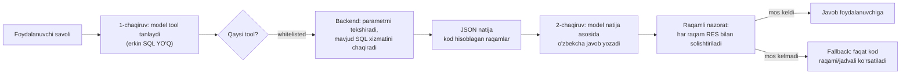
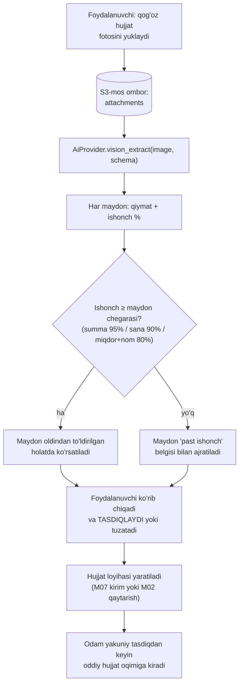

# AI qatlami

**Maqsad:** AI qatlamining port/adapter arxitekturasi, model routing, "kod hisoblaydi — AI tushuntiradi" majburlash mexanizmi, budjet/baholash siyosati.
**Kim uchun:** Backend ishlab chiquvchi, AI/prompt muhandisi.
**Bog'liq fayllar:** `09-ai-funksiyalar.md`, `05-mvp-chegarasi.md`, `10-umumiy-arxitektura.md`, `11-malumotlar-modeli.md`, `23-backend-arxitekturasi.md`.
**Holat:** joriy, 2026-10-15.

## Asosiy xulosalar

1. **AI — chekka qatlam, ajratilgan interfeys orqali**: butun backend `AiProvider` porti (Python `Protocol`: `complete`, `complete_structured`, `vision_extract`) bilan ishlaydi; adapter — `fake` (test), `cli` (faqat dev/demo, Anthropic qoidasi bo'yicha obuna mahsulot ichida ishlatilmaydi), `api` (production, rasmiy `anthropic` Python SDK) — `10-umumiy-arxitektura.md`, `09-ai-funksiyalar.md` 5-bo'lim.
2. **Model routing**: oddiy tushuntirish/matn (AI-01 standart, AI-06) — **Claude Haiku 5.5** ($0,10–0,50 kirish / $0,50–2,50 chiqish, 1M tok); murakkab ko'p hujjatli tahlil (AI-05, AI-01'ning ko'p-modulli holati) — **Claude Sonnet 5.5** ($2/$10, Sonnet 5 bilan bir xil narx) — narxlar `research_notes/texnik/05-ozbek-tilidagi-ai.md` 2.2-bo'limidan, claude.com/pricing (2026-10-14 holati).
3. **"Kod hisoblaydi, AI tushuntiradi" kod darajasida majburlanadi**, prompt qoidasi bilan emas: AI-01 faqat oldindan ro'yxatlangan (whitelisted) o'qish-uchun-tool'larni chaqiradi (hech qachon erkin SQL yozmaydi), tool natijasi kod tomonidan SQL orqali hisoblanadi; javob matni chiqqandan keyin **raqamli nazorat (`numeric_guard`)** har bir raqamni tool natijasi bilan solishtiradi.
4. **Qatlam standartlari**: port naqshi (`AiProvider`), CLI/API adapterining himoyalari (timeout, retry+backoff, circuit breaker), token/xarajat hisob-kitob modeli, DI'dagi rejim almashtirish naqshi (`fake | cli | api`), readiness tekshiruvi naqshi (gating vs reported). Transport ERP'da **API kalit** orqali bo'ladi (CLI faqat dev/demo).
5. **Xarajat — tarif narxining kichik ulushi** (yagona 99 000 so'm/oy tarifga nisbatan): taxminiy hisob-kitobga ko'ra (13-bo'lim) yengil tenant uchun ~700–800 so'm/oy (~0,7%), og'ir tenant uchun ~15–16 ming so'm/oy (~15,7%) — yagona tarif narxining (99 000 so'm) ~0,7–15,7%i oralig'ida, foydalanish darajasiga qarab; aniq raqam pilotda tasdiqlanishi shart (barcha hajm/token taxminlari **taxmin**, manbada yo'q).
6. **Maxfiylik**: biometrik/genetik/telekom ma'lumotdan tashqari hamma narsa (mijoz ismi, tranzaksiya matni) xavfsizlik talablariga rioya qilgan holda chet el API'ga (Claude) yuborilishi mumkin (`research_notes/texnik/05-ozbek-tilidagi-ai.md`, 1.3-bo'lim); shunga qaramay, minimal ma'lumot yuborish, PII mask qilish imkoniyati va **o'qitish uchun mijoz ma'lumotidan aniq rozilik (consent) siz foydalanilmasligi** majburiy qoida sifatida belgilanadi.
7. **Baholash o'zbek tili uchun rasmiy benchmark yo'qligi sababli to'liq ichki**: har funksiya uchun 50–100 taxminiy holatli eval to'plam (lotin/kirill/rus aralash), CI'da regression gate, pilot davrida haqiqiy o'lchov — bu hujjatning markaziy yangiligi, chunki `09-ai-funksiyalar.md`da faqat "pilot kerak" deyilgan, usul ko'rsatilmagan.
8. **Tenant oylik token budjeti tarifga bog'liq** (`plans.limits.ai_monthly_tokens`, `11-malumotlar-modeli.md` 2-bo'lim); limit tugaganda yoki Claude API ishlamaganda **faqat AI funksiyalari o'chadi, kassa/hisob to'liq ishlayveradi** — bu qoida `10-umumiy-arxitektura.md`dan meros.

---

## 1. `AiProvider` interfeysi

Butun tizim AI bilan **bitta** portga murojaat qiladi — `AiProvider` (Python `Protocol`, ERP ehtiyojiga moslashtirilgan: raqamli tushuntirish, tuzilgan chiqish, vision). To'rt metod:

| Metod | Imzo (konseptual) | Vazifa | Kim chaqiradi |
|---|---|---|---|
| `complete` | `complete(system, user, *, model=None, stream=False) -> str \| AsyncIterator[str]` | Erkin matn generatsiyasi (tushuntirish, eslatma matni); `stream=True` — AI-01 chat UI uchun token-oqim | AI-01, AI-06 |
| `complete_structured` | `complete_structured(system, user, schema: BaseModel, *, model=None) -> BaseModel` | Tuzilgan JSON chiqish (Anthropic "structured outputs"/tool-use orqali) — javobni frontend to'g'ridan-to'g'ri render qiladi, erkin matnni parse qilish kerak emas | AI-05 (tafovut tushuntirish + manba hujjat ro'yxati), AI-01 (tool-chaqiruv formati) |
| `vision_extract` | `vision_extract(image: bytes, schema: BaseModel, instructions, *, model=None) -> BaseModel` | Rasmdan tuzilgan maydon chiqarish, har maydon uchun ishonch (confidence) darajasi bilan | AI-03 (OCR) |
| `submit_batch` | `submit_batch(items: list[AiBatchItem]) -> batch_id`; natija `get_batch_results(batch_id)` | Shoshilinch bo'lmagan so'rovlarni Batch API orqali (−50% narx); `FakeProvider`/`CliProvider`da oddiy `complete`ga tushadi | AI-05, AI-06 (MVP'dan keyin, ixtiyoriy) |

Qo'shimcha: har metod `AiRequestContext` (tenant_id, user_id, feature kodi `AI-01`…, til) qabul qiladi — bu `ai_requests` yozuviga va budjet/rate-limit tekshiruviga ishlatiladi (8-bo'lim). Xato holatlari bitta umumiy `AiProviderUnavailable` istisno orqali ko'tariladi — chaqiruvchi tomon (worker) buni "AI vaqtincha ishlamaydi" holatiga aylantiradi, foydalanuvchiga xato chiqmaydi, faqat AI javobi kutilmoqda/mavjud emas ko'rinadi.

### 1.1 Adapterlar

| Adapter | Muhit | Tavsif |
|---|---|---|
| `FakeProvider` | test, CI | Deterministik, oldindan belgilangan javoblar; token/xarajat 0; eval suite va unit testlar shu bilan ishlaydi |
| `CliProvider` | **faqat local/dev/demo** | `claude -p --output-format json` subprocess, dasturchi/demo operatorining shaxsiy obunasi orqali (`CLAUDE_CODE_OAUTH_TOKEN`). Hech qachon production tenant trafigini ko'tarmaydi (Anthropic shartlari, `09-ai-funksiyalar.md` 5-bo'lim) |
| `AnthropicApiProvider` | **staging, production** | Rasmiy `anthropic` Python SDK, API kalit orqali. Streaming (`complete(stream=True)` uchun), prompt caching (takrorlanuvchi system prompt/tenant glossary qismini keshlab kirish narxini ~10x kamaytiradi — kesh o'qish/yozish koeffitsientlariga mos), structured outputs (`complete_structured`), **Batch API** (−50% narx, shoshilinch bo'lmagan AI-05/AI-06 uchun, 9-bo'lim) |
| `LocalModelProvider` | **kelajak** | Markaziy GPU serverda o'zimiz o'qitgan/moslashtirgan model; faqat sinov to'plamida sifat Claude'ga yaqinlashganda yoqiladi (`09-ai-funksiyalar.md` 5-bo'lim, "Lokal modelni o'zimiz o'qitish" qatori) |

Muhit → rejim xaritasi (`10-umumiy-arxitektura.md`, 3-bo'lim bilan bir xil): local → `fake`/`cli`; staging → `api` (alohida kalit, past limit); production → faqat `api`.

### 1.2 Qatlam naqshlari

AI qatlamining standart naqshlari — ushbu loyihaning o'z arxitektura qarorlari:

- **Port naqshi**: "AI aniq nima qila oladi"ni toraytiruvchi yagona interfeys (uch metod: `complete`, `complete_structured`, `vision_extract`) — ilovaning qolgan qismi konkret provayderni bilmaydi (`AiProvider`, 1-bo'lim).
- **CLI/API adapterining himoyalari**: (a) **isolyatsiya** — chaqiruv konteksti har doim minimal/tozalangan bo'ladi (tenant ma'lumoti faqat kerakli qismi yuboriladi, 9-bo'lim); (b) **bounded retry + exponential backoff**; (c) **circuit breaker** (N marta ketma-ket xato → vaqtincha to'xtash, keyin bitta sinov) — ikkisi ham `AnthropicApiProvider` ichida saqlanadi.
- **Token/xarajat modeli**: `AiCallUsage` (input/output/cache token), narx jadvalidan USD hisoblash, **USD→UZS** konvertatsiya konfiguratsiyalanadigan kurs bilan, per-turn akkumulyator (`TurnUsage`, bir nechta AI chaqiruvi — masalan AI-01'da tool-chaqiruv + yakuniy javob — bitta so'rov sifatida yig'iladi) → `ai_requests` yozish mantiqi (8-bo'lim).
- **DI rejim almashtirish**: muhitga qarab provayder tanlash (`fake | cli | api`), xizmatlarni (titler, extractor va h.k.) rejimga qarab moslashtirish naqshi — DI konteynerida `AiProvider` tanlovi (1.1-bo'lim jadvali).
- **Readiness: gating vs reported**: asosiy xizmat (DB) tayyor bo'lmasa `/health/ready` 200 bermaydi, lekin tashqi/ixtiyoriy xizmat (AI, Redis) faqat **hisobot** qilinadi, tayyorlikni bloklamaydi; CLI holatini tekshirish (credential bor-yo'qligi, versiya) — hech qachon pul to'lanadigan chaqiruv qilmasdan, keshlangan (60 soniya) → `GET /health/ready`'da `ai: ok/degraded/down` — 14-bo'lim.
- **Raqamli nazorat (`numeric_guard`)**: deterministik tekshiruv — matndagi har bir raqamni ruxsat etilgan qiymatlar ro'yxati (fakt, foiz, davr sanasi, kichik son) bilan solishtirish, "boshqa bo'limga tegishli raqam" / "faktlarda yo'q raqam" turlariga ajratish, texnik token (identifikator, kalit nomi) sizib chiqishini aniqlash (3-bo'lim).

---

## 2. Model routing

| Funksiya | Standart model | Routing qoidasi | Sabab |
|---|---|---|---|
| AI-01 (oddiy savol — bitta modul, bitta agregatsiya) | Haiku 5.5 | Default | Oddiy qayta ifodalash, past xato narxi (`09-ai-funksiyalar.md`, AI-01) |
| AI-01 (ko'p-modulli/kesishma tahlil — 2+ tool chaqiruvi yoki aniq "nega"/"sabab" so'rovi) | Sonnet 5.5 | Heuristika: tool-chaqiruvlar soni > 1 **yoki** savol murakkabligi belgisi (foydalanuvchi "nega", "sababi", "solishtir" kalit so'zlari) | `09-ai-funksiyalar.md`: "murakkabroq ko'p bosqichli tahlil... Sonnet 5.5" |
| AI-03 (OCR, vision) | Sonnet 5.5 (vision-capable) | Har doim — matn-faqat model vision qila olmaydi | Vision model talab qilinadi; **narx taxmin** — alohida vision-narx rasmiy sahifada yo'q (`09-ai-funksiyalar.md`, Ochiq savol 1), hisobda matn narxi bilan baholangan |
| AI-05 (davlat hisoboti tafovuti) | Sonnet 5.5 | Har doim | Ko'p hujjatni taqqoslash, yuqori xato narxi (`09-ai-funksiyalar.md`, AI-05) |
| AI-06 (nasiya eslatma matni) | Haiku 5.5 | Har doim | Oddiy qisqa matn generatsiyasi (`09-ai-funksiyalar.md`, AI-06) |

Model tanlovi `AiProvider.complete*`ning `model` parametri orqali ustidan yoziladi; default — har funksiya konfiguratsiyasida (`settings`, muhit o'zgaruvchisi), kod ichida qotirilmaydi — tarif/narx o'zgarsa (claude.com/pricing yangilansa) kod o'zgarmasdan konfiguratsiya yangilanadi.

---

## 3. "Kod hisoblaydi, AI tushuntiradi" — majburlash mexanizmi

Bu loyihaning markaziy AI xavfsizlik qoidasi (`09-ai-funksiyalar.md`, Asosiy xulosa #2). Ikki qatlamli himoya:

### 3.1 Tool-chaqiruv (function-calling) dizayni — AI-01

AI hech qachon erkin SQL yozmaydi va bazaga to'g'ridan-to'g'ri kirmaydi. Backend **whitelisted** (oldindan ro'yxatlangan, parametrlari qat'iy tipli) o'qish-uchun-tool'lar to'plamini e'lon qiladi — M12 (hisobotlar) xizmat qatlamidagi mavjud so'rovlarning ustiga qo'yilgan tor interfeys, masalan: "bugungi/davr foyda", "TOP-N sotilgan mahsulot", "past qoldiqli tovarlar", "eng ko'p qarzdor mijozlar". Har tool: nomi, parametr sxemasi (davr, filial, limit), va u qaytaradigan maydonlar ro'yxati bilan Claude API'ning tool-use mexanizmiga beriladi.

Qoidalar:
- Model birinchi chaqiruvda **faqat** tool tanlaydi va parametr beradi (erkin matn emas); backend parametrlarni Pydantic sxema bilan tekshiradi, noma'lum/ro'yxatdan tashqari tool chaqirilsa — rad etiladi.
- Tool bajarilishi **har doim** mavjud, allaqachon test qilingan SQL/xizmat qatlami orqali (M12 va modul xizmatlari) — AI uchun alohida yo'l yozilmaydi.
- Ikkinchi chaqiruvda model faqat qaytgan JSON natijadan foydalanib matn yozadi; promptda aniq taqiq: "raqamni o'zing to'qima, faqat berilgan natijadan foydalan".

### 3.2 Raqamli nazorat (numeric guard)

Ikkinchi chaqiruv natijasi chiqqandan keyin, foydalanuvchiga ko'rsatilishidan **oldin**, deterministik tekshiruv (`numeric_guard`, 1.2-bo'lim) ishga tushadi:
1. Javob matnidagi har bir sonni ajratib oladi (turli yozilish: bo'sh joy/nuqta/vergul bilan guruhlangan, o'nlik vergul, "ming"/"mln" kabi so'z bilan masshtablangan).
2. Har sonni tool natijasidagi qiymatlar, davr sanasi qismlari va kichik sanoq sonlar (0..N) ro'yxati bilan solishtiradi (yaqinlashtirish — ko'rsatilgan o'nlik aniqlikka yaxlitlab).
3. Mos kelmagan son topilsa: so'rov **bir marta** tuzatish ko'rsatmasi bilan qayta yuboriladi ("faqat quyidagi raqamlardan foydalan: …"); ikkinchi marta ham mos kelmasa, AI matni bostiriladi va foydalanuvchiga faqat kod hisoblagan raqam/jadval (AI izohisiz) ko'rsatiladi — `ai_requests.status = 'guard_failed'` deb belgilanadi, monitoring uchun hisoblanadi (14-bo'lim).

Bu mexanizm AI-05 va AI-06 uchun ham xuddi shunday ishlaydi: ularda "tool natijasi" — M10/M08 modullari kod tomonidan allaqachon hisoblagan tafovut/risk obyekti (`complete_structured` orqali olinadi, bevosita JSON sifatida promptga kiritiladi, qo'shimcha tool-chaqiruv shart emas — ma'lumot allaqachon kod tomonidan tayyor).

---

## 4. Prompt shablonlari — joylashuvi va versiyalash

- Joylashuv (tavsiya): `backend/ai/prompts/<feature_id>/v<N>/system.md` (masalan `backend/ai/prompts/ai01_qna/v3/system.md`), har versiyada o'zgarmas matn + o'zgaruvchi joylar uchun aniq belgilangan placeholder'lar (tenant nomi, tenant_glossary atamalari, joriy sana).
- Har prompt versiyasi **eval suite'dan o'tgandan keyin** (10-bo'lim) productionga chiqadi — versiya raqami oshirilganda eski versiya kodda saqlanadi (A/B yoki tezkor rollback uchun), hech qachon joyida tahrirlanmaydi.
- `tenant_glossary` (`11-malumotlar-modeli.md`, 10-bo'lim: "kola" → mahsulot kabi tenant-xos atamalar) promptning alohida, tez-tez o'zgaruvchi bo'lagi — prompt caching chegarasida **boshqa** segmentga joylashtiriladi (asosiy tizim prompti — statik, uzoq TTL keshlanadi; glossary — tenant-xos, qisqaroq keshlanadi) — xarajatni pasaytirish uchun (9-bo'lim).
- `ai_requests.prompt_version` (`11-malumotlar-modeli.md` 10-bo'lim) — har javob qaysi prompt versiyasidan kelganini qayd etadi (format: `ai01_qna/v3`).

---

## 5. Tenant oylik token budjeti, rate limit, graceful degradation

- Har tenant uchun oylik token limiti — `plans.limits.ai_monthly_tokens` (`11-malumotlar-modeli.md`, 2-bo'lim, allaqachon mavjud JSONB maydon). **Bitta tarif, bitta limit** — barcha tenant hamma AI funksiyasiga (AI-01/03/05/06) kirishi mumkin bo'lgani uchun, eng yuqori ehtiyojni qoplaydigan, "biroz kengroq" qiymat tanlandi (§5, tavsiya #11 — overage yo'q, qattiq to'xtatish, qaror #23 bilan izchil):

| Tarif | Taklif (token/oy, taxmin) |
|---|---|
| `standard` (99 000 so'm, yagona tarif) | **2 500 000** |

Aniq raqam — **taxmin**, 10-bo'limdagi xarajat hisob-kitobiga asoslangan va unit-iqtisod hisobi bilan tasdiqlanishi shart (`25-nofunksional-talablar.md` §11 bilan bir xil ruhda); pilotda tenantlarning ≥10%i limitga urilsa, qiymat oshiriladi va/yoki prepaid AI paket (`addons`) qo'shiladi (§5).

- Hisoblash: har `ai_requests` yozuvidagi `input_tokens + output_tokens` joriy oy bo'yicha tenant kesimida yig'iladi (Redis'da tez sanoq — kunlik/oylik kalit, davr oxirida 0'ga tushadi, PostgreSQL `ai_requests`'dan tasdiqlanadi).
- **Limit tugaganda — qattiq to'xtatish, overage yo'q**: AI so'rovlari **hard-stop** qilinadi — foydalanuvchiga "bu oy uchun AI limiti tugadi, keyingi oyda tiklanadi" ko'rsatiladi, kassa/ombor/buxgalteriya **to'liq ishlayveradi** (`10-umumiy-arxitektura.md`, Asosiy xulosa #8). Qo'shimcha avtomatik to'lov (overage) **yo'q** — mayda summalarni Click/Payme orqali yechish komissiya, support savollari va murakkablik keltiradi, AI xarajati esa tarifning atigi ~1,5–6%i (13-bo'lim). Yagona tarif modelida "tarifni oshirish" taklifi yo'q (bir xil tarif hammaga). **Oldindan to'lanadigan AI paket** — faqat **pilotdan keyin**, agar tenantlarning **≥10%i** oylik limitga urilsa, qo'shimcha xizmat (`addons` katalogi, `11-malumotlar-modeli.md` §2) sifatida qo'shiladi. Limit qiymatlari (5-bo'lim) shu sababli biroz kengroq qo'yiladi, oshirib yuborish ehtimolini kamaytirish uchun.
- **Rate limit**: Redis asosidagi tenant-kesimidagi daqiqalik chegara — bitta tenant barcha boshqalarning navbatini band qilib qo'ymasligi uchun (worker navbat orqali ishlaganidan tashqari qo'shimcha himoya).
- **Graceful degradation** (Claude API ishlamay qolganda — timeout, 5xx, circuit breaker ochiq): worker `outbox_jobs` (`kind='ai'`) qayta urinadi (backoff bilan); bir necha urinishdan keyin ham muvaffaqiyatsiz bo'lsa — AI-01 so'rovi uchun foydalanuvchiga "AI hozir javob bera olmayapti, keyinroq urinib ko'ring" xabari, AI-05/AI-06 uchun ko'rsatma/eslatma **AI matnisiz, faqat kod raqami** bilan ko'rsatiladi (masalan AI-06: eslatma shabloni + summa, tayyor matn o'rniga). Bu holatlar `ai_requests.status='failed'` bilan loglanadi.

---

## 6. Xarajat hisobi (`ai_requests`, USD→UZS)

Har AI chaqiruvi (`AiCallUsage` modeliga mos) quyidagicha `ai_requests`ga yoziladi (maydonlar `11-malumotlar-modeli.md` 10-bo'limda: `tenant_id, user_id, feature, model, prompt_version, input_tokens, output_tokens, cache_read_tokens, cost_usd, fx_rate_used, cost_uzs, latency_ms, guard_result, status`):

1. Claude API javobi `usage.input_tokens`, `usage.output_tokens` (va kesh bo'lsa `cache_read_input_tokens`/`cache_creation_input_tokens`) qaytaradi.
2. `cost_usd = (input_tokens × price_in + output_tokens × price_out) / 1_000_000` — narx jadvali model nomiga qarab (2-bo'lim narxlari), kesh o'qish ~0,1×, kesh yozish ~1,25× kirish narxida hisoblanadi (kesh o'qish/yozish koeffitsientlari konstanta sifatida belgilanadi).
3. So'mga ko'rsatish uchun: `cost_uzs = cost_usd × FX_USD_UZS` (`FX_USD_UZS = 12 500`, **taxmin**, sozlanadigan konfiguratsiya — real vaqtda kursi o'zgarishi mumkin). Yozuv vaqtidagi kurs `fx_rate_used`, natija `cost_uzs` ustunida saqlanadi (tarixiy aniqlik).
4. Bir foydalanuvchi so'rovida bir nechta AI chaqiruvi bo'lsa (masalan AI-01'ning tool-tanlash + yakuniy javob, ikki chaqiruv) — `TurnUsage` modeliga mos, bitta "turn" ichida yig'iladi, lekin **har chaqiruv** alohida `ai_requests` qatori sifatida ham saqlanishi mumkin (audit uchun to'liqlik) — aniq granularlik backend arxitekturasi bosqichida (`23-backend-arxitekturasi.md`) belgilanadi.
5. Platform admin paneli va tenant hisobotida (M12 ichida yoki alohida AI-xarajat widget) oylik AI xarajati (USD va so'm) ko'rinadi — bu bir vaqtning o'zida budjet sarfini kuzatish vositasi (5-bo'lim).

---

## 7. Maxfiylik

- **Minimal ma'lumot**: AI chaqiruviga faqat zarur maydonlar yuboriladi (masalan AI-01'da — tool natijasidagi agregatsiya qilingan raqamlar, mijozning to'liq profili emas); xom hujjat matni/butun jadval hech qachon promptga tashlanmaydi.
- **Ma'lumot lokalizatsiyasi**: faqat biometrik/genetik/telekom ma'lumot O'zbekistonda saqlanishi majburiy; mijoz ismi, telefon, tranzaksiya matni kabi ma'lumotlar xavfsizlik talablariga rioya qilgan holda Claude API'ga (chet elga) yuborilishi mumkin (`research_notes/texnik/05-ozbek-tilidagi-ai.md`, 1.3-bo'lim) — tizim hech qachon pasport/biometrik ma'lumotni AI'ga yubormaydi.
- **PII masking (ixtiyoriy himoya qatlami)**: tenant sozlamasida (`tenants.settings`) yoqilganda, promptga yuborilishidan oldin mijoz F.I.Sh./telefon/STIR kabi maydonlar token bilan almashtiriladi (masalan "mijoz A"), AI javobi qaytganda kod tomonidan asl qiymatga almashtiriladi — bu qatlam standart yoqilmagan (chunki lokalizatsiya qonuni ruxsat beradi), lekin ehtiyotkor tenant/majburiy sektor uchun yoqilishi mumkin.
- **O'qitish uchun rozilik (training consent)**: Claude/boshqa provayder tomonidan mijoz ma'lumotidan modelni o'qitish uchun **standart holatda foydalanilmaydi** (API shartlariga ko'ra Anthropic API orqali yuborilgan ma'lumot default modelni o'qitishga ishlatilmaydi — bu amaldagi tijorat shart, alohida tasdiqlanishi kerak bo'lsa ham); o'zimizning kelajakdagi fine-tuning (11-bo'lim) uchun esa **aniq, tenant darajasidagi rozilik** talab qilinadi.
- **Rozilikni saqlash**: `tenants.settings.ai_training_consent` (bool + sana) — tenant darajasidagi umumiy rozilik; `ai_feedback.consent_for_training` (`11-malumotlar-modeli.md`, 10-bo'lim, allaqachon mavjud) — har bir alohida fikr-mulohaza/tuzatish yozuvi darajasidagi rozilik. Ikkisi ham **ixtiyoriy va rad etilsa funksiya ishlashini to'xtatmaydi**.

---

## 8. Baholash (evaluation)

O'zbek tili uchun rasmiy LLM/OCR benchmark yo'qligi (`09-ai-funksiyalar.md`, Asosiy xulosa #6) MVP'ni **to'liq ichki eval tizimga** majbur qiladi:

### 8.1 Eval to'plami

- Joylashuv: `backend/ai/eval/<feature_id>/cases.jsonl` — har funksiya (AI-01, AI-03, AI-05, AI-06) uchun alohida.
- Hajm: **50–100 holat/funksiya** (vazifa talabi) — lotin, kirill va rus tilidagi aralash matnlarni qamrab oladi (masalan AI-01'da: "bugun qancha foyda?" / "бугунги фойда қанча?" / "сколько прибыли сегодня?" — uchtasi ham bir xil tool'ga map qilinishi kutiladi).
- Har holat: kirish (savol/hujjat rasmi/kontekst), kutilgan tool-chaqiruv (AI-01 uchun) yoki kutilgan maydon qiymatlari (AI-03 uchun), qabul mezoni (masalan "javobda 1 240 000 soni bo'lishi kerak va boshqa raqam bo'lmasligi kerak").
- Manba: dastlabki to'plam qo'lda yoziladi (haqiqiy pilot ma'lumoti yo'q); pilotdan keyin haqiqiy so'rovlar (anonimlashtirilgan, rozilik bilan) to'plamga qo'shiladi (11-bo'lim bilan bog'liq).

### 8.2 Metrikalar

| Funksiya | Asosiy metrika | Qo'shimcha |
|---|---|---|
| AI-01 | Raqamli nazorat o'tish darajasi (3-bo'lim) — **100% talab qilinadi** (nol tolerantlik) | Tool tanlash to'g'riligi (kutilgan tool chaqirilganmi); til aniqlanishi (savol tiliga javob berilganmi); uslub/tabiiylik (LLM-judge ball, 1–5, **taxmin metodologiya**) |
| AI-03 | **Maydon bo'yicha ishga tushirish shartlari**: 100 ta O'zbekiston hujjatida (≈40% toza, 40% foto/skaner, 20% qo'lda yozilgan; lotin/kirill/rus) **summa ≥95%**, **sana ≥90%**, **miqdor va tovar nomi ≥80%** aniqlik; summa yoki sana 90%dan past bo'lsa — AI-03 pilotga chiqmaydi (yagona 90% chegara o'rniga maydon bo'yicha qattiqroq shart, chunki pul maydonidagi xato eng qimmat) | Past ishonchli maydon har doim sariq belgilanadi; ishonch kalibrlanishi — past-ishonch belgisi haqiqatan xato maydonlarga to'g'ri kelishi kerak |
| AI-05 | Raqamli nazorat o'tish darajasi — 100% | Tushuntirish aniqligi (manba hujjatga havola to'g'ri ko'rsatilganmi) |
| AI-06 | Raqam generatsiya qilmaganligi (0 raqam AI tomonidan to'qilgan) | Ohang/tabiiylik (LLM-judge yoki qo'lda baholash) |

### 8.3 CI regression gate

- Prompt shabloni (4-bo'lim) yoki model versiyasi o'zgarganda, CI avtomatik eval suite'ni ishga tushiradi (`FakeProvider` bilan emas — kichik, arzon haqiqiy chaqiruv to'plami yoki saqlangan "golden" javoblar ustida qayta tekshiruv).
- **Bloklovchi shart**: raqamli nazorat o'tish darajasi 100%dan past bo'lsa — merge bloklanadi (nol tolerantlik, chunki bu moliyaviy/soliq ma'lumoti). Uslub/sifat ball **taxmin chegaradan** (masalan oldingi versiyadan −10% dan ko'p pasaymasligi) past tushsa — ogohlantirish, lekin blok emas (aniq chegara pilotda sozlanadi).
- Natijalar versiyalanadi (`4-bo'lim`dagi prompt versiyasiga bog'langan) — qaysi versiya qachon qanday ball olgani tarix sifatida saqlanadi.

### 8.4 Pilot o'lchov rejasi

- Production'da har AI javobidan keyin foydalanuvchi fikr-mulohazasi (`ai_feedback`: rating, correction) yig'iladi — ekranda kichik 👍/👎 va "tuzat" tugmasi.
- Haftalik: pilot tenant(lar)dagi real `ai_requests`/`ai_feedback` ko'rib chiqiladi, past ball/tuzatilgan javoblar eval to'plamiga **yangi holat** sifatida qo'shiladi (regressiyaning oldini olish).
- Birinchi 90 kunlik pilot maqsadi (**taxmin**, `05-mvp-chegarasi.md`dagi "taxmin" uslubiga mos): AI-01 raqamli nazorat o'tish darajasi production trafikda ≥99,9% (xato holatlari fallbackka tushadi, 3-bo'lim), AI-03 foydalanuvchi tomonidan hech qanday tahrirsiz tasdiqlangan hujjat ulushi — aniq maqsad yo'q, kuzatiladi va hisobot qilinadi.

---

## 9. Kelajakdagi fine-tuning uchun ma'lumot to'plash

- **Opt-in, tenant darajasida** (`tenants.settings.ai_training_consent`, 7-bo'lim) — standart holatda **o'chiq**.
- Rozilik berilgan tenantlar uchun: har `ai_feedback` yozuvi (ayniqsa foydalanuvchi tuzatgan javoblar — eng qiymatli signal) anonimlashtirish bosqichidan o'tadi (mijoz ismi/telefon/STIR kabi maydonlar olib tashlanadi yoki sintetik qiymat bilan almashtiriladi) va alohida saqlash joyiga (`ai_training_samples`, `11-malumotlar-modeli.md` 10-bo'lim) ko'chiriladi.
- Yig'ilgan namunalar davriy ravishda (masalan choraklik) ko'rib chiqiladi/tasdiqlanadi (inson nazorati) va faqat shundan keyin markaziy GPU serverdagi fine-tuning jarayoniga kiritiladi — bu bosqich `09-ai-funksiyalar.md` 5-bo'limidagi "Lokal modelni o'zimiz o'qitish — hozir yo'q, keyin ko'rib chiqiladi" qarori bilan mos.
- Maqsad — tor vazifalar (masalan tovar nomini toifaga ajratish, eslatma matnining tenant ohangiga moslashuvi), umumiy suhbat qobiliyatini almashtirish emas.

---

## 10. OCR quvuri (AI-03) — MVP'da, bu quvur MVP bosqichlarida quriladi

**Yagona yo'l (API unifikatsiyasi)**: OCR **bitta** jadval (`ai_ocr_jobs`) va **bitta** endpoint oilasi bilan amalga oshiriladi: fayl avval `POST /api/v1/attachments` (`purpose=ocr_source`) orqali yuklanadi → `POST /api/v1/ai/ocr/jobs` (`attachment_id`, `doc_type_hint=purchase` — **faqat shu qiymat**, qaytarish uchun qog'oz chek faqat POS/sync orqali kiradi, `17-api-umumiy.md` §9) → `GET /api/v1/ai/ocr/jobs/{job_id}` bilan poll (`status: processing→done→confirmed`/`failed`/`expired`) → `POST /api/v1/ai/ocr/jobs/{job_id}/confirm` — shu paytgina `goods_receipts` qoralamasi yaratiladi (ruxsat `ai.ocr.use` **va** `purchases.receive`). Natija shakli pastdagi quvur bilan bir xil (sarlavha + `lines[]`, har maydon `value`/`confidence` 0..1, `low_confidence_fields` yo'l ro'yxati).

- **Qamrov eslatmasi** (`09-ai-funksiyalar.md`, AI-03): faqat (a) QQS to'lovchi bo'lmagan/norasmiy yetkazib beruvchining qog'oz yuk xati, (b) texnik uzilish davridagi qog'oz faktura, (c) qaytarish uchun qog'oz chek — standart QQS to'lovchilar o'rtasidagi e-faktura/e-TTN bu quvur orqali **emas**, EDO operatori import orqali kiradi.
- **Ishonch chegarasi, maydon bo'yicha**: summa **≥95%**, sana **≥90%**, miqdor/tovar nomi **≥80%** — 100 ta O'zbekiston hujjatida (≈40% toza, 40% foto/skaner, 20% qo'lda yozilgan; lotin/kirill/rus aralash) o'lchanadi; summa yoki sana shu chegaradan past chiqsa, AI-03 pilotga **chiqmaydi**. Yagona 90% chegara o'rniga maydon bo'yicha differensial yondashuv — xalqaro amaliyotda ham maydon ishonchi avtomatik qabul/odam tekshiruviga yo'naltirish uchun ishlatiladi (F16, `tarix/tekshiruv/savollar-yakuniy-tavsiyalar.md`), aniq raqamlar esa o'zbek hujjatlari uchun yangi benchmark — ishonch darajasi o'rta.
- AI hech qachon hujjatni avtomatik tasdiqlamaydi yoki davlat tizimiga (Didox/Faktura.uz, e-TTN) yubormaydi — faqat loyiha tayyorlaydi; yakuniy tasdiq va yuborish har doim odam (Buxgalter/Omborchi) tomonidan.
- Vision chaqiruvi narxi — **taxmin** (2-bo'lim, Ochiq savol 1 bilan bir xil): rasmiy vision-narx sahifada yo'q, matn narxiga yaqin deb baholangan.
- AI-03 MVP'da qoladi, bu quvur birinchi relizdan boshlab quriladi (13-bo'lim xarajat jadvalida ham hisobga olingan).

---

## 11. Telegram bot integratsiyasi (AI-01)

- M18 (Telegram bot, `aiogram`) — asosiy REST API'ning oddiy mijozi (`10-umumiy-arxitektura.md`, 1-bo'lim); AI-01 so'rovi bot orqali kelganda ham **xuddi shu** `AiProvider` + tool-chaqiruv + raqamli nazorat quvuridan o'tadi — botga alohida AI yo'li yozilmaydi.
- Autentifikatsiya: `telegram_links` (tenant_id, user_id, chat_id) orqali Telegram foydalanuvchisi tizimdagi `users`/`memberships`ga bog'lanadi; savolga javob berishdan oldin **xuddi web kabi** rol/huquq tekshiruvi (`role_permissions`) qo'llaniladi — masalan Kassir roli moliyaviy xulosa so'rasa, huquqsiz deb rad etiladi.
- Bu funksiya `05-mvp-chegarasi.md`da **Could** darajasida (US-M18-04, "botda AI savol") — MVP'da ixtiyoriy, M18ning asosiy (Must) qismi (kunlik hisobot, ogohlantirish) AI'siz ishlaydi.
- Rate limit va oylik budjet (5-bo'lim) Telegram orqali kelgan so'rovlarga ham baravar qo'llaniladi (bitta tenant kesimidagi umumiy hisoblash, kanal farqlanmaydi).

---

## 12. Observability

- **Readiness** (`GET /health/ready`, gating vs reported naqshiga mos): AI holati — **faqat hisobot (reported), hech qachon gating** (chunki "AI — chekka qatlam" qoidasi, 10-umumiy-arxitektura.md #8): `ai: ok` / `ai: degraded (circuit open)` / `ai: down`. Tekshiruv — kreditsial/konfiguratsiya mavjudligi va (ixtiyoriy) bitta arzon, pulsiz "ping"ga yaqin chaqiruv, 60 soniya keshlanadi — hech qachon haqiqiy tenant so'rovini sarflamaydi.
- **Metrikalar**: har chaqiruv uchun model, token, xarajat, latency (`ai_requests`dan); circuit breaker holati (ochiq/yopiq, oxirgi ochilgan vaqt); raqamli nazorat o'tish/muvaffaqiyatsizlik darajasi (3-bo'lim) — bularning barchasi kunlik agregatsiya qilinib platform admin panelida ko'rinadi.
- **Ogohlantirish**: oylik budjetning 80%iga yetganda tenant Egasiga M18 (Telegram) orqali xabar; circuit breaker ochilganda yoki `guard_failed` darajasi anomal oshganda platform admin'ga ichki ogohlantirish.
- **Audit**: har AI javobi (xususan AI-05, moliyaviy/soliq tushuntirish) `ai_requests`ga bog'langan holda saqlanadi — kelajakda nizoli vaziyatda "AI nima deganini va qaysi raqamlar asosida" tekshirish imkoni beradi (`audit_log` bilan bir xil ruhda, `11-malumotlar-modeli.md`).

---

## 13. Xarajat jadvali: tenant/oy, yengil/o'rta/og'ir foydalanish

**Metodologiya (hammasi taxmin, manbada haqiqiy foydalanish ma'lumoti yo'q — faqat `09-ai-funksiyalar.md`dagi AI-01 namunaviy hisob-kitobi, "300 so'rov × 3000/500 token ≈ $0,2", asos qilib olindi va qolgan funksiyalarga proportsional kengaytirildi):**

Formula har funksiya uchun: `xarajat_USD = so'rovlar_soni × ((kirish_token / 1 000 000) × narx_kirish + (chiqish_token / 1 000 000) × narx_chiqish)`; so'mga: `× 12 500` (taxmin kurs).

Qabul qilingan token/chaqiruv taxminlari va narxlar (2-bo'lim):

| Funksiya | Model | Narx (kirish/$1M, chiqish/$1M) | Token/chaqiruv (kirish+chiqish, taxmin) |
|---|---|---|---|
| AI-01 | Haiku 5.5 | 0,10 / 0,50 | 3000 + 500 |
| AI-06 | Haiku 5.5 | 0,10 / 0,50 | 800 + 150 |
| AI-05 | Sonnet 5.5 | 2 / 10 | 5000 + 600 |
| AI-03 (OCR, vision — narx taxmin) | Sonnet 5.5 | 2 / 10 | 1800 + 400 |

Oylik so'rovlar soni (taxmin) — yagona tarifda barcha tenant barcha AI funksiyasiga (AI-01/03/05/06) kirishi mumkin, shuning uchun daraja tarifga emas, tenantning haqiqiy faolligiga bog'liq:

| Daraja (foydalanish darajasi, tarif emas) | AI-01/oy | AI-06/oy | AI-05/oy | AI-03/oy |
|---|---|---|---|---|
| Yengil | 100 | 20 | 0 | 0 |
| O'rta | 400 | 80 | 4 | 15 |
| Og'ir | 1200 | 300 | 10 | 50 |

**Hisoblangan oylik xarajat (USD va so'm):**

| Daraja | AI-01 | AI-06 | AI-05 | AI-03 | **Jami USD** | **Jami so'm** |
|---|---|---|---|---|---|---|
| Yengil | $0,055 | $0,003 | $0 | $0 | **$0,058** | **~725 so'm** |
| O'rta | $0,220 | $0,012 | $0,064 | $0,114 | **$0,410** | **~5 130 so'm** |
| Og'ir | $0,660 | $0,047 | $0,160 | $0,380 | **$1,247** | **~15 580 so'm** |

- Taqqoslash (yagona 99 000 so'm/oy tarifga nisbatan): yengil/o'rta/og'ir foydalanish yagona tarif narxining mos ravishda **~0,7% / ~5,2% / ~15,7%**ini tashkil qiladi — `25-nofunksional-talablar.md` §11dagi jami xarajat jadvalida AI komponenti ~2 000–5 000 so'm sifatida kiritilgan (o'rta foydalanish darajasiga yaqin).
- **Qo'shimcha tejash (jadvalga kiritilmagan)**: AI-05 va AI-06 real-vaqt talab qilmaydi (hisobot tayyor bo'lgandan keyin yoki rejalashtirilgan eslatma sifatida generatsiya qilinadi) — Batch API orqali −50% qo'llanilsa, bu ikki funksiya xarajati yarmiga tushadi; prompt caching (tizim prompti + tenant glossary takroriy qismi) AI-01'ning kirish narxini yanada kamaytiradi (kesh o'qish ~0,1× narxda).
- **Taxmin ekanligi ta'kidi**: yuqoridagi barcha so'rovlar soni va token/chaqiruv raqamlari hech qanday manbada tasdiqlanmagan — bular MVP pilotida haqiqiy `ai_requests` ma'lumoti bilan almashtirilishi SHART (shu jadvalning o'zi — unit-iqtisod hisobini tasdiqlash vazifasining bir qismi, `05-mvp-chegarasi.md`, 3.3-bo'lim shartiga mos).

---

## Ochiq savollar

1. Vision-LLM (AI-03) uchun aniq narx (rasm-boshiga yoki token-ekvivalenti) — rasmiy manbada yo'q (meros: `09-ai-funksiyalar.md`, Ochiq savol 1); 13-bo'limdagi hisob shu sababli taxmin.
2. Oylik AI token budjeti qiymatlari (5-bo'lim jadvali) — taxmin, unit-iqtisod hisobi va pilot ma'lumoti bilan tasdiqlanishi shart.
3. Limit tugagandan keyin "overage" (qo'shimcha to'lov bilan limitni oshirish) imkoniyati kerakmi — hal qilinmagan (5-bo'lim).
4. LLM-judge uslub/tabiiylik bahosi uchun metodologiya (qaysi model, qaysi mezon) — aniqlashtirilmagan, pilotgacha ochiq (8.2-bo'lim).
5. `ai_training_samples` uchun saqlash muddati va anonimlashtirish darajasi (sxema 01'da bor) — aniqlanmagan (9-bo'lim).
6. Raqamli nazorat (numeric guard) ikki marta muvaffaqiyatsiz bo'lgan holatlarning tenant-ko'rinadigan chastotasi qanday bo'lishi — agar tez-tez bo'lsa, bu prompt/tool dizayni muammosini bildiradi; pilotda kuzatilishi kerak (3.2-bo'lim).

## Manbalar

- `spec/kod-uchun/09-ai-funksiyalar.md` — AI-01…AI-11 hukmlari, provayder qarori (5-bo'lim), model/narx jadvali.
- `spec/kod-uchun/05-mvp-chegarasi.md` — tariflar (3.3-bo'lim), AI MoSCoW (1.2-bo'lim).
- `spec/kod-uchun/10-umumiy-arxitektura.md` — AI chekka qatlam qoidasi, muhit/rejim jadvali.
- `spec/kod-uchun/11-malumotlar-modeli.md` — `ai_requests`, `ai_feedback`, `tenant_glossary`, `plans.limits` maydonlari.
- `research_notes/texnik/05-ozbek-tilidagi-ai.md` — narx jadvali (2.2-bo'lim), OCR/STT benchmarklar, lokalizatsiya qonuni (1.3-bo'lim).
