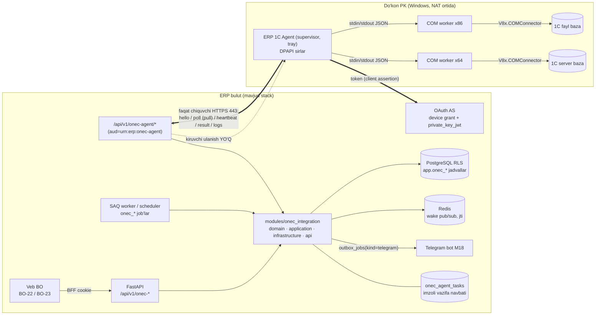
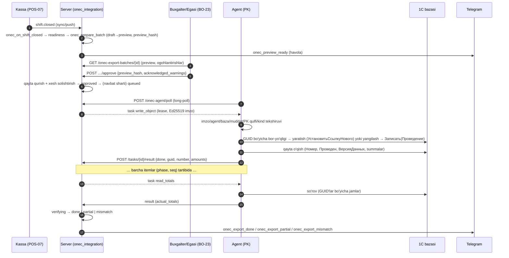
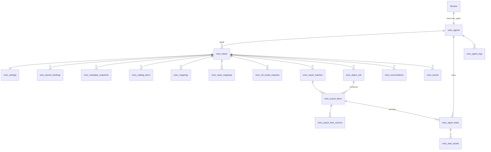
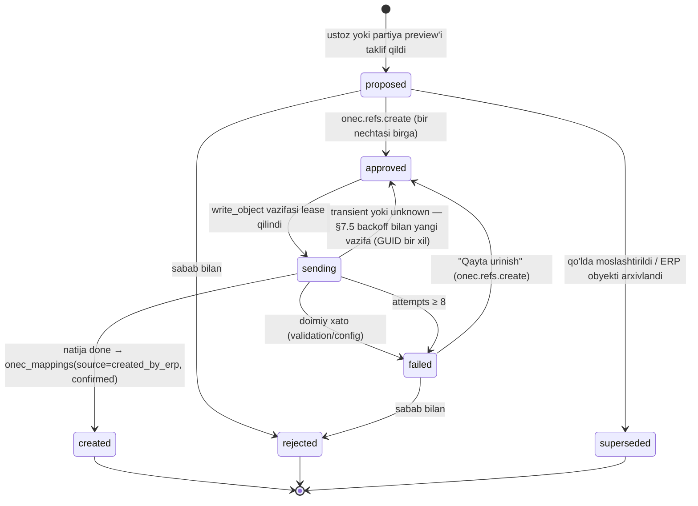
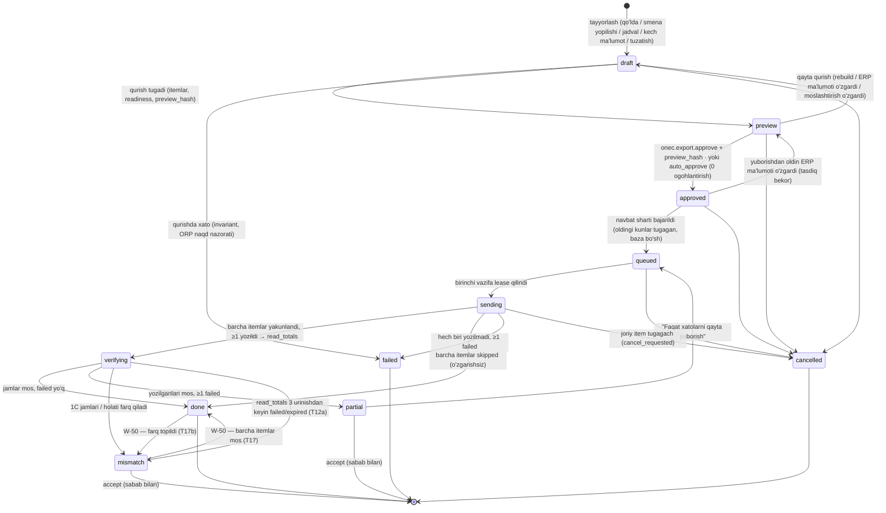
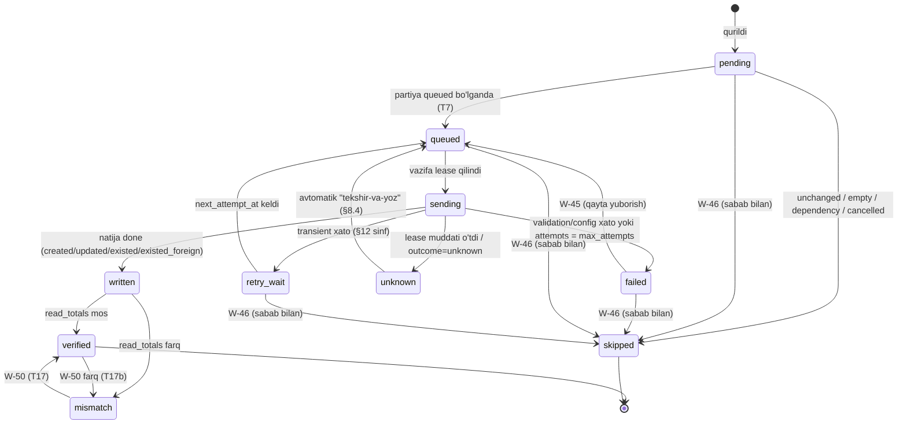

# 1C integratsiyasi — ERP → 1C kunlik eksport (COM agent orqali)

**Maqsad:** ERP'dagi kunlik sotuv va boshqa birlamchi hujjatlarni do'konning o'z kompyuteridagi 1C bazasiga (birinchi navbatda «Бухгалтерия для Узбекистана 3.0») Windows agenti va COM orqali, ketma-ket, takrorsiz va tekshiriladigan tarzda yozish — server moduli `onec_integration`, ma'lumotlar modeli, agent↔server protokoli, veb API, ruxsatlar, xato kodlari, ekranlar va qabul mezonlari bilan. · **Kim uchun:** backend (`modules/onec_integration`), frontend (BO-22, BO-23), Windows agenti ishlab chiquvchisi (`34-1c-agent.md` shu faylning §9 protokoliga bo'ysunadi), QA, asoschi. · **Bog'liq fayllar:** `01-qarorlar.md` (#1, #2, #12, #14, #15, #24, #26, #28, #30, #36–#42), `04-biznes-jarayonlar.md`, `07-ekran-tafsilotlari.md`, `11-malumotlar-modeli.md`, `12-db-sxema.md`, `13-provodka-qoidalari.md`, `14-autentifikatsiya-oauth2.md`, `15-xavfsizlik-va-audit.md`, `16-offline-sync.md` §9, `17-api-umumiy.md`, `20-api-moliya-admin.md`, `21-integratsiyalar.md`, `23-backend-arxitekturasi.md`, `24-frontend-arxitekturasi.md`, `25-nofunksional-talablar.md`, `26-ochiq-savollar-reestri.md`, `27-backlog.md`, `29`–`31`, `34-1c-agent.md`; tadqiqot — `research_notes/1c-integratsiya/00-xulosa.md` (ustun), `03`, `04`, `06`; `research_notes/ochiq-savollar/P5-1c-platforma.md` (COM platforma xulqi, БП UZ 3.0 reliz eslatmalari, litsenziya). · **Holat:** joriy, 2026-10-16.

Bu fayl 1C integratsiyasi bo'yicha **yagona manba**: jadval, ustun, enum, endpoint, vazifa turi, xato kodi va ruxsat nomlari shu yerda belgilanadi; boshqa fayllar (`07`, `11`, `12`, `14`, `15`, `17`, `20`, `21`, `23`, `24`, `27`, `29`–`31`) ularni o'zgartirmasdan ko'chiradi (§17). Ziddiyatda tartib: `01-qarorlar.md` → shu fayl → boshqalar. 1C rekvizit/hujjat nomlari *taxmin* deb belgilangan joylarda real bazada pilot oldi testi (§16.1, `P-xx`) bilan tasdiqlanadi; kod nomlarni qattiq yozmaydi — profil faylidan oladi va metadata snapshot bilan tekshiradi.

---

## 1. Asosiy xulosalar va atamalar

### 1.1 Asosiy xulosalar

1. **Kanal — faqat COM** (qaror #36): do'kon kompyuteridagi «ERP 1C Agent» (C#/.NET Framework 4.8, per-user tray, 32/64-bit COM worker'lar — qaror #38) 1C'ga `V8x.COMConnector` orqali ulanadi va bulutdan vazifani **faqat chiquvchi HTTPS long-poll** bilan tortadi. OData yo'q, 1C'da hech narsa publish qilinmaydi, `.epf`/kengaytma o'rnatilmaydi (qaror #41), kiruvchi port yo'q.
2. **Yo'nalish — ERP → 1C bir tomonlama** (qaror #37). 1C'dan faqat moslashtirish, tekshiruv va solishtirish uchun o'qiladi; 1C ma'lumoti ERP'ga hech qachon yozilmaydi.
3. **Birinchi va yagona profil Bosqich 7 da — `bp30_uz`** («Бухгалтерия для Узбекистана», ред. 3.0, 3.0.64+). `ut11_uz`, `roznica30_uz`, `uk30_uz` — keyin (enum'da bor, yozish rad etiladi).
4. **Kunlik sotuv — har kassa × kun (× ombor) bitta «Отчет о розничных продажах» (ОРП)**; filial × kun — sozlama; smena bo'yicha — keyin (qaror #39). Qarzga va yuridik shaxsga sotuv — har chek alohida «Реализация товаров и услуг», **sotuv kuni** (daromad va QQS sotuv kuni tan olinadi — qaror #30).
5. **Rejim standart `full`** — kirim, qaytarish, ko'chirish, hisobdan chiqarish, inventarizatsiya, pul hujjatlari ham yuboriladi; `sales_only` — faqat buxgalter so'rasa, majburiy qoldiq preflight'i bilan (qaror #39).
6. **Provodka, QQS registri, tannarx yuborilmaydi** — 1C hujjatni o'zi o'tkazadi (`Записать(Проведение, Неоперативный)`), buxgalteriya haqiqat manbai — 1C (qaror #39). `ОбменДанными.Загрузка` ishlatilmaydi.
7. **1C ma'lumotnomalari hech qachon jim yaratilmaydi**: yangi tovar/kontragent va h.k. faqat `onec_ref_create_requests` orqali, `onec.refs.create` ruxsati bilan tasdiqdan keyin yaratiladi; Организация va QQS stavkasi **hech qachon** yaratilmaydi (DB CHECK darajasida ham) (qaror #40).
8. **Takror yozish yo'q**: har 1C obyektiga GUID'ni ERP beradi — `uuid5(onec_bases.guid_namespace, "{kind}:{erp_key}")` → `УстановитьСсылкуНового`; qo'shimcha `Комментарий` markeri (`ERP #… h:…`) va server daftari `onec_object_refs` (qaror #40). «Noma'lum natija» xavfsiz: keyingi urinish avval GUID bo'yicha tekshiradi.
9. **Har kun — partiya (`onec_export_batches`)**: `draft → preview → approved → queued → sending → verifying → done | partial | mismatch | failed | cancelled`. Tasdiq `onec.export.approve` ruxsati va **preview xeshi** bilan bog'langan; avto-tasdiq standart **o'chiq**, faqat Egasi yoqadi va faqat ogohlantirishsiz partiyaga ishlaydi (qaror #40).
10. **Ketma-ketlik qat'iy**: baza bo'yicha bitta faol partiya; D kuni D−1 yakunlanmaguncha navbatga chiqmaydi; partiya ichida bosqichlar (`phase`) — kirim → … → ОРП → Реализация → qaytarish → pul hujjatlari.
11. **Tayyorlik**: smenalar yopilgan, filialning barcha faol POS qurilmalari kun yopilgandan keyin sinxronlangan va outbox'ida eski voqea qolmagan (`16-offline-sync.md` §9), oldingi kunlar tugagan, 1C'da sana taqiqlanmagan, moslashtirish to'liq.
12. **Kech kelgan offline chek** — o'sha GUID'li ОРП'ni yangi `revision` bilan yangilaydi; 1C'da sana yopilgan bo'lsa — buxgalter tasdig'i bilan **joriy ochiq sanada tuzatuvchi ОРП (faqat farq)**, avtomatik sana almashtirish yo'q.
13. **Uch qulf**: server `onec_bases.write_enabled` + kompyuterdagi «yozishga ruxsat» (`pc_write_enabled`) + har partiyaning ruxsatli tasdig'i. Vazifalar **Ed25519 bilan imzolanadi** (`signing_keys.purpose='onec_task'`), agent faqat oq ro'yxatdagi `kind`larni bajaradi, jismoniy o'chirish yo'q.
14. **Sirlar**: 1C paroli va agent maxfiy kaliti faqat PK'da (DPAPI `CurrentUser`); server 1C parolini **hech qachon** olmaydi va saqlamaydi (faqat ulanish satrining xeshi va maskalangan ko'rinishi).
15. **Qamrov va tarif**: «Базовая» versiyalar (COM yo'q), bulutdagi 1C (1С:Фреш, ijara), tovarni sotish narxida hisoblaydigan bazalar (2920/2980) — qamrovdan tashqari, onboarding tekshiruvi aniq aytadi (qaror #41). Integratsiya **99 000 so'm tarif ichida**, MVP'dan keyin **Bosqich 7** (qaror #37, #41).
16. **Yo'ldagi pul (5710)**: karta/UzQR/Click/Payme/Uzum tushumlari va inkassa 1C'da ham 5710 orqali (1C'dagi «вид оплаты» sozlamasi), bank/ekvayring komissiyasi — 9430; `bank_settlements` (5710→5110) — sozlama bilan yuboriladi, standart o'chiq (qaror #42, §6).
17. **Do'kon agenti** (qaror #60): 1C agenti — do'kon Windows kompyuteridagi yagona «Do'kon agenti»ning (.NET Framework 4.8) imkoniyatlaridan biri; xuddi shu agent keyin fiskal modul ko'prigi, raw TCP 9100 printerlar va tarozi uchun ham ishlatiladi, `34-1c-agent.md` Do'kon agentiga kengaytiriladi. Agentning 1C qismi uchun kanonik protokol — shu faylning §9.

### 1.2 Atamalar

| O'zbekcha | Ruscha (1C) | Koddagi nom | Ma'nosi |
|---|---|---|---|
| Agent | — | `onec_agent` | Do'kon PK'sidagi tray ilova (supervisor + COM worker'lar), `34-1c-agent.md` |
| COM worker | — | `OneCWorker.x86.exe` / `.x64.exe` | Bitta bazaga bitta COM sessiya ochadigan bola jarayon |
| 1C bazasi | Информационная база | `onec_bases` | Agent ulagan bitta 1C infobazasi (`File=` yoki `Srvr=;Ref=`) |
| Profil | Конфигурация | `profile_code` | 1C konfiguratsiyasi uchun server tomonidagi xarita to'plami (`bp30_uz`) |
| Partiya / kun eksporti | — | `onec_export_batches` | Bitta baza × hisob kuni × revision bo'yicha 1C'ga yoziladigan obyektlar to'plami |
| Eksport obyekti | Документ/элемент | `onec_export_items` | Partiyadagi bitta 1C obyekti (bitta GUID) |
| Obyekt daftari | — | `onec_object_refs` | ERP 1C'da yaratgan har obyektning doimiy yozuvi (GUID, raqam, versiya) |
| Vazifa | — | `onec_agent_tasks` | Agentga beriladigan imzolangan ish (o'qish yoki yozish) |
| Obyekt ko'rsatmasi | — | `ObjectSpec` | Server quradigan deklarativ JSON: qaysi 1C obyektiga qaysi qiymat yoziladi (§9.6) |
| So'rov ko'rsatmasi | Запрос | `QuerySpec` | Server profili yozgan faqat-o'qish 1C so'rovi (§9.7) |
| Moslashtirish | Сопоставление | `onec_mappings`, `onec_value_mappings` | ERP obyekti/qiymati ↔ 1C elementi GUID'i |
| Ma'lumotnoma yaratish so'rovi | — | `onec_ref_create_requests` | 1C'da yangi element yaratish taklifi, tasdiq bilan |
| Sana taqiqi | Дата запрета изменения | `date_prohibition` | 1C'da shu sanagacha yozish taqiqlangan sana |
| ОРП | Отчет о розничных продажах | `retail_sales_report` | Kassa × kun chakana sotuv hisoboti |
| Реализация | Реализация товаров и услуг | `credit_sale` | Qarzga/B2B sotuv hujjati |
| Marker | Комментарий | `marker` | `ERP #<guid8> h:<hash8> · …` — inson uchun iz va zaxira idempotentlik |
| Revision | — | `revision` | Bitta kun partiyasining qayta qurilgan nusxasi (o'sha GUID'lar) |
| Tuzatuvchi hujjat | Корректировка | `retail_sales_correction` | Yopiq 1C davri uchun joriy sanadagi farq hujjati |
| Lease | — | `lease_id`, `lease_until` | Vazifani agentga vaqtinchalik biriktirish |
| Yozishga ruxsat (PK qulfi) | — | `pc_write_enabled` | Agent oynasidagi baza bo'yicha mahalliy qulf |
| Yo'ldagi pul | Денежные средства в пути | 5710 | Naqdsiz tushum/inkassa tranzit hisobi (qaror #42) |

---

## 2. Qamrov, cheklovlar va onboarding tekshiruvlari

### 2.1 Qamrov

| Band | Qiymat |
|---|---|
| Bosqich | MVP'dan keyin, **Bosqich 7** (§17.1), pilot do'konlar bilan birinchi navbat (qaror #37) |
| Tarif | 99 000 so'm/oy tarifi ichida, qo'shimcha to'lovsiz (qaror #22, #41) |
| Yo'nalish | ERP → 1C yozish; 1C'dan faqat o'qish (moslashtirish, tekshiruv, solishtirish) |
| Konfiguratsiya | `bp30_uz` — «1С:Бухгалтерия 8 для Узбекистана», ред. 3.0, reliz ≥ 3.0.64 |
| Platforma | 1C:Предприятие 8.3 va 8.5 (ProgID registrdan qidiriladi, qattiq yozilmaydi), 32 va 64-bit |
| Baza turi | Fayl (`File=`) va klient-server (`Srvr=;Ref=`); veb (`ws=`) — yo'q |
| OS | Windows 7 SP1+ (.NET Framework 4.8 o'rnatilgan), 10/11 — asosiy |
| Litsenziya | 1C **ПРОФ/КОРП** (ishlaydigan klient litsenziyasi bor PK); agent shu PK'da, 1C bilan bir Windows foydalanuvchisida turadi. Odatiy do'kon (fayl baza, mahalliy bir foydalanuvchilik pin-kod yoki USB HASP) — agent COM ulanishi mahalliy klient litsenziyasini bo'lishadi, qo'shimcha litsenziya kerak emas (ИТС, Руководство администратора 10.2.5.7). Alohida litsenziya kerak bo'ladigan hollar: litsenziyani 1C serveri tarqatadi («один сеанс – одна лицензия», klient-server baza), RDP + bir foydalanuvchilik HASP, veb-server orqali ochilgan baza — onboarding `license_source` tekshiruvi (§2.3) aniqlaydi va BO-22 da yo'riqnoma ko'rsatadi |
| Bitta filial | faqat bitta 1C bazasiga yozadi (`onec_branch_bindings` — filialga bitta faol bog'lanish) |
| Bitta tenant | bir nechta baza va agentga ruxsat (har baza — o'z sozlamasi, moslashtirishi, GUID nomlar fazosi) |
| Rejimlar | `full` (standart), `sales_only` |

### 2.2 Qamrovdan tashqari (aniq)

| Holat | Nima bo'ladi |
|---|---|
| 1C **«Базовая»** versiya | COM platforma darajasida yo'q — onboarding `edition` tekshiruvi `fail`, `ONEC_EDITION_NO_COM` («ПРОФ versiya kerak») |
| Bulutdagi 1C (1С:Фреш, uzcloud, clobus, ijara) | Agent bazani ko'rmaydi (`ws=` ro'yxatdan chiqariladi) — `ONEC_CLOUD_BASE_UNSUPPORTED`; sotuvdan oldin aytiladi |
| Tovarni **sotish narxida** hisoblaydigan baza (2920/2980, «Способ оценки товаров в рознице = по продажной стоимости») | `retail_valuation` tekshiruvi `fail`, `ONEC_SALE_PRICE_ACCOUNTING_UNSUPPORTED` |
| БП UZ 1.5 / 2.0, «o'zi yozilgan» konfiguratsiyalar | `config_supported` `fail`, `ONEC_PROFILE_UNSUPPORTED` |
| УТ UZ 11, Розница UZ 3.0, УК UZ 3.0 | Keyingi bosqich (profil yo'q) — `ONEC_PROFILE_UNSUPPORTED` |
| 1C → ERP yozish/migratsiya, 1C ma'lumotini AI bilan tahlil | Bu modul qamrovida emas |
| 1C ichiga `.epf`/`.cfe`, HTTP-servis, OData | Hech qachon (qaror #36, #41) |
| Provodka, QQS registri, tannarx, fiskal cheklar, Z-hisobot, markirovka kodlari, e-faktura obyektlari | Yuborilmaydi (§6.12) |
| Narx o'zgarishi (`УстановкаЦенНоменклатуры`), qarzni kechish (`КорректировкаДолга`), boshlang'ich qoldiq (`ВводНачальныхОстатков`) | Bosqich 7 da yo'q (keyingi bosqich) |
| Smena bo'yicha ОРП, server-PK (Task Scheduler) rejimi, WPAD/PAC proksi | Keyingi bosqich |
| Bir filialning ikki 1C bazasiga parallel yozilishi | Taqiq — 1C ichidagi almashuv orqali ikki marta tushadi |

### 2.3 Onboarding tekshiruvlari

Baza qo'shilgach va har `POST /onec-bases/{id}/checks` da server vazifalar zanjirini yaratadi (`probe` → `read_metadata` (metadata + profil konstantalari + «Счета учета номенклатуры» registri, §9.5) → `read_refs(Организации)` → `read_date_prohibition` → profil so'rovlari) va natijani `onec_bases.checks` ga yozadi (har tekshiruv: `{code, status: pass|warn|fail|skipped, value, error_code, checked_at}`). `fail` bo'lgan har tekshiruv bazani `ready` holatiga o'tkazmaydi (§5.3).

| `code` | Nima tekshiriladi | Qanday (vazifa) | `fail` / `warn` sharti | Xato kodi | Foydalanuvchi harakati |
|---|---|---|---|---|---|
| `com_registered` | `V85.COMConnector` yoki `V83.COMConnector` kamida bitta bitlikda ro'yxatdan o'tgan (8.2 qo'llab-quvvatlanmaydi — faqat 8.2 platformasi bo'lsa `platform_version` → `ONEC_PLATFORM_VERSION_MISMATCH`) (`comcntr.dll` yo'qligi — «Класс не зарегистрирован» / «Недопустимая строка с указанием класса», `0x800401F3`) | `probe` | hech qaysi bitlikda yo'q → fail | `ONEC_COM_NOT_REGISTERED` | Agentda [Tuzatish] — onboarding'da **bir martalik** UAC qadami (`regsvr32 "<bin>\comcntr.dll"`, kerakli bitlik uchun); agentning o'zi admin huquqisiz ishlaydi (qaror #38) |
| `bitness` | Baza ochiladigan platforma bitligi uchun mos worker va `comcntr.dll` bor | `probe` | ikkala worker ham ulana olmadi (bitlik xatosi) → fail | `ONEC_BITNESS_MISMATCH` | Mos bitlikdagi 1C platformasini o'rnatish yoki COM'ni ro'yxatdan o'tkazish |
| `platform_version` | Platforma 8.3.x/8.5.x; klient-server bazada `comcntr` versiyasi server versiyasiga teng | `probe` | versiya nomuvofiq → fail | `ONEC_PLATFORM_VERSION_MISMATCH` | PK'dagi platformani server versiyasiga yangilash |
| `connect` | Saqlangan ulanish satri va 1C foydalanuvchisi bilan `Connect` muvaffaqiyatli | `probe(base)` | ulanmadi → fail (kod sababga ko'ra) | `ONEC_AUTH_FAILED` / `ONEC_BASE_UNAVAILABLE` / `ONEC_BASE_LOCKED` / `ONEC_BASE_EXCLUSIVE` / `ONEC_NO_RIGHTS` / `ONEC_LICENSE_UNAVAILABLE` | Agent oynasida bazani tahrirlash, 1C'ni yopish va h.k. (§12) |
| `edition` | Versiya «Базовая» emas | `probe(base)`: ulanish xatosi matni («не поддерживается», «базов») yoki `Метаданные.Синоним`da «базовая» (*taxmin*, P-14) | aniqlansa → fail | `ONEC_EDITION_NO_COM` | ПРОФ litsenziyasi kerak |
| `cloud` | Baza mahalliy (`File=`/`Srvr=`) | `discover_bases` | `ws=` — ro'yxatga kirmaydi; qo'lda kiritilsa → fail | `ONEC_CLOUD_BASE_UNSUPPORTED` | Qamrovdan tashqari |
| `config_supported` | `Метаданные.Имя` + `Синоним` → `bp30_uz` | `probe(base)` | profil topilmadi → fail | `ONEC_PROFILE_UNSUPPORTED` | — |
| `config_version` | `Метаданные.Версия` ≥ 3.0.64 | `probe(base)` | < 3.0.64 → warn (profil sinalmagan versiya) | — | 1C'ni yangilash tavsiyasi |
| `metadata_profile` | Profil ishlatadigan barcha metadata nomlari, rekvizit va jadval qismlari mavjud va turi mos | `read_metadata` | biror nom yo'q yoki tur mos emas → fail (ro'yxat bilan) | `ONEC_METADATA_MISMATCH` | Qo'llab-quvvatlashga murojaat (profil tuzatiladi, agent yangilanmaydi) |
| `organization` | `Справочник.Организации` da `ИНН = tenants.stir` bo'lgan aynan bitta element | `read_refs` | 0 → fail; 2+ → fail | `ONEC_ORGANIZATION_NOT_FOUND` / `ONEC_REF_AMBIGUOUS` | 1C'da tashkilot STIR'ini to'g'rilash (ERP yaratmaydi) |
| `tax_regime` | 1C tashkiloti hisob siyosatidagi QQS to'lovchi belgisi ↔ ERP `tenant_tax_regimes` (bugungi) | profil so'rovi (*taxmin*, P-04) | mos emas → fail | `ONEC_TAX_REGIME_MISMATCH` | Buxgalter rejimni moslaydi |
| `retail_valuation` | Chakanada tovar xarid narxida hisoblanadi | profil so'rovi (*taxmin*, P-13) | sotish narxida → fail | `ONEC_SALE_PRICE_ACCOUNTING_UNSUPPORTED` | Qamrovdan tashqari |
| `date_prohibition` | Joriy taqiq sanasi | `read_date_prohibition` | `start_date` ≤ taqiq sanasi → warn | `ONEC_DATE_PROHIBITED` (warn) | Boshlanish sanasini taqiqdan keyinga qo'yish |
| `negative_stock_setting` | Администрирование → Проведение документов → «Разрешить списание запасов при отсутствии остатков по данным учета» holati (konstanta nomi profil faylida, *taxmin*, P-10) | `read_metadata` (`constants`); har partiya yozilishidan oldin qayta o'qiladi (§7.3) | yoqilgan → warn (qoldiqsiz hujjat o'tadi, lekin provodka «только в количественном выражении без суммы» — 1C tannarxi nol); o'chiq → pass (qoldiq yetmasa hujjat o'tmaydi — `ONEC_NEGATIVE_STOCK`, qoldiq preflight §6.10) | `ONEC_NEGATIVE_STOCK_ALLOWED` (warn) | Buxgalter bilan kelishish; `sales_only` rejimda kirim 1C'da kiritilganini tekshirish |
| `marking_check` | 1C'da markirovka nazorati yoqilganmi | profil so'rovi (*taxmin*, P-04) | yoqilgan → warn | `ONEC_MARKING_CHECK_ENABLED` | Markirovkali tovar ОРП'si o'tmasligi mumkin — buxgalter bilan kelishish |
| `license` | Ulanish 1C klienti shu PK'da ochiq turganda ham muvaffaqiyatli | `probe(base, license_test=true)` — foydalanuvchidan «1C'ni oching» so'raladi | ulanmadi → warn | `ONEC_LICENSE_UNAVAILABLE` | Bo'sh litsenziya; eksport 1C yopiq vaqtda |
| `license_source` | Agent litsenziyani mahalliy klient litsenziyasidan oladimi | `probe(base)`: `connect_kind`, agent sessiyasi turi (`data.base.session_kind`: `console`\|`rdp`, §9.5), litsenziya xatosi matni | `connect_kind='server'` va litsenziyani server tarqatadi, RDP sessiya, veb-server orqali baza → warn | `ONEC_LICENSE_SEPARATE_REQUIRED` | Agent uchun alohida klient litsenziyasi yoki eksportni 1C yopiq vaqtga qo'yish (BO-22 yo'riqnomasi) |
| `user_rights` | 1C foydalanuvchisi «Полные права» emas va tashqi ulanish huquqi bor | `probe(base)` (*taxmin*, P-18) | tashqi ulanish huquqi yo'q → fail; to'liq huquqli → warn | `ONEC_NO_RIGHTS` / `ONEC_USER_TOO_PRIVILEGED` | Alohida `ERP integratsiya` foydalanuvchisi yaratish (§15.3) |

`edition`, `retail_valuation`, `tax_regime`, `marking_check`, `negative_stock_setting`, `license_source`, `user_rights` uchun 1C so'rov matnlari va konstanta nomlari profil faylida (`profiles/bp30_uz/queries.yaml`), pilot testlari natijasiga ko'ra yoziladi; matn o'zgarsa agent yangilanmaydi.

---

## 3. Arxitektura

### 3.1 Komponentlar



Oqim: veb → API → `onec_integration` moduli → vazifa navbati (`onec_agent_tasks`) ← agent (pull) → COM worker → 1C.

**Do'kon agenti (qaror #60).** Diagrammadagi «ERP 1C Agent» — do'kon PK'sidagi yagona Windows agentining 1C moduli. Xuddi shu agent (bitta o'rnatish, bitta ulash va `devices` yozuvi) keyin fiskal modul ko'prigi (`FiscalPort` Local Bridge), raw TCP 9100 printerlar va tarozi uchun ham ishlatiladi; bu modullar o'z protokoli bilan alohida yoziladi. 1C moduli chegaralari (faqat chiquvchi HTTPS, imzoli vazifalar, oq ro'yxat, uch qulf) boshqa modullar qo'shilganda o'zgarmaydi.

### 3.2 Kunlik oqim (tizim ko'zi bilan)



### 3.3 Tamoyillar

1. **Aqlli server, sodda agent.** Qaysi 1C hujjatiga qaysi rekvizit yoziladi — server profili (`bp30_uz`) hal qiladi va tayyor `ObjectSpec` (§9.6) yuboradi; agent umumiy bajaruvchi. 1C xaritasidagi tuzatish agent yangilanishisiz serverda chiqadi.
2. **Agent nom bo'yicha qidirmaydi.** Barcha havolalar `ObjectSpec`da faqat GUID bilan; havola 1C'da topilmasa — `ONEC_REF_NOT_FOUND`, yaratilmaydi. Istisno — `dedupe` bloki (kirimda e-faktura raqami bo'yicha mavjud hujjatni «qabul qilish», §6.8) va `read_refs` o'qish vazifalari.
3. **Partiya tranzaksiya emas.** 1C va PostgreSQL o'rtasida taqsimlangan tranzaksiya yo'q; har item mustaqil va idempotent, kafolat — «oxir-oqibat to'liq» + ko'rinadigan holat. Har 1C hujjati — o'z qisqa tranzaksiyasi.
4. **`outbox_jobs` ishlatilmaydi** agentga ish berish uchun (u push modeli, `21` §0); agent pull qiladi — alohida `onec_agent_tasks` (lease, heartbeat, imzo, baza bo'yicha ketma-ketlik). Telegram xabarlari — mavjud `outbox_jobs(kind='telegram')`.
5. **ERP yadrosi 1C'siz ishlaydi** (qaror #36): boshqa modullar `onec_integration`ni faqat `OneCChangeTracker` porti orqali chaqiradi; tenantda baza bo'lmasa port no-op.

---

## 4. Server moduli `onec_integration`

### 4.1 Papka tuzilishi

`23-backend-arxitekturasi.md` §1 qoidasiga mos (`api → application → domain`, `infrastructure` portlarni amalga oshiradi; boshqa modullarning faqat `application` portlari chaqiriladi).

```
backend/app/modules/onec_integration/
├── domain/
│   ├── entities.py          # OneCAgent, OneCBase, Settings, Mapping, ValueMapping, RefCreateRequest,
│   │                        # ExportBatch, ExportItem, ObjectRef, AgentTask, TaskResult, Reconciliation
│   ├── states.py            # BATCH_TRANSITIONS, ITEM_TRANSITIONS, TASK_TRANSITIONS, REF_CREATE_TRANSITIONS (§7)
│   ├── kinds.py             # ExportKind enum (§6.2), Phase, TimeSlot, TaskKind enum (§9.5)
│   ├── guids.py             # onec_guid(namespace, kind, erp_key), idempotency_key(), marker_text() (§8.1)
│   ├── content_hash.py      # JCS (RFC 8785) kanonik JSON → SHA-256 (§8.2)
│   ├── object_spec.py       # ObjectSpec / QuerySpec / Value Pydantic modellari (§9.6–9.8) — JSON Schema manbasi
│   ├── money.py             # ROUND_HALF_UP qoidalari (shared/money bilan bir xil, qaror #26)
│   └── errors.py            # ONEC_* kodlari, sinfi (transient/unknown/config/validation) (§12)
├── application/
│   ├── ports.py             # kiruvchi portlar (pastda §4.3) + OneCChangeTracker (chiquvchi)
│   ├── pairing.py           # PairingService — device grant tasdiqlash, agent/device yaratish, revoke
│   ├── bases.py             # BaseService — ro'yxat, onboarding tekshiruvlari, reassign, archive
│   ├── settings.py          # SettingsService — onec_settings, branch bindings
│   ├── catalog_cache.py     # CatalogCacheService — read_refs natijasini onec_catalog_items ga yozish
│   ├── mapping.py           # MappingService — auto-match (§6.13), confirm, value mappings, unmatched ro'yxati
│   ├── ref_create.py        # RefCreateService — yaratish so'rovlari, tasdiq, natija → mapping
│   ├── readiness.py         # ReadinessService — §7.3 tekshiruvlari
│   ├── batch_builder.py     # BatchBuilder — ERP → neytral model → profil → ExportItem + preview + xesh
│   ├── profiles/
│   │   ├── base.py          # Profile interfeysi: object_spec(kind, neutral) → ObjectSpec; queries()
│   │   └── bp30_uz/
│   │       ├── profile.py   # Bp30UzProfile
│   │       ├── names.yaml   # metadata nomlari (§6), pilot testlaridan keyin qotiriladi
│   │       └── queries.yaml # QuerySpec matnlari (onboarding, read_totals, date prohibition, qoldiq)
│   ├── approval.py          # ApprovalService — approve/auto-approve, preview_hash, acknowledged_warnings
│   ├── dispatcher.py        # Dispatcher — navbat siljitish (§7.6), task yaratish/lease, imzolash
│   ├── results.py           # ResultService — natijani qabul qilish, item/task/batch o'tishlari, retry
│   ├── reconcile.py         # ReconcileService — read_totals solishtiruvi, drift, qoldiq solishtiruvi
│   ├── corrections.py       # CorrectionService — revision, tuzatuvchi partiya, unpost/mark_delete
│   ├── change_tracker.py    # OneCChangeTrackerImpl — posting xizmatlaridan kech ma'lumot belgisi (§8.6)
│   └── notifications.py     # OneCNotifier — Telegram shablonlari (§13.3)
├── infrastructure/
│   ├── models.py            # SQLAlchemy jadvallari (§5)
│   ├── repositories.py
│   ├── task_signer.py       # Ed25519 compact JWS (signing_keys.purpose='onec_task') (§9.4)
│   ├── keyset.py            # agentga beriladigan imzoli kalitlar to'plami (agent_update ildiz kaliti) (§9.4)
│   ├── wakeup.py            # Redis pub/sub `onec:wake:{agent_id}`
│   └── tasks.py             # SAQ job'lar (§4.4)
└── api/
    ├── router_web.py        # /api/v1/onec-* (BFF, ruxsatlar §11)
    ├── router_agent.py      # /api/v1/onec-agent/* (aud=urn:erp:onec-agent, scope=onec.agent, CSRF'dan ozod)
    ├── schemas.py
    └── deps.py              # current_agent(), require_agent_base(base_id), require_onec_enabled()
```

OAuth qismi (device authorization endpoint, `client_credentials` + `private_key_jwt` grant) `modules/auth/` ichida (§9.2), `onec_integration`ning `application.pairing` portini chaqiradi.

### 4.2 Xizmatlar va mas'uliyat

| Xizmat | Asosiy metodlar | Tranzaksiya / qulf |
|---|---|---|
| `PairingService` | `lookup(user_code)`, `approve(user_code, actor)`, `deny(user_code, actor)`, `revoke(agent_id, actor, reason)`, `unpair_from_agent(agent)` | `tenant_transaction`; device auth jadvali faqat SECURITY DEFINER funksiyalar orqali (§5.18) |
| `BaseService` | `register_from_agent(agent, dto)`, `apply_hello(agent, bases[])`, `run_checks(base_id)`, `on_check_result(task)`, `reassign(base_id, agent_id)`, `archive(base_id)` | `onec_bases` `FOR UPDATE` |
| `SettingsService` | `get/patch(base_id)`, `bind_branch(branch_id, base_id, bound_from)`, `unbind(branch_id)` | `version` optimistik qulf |
| `MappingService` | `summary`, `list_unmatched(base, entity)`, `auto_match(base, entities)`, `confirm(items)`, `remove(id)`, `upsert_value_mappings` | — |
| `RefCreateService` | `propose(base, items)`, `approve(ids, actor)`, `reject(id)`, `on_task_result(task)` | — |
| `ReadinessService` | `evaluate(base, business_date) → Readiness` | o'qish |
| `BatchBuilder` | `prepare(base, date, trigger)`, `rebuild(batch)`, `build_items(batch)`, `preview(batch)` | `pg_advisory_xact_lock(hashtextextended('onec:'\|\|base_id::text, 0))` |
| `ApprovalService` | `approve(batch, preview_hash, acknowledged, actor)`, `try_auto_approve(batch)` | advisory lock + `FOR UPDATE` |
| `Dispatcher` | `advance_queue(base)`, `lease_for_agent(agent, ready_base_ids)`, `enqueue_read_task(...)` | `SELECT … FOR UPDATE SKIP LOCKED` |
| `ResultService` | `accept_result(agent, task_id, dto)`, `heartbeat(...)`, `expire_leases()`, `finalize_batch(batch)` | `FOR UPDATE` task + item |
| `ReconcileService` | `start_batch_verify(batch)`, `apply_totals(task)`, `drift_check(base)`, `stock_compare(base, date)` | — |
| `CorrectionService` | `new_revision(batch)`, `create_correction(batch, correction_date)`, `resend_failed(batch, item_ids)`, `skip_item`, `accept(batch)`, `cancel(batch)` | advisory lock |
| `OneCChangeTrackerImpl` | `touch(tenant_id, branch_id, doc_type, doc_id, doc_date)` | posting xizmatining o'z tranzaksiyasida, bitta indeksli `UPDATE` |
| `OneCNotifier` | `notify(template, batch\|base\|agent)` | `outbox_jobs(kind='telegram')` |

### 4.3 Portlar

**Kiruvchi (boshqa modullar amalga oshiradi, `onec_integration` faqat o'qiydi):**

| Port | Modul | Metodlar (barchasi `tenant_id` kontekstida, faqat `status='posted'` hujjatlar) |
|---|---|---|
| `SalesExportPort` | `sales` | `sales_for_day(branch_ids, date)` (sarlavha + qatorlar + to'lovlar + `stock_moves` ombori), `shifts_for_day(branch_ids, date)`, `z_totals(cash_register_id, date)` |
| `ReturnsExportPort` | `returns` | `returns_for_day(branch_ids, date)` (asl chek ma'lumoti bilan) |
| `DebtsExportPort` | `debts` | `debt_payments_for_day(branch_ids, date)` (+ `debt_payment_allocations`) |
| `PurchasingExportPort` | `purchasing` | `goods_receipts_for_day`, `supplier_returns_for_day`, `supplier_payments_for_day` (+ allocations), `einvoice_number(receipt)` |
| `InventoryExportPort` | `inventory` | `transfers_received_on(branch_ids, date)`, `write_offs_for_day`, `stock_counts_for_day`, `stock_balance(warehouse_id, as_of)` |
| `CashExportPort` | `cash` | `cash_movements_for_day`, `bank_settlements_for_day` |
| `ExpensesExportPort` | `expenses` | `expenses_for_day(branch_ids, date, source='cash')` |
| `CatalogPort` | `catalog` | `products(ids)` (nom, `name_ru`, `unit_code`, `mxik_code`, `package_code`, QQS, shtrix-kodlar, `version`) |
| `CounterpartiesPort` | `debts`/`purchasing` | `counterparties(ids)` (`kind`, `stir`, nom, telefon, `version`) |
| `BranchesPort` | `branches` | `branches`, `warehouses`, `cash_registers`, `pos_devices(branch_id)` (`devices` + outbox holati, §7.3) |
| `TaxRegimePort` | `vat` | `regime_on(date)` (`vat`/`turnover`) |

**Chiquvchi (`onec_integration` amalga oshiradi):** `OneCChangeTracker.touch(tenant_id, branch_id, doc_type, doc_id, doc_date)` — barcha posting/cancel xizmatlari (`sales`, `returns`, `debts`, `purchasing`, `inventory`, `cash`, `expenses`) o'z tranzaksiyasida chaqiradi; tenantda faol baza yo'q bo'lsa no-op (§8.6). `OneCChangeTracker.device_synced(tenant_id, device_id)` — `sync` moduli har `POST /sync/push` qayta ishlangach (`devices.outbox_*` yangilangandan keyin) chaqiradi; `ONEC_DEVICES_NOT_SYNCED` bilan kutayotgan `draft/preview` partiyalarni qayta quradi (§7.3).

### 4.4 SAQ job'lari

Har job imzosida birinchi argument `tenant_id` (qaror #1, #2); tana `tenant_transaction` ichida.

| Job | Trigger | Argumentlar | Nima qiladi | Idempotentlik |
|---|---|---|---|---|
| `onec_on_shift_closed` | `shift.closed` posting'dan keyin navbatga | `tenant_id, shift_id` | Smena filiali bog'langan baza uchun `schedule_mode='on_shift_close'` bo'lsa §7.2 qoidasi bo'yicha kunlarni tayyorlaydi | `(shift_id)` bo'yicha bir marta |
| `onec_prepare_batch` | qo'lda (W-36), jadval, `on_shift_close`, kech ma'lumot | `tenant_id, base_id, business_date, trigger, rebuild_batch_id?` | `BatchBuilder.prepare/rebuild` → `preview`; avto-tasdiq sharti | advisory lock; mavjud joriy `draft/preview` qayta quriladi |
| `onec_schedule_tick` | cron, har 5 daqiqa, `app.onec_tenants_due()` fan-out | `tenant_id` | `at_time` rejimidagi bazalar: Toshkent vaqti `schedule_time` dan o'tgan va bugun hali ishga tushmagan bo'lsa §7.2 bo'yicha tayyorlash | `onec_settings.last_schedule_run_on` |
| `onec_lease_sweeper` | cron, har 1 daqiqa, `app.onec_tenants_due()` fan-out | `tenant_id` | `lease_until < now()` → task `expired` (yakuniy); yozish → item `unknown`; o'qish → **yangi vazifa qatori** (`attempt + 1`, ≤ 3), 3-urinishdan keyin bog'liq `onec_reconciliations` / `onec_ref_create_requests` / tekshiruv `failed`; `retry_wait` muddati kelgan itemlarni `queued` | `FOR UPDATE SKIP LOCKED` |
| `onec_finalize_batch` | barcha itemlar yakunlanganda (`ResultService`) | `tenant_id, batch_id` | `sending → verifying` + `read_totals` vazifasi yoki `failed/done` (§7.1) | holat tekshiruvi bilan |
| `onec_verify_batch` | `read_totals` natijasi kelganda | `tenant_id, batch_id, task_id` | Solishtirish → `done/partial/mismatch`, `onec_reconciliations` yozuvi, Telegram | `(batch_id, task_id)` |
| `onec_auto_revision` | partiya yakunlanganda `needs_resync=true` va `schedule_mode<>'manual'` | `tenant_id, batch_id` | Yangi revision `draft` → `onec_prepare_batch` | `(batch_id)` |
| `onec_drift_check` | cron, har kuni 06:30 Toshkent, fan-out | `tenant_id` | Oxirgi 7 kun `onec_object_refs` bo'yicha `read_totals(drift)` vazifasi (§8.9) | kuniga bir marta |
| `onec_agent_offline_check` | cron, har 15 daqiqa, fan-out | `tenant_id` | Navbatda ish bor va agent `last_poll_at` > 2 soat → Telegram `onec_agent_offline` (24 soatda bir marta, keyin kuniga bir marta) | `onec_agents.offline_notified_at` |
| `onec_cleanup` | cron, har kuni 03:00, fan-out | `tenant_id` | `onec_agent_logs` > 30 kun, o'qish `onec_task_results` > 30 kun, keyin o'qish vazifalari (`onec_agent_tasks`, `is_write=false`) > 30 kun (`task_id` havolalari `NULL` bo'ladi, §5.21), `onec_export_items.op_spec` > 90 kun (`NULL`, xesh qoladi), `onec_catalog_items` eskirgan (`read_at` > 30 kun va baza arxivlangan) o'chiriladi | — |
| `onec_auto_match` | W-25 (> 20 000 ERP obyekti bo'lsa) | `tenant_id, base_id, entities` | §6.13 auto-match fon rejimida | `(base_id)` bo'yicha bitta faol |
| `onec_apply_catalog_page` | `read_refs` natijasi kelganda | `tenant_id, task_id` | Sahifani `onec_catalog_items` ga upsert; `next_after_guid` bo'lsa keyingi `read_refs` vazifasi | `(task_id)` |
| `onec_notify` | xizmatlardan | `tenant_id, template, entity_id` | `outbox_jobs(kind='telegram')` yozadi (§13.3) | `idempotency_key = onec:{template}:{entity_id}:{revision}` |

Cron ro'yxati `workers/cron.py` ga qo'shiladi: `onec_schedule_tick` (*/5), `onec_lease_sweeper` (*/1), `onec_drift_check` (30 6 * * *), `onec_agent_offline_check` (*/15), `onec_cleanup` (0 3 * * *). Fan-out — `app.onec_tenants_due(p_kind text)` SECURITY DEFINER funksiyasi (§5.18): faqat faol bazasi bor tenantlar qaytadi.

### 4.5 Redis kalitlari

| Kalit | TTL | Ma'nosi |
|---|---|---|
| `onec:wake:{agent_id}` (pub/sub kanal) | — | Yangi vazifa paydo bo'lsa long-poll'ni darhol uyg'otish |
| `onec:jti:{jti}` | 120 s | `private_key_jwt` client assertion qayta ishlatilishiga qarshi |
| `onec:agent_status:{agent_id}` | 60 s | `status` keshi (revoke ≤ 60 s ichida ta'sir qiladi; `revoke` darhol o'chiradi) |
| `onec:poll:{agent_id}` | 30 s | Joriy long-poll ID (yangi poll eskisini `204` bilan yopadi) |

### 4.6 Metrikalar (`23` §8)

`onec_agents_online` (gauge), `onec_poll_connections` (gauge), `onec_batch_duration_seconds` (histogram, approve→done), `onec_items_total{kind,status}`, `onec_items_failed_total{code}`, `onec_task_lease_expired_total{kind}`, `onec_task_duration_seconds{kind}`, `onec_unknown_outcomes_total`, `onec_verify_mismatch_total`. BO-14 «Integratsiyalar holati» jadvaliga «1C» qatori — `GET /onec-status` (W-55) manbasi.

---

## 5. Ma'lumotlar modeli (PostgreSQL DDL)

### 5.1 Umumiy

Konventsiyalar — `12-db-sxema.md` §1: hammasi `app` sxemasida (device grant jadvali — `auth`), `id UUID` ilova tomonida UUIDv7 bilan generatsiya qilinadi (`DEFAULT app.uuidv7()` — faqat zaxira), har jadvalda `tenant_id NOT NULL`, pul `NUMERIC(18,2)`, miqdor `NUMERIC(18,3)`, enum — `TEXT + CHECK`, vaqt `TIMESTAMPTZ` (UTC). Istisno: 1C hujjat vaqti (`doc_time`, `onec_date`) — `TIMESTAMP` (zonasiz, Asia/Tashkent mahalliy vaqti — 1C `Дата` shunday saqlaydi). `updated_at` trigger'i 12 §2.10 bloki bilan ulanadi (revizion oxirida aniq `CREATE TRIGGER trg_set_updated_at` ham yoziladi). Migratsiya — ikki Alembic revizion (12 §6.1, qaror #66), `core_tenant_user`, `auth_schema`, `platform_global`, `integration_sync` revizionlaridan keyin: **`0028 store_agent`** (Bosqich 5) — Do'kon agentining umumiy registri `onec_agents`, `onec_agent_tasks`, `onec_task_results`, `auth.onec_device_authorizations` (nomi moslik uchun `onec_` prefiksli; `onec_agent_tasks` ning 1C ga ishora qiluvchi ustunlari FK'siz), `cash_registers.fiscal_agent_id` FK'i, ulash/token funksiyalari; **`0029 onec_integration`** (Bosqich 7) — qolgan 15 ta 1C ga xos jadval, `onec_forbid_namespace_change`, `onec_tenants_due` va kechiktirilgan FK'lar (§5.21), jumladan `onec_agent_tasks` ga `fk_oat_*`. Shu bo'limdagi DDL, RLS, grant va SECURITY DEFINER funksiyalar matni `12-db-sxema.md` §2.11, §4.2, §4.4, §4.5 bilan aynan bir xil; DDL matnida farq topilsa `12` ustun.



| Jadval | Maqsad | Saqlash muddati |
|---|---|---|
| `onec_agents` | Ulangan Do'kon agentlari (har PK — bitta), `devices` bilan 1:1, imkoniyatlar (`capabilities`) | Doimiy (revoke — holat) |
| `onec_bases` | Agent ulagan 1C bazalari, qulf №1, onboarding natijasi | Doimiy (arxiv — holat) |
| `onec_settings` | Baza bo'yicha rejim, jadval, avto-tasdiq, siyosatlar | Doimiy |
| `onec_branch_bindings` | Filial → baza yo'naltirish | Doimiy (arxiv) |
| `onec_metadata_snapshots` | 1C metadata nusxasi (profil tekshiruvi) | Oxirgi 5 ta nusxa |
| `onec_catalog_items` | 1C ma'lumotnoma elementlari keshi (moslashtirish ustasi uchun) | Baza faol ekan |
| `onec_mappings` | ERP qatori (UUID) ↔ 1C elementi GUID (ref maps) | Doimiy |
| `onec_value_mappings` | ERP qiymati/kaliti ↔ 1C elementi / sanoq qiymati / hisob (value maps) | Doimiy |
| `onec_ref_create_requests` | 1C'da element yaratish takliflari va tasdig'i | 5 yil |
| `onec_export_batches` | Kun eksporti (baza × sana × revision) | 5 yil (qaror #7) |
| `onec_export_items` | Partiyadagi har 1C obyekti (urinish, holat) | 5 yil (`op_spec` — 90 kun) |
| `onec_export_item_sources` | Item ↔ ERP manba hujjatlari | 5 yil |
| `onec_object_refs` | ERP yozgan har 1C obyektining daftari | 5 yil |
| `onec_agent_tasks` | Imzolangan vazifalar navbati (1C va qurilma xizmati), lease | 5 yil (yozish), 30 kun (o'qish va xizmat) |
| `onec_task_results` | Har urinish natijasi (xom) | 5 yil (yozish), 30 kun (o'qish) |
| `onec_reconciliations` | Solishtirish natijalari (partiya jamlari, drift, qoldiq) | 5 yil |
| `onec_events` | Server voqealar lentasi (BO-23 progress, BO-22 jurnal) | 1 yil |
| `onec_agent_logs` | Agent yuborgan maskalangan loglar | 30 kun |
| `auth.onec_device_authorizations` | RFC 8628 device grant holati | 30 kun |

### 5.2 `onec_agents`

**Maqsad:** do'kon PK'sidagi har agent. `devices` jadvalida `kind='onec_agent'` yozuvi bilan 1:1 (12 dagi `devices.kind` CHECK'ga `'onec_agent'` qo'shiladi — §5.22). 1C paroli va agent maxfiy kaliti bu yerda **yo'q** — faqat ochiq kalit.

```sql
CREATE TABLE app.onec_agents (
  id                      UUID PRIMARY KEY DEFAULT app.uuidv7(),
  tenant_id               UUID NOT NULL REFERENCES app.tenants(id),
  device_id               UUID NOT NULL REFERENCES app.devices(id),
  client_id               TEXT NOT NULL,                 -- 'onec-agent:' || id — private_key_jwt iss/sub
  name                    TEXT NOT NULL,                 -- BO'da ko'rinadigan nom (standart = pc_name)
  pc_name                 TEXT NOT NULL,
  machine_hash            TEXT NOT NULL CHECK (machine_hash ~ '^[0-9a-f]{64}$'), -- SHA-256(MachineGuid|user SID) — agent hisoblaydi
  os_version              TEXT NULL,
  agent_version           TEXT NULL,
  worker_bits             SMALLINT[] NOT NULL DEFAULT '{}' CHECK (worker_bits <@ ARRAY[32,64]::smallint[]),
  platforms               JSONB NOT NULL DEFAULT '[]',   -- [{version:"8.3.25.1374", bits:64, progid:"V83.COMConnector", registered:true}]
  public_jwk              JSONB NOT NULL,                -- {"kty":"OKP","crv":"Ed25519","x":"...","kid":"<thumbprint>"}
  public_key_thumbprint   TEXT NOT NULL,                 -- RFC 7638 JWK thumbprint (base64url)
  status                  TEXT NOT NULL DEFAULT 'active' CHECK (status IN ('active','revoked')),
  update_channel          TEXT NOT NULL DEFAULT 'stable' CHECK (update_channel IN ('stable','pilot')),
  capabilities            JSONB NOT NULL DEFAULT '{}',   -- 34 §14.2 sxemasi; A-01 hello'dan yangilanadi
                                                         -- (vazifa faqat capabilities.<oila>.enabled = true bo'lsa navbatga qo'yiladi)
  paired_by               UUID NOT NULL REFERENCES app.users(id),
  paired_at               TIMESTAMPTZ NOT NULL DEFAULT now(),
  paired_ip               INET NULL,
  last_hello_at           TIMESTAMPTZ NULL,
  last_poll_at            TIMESTAMPTZ NULL,
  last_ip                 INET NULL,
  machine_hash_changed_at TIMESTAMPTZ NULL,              -- hello'da boshqa machine_hash kelsa (ogohlantirish)
  offline_notified_at     TIMESTAMPTZ NULL,
  revoked_at              TIMESTAMPTZ NULL,
  revoked_by              UUID NULL REFERENCES app.users(id),
  revoke_reason           TEXT NULL CHECK (revoke_reason IN ('user','uninstall','key_compromised','replaced')),
  created_at              TIMESTAMPTZ NOT NULL DEFAULT now(),
  updated_at              TIMESTAMPTZ NOT NULL DEFAULT now(),
  version                 INT NOT NULL DEFAULT 1,
  UNIQUE (client_id),
  UNIQUE (device_id),
  CHECK (client_id = 'onec-agent:' || id::text),
  CHECK (status <> 'revoked' OR (revoked_at IS NOT NULL AND revoke_reason IS NOT NULL))
);
CREATE INDEX idx_onec_agents_tenant_status ON app.onec_agents (tenant_id, status);
-- kassa ↔ agent bog'lanishi (lokal fiskal ko'prik, qaror #66); cash_registers.fiscal_agent_id 0002 da FK'siz
ALTER TABLE app.cash_registers ADD CONSTRAINT fk_cr_fiscal_agent FOREIGN KEY (fiscal_agent_id) REFERENCES app.onec_agents(id);
```

Holatlar: `active` → `revoked` (yakuniy). Qayta ulash — yangi agent yozuvi (bazalar `reassign` bilan o'tkaziladi, §5.3). `revoke`: `devices.revoked_at` ham o'rnatiladi, `onec:agent_status` keshi o'chiriladi, `queued` vazifalar `cancelled`, bazalar `disabled`.

### 5.3 `onec_bases`

**Maqsad:** agent qo'shgan har 1C bazasi. `guid_namespace` — deterministik GUID nomlar fazosi (§8.1), yaratilganda server tasodifiy UUIDv4 beradi, **hech qachon o'zgarmaydi** (trigger). Ulanish satrining o'zi va parol saqlanmaydi.

```sql
CREATE TABLE app.onec_bases (
  id                        UUID PRIMARY KEY DEFAULT app.uuidv7(),
  tenant_id                 UUID NOT NULL REFERENCES app.tenants(id),
  agent_id                  UUID NOT NULL REFERENCES app.onec_agents(id),
  local_id                  TEXT NOT NULL,              -- agentdagi baza ID'si (agent beradi, GUID satr)
  name                      TEXT NOT NULL,
  connect_kind              TEXT NOT NULL CHECK (connect_kind IN ('file','server')),
  connect_fingerprint       TEXT NOT NULL CHECK (connect_fingerprint ~ '^[0-9a-f]{64}$'),
                            -- SHA-256(normallashtirilgan "File=..." yoki "Srvr=...;Ref=...", Usr/Pwd'siz,
                            -- kichik harf, disk harfi UNC'ga yechilgan) — agent hisoblaydi (34)
  connect_display           TEXT NOT NULL,              -- maskalangan: '\\SERVER\1c\shop' yoki 'srv1c/shop'
  auth_kind                 TEXT NOT NULL CHECK (auth_kind IN ('password','os')),
  onec_user_name            TEXT NULL,                  -- 1C login nomi (sir emas)
  config_name               TEXT NULL,                  -- Метаданные.Имя
  config_synonym            TEXT NULL,                  -- Метаданные.Синоним
  config_version            TEXT NULL,                  -- Метаданные.Версия
  platform_version          TEXT NULL,
  platform_bits             SMALLINT NULL CHECK (platform_bits IN (32,64)),
  profile_code              TEXT NOT NULL DEFAULT 'unknown'
                            CHECK (profile_code IN ('bp30_uz','ut11_uz','roznica30_uz','uk30_uz','unknown')),
  guid_namespace            UUID NOT NULL,              -- uuid4, o'zgarmas
  write_enabled             BOOLEAN NOT NULL DEFAULT false,  -- qulf №1 (server, BO-22)
  pc_write_enabled          BOOLEAN NOT NULL DEFAULT false,  -- qulf №2 (agent oynasi; hello orqali keladi, faqat ko'rsatish)
  status                    TEXT NOT NULL DEFAULT 'onboarding'
                            CHECK (status IN ('onboarding','ready','error','disabled','archived')),
  checks                    JSONB NOT NULL DEFAULT '[]', -- §2.3 natijalari
  checks_at                 TIMESTAMPTZ NULL,
  date_prohibition          DATE NULL,                  -- oxirgi o'qilgan 1C taqiq sanasi (NULL = yo'q)
  date_prohibition_read_at  TIMESTAMPTZ NULL,
  organization_guid         UUID NULL,                  -- tasdiqlangan onec_mappings(entity='organization') nusxasi
  metadata_hash             TEXT NULL,
  last_ok_at                TIMESTAMPTZ NULL,
  last_error_code           TEXT NULL,
  last_error_at             TIMESTAMPTZ NULL,
  archived_at               TIMESTAMPTZ NULL,
  archived_by               UUID NULL REFERENCES app.users(id),
  created_at                TIMESTAMPTZ NOT NULL DEFAULT now(),
  updated_at                TIMESTAMPTZ NOT NULL DEFAULT now(),
  version                   INT NOT NULL DEFAULT 1,
  UNIQUE (agent_id, local_id),
  CHECK (status <> 'archived' OR archived_at IS NOT NULL),
  CHECK (auth_kind = 'os' OR onec_user_name IS NOT NULL),
  CHECK (NOT write_enabled OR status IN ('ready','error'))
);
-- bitta 1C bazasiga tenant ichida faqat bitta faol yozuvchi agent
CREATE UNIQUE INDEX uq_onec_bases_fingerprint_active ON app.onec_bases (tenant_id, connect_fingerprint)
  WHERE status <> 'archived';
CREATE INDEX idx_onec_bases_agent ON app.onec_bases (agent_id) WHERE status <> 'archived';

CREATE OR REPLACE FUNCTION app.onec_forbid_namespace_change() RETURNS trigger
LANGUAGE plpgsql AS $$
BEGIN
  IF NEW.guid_namespace IS DISTINCT FROM OLD.guid_namespace THEN
    RAISE EXCEPTION 'onec_bases.guid_namespace o''zgartirilmaydi' USING ERRCODE = 'integrity_constraint_violation';
  END IF;
  RETURN NEW;
END;
$$;
CREATE TRIGGER trg_onec_bases_namespace_immutable BEFORE UPDATE ON app.onec_bases
  FOR EACH ROW EXECUTE FUNCTION app.onec_forbid_namespace_change();
```

**Holat mashinasi (`status`):**

| Dan | Ga | Qachon | Kim |
|---|---|---|---|
| — | `onboarding` | Agent `POST /onec-agent/bases` (A-02) | agent |
| `onboarding` | `ready` | `fail`-darajali tekshiruvlar yo'q (§2.3), `profile_code='bp30_uz'`, `onec_settings.start_date` bor, ≥ 1 faol `onec_branch_bindings`, `organization` mapping tasdiqlangan | server (`BaseService.recompute_status`) |
| `ready` | `error` | `config`-sinf xato (§12: `ONEC_AUTH_FAILED`, `ONEC_COM_NOT_REGISTERED`, `ONEC_ACCESS_DENIED`, `ONEC_NO_RIGHTS`, `ONEC_METADATA_MISMATCH`, `ONEC_PROFILE_UNSUPPORTED`, `ONEC_BASE_UNAVAILABLE` 3 marta ketma-ket) | server |
| `error` | `ready` | Keyingi muvaffaqiyatli vazifa yoki tekshiruvlar qayta `pass` | server |
| `onboarding`/`ready`/`error` | `disabled` | Agent `revoked`; yoki baza agentning `hello` ro'yxatida yo'q (`ONEC_BASE_NOT_ON_PC`) | server |
| `onboarding`/`ready`/`error`/`disabled` | `onboarding` | `POST /onec-bases/{id}/reassign` (W-14) — yangi agentga; shart: eski agent `revoked` yoki yangi agent A-02 da `ONEC_BASE_DUPLICATE` olgan; navbatda faol partiya bo'lsa va eski agent hali `active` — `409 ONEC_ACTIVE_BATCH_EXISTS` (W-14 bilan bir xil) | Egasi |
| `archived`dan boshqa har qanday | `archived` | `POST /onec-bases/{id}/archive` (W-15), faol partiya bo'lmasa | Egasi |

`disabled`/`archived`ga o'tishda `write_enabled=false`. `archived` bazaning `onec_object_refs`, partiyalari va moslashtirishlari saqlanadi.

### 5.4 `onec_settings`

**Maqsad:** baza bo'yicha sozlamalar (1:1). Baza yaratilganda standart qiymatlar bilan yoziladi.

```sql
CREATE TABLE app.onec_settings (
  base_id                       UUID PRIMARY KEY REFERENCES app.onec_bases(id),
  tenant_id                     UUID NOT NULL REFERENCES app.tenants(id),
  mode                          TEXT NOT NULL DEFAULT 'full' CHECK (mode IN ('full','sales_only')),
  start_date                    DATE NULL,             -- shu sanadan oldingi ERP hujjatlari hech qachon yuborilmaydi
  orp_grouping                  TEXT NOT NULL DEFAULT 'register_day' CHECK (orp_grouping IN ('register_day','branch_day')),
  same_day_returns              TEXT NOT NULL DEFAULT 'orp_returns_section'
                                CHECK (same_day_returns IN ('orp_returns_section','separate_document')), -- P-07
  card_refund_mode              TEXT NOT NULL DEFAULT 'card_operation'
                                CHECK (card_refund_mode IN ('card_operation','orp_negative_payment')), -- P-08
  schedule_mode                 TEXT NOT NULL DEFAULT 'manual' CHECK (schedule_mode IN ('manual','on_shift_close','at_time')),
  schedule_time                 TIME NULL,             -- Asia/Tashkent
  last_schedule_run_on          DATE NULL,
  readiness_policy              TEXT NOT NULL DEFAULT 'all_shifts_closed'
                                CHECK (readiness_policy IN ('all_shifts_closed','allow_open')),
  auto_approve                  BOOLEAN NOT NULL DEFAULT false,  -- faqat Egasi yoqadi (qaror #40)
  auto_approve_set_by           UUID NULL REFERENCES app.users(id),
  auto_approve_set_at           TIMESTAMPTZ NULL,
  ref_create_policy             TEXT NOT NULL DEFAULT 'ask' CHECK (ref_create_policy IN ('ask','deny')),
  stock_preflight               TEXT NOT NULL DEFAULT 'on_error' CHECK (stock_preflight IN ('always','on_error','off')),
                                -- mode='sales_only' bo'lsa amalda 'always'
  continue_money_on_stock_error BOOLEAN NOT NULL DEFAULT true,
  send_bank_payments            BOOLEAN NOT NULL DEFAULT false, -- bank orqali qarz/yetkazib beruvchi to'lovlari
  send_bank_settlements         BOOLEAN NOT NULL DEFAULT false, -- bank_settlements (5710→5110), qaror #42
  send_shift_variance           BOOLEAN NOT NULL DEFAULT false,
  notify_user_ids               UUID[] NOT NULL DEFAULT '{}',   -- qo'shimcha qabul qiluvchilar (onec.view baribir shart)
  created_at                    TIMESTAMPTZ NOT NULL DEFAULT now(),
  updated_at                    TIMESTAMPTZ NOT NULL DEFAULT now(),
  version                       INT NOT NULL DEFAULT 1,
  CHECK (schedule_mode <> 'at_time' OR schedule_time IS NOT NULL),
  CHECK (NOT auto_approve OR (auto_approve_set_by IS NOT NULL AND auto_approve_set_at IS NOT NULL)),
  CHECK (NOT (auto_approve AND schedule_mode = 'manual'))
);
```

### 5.5 `onec_branch_bindings`

**Maqsad:** filial ma'lumoti qaysi 1C bazasiga ketishini belgilaydi. Bitta filial — bitta faol bog'lanish (ikki bazaga parallel yozish taqiqlangan, §2.2).

```sql
CREATE TABLE app.onec_branch_bindings (
  id          UUID PRIMARY KEY DEFAULT app.uuidv7(),
  tenant_id   UUID NOT NULL REFERENCES app.tenants(id),
  branch_id   UUID NOT NULL REFERENCES app.branches(id),
  base_id     UUID NOT NULL REFERENCES app.onec_bases(id),
  bound_from  DATE NOT NULL,              -- shu sanadan boshlab; >= onec_settings.start_date (ilova tekshiradi)
  created_by  UUID NOT NULL REFERENCES app.users(id),
  archived_at TIMESTAMPTZ NULL,
  archived_by UUID NULL REFERENCES app.users(id),
  created_at  TIMESTAMPTZ NOT NULL DEFAULT now(),
  updated_at  TIMESTAMPTZ NOT NULL DEFAULT now()
);
CREATE UNIQUE INDEX uq_onec_bindings_branch_active ON app.onec_branch_bindings (branch_id) WHERE archived_at IS NULL;
CREATE INDEX idx_onec_bindings_base ON app.onec_branch_bindings (base_id) WHERE archived_at IS NULL;
```

### 5.6 `onec_metadata_snapshots`

**Maqsad:** `read_metadata` natijasi — profil nomlarini va `ObjectSpec`ni yuborishdan oldin tekshirish uchun (§9.6 «server tomonidagi validatsiya»).

```sql
CREATE TABLE app.onec_metadata_snapshots (
  id              UUID PRIMARY KEY DEFAULT app.uuidv7(),
  tenant_id       UUID NOT NULL REFERENCES app.tenants(id),
  base_id         UUID NOT NULL REFERENCES app.onec_bases(id),
  config_name     TEXT NOT NULL,
  config_version  TEXT NOT NULL,
  metadata_hash   TEXT NOT NULL CHECK (metadata_hash ~ '^[0-9a-f]{64}$'),
  object_count    INT NOT NULL,
  data            JSONB NOT NULL,          -- §9.5 read_metadata natijasi (objects[])
  task_id         UUID NULL,               -- FK §5.21
  created_at      TIMESTAMPTZ NOT NULL DEFAULT now(),
  UNIQUE (base_id, metadata_hash)
);
CREATE INDEX idx_onec_meta_base_time ON app.onec_metadata_snapshots (base_id, created_at DESC);
```

### 5.7 `onec_catalog_items`

**Maqsad:** `read_refs` bilan o'qilgan 1C ma'lumotnoma elementlari va sanoq qiymatlari keshi; auto-match va qo'lda tanlash shu jadvaldan ishlaydi (har qidiruvda 1C'ga bormaslik uchun).

```sql
CREATE TABLE app.onec_catalog_items (
  id             UUID PRIMARY KEY DEFAULT app.uuidv7(),
  tenant_id      UUID NOT NULL REFERENCES app.tenants(id),
  base_id        UUID NOT NULL REFERENCES app.onec_bases(id),
  onec_type      TEXT NOT NULL,          -- 'Справочник.Номенклатура', 'Перечисление.СтавкиНДС', 'ПланСчетов.Хозрасчетный'
  onec_guid      UUID NULL,              -- sanoq qiymatida NULL
  enum_value     TEXT NULL,              -- sanoq qiymati nomi
  code           TEXT NULL,
  name           TEXT NOT NULL,
  full_name      TEXT NULL,
  name_norm      TEXT NOT NULL,          -- §6.13 normallashtirish
  inn            TEXT NULL,              -- ИНН (STIR, 9 raqam)
  pinfl          TEXT NULL,              -- ПИНФЛ (14 raqam) — 1C rekvizit nomi metadata o'qishda tasdiqlanadi (26 #132)
  ikpu           TEXT NULL,              -- ИКПУ/MXIK (17 raqam) — 1C rekvizit nomi metadata o'qishda tasdiqlanadi (26 #132)
  article        TEXT NULL,              -- Артикул
  barcodes       TEXT[] NOT NULL DEFAULT '{}',
  parent_guid    UUID NULL,
  owner_guid     UUID NULL,              -- ДоговорыКонтрагентов.Владелец va h.k.
  is_folder      BOOLEAN NOT NULL DEFAULT false,
  deletion_mark  BOOLEAN NOT NULL DEFAULT false,
  extra          JSONB NOT NULL DEFAULT '{}', -- ТипСклада, ВидДоговора, ВидОплаты hisobi/kontragenti, ЕдиницаИзмерения va h.k.
  read_at        TIMESTAMPTZ NOT NULL,
  created_at     TIMESTAMPTZ NOT NULL DEFAULT now(),
  updated_at     TIMESTAMPTZ NOT NULL DEFAULT now(),
  CHECK ((onec_guid IS NULL) <> (enum_value IS NULL))
);
CREATE UNIQUE INDEX uq_onec_catalog_items_guid ON app.onec_catalog_items (base_id, onec_type, onec_guid) WHERE onec_guid IS NOT NULL;
CREATE UNIQUE INDEX uq_onec_catalog_items_enum ON app.onec_catalog_items (base_id, onec_type, enum_value) WHERE enum_value IS NOT NULL;
CREATE INDEX idx_onec_catalog_items_name_trgm ON app.onec_catalog_items USING gin (name_norm gin_trgm_ops);
CREATE INDEX idx_onec_catalog_items_inn ON app.onec_catalog_items (base_id, onec_type, inn) WHERE inn IS NOT NULL;
CREATE INDEX idx_onec_catalog_items_ikpu ON app.onec_catalog_items (base_id, ikpu) WHERE ikpu IS NOT NULL;
CREATE INDEX idx_onec_catalog_items_barcodes ON app.onec_catalog_items USING gin (barcodes);
```

### 5.8 `onec_mappings` (ref maps)

**Maqsad:** ERP qatori (UUID) ↔ 1C ma'lumotnoma elementi GUID. Eksport **faqat** `status='confirmed'` qatorlarni ishlatadi; yozish paytida 1C'da nom bo'yicha qidiruv yo'q.

```sql
CREATE TABLE app.onec_mappings (
  id                 UUID PRIMARY KEY DEFAULT app.uuidv7(),
  tenant_id          UUID NOT NULL REFERENCES app.tenants(id),
  base_id            UUID NOT NULL REFERENCES app.onec_bases(id),
  entity             TEXT NOT NULL CHECK (entity IN ('organization','branch','warehouse','cash_register','cash_desk',
                       'product','product_category','counterparty','counterparty_contract','expense_category')),
  erp_id             UUID NOT NULL,      -- tenants.id / branches.id / warehouses.id / cash_registers.id / products.id / ...
  erp_role           TEXT NOT NULL DEFAULT '' CHECK (erp_role IN ('','customer','supplier')), -- faqat counterparty_contract
  onec_type          TEXT NOT NULL,      -- 'Справочник.Номенклатура' (profil beradi)
  onec_guid          UUID NOT NULL,
  onec_presentation  TEXT NULL,
  onec_extra         JSONB NOT NULL DEFAULT '{}', -- expense_category: {"account_guid":"..."}; warehouse: {"warehouse_type":"РозничныйМагазин"}
  status             TEXT NOT NULL CHECK (status IN ('suggested','confirmed')),
  source             TEXT NOT NULL CHECK (source IN ('auto_inn','auto_ikpu','auto_barcode','auto_article','auto_code',
                       'auto_name','auto_fuzzy','manual','created_by_erp')),
  match_quality      TEXT NULL CHECK (match_quality IN ('exact','probable')),
  confidence         NUMERIC(4,3) NULL CHECK (confidence BETWEEN 0 AND 1),
  erp_version        INT NULL,           -- products/counterparties.version bog'langan paytda
  confirmed_by       UUID NULL REFERENCES app.users(id),
  confirmed_at       TIMESTAMPTZ NULL,
  created_at         TIMESTAMPTZ NOT NULL DEFAULT now(),
  updated_at         TIMESTAMPTZ NOT NULL DEFAULT now(),
  UNIQUE (base_id, entity, erp_id, erp_role),
  CHECK (status <> 'confirmed' OR (confirmed_by IS NOT NULL AND confirmed_at IS NOT NULL)),
  CHECK (entity = 'counterparty_contract' OR erp_role = '')
);
CREATE INDEX idx_onec_mappings_guid ON app.onec_mappings (base_id, onec_guid);  -- bir 1C elementiga bir nechta ERP qatori mumkin
CREATE INDEX idx_onec_mappings_status ON app.onec_mappings (base_id, entity, status);
```

`entity` → 1C turi (`bp30_uz`, *taxmin*, P-03/P-04): `organization` → `Справочник.Организации` (`erp_id = tenants.id`); `branch` → `Справочник.ПодразделенияОрганизаций` (ixtiyoriy); `warehouse` → `Справочник.Склады`; `cash_register` → `Справочник.Кассы` (ОРП `Касса` rekviziti uchun); `cash_desk` → `Справочник.Кассы` (ПКО/РКО uchun, `erp_id = cash_registers.id`; ko'p ERP kassasi bitta 1C kassaga bog'lanishi mumkin) — ikkalasi faqat 1C'da «По кассам» (Администрирование → Параметры учета → Настройка плана счетов → «Учет движения денежных средств») yoqilgan bazada kerak; o'chiq bo'lsa `Касса` rekviziti yo'q, mapping talab qilinmaydi (`read_metadata` aniqlaydi). БП UZ'da `КассыККМ` ma'lumotnomasi yo'q; `product` → `Справочник.Номенклатура`; `product_category` → `Справочник.Номенклатура` (papka, `is_folder`); `counterparty` → `Справочник.Контрагенты`; `counterparty_contract` → `Справочник.ДоговорыКонтрагентов` (`erp_id = counterparties.id`, `erp_role`); `expense_category` → `Справочник.СтатьиЗатрат` (+ `onec_extra.account_guid`).

### 5.9 `onec_value_mappings` (value maps)

**Maqsad:** ERP enum qiymati yoki sozlama kaliti ↔ 1C elementi (GUID) yoki sanoq qiymati.

```sql
CREATE TABLE app.onec_value_mappings (
  id                 UUID PRIMARY KEY DEFAULT app.uuidv7(),
  tenant_id          UUID NOT NULL REFERENCES app.tenants(id),
  base_id            UUID NOT NULL REFERENCES app.onec_bases(id),
  kind               TEXT NOT NULL CHECK (kind IN ('payment_method','vat_rate','unit','account','cash_flow_item',
                       'retail_customer','retail_customer_contract','bank_account','goods_kind','product_folder','debtor_folder')),
  erp_value          TEXT NOT NULL,      -- quyidagi lug'at
  onec_type          TEXT NOT NULL,
  onec_guid          UUID NULL,
  onec_enum          TEXT NULL,
  onec_presentation  TEXT NULL,
  onec_extra         JSONB NOT NULL DEFAULT '{}', -- payment_method: {"account_code":"5710","acquirer_guid":"..."} (ko'rsatish uchun)
  source             TEXT NOT NULL CHECK (source IN ('auto','manual','created_by_erp')),
  confirmed_by       UUID NULL REFERENCES app.users(id),
  confirmed_at       TIMESTAMPTZ NULL,
  created_at         TIMESTAMPTZ NOT NULL DEFAULT now(),
  updated_at         TIMESTAMPTZ NOT NULL DEFAULT now(),
  UNIQUE (base_id, kind, erp_value),
  CHECK ((onec_guid IS NULL) <> (onec_enum IS NULL))
);
```

`erp_value` lug'ati (yopiq ro'yxat, ilova tekshiradi):

| `kind` | `erp_value` | 1C turi (*taxmin*) | Qachon majburiy |
|---|---|---|---|
| `payment_method` | `card`, `uzqr`, `click`, `payme`, `uzum` | `Справочник.ВидыОплатОрганизаций` (1C'da hisobi 5710 bo'lishi tavsiya — qaror #42; boshqa hisob bo'lsa ustozda ogohlantirish) | shu usul bilan sotuv/to'lov bo'lsa |
| `vat_rate` | `12.00`, `0.00`, `exempt`, `turnover` | `Перечисление.СтавкиНДС` yoki `Справочник.СтавкиНДС` (P-04) | ishlatilgan stavkalar |
| `unit` | `platform.units.code` (`pcs`, `kg`, `l`, `m`, `box`, …) | `Справочник.КлассификаторЕдиницИзмерения` | yangi tovar yaratishda |
| `account` | `cash_in_transit` (5710), `owner_withdrawal`, `cash_other_in`, `cash_other_out`, `write_off_expense`, `write_off_responsible`, `transfer_loss`, `stock_count_loss`, `stock_count_gain` (9390), `shift_shortage`, `shift_surplus`, `acquiring_commission` (9430, `tenants.settings.payment_org_commission_account`) | `ПланСчетов.Хозрасчетный` | tegishli hujjat turi yuborilsa; standart taklif — `13` dagi hisob, buxgalter BO-22 da tasdiqlaydi |
| `cash_flow_item` | `retail_revenue`, `customer_payment`, `customer_refund`, `supplier_payment`, `cash_collection`, `cash_deposit`, `owner_withdrawal`, `other_in`, `other_out`, `expense` | `Справочник.СтатьиДвиженияДенежныхСредств` | profil talab qilsa (P-03) |
| `retail_customer` | `default` | `Справочник.Контрагенты` («Розничный покупатель») | `retail_return` uchun (P-08) |
| `retail_customer_contract` | `default` | `Справочник.ДоговорыКонтрагентов` | profil talab qilsa |
| `bank_account` | `main` | `Справочник.БанковскиеСчета` | `send_bank_*` yoqilsa |
| `goods_kind` | `goods` | `Справочник.ВидыНоменклатуры` | tovar yaratishda |
| `product_folder` | `default` | `Справочник.Номенклатура` (papka) | ixtiyoriy |
| `debtor_folder` | `default` | `Справочник.Контрагенты` (papka, «Qarz daftari») | ixtiyoriy |

`vat_rate` kaliti: qator `vat_exemption_code IS NOT NULL` → `exempt`; aks holda `vat_rate` 2 xonali matn (`12.00`/`0.00`); hujjat sanasida `tenant_tax_regimes` = aylanma solig'i bo'lsa barcha qatorlar → `turnover` («Без НДС», `СуммаНДС = 0`).

### 5.10 `onec_ref_create_requests`

**Maqsad:** 1C'da yangi ma'lumotnoma elementi yaratish **faqat** shu jadval orqali, inson tasdig'i bilan (qaror #40). `organization`, `vat_rate`, `account`, `bank_account` CHECK'da yo'q — DB darajasida yaratib bo'lmaydi.

```sql
CREATE TABLE app.onec_ref_create_requests (
  id                UUID PRIMARY KEY DEFAULT app.uuidv7(),
  tenant_id         UUID NOT NULL REFERENCES app.tenants(id),
  base_id           UUID NOT NULL REFERENCES app.onec_bases(id),
  entity            TEXT NOT NULL CHECK (entity IN ('product','counterparty','counterparty_contract','warehouse',
                      'cash_register','cash_desk','branch','expense_category','unit','payment_method','cash_flow_item',
                      'retail_customer')),
  erp_id            TEXT NOT NULL,     -- UUID matni yoki value lug'ati qiymati (unit/payment_method/...)
  erp_role          TEXT NOT NULL DEFAULT '' CHECK (erp_role IN ('','customer','supplier')),
  onec_type         TEXT NOT NULL,
  onec_guid         UUID NOT NULL,     -- uuid5(guid_namespace, 'catalog_{entity}:{erp_key}') — §8.1
  proposed_fields   JSONB NOT NULL,    -- [{name, value(§9.8), label_uz}] — BO'dagi "1C'da yaratiladi" kartasi
  op_spec           JSONB NULL,        -- tasdiqda quriladi
  op_spec_sha256    TEXT NULL,
  status            TEXT NOT NULL DEFAULT 'proposed'
                    CHECK (status IN ('proposed','approved','sending','created','failed','rejected','superseded')),
  source            TEXT NOT NULL CHECK (source IN ('wizard','batch_preview')),
  batch_id          UUID NULL,         -- qaysi partiya preview'i talab qilgan (FK §5.21)
  requested_by      UUID NULL REFERENCES app.users(id),
  approved_by       UUID NULL REFERENCES app.users(id),
  approved_at       TIMESTAMPTZ NULL,
  rejected_by       UUID NULL REFERENCES app.users(id),
  rejected_at       TIMESTAMPTZ NULL,
  reject_reason     TEXT NULL,
  task_id           UUID NULL,         -- FK §5.21
  attempts          INT NOT NULL DEFAULT 0,
  last_error_code   TEXT NULL,
  last_error        JSONB NULL,
  created_at        TIMESTAMPTZ NOT NULL DEFAULT now(),
  updated_at        TIMESTAMPTZ NOT NULL DEFAULT now(),
  CHECK (status NOT IN ('approved','sending','created') OR approved_by IS NOT NULL),
  CHECK (status <> 'rejected' OR (rejected_by IS NOT NULL AND reject_reason IS NOT NULL))
);
CREATE UNIQUE INDEX uq_onec_ref_create_open ON app.onec_ref_create_requests (base_id, entity, erp_id, erp_role)
  WHERE status IN ('proposed','approved','sending');
CREATE INDEX idx_onec_ref_create_status ON app.onec_ref_create_requests (base_id, status);
```

**Holat mashinasi:**



**Yaratish tartibi:** `unit` / `payment_method` → `counterparty` → `counterparty_contract` → `product` — oldingi bosqichdagi so'rov `created` bo'lmaguncha keyingisining vazifasi navbatga qo'yilmaydi. **Qayta urinish:** transient/unknown natija → `approved`, yangi `write_object` vazifasi §7.5 backoff'i bilan (`not_before = now() + min(30 daq, 60 s × 2^(attempts−1)) + random(0..30 s)`); `attempts ≥ 8` → `failed`.

`ref_create_policy='deny'` bo'lsa `proposed` yaratilmaydi — preview'da faqat «qo'lda moslang» bloki. `created` natijasida `onec_mappings` (`status='confirmed'`, `source='created_by_erp'`, `confirmed_by = approved_by`) va `onec_object_refs` (`kind='catalog_{entity}'`) yoziladi.

### 5.11 `onec_export_batches`

**Maqsad:** bitta baza × hisob kuni × revision bo'yicha kun eksporti (holat mashinasi — §7.1).

```sql
CREATE TABLE app.onec_export_batches (
  id                     UUID PRIMARY KEY DEFAULT app.uuidv7(),
  tenant_id              UUID NOT NULL REFERENCES app.tenants(id),
  base_id                UUID NOT NULL REFERENCES app.onec_bases(id),
  business_date          DATE NOT NULL,           -- ERP doc_date (Toshkent hisob kuni)
  revision               INT NOT NULL DEFAULT 1 CHECK (revision >= 1),
  kind                   TEXT NOT NULL DEFAULT 'regular' CHECK (kind IN ('regular','correction')),
  correction_date        DATE NULL,               -- kind='correction': 1C hujjatlari sanasi (joriy ochiq sana)
  is_current             BOOLEAN NOT NULL DEFAULT true,
  supersedes_batch_id    UUID NULL REFERENCES app.onec_export_batches(id),
  status                 TEXT NOT NULL DEFAULT 'draft' CHECK (status IN ('draft','preview','approved','queued',
                           'sending','verifying','done','partial','mismatch','failed','cancelled')),
  trigger                TEXT NOT NULL CHECK (trigger IN ('manual','shift_close','schedule','late_data','correction')),
  mode                   TEXT NOT NULL CHECK (mode IN ('full','sales_only')),          -- qurilgan paytdagi nusxa
  orp_grouping           TEXT NOT NULL CHECK (orp_grouping IN ('register_day','branch_day')),
  branch_ids             UUID[] NOT NULL,         -- qurilgan paytdagi bog'langan filiallar
  readiness              JSONB NOT NULL DEFAULT '{}',  -- §7.3 {checks:[...], evaluated_at}
  blocking_issues        JSONB NOT NULL DEFAULT '[]',  -- [{code, params}] — bo'sh bo'lmasa approve taqiqlanadi
  warnings               JSONB NOT NULL DEFAULT '[]',  -- [{code, params}]
  excluded_devices       JSONB NOT NULL DEFAULT '[]',  -- [{device_id, reason, by, at}] — §7.3 qo'lda istisno
  preview                JSONB NULL,                   -- §7.4
  preview_hash           TEXT NULL CHECK (preview_hash IS NULL OR preview_hash ~ '^[0-9a-f]{64}$'),
  expected_totals        JSONB NOT NULL DEFAULT '{}',  -- §6.11
  actual_totals          JSONB NULL,
  item_counts            JSONB NOT NULL DEFAULT '{}',  -- {"pending":0,"written":3,"failed":1,...}
  needs_resync           BOOLEAN NOT NULL DEFAULT false,
  resync_detected_at     TIMESTAMPTZ NULL,
  created_by             UUID NULL REFERENCES app.users(id),  -- NULL = scheduler
  approved_by            UUID NULL REFERENCES app.users(id),  -- auto: onec_settings.auto_approve_set_by
  approved_at            TIMESTAMPTZ NULL,
  approval_mode          TEXT NULL CHECK (approval_mode IN ('manual','auto')),
  approved_preview_hash  TEXT NULL,
  acknowledged_warnings  TEXT[] NOT NULL DEFAULT '{}',
  queued_at              TIMESTAMPTZ NULL,
  started_at             TIMESTAMPTZ NULL,
  finished_at            TIMESTAMPTZ NULL,
  accepted_by            UUID NULL REFERENCES app.users(id),  -- partial/mismatch qabul qilindi
  accepted_at            TIMESTAMPTZ NULL,
  accept_reason          TEXT NULL,
  cancel_requested_at    TIMESTAMPTZ NULL,
  cancelled_by           UUID NULL REFERENCES app.users(id),
  cancelled_at           TIMESTAMPTZ NULL,
  cancel_reason          TEXT NULL,
  error_code             TEXT NULL,
  created_at             TIMESTAMPTZ NOT NULL DEFAULT now(),
  updated_at             TIMESTAMPTZ NOT NULL DEFAULT now(),
  UNIQUE (base_id, business_date, kind, revision),
  CHECK (kind <> 'correction' OR correction_date IS NOT NULL),
  CHECK (status NOT IN ('approved','queued','sending','verifying','done','partial','mismatch')
         OR (approved_at IS NOT NULL AND approval_mode IS NOT NULL AND approved_preview_hash IS NOT NULL)),
  CHECK (status <> 'cancelled' OR (cancelled_at IS NOT NULL AND cancel_reason IS NOT NULL)),
  CHECK (accepted_at IS NULL OR (status IN ('partial','mismatch') AND accepted_by IS NOT NULL AND accept_reason IS NOT NULL))
);
-- baza bo'yicha bir vaqtda bitta faol (navbatda/yuborilayotgan/tekshirilayotgan) partiya
CREATE UNIQUE INDEX uq_onec_batches_one_active ON app.onec_export_batches (base_id)
  WHERE status IN ('queued','sending','verifying');
-- (baza, sana, tur) bo'yicha bitta joriy revision
CREATE UNIQUE INDEX uq_onec_batches_current ON app.onec_export_batches (base_id, business_date, kind) WHERE is_current;
CREATE INDEX idx_onec_batches_base_date ON app.onec_export_batches (base_id, business_date DESC);
CREATE INDEX idx_onec_batches_open ON app.onec_export_batches (tenant_id, status) WHERE status NOT IN ('done','cancelled');
```

### 5.12 `onec_export_items`

**Maqsad:** partiyadagi har 1C obyekti — bitta GUID, bitta urinishlar zanjiri (holat mashinasi — §7.5).

```sql
CREATE TABLE app.onec_export_items (
  id                 UUID PRIMARY KEY DEFAULT app.uuidv7(),
  tenant_id          UUID NOT NULL REFERENCES app.tenants(id),
  batch_id           UUID NOT NULL REFERENCES app.onec_export_batches(id),
  base_id            UUID NOT NULL REFERENCES app.onec_bases(id),
  seq                INT NOT NULL CHECK (seq > 0),
  phase              SMALLINT NOT NULL CHECK (phase BETWEEN 10 AND 120),
  kind               TEXT NOT NULL CHECK (kind IN ('retail_sales_report','retail_sales_correction','retail_return',
                       'retail_return_cash_out','retail_return_card_refund','credit_sale','credit_sale_payment',
                       'customer_return','customer_return_refund','debt_payment','goods_receipt','goods_receipt_payment',
                       'supplier_return','supplier_payment','transfer','transfer_loss','write_off','stock_count',
                       'stock_count_loss','stock_count_gain','stock_adjustment','expense','cash_movement',
                       'bank_settlement','shift_variance')),
  action             TEXT NOT NULL CHECK (action IN ('create','update','unchanged','unpost_mark_delete','correction')),
  erp_key            TEXT NOT NULL,           -- §8.1 jadvali
  idempotency_key    TEXT NOT NULL,           -- '{base_id}:{kind}:{erp_key}'
  object_ref_id      UUID NULL,               -- FK §5.21 (avval yozilgan bo'lsa)
  depends_on_item_id UUID NULL REFERENCES app.onec_export_items(id),
  onec_type          TEXT NOT NULL,           -- 'Документ.ОтчетОРозничныхПродажах'
  onec_guid          UUID NOT NULL,
  doc_time           TIMESTAMP NOT NULL,      -- 1C Дата (Toshkent mahalliy, zonasiz)
  title              TEXT NOT NULL,           -- 'ОРП · Kassa-1 · 15.10.2026' (preview qatori)
  content_hash       TEXT NOT NULL CHECK (content_hash ~ '^[0-9a-f]{64}$'),   -- §8.2
  op_spec            JSONB NULL,              -- ObjectSpec (§9.6); 90 kundan keyin NULL
  op_spec_sha256     TEXT NOT NULL CHECK (op_spec_sha256 ~ '^[0-9a-f]{64}$'),
  line_count         INT NOT NULL DEFAULT 0,
  expected_amount    NUMERIC(18,2) NOT NULL DEFAULT 0,  -- hujjat summasi (ERP)
  expected_vat       NUMERIC(18,2) NOT NULL DEFAULT 0,
  expected_qty       NUMERIC(18,3) NULL,
  status             TEXT NOT NULL DEFAULT 'pending' CHECK (status IN ('pending','queued','sending','retry_wait',
                       'unknown','written','verified','failed','skipped','mismatch')),
  skip_reason        TEXT NULL CHECK (skip_reason IN ('unchanged','empty','user','dependency','cancelled')),
  attempts           INT NOT NULL DEFAULT 0,
  max_attempts       INT NOT NULL DEFAULT 8,
  next_attempt_at    TIMESTAMPTZ NULL,
  last_task_id       UUID NULL,               -- FK §5.21
  last_error_code    TEXT NULL,
  last_error         JSONB NULL,              -- §9.10 xato obyekti (1C xabarlari bilan)
  result             JSONB NULL,              -- write_object natijasi (§9.5)
  onec_number        TEXT NULL,
  onec_posted        BOOLEAN NULL,
  written_at         TIMESTAMPTZ NULL,
  verified_at        TIMESTAMPTZ NULL,
  skipped_by         UUID NULL REFERENCES app.users(id),
  skipped_at         TIMESTAMPTZ NULL,
  skip_note          TEXT NULL,
  created_at         TIMESTAMPTZ NOT NULL DEFAULT now(),
  updated_at         TIMESTAMPTZ NOT NULL DEFAULT now(),
  UNIQUE (batch_id, seq),
  UNIQUE (batch_id, onec_guid),
  UNIQUE (batch_id, idempotency_key),
  CHECK (status <> 'skipped' OR skip_reason IS NOT NULL),
  CHECK (skip_reason IS DISTINCT FROM 'user' OR (skipped_by IS NOT NULL AND skip_note IS NOT NULL)),
  CHECK (action <> 'unchanged' OR status = 'skipped')
);
CREATE INDEX idx_onec_items_dispatch ON app.onec_export_items (batch_id, phase, seq)
  WHERE status IN ('pending','queued','retry_wait','unknown');
CREATE INDEX idx_onec_items_retry ON app.onec_export_items (next_attempt_at) WHERE status = 'retry_wait';
CREATE INDEX idx_onec_items_guid ON app.onec_export_items (base_id, onec_guid);
```

### 5.13 `onec_export_item_sources`

**Maqsad:** item qaysi ERP hujjatlaridan qurilgani (ERP hujjat ekranida «1C da: ОРП № 0000123» havolasi, kech o'zgarish tahlili, audit).

```sql
CREATE TABLE app.onec_export_item_sources (
  id             UUID PRIMARY KEY DEFAULT app.uuidv7(),
  tenant_id      UUID NOT NULL REFERENCES app.tenants(id),
  item_id        UUID NOT NULL REFERENCES app.onec_export_items(id),
  batch_id       UUID NOT NULL REFERENCES app.onec_export_batches(id),
  base_id        UUID NOT NULL REFERENCES app.onec_bases(id),
  doc_type       TEXT NOT NULL CHECK (doc_type IN ('sales','returns','goods_receipts','supplier_returns','transfers',
                   'write_offs','stock_counts','debt_payments','supplier_payments','expenses','cash_movements',
                   'bank_settlements','shifts')),
  doc_id         UUID NOT NULL,
  business_date  DATE NOT NULL,
  created_at     TIMESTAMPTZ NOT NULL DEFAULT now(),
  UNIQUE (item_id, doc_type, doc_id)
);
CREATE INDEX idx_onec_item_sources_doc ON app.onec_export_item_sources (tenant_id, doc_type, doc_id);
```

### 5.14 `onec_object_refs`

**Maqsad:** ERP 1C'da yaratgan (yoki `dedupe` bilan qabul qilgan) har obyektning doimiy daftari — revisionlar, tuzatishlar, drift va «1C da ko'rish» uchun. Bitta `(base, kind, erp_key)` — bitta 1C obyekti.

```sql
CREATE TABLE app.onec_object_refs (
  id                 UUID PRIMARY KEY DEFAULT app.uuidv7(),
  tenant_id          UUID NOT NULL REFERENCES app.tenants(id),
  base_id            UUID NOT NULL REFERENCES app.onec_bases(id),
  kind               TEXT NOT NULL,            -- onec_export_items.kind yoki 'catalog_*' (§8.1)
  erp_key            TEXT NOT NULL,
  onec_type          TEXT NOT NULL,
  onec_guid          UUID NOT NULL,
  origin             TEXT NOT NULL DEFAULT 'created' CHECK (origin IN ('created','adopted')),
                     -- adopted = 1C'da allaqachon bor hujjat dedupe orqali bog'landi (GUID bizniki emas)
  onec_number        TEXT NULL,
  onec_date          TIMESTAMP NULL,           -- 1C mahalliy vaqt
  onec_data_version  TEXT NULL,                -- ВерсияДанных (oxirgi yozish/o'qishdan keyin)
  content_hash       TEXT NULL,                -- oxirgi muvaffaqiyatli yozilgan kontent
  content_snapshot   JSONB NULL,               -- neytral kontent (qatorlar) — tuzatuvchi hujjat farqi uchun (§8.8)
  posted             BOOLEAN NOT NULL DEFAULT false,
  deletion_mark      BOOLEAN NOT NULL DEFAULT false,
  state              TEXT NOT NULL DEFAULT 'active' CHECK (state IN ('active','unposted','marked_deleted',
                       'missing_in_1c','changed_in_1c')),
  last_batch_id      UUID NULL REFERENCES app.onec_export_batches(id),
  last_item_id       UUID NULL,                -- FK §5.21
  first_written_at   TIMESTAMPTZ NULL,
  last_written_at    TIMESTAMPTZ NULL,
  last_checked_at    TIMESTAMPTZ NULL,         -- drift tekshiruvi
  created_at         TIMESTAMPTZ NOT NULL DEFAULT now(),
  updated_at         TIMESTAMPTZ NOT NULL DEFAULT now(),
  UNIQUE (base_id, kind, erp_key),
  UNIQUE (base_id, onec_guid)
);
CREATE INDEX idx_onec_object_refs_drift ON app.onec_object_refs (base_id, last_written_at DESC) WHERE state = 'active';
```

### 5.15 `onec_agent_tasks`

**Maqsad:** agent faqat shu jadvaldan vazifa oladi (pull, lease, imzo). Do'kon agenti xizmat vazifalari (`fiscal.*`, `print.raw`, `scale.plu_upload`) — `purpose='device_service'`, `base_id IS NULL` (§9.5). Jadval `0028 store_agent` da yaratiladi; `base_id`, `batch_id`, `item_id`, `ref_create_request_id`, `reconciliation_id` FK'lari — `0029 onec_integration` da (§5.21). Eksport itemi har urinishda yangi vazifa qatorini oladi (`attempt` = `onec_export_items.attempts`).

```sql
CREATE TABLE app.onec_agent_tasks (
  id                     UUID PRIMARY KEY DEFAULT app.uuidv7(),
  tenant_id              UUID NOT NULL REFERENCES app.tenants(id),
  agent_id               UUID NOT NULL REFERENCES app.onec_agents(id),
  base_id                UUID NULL,   -- NULL: agent darajasidagi vazifa; FK fk_oat_base (0029)
  batch_id               UUID NULL,   -- FK fk_oat_batch (0029)
  item_id                UUID NULL,   -- FK fk_oat_item (0029)
  ref_create_request_id  UUID NULL,   -- FK fk_oat_ref_create (0029)
  reconciliation_id      UUID NULL,   -- FK fk_oat_reconciliation (0029)
  kind                   TEXT NOT NULL CHECK (kind IN ('probe','discover_bases','read_metadata','read_refs',
                           'read_date_prohibition','read_totals','read_stock_balances','preview_object','write_object',
                           'post_object','unpost_object','mark_delete_object','collect_diagnostics',
                           'fiscal.status','fiscal.resend_unsent','fiscal.zreport','print.raw','scale.plu_upload')),
  purpose                TEXT NOT NULL CHECK (purpose IN ('onboarding','mapping','export','reconcile','correction',
                           'ref_create','diagnostics','user_test','device_service')),
  is_write               BOOLEAN GENERATED ALWAYS AS
                           (kind IN ('write_object','post_object','unpost_object','mark_delete_object')) STORED,
  priority               SMALLINT NOT NULL DEFAULT 100,  -- kichik = birinchi: user_test/onboarding 10, mapping 30, ref_create 50, export 100, reconcile 150
  payload                JSONB NOT NULL,                 -- §9.5 vazifa turi bo'yicha
  payload_sha256         TEXT NOT NULL CHECK (payload_sha256 ~ '^[0-9a-f]{64}$'),  -- SHA-256(JCS(payload))
  status                 TEXT NOT NULL DEFAULT 'queued' CHECK (status IN ('queued','leased','done','failed','expired','cancelled')),
  attempt                INT NOT NULL DEFAULT 1 CHECK (attempt >= 1),
  timeout_s              INT NOT NULL CHECK (timeout_s BETWEEN 10 AND 1800),
  not_before             TIMESTAMPTZ NOT NULL DEFAULT now(),
  expires_at             TIMESTAMPTZ NULL,               -- shu vaqtgacha lease qilinmasa → expired (o'qish vazifalari)
  lease_id               UUID NULL,
  leased_at              TIMESTAMPTZ NULL,
  lease_until            TIMESTAMPTZ NULL,
  heartbeat_at           TIMESTAMPTZ NULL,
  progress               JSONB NULL,                     -- {"stage":"posting","pct":40}
  signing_kid            UUID NULL,                      -- platform.signing_keys.kid (purpose='onec_task')
  signature              TEXT NULL,                      -- compact JWS (§9.4)
  outcome                TEXT NULL CHECK (outcome IN ('done','failed','unknown')),
  error_code             TEXT NULL,
  finished_at            TIMESTAMPTZ NULL,
  created_by             UUID NULL REFERENCES app.users(id),
  created_at             TIMESTAMPTZ NOT NULL DEFAULT now(),
  updated_at             TIMESTAMPTZ NOT NULL DEFAULT now(),
  CHECK (status <> 'leased' OR (lease_id IS NOT NULL AND lease_until IS NOT NULL AND signature IS NOT NULL)),
  CHECK (status NOT IN ('done','failed') OR outcome IS NOT NULL),
  CHECK (base_id IS NOT NULL OR kind IN ('probe','discover_bases','collect_diagnostics',
         'fiscal.status','fiscal.resend_unsent','fiscal.zreport','print.raw','scale.plu_upload')),
  CHECK ((kind LIKE '%.%') = (purpose = 'device_service')),
  CHECK (kind NOT LIKE '%.%' OR base_id IS NULL),
  CHECK (NOT is_write OR base_id IS NOT NULL)
);
CREATE INDEX idx_onec_tasks_dispatch ON app.onec_agent_tasks (agent_id, priority, not_before) WHERE status = 'queued';
CREATE INDEX idx_onec_tasks_lease ON app.onec_agent_tasks (lease_until) WHERE status = 'leased';
-- bitta bazada bir vaqtda bitta lease (bitta COM sessiya, fayl bazada 1C qulflari)
CREATE UNIQUE INDEX uq_onec_tasks_one_leased_per_base ON app.onec_agent_tasks (base_id)
  WHERE status = 'leased' AND base_id IS NOT NULL;
-- agent darajasidagi vazifadan bir vaqtda bittasi
CREATE UNIQUE INDEX uq_onec_tasks_one_leased_agent_level ON app.onec_agent_tasks (agent_id)
  WHERE status = 'leased' AND base_id IS NULL;
CREATE INDEX idx_onec_tasks_item ON app.onec_agent_tasks (item_id) WHERE item_id IS NOT NULL;
```

**Holat mashinasi (`status`):**

| Dan | Ga | Qachon |
|---|---|---|
| — | `queued` | O'qish/foydalanuvchi/ref_create vazifasi yaratildi. Eksport itemining vazifasi esa lease paytida yaratiladi va darhol `leased` (§7.6) |
| `queued` | `leased` | `POST /onec-agent/poll` — dispetcher `FOR UPDATE SKIP LOCKED`, imzolaydi |
| `queued` | `expired` | `expires_at < now()` (agent offline) |
| `queued` | `cancelled` | Partiya/so'rov bekor qilindi; agent `revoked` |
| `leased` | `done` | Natija `outcome='done'` |
| `leased` | `failed` | Natija `outcome IN ('failed','unknown')` (item holati §7.5 bo'yicha) |
| `leased` | `expired` | `lease_until < now()` (sweeper) — yozish vazifasida item `unknown` |
| `leased` | `cancelled` | Faqat o'qish vazifasi: `NOT is_write AND batch.cancel_requested_at IS NOT NULL` (A-04 javobida `cancel_requested=true`); agent to'xtatadi va natija yubormaydi; `onec_lease_sweeper` `lease_until < now()` da bunday vazifani `expired` emas, `cancelled` qiladi |
| `expired` | `done`/`failed` | **Kech natija** (agentning `results.jsonl` outbox'idan) — qabul qilinadi, `onec_task_results.late=true` |

`expired` — yakuniy (kech natija qabulidan tashqari); o'qish vazifasini qayta urinish — **yangi vazifa qatori** (`attempt + 1`, ≤ 3, §4.4 `onec_lease_sweeper`), eski qator qayta `queued` qilinmaydi. `leased` holatidagi yozish vazifasi bekor qilinmaydi (sinxron COM chaqiruvini to'xtatib bo'lmaydi) — natija kutiladi.

### 5.16 `onec_task_results`

**Maqsad:** har urinishning xom natijasi. Ilova faqat `INSERT` qiladi; o'qish natijalari 30 kundan keyin `onec_cleanup` bilan o'chiriladi (shu sababli 12 §3 append-only ro'yxatiga kirmaydi).

```sql
CREATE TABLE app.onec_task_results (
  id             UUID PRIMARY KEY DEFAULT app.uuidv7(),
  tenant_id      UUID NOT NULL REFERENCES app.tenants(id),
  task_id        UUID NOT NULL REFERENCES app.onec_agent_tasks(id),
  lease_id       UUID NOT NULL,
  attempt        INT NOT NULL,
  outcome        TEXT NOT NULL CHECK (outcome IN ('done','failed','unknown')),
  data           JSONB NOT NULL DEFAULT '{}',   -- read_refs/read_metadata katta qismi o'z jadvaliga ko'chiriladi, bu yerda qisqartiriladi
  data_trimmed   BOOLEAN NOT NULL DEFAULT false,
  error          JSONB NULL,                    -- §9.10
  duration_ms    INT NULL CHECK (duration_ms >= 0),
  agent_version  TEXT NULL,
  worker_bits    SMALLINT NULL CHECK (worker_bits IN (32,64)),
  late           BOOLEAN NOT NULL DEFAULT false, -- lease muddati o'tgandan keyin keldi
  received_at    TIMESTAMPTZ NOT NULL DEFAULT now(),
  UNIQUE (task_id, lease_id)
);
```

### 5.17 `onec_reconciliations`

**Maqsad:** solishtirish natijalari: partiya jamlari (`batch_totals`), drift (1C'da qo'lda o'zgartirilgan/o'chirilgan ERP hujjatlari), qoldiq (`stock_balance` — preflight va kunlik, `opening_stock` — birinchi ulanish).

```sql
CREATE TABLE app.onec_reconciliations (
  id             UUID PRIMARY KEY DEFAULT app.uuidv7(),
  tenant_id      UUID NOT NULL REFERENCES app.tenants(id),
  base_id        UUID NOT NULL REFERENCES app.onec_bases(id),
  batch_id       UUID NULL REFERENCES app.onec_export_batches(id),
  kind           TEXT NOT NULL CHECK (kind IN ('batch_totals','drift','stock_balance','opening_stock')),
  as_of_date     DATE NOT NULL,
  status         TEXT NOT NULL DEFAULT 'pending' CHECK (status IN ('pending','running','match','mismatch','failed')),
  task_id        UUID NULL REFERENCES app.onec_agent_tasks(id) ON DELETE SET NULL,
  expected       JSONB NOT NULL DEFAULT '{}',
  actual         JSONB NULL,
  diffs          JSONB NOT NULL DEFAULT '[]',   -- [{key, title, erp, onec, diff}]
  diff_count     INT NOT NULL DEFAULT 0,
  diff_amount    NUMERIC(18,2) NULL,
  requested_by   UUID NULL REFERENCES app.users(id),
  finished_at    TIMESTAMPTZ NULL,
  created_at     TIMESTAMPTZ NOT NULL DEFAULT now(),
  updated_at     TIMESTAMPTZ NOT NULL DEFAULT now()
);
CREATE INDEX idx_onec_recon_base ON app.onec_reconciliations (base_id, kind, as_of_date DESC);
```

### 5.18 `auth.onec_device_authorizations` va SECURITY DEFINER funksiyalar

**Maqsad:** RFC 8628 device grant holati (ulash). Tenant tasdiqqacha noma'lum — shuning uchun `auth` sxemasida; `erp_app` to'g'ridan-to'g'ri kira olmaydi (12 §1.1), faqat quyidagi funksiyalar orqali.

```sql
CREATE TABLE auth.onec_device_authorizations (
  id                     UUID PRIMARY KEY DEFAULT app.uuidv7(),
  device_code_hash       TEXT NOT NULL UNIQUE,      -- SHA-256(device_code); kodning o'zi saqlanmaydi
  user_code              TEXT NOT NULL CHECK (user_code ~ '^[BCDFGHJKLMNPQRSTVWXZ]{8}$'),  -- chiziqchasiz, katta harf
  client_id              TEXT NOT NULL DEFAULT 'onec-agent',
  scope                  TEXT NOT NULL DEFAULT 'onec.agent',
  public_jwk             JSONB NOT NULL,
  public_key_thumbprint  TEXT NOT NULL,
  machine_hash           TEXT NOT NULL,
  pc_name                TEXT NOT NULL,
  os_version             TEXT NULL,
  agent_version          TEXT NULL,
  request_ip             INET NULL,
  status                 TEXT NOT NULL DEFAULT 'pending' CHECK (status IN ('pending','approved','denied','consumed','expired')),
  tenant_id              UUID NULL REFERENCES app.tenants(id),
  approved_by            UUID NULL REFERENCES app.users(id),
  approved_at            TIMESTAMPTZ NULL,
  agent_id               UUID NULL,                 -- tasdiqlanganda yaratilgan app.onec_agents.id
  poll_interval_s        INT NOT NULL DEFAULT 5,
  last_poll_at           TIMESTAMPTZ NULL,
  expires_at             TIMESTAMPTZ NOT NULL,      -- created_at + 10 daqiqa
  created_at             TIMESTAMPTZ NOT NULL DEFAULT now(),
  CHECK (status NOT IN ('approved','consumed') OR (tenant_id IS NOT NULL AND agent_id IS NOT NULL AND approved_by IS NOT NULL))
);
CREATE UNIQUE INDEX uq_onec_device_auth_user_code_pending ON auth.onec_device_authorizations (user_code) WHERE status = 'pending';
```

7 ta funksiya (`0028 store_agent` — `onec_device_auth_start/lookup/approve/poll/deny`, `onec_agent_credentials`; `0029 onec_integration` — `onec_tenants_due`) — hammasi `erp_system` egaligida, `SECURITY DEFINER`, `SET search_path = app, auth, pg_temp` (`auth`ga tegmaydiganlarida `app, pg_temp`; chaqiruvchi sessiyaning `search_path`i e'tiborga olinmaydi), `erp_app`ga faqat `EXECUTE`. Holat qoidalari:

- **lookup** (W-03) — faqat `pending` va muddati o'tmagan yozuv; `public_jwk`, `public_key_thumbprint`, `machine_hash` ham qaytadi — W-04 `onec_agents` qatorini aynan shu qiymatlar bilan yaratadi.
- **approve** (W-04) — `p_tenant_id = app.current_tenant_id()` va `p_user_id = app.current_user_id()` bo'lmasa istisno (`insufficient_privilege`); `pending → approved` faqat muddati o'tmagan yozuvda, `p_agent_id` agenti joriy tenantda va uning `public_key_thumbprint`i so'rovdagi bilan bir xil bo'lsa. `RETURNS text`: `approved` | `not_found` (kod yo'q yoki agent/kalit mos emas) | `expired` | `used` (allaqachon tasdiqlangan/rad etilgan/iste'mol qilingan); W-04 xaritasi — `not_found`/`used` → `404 ONEC_PAIRING_CODE_INVALID`, `expired` → `409 ONEC_PAIRING_CODE_EXPIRED` (§10.3).
- **deny** (W-04 «Rad etish») — tenant/foydalanuvchi konteksti tekshiruvi approve kabi; `pending → denied` faqat muddati o'tmagan yozuvda; natija `denied` | `not_found` | `expired` | `used` (approve bilan bir xil xaritalash); agent poll'i `denied` holatini oladi → AS `access_denied`.
- **poll** (AS `/oauth/token`, device grant) — `approved` faqat bir marta qaytadi va shu chaqiruvda `consumed` bo'ladi (token beriladi), keyingi chaqiruvlar `consumed` → `invalid_grant`; `slow_down` (`now() − last_poll_at < poll_interval_s`) holatni o'zgartirmaydi va `approved`ni iste'mol qilmaydi; muddati o'tgan `pending`/`approved` → `expired` (`expired_token`); `denied` → `access_denied`; topilmasa bo'sh natija → `invalid_grant`.

```sql
-- AS POST /oauth/device_authorization: yangi pending yozuv (10 daqiqa).
-- user_code to'qnashsa (uq_onec_device_auth_user_code_pending) — ilova yangi kod bilan qayta chaqiradi.
CREATE OR REPLACE FUNCTION app.onec_device_auth_start(
  p_device_code_hash text, p_user_code text, p_public_jwk jsonb, p_thumbprint text,
  p_machine_hash text, p_pc_name text, p_os text, p_agent_version text, p_ip inet
) RETURNS uuid
LANGUAGE sql SECURITY DEFINER
SET search_path = app, auth, pg_temp
AS $$
  INSERT INTO auth.onec_device_authorizations
    (device_code_hash, user_code, public_jwk, public_key_thumbprint, machine_hash, pc_name,
     os_version, agent_version, request_ip, expires_at)
  VALUES
    (p_device_code_hash, p_user_code, p_public_jwk, p_thumbprint, p_machine_hash, p_pc_name,
     p_os, p_agent_version, p_ip, now() + interval '10 minutes')
  RETURNING id;
$$;

-- W-03: foydalanuvchi kiritgan kod bo'yicha so'rov kartasi. Faqat pending va muddati o'tmagan; aks holda bo'sh.
-- public_jwk/public_key_thumbprint/machine_hash — W-04 shu qiymatlar bilan onec_agents qatorini yaratadi.
CREATE OR REPLACE FUNCTION app.onec_device_auth_lookup(p_user_code text)
RETURNS TABLE (
  id uuid, pc_name text, os_version text, agent_version text, request_ip inet,
  created_at timestamptz, expires_at timestamptz,
  public_jwk jsonb, public_key_thumbprint text, machine_hash text
)
LANGUAGE sql STABLE SECURITY DEFINER
SET search_path = app, auth, pg_temp
AS $$
  SELECT d.id, d.pc_name, d.os_version, d.agent_version, d.request_ip, d.created_at, d.expires_at,
         d.public_jwk, d.public_key_thumbprint, d.machine_hash
  FROM auth.onec_device_authorizations d
  WHERE d.user_code = p_user_code AND d.status = 'pending' AND d.expires_at > now();
$$;

-- W-04: onec_agents/devices shu tranzaksiyada RLS ostida yaratilgandan keyin chaqiriladi.
-- pending → approved. Agent joriy tenant'da bo'lishi va kaliti so'rovdagi kalit bilan bir xil bo'lishi shart.
-- Natija: 'approved' | 'not_found' (kod yo'q yoki agent/kalit mos emas → 404 ONEC_PAIRING_CODE_INVALID) |
-- 'expired' (→ 409 ONEC_PAIRING_CODE_EXPIRED) | 'used' (allaqachon tasdiqlangan/rad etilgan/iste'mol qilingan → 404 ONEC_PAIRING_CODE_INVALID).
CREATE OR REPLACE FUNCTION app.onec_device_auth_approve(
  p_user_code text, p_tenant_id uuid, p_user_id uuid, p_agent_id uuid
) RETURNS text
LANGUAGE plpgsql SECURITY DEFINER
SET search_path = app, auth, pg_temp
AS $$
DECLARE
  r auth.onec_device_authorizations%ROWTYPE;
BEGIN
  IF p_tenant_id IS DISTINCT FROM app.current_tenant_id()
     OR p_user_id IS DISTINCT FROM app.current_user_id() THEN
    RAISE EXCEPTION 'onec_device_auth_approve: tenant/foydalanuvchi konteksti mos emas'
      USING ERRCODE = 'insufficient_privilege';
  END IF;

  -- user_code faqat pending orasida noyob — pending birinchi, aks holda eng oxirgisi
  SELECT * INTO r FROM auth.onec_device_authorizations d
   WHERE d.user_code = p_user_code
   ORDER BY (d.status = 'pending') DESC, d.created_at DESC
   LIMIT 1
   FOR UPDATE;
  IF NOT FOUND THEN
    RETURN 'not_found';
  END IF;
  IF r.status = 'expired' OR (r.status = 'pending' AND r.expires_at <= now()) THEN
    UPDATE auth.onec_device_authorizations d SET status = 'expired' WHERE d.id = r.id AND d.status = 'pending';
    RETURN 'expired';
  END IF;
  IF r.status <> 'pending' THEN
    RETURN 'used';
  END IF;
  IF NOT EXISTS (SELECT 1 FROM app.onec_agents a
                 WHERE a.id = p_agent_id AND a.tenant_id = p_tenant_id
                   AND a.public_key_thumbprint = r.public_key_thumbprint) THEN
    RETURN 'not_found';
  END IF;

  UPDATE auth.onec_device_authorizations d
     SET status = 'approved', tenant_id = p_tenant_id, approved_by = p_user_id,
         approved_at = now(), agent_id = p_agent_id
   WHERE d.id = r.id;
  RETURN 'approved';
END;
$$;

-- W-04 "Rad etish": pending → denied; agent poll'i 'denied' oladi (AS: access_denied).
-- Natija: 'denied' | 'not_found' | 'expired' | 'used' (approve bilan bir xil xaritalash).
CREATE OR REPLACE FUNCTION app.onec_device_auth_deny(p_user_code text, p_user_id uuid)
RETURNS text
LANGUAGE plpgsql SECURITY DEFINER
SET search_path = app, auth, pg_temp
AS $$
DECLARE
  r auth.onec_device_authorizations%ROWTYPE;
BEGIN
  IF app.current_tenant_id() IS NULL OR p_user_id IS DISTINCT FROM app.current_user_id() THEN
    RAISE EXCEPTION 'onec_device_auth_deny: tenant/foydalanuvchi konteksti mos emas'
      USING ERRCODE = 'insufficient_privilege';
  END IF;

  SELECT * INTO r FROM auth.onec_device_authorizations d
   WHERE d.user_code = p_user_code
   ORDER BY (d.status = 'pending') DESC, d.created_at DESC
   LIMIT 1
   FOR UPDATE;
  IF NOT FOUND THEN
    RETURN 'not_found';
  END IF;
  IF r.status = 'expired' OR (r.status = 'pending' AND r.expires_at <= now()) THEN
    UPDATE auth.onec_device_authorizations d SET status = 'expired' WHERE d.id = r.id AND d.status = 'pending';
    RETURN 'expired';
  END IF;
  IF r.status <> 'pending' THEN
    RETURN 'used';
  END IF;

  UPDATE auth.onec_device_authorizations d
     SET status = 'denied', tenant_id = app.current_tenant_id()
   WHERE d.id = r.id;
  RETURN 'denied';
END;
$$;

-- AS /oauth/token (grant_type=urn:ietf:params:oauth:grant-type:device_code).
-- Bo'sh natija → invalid_grant. slow_down=true → poll_interval_s dan tez so'raldi (holat o'zgarmaydi).
-- approved → consumed bir martalik: shu chaqiruv status='approved' qaytaradi (token beriladi),
-- keyingilari 'consumed' (invalid_grant). Muddati o'tgan pending/approved → 'expired'.
CREATE OR REPLACE FUNCTION app.onec_device_auth_poll(p_device_code_hash text)
RETURNS TABLE (status text, tenant_id uuid, agent_id uuid, slow_down boolean)
LANGUAGE plpgsql SECURITY DEFINER
SET search_path = app, auth, pg_temp
AS $$
#variable_conflict use_column
DECLARE
  r      auth.onec_device_authorizations%ROWTYPE;
  v_slow boolean;
  v_new  text;
BEGIN
  SELECT * INTO r FROM auth.onec_device_authorizations d
   WHERE d.device_code_hash = p_device_code_hash
   FOR UPDATE;
  IF NOT FOUND THEN
    RETURN;
  END IF;

  v_slow := r.last_poll_at IS NOT NULL
            AND now() - r.last_poll_at < make_interval(secs => r.poll_interval_s);

  IF r.status IN ('pending','approved') AND r.expires_at <= now() THEN
    r.status := 'expired';
  END IF;
  v_new := CASE WHEN r.status = 'approved' AND NOT v_slow THEN 'consumed' ELSE r.status END;

  UPDATE auth.onec_device_authorizations d
     SET last_poll_at = now(), status = v_new
   WHERE d.id = r.id;

  RETURN QUERY SELECT r.status, r.tenant_id, r.agent_id, v_slow;
END;
$$;

-- AS /oauth/token (client_credentials + private_key_jwt): client_id = 'onec-agent:{agent_id}' bo'yicha
-- tenant kontekstisiz agent kalitini topish. status='revoked' bo'lsa AS rad etadi.
CREATE OR REPLACE FUNCTION app.onec_agent_credentials(p_client_id text)
RETURNS TABLE (tenant_id uuid, agent_id uuid, device_id uuid, public_jwk jsonb, status text)
LANGUAGE sql STABLE SECURITY DEFINER
SET search_path = app, pg_temp
AS $$
  SELECT a.tenant_id, a.id, a.device_id, a.public_jwk, a.status
  FROM app.onec_agents a
  WHERE a.client_id = p_client_id;
$$;

-- 0028: funksiyalar ichida o'qiladigan app jadvali (erp_system — BYPASSRLS, lekin jadval grant'i baribir kerak)
GRANT SELECT ON app.onec_agents TO erp_system;

ALTER FUNCTION app.onec_device_auth_start(text, text, jsonb, text, text, text, text, text, inet) OWNER TO erp_system;
ALTER FUNCTION app.onec_device_auth_lookup(text) OWNER TO erp_system;
ALTER FUNCTION app.onec_device_auth_approve(text, uuid, uuid, uuid) OWNER TO erp_system;
ALTER FUNCTION app.onec_device_auth_deny(text, uuid) OWNER TO erp_system;
ALTER FUNCTION app.onec_device_auth_poll(text) OWNER TO erp_system;
ALTER FUNCTION app.onec_agent_credentials(text) OWNER TO erp_system;

REVOKE ALL ON FUNCTION app.onec_device_auth_start(text, text, jsonb, text, text, text, text, text, inet) FROM PUBLIC;
REVOKE ALL ON FUNCTION app.onec_device_auth_lookup(text) FROM PUBLIC;
REVOKE ALL ON FUNCTION app.onec_device_auth_approve(text, uuid, uuid, uuid) FROM PUBLIC;
REVOKE ALL ON FUNCTION app.onec_device_auth_deny(text, uuid) FROM PUBLIC;
REVOKE ALL ON FUNCTION app.onec_device_auth_poll(text) FROM PUBLIC;
REVOKE ALL ON FUNCTION app.onec_agent_credentials(text) FROM PUBLIC;

GRANT EXECUTE ON FUNCTION app.onec_device_auth_start(text, text, jsonb, text, text, text, text, text, inet) TO erp_app;
GRANT EXECUTE ON FUNCTION app.onec_device_auth_lookup(text) TO erp_app;
GRANT EXECUTE ON FUNCTION app.onec_device_auth_approve(text, uuid, uuid, uuid) TO erp_app;
GRANT EXECUTE ON FUNCTION app.onec_device_auth_deny(text, uuid) TO erp_app;
GRANT EXECUTE ON FUNCTION app.onec_device_auth_poll(text) TO erp_app;
GRANT EXECUTE ON FUNCTION app.onec_agent_credentials(text) TO erp_app;
```

`0029 onec_integration`:

```sql
-- SAQ cron fan-out (33 §4.4): arxivlanmagan 1C bazasi bor tenantlar;
-- 'sweep' — yana queued/leased vazifasi yoki retry_wait itemi borlar.
CREATE OR REPLACE FUNCTION app.onec_tenants_due(p_kind text)
RETURNS SETOF uuid
LANGUAGE plpgsql STABLE SECURITY DEFINER
SET search_path = app, pg_temp
AS $$
BEGIN
  IF p_kind IS NULL OR p_kind NOT IN ('schedule','sweep','drift','offline','cleanup') THEN
    RAISE EXCEPTION 'onec_tenants_due: noma''lum tur %', p_kind USING ERRCODE = 'invalid_parameter_value';
  END IF;
  RETURN QUERY
    SELECT DISTINCT b.tenant_id
    FROM app.onec_bases b
    WHERE b.status <> 'archived'
      AND (p_kind <> 'sweep'
           OR EXISTS (SELECT 1 FROM app.onec_agent_tasks t
                      WHERE t.tenant_id = b.tenant_id AND t.status IN ('queued','leased'))
           OR EXISTS (SELECT 1 FROM app.onec_export_items i
                      WHERE i.tenant_id = b.tenant_id AND i.status = 'retry_wait'));
END;
$$;

GRANT SELECT ON app.onec_bases, app.onec_agent_tasks, app.onec_export_items TO erp_system;
ALTER FUNCTION app.onec_tenants_due(text) OWNER TO erp_system;
REVOKE ALL ON FUNCTION app.onec_tenants_due(text) FROM PUBLIC;
GRANT EXECUTE ON FUNCTION app.onec_tenants_due(text) TO erp_app;
```

### 5.19 `onec_events`

**Maqsad:** server voqealar lentasi (BO-23 progress va tarix, BO-22 jurnal). `audit_log` o'rnini bosmaydi — audit alohida (§11.3).

```sql
CREATE TABLE app.onec_events (
  id             UUID PRIMARY KEY DEFAULT app.uuidv7(),
  tenant_id      UUID NOT NULL REFERENCES app.tenants(id),
  base_id        UUID NULL REFERENCES app.onec_bases(id),
  agent_id       UUID NULL REFERENCES app.onec_agents(id),
  batch_id       UUID NULL REFERENCES app.onec_export_batches(id),
  item_id        UUID NULL REFERENCES app.onec_export_items(id),
  task_id        UUID NULL REFERENCES app.onec_agent_tasks(id) ON DELETE SET NULL,
  level          TEXT NOT NULL CHECK (level IN ('info','warning','error')),
  code           TEXT NOT NULL,     -- 'batch.prepared','batch.approved','item.written','item.retry','agent.online', ...
  message_key    TEXT NOT NULL,     -- 'onec.events.item_written'
  params         JSONB NOT NULL DEFAULT '{}',
  actor_user_id  UUID NULL REFERENCES app.users(id),
  at             TIMESTAMPTZ NOT NULL DEFAULT now()
);
CREATE INDEX idx_onec_events_batch ON app.onec_events (batch_id, at) WHERE batch_id IS NOT NULL;
CREATE INDEX idx_onec_events_base ON app.onec_events (tenant_id, base_id, at DESC);
```

Voqea kodlari: `agent.paired`, `agent.online`, `agent.offline`, `agent.revoked`, `agent.updated`, `base.registered`, `base.checks_finished`, `base.status_changed`, `batch.prepared`, `batch.rebuilt`, `batch.approved`, `batch.queued`, `batch.started`, `batch.verifying`, `batch.finished`, `batch.cancelled`, `batch.accepted`, `batch.resync_needed`, `item.sending`, `item.written`, `item.existed`, `item.retry`, `item.unknown`, `item.failed`, `item.skipped`, `ref_create.created`, `ref_create.failed`, `reconcile.mismatch`, `drift.detected`.

### 5.20 `onec_agent_logs`

**Maqsad:** agent `POST /onec-agent/logs` (A-06) bilan yuborgan maskalangan log yozuvlari (sirlar agentda maskalanadi; server ham `Pwd=`, `Bearer`, `client_assertion` naqshlarini qayta maskalaydi).

```sql
CREATE TABLE app.onec_agent_logs (
  id              UUID PRIMARY KEY DEFAULT app.uuidv7(),
  tenant_id       UUID NOT NULL REFERENCES app.tenants(id),
  agent_id        UUID NOT NULL REFERENCES app.onec_agents(id),
  client_log_id   UUID NOT NULL,          -- agent beradi (takror yuborishda dedupe)
  base_id         UUID NULL REFERENCES app.onec_bases(id),
  task_id         UUID NULL,
  at              TIMESTAMPTZ NOT NULL,   -- agent vaqti (server_time ofseti bilan tuzatilgan)
  level           TEXT NOT NULL CHECK (level IN ('debug','info','warn','error')),
  code            TEXT NULL,
  message         TEXT NOT NULL CHECK (length(message) <= 4000),
  context         JSONB NOT NULL DEFAULT '{}',
  received_at     TIMESTAMPTZ NOT NULL DEFAULT now(),
  UNIQUE (agent_id, client_log_id)
);
CREATE INDEX idx_onec_agent_logs_agent_time ON app.onec_agent_logs (agent_id, at DESC);
```

### 5.21 Kechiktirilgan FK, RLS, grant

Aylana bog'liqliklar (`onec_agent_tasks` ↔ `onec_reconciliations`, `onec_export_items` ↔ `onec_object_refs` va h.k.) — `0029 onec_integration` revizionida, barcha jadvallar yaratilgandan keyin; `onec_agent_tasks` (`0028 store_agent` da FK'siz yaratilgan) ning 1C jadvallariga FK'lari (`fk_oat_*`) ham shu yerda. Uzoq yashovchi jadvallarning vazifaga havolasi (`onec_metadata_snapshots.task_id`, `onec_reconciliations.task_id`, `onec_events.task_id`) — `ON DELETE SET NULL`: o'qish vazifalari 30 kundan keyin `onec_cleanup` bilan o'chiriladi (§4.4), bu yozuvlarning o'zi qoladi.

```sql
ALTER TABLE app.onec_metadata_snapshots  ADD CONSTRAINT fk_onec_meta_task        FOREIGN KEY (task_id)           REFERENCES app.onec_agent_tasks(id) ON DELETE SET NULL;
ALTER TABLE app.onec_export_items        ADD CONSTRAINT fk_onec_items_object_ref FOREIGN KEY (object_ref_id)     REFERENCES app.onec_object_refs(id);
ALTER TABLE app.onec_export_items        ADD CONSTRAINT fk_onec_items_last_task  FOREIGN KEY (last_task_id)      REFERENCES app.onec_agent_tasks(id);
ALTER TABLE app.onec_object_refs         ADD CONSTRAINT fk_onec_refs_last_item   FOREIGN KEY (last_item_id)      REFERENCES app.onec_export_items(id);
ALTER TABLE app.onec_ref_create_requests ADD CONSTRAINT fk_onec_rcr_task         FOREIGN KEY (task_id)           REFERENCES app.onec_agent_tasks(id);
ALTER TABLE app.onec_ref_create_requests ADD CONSTRAINT fk_onec_rcr_batch        FOREIGN KEY (batch_id)          REFERENCES app.onec_export_batches(id);
-- onec_agent_tasks (0028 da FK'siz yaratilgan) — 1C jadvallariga FK'lar
ALTER TABLE app.onec_agent_tasks         ADD CONSTRAINT fk_oat_base              FOREIGN KEY (base_id)               REFERENCES app.onec_bases(id);
ALTER TABLE app.onec_agent_tasks         ADD CONSTRAINT fk_oat_batch             FOREIGN KEY (batch_id)              REFERENCES app.onec_export_batches(id);
ALTER TABLE app.onec_agent_tasks         ADD CONSTRAINT fk_oat_item              FOREIGN KEY (item_id)               REFERENCES app.onec_export_items(id);
ALTER TABLE app.onec_agent_tasks         ADD CONSTRAINT fk_oat_ref_create        FOREIGN KEY (ref_create_request_id) REFERENCES app.onec_ref_create_requests(id);
ALTER TABLE app.onec_agent_tasks         ADD CONSTRAINT fk_oat_reconciliation    FOREIGN KEY (reconciliation_id)     REFERENCES app.onec_reconciliations(id);
```

RLS uchligi (12 §4.2) — 18 ta `app.onec_*` jadvali, hammasi oddiy `tenant_isolation` (`auth.onec_device_authorizations` — RLS'siz, 12 §6.2 CI istisnosi). `0028 store_agent` — 3 jadval:

```sql
DO $$
DECLARE t TEXT;
BEGIN
  FOREACH t IN ARRAY ARRAY['onec_agents','onec_agent_tasks','onec_task_results'] LOOP
    EXECUTE format('ALTER TABLE app.%I ENABLE ROW LEVEL SECURITY', t);
    EXECUTE format('ALTER TABLE app.%I FORCE ROW LEVEL SECURITY', t);
    EXECUTE format('CREATE POLICY tenant_isolation ON app.%I USING (tenant_id = app.current_tenant_id()) WITH CHECK (tenant_id = app.current_tenant_id())', t);
  END LOOP;
END $$;
```

`0029 onec_integration` — 15 jadval:

```sql
DO $$
DECLARE t TEXT;
BEGIN
  FOREACH t IN ARRAY ARRAY['onec_bases','onec_settings','onec_branch_bindings','onec_metadata_snapshots',
    'onec_catalog_items','onec_mappings','onec_value_mappings','onec_ref_create_requests','onec_export_batches',
    'onec_export_items','onec_export_item_sources','onec_object_refs',
    'onec_reconciliations','onec_events','onec_agent_logs'] LOOP
    EXECUTE format('ALTER TABLE app.%I ENABLE ROW LEVEL SECURITY', t);
    EXECUTE format('ALTER TABLE app.%I FORCE ROW LEVEL SECURITY', t);
    EXECUTE format('CREATE POLICY tenant_isolation ON app.%I USING (tenant_id = app.current_tenant_id()) WITH CHECK (tenant_id = app.current_tenant_id())', t);
  END LOOP;
END $$;
```

Grantlar jadval nomi bilan (12 §4.4) — `ON ALL TABLES IN SCHEMA` keyingi revizionda ishlatilmaydi, chunki u append-only jadvallardan olingan `UPDATE`/`DELETE` huquqini qaytarib beradi (12 §3):

```sql
-- 0028 store_agent
GRANT SELECT, INSERT, UPDATE, DELETE ON app.onec_agents, app.onec_agent_tasks, app.onec_task_results TO erp_app;
GRANT ALL ON auth.onec_device_authorizations TO erp_system; -- erp_app'ga hech qanday grant yo'q
```

```sql
-- 0029 onec_integration
GRANT SELECT, INSERT, UPDATE, DELETE ON
  app.onec_bases, app.onec_settings, app.onec_branch_bindings, app.onec_metadata_snapshots,
  app.onec_catalog_items, app.onec_mappings, app.onec_value_mappings, app.onec_ref_create_requests,
  app.onec_export_batches, app.onec_export_items, app.onec_export_item_sources, app.onec_object_refs,
  app.onec_reconciliations, app.onec_events, app.onec_agent_logs
  TO erp_app;
```

`auth.onec_device_authorizations` 12 §6.2 CI istisno ro'yxatida (boshqa `auth.*` kabi); 7 ta SECURITY DEFINER funksiya (§5.18) — CI ro'yxatida.

### 5.22 Mavjud jadval va protokollardagi o'zgarishlar (12, 14, 16 ko'chiradi)

| Joy | O'zgarish | Sabab |
|---|---|---|
| `app.devices.kind` | CHECK → `('web','android','onec_agent')` — Bosqich 0 migratsiyasida (qaror #58c), 12 da shu CHECK bilan; Bosqich 7 vazifasi emas | Agent `devices` yozuviga ega (token `device_id`, revoke) |
| `app.devices` | `+ outbox_pending_count INT NULL`, `+ outbox_oldest_pending_at TIMESTAMPTZ NULL`, `+ outbox_reported_at TIMESTAMPTZ NULL` | §7.3 qurilma tayyorligi (`16` §9) |
| `POST /sync/push` so'rovi (`16` §3.1, `18` §2.6) | `+ "outbox_state": {"pending_count": 0, "oldest_pending_created_at": null}` (majburiy, yo'q bo'lsa `422 VALIDATION_ERROR`) — shu so'rovga **kiritilmagan** outbox qismi. `pending` = server natijasi hali `accepted`/`duplicate` bo'lmagan voqealar: yuborilishini kutayotganlar, partiyaga sig'maganlar va avval `rejected` bo'lib qayta yuborilishi kutilayotganlar; `oldest_pending_created_at` — ulardan eng eskisining `created_at`i (`pending_count = 0` da `null`). Onlayn qurilma outbox'i bo'sh bo'lsa ham har 5 daqiqada (*taxmin*) `"events": []` bilan push yuboradi | Server bitta tranzaksiyada: `last_sync_at = outbox_reported_at = now()`, `outbox_pending_count = pending_count + shu so'rovda rad etilgan voqealar soni`, `outbox_oldest_pending_at = min(oldest_pending_created_at, rad etilganlarning created_at)` |
| `platform.signing_keys.purpose` | CHECK → `('access','license','onec_task','agent_update')` — Bosqich 0 migratsiyasida (qaror #58c), 12 da shu CHECK bilan; Bosqich 7 vazifasi emas | Vazifa imzosi; agent yangilanish manifesti va vazifa kalitlari to'plami imzosi (§9.4) |
| `platform.oauth_clients` seed | `onec-agent`: `client_type='public'`, `allowed_grant_types={'urn:ietf:params:oauth:grant-type:device_code','client_credentials'}`, `allowed_scopes={'onec.agent'}`, `redirect_uris={}`, `client_secret` yo'q. Agentning shaxsiy `client_id`si `onec-agent:{agent_id}` — `oauth_clients` qatori emas: AS uni `app.onec_agent_credentials()` orqali `onec_agents.client_id` bo'yicha topadi, kalit — `onec_agents.public_jwk` | §9.2 |
| `app.attachments.kind` | CHECK'ga `'onec_diagnostics'` | Agent diagnostika paketi (A-07) |
| `app.notification_settings.kind` | qiymatlar: `onec_export_result`, `onec_problems` | §13.3 |

---

## 6. Eksport hujjatlari va moslashtirish (profil `bp30_uz`)

Belgilar: **[t]** — 1C metadata/rekvizit/sanoq nomi *taxmin* (rus «БП 3.0» analogiyasi), qavsda tasdiqlovchi pilot testi (`P-xx`, §16.1); `map(entity)` — `onec_mappings` (tasdiqlangan); `val(kind.erp_value)` — `onec_value_mappings`; `ref(kind:erp_key)` — boshqa eksport obyektining GUID'i (§8.1). Nomlar `profiles/bp30_uz/names.yaml` da bitta joyda; kod ularni qattiq yozmaydi va yuborishdan oldin metadata snapshot bilan tekshiradi (`ONEC_METADATA_MISMATCH`).

### 6.1 Umumiy konvertatsiya qoidalari

| Mavzu | Qoida |
|---|---|
| Hisob kuni | `business_date` = ERP `doc_date` (Toshkent kuni). Ko'chirishda — `received_at` ning Toshkent sanasi |
| 1C `Дата` | Zonasiz Toshkent mahalliy vaqti (`Asia/Tashkent`, UTC+5). **Haqiqiy vaqt** = `posted_at` ning Toshkent vaqti, agar uning sanasi `business_date` ga teng bo'lsa; aks holda `business_date 23:00:00`. **Slot vaqtlari** — §6.11 |
| Bir xil vaqt | Bir sekundga tushgan hujjatlar: `+1 s` qadam bilan `seq` tartibida siljitiladi (`doc_time` noyob bo'lishi shart emas, lekin tartib barqaror) |
| O'tkazish | Hujjatlar `Записать(РежимЗаписиДокумента.Проведение, РежимПроведенияДокумента.Неоперативный)`; ma'lumotnomalar `Записать()` |
| Raqam | 1C `Номер` ni 1C o'zi beradi (avtoraqam). ERP raqami `Комментарий` da. Yozilgandan keyin `Номер`/`Дата` o'qiladi → `onec_object_refs.onec_number`, BO'da «1C: 0000-000123» |
| Marker (`Комментарий`) | `ERP #{guid8} h:{hash8} · {erp_matn}`; `guid8` — `onec_guid` ning chiziqchasiz birinchi 8 hex belgisi, `hash8` — `content_hash` ning birinchi 8 belgisi; `erp_matn` — kind bo'yicha (pastda), jami ≤ 250 belgi (oshsa `erp_matn` qisqartiriladi, `…` bilan) |
| Pul | `NUMERIC(18,2)` aynan yoziladi (`{"t":"num","v":"12000.00"}`); 1C `Сумма` Число(15,2) [t] (P-12) |
| Miqdor | `NUMERIC(18,3)` aynan, asosiy birlikda (qadoq shtrix-kodi `units_per_barcode` hisobga olingan, 1C'ga ketmaydi) |
| Narx | `Цена = ROUND_HALF_UP(Сумма / Количество, 2)`; `Сумма` — har doim ERP'dagi aniq yig'indi. 1C'da `Цена × Количество ≠ Сумма` bo'lishi mumkin — ruxsat (P-12). 1C qayta hisoblash protseduralari chaqirilmaydi |
| QQS | `СуммаНДС` = ERP qator `vat_amount` lari yig'indisi (qator bo'yicha yaxlitlangan, qaror #26) — 1C qayta hisoblamaydi; `СтавкаНДС = val(vat_rate.<kalit>)` (§5.9). Chakana (`ОРП`, `Реализация`, qaytarishlar): `СуммаВключаетНДС = Истина`. Kirim/yetkazib beruvchiga qaytarish: `СуммаВключаетНДС = Ложь` (ERP `receipt_lines.cost` QQS siz, 13 §2.6) |
| Aylanma solig'i rejimi | `business_date` da `tenant_tax_regimes` = aylanma bo'lsa: barcha qatorlar `СтавкаНДС = val(vat_rate.turnover)`, `СуммаНДС = 0` |
| Chegirma | Alohida ko'rsatilmaydi — `Сумма` chegirmadan keyingi sof summa (`line_total`); 1C'da 9050 aylanmasi bo'lmaydi (26 #97 (OQ-057)) |
| Hisob raqamlari | Tovar qatorlaridagi hisoblar (`СчетУчета`, `СчетДоходов`, `СчетРасходов`, `Субконто` / nomenklatura guruhi, `СчетУчетаНДС…` — profil nomlari) server tomonidan **«Счета учета номенклатуры»** registridan to'ldiriladi: `read_metadata` bu registr yozuvlarini o'qiydi (§9.5), server har qator uchun eng aniq yozuvni tanlaydi (Организация × Склад × Номенклатура / вид номенклатуры → bo'sh o'lchamli yozuv) va qiymatni `ObjectSpec` qatoriga qo'yadi. COM'da forma handlerlari chaqirilmaydi, shuning uchun bo'sh hisob bilan ishonchli o'tkazishga tayanilmaydi. Profil bayrog'i `fill_accounts` (standart yoqilgan; P-05 «1C o'zi to'ldiradi» natijasini bersa o'chiriladi). Mos yozuv topilmasa — `blocking_issues: ONEC_METADATA_MISMATCH` (`params.register='СчетаУчетаНоменклатуры'`). Pul/hisobdan chiqarish hujjatlaridagi hisoblar — `val(account.*)` (pastda) |
| Havolalar | Faqat GUID (`{"t":"ref","type":"Справочник.Номенклатура","guid":"…"}`); moslanmagan havola — partiya `blocking_issues` (`ONEC_MAPPING_INCOMPLETE`), yuborilmaydi |
| MXIK/qadoq kodi | Hujjat qatorlariga yozilmaydi (`Номенклатура` dan); faqat yangi tovar yaratishda rekvizitga (P-04) |
| Markirovka kodlari | Yuborilmaydi (§6.12) |
| Bo'sh qiymat | ERP `NULL` → rekvizit umuman yuborilmaydi (1C standart qiymati qoladi) |

### 6.2 Eksport turlari katalogi (`onec_export_items.kind`)

«Rejim»: `F` — faqat `full`; `F,S` — `full` va `sales_only`. «Standart»: sozlama bilan o'chiriladigan turlar uchun.

| `kind` | ERP manbasi (faqat `status='posted'`) | 1C obyekti [t] | Jamlash / `erp_key` (§8.1) | `phase` | 1C vaqti | Rejim | Standart |
|---|---|---|---|---|---|---|---|
| `goods_receipt` | `goods_receipts` + `receipt_lines` | `Документ.ПоступлениеТоваровУслуг` (`ВидОперации=Товары`) | har hujjat / `{goods_receipt_id}` | 10 | haqiqiy | F | yoqilgan |
| `goods_receipt_payment` | `goods_receipts.paid_immediately` va naqd (`cash_moves` shu kirim bo'yicha) | `Документ.РасходныйКассовыйОрдер` (`ОплатаПоставщику`) | har kirim / `{goods_receipt_id}` | 15 | kirim +1 s | F | yoqilgan |
| `supplier_return` | `supplier_returns` + qatorlar | `Документ.ВозвратТоваровПоставщику` | har hujjat / `{supplier_return_id}` | 20 | haqiqiy | F | yoqilgan |
| `transfer` | `transfers` `status IN ('received','discrepancy')`, `received_at` Toshkent sanasi = D | `Документ.ПеремещениеТоваров` | har hujjat / `{transfer_id}` | 30 | `received_at` | F | yoqilgan |
| `transfer_loss` | shu ko'chirishda `qty_sent − qty_received > 0` | `Документ.СписаниеТоваров` | har hujjat / `{transfer_id}` | 30 | ko'chirish +1 s | F | yoqilgan |
| `write_off` | `write_offs` + qatorlar | `Документ.СписаниеТоваров` | har hujjat / `{write_off_id}` | 40 | haqiqiy | F | yoqilgan |
| `stock_count` | `stock_counts` `status='posted'` | `Документ.ИнвентаризацияТоваровНаСкладе` | har hujjat / `{stock_count_id}` | 50 | haqiqiy | F | yoqilgan |
| `stock_count_loss` | shu inventarizatsiyada `diff < 0` qatorlar | `Документ.СписаниеТоваров` | har hujjat / `{stock_count_id}` | 50 | +1 s | F | yoqilgan |
| `stock_count_gain` | shu inventarizatsiyada `diff > 0` qatorlar | `Документ.ОприходованиеТоваров` | har hujjat / `{stock_count_id}` | 50 | +2 s | F | yoqilgan |
| `stock_adjustment` | Qoldiq preflight'idagi foydalanuvchi tanlovi (§6.10) | `Документ.ОприходованиеТоваров` | ombor × kun / `{warehouse_id}:{D}` | 55 | `23:45:00` | F,S | faqat tanlansa |
| `retail_sales_report` | Chakana sotuvlar (qarzsiz, B2B emas) + shu kungi qaytarishlar (`Возвраты` jadval qismi) | `Документ.ОтчетОРозничныхПродажах` | kassa × ombor × kun / `{cash_register_id}:{warehouse_id}:{D}`; `branch_day`: `branch:{branch_id}:{warehouse_id}:{D}`; > 3 000 qator: `…:p{n}` | 60 | `23:50:{k}` | F,S | yoqilgan |
| `retail_sales_correction` | Yopiq 1C davri uchun ОРП farqi (§8.8) | `Документ.ОтчетОРозничныхПродажах` | asl `erp_key` + `:corr:r{revision}` | 60 | `correction_date 23:51:{k}` | F,S | faqat tuzatish partiyasida |
| `credit_sale` | Qarzli (`sale_payments.method='debt'` bor) yoki yuridik shaxsga (`counterparties.kind='company'`) sotuv | `Документ.РеализацияТоваровУслуг` (`ВидОперации=Товары`) | har chek / `{sale_id}` | 70 | haqiqiy | F,S | yoqilgan |
| `credit_sale_payment` | `credit_sale` chekining qarz bo'lmagan to'lovlari (aralash to'lov) | naqd: `Документ.ПриходныйКассовыйОрдер` (`ОплатаПокупателя`); karta/QR: `Документ.ОперацияПоПлатежнойКарте` (P-08) | har to'lov / `{sale_payment_id}` | 75 | chek +1 s | F,S | yoqilgan |
| `retail_return` | Oldingi kun cheklari (yoki `same_day_returns='separate_document'` da shu kungi) qaytarishlari, nomsiz | `Документ.ВозвратТоваровОтПокупателя` (chakana varianti, P-08) | kassa × ombor × kun / `{cash_register_id}:{warehouse_id}:{D}` | 80 | `23:55:{k}` | F,S | yoqilgan |
| `retail_return_cash_out` | `retail_return` ga kirgan `refund_method='cash'` | `Документ.РасходныйКассовыйОрдер` (`ВозвратДенежныхСредствПокупателю`) | kassa × kun / `{cash_register_id}:{D}` | 80 | `23:56:{k}` | F,S | yoqilgan |
| `retail_return_card_refund` | `retail_return` ga kirgan `refund_method='card'` (`card_refund_mode='card_operation'`) | `Документ.ОперацияПоПлатежнойКарте` (qaytarish varianti, P-08) | kassa × kun × usul / `{cash_register_id}:{D}:{method}` | 80 | `23:56:{k}` | F,S | yoqilgan |
| `customer_return` | Nomli qaytarish: `returns.counterparty_id` bor yoki asl chek `credit_sale` | `Документ.ВозвратТоваровОтПокупателя` | har hujjat / `{return_id}` | 80 | haqiqiy | F,S | yoqilgan |
| `customer_return_refund` | shu qaytarishda `refund_method IN ('cash','card')` | naqd: РКО `ВозвратДенежныхСредствПокупателю`; karta: `ОперацияПоПлатежнойКарте` (qaytarish) | har hujjat / `{return_id}` | 80 | +1 s | F,S | yoqilgan |
| `debt_payment` | `debt_payments` (`method` ≠ `bank`; `bank` faqat `send_bank_payments`) | naqd: ПКО `ОплатаПокупателя`; karta/UzQR/Click/Payme/Uzum: `ОперацияПоПлатежнойКарте`; bank: `ПоступлениеНаРасчетныйСчет` (`ОплатаПокупателя`) | har to'lov / `{debt_payment_id}` | 90 | haqiqiy | F,S | yoqilgan (bank — o'chiq) |
| `bank_settlement` | `bank_settlements` (13 §2.18a, 5710 → 5110) | `Документ.ПоступлениеНаРасчетныйСчет` (`ПоступленияОтПродажПоПлатежнымКартам` / `Инкассация`) [t] (P-09) | har hujjat / `{bank_settlement_id}` | 95 | haqiqiy | F,S | **o'chiq** (`send_bank_settlements`) |
| `supplier_payment` | `supplier_payments` `method='cash'` (`bank` — `send_bank_payments`) | РКО `ОплатаПоставщику` / `СписаниеСРасчетногоСчета` (`ОплатаПоставщику`) | har to'lov / `{supplier_payment_id}` | 100 | haqiqiy | F | yoqilgan (bank — o'chiq) |
| `expense` | `expenses` `source='cash'` | РКО `ПрочийРасход` | har hujjat / `{expense_id}` | 100 | haqiqiy | F,S | yoqilgan (bank/karta — yo'q) |
| `cash_movement` | `cash_movements` | §6.7 jadvali | har hujjat / `{cash_movement_id}` | 100 | haqiqiy | F,S | yoqilgan |
| `shift_variance` | `shifts.variance ≠ 0` (`closed_at` Toshkent sanasi = D) | kamomad: РКО `ПрочийРасход`; ortiqcha: ПКО `ПрочийПриход` | har smena / `{shift_id}` | 110 | `23:58:{k}` | F,S | **o'chiq** (`send_shift_variance`) |

Sotuvni tasniflash (bitta chek faqat bitta turga tushadi): `credit_sale` ⇔ chekda `method='debt'` to'lovi bor **yoki** `counterparty_id` yuridik shaxs (`kind='company'`); aks holda — `retail_sales_report`. Qaytarishni tasniflash: `customer_return` ⇔ `counterparty_id IS NOT NULL` yoki asl chek `credit_sale`; aks holda «shu kungi» (`doc_date = D` va (`sale_id IS NULL` yoki asl chek `doc_date = D`)) → `same_day_returns='orp_returns_section'` da shu ОРП ning `Возвраты` jadval qismi, `'separate_document'` da `retail_return`; qolganlari (asl chek `doc_date < D`) → `retail_return`. Manfiy miqdorli `Товары` qatori hech qachon ishlatilmaydi (1C qaytarishni sotuvga solishtirib tekshiradi). `read_metadata` bazada `Возвраты` jadval qismini topmasa — profil `same_day_returns='separate_document'` ga o'tadi (P-07).

Sotuv/qaytarish ombori — shu hujjatning `stock_moves` dagi `warehouse_id` (qator darajasida); ombor harakati yo'q qator (xizmat) — filialning `type='store'` standart omboriga. `{k}` — shu slotdagi tartib raqami (0–59, kassalar `cash_registers.created_at` bo'yicha; 60 dan oshsa daqiqa ham siljiydi).

`sales_only` rejimida `goods_receipt`, `goods_receipt_payment`, `supplier_return`, `transfer`, `transfer_loss`, `write_off`, `stock_count*`, `supplier_payment` qurilmaydi; qoldiq preflight majburiy (§6.10).

### 6.3 `retail_sales_report` — «Отчет о розничных продажах»

**Tarkib:** `sales` (`status='posted'`, `doc_date = D`, `branch_id ∈ batch.branch_ids`, bog'lanish `bound_from ≤ D`, `D ≥ start_date`, `credit_sale` emas) — guruh `(cash_register_id, warehouse_id)` (`branch_day`: `(branch_id, warehouse_id)`); + shu guruhning shu kungi qaytarishlari (`Возвраты` jadval qismi, `same_day_returns='orp_returns_section'`).

**Sarlavha:**

| 1C rekviziti [t] (P-03) | Qiymat |
|---|---|
| `Ссылка` | `onec_guid` (`УстановитьСсылкуНового`) |
| `Дата` | `D 23:50:{k}` |
| `Организация` | `map(organization)` |
| `Склад` | `map(warehouse)` — 1C ombori `ТипСклада = РозничныйМагазин` (АТТ) bo'lishi kerak; ustoz `onec_catalog_items.extra` dan tekshiradi |
| `ВидОперации` | АТТ varianti (`ОтчетККМОПродажах`) [t] (P-03) |
| `Касса` | Faqat «По кассам» yoqilgan bazada: `map(cash_register)`; `branch_day` da — filialning birinchi kassasi mappingi. O'chiq bo'lsa rekvizit yuborilmaydi — ОРП baribir kassa × kun bo'yicha, kassa nomi `Комментарий` da (P-03) |
| `ПодразделениеОрганизации` | `map(branch)` — mapping bo'lsa |
| `СтатьяДвиженияДенежныхСредств` | `val(cash_flow_item.retail_revenue)` — profil talab qilsa |
| `СуммаВключаетНДС` | `Истина` |
| `Комментарий` | `ERP #… h:… · {kassa nomi} · smenalar {shift_no ro'yxati} · cheklar {n} · qaytarishlar {m}` |

**`Товары` jadvali** (sotuv) — kalit `(product_id, vat_key)`; **`Возвраты` jadvali** (shu kungi qaytarish) — xuddi shu kalit, alohida jadval qismi. Sotuv va qaytarish **netto qilinmaydi** va manfiy qator yozilmaydi. Tartib: `product.name` (o'zbekcha), keyin `vat_key`. Hisob ustunlari (`СчетУчета`, `СчетДоходов`, `СчетРасходов`, `Субконто`) — §6.1 «Счета учета номенклатуры» qoidasi bo'yicha har ikkala jadvalda.

| Ustun [t] | `Товары` | `Возвраты` (P-07) |
|---|---|---|
| `Номенклатура` | `map(product)` | `map(product)` |
| `Количество` | `Σ sale_lines.qty` | `Σ return_lines.qty` (musbat) |
| `Сумма` | `Σ sale_lines.line_total` | `Σ return_lines.line_total` (musbat) |
| `Цена` | `ROUND_HALF_UP(Сумма/Количество, 2)` | shu |
| `СтавкаНДС` | `val(vat_rate.<kalit>)` | shu |
| `СуммаНДС` | `Σ sale_lines.vat_amount` | `Σ return_lines.vat_amount` |
| `ДатаРеализации` | — | `D` (shu kungi sotuv) |

**To'lov jadvali** `Оплата` (sinonimi «Безналичные оплаты», standart nom; P-03 tasdiqlaydi) — har naqdsiz usul (`card`, `uzqr`, `click`, `payme`, `uzum`) bitta qator:

| Ustun [t] | Qiymat |
|---|---|
| `ВидОплаты` | `val(payment_method.<method>)` (`Справочник.ВидыОплатОрганизаций`; 1C'da hisobi 5710 — qaror #42) |
| `СуммаОплаты` | `Σ sale_payments.amount (shu usul)` − `Σ` shu kungi kartaga qaytarishlar (ERP `refund_method='card'`; usul — asl chekning yagona naqdsiz usuli, aniqlanmasa `card`) − (`card_refund_mode='orp_negative_payment'` bo'lsa) shu kassaning `retail_return` kartaga qaytarishlari |

Naqd qism jadvalga yozilmaydi — 1C uni `Σ Товары − Σ Возвраты − Σ Оплата` sifatida kassaga (5010) o'tkazadi [t] (P-06).

**Qurish paytidagi nazoratlar** (buzilsa partiya `failed`, `error_code`):
- `ONEC_ORP_CASH_MISMATCH`: `Σ Товары.Сумма − Σ Возвраты.Сумма − Σ Оплата.СуммаОплаты` ≠ `Σ sale_payments.amount (cash)` − `Σ` shu kungi naqd qaytarishlar (`Возвраты` ga kirganlari).
- `Σ Оплата.СуммаОплаты` (har usul) < 0 → `ONEC_ORP_CASH_MISMATCH` (`params.method`).
- Z-hisobot bilan solishtirish — **ogohlantirish** (`ONEC_Z_REPORT_DIFF`): shu kassaning D kuni yopilgan smenalari `z_totals` (usul bo'yicha) − `credit_sale_payment` − qarz to'lovi cheklari (`debt_settlement`) ≠ ОРП jamlari.
- > 3 000 `Товары` qatori → bir nechta ОРП (`:p1`, `:p2`… — mahsulot nomi tartibida 3 000 dan bo'linadi; `Возвраты` va to'lov jadvali faqat `p1` da). *Taxmin* chegara, P-19 natijasiga ko'ra profil sozlamasi.

### 6.4 Qaytarishlar

**`retail_return` — «Возврат товаров от покупателя» (chakana, kassa × kun)** [t] (P-08):

| 1C [t] | Qiymat |
|---|---|
| `Дата` | `D 23:55:{k}` |
| `ВидОперации` | chakana qaytarish varianti (profil; P-08) |
| `Организация`, `Склад`, `ПодразделениеОрганизации` | ОРП kabi |
| `Контрагент` / `ДоговорКонтрагента` | `val(retail_customer.default)` / `val(retail_customer_contract.default)` — profil talab qilsa |
| `СуммаВключаетНДС` | `Истина` |
| `Товары` | `(product, vat_key)` bo'yicha `Σ return_lines`: `Номенклатура`, `Количество`, `Цена`, `Сумма`, `СтавкаНДС`, `СуммаНДС` (musbat) |
| `Комментарий` | `ERP #… · qaytarishlar {raqamlar} · asl cheklar {raqamlar}` |

**`retail_return_cash_out` — РКО «Возврат денежных средств покупателю»** [t]: `Дата = D 23:56:{k}`, `Касса = map(cash_desk)`, `Контрагент = val(retail_customer.default)`, `СуммаДокумента = Σ` naqd qaytarishlar, `СтатьяДвиженияДенежныхСредств = val(cash_flow_item.customer_refund)`, `ДокументОснование = ref(retail_return)` (bo'lsa).

**`retail_return_card_refund` — «Операция по платежной карте» (qaytarish)** [t] (P-08): `Дата = D 23:56:{k}`, `ВидОперации` — qaytarish varianti, `ВидОплаты = val(payment_method.<method>)`, `Сумма = Σ` shu usulda kartaga qaytarishlar. P-08 da hujjat topilmasa — `card_refund_mode='orp_negative_payment'` (manfiy `Оплата` qatori yozilmaydi — qaytarish summasi shu kun ОРП'ining shu usuldagi `СуммаОплаты` sidan ayiriladi; natija < 0 → `ONEC_ORP_CASH_MISMATCH`; shu kassada shu kuni ОРП bo'lmasa — `blocking_issues: ONEC_SETTING_NOT_SUPPORTED`).

**`customer_return` — nomli qaytarish (1:1):** `Дата` haqiqiy; `Контрагент = map(counterparty)`; `ДоговорКонтрагента = map(counterparty_contract, customer)`; `ДокументРеализации = ref(credit_sale:{sale_id})` — asl chek eksport qilingan bo'lsa (`onec_object_refs` da bor); `Товары` — qator bo'yicha (`return_lines`). `refund_method='debt_adjustment'` — pul hujjati yo'q (qarz kamayadi). **`customer_return_refund`**: naqd → РКО `ВозвратДенежныхСредствПокупателю` (`Касса = map(cash_desk)`, `Контрагент`, `Договор`, `Сумма`); karta → `ОперацияПоПлатежнойКарте` (qaytarish).

### 6.5 `credit_sale` — «Реализация товаров и услуг» va `credit_sale_payment`

Реализация **sotuv kuni** yoziladi: qarzga sotuvda daromad va QQS sotuv kuni tan olinadi (BHMS 2, SK 242, qaror #30; 13 §2.14) — boshqa variant yo'q.

| 1C [t] | Qiymat |
|---|---|
| `Дата` | haqiqiy vaqt |
| `ВидОперации` | `{"t":"enum","type":"Перечисление.ВидыОперацийРеализацияТоваров","v":"Товары"}` [t] |
| `Организация`, `Склад`, `ПодразделениеОрганизации` | ОРП kabi (ombor — `stock_moves` dan) |
| `Контрагент` | `map(counterparty)` (jismoniy shaxs ham — har biri alohida kontragent, 26 #96 (OQ-057)) |
| `ДоговорКонтрагента` | `map(counterparty_contract, customer)` |
| `СуммаВключаетНДС` | `Истина` |
| `Товары` | **qator bo'yicha** (`sale_lines.line_no` tartibida): `Номенклатура`, `Количество = qty`, `Сумма = line_total`, `Цена = ROUND_HALF_UP(line_total/qty, 2)`, `СтавкаНДС`, `СуммаНДС = vat_amount` |
| `Комментарий` | `ERP #… · {sales.number} · qarz muddati {due_date}` (+ chiquvchi e-faktura bo'lsa `· ESF {raqam} {sana}`) |

1C'da «Счет-фактура выданный» yaratilmaydi (e-faktura o'z EDO kanali bilan). Qarzga sotuvga fiskal chek yo'q (qaror #30) — 1C bunga ta'sir qilmaydi.

**`credit_sale_payment`** (aralash to'lovning qarz bo'lmagan qismi): naqd → ПКО `ОплатаПокупателя`: `Дата = chek vaqti + 1 s`, `Касса = map(cash_desk)`, `Контрагент`, `ДоговорКонтрагента`, `СуммаДокумента`, `РасшифровкаПлатежа[1] = {ДоговорКонтрагента, СуммаПлатежа, Сделка/ДокументРасчетов = ref(credit_sale:{sale_id})}` [t], `СтатьяДвиженияДенежныхСредств = val(cash_flow_item.customer_payment)`. Karta/UzQR/Click/Payme/Uzum → `ОперацияПоПлатежнойКарте` (`ОплатаОтПокупателя` varianti [t]): `ВидОплаты = val(payment_method.<method>)`, `Контрагент`, `Договор`, `Сумма`, `Комментарий` ichida `provider_tx_id`/`terminal_ref`. `depends_on_item_id` = shu chekning `credit_sale` itemi.

### 6.6 `debt_payment` — qarz to'lovi

**Daromad yaratmaydi** (qaror #30): faqat pul hujjati; `debt_settlement` fiskal cheki 1C'ga alohida ketmaydi.

| `method` | 1C [t] | Asosiy maydonlar |
|---|---|---|
| `cash` | `Документ.ПриходныйКассовыйОрдер` (`ОплатаПокупателя`) | `Дата` haqiqiy, `Касса = map(cash_desk)`, `Контрагент`, `ДоговорКонтрагента (customer)`, `СуммаДокумента = amount`, `РасшифровкаПлатежа` ← `debt_payment_allocations`: `target_doc_type='sales'` va `onec_object_refs(credit_sale:{target_doc_id})` bor → `Сделка = ref`; boshqalari (`debt_openings`, `start_date` dan oldingi sotuv) → `Сделка` bo'sh («по договору») |
| `card`, `uzqr`, `click`, `payme`, `uzum` | `Документ.ОперацияПоПлатежнойКарте` (`ОплатаОтПокупателя`) | `ВидОплаты = val(payment_method.<method>)`, `Контрагент`, `Договор`, `Сумма`, `Комментарий` — `provider_tx_id` |
| `bank` | `Документ.ПоступлениеНаРасчетныйСчет` (`ОплатаПокупателя`) | faqat `send_bank_payments=true`: `БанковскийСчет = val(bank_account.main)`, `Контрагент`, `Договор`, `Сумма` |

### 6.7 Kassa va bank hujjatlari

**`cash_movement`** (`Касса = map(cash_desk)` (`cash_register_id`), `Дата` haqiqiy, `СуммаДокумента = amount`, `Комментарий = ERP #… · {number} · {comment}`):

| `reason` / `direction` | 1C [t] | `ВидОперации` [t] | Hisob / statya |
|---|---|---|---|
| `collection` / `out` | РКО | `Инкассация` (yoki `ВзносНаличнымиВБанк` — P-09) | `СчетУчетаРасчетов = val(account.cash_in_transit)` (5710, qaror #42); `val(cash_flow_item.cash_collection)` |
| `deposit` / `in` | ПКО | `ПолучениеНаличныхВБанке` | `БанковскийСчет = val(bank_account.main)`; `val(cash_flow_item.cash_deposit)` |
| `owner_withdrawal` / `out` | РКО | `ПрочийРасход` | `СчетУчетаРасчетов = val(account.owner_withdrawal)`; `val(cash_flow_item.owner_withdrawal)` |
| `other` / `in` | ПКО | `ПрочийПриход` | `val(account.cash_other_in)`; `val(cash_flow_item.other_in)` |
| `other` / `out` | РКО | `ПрочийРасход` | `val(account.cash_other_out)`; `val(cash_flow_item.other_out)` |

**`expense`** (`source='cash'`): РКО `ПрочийРасход`: `Касса = map(cash_desk)`, `СчетУчетаРасчетов = map(expense_category).onec_extra.account_guid`, `СтатьяЗатрат = map(expense_category)`, `ПодразделениеОрганизации = map(branch)`, `СуммаДокумента = amount`, `СтатьяДвиженияДенежныхСредств = val(cash_flow_item.expense)`. `source IN ('bank','card')` — yuborilmaydi (bank operatsiyalari 1C'ga buxgalterning bank-klient importidan keladi).

**`supplier_payment`**: `cash` → РКО `ОплатаПоставщику` (`Контрагент`, `ДоговорКонтрагента (supplier)`, `РасшифровкаПлатежа` ← `supplier_payment_allocations`, `Сделка = ref(goods_receipt:{id})` bo'lsa); `bank` → `СписаниеСРасчетногоСчета` (`ОплатаПоставщику`) faqat `send_bank_payments`.

**`bank_settlement`** (13 §2.18a, faqat `send_bank_settlements=true`) — `Документ.ПоступлениеНаРасчетныйСчет` [t] (P-09):

| 1C [t] | `method IN ('card','uzqr','click','payme','uzum')` | `method='collection'` |
|---|---|---|
| `ВидОперации` | `ПоступленияОтПродажПоПлатежнымКартам` | `Инкассация` |
| `Дата` | haqiqiy (`doc_date` — bank sanasi) | shu |
| `БанковскийСчет` | `val(bank_account.main)` | shu |
| `СуммаДокумента` | `net_amount` (5110 ga tushgan) | `gross_amount` |
| `ВидОплаты` | `val(payment_method.<method>)` | — |
| `СуммаУслуг` / `СчетУчетаЗатрат` (komissiya) | `commission_amount` / `val(account.acquiring_commission)` (standart 9430) | — |
| `СчетУчетаРасчетов` | `val(account.cash_in_transit)` (5710) | shu |
| `Комментарий` | `ERP #… · {number} · {settled_from}–{settled_to} · {bank_ref}` | shu |

Standart o'chiq — buxgalter odatda bank ko'chirmasini 1C'ga bank-klientdan import qiladi; ikkalasi birga yoqilsa dublikat (26 #95 (OQ-057)). `send_bank_settlements=false` da 1C'dagi 5710 qoldig'ini buxgalter o'z bank importi bilan yopadi. ERP tomonida `bank_settlements` qo'lda yoki bank ko'chirmasi importidan yaratiladi: `20` `POST /bank-settlements/imports` (`1CClientBankExchange` .txt → `source='statement_import'` qoralamalari, o'tkazish — odatdagi `post`); 5710 tranzit qoldig'i — `20` `GET /bank-settlements/transit-balances`. 1C'ga yuborish qoidasi manbadan qat'i nazar bir xil (faqat `posted`).

**`shift_variance`** (faqat `send_shift_variance=true`): `variance < 0` → РКО `ПрочийРасход` (`val(account.shift_shortage)`, `СуммаДокумента = |variance|`); `variance > 0` → ПКО `ПрочийПриход` (`val(account.shift_surplus)`); `Дата = D 23:58:{k}`.

### 6.8 Kirim va yetkazib beruvchiga qaytarish

**`goods_receipt` — «Поступление товаров и услуг»** [t]:

| 1C [t] | Qiymat |
|---|---|
| `Дата` | haqiqiy |
| `ВидОперации` | `Товары` |
| `Организация` | `map(organization)` |
| `Склад` | `map(warehouse)` (`goods_receipts.warehouse_id`) |
| `Контрагент` / `ДоговорКонтрагента` | `map(counterparty)` (`supplier_id`) / `map(counterparty_contract, supplier)` |
| `НомерВходящегоДокумента` / `ДатаВходящегоДокумента` | `source='einvoice'`: e-faktura raqami/sanasi; aks holda `goods_receipts.number` / `doc_date` |
| `СуммаВключаетНДС` | `Ложь` (ERP `cost` QQS siz, 13 §2.6) |
| `Товары` | `receipt_lines` qator bo'yicha: `Номенклатура`, `Количество = qty`, `Сумма = ROUND_HALF_UP(qty × cost, 2)`, `Цена = ROUND_HALF_UP(Сумма/Количество, 2)`, `СтавкаНДС`, `СуммаНДС = vat_amount` |
| `Комментарий` | `ERP #… · {number}` (+ `· QQS: qizil faktura` — `einvoices.risk_flag='red'` bo'lsa) |

**Dublikatga qarshi (`dedupe`)**: `source='einvoice'` bo'lsa `ObjectSpec.dedupe` = `{meta_name: "ПоступлениеТоваровУслуг", match: [Контрагент = ref, НомерВходящегоДокумента = raqam], date_from: doc_date − 31 kun, date_to: doc_date + 31 kun, on_found: "adopt"}` — 1C'da e-faktura kanali orqali allaqachon kiritilgan hujjat aniq bitta topilsa, yangisi yaratilmaydi: natija `outcome_detail='existed_foreign'`, `onec_object_refs.origin='adopted'` (GUID — 1C'niki); 2+ topilsa `ONEC_REF_AMBIGUOUS` (failed, buxgalter hal qiladi). `goods_receipt_payment` (naqd darhol to'lov): РКО `ОплатаПоставщику`, `Сделка = ref(goods_receipt)`, `depends_on`.

**`supplier_return`**: `ВозвратТоваровПоставщику`: `Контрагент`, `Договор (supplier)`, `Склад`, `ДокументПоступления = ref(goods_receipt:{receipt_id})` (bo'lsa), `СуммаВключаетНДС = Ложь`, `Товары` ← `supplier_return_lines` (`qty`, `cost`, `vat_amount`, kirim bilan bir xil formula), `Комментарий` — sabab.

### 6.9 Ko'chirish

`transfer` — `ПеремещениеТоваров` [t]: `Дата = received_at` (Toshkent), `СкладОтправитель = map(from_warehouse)`, `СкладПолучатель = map(to_warehouse)`, `Товары`: `Номенклатура`, `Количество = qty_received` (> 0 qatorlar). БП'da filiallararo «yo'ldagi tovar» yuborilmaydi: `sent` holatidagi ko'chirish 1C'ga ketmaydi (tovar 1C'da jo'natuvchi omborda qoladi). `transfer_loss` — `СписаниеТоваров` jo'natuvchi omborda, `Количество = qty_sent − qty_received`, `СчетЗатрат = val(account.transfer_loss)`, `depends_on = transfer`.

Ikki filial **turli bazalarga** bog'langan bo'lsa ko'chirish yuborilmaydi — ogohlantirish `ONEC_TRANSFER_CROSS_BASE` (buxgalter ikkala bazada qo'lda aks ettiradi). Partiya qabul qiluvchi filial bazasining `received_at` sanasiga tegishli.

### 6.10 Hisobdan chiqarish, inventarizatsiya, qoldiq preflight

- **`write_off`** — `СписаниеТоваров` [t]: `Склад`, `Товары(Номенклатура, Количество)`, `СчетЗатрат = val(account.write_off_responsible)` agar `write_offs.responsible_user_id` bor, aks holda `val(account.write_off_expense)`; qator sababi (`expired`/`damaged`/`gift`/`other`) `Комментарий` da. `gift` ning QQS oqibati — buxgalter (13).
- **`stock_count`** — `ИнвентаризацияТоваровНаСкладе` [t]: `Склад`, `Товары(Номенклатура, КоличествоУчет = expected, Количество = counted)`. Farq **ERP'dan** olinadi (1C `КоличествоУчет` ni qayta hisoblamaydi). **`stock_count_loss`** — `СписаниеТоваров` (`diff < 0` qatorlar, `Количество = −diff`, `ДокументОснование = ref(stock_count)`, `СчетЗатрат = val(account.stock_count_loss)`); **`stock_count_gain`** — `ОприходованиеТоваров` (`diff > 0`, `Количество = diff`, `Цена = ROUND_HALF_UP(avg_cost yoki oxirgi partiya unit_cost, 2)`, `Сумма = ROUND_HALF_UP(Количество × Цена, 2)`, `СчетДоходов = val(account.stock_count_gain)`).
- **Qoldiq preflight** (`stock_preflight='always'` yoki `sales_only`; `on_error` — faqat `ONEC_NEGATIVE_STOCK` dan keyin): partiya qurilganda `read_stock_balances` vazifasi (D kuni 23:49:59 holatiga, partiya omborlari bo'yicha) → `onec_reconciliations(kind='stock_balance')`; 1C qoldig'i + shu partiyadagi kirimlar − chiqimlar < ОРП/Реализация miqdori bo'lgan tovarlar → `warnings: ONEC_STOCK_SHORTAGE` (ro'yxat bilan). Foydalanuvchi tanlovi (BO-23): (1) «1C'da kirimni kiritaman» — qayta qurish; (2) «ERP qoldig'i bo'yicha tuzatuvchi kirim» — `stock_adjustment` itemi (`ОприходованиеТоваров`, `Цена` = ERP `avg_cost`/partiya tannarxi, `onec.export.correct` ruxsati); (3) ogohlantirishni tasdiqlab yuborish (1C o'tkazmasa `ONEC_NEGATIVE_STOCK`).

### 6.11 Ketma-ketlik, vaqt slotlari va jamlar

**Yozish tartibi (dispetcher):** `phase` o'sish tartibida, phase ichida `seq`; `seq` — phase ichida `doc_time`, keyin `kind`, keyin `erp_key` bo'yicha. Partiya ichida tartib: kirim (10) → kirim to'lovi (15) → yetkazib beruvchiga qaytarish (20) → ko'chirish (30) → hisobdan chiqarish (40) → inventarizatsiya (50) → tuzatuvchi kirim (55) → ОРП (60) → Реализация (70) → unga to'lovlar (75) → qaytarishlar (80) → qarz to'lovlari (90) → bank (95) → kassa hujjatlari (100) → smena farqi (110).

**1C vaqt slotlari (D kuni):** `goods_receipt`…`stock_count_gain`, `credit_sale`, `customer_return`, `debt_payment`, `bank_settlement`, `supplier_payment`, `expense`, `cash_movement` — haqiqiy vaqt (`full` rejimda 1C qoldiq vaqt chizig'i ERP'nikini takrorlaydi); `stock_adjustment` — `23:45:00`; ОРП — `23:50:{k}`; tuzatuvchi ОРП — `23:51:{k}`; `retail_return` — `23:55:{k}`; uning pul hujjatlari — `23:56:{k}`; smena farqi — `23:58:{k}`.

**Bog'liqlik (`depends_on_item_id`):** `goods_receipt_payment` → `goods_receipt`; `transfer_loss` → `transfer`; `stock_count_loss/gain` → `stock_count`; `credit_sale_payment` → `credit_sale`; `customer_return_refund` → `customer_return`; `retail_return_cash_out`/`retail_return_card_refund` → `retail_return`. Bog'liq item `failed` bo'lsa, bog'langan item `skipped` (`skip_reason='dependency'`). Boshqa hollarda xato keyingi itemlarni to'xtatmaydi (1C qoldiq nazorati o'zi `ONEC_NEGATIVE_STOCK` beradi); `continue_money_on_stock_error=false` bo'lsa phase ≤ 80 da tovar xatosi bo'lganda phase ≥ 90 itemlar ham `skipped (dependency)`.

**`expected_totals` (partiya):**

| Kalit | Formula (shu partiya itemlari bo'yicha) |
|---|---|
| `retail_sales_amount` / `retail_sales_vat` | Σ ОРП `Товары.Сумма` − Σ `Возвраты.Сумма` / shu bo'yicha `СуммаНДС` |
| `retail_noncash_amount` | Σ ОРП `Оплата.СуммаОплаты` |
| `retail_cash_amount` | `retail_sales_amount − retail_noncash_amount` |
| `credit_sales_amount` / `credit_sales_vat` | Σ `credit_sale` |
| `returns_amount` | Σ `retail_return` + Σ `customer_return` |
| `receipts_amount` | Σ `goods_receipt` (`Сумма + СуммаНДС`) |
| `money_in_amount` / `money_out_amount` | Σ ПКО/karta kirimi / Σ РКО (+ bank) |
| `documents_count` | `status <> 'skipped'` itemlar soni |
| `erp_sales_total` | Σ `sales.total_amount` (shu kun, bog'langan filiallar, `posted`) |

**Invariant (qurishda, buzilsa `failed`, `ONEC_BUILD_INVARIANT_FAILED`):** `erp_sales_total = retail_sales_amount + credit_sales_amount + Σ shu kungi qaytarishlar (ОРП `Возвраты` jadvaliga kirganlari)`. BO-23 sarlavhasidagi «ERP jami = 1C ga yoziladigan jami» shu tenglikdan.

### 6.12 Nima yuborilmaydi

| ERP | Sabab |
|---|---|
| `ledger_entries`, `vat_moves`, `ledger_adjustments` | 1C o'zi o'tkazadi; ikki marta hisoblanadi (qaror #39) |
| `stock_lots`, `lot_allocations`, `cost_amount`, `avg_costs`, `recost_jobs` | Tannarxni 1C o'zi hisoblaydi (qaror #39); solishtiruv faqat miqdor bo'yicha |
| `fiscal_receipts` (shu jumladan `debt_settlement`), Z-hisobot | БП'da yo'q; Z — faqat nazorat (§6.3) |
| `sales`/hujjatlar `draft`, `sale.draft_voided`, `purchase_orders`, `approval_requests`, `doc_approvals`, `payment_checkouts`, `discount_rules` | Registrga ta'sirsiz / ichki jarayon |
| `marking_codes`, `einvoices`, `ettn_documents` (obyekt sifatida) | O'z kanali bor; e-faktura raqami faqat `Комментарий`/`НомерВходящегоДокумента` da |
| `price_changes`, `debt_writeoffs`, `stock_openings`, `debt_openings` | Bosqich 7 da yo'q (keyingi bosqich) |
| `tax_settlements` (`ST` — QQS hisob-kitobi, aylanma solig'i hisoblash) | Soliqlarni 1C o'zi hisoblaydi (oy yopish, QQS hisob-kitobi); yuborilsa ikki marta hisoblanadi |
| Bank orqali to'lovlar va `bank_settlements` | Standart o'chiq (`send_bank_payments`, `send_bank_settlements`) — bank-klient importi bilan dublikat |
| `expenses` `source IN ('bank','card')` | Bank ko'chirmasidan |
| `start_date` dan oldingi yoki `bound_from` dan oldingi har qanday hujjat | Hech qachon |
| `ai_*`, `audit_log`, `notifications_log`, `subscriptions`, `billing_*`, `users`, `memberships`, `devices`, `sync_receipts`, `debt_doubtful_flags`, `counterparty_statement_links`, `state_reports` | 1C buxgalteriyasiga aloqasi yo'q yoki shaxsiy |

### 6.13 Ma'lumotnomalarni moslashtirish

**Normallashtirish (`name_norm`):** kichik harf; `ё→е`; lotin↔kirill transliteratsiya (o'zbek lotin → kirill jadvali, `ʻ`/`'`/`’` → `'`); ko'p probel → bitta; qo'shtirnoqlar va `MChJ/ООО/XK/ЧП/YaTT/ИП` olib tashlanadi; faqat solishtirish uchun.

**Auto-match tartibi** (W-25; birinchi aniq natija; 2+ nomzod — `probable`, foydalanuvchi tanlaydi; o'chirishga belgilangan va papkalar chiqariladi):

| ERP `entity` | 1-qadam (`exact`) | 2-qadam | 3-qadam | Topilmasa |
|---|---|---|---|---|
| `organization` | `ИНН = tenants.stir`, aynan 1 ta | — | — | **Blok** (`ONEC_ORGANIZATION_NOT_FOUND`), yaratilmaydi |
| `warehouse` | `name_norm` aynan + `ТипСклада = РозничныйМагазин` (`type='store'` uchun) | trigram ≥ 0.6 (`probable`) | — | yaratish taklifi (`ТипСклада`) |
| `cash_register` / `cash_desk` | `name_norm` aynan (faqat «По кассам» yoqilgan bazada; aks holda qadam o'tkazib yuboriladi) | trigram ≥ 0.6 | — | yaratish taklifi yoki bitta umumiy 1C kassasiga qo'lda bog'lash |
| `branch` | `name_norm` aynan | — | — | ixtiyoriy (bo'sh qoldirish mumkin) |
| `product` | `ИКПУ = mxik_code` **va** nom trigram ≥ 0.6, aynan 1 ta (`auto_ikpu`) | shtrix-kod (`barcodes` ∩ `product_barcodes`, aynan 1 ta — `auto_barcode`) → `Артикул` = EAN (`auto_article`) | `name_norm` aynan (`name` yoki `name_ru`, `auto_name`); trigram ≥ 0.6 — faqat `probable` (`auto_fuzzy`) | yaratish taklifi / qo'lda tanlash; sotilgan tovar moslanmasa — kun `blocking_issues` |
| `counterparty` (`company`) | `ИНН = stir` aynan 1 ta (`auto_inn`) | `name_norm` aynan (`probable`) | — | yaratish taklifi |
| `counterparty` (`person`) | `name_norm` + telefon `extra` da aynan | — | — | yaratish taklifi (`debtor_folder` ichida) |
| `counterparty_contract` | `owner_guid = map(counterparty)` va `ВидДоговора` mos (`СПокупателем`/`СПоставщиком`), «Основной договор» | yagona mos shartnoma | — | kontragent yaratish tasdig'i bilan birga tasdiqlanadi; vazifasi kontragent `created` bo'lgach navbatga qo'yiladi (§5.10 yaratish tartibi) |
| `expense_category` | `name_norm` aynan (`СтатьиЗатрат`) | — | — | yaratish taklifi + hisobni buxgalter tanlaydi |
| `vat_rate` (value) | taqdimot `12%`/`0%`/`Без НДС` | — | — | **Blok**, yaratilmaydi |
| `payment_method` (value) | nom (`Uzcard`, `Humo`, `Click`, `Payme`, `Uzum`, `UzQR`) | — | — | yaratish taklifi (ekvayer kontragenti va shartnoma tanlanadi) |
| `unit` (value) | ОКЕИ kodi (`pcs→796`, `kg→166`, `l→112`, `m→006`, `box→778`) [t] | qisqa nom | — | yaratish taklifi |

Auto-match natijasi — `status='suggested'` (`match_quality='exact'|'probable'`); eksport uchun **faqat tasdiqlangani**. Ustozda «Barcha aniq moslarni tasdiqlash» — bitta amal (`onec.mapping.edit`). Majburiy moslash doirasi: `start_date` dan keyin sotilgan/kirim qilingan/harakatlangan ERP obyektlari; qolganlari — «kerak bo'lganda».

**1C'da yaratiladigan maydonlar** (`onec_ref_create_requests.proposed_fields` → `ObjectSpec`, `target.meta_kind='Catalog'`, `fill_on_create='Заполнить'`):

| `entity` | 1C [t] | Maydonlar |
|---|---|---|
| `product` | `Справочник.Номенклатура` | `Наименование = name` (≤ 100), `НаименованиеПолное = name / name_ru`, `ЕдиницаИзмерения = val(unit.<unit_code>)`, `ВидНоменклатуры = val(goods_kind.goods)`, `СтавкаНДС = val(vat_rate.<kalit>)`, ИКПУ = `mxik_code`, «Упаковка (ЭДО)» = `package_code` — «ЭДО» bo'limi rekvizitlari (P-04); QQS imtiyozi Номенклатура'ga yozilmaydi («Льготы по НДС» registri, P-04), `Артикул` = birinchi EAN (ixtiyoriy), `Родитель = map(product_category)` yoki `val(product_folder.default)` |
| `counterparty` | `Справочник.Контрагенты` | `Наименование`, `НаименованиеПолное`, `ЮридическоеФизическоеЛицо` (`ЮрЛицо`/`ФизЛицо`), `ИНН = stir`, telefon/manzil (bo'lsa), `Родитель = val(debtor_folder.default)` (jismoniy) |
| `counterparty_contract` | `Справочник.ДоговорыКонтрагентов` | `Владелец = ref(counterparty)`, `Организация`, `ВидДоговора` (`СПокупателем`/`СПоставщиком`), `Наименование = "Основной договор"`; `Владелец` GUID'i ma'lum bo'lishi uchun kontragent `created` bo'lgach yaratiladi |
| `warehouse` | `Справочник.Склады` | `Наименование`, `ТипСклада = РозничныйМагазин` (`store`) / `ОптовыйСклад` (`stock`) |
| `cash_register` / `cash_desk` | `Справочник.Кассы` (faqat «По кассам» yoqilgan bazada) | `Наименование`, `Владелец = Организация` [t] |
| `branch` | `Справочник.ПодразделенияОрганизаций` | `Наименование`, `Владелец = Организация` |
| `expense_category` | `Справочник.СтатьиЗатрат` | `Наименование`; hisob — `onec_mappings.onec_extra.account_guid` (buxgalter tanlaydi) |
| `unit` | `Справочник.КлассификаторЕдиницИзмерения` | `Код` (ОКЕИ), `Наименование` |
| `payment_method` | `Справочник.ВидыОплатОрганизаций` | `Наименование`, `ТипОплаты = ПлатежнаяКарта`, `Контрагент` (ekvayer — foydalanuvchi tanlaydi), `ДоговорКонтрагента`, hisob 5710 (`val(account.cash_in_transit)`) |
| `cash_flow_item`, `retail_customer` | `Справочник.СтатьиДвиженияДенежныхСредств` / `Справочник.Контрагенты` | `Наименование` |

Yaratish tartibi va qayta urinish — §5.10: `unit` / `payment_method` → `counterparty` → `counterparty_contract` → `product` (oldingisi `created` bo'lmaguncha keyingisi navbatga qo'yilmaydi); transient/unknown → `approved` + §7.5 backoff bilan yangi vazifa; `attempts ≥ 8` → `failed`.

ERP'da ma'lumotnoma o'zgarsa (`products.version > onec_mappings.erp_version`) 1C elementi **avtomatik o'zgarmaydi** — BO-22 «Yangilash taklifi» ro'yxati (Bosqich 7 da faqat ko'rsatish; 1C'ni yangilash — keyingi bosqich).

---

## 7. Kunlik eksport holat mashinasi

### 7.1 Partiya (`onec_export_batches.status`)



Yakuniy holatlar: `done`, `failed`, `cancelled`. `partial` → T13 (qayta yuborish) yoki T14 (qabul); `mismatch` → T14 (qabul), T17 (W-50). `partial`/`mismatch` qabul qilinsa (`accepted_at`) status o'zgarmaydi — faqat navbatni ochadi. `done` dan faqat T17b (W-50 farq topsa); ERP ma'lumotini o'zgartirish — **yangi revision** (W-48) yoki **tuzatuvchi partiya** (W-49) orqali.

| # | Dan → Ga | Kim / nima | Shartlar (guard) | Yon ta'sir |
|---|---|---|---|---|
| T1 | ∅ → `draft` | W-36 (`onec.export.prepare`); `onec_prepare_batch` (jadval, `on_shift_close`, kech ma'lumot); W-48/W-49 | `base.status IN ('ready','error')`; `start_date ≤ D ≤ bugun` (Toshkent); shu `(base, D, kind)` uchun joriy partiya yo'q yoki u `draft`/`preview` (unda shu partiya qaytariladi/qayta quriladi); joriy partiya yakuniy bo'lsa → `409 ONEC_BATCH_INVALID_STATE` (`params.hint='new_revision'`); D kuni bog'langan filiallarda ERP hujjati yo'q va `kind='regular'` → `422 ONEC_NOTHING_TO_EXPORT` (partiya yaratilmaydi) | `onec_events batch.prepared`, SAQ `onec_prepare_batch` |
| T2 | `draft → preview` | `BatchBuilder` | Qurish muvaffaqiyatli (§6) | `readiness`, `blocking_issues`, `warnings`, `preview`, `preview_hash`, `expected_totals`; Telegram `onec_preview_ready` (`auto_approve` ishlamasa); `onec_mapping_needed` (`ONEC_MAPPING_INCOMPLETE` bo'lsa) |
| T3 | `draft → failed` | `BatchBuilder` | `ONEC_ORP_CASH_MISMATCH`, `ONEC_BUILD_INVARIANT_FAILED`, kutilmagan xato | `error_code`; Telegram `onec_export_failed` |
| T4 | `preview → draft` | W-41; `OneCChangeTracker.touch`; mapping/ref_create o'zgarishi; qurilma sinxronlandi (`device_synced`) | — | Itemlar o'chirilib qayta quriladi (shu revision; hali hech narsa yuborilmagan) |
| T5 | `preview → approved` | W-43 (`onec.export.approve`) | `blocking_issues = []`; so'rovdagi `preview_hash` = saqlangan = **qayta hisoblangan** (advisory lock ichida ERP'dan qayta qurib); `acknowledged_warnings ⊇ warnings[].code`; `base.status='ready'`, `base.write_enabled`; obuna `restricted` emas | `approved_by/at`, `approval_mode='manual'`, `approved_preview_hash`; audit `onec.export.approved`; T7 urinish |
| T5a | `preview → approved` | `ApprovalService.try_auto_approve` (T2 dan keyin) | `onec_settings.auto_approve`; `schedule_mode <> 'manual'`; `blocking_issues = []` **va** `warnings = []`; `base.write_enabled` | `approval_mode='auto'`, `approved_by = auto_approve_set_by`; audit `onec.export.auto_approved` |
| T6 | `approved → preview` | `OneCChangeTracker.touch` (shu kun ERP ma'lumoti o'zgardi) | `status='approved'` (hali `queued` emas) | Tasdiq maydonlari tozalanadi, qayta quriladi; Telegram `onec_preview_ready` («ma'lumot o'zgardi — qayta tasdiqlang») |
| T7 | `approved → queued` | `Dispatcher.advance_queue(base)` — approve, partiya yakunlanishi, agent `hello`, sweeper'dan keyin | (a) shu bazada `queued/sending/verifying` partiya yo'q; (b) `business_date` dan oldingi barcha joriy partiyalar `done`, yoki `partial`/`mismatch` + `accepted_at`, yoki `cancelled`; (c) eng kichik `(business_date, kind='regular' oldin, revision)`; (d) `base.status='ready'`; (e) `negative_stock_setting` qiymati 6 soatdan eski emas (eskirgan bo'lsa avval `read_metadata` (`constants`) vazifasi, natijada qayta urinish, §7.3) | `queued_at`; partiyaning **barcha** `pending` itemlari → `queued` (dispetcher ularni `(phase, seq)` tartibida oladi, §7.6); agentni uyg'otish |
| T8 | `queued → sending` | `Dispatcher` (birinchi lease) | — | `started_at`; `batch.started` |
| T9 | `sending → verifying` | `onec_finalize_batch` | Barcha itemlar `written/skipped/failed`, kamida bitta `written` | `read_totals` vazifasi (`purpose='reconcile'`), `onec_reconciliations(kind='batch_totals', status='running')` |
| T10 | `sending → done` | `onec_finalize_batch` | Barcha itemlar `skipped` | `finished_at`; Telegram `onec_export_done` |
| T11 | `sending → failed` | `onec_finalize_batch` | `written = 0`, `failed ≥ 1` | `error_code` = birinchi failed itemning kodi; Telegram `onec_export_failed` |
| T12 | `verifying → done/partial/mismatch` | `onec_verify_batch` | §8.10 solishtiruvi | `actual_totals`, `finished_at`, itemlar `verified`/`mismatch`; Telegram mos shablon; `needs_resync` bo'lsa `onec_auto_revision` |
| T12a | `verifying → mismatch` | `onec_lease_sweeper` / `ResultService` | `read_totals` vazifasi 3 urinishdan keyin `failed`/`expired` | `onec_reconciliations.status='failed'`; partiya `error_code` = vazifa xato kodi; itemlar `written` holatida qoladi; `finished_at`; Telegram `onec_export_mismatch`; foydalanuvchi W-50 (qayta solishtirish) yoki W-47 (qabul) qila oladi |
| T13 | `partial → queued` | W-45 (`onec.export.correct`) | Faqat `failed` itemlar (yoki tanlanganlari) → `queued`, `attempts=0`; T7 (a) sharti | `accepted_*` tozalanadi; audit `onec.export.resent` |
| T14 | `partial/mismatch` qabul | W-47 (`onec.export.correct`) | Sabab majburiy | `accepted_by/at/reason`; T7 orqali keyingi kunlar ochiladi; audit `onec.export.accepted` |
| T15 | `draft/preview/approved/queued → cancelled` | W-44 (`onec.export.approve`) | Sabab majburiy | Ochiq vazifalar `cancelled`, itemlar `skipped (cancelled)`; audit `onec.export.cancelled` |
| T16 | `sending → cancelled` | W-44 | `cancel_requested_at` qo'yiladi; joriy lease'dagi vazifa tugagach | Qolgan itemlar `skipped (cancelled)`; yozilganlari 1C'da **qoladi** (o'chirilmaydi) |
| T17 | `mismatch → done` | `onec_verify_batch` (W-50 natijasi) | Qayta solishtiruvda barcha itemlar mos | `accepted_by/accepted_at/accept_reason` tozalanadi (`accepted_at` faqat `partial`/`mismatch` da — CHECK buzilmaydi); itemlar `mismatch → verified`; `actual_totals`, `finished_at`; Telegram `onec_export_done` |
| T17b | `done → mismatch` | `onec_verify_batch` (W-50 natijasi) | Qayta solishtiruv farq topdi | Farqli itemlar `verified → mismatch`; `actual_totals`; Telegram `onec_export_mismatch` |

`verifying` holatida bekor qilish va qayta qurish taqiqlanadi (`409 ONEC_BATCH_INVALID_STATE`); undan chiqish — faqat T12 yoki T12a (T12a dan tashqari barcha chiqishlar `read_totals` natijasiga bog'liq).

### 7.2 Avtomatik tayyorlash (jadval)

| `schedule_mode` | Qachon | Qaysi kunlar | Tasdiq |
|---|---|---|---|
| `manual` | Faqat W-36 | Foydalanuvchi tanlagan D | Har doim qo'lda |
| `on_shift_close` | `onec_on_shift_closed` — bazaga bog'langan filial smenasi yopilganda | Shu smenaning `opened_at` Toshkent sanasi va smenadagi hujjatlarning `doc_date` lari; har D uchun `shifts_closed` tekshiruvi o'tsa (shu kunning barcha smenalari yopilgan) | `auto_approve` → T5a, aks holda Telegram `onec_preview_ready` |
| `at_time` | `onec_schedule_tick`: Toshkent vaqti ≥ `schedule_time` va `last_schedule_run_on < bugun` | `[max(start_date, bugun − 31), bugun]` oralig'idagi ERP hujjati bor va joriy (bekor qilinmagan) partiyasi yo'q **barcha** kunlar, o'sish tartibida (masalan 23:30 → bugun; 07:00 → kecha va qolib ketganlar) | shunday |

Agent o'chiq bo'lsa ham partiyalar quriladi va tasdiqlanadi — `approved` holatida navbatda kutadi (muddat yo'q, §15.1); agent qaytganda sanalar tartibida ketadi.

### 7.3 Tayyorlik tekshiruvlari (`readiness`)

`ReadinessService.evaluate(base, D)` har qurishda va W-37 so'rovida (agar 5 daqiqadan eski bo'lsa) qayta hisoblanadi. Natija: `{checks:[{code, status: pass|warn|block, params}], evaluated_at}`; `block` — `blocking_issues` ga, `warn` — `warnings` ga.

`day_end(D)` = `(D + 1) 00:00:00 Asia/Tashkent` (timestamptz). `branches` = partiyaning `branch_ids` (faol bog'lanishli, `bound_from ≤ D`).

| `code` | Aniq qoida | Natija | Xato kodi | Hal qilish |
|---|---|---|---|---|
| `start_date` | `onec_settings.start_date IS NOT NULL AND D >= start_date` | block | `ONEC_BEFORE_START_DATE` | BO-22'da sana |
| `base_ready` | `onec_bases.status = 'ready'` | block | `ONEC_BASE_NOT_READY` | Onboarding tekshiruvlari |
| `write_enabled` | `onec_bases.write_enabled` | block | `ONEC_WRITE_DISABLED` | BO-22 kaliti (`onec.settings.manage`) |
| `pc_write_enabled` | Oxirgi `hello`da `pc_write_enabled = true` | warn | `ONEC_PC_WRITE_DISABLED` | Agent oynasida «Bu bazaga yozishga ruxsat» |
| `agent_online` | `onec_agents.last_poll_at > now() − 2 min` | warn | `ONEC_AGENT_OFFLINE` | Partiya navbatda kutadi |
| `shifts_closed` | `NOT EXISTS (shifts s WHERE s.branch_id ∈ branches AND s.status IN ('open','closing') AND (s.opened_at AT TIME ZONE 'Asia/Tashkent')::date <= D)` | `readiness_policy='all_shifts_closed'` → block; `'allow_open'` → warn | `ONEC_SHIFTS_OPEN` (`params.shifts`) | Smenani yopish (POS-07) |
| `devices_synced` | `16` §9: har **faol POS qurilmasi** `d` uchun — `d.kind IN ('web','android') AND d.revoked_at IS NULL AND cash_registers(d.cash_register_id).branch_id ∈ branches AND d.last_seen_at >= day_end(D) − interval '8 days' AND d.id ∉ excluded_devices` — shart: `d.last_sync_at > day_end(D) AND d.outbox_reported_at >= d.last_sync_at AND (d.outbox_pending_count = 0 OR d.outbox_oldest_pending_at > day_end(D))` | bajarilmasa **block** | `ONEC_DEVICES_NOT_SYNCED` (`params.devices: [{device_id, cash_register_name, last_sync_at, outbox_pending_count, outbox_oldest_pending_at}]`) | Qurilmani internetga ulash (sinxron o'tgach avtomatik qayta qurish) yoki **qo'lda istisno** W-42 (`onec.export.approve`, sabab majburiy, audit) — keyin kelgan chek «kech ma'lumot» yo'li (§8.6) bilan |
| `mapping_complete` | Partiya itemlari ishlatadigan barcha `map(...)`/`val(...)` tasdiqlangan; ochiq `onec_ref_create_requests` yo'q | block | `ONEC_MAPPING_INCOMPLETE` (`params.by_entity`, `params.items[≤50]`) | Ustoz (BO-22) yoki «1C da yaratish» |
| `previous_days` | `[start_date, D)` oralig'ida bog'langan filiallarda ERP hujjati bor, lekin joriy (bekor qilinmagan) partiyasi **yo'q** kun yo'q | block | `ONEC_PREVIOUS_DAY_NOT_DONE` (`params.dates`) | O'sha kunlarni tayyorlash (W-36) |
| `queue_position` | Oldingi kunlarning joriy partiyalari hali yakunlanmagan | warn (ma'lumot) | `ONEC_QUEUED_BEHIND` (`params.dates`) | Kutadi (T7) |
| `date_not_prohibited` | `onec_bases.date_prohibition IS NULL OR D > date_prohibition` (`kind='correction'` da `correction_date > date_prohibition`); `date_prohibition_read_at` > 6 soat eski bo'lsa qurishda `read_date_prohibition` vazifasi yuboriladi va natijasi kelganda qayta baholanadi | block | `ONEC_DATE_PROHIBITED` (`params.prohibition_date`) | Buxgalter 1C'da sanani ochadi yoki W-49 tuzatuvchi partiya |
| `negative_stock_setting` | «Разрешить списание запасов при отсутствии остатков» qiymati (`onec_bases.checks[negative_stock_setting]`) yozishdan oldin yangi: o'qilganiga 6 soatdan oshgan bo'lsa qurishda `read_metadata` (`constants`) vazifasi yuboriladi va natija kelganda qayta baholanadi; T7 (`approved → queued`) ham shu shartni talab qiladi | yoqilgan → warn | `ONEC_NEGATIVE_STOCK_ALLOWED` | Buxgalter bilan kelishish (tannarx nol bo'lishi mumkin) |
| `z_report_match` | §6.3 | warn | `ONEC_Z_REPORT_DIFF` | Ma'lumot uchun |
| `stock_preflight` | §6.10 | warn | `ONEC_STOCK_SHORTAGE` | §6.10 tanlovlari |
| `transfer_cross_base` | §6.9 | warn | `ONEC_TRANSFER_CROSS_BASE` | Qo'lda aks ettirish |
| `marking_check` | Kunda markirovkali tovar sotilgan va `onec_bases.checks.marking_check = warn` | warn | `ONEC_MARKING_CHECK_ENABLED` | Buxgalter bilan |
| `late_data` | Shu kun uchun yakunlangan oldingi revision bor va hozirgi qurish undan farq qiladi | warn (ma'lumot) | `ONEC_LATE_DATA` (`params.changed_objects`) | Revision tasdig'i |

Qurilma sinxronlanganda (`/sync/push` qayta ishlangach) `OneCChangeTracker.device_synced(tenant_id, device_id)` chaqiriladi: shu qurilma `ONEC_DEVICES_NOT_SYNCED` ro'yxatida bo'lgan `draft/preview` partiyalari uchun `onec_prepare_batch(rebuild)` navbatga qo'yiladi (60 s debounce).

### 7.4 Preview va xesh

`preview` (JSON, W-37 javobida ham):

```json
{
  "business_date": "2026-10-15", "revision": 1, "kind": "regular", "correction_date": null,
  "base": {"id": "…", "name": "Do'kon BP", "profile_code": "bp30_uz"},
  "objects": [
    {"seq": 1, "phase": 10, "kind": "goods_receipt", "title": "Поступление · M-01-2026-000231 · «Oziq-ovqat MChJ»",
     "onec_type": "Документ.ПоступлениеТоваровУслуг", "onec_type_synonym": "Поступление (акты, накладные)",
     "action": "create", "branch_id": "…", "cash_register_id": null, "line_count": 14,
     "amount": "5600000.00", "vat_amount": "600000.00", "onec_guid": "…", "onec_number_existing": null}
  ],
  "ref_creates": [{"request_id": "…", "entity": "product", "title": "Coca-Cola 1,5 l", "status": "proposed"}],
  "totals": {"erp_sales_total": "45230000.00", "retail_sales_amount": "44100000.00", "credit_sales_amount": "1130000.00", "…": "…"},
  "warnings": [{"code": "ONEC_Z_REPORT_DIFF", "params": {"cash_register": "Kassa-2", "diff": "12000.00"}}],
  "blocking_issues": []
}
```

`preview_hash = SHA-256( JCS(preview) )` (RFC 8785, `readiness.evaluated_at` va boshqa vaqt maydonlarisiz). Tasdiq **xeshga** bog'lanadi: T5 da server shu advisory lock ichida ERP'dan partiyani qayta quradi va xeshni solishtiradi; farq bo'lsa yangi preview saqlanadi, javob `409 ONEC_PREVIEW_CHANGED` (`params.preview_hash` — yangi). Foydalanuvchi ko'rmagan narsa hech qachon yozilmaydi.

### 7.5 Item (`onec_export_items.status`)



| Xato sinfi (§12) | Item o'tishi | Keyingi urinish |
|---|---|---|
| `transient` | `retry_wait` | `next_attempt_at = now() + min(30 daq, 60 s × 2^(attempts−1)) + random(0..30 s)`; `attempts = max_attempts` (8) bo'lsa `failed` |
| `unknown` | `unknown` → darhol `queued` | Keyingi urinish §8.3 algoritmi (GUID bo'yicha tekshiradi); `attempts` hisobiga kiradi |
| `config` | `retry_wait` (`next_attempt_at = NULL`) + `onec_bases.status='error'` | Baza qayta `ready` bo'lganda (`hello`/`probe` muvaffaqiyati) avtomatik `queued`; Telegram `onec_base_error` |
| `validation` | `failed` (o'lik xat) | Faqat qo'lda: tuzatib W-45 yoki W-46 |

### 7.6 Dispetcher

`POST /onec-agent/poll` (A-03) ichida, agentning `tenant_transaction` ida:

```
lease_for_agent(agent, ready_base_ids, max_tasks ≤ 4):
  tasks = []
  # 1) Tayyor (queued) o'qish / foydalanuvchi / ref_create vazifalari
  for t in SELECT … FROM onec_agent_tasks
           WHERE agent_id = agent.id AND status='queued' AND not_before <= now()
             AND (base_id IS NULL OR base_id = ANY(ready_base_ids))
           ORDER BY priority, created_at FOR UPDATE SKIP LOCKED:
      if baza (yoki agent darajasi) bo'yicha allaqachon lease bor: continue   # uq_onec_tasks_one_leased_*
      lease(t); tasks.append(t)
  # 2) Eksport: har tayyor baza uchun bitta keyingi item
  for base in ready_base_ids (lease'siz):
      advance_queue(base)                                # T7
      batch = shu bazaning queued|sending partiyasi
      if batch.cancel_requested_at: finalize; continue
      item = SELECT … FROM onec_export_items
             WHERE batch_id = batch.id AND status IN ('queued','unknown')
               AND depends_on bajarilgan (written|verified) yoki NULL
             ORDER BY phase, seq LIMIT 1 FOR UPDATE SKIP LOCKED
      # qat'iy (phase, seq) tartibi: oldingi item yakunlanmaguncha keyingisi olinmaydi; retry_wait keyingi itemlarni ham kuttiradi (ataylab)
      if item yo'q yoki undan oldingi (phase, seq) itemlar orasida queued/sending/retry_wait/unknown bor: continue
      task = INSERT onec_agent_tasks(kind = item.action→§9.5, payload = op_spec, attempt = item.attempts + 1, status='leased', …)
      item.status='sending'; item.attempts += 1; item.last_task_id = task.id; batch: queued → sending (T8)
      tasks.append(task)
  return tasks (har biri imzolangan konvert, §9.3)

lease(t): lease_id = uuidv7(); leased_at = now();
          lease_until = now() + min(t.timeout_s, 90 s) + 30 s;
          signature = sign(t, exp = leased_at + t.timeout_s + 5 daq)   # §9.4
```

- Item → vazifa turi: `action IN ('create','update','correction')` → `write_object`; `unpost_mark_delete` → `mark_delete_object` (`unpost_first=true`).
- Heartbeat (A-04): `lease_until = min(now() + 90 s, leased_at + timeout_s + 60 s)`.
- Sweeper (`onec_lease_sweeper`, har daqiqa): `status='leased' AND lease_until < now()` → `expired`; `is_write` → item `unknown` → darhol `queued` (§8.4); o'qish → yangi `queued` vazifa (attempt+1, ≤ 3 marta, keyin `failed`). `retry_wait` va `next_attempt_at <= now()` itemlar → `queued`. `queued` vazifa `expires_at < now()` → `expired`.
- Agent o'chiq: hech narsa muddati o'tib yo'qolmaydi (eksport vazifasi faqat lease paytida yaratiladi; `expires_at` faqat foydalanuvchi o'qish vazifalarida).
- Uyg'otish: vazifa yaratilganda / partiya `queued` bo'lganda `PUBLISH onec:wake:{agent_id}`.

---

## 8. Takror yozilmaslik va tuzatishlar

### 8.1 Deterministik GUID va idempotentlik kaliti

```
namespace     = onec_bases.guid_namespace                 # UUIDv4, baza yaratilganda server beradi, o'zgarmas
name          = f"{kind}:{erp_key}"                       # UTF-8; UUID — kichik harf, chiziqchali; sana — ISO YYYY-MM-DD
onec_guid     = uuid.uuid5(namespace, name)               # RFC 4122 v5 (SHA-1) — Python standart kutubxonasi
idempotency   = f"{base_id}:{kind}:{erp_key}"             # onec_export_items.idempotency_key
```

- **Barcha** obyektlar (jamlangan va 1:1 hujjatlar, ma'lumotnomalar) uchun bitta qoida; ERP `id` to'g'ridan-to'g'ri GUID sifatida ishlatilmaydi.
- `erp_key` **revisiyadan mustaqil** — yangi revision aynan o'sha 1C obyektini yangilaydi.
- Namespace baza bo'yicha — bir xil ERP ma'lumoti ikki bazaga ketsa GUID'lar farq qiladi.
- `adopted` obyektlar (§6.8 `dedupe`) — 1C'ning o'z GUID'i `onec_object_refs.onec_guid` da; keyingi revisionlarda shu GUID ishlatiladi.

**`erp_key` formatlari:**

| `kind` | `erp_key` |
|---|---|
| `retail_sales_report` | `{cash_register_id}:{warehouse_id}:{D}`; `branch_day`: `branch:{branch_id}:{warehouse_id}:{D}`; bo'lak: `…:p{n}` (`n ≥ 2`; birinchi bo'lak qo'shimchasiz) |
| `retail_sales_correction` | `{asl erp_key}:corr:r{tuzatish partiyasi revision}` |
| `retail_return` | `{cash_register_id}:{warehouse_id}:{D}` |
| `retail_return_cash_out` | `{cash_register_id}:{D}` |
| `retail_return_card_refund` | `{cash_register_id}:{D}:{method}` |
| `stock_adjustment` | `{warehouse_id}:{D}` |
| `shift_variance` | `{shift_id}` |
| qolgan 1:1 turlar (`credit_sale`, `credit_sale_payment`, `customer_return`, `customer_return_refund`, `debt_payment`, `goods_receipt`, `goods_receipt_payment`, `supplier_return`, `supplier_payment`, `transfer`, `transfer_loss`, `write_off`, `stock_count`, `stock_count_loss`, `stock_count_gain`, `expense`, `cash_movement`, `bank_settlement`) | manba hujjat `id` (`credit_sale_payment` — `sale_payments.id`) |
| `catalog_product`, `catalog_counterparty`, `catalog_warehouse`, `catalog_cash_register`, `catalog_cash_desk`, `catalog_branch`, `catalog_expense_category` | ERP qator `id` (`catalog_branch` — `branches.id`) |
| `catalog_counterparty_contract` | `{counterparty_id}:{customer\|supplier}` |
| `catalog_unit` / `catalog_payment_method` / `catalog_cash_flow_item` / `catalog_retail_customer` | `units.code` / `method` / `cash_flow_item` kaliti / `default` |

**Test vektorlari** (`shared/onec-guid-vectors.json`, backend va agent testlari uchun; namespace `6f1c2a9e-3b4d-4c5e-8f60-718293a4b5c6`):

| `name` | `onec_guid` |
|---|---|
| `retail_sales_report:0192a6c1-7e00-7a00-8000-000000000101:0192a6c1-7e00-7a00-8000-000000000201:2026-10-15` | `266a501b-553e-5bcf-8148-533909a9f339` |
| `credit_sale:0192a6c1-7e00-7a00-8000-000000000301` | `b5e6e8b9-ebe4-52a3-83c9-9bac01e144ff` |
| `catalog_product:0192a6c1-7e00-7a00-8000-000000000401` | `0eaa2ce4-e894-57dc-a65a-e825b019d668` |
| `catalog_branch:0192a6c1-7e00-7a00-8000-000000000501` | `01b569aa-4aac-58a7-8ad8-088ab2a72bc4` |
| `catalog_expense_category:0192a6c1-7e00-7a00-8000-000000000601` | `29494522-1aa4-5262-8eb1-2a151b728bec` |
| `catalog_payment_method:click` | `024041e8-09a3-5d4b-a5e5-4c2f6a8be5a2` |

### 8.2 Kontent xeshi

`content_hash = SHA-256( JCS(neytral_kontent) )` (RFC 8785; hex, kichik harf). `neytral_kontent` — profil quradigan `ObjectSpec`dan **oldingi** konfiguratsiyadan mustaqil model: `{kind, erp_key, doc_time, header: {kalit: qiymat}, tables: {nom: [qatorlar, deterministik tartibda]}}`, barcha pul/miqdor — o'nlik satr, havolalar — `(entity, erp_id)` juftligi (GUID emas), `Комментарий` va marker **kirmaydi**. Xesh o'zgarmasa — item `action='unchanged'`, `skipped (unchanged)`, 1C'ga bormaydi. `op_spec_sha256 = SHA-256(JCS(op_spec))` — vazifa imzosi uchun alohida.

### 8.3 Agentdagi yozish algoritmi (`write_object`) — kanonik

Bitta COM tranzaksiyasiz (har `Записать` o'zi tranzaksiya); `ОбменДанными.Загрузка` **ishlatilmaydi**; yozish ichida **qayta urinilmaydi** (34).

```
0. TakeMessages()                                   # ПолучитьСообщенияПользователю(Истина) — navbatni tozalash
1. mgr = Документы[meta_name] | Справочники[meta_name]
   uid = conn.NewObject("УникальныйИдентификатор", target.guid)   # ulangan baza tomonida yaratiladi; satr yoki
                                                    # chaqiruvchi tomondagi obyekt → «Несоответствие типов» (P-01)
   ref = mgr.ПолучитьСсылку(uid)
   obj = ref.ПолучитьОбъект()                      # Неопределено → obyekt yo'q (istisno chiqarmaydi)
2. Agar obj = Неопределено:
     agar dedupe berilgan: so'rov (dedupe.match, sana oralig'i, ПометкаУдаления = Ложь)
        1 ta topildi  → natija outcome_detail='existed_foreign', guid = topilgan, yozilmaydi
        2+ ta         → ONEC_REF_AMBIGUOUS (failed)
     obj = mgr.СоздатьДокумент() | mgr.СоздатьЭлемент()
     obj.УстановитьСсылкуНового(ref)                # (P-01, P-02)
     agar fill_on_create: obj.Заполнить(Неопределено)
     mode = 'created'
   Aks holda (obyekt bor):
     a) obj.ПометкаУдаления = Истина → if_marked_deleted='fail' → ONEC_OBJECT_MARKED_DELETED;
                                         'unmark' (faqat correction) → qaror shu yerda, lekin
                                         obj.УстановитьПометкуУдаления(Ложь) 6-qadamdan bevosita oldin
                                         chaqiriladi (u obyektni darhol yozadi — 3–5-qadam xatosida qisman
                                         o'zgarish qolmasligi uchun); b) faqat belgi olinmagan obyektda
     b) Комментарий markerida "h:{content_hash[0:8]}" bor va (hujjatda) obj.Проведен = (write_mode='post')
          → outcome_detail='existed', yozilmaydi (oldingi urinish yozgan — unknown holatdan qaytish)
     c) allow_update = false → ONEC_EXISTS_DIFFERENT
     d) expect_version berilgan va obj.ВерсияДанных ≠ expect_version → ONEC_CHANGED_IN_1C
     e) mode = 'updated'; jadval qismlari tozalanadi (Очистить())
3. fields va tables qiymatlari qo'yiladi (havola: mgr.ПолучитьСсылку(GUID); havola obyekti yo'q → ONEC_REF_NOT_FOUND;
   havola ПометкаУдаления = Истина → ONEC_REF_MARKED_FOR_DELETION); marker Комментарий ga
4. Har qo'yilgan qiymat qayta o'qilib solishtiriladi (son — o'nlik, sana — soniyagacha, havola — GUID);
   farq → ONEC_FIELD_VERIFY_FAILED (yozilmaydi)
5. verify.tables bilan tekshiruv (jadval qatorlari soni, Σ ustunlar) → farq → ONEC_FIELD_VERIFY_FAILED
   (verify.document_amount bu yerda tekshirilmaydi — СуммаДокумента yozishdan oldin hisoblanmagan bo'lishi mumkin)
6. obj.Записать(РежимЗаписиДокумента.Проведение | Запись, РежимПроведенияДокумента.Неоперативный)
   har doim (muvaffaqiyatda ham) ПолучитьСообщенияПользователю(Истина) o'qiladi va natijaga qo'shiladi
   (o'tkazish sabablari istisno matnida emas, xabarlarda keladi);
   «Уникальность ссылки» / «Значение не может равняться ссылке…» → ONEC_DUPLICATE_REF (platforma dublikat
   yaratmaydi; keyingi urinish 1-qadamdan GUID bo'yicha o'qib yangilaydi);
   boshqa xato → §9.10 tasnifi (ONEC_POST_FAILED, ONEC_NEGATIVE_STOCK, ONEC_DATE_PROHIBITED, …)
7. Qayta o'qish: Ссылка GUID, Номер, Дата, Проведен, ПометкаУдаления, ВерсияДанных, СуммаДокумента,
   jadval qismlari bo'yicha qatorlar soni va Σ (verify ro'yxati) → natija (§9.5); document_amount natijada
   qaytadi va verify.document_amount bilan **server** `verifying` da solishtiradi (yozilgan hujjat agentda
   `failed` deb belgilanmaydi). Muvaffaqiyatli Записать dan keyin qayta o'qish xato bersa →
   outcome='unknown', stage='reread' (keyingi urinish 2(b) bilan to'liq natija beradi)
```

Shu algoritm tufayli `unknown` itemni ko'r-ko'rona qayta yuborish xavfsiz: birinchi urinish yozgan bo'lsa 2(b) uni topadi (yoki, marker o'zgartirilgan bo'lsa, 2(d)/2(e) yangilaydi — dublikat hech qachon yaratilmaydi, chunki GUID bir xil). Platforma o'zi ham dublikatga yo'l qo'ymaydi: berilgan ssylka bilan obyekt bazada bo'lsa ikkinchi `Записать` xato beradi (`ONEC_DUPLICATE_REF`), yangi obyekt yaratmaydi. `ОбменДанными.Загрузка` shart emas. 1C ulanish satrida `UC=` (seanslar blokirovkasini chetlab o'tish kodi) hech qachon ishlatilmaydi. Zaxira (P-01 GUID usulini tasdiqlamasa): marker bo'yicha so'rov `ВЫБРАТЬ Ссылка ИЗ Документ.X ГДЕ Комментарий ПОДОБНО "%ERP #{guid8}%"` (profil sozlamasi `idempotency_strategy='marker'`).

### 8.4 «Noma'lum natija» (timeout, aloqa uzilishi)

| Holat | Server | Keyingi urinish |
|---|---|---|
| Agent `outcome='unknown'` (worker o'ldirildi, COM `connection_lost` yozish paytida) | item `unknown` → `queued` | §8.3: GUID bo'yicha bor-yo'qligi; bor + marker xeshi mos → `existed` |
| Lease muddati o'tdi, natija kelmadi | sweeper: task `expired`, item `unknown` → `queued` | shunday |
| Kech natija keldi (agent outbox'idan, lease o'tgan) | `onec_task_results.late=true`; item hali `queued`/`sending` (yangi urinish) bo'lsa — kech `done` qabul qilinadi: item `written`, yangi urinish natijasi kelganda `existed` sifatida yoziladi | — |
| Agent almashtirildi (yangi PK) | Yangi agent o'sha bazani `reassign` bilan oladi — GUID va `onec_object_refs` saqlanadi | §8.3 |

### 8.5 Create va update — kim hal qiladi

Server `BatchBuilder` har item uchun `onec_object_refs(base, kind, erp_key)` ga qaraydi:

| `onec_object_refs` | `content_hash` | `action` | `ObjectSpec` |
|---|---|---|---|
| yo'q | — | `create` | `expect_version = null`, `allow_update = true` (unknown'dan qaytish uchun) |
| `state='active'` | teng | `unchanged` | — (skipped) |
| `state='active'` | farq | `update` | `expect_version = onec_data_version`, `allow_update = true` |
| `state IN ('unposted','marked_deleted')` | — | `update` (`if_marked_deleted='unmark'` faqat `onec.export.correct` tasdiqi bilan; aks holda `blocking_issues: ONEC_OBJECT_MARKED_DELETED`) | — |
| `state='changed_in_1c'` | — | `blocking_issues: ONEC_CHANGED_IN_1C` — W-48 «ERP bilan almashtirish» (`expect_version = null`, `onec.export.correct`) yoki W-49 tuzatuvchi hujjat | — |
| `state='missing_in_1c'` | — | `create` (o'sha GUID bilan qayta yaratiladi) | — |

### 8.6 Kech kelgan offline chek va boshqa kech ma'lumot

`OneCChangeTracker.touch(tenant_id, branch_id, doc_type, doc_id, doc_date)` — har posting/cancel tranzaksiyasida (sotuv, qaytarish, kirim, ko'chirish qabuli, hisobdan chiqarish, inventarizatsiya, qarz/yetkazib beruvchi to'lovi, xarajat, kassa harakati, bank tushumi):

```sql
UPDATE app.onec_export_batches b
   SET needs_resync = true, resync_detected_at = now()
  FROM app.onec_branch_bindings bb
 WHERE bb.branch_id = :branch_id AND bb.archived_at IS NULL AND bb.bound_from <= :doc_date
   AND b.base_id = bb.base_id AND b.business_date = :doc_date AND b.kind = 'regular' AND b.is_current
   AND b.status <> 'cancelled';
```

| Partiya holati | Natija |
|---|---|
| Yo'q | Hech narsa (kun keyin odatdagidek tayyorlanadi) |
| `draft`/`preview` | T4 — `onec_prepare_batch(rebuild)` (60 s debounce) |
| `approved` | T6 — tasdiq bekor, qayta qurish, Telegram «qayta tasdiqlang» |
| `queued`/`sending`/`verifying` | Faqat belgi; yakunlangach `onec_auto_revision` (`schedule_mode <> 'manual'`) yoki Telegram `onec_late_data` + BO-23 «Revision 2 tavsiya etiladi» |
| `done`/`partial`/`mismatch`/`failed` | Yangi revision: avtomatik (`schedule_mode <> 'manual'`) yoki qo'lda W-48. Revision o'sha GUID'larni yangilaydi (`update`), o'zgarmaganlari `skipped (unchanged)` |

Kech chek 1:1 hujjat bo'lsa (masalan yangi `credit_sale`) — revisionda yangi `create` item. 1C sanasi taqiqlangan bo'lsa — §8.8.

### 8.7 ERP'da bekor qilingan hujjatlar

ERP o'tkazilgan chekni bekor qilmaydi (faqat qaytarish), boshqa hujjatlar `status='cancelled'` + storno (qaror #6).

| Hujjat | 1C'da (yangi revision) |
|---|---|
| Jamlangan hujjatga kirgan (ОРП, `retail_return`) | Agregat qayta hisoblanadi → `update` |
| 1:1 hujjat, `onec_object_refs` bor | `action='unpost_mark_delete'` → `mark_delete_object` (`unpost_first=true`): `Записать(ОтменаПроведения)` + `УстановитьПометкуУдаления(Истина)`; preview'da alohida belgilanadi; tasdiq `onec.export.approve` va `acknowledged_warnings` ichida `ONEC_UNPOST_REQUIRED` |
| 1:1 hujjat, hali yuborilmagan | Item qurilmaydi |
| Bog'liq pul hujjati (`*_payment`, `*_refund`) | Asosiy hujjat bilan birga `unpost_mark_delete` |

**Jismoniy o'chirish (`Удалить`) hech qachon** — agent bu amalni bajarmaydi (§9.5 oq ro'yxatida yo'q).

### 8.8 Yopiq 1C davri — tuzatuvchi hujjat

1C'da `D ≤ date_prohibition` (`ONEC_DATE_PROHIBITED` — preflight'da yoki yozishda). **Avtomatik sana almashtirish yo'q.** Foydalanuvchi variantlari (BO-23): (1) buxgalter 1C'da sanani ochadi → «Qayta yuborish»; (2) **tuzatuvchi partiya** W-49 (`onec.export.correct`, sabab majburiy); (3) o'tkazib yuborish (W-46 / W-47).

Tuzatuvchi partiya (`kind='correction'`, `business_date = D`, `correction_date` = so'rovdagi sana, standart — bugun, `> date_prohibition` bo'lishi shart):

| Asl obyekt | Tuzatish itemi |
|---|---|
| ОРП (`retail_sales_report`) | `retail_sales_correction`: farq = joriy neytral kontent − `onec_object_refs.content_snapshot` (qator kaliti bo'yicha); musbat farq (qo'shimcha sotuv) — `Товары`, manfiy farq (kamaygan sotuv) — `Возвраты` (musbat miqdor, `ДатаРеализации = D`), manfiy qator yozilmaydi; to'lov jadvali — farq; `Дата = correction_date 23:51:{k}`; `Комментарий = "ERP #… · {D} kuni uchun tuzatish · asl ОРП №{onec_number}"`. Farq bo'lmasa item qurilmaydi |
| `retail_return` | Xuddi shunday farq, `retail_return` kind, `erp_key = {asl}:corr:r{n}` |
| Yangi 1:1 hujjat (kech `credit_sale`, `debt_payment` va h.k.) | Odatdagi item, lekin `Дата = correction_date` + haqiqiy vaqt, `Комментарий` da asl sana; `action='correction'` |
| Bekor qilingan 1:1 hujjat (yopiq davrda) | Avtomatik tuzatish **yo'q** — `blocking_issues: ONEC_DATE_PROHIBITED`, buxgalter 1C'da qo'lda hal qiladi (W-46 bilan o'tkazib yuboriladi) |

Muvaffaqiyatli tuzatishdan keyin asl `onec_object_refs.content_snapshot` **o'zgarmaydi** (1C'dagi asl hujjat o'zgarmagan); tuzatish obyekti o'z yozuviga ega. Tuzatishlar zanjiri: keyingi tuzatish farqni «asl snapshot + oldingi tuzatishlar» ga nisbatan hisoblaydi.

### 8.9 1C'da qo'lda o'zgartirilgan yoki o'chirilgan obyekt (drift)

- Yozishda: `expect_version` mos emas → `ONEC_CHANGED_IN_1C`, ustiga yozilmaydi; `onec_object_refs.state='changed_in_1c'`.
- `onec_drift_check` (kuniga bir marta): oxirgi 7 kunda yozilgan `state='active'` obyektlar bo'yicha `read_totals` (`template='drift'`: `ВерсияДанных`, `Проведен`, `ПометкаУдаления`, `СуммаДокумента`) → farqlar `onec_reconciliations(kind='drift')`; holatlar: versiya farq → `changed_in_1c`; `Проведен = Ложь` → `unposted`; `ПометкаУдаления` → `marked_deleted`; topilmadi → `missing_in_1c`. Avtomatik «tuzatish» **yo'q** — Telegram `onec_drift_detected` va BO-22 jurnali; keyingi revisionda §8.5 jadvali qo'llanadi.

### 8.10 Yozilgandan keyingi solishtirish (`verifying`)

1. Har `write_object` natijasi itemga yoziladi (`result`, `onec_number`, `onec_posted`) va `onec_object_refs` yangilanadi (`content_hash`, `content_snapshot`, `onec_data_version`, `posted`, `last_*`).
2. Partiya yakunida `read_totals` (`template='batch_totals'`, parametr — partiyadagi `written` GUID'lar): har GUID bo'yicha `СуммаДокумента`, Σ `СуммаНДС`, `Товары` qatorlar soni, `Проведен`, `ПометкаУдаления`.
3. Solishtirish (chegara **0.00**): har item — `expected_amount`, `expected_vat`, `line_count`, `Проведен = (write_mode='post')`, `ПометкаУдаления = Ложь`. Farq → item `mismatch`, partiya `mismatch`; diff jadvali `onec_reconciliations.diffs` (`{key: onec_guid, title, erp, onec, diff}`).
4. 1C QQS'ni boshqacha yaxlitlasa (P-12) — profil `vat_rounding_mode` bilan hujjatlashtirilgan tuzatish qatori qo'shiladi; chegara baribir 0.00.

---

## 9. Agent ↔ server protokoli (kanonik)

`34-1c-agent.md` agent ichki tuzilishini (supervisor, worker, DPAPI, UI, o'rnatish) shu bo'limga **bo'ysungan** holda yozadi; protokol o'zgarsa avval shu bo'lim, keyin `X-Agent-Protocol` versiyasi oshiriladi.

### 9.1 Umumiy qoidalar

| Band | Qiymat |
|---|---|
| Transport | Faqat chiquvchi HTTPS 443 (TLS 1.2+, OS sertifikat ombori; SPKI pinning standart o'chiq — AV/proksi HTTPS tekshiruvi bilan to'qnashadi), tizim proksisi (.NET Framework 4.8: `WebRequest.DefaultWebProxy` — IE/WinINET sozlamalari, PAC ham) |
| Base path | `https://<domen>/api/v1/onec-agent/*` (A-01…A-10); OAuth — `https://<domen>/oauth/*`. Domen kanal build'iga kompilyatsiya qilinadi (`settings.json` da yo'q; faqat DEV build'da `--server`) |
| Autentifikatsiya | `Authorization: Bearer <access_token>` (`aud=urn:erp:onec-agent`, `scope=onec.agent`); CSRF yo'q; `Idempotency-Key` talab qilinmaydi (idempotentlik `lease_id`/`client_log_id` bilan) |
| Majburiy headerlar | `X-Agent-Version: 1.4.2`, `X-Agent-Protocol: 2`, `User-Agent: ErpOneCAgent/1.4.2 (Windows 10.0.19045; x64)` |
| Siqish | So'rov tanasi > 16 KB → `Content-Encoding: gzip`; javob — `Accept-Encoding: gzip` |
| Format | JSON, snake_case; pul/miqdor — o'nlik satr (qaror #26); vaqt — ISO-8601 UTC (`Z`); 1C qiymatlari — §9.8 kodlash |
| Xato | `17` §7 konverti `{"error":{code, message_key, params, details, request_id}}` |
| Tenant | Faqat tokendan (`tenant_id`, `agent_id`); so'rov tanasidagi tenant/agent maydonlari e'tiborga olinmaydi |
| Hajm chegarasi | So'rov ≤ 10 MB (gzip'dan keyin), A-07 fayl ≤ 20 MB |
| Protokol versiyasi | Server `2` ni qo'llaydi (A-01 `capabilities` bilan, qaror #66); qo'llanmaydigan versiya yoki `agent_version < min_agent_version` → `426 ONEC_AGENT_UPDATE_REQUIRED` |
| Obuna lokauti (qaror #15) | `restricted`/`closed` tenant agentiga token beriladi (§9.2), cheklovni agent API qo'llaydi. **Rad** (`403 SUBSCRIPTION_RESTRICTED`): A-01 `hello`, A-02 `bases`, A-03 `poll` — yangi baza va yangi vazifa yo'q. **Ruxsat**: A-04 `heartbeat`, A-05 `result`, A-06 `logs` (lease'dagi yozish yarim qolmasin, natija va loglar yetib borsin), A-07 `diagnostics` (qo'llab-quvvatlash), A-08 `task-keys` (lease'dagi vazifa imzosini tekshirish), A-09 `update-manifest` (xavfsizlik yangilanishi), A-10 `unpair` (o'chirish). Agent `403` dan keyin faqat `hello` ni har 600 s takrorlaydi (§9.9) |
| Vaqt | Agent `hello.server_time` dan ofset hisoblaydi; imzo `exp` tekshiruvi tuzatilgan vaqt bilan, ±120 s tolerans |

### 9.2 Ulash (pairing) va token

Yangi OAuth mijozi `onec-agent` (`public`, §5.22) — `14` §2 jadvaliga qo'shiladi. Grant'lar: RFC 8628 device code (birinchi ulash) va `client_credentials` + `private_key_jwt` (RFC 7523, doimiy). **Refresh token berilmaydi**; agentda uzoq muddatli bearer sir yo'q; maxfiy Ed25519 kalit faqat PK'da (DPAPI `CurrentUser`).

```mermaid
sequenceDiagram
    autonumber
    participant A as Agent (do'kon PK)
    participant AS as OAuth AS (/oauth/*)
    participant U as Egasi (BO-22, login qilingan)
    A->>A: Ed25519 kalit juftligi (maxfiy — DPAPI)
    A->>AS: POST /oauth/device_authorization {client_id=onec-agent, scope=onec.agent, public_jwk, machine_hash, pc_name, os_version, agent_version}
    AS-->>A: {device_code, user_code "WDJB-MJHT", verification_uri, verification_uri_complete, expires_in 600, interval 5}
    A->>A: Oynada kod + QR + [Brauzerda ochish]
    U->>AS: BO-22 → W-03 GET pairing-requests/{user_code} (PK nomi, IP, OS ko'rinadi)
    U->>AS: W-04 POST /onec-agents/pair {user_code} (onec.settings.manage)
    AS->>AS: onec_agents + devices(kind=onec_agent) + device auth approved; audit; Telegram onec_agent_paired
    loop har interval soniya
      A->>AS: POST /oauth/token grant_type=device_code
      AS-->>A: 400 authorization_pending / slow_down (+5 s)
    end
    AS-->>A: 200 {access_token, expires_in 600, agent_id, agent_client_id, task_keyset}
    A->>AS: (har ~8 daqiqada) POST /oauth/token grant_type=client_credentials + client_assertion (private_key_jwt)
    AS-->>A: {access_token (10 daq)}
```

**`POST /oauth/device_authorization`** (`application/x-www-form-urlencoded`):

| Parametr | Majburiy | Qiymat |
|---|---|---|
| `client_id` | ha | `onec-agent` |
| `scope` | ha | `onec.agent` |
| `public_jwk` | ha | JSON satr: `{"kty":"OKP","crv":"Ed25519","x":"<base64url>"}` |
| `machine_hash` | ha | 64 hex: `hex(SHA-256(UTF8(lower(MachineGuid) + "\|" + SID)))` (Windows `MachineGuid` va joriy foydalanuvchi SID) |
| `pc_name` | ha | ≤ 64 belgi |
| `os_version`, `agent_version` | yo'q | satr |

Javob `200`: `{"device_code":"<43 belgi base64url, 256 bit>","user_code":"WDJB-MJHT","verification_uri":"https://<domen>/app/settings/onec/pair","verification_uri_complete":"https://<domen>/app/settings/onec/pair?user_code=WDJBMJHT","expires_in":600,"interval":5}`. `user_code` — RFC 8628 alifbosi `BCDFGHJKLMNPQRSTVWXZ`, 8 belgi, ko'rsatishda `XXXX-XXXX`, kiritishda chiziqcha olib tashlanadi va katta harfga o'tkaziladi. Rate limit: IP bo'yicha 10/soat (`429 RATE_LIMITED`).

**`POST /oauth/token` — device grant:** `grant_type=urn:ietf:params:oauth:grant-type:device_code`, `device_code`, `client_id=onec-agent`. Xatolar (RFC 8628, `400 {"error": …}`): `authorization_pending`, `slow_down` (agent `interval += 5`), `expired_token`, `access_denied`. Muvaffaqiyat: `{"access_token":"…","token_type":"Bearer","expires_in":600,"scope":"onec.agent","agent_id":"…","agent_client_id":"onec-agent:<agent_id>","tenant_name":"…","task_keyset":"<JWS, §9.4>"}`.

**`POST /oauth/token` — doimiy:** `grant_type=client_credentials`, `client_id=onec-agent:<agent_id>`, `client_assertion_type=urn:ietf:params:oauth:client-assertion-type:jwt-bearer`, `client_assertion=<JWT>`, `scope=onec.agent`.

| Client assertion | Qiymat |
|---|---|
| Header | `{"alg":"EdDSA","typ":"JWT","kid":"<public_key_thumbprint>"}` |
| Claims | `iss = sub = "onec-agent:<agent_id>"`, `aud = "https://<domen>/oauth/token"`, `jti` (UUID, Redis `onec:jti:{jti}` 120 s — qayta ishlatilsa rad), `iat`, `exp ≤ iat + 60` |
| Tekshiruv | `app.onec_agent_credentials(client_id)` → `public_jwk`, `status='active'`; aks holda `401 {"error":"invalid_client","error_description":"agent_revoked"}` |

**Access token** (JWT, `typ=at+jwt`, `signing_keys.purpose='access'`, 10 daqiqa): `iss`, `aud = "urn:erp:onec-agent"`, `sub = client_id`, `client_id`, `tenant_id`, `agent_id`, `device_id`, `scope = "onec.agent"`, `iat`, `exp`, `jti`. Tenant API (`aud=urn:erp:api`) bu tokenni rad etadi va aksincha (confused deputy'ga qarshi). Har so'rovda `onec:agent_status:{agent_id}` (Redis, 60 s) tekshiriladi — `revoked` → `403 ONEC_AGENT_REVOKED`.

### 9.3 Agent API endpointlari

Barchasi `router_agent.py`, ruxsat — token `scope=onec.agent` (foydalanuvchi ruxsati emas).

#### A-01. `POST /api/v1/onec-agent/hello`

Ishga tushganda, har 600 s, baza ro'yxati yoki PK qulfi o'zgarganda darhol.

```json
// So'rov
{
  "agent_version": "1.4.2", "protocol": 2,
  "os_version": "Windows 10 Pro 22H2 (19045)", "machine_hash": "…64 hex…", "pc_name": "DOKON-PC",
  "worker_bits": [32, 64],
  "platforms": [{"version": "8.3.25.1374", "bits": 64, "progid": "V83.COMConnector", "registered": true,
                 "dll": "C:\\Program Files\\1cv8\\8.3.25.1374\\bin\\comcntr.dll"}],
  "bases": [{"local_id": "…", "base_id": "…", "status": "ok", "pc_write_enabled": true,
             "last_error_code": null, "config_version": "3.0.64.8", "platform_version": "8.3.25.1374"}],
  "task_keyset_version": 3, "busy_base_ids": [], "results_outbox_pending": 0,
  "capabilities": {
    "onec":   {"enabled": true,  "version": 1},
    "fiscal": {"enabled": false, "version": 0, "provider": null, "devices": []},
    "print":  {"enabled": true,  "version": 1,
               "devices": [{"local_id": "…", "transport": "tcp9100", "host": "192.168.1.50", "port": 9100, "status": "ok"}]},
    "scale":  {"enabled": false, "version": 0, "devices": []}
  },
  "clock": "2026-10-15T18:02:11Z"
}
// Javob 200
{
  "agent_id": "…", "server_time": "2026-10-15T18:02:12Z", "hello_interval_s": 600, "poll_hint_ms": 0,
  "bases_control": [{"base_id": "…", "local_id": "…", "active": true, "write_enabled": true,
                     "profile_code": "bp30_uz", "status": "ready"}],
  "task_keyset": null,
  "update": {"version": "1.4.3", "channel": "stable", "mandatory": false,
             "manifest_url": "/api/v1/onec-agent/update-manifest?channel=stable"},
  "min_agent_version": "1.2.0", "log_level": "info", "subscription": "active"
}
```

`bases[].status` ∈ `ok`, `error`, `credentials_missing`; A-02 da `409` olgan (hali ro'yxatdan o'tmagan) baza `base_id=null` bilan yuboriladi — W-14 dan keyin `bases_control` da `local_id` orqali bog'lanadi. `capabilities` — Do'kon agenti modullari (sxema va qoidalar — `34-1c-agent.md` §14.2; `fiscal.devices[].local_id` — kassa tomonida `cash_registers.fiscal_local_device_id` bilan bog'lanadi); maydonsiz `hello` — faqat `onec` yoqilgan deb olinadi. Agent metrikalari `hello` sxemasida yo'q — A-06 orqali (`code="agent.metrics"`, har 600 s).

Server: `last_hello_at`, `agent_version`, `os_version`, `pc_name`, `platforms`, `worker_bits`, `capabilities` (→ `onec_agents.capabilities`), `last_ip` yangilanadi; `machine_hash` o'zgarsa `machine_hash_changed_at` + Telegram `onec_base_error` (ogohlantirish); har baza bo'yicha `pc_write_enabled`, `config_version` (o'zgarsa `read_metadata` + tekshiruvlar navbatga), ro'yxatda yo'q baza → `disabled` (`ONEC_BASE_NOT_ON_PC`); `task_keyset_version` eski bo'lsa yangi to'plam; so'ng `Dispatcher.advance_queue`. Xatolar: `401 UNAUTHORIZED`, `403 ONEC_AGENT_REVOKED`, `403 SUBSCRIPTION_RESTRICTED`, `426 ONEC_AGENT_UPDATE_REQUIRED`.

#### A-02. `POST /api/v1/onec-agent/bases`

Agent oynasida baza «saqlash = sinash» (COM orqali haqiqiy ulanish + `base_info`) dan o'tgandan keyin.

```json
// So'rov
{"local_id": "…", "name": "Do'kon BP", "connect_kind": "file", "connect_fingerprint": "…64 hex…",
 "connect_display": "D:\\1C\\Shop", "auth_kind": "password", "onec_user_name": "ERP integratsiya",
 "platform_version": "8.3.25.1374", "platform_bits": 64, "config_name": "БухгалтерияДляУзбекистана",
 "config_synonym": "Бухгалтерия для Узбекистана, редакция 3.0", "config_version": "3.0.64.8", "pc_write_enabled": false}
// Javob 201 (yangi) yoki 200 (shu local_id allaqachon bor — metadata yangilandi)
{"base_id": "…", "status": "onboarding", "profile_code": "bp30_uz", "checks_started": true}
```

`connect_fingerprint` normallashtirish (agent hisoblaydi, 34): lokal disk yo'li → `\\<COMPUTERNAME>\<harf>$\…`, tarmoq diski → UNC, keyin kichik harf; `server` → `srvr=…;ref=…`; `Usr`/`Pwd` kirmaydi. Shu tufayli bitta tenantning turli PK'laridagi bir xil `D:\1C\Shop` yo'lli turli bazalar soxta `ONEC_BASE_DUPLICATE` bermaydi.

Server: `onec_bases` + `onec_settings` (standart), `guid_namespace = uuid4()`, onboarding vazifalar zanjiri (§2.3), audit `onec.base.registered`. Xatolar: `409 ONEC_BASE_DUPLICATE` (`params: {base_id, agent_name}` — shu fingerprint boshqa faol agentda; BO-22 da W-14 bilan ko'chiriladi), `422 ONEC_CLOUD_BASE_UNSUPPORTED`, `422 VALIDATION_ERROR`.

#### A-03. `POST /api/v1/onec-agent/poll`

Uzluksiz long-poll (server ≤ 25 s ushlaydi; vazifa paydo bo'lsa `onec:wake:{agent_id}` darhol uyg'otadi; bir agentdan yangi poll eskisini `204` bilan yopadi).

```json
// So'rov
{"ready_base_ids": ["…"], "busy_base_ids": [], "agent_level_busy": false, "max_tasks": 4, "wait_s": 25}
// Javob 200
{"tasks": [{
  "task_id": "…", "kind": "write_object", "purpose": "export", "base_id": "…", "local_id": "…",
  "attempt": 1, "lease_id": "…", "lease_until": "2026-10-15T18:04:12Z", "timeout_s": 660,
  "payload": { "…ObjectSpec §9.6…" },
  "payload_sha256": "…64 hex…", "kid": "…", "signature": "<compact JWS §9.4>"
}]}
// Javob 204 — vazifa yo'q
```

Bitta bazaga bir vaqtda bitta vazifa (`busy_base_ids` va `uq_onec_tasks_one_leased_per_base`). Agentning barcha yo'laklari band bo'lsa poll yuborilmaydi (`max_tasks=0` bilan so'rov yo'q); onlayn belgisi `hello`/heartbeat bilan saqlanadi. Xatolar: `403 ONEC_AGENT_REVOKED`, `403 SUBSCRIPTION_RESTRICTED`.

#### A-04. `POST /api/v1/onec-agent/tasks/{task_id}/heartbeat`

Uzun vazifada har 15 s (supervisor yuboradi — worker COM chaqiruvida band bo'lsa ham).

```json
// So'rov
{"lease_id": "…", "progress": {"stage": "posting", "pct": 60, "message": null}}
// Javob 200
{"lease_until": "2026-10-15T18:05:42Z", "cancel_requested": false}
```

`stage` ∈ `connecting`, `reading`, `resolving`, `filling`, `writing`, `posting`, `rereading`, `querying`, `uploading`. `lease_until = min(now + 90 s, leased_at + timeout_s + 60 s)`. `cancel_requested` hisoblanadi (ustun emas): `NOT is_write AND batch.cancel_requested_at IS NOT NULL` (vazifaning `batch_id` partiyasi bo'yicha). `cancel_requested=true` — o'qish vazifasini agent to'xtatishi mumkin (to'xtatilgan o'qish vazifasi natijasi yuborilmaydi, agent jurnaliga `cancelled`; server vazifani `leased → cancelled` qiladi, §5.15); yozish vazifasi baribir tugatiladi. Xato: `409 ONEC_TASK_LEASE_LOST` (vazifa bekor qilingan/boshqa lease) — agent o'qishni to'xtatadi, yozishni tugatib natijani baribir yuboradi.

#### A-05. `POST /api/v1/onec-agent/tasks/{task_id}/result`

```json
// So'rov
{"lease_id": "…", "attempt": 1, "outcome": "done",
 "data": { "…§9.5 kind bo'yicha…" },
 "error": null,
 "started_at": "2026-10-15T18:02:20Z", "finished_at": "2026-10-15T18:03:41Z",
 "duration_ms": 81000, "worker_bits": 64}
// Javob 200
{"accepted": true, "duplicate": false, "late": false}
```

`started_at`/`finished_at` saqlanmaydi — faqat `duration_ms` (`onec_task_results.duration_ms`; vazifaning `finished_at` — server qabul vaqti). `outcome` ∈ `done`, `failed` (aniq xato, `error` majburiy), `unknown` (yozish paytida worker o'ldi/aloqa uzildi — natija noma'lum, `error.code='ONEC_UNKNOWN_OUTCOME'`). Idempotent: bir xil `(task_id, lease_id)` takror kelsa — o'sha javob, `duplicate=true`. Lease muddati o'tgan bo'lsa ham qabul qilinadi (`late=true`, §8.4). Agent natijani avval diskdagi `results.jsonl` outbox'iga yozadi, `200` olgach o'chiradi (34). Xatolar: `404 NOT_FOUND` (vazifa bu agentniki emas), `409 ONEC_TASK_LEASE_LOST` (`lease_id` bu vazifaning hech qaysi lease'iga mos emas), `413 FILE_TOO_LARGE` (so'rov > 10 MB, §9.1), `422 VALIDATION_ERROR`.

#### A-06. `POST /api/v1/onec-agent/logs`

Har 60 s yoki 200 yozuvda, ≤ 500 yozuv/so'rov. Agent metrikalari ham shu yerda: `code="agent.metrics"` yozuvi har 600 s (`context` ichida ko'rsatkichlar).

```json
// So'rov
{"entries": [{"client_log_id": "…", "at": "2026-10-15T18:03:41.120Z", "level": "warn",
              "code": "ONEC_LOCK_CONFLICT", "message": "Конфликт блокировок… (2/3)",
              "base_id": "…", "task_id": "…", "context": {"stage": "posting"}}]}
// Javob 200
{"accepted": 1, "duplicates": 0}
```

#### A-07. `POST /api/v1/onec-agent/diagnostics`

`multipart/form-data`: `file` (zip, ≤ 20 MB: loglar, `settings.json` sirlarsiz, `actions.jsonl`), `task_id` (`collect_diagnostics`). Javob `201 {"attachment_id": "…"}` (`attachments.kind='onec_diagnostics'`; `attachments.uploaded_by` = `collect_diagnostics` vazifasining `created_by` — W-07 so'rovchisi). Xatolar: `413 FILE_TOO_LARGE` (> 20 MB); `422 VALIDATION_ERROR` — vazifaning `created_by` NULL.

#### A-08. `GET /api/v1/onec-agent/task-keys`

Javob `200 {"version": 3, "task_keyset": "<JWS>"}` (§9.4).

#### A-09. `GET /api/v1/onec-agent/update-manifest?channel=stable|pilot`

Javob `200 {"manifest": "<base64(JSON baytlari)>", "signature": "<base64 Ed25519>", "kid": "…"}`. `manifest` JSON: `{"product":"erp-onec-agent","version":"1.4.3","channel":"stable","url":"https://<domen>/downloads/erp-onec-agent-1.4.3-setup.exe","sha256":"…","size":5242880,"min_os":"6.1.7601","min_protocol":1,"rollout_pct":100,"released_at":"2026-10-14T10:00:00Z","notes_uz":"…","notes_ru":"…"}`. Agent tekshiradi: imzo (`agent_update` ildiz kaliti, agent ichida), `version` > o'rnatilgan (downgrade yo'q), `size` va `sha256`, Authenticode noshir nomi. O'rnatish — hech qanday vazifa lease'da bo'lmaganda (34). `rollout_pct` — server `hash(agent_id) mod 100 < rollout_pct` bo'lsa `hello.update` ni ko'rsatadi.

#### A-10. `POST /api/v1/onec-agent/unpair`

O'chirishda (uninstall) yoki agent oynasidagi «Uzish». So'rov `{"reason": "uninstall" | "user"}`, javob `204`. Server: `onec_agents.status='revoked'`, `revoke_reason = <so'rovdagi reason>` (`uninstall` | `user`), bazalar `disabled`, audit `onec.agent.unpaired`, Telegram `onec_agent_paired` (uzildi varianti).

### 9.4 Imzolar va kalitlar

**Vazifa imzosi** — compact JWS (EdDSA/Ed25519), kalit `platform.signing_keys` (`purpose='onec_task'`, `status='active'`; rotatsiya 90 kun, `14` §6 mexanizmi). Dispetcher har lease'da imzolaydi.

| Qism | Qiymat |
|---|---|
| Header | `{"alg":"EdDSA","typ":"onec-task+jwt","kid":"<signing_keys.kid>"}` |
| Claims | `iss = "urn:erp:onec"`, `aud = "urn:erp:onec-agent:<agent_id>"`, `tid` (task_id), `att` (attempt), `lid` (lease_id), `ten` (tenant_id), `aid` (agent_id), `bid` (base_id yoki `null`), `knd` (kind), `psh` (payload_sha256), `iat`, `exp = leased_at + timeout_s + 300` |
| `payload_sha256` | `SHA-256(JCS(payload))` (RFC 8785), hex |

**Vazifa kalitlari to'plami** (`task_keyset`) — agent `onec_task` ochiq kalitlariga qanday ishonadi: JWS, header `{"alg":"EdDSA","typ":"onec-task-keyset+jwt","kid":"<agent_update kid>"}`, payload `{"ver":3,"iat":…,"exp":iat+180 kun,"keys":[{"kid":"…","kty":"OKP","crv":"Ed25519","x":"…","nbf":…,"exp":…}]}` — **`agent_update` ildiz kaliti** bilan imzolanadi (kalit oflayn saqlanadi, CI'da emas; `onec_task` rotatsiyasida to'plam qo'lda qayta imzolanadi). Agent binariga `agent_update` ildiz ochiq kalitlari (joriy + keyingi) joylanadi. Agent to'plamning `ver`ini pasaytirmaydi (eski to'plam qabul qilinmaydi); noma'lum `kid` kelsa bir marta A-08 so'raydi, baribir topilmasa vazifani rad etadi. TLS buzilsa (AV/proksi MITM) ham soxta vazifa bajarilmaydi.

**Yangilanish manifesti** — xuddi shu `agent_update` kaliti (A-09).

### 9.5 Vazifa turlari (oq ro'yxat)

Agent faqat shu 13 turni biladi; boshqasi → `ONEC_TASK_REJECTED`. **`delete` (jismoniy o'chirish) yo'q.** Ixtiyoriy 1C kodi bajarilmaydi — faqat `ObjectSpec` (deklarativ yozish) va faqat-o'qish `QuerySpec`.

| `kind` | Yozadimi | `base_id` | Standart `timeout_s` | Payload | Natija `data` |
|---|---|---|---|---|---|
| `probe` | yo'q | ixtiyoriy | 120 | `{"base_local_id": null, "license_test": false, "queries": [QuerySpec]\|null}` | `{"com": {"progids": [{"progid","bits","registered","dll","version"}]}, "base": null \| {"connect_ok", "connect_ms", "bits_used", "config_name", "config_synonym", "config_version", "platform_version", "user_name", "user_full_rights", "external_connection_right", "edition_hint": "prof\|basic\|unknown", "session_kind": "console\|rdp", "error": ErrorObj\|null}, "results": [QueryResult]}` |
| `discover_bases` | yo'q | yo'q | 60 | `{}` | `{"bases": [{"local_id","name","connect_kind","connect_display","connect_fingerprint","registered_base_id"}]}` (`ws=` chiqariladi) |
| `read_metadata` | yo'q | ha | 600 | `{"classes": ["Документ","Справочник","Перечисление","ПланСчетов","РегистрСведений","РегистрБухгалтерии"] \| [], "names": null \| ["…"], "constants": null \| ["<konstanta nomi>"], "queries": null \| [QuerySpec]}` — `classes=[]` + `constants` — yengil «faqat sozlamalar» o'qishi (§7.3) | `{"config": {"name","synonym","version"}, "metadata_hash", "objects": [{"class","name","synonym","attributes":[{"name","types":["СправочникСсылка.Склады"]}],"tables":[{"name","attributes":[…]}],"values":["…"]}], "constants": {"<nom>": Value}, "results": [QueryResult]}` — profil `constants`: «Разрешить списание запасов при отсутствии остатков», «По кассам» (`Касса` rekviziti) va h.k.; `queries`: «Счета учета номенклатуры» registri yozuvlari (§6.1). Server: `objects` → `onec_metadata_snapshots`, `constants` → `onec_bases.checks`, registr yozuvlari → snapshot `data.account_rules` |
| `read_refs` | yo'q | ha | 300 | `{"onec_type": "Справочник.Номенклатура", "query": QuerySpec, "page": {"after_guid": null, "size": 1000}}` | `{"result": QueryResult, "next_after_guid": null}` — ustunlar: `guid`, `code`, `name`, `full_name`, `inn`, `pinfl`, `ikpu`, `article`, `barcodes` (`\|` bilan), `parent_guid`, `owner_guid`, `is_folder`, `deletion_mark`, `extra_*` |
| `read_date_prohibition` | yo'q | ha | 120 | `{"queries": [QuerySpec]}` | `{"results": [QueryResult]}` (server talqin qiladi → `onec_bases.date_prohibition`) |
| `read_totals` | yo'q | ha | 300 | `{"template": "batch_totals" \| "drift", "queries": [QuerySpec]}` | `{"results": [QueryResult]}` |
| `read_stock_balances` | yo'q | ha | 600 | `{"as_of": "2026-10-15T23:49:59", "queries": [QuerySpec]}` | `{"results": [QueryResult]}` |
| `preview_object` | yo'q (xotirada qo'yadi, `Записать` chaqirmaydi) | ha | 300 | `ObjectSpec` (`op='preview_object'`) | `{"guid","mode":"create\|update","exists","before":{"fields":{},"tables":{}},"after":{…},"verify_ok","warnings":[…],"onec_messages":[…]}` |
| `write_object` | **ha** | ha | `clamp(60 + 0.4 × qatorlar, 120, 1800)` | `ObjectSpec` (`op='write_object'`) | `{"guid","outcome_detail":"created\|updated\|existed\|existed_foreign","number","date","posted","deletion_mark","data_version","document_amount","tables":{"Товары":{"rows":312,"sums":{"Сумма":"…","СуммаНДС":"…","Количество":"…"}}},"fill_changed":[{"field","before","after"}],"onec_messages":[…]}` |
| `post_object` | **ha** | ha | 300 | `{"target": Target, "expect_version": null, "posting_mode": "non_operational"}` | `{"guid","posted","deletion_mark","data_version"}` |
| `unpost_object` | **ha** | ha | 300 | `{"target": Target, "expect_version": null}` | shunday |
| `mark_delete_object` | **ha** | ha | 300 | `{"target": Target, "expect_version": null, "unpost_first": true}` | shunday |
| `collect_diagnostics` | yo'q | yo'q | 300 | `{"include_logs_days": 3, "include_settings": true}` | `{"attachment_id"}` (fayl A-07 orqali) |

`Target = {"meta_kind": "Document"|"Catalog", "meta_name": "…", "guid": "…"}`.

**Do'kon agenti kengaytmasi (qaror #60, Bosqich 5).** Yuqoridagi 13 tur — 1C modulining oq ro'yxati, u o'zgarmaydi; 1C protokoli (§9) ham o'zgarmaydi. Xuddi shu agent va shu bulut kanali (A-01…A-10, imzoli vazifa, lease) orqali server navbatga qo'yadigan Do'kon agenti xizmat vazifalari — alohida oila oq ro'yxati, `base_id = null` (1C bazasi talab qilinmaydi), agent `hello` da modulni e'lon qilgandagina (`capabilities.<oila>.enabled = true`, aks holda `AgentTaskPort.enqueue` → `409 AGENT_CAPABILITY_DISABLED`): `fiscal.status`, `fiscal.resend_unsent`, `fiscal.zreport`, `print.raw`, `scale.plu_upload` (MVP'dan keyin). Bu vazifalar `purpose='device_service'` (§5.15 CHECK'lari: `kind` nuqtali ⇔ `purpose='device_service'`, `base_id IS NULL`). Payload'lar: `fiscal.status` / `fiscal.resend_unsent` — `{cash_register_id}`; `fiscal.zreport` — `{cash_register_id, shift_id}`; `print.raw` — `{printer_local_id, data_base64, encoding: "cp866"|"raster"}`; `scale.plu_upload` — `{scale_local_id, items:[{plu, name, price, barcode_prefix}]}`. Natija `fiscal.status` — `{cash_register_id, fm_state, pending_count, oldest_unacked_at, acked:[{fm_terminal_id, fm_receipt_seq, acked_at}]}` → `cash_registers.fm_state`, `fm_receipts_pending`, `last_unacked_receipt_at`, `acked[]` → `fiscal_receipts.ofd_acked_at`. Kassa bog'lanishi — `cash_registers.fiscal_agent_id` + `fiscal_local_device_id` (`capabilities.fiscal.devices[].local_id`). Vazifa va natija — `21-integratsiyalar.md` §16, ishlovchi modullar — `23-backend-arxitekturasi.md` §4.2, agent tomoni — `34-1c-agent.md` §14. Agent infratuzilmasining o'zi (A-01, A-03…A-10, ulash, token, imzo, lease, imzoli yangilanish, `0028 store_agent`) Bosqich 5 da quriladi (qaror #66); 1C vazifa turlari, A-02 va `0029 onec_integration` — Bosqich 7. Sotuv paytidagi fiskallashtirish, chek chop etish va tortish — server vazifasi emas: POS ularni agentning lokal API'si (`127.0.0.1`, `Origin` oq ro'yxati + qurilmaga bog'langan token; sxemalar — `21` §16.1) orqali bajaradi.

Turlar bo'yicha aniqliklar (agent 34 shu qoidalar bilan ishlaydi):

- **`timeout_s`**: `ObjectSpec` turlarida (`write_object`, `preview_object`) watchdog `payload.timeout_s` ni ishlatadi (u `psh` orqali imzolangan), qolgan turlarda — konvertdagi `timeout_s`; ikkalasi `[10, 1800]` ga qisiladi.
- **`probe`**: `user_full_rights` = `РольДоступна("ПолныеПрава")` ∨ `ПравоДоступа("Администрирование", Метаданные)`; `external_connection_right` = `ПравоДоступа("ВнешнееСоединение", Метаданные)`; aniqlab bo'lmasa `null` (*taxmin*, P-18). `edition_hint`: ulanish xatosi `ONEC_EDITION_NO_COM` → `basic`, `Метаданные.Синоним` da «базов» → `basic`, aks holda `prof`. `session_kind` — agent Windows sessiyasi turi: `GetSystemMetrics(SM_REMOTESESSION) ≠ 0` → `rdp`, aks holda `console` (§2.3 `license_source` dalili; `rdp` → `ONEC_LICENSE_SEPARATE_REQUIRED` warn).
- **`discover_bases`**: hali qo'shilmagan bazaning `local_id`si — agent bergan vaqtinchalik UUIDv4 (fingerprint bo'yicha barqaror); «Qo'shish» (A-02) aynan shu `local_id` bilan.
- **`read_metadata`**: profildagi konstanta bazada yo'q bo'lsa — `constants` da shu kalit `{"t":"null"}`, vazifa `done` (talqin serverda); yengil o'qishda (`classes=[]`) `objects=[]`, `metadata_hash=null` — server bu natija bilan `onec_metadata_snapshots` ni yangilamaydi. Rekvizit turi `"<Sinf>Ссылка.<Nom>"` yoki primitiv `Строка|Число|Дата|Булево` (+ `number`/`string` kvalifikatorlari); standart rekvizitlar `standard: true`; registr maydonlarida `role` (o'lchov/resurs/rekvizit); `metadata_hash = SHA-256(JCS({config, objects}))` (tartiblangan).
- **`read_refs`**: sahifalash — matnda `&ПослеСсылки` parametri bo'lsa `page.after_guid` shunga beriladi, `max_rows = page.size`, `next_after_guid` — oxirgi qatordagi `guid`; tartib va filtr server matnida.
- **`read_stock_balances`**: matnda `&НаДату` bo'lsa va `params` da berilmagan bo'lsa `НаДату = as_of`.
- **`preview_object`**: `warnings[] = {code, message, …}`; §8.3 2(a)/(c)/(d) va 4–5-qadam farqlari → `outcome='done'` + `verify_ok=false`; 2(b) → `existed`; `dedupe` bitta topsa → `existed_foreign`.
- **`write_object` (ma'lumotnoma)**: natijada `number = Код`, `date = null`, `posted = null`.
- **`post_object` / `unpost_object` / `mark_delete_object`**: nishon yo'q → `ONEC_REF_NOT_FOUND` (`field="target"`); obyekt allaqachon kerakli holatda → yozmasdan muvaffaqiyat; `post_object` o'chirishga belgilangan obyektga → `ONEC_OBJECT_MARKED_DELETED`.

### 9.6 `ObjectSpec` — obyekt ko'rsatmasi (JSON Schema)

Server profili quradi; yuborishdan oldin metadata snapshot bilan validatsiya qilinadi (har `meta_name`, rekvizit, jadval qismi va qiymat turi mavjud/mos — aks holda item `failed`, `ONEC_METADATA_MISMATCH`, agentga bormaydi). Pydantic modeli (`domain/object_spec.py`) — yagona manba; JSON Schema shundan generatsiya qilinadi va agent (C#) klasslari shu sxemadan quriladi.

```json
{
  "$schema": "https://json-schema.org/draft/2020-12/schema",
  "$id": "urn:erp:onec:object-spec:1",
  "type": "object",
  "additionalProperties": false,
  "required": ["spec_version", "op", "target", "write_mode", "content_hash", "marker", "fields", "tables", "timeout_s"],
  "properties": {
    "spec_version":     {"const": 1},
    "op":               {"enum": ["write_object", "preview_object"]},
    "target": {
      "type": "object", "additionalProperties": false,
      "required": ["meta_kind", "meta_name", "guid"],
      "properties": {
        "meta_kind": {"enum": ["Document", "Catalog"]},
        "meta_name": {"type": "string", "minLength": 1, "maxLength": 80},
        "guid":      {"type": "string", "format": "uuid"},
        "is_folder": {"type": "boolean", "default": false}
      }
    },
    "write_mode":       {"enum": ["post", "write"]},
    "posting_mode":     {"enum": ["non_operational", "operational"], "default": "non_operational"},
    "allow_update":     {"type": "boolean", "default": true},
    "expect_version":   {"type": ["string", "null"], "maxLength": 200},
    "if_marked_deleted":{"enum": ["fail", "unmark"], "default": "fail"},
    "content_hash":     {"type": "string", "pattern": "^[0-9a-f]{64}$"},
    "marker": {
      "type": "object", "additionalProperties": false, "required": ["field", "text"],
      "properties": {"field": {"type": "string"}, "text": {"type": "string", "maxLength": 250}}
    },
    "fill_on_create":   {"enum": ["Заполнить", null], "default": null},
    "fields":           {"type": "array", "items": {"$ref": "#/$defs/field"}},
    "tables":           {"type": "array", "items": {"$ref": "#/$defs/table"}},
    "dedupe":           {"oneOf": [{"type": "null"}, {"$ref": "#/$defs/dedupe"}]},
    "verify":           {"$ref": "#/$defs/verify"},
    "timeout_s":        {"type": "integer", "minimum": 10, "maximum": 1800}
  },
  "$defs": {
    "field": {
      "type": "object", "additionalProperties": false, "required": ["name", "value"],
      "properties": {"name": {"type": "string", "minLength": 1, "maxLength": 80}, "value": {"$ref": "#/$defs/value"}}
    },
    "table": {
      "type": "object", "additionalProperties": false, "required": ["name", "columns", "rows"],
      "properties": {
        "name":    {"type": "string"},
        "mode":    {"const": "replace", "default": "replace"},
        "columns": {"type": "array", "items": {"type": "string"}, "minItems": 1, "uniqueItems": true},
        "rows":    {"type": "array", "maxItems": 3000,
                    "items": {"type": "array", "items": {"$ref": "#/$defs/value"}}}
      }
    },
    "dedupe": {
      "type": "object", "additionalProperties": false, "required": ["meta_name", "match", "date_from", "date_to", "on_found"],
      "properties": {
        "meta_name": {"type": "string"},
        "match":     {"type": "array", "minItems": 1, "maxItems": 5, "items": {"$ref": "#/$defs/field"}},
        "date_from": {"type": "string", "format": "date"},
        "date_to":   {"type": "string", "format": "date"},
        "on_found":  {"const": "adopt"}
      }
    },
    "verify": {
      "type": "object", "additionalProperties": false,
      "properties": {
        "document_amount": {"type": ["string", "null"], "pattern": "^-?[0-9]+\\.[0-9]{2}$"},
        "tables": {"type": "object", "additionalProperties": {
          "type": "object", "additionalProperties": false,
          "properties": {
            "rows": {"type": "integer", "minimum": 0},
            "sums": {"type": "object", "additionalProperties": {"type": "string", "pattern": "^-?[0-9]+\\.[0-9]{1,3}$"}}
          }}}
      }
    },
    "value": {
      "oneOf": [
        {"type": "object", "additionalProperties": false, "required": ["t", "v"], "properties": {"t": {"const": "str"},  "v": {"type": "string", "maxLength": 1024}}},
        {"type": "object", "additionalProperties": false, "required": ["t", "v"], "properties": {"t": {"const": "num"},  "v": {"type": "string", "pattern": "^-?[0-9]{1,15}(\\.[0-9]{1,4})?$"}}},
        {"type": "object", "additionalProperties": false, "required": ["t", "v"], "properties": {"t": {"const": "date"}, "v": {"type": "string", "pattern": "^[0-9]{4}-[0-9]{2}-[0-9]{2}T[0-9]{2}:[0-9]{2}:[0-9]{2}$"}}},
        {"type": "object", "additionalProperties": false, "required": ["t", "v"], "properties": {"t": {"const": "bool"}, "v": {"type": "boolean"}}},
        {"type": "object", "additionalProperties": false, "required": ["t", "type", "guid"], "properties": {"t": {"const": "ref"}, "type": {"type": "string"}, "guid": {"type": "string", "format": "uuid"}, "presentation": {"type": "string"}}},
        {"type": "object", "additionalProperties": false, "required": ["t", "type", "v"], "properties": {"t": {"const": "enum"}, "type": {"type": "string"}, "v": {"type": "string"}}},
        {"type": "object", "additionalProperties": false, "required": ["t", "type"], "properties": {"t": {"const": "empty_ref"}, "type": {"type": "string"}}},
        {"type": "object", "additionalProperties": false, "required": ["t"], "properties": {"t": {"const": "null"}}}
      ]
    }
  }
}
```

Qo'shimcha qoidalar (sxemadan tashqari, server ham, agent ham tekshiradi): `write_mode='post'` faqat `meta_kind='Document'`; `Catalog` → `write_mode='write'`, `dedupe=null`; `table.rows[i]` uzunligi = `columns` soni; bitta `name` `fields` da bir marta; `marker.field` qiymati agent tomonidan `fields` ga qo'shiladi (`fields` da alohida berilmaydi).

**Misol (ОРП, qisqartirilgan):**

```json
{
  "spec_version": 1, "op": "write_object",
  "target": {"meta_kind": "Document", "meta_name": "ОтчетОРозничныхПродажах", "guid": "266a501b-553e-5bcf-8148-533909a9f339"},
  "write_mode": "post", "posting_mode": "non_operational", "allow_update": true, "expect_version": null,
  "if_marked_deleted": "fail",
  "content_hash": "9f8e7d6c…",
  "marker": {"field": "Комментарий", "text": "ERP #266a501b h:9f8e7d6c · Kassa-1 · smenalar 41,42 · cheklar 312 · qaytarishlar 2"},
  "fill_on_create": "Заполнить",
  "fields": [
    {"name": "Дата", "value": {"t": "date", "v": "2026-10-15T23:50:00"}},
    {"name": "Организация", "value": {"t": "ref", "type": "Справочник.Организации", "guid": "…"}},
    {"name": "Склад", "value": {"t": "ref", "type": "Справочник.Склады", "guid": "…"}},
    {"name": "ВидОперации", "value": {"t": "enum", "type": "Перечисление.ВидыОперацийОтчетОРозничныхПродажах", "v": "ОтчетККМОПродажах"}},
    {"name": "СуммаВключаетНДС", "value": {"t": "bool", "v": true}}
  ],
  "tables": [
    {"name": "Товары", "mode": "replace",
     "columns": ["Номенклатура", "Количество", "Цена", "Сумма", "СтавкаНДС", "СуммаНДС"],
     "rows": [[{"t": "ref", "type": "Справочник.Номенклатура", "guid": "…"}, {"t": "num", "v": "24.000"},
               {"t": "num", "v": "12000.00"}, {"t": "num", "v": "288000.00"},
               {"t": "enum", "type": "Перечисление.СтавкиНДС", "v": "НДС12"}, {"t": "num", "v": "30857.14"}]]},
    {"name": "Оплата", "mode": "replace", "columns": ["ВидОплаты", "СуммаОплаты"],
     "rows": [[{"t": "ref", "type": "Справочник.ВидыОплатОрганизаций", "guid": "…"}, {"t": "num", "v": "15400000.00"}]]}
  ],
  "dedupe": null,
  "verify": {"document_amount": "44100000.00",
             "tables": {"Товары": {"rows": 312, "sums": {"Сумма": "44100000.00", "СуммаНДС": "4725000.00"}}}},
  "timeout_s": 660
}
```

### 9.7 `QuerySpec` — faqat-o'qish so'rovi

```json
{"name": "batch_totals",
 "text": "ВЫБРАТЬ РАЗРЕШЕННЫЕ Д.Ссылка КАК guid, Д.СуммаДокумента КАК amount, Д.Проведен КАК posted, Д.ПометкаУдаления КАК deletion_mark ИЗ Документ.ОтчетОРозничныхПродажах КАК Д ГДЕ Д.Ссылка В (&Ссылки)",
 "params": {"Ссылки": {"t": "ref_list", "items": [{"type": "Документ.ОтчетОРозничныхПродажах", "guid": "…"}]}},
 "max_rows": 100000}
```

- Matn **server profilida** (`profiles/bp30_uz/queries.yaml`) — AI yoki foydalanuvchi yozmaydi; agent matnni o'zgartirmaydi.
- Agent tekshiradi: izoh/bo'shliqdan keyin `ВЫБРАТЬ` yoki `SELECT` bilan boshlanadi, uzunligi ≤ 20 000; parametrlar faqat `&Nom` orqali (`Запрос.УстановитьПараметр`). 1C so'rov tili ma'lumotni o'zgartira olmaydi.
- Parametr turlari — §9.8 + `ref_list` (`{"t":"ref_list","items":[{type,guid}]}` → `Массив` havolalar).
- `QueryResult = {"name", "columns": ["guid", …], "rows": [[Value, …]], "row_count", "truncated", "duration_ms"}`; havola ustunlari `{"t":"ref","type","guid","presentation"}`, sonlar o'nlik satr (eksponentasiz, invariant madaniyat, oxirgi nollar olingan: `"12000"`, `"30857.14"`).

### 9.8 Qiymat kodlash (ikki tomonga)

| `t` | JSON | 1C | Eslatma |
|---|---|---|---|
| `str` | `{"t":"str","v":"Kassa-1"}` | Строка | ≤ 1024 belgi |
| `num` | `{"t":"num","v":"-123.450"}` | Число | Agent invariant madaniyat bilan `decimal` ga o'qiydi; float **taqiqlangan**; COM'ga `XMLЗначение(Тип("Число"), "…")` orqali (34) |
| `date` | `{"t":"date","v":"2026-10-15T23:50:00"}` | Дата | Zonasiz mahalliy; bo'sh sana `0001-01-01T00:00:00` |
| `bool` | `{"t":"bool","v":true}` | Булево | — |
| `ref` | `{"t":"ref","type":"Справочник.Номенклатура","guid":"…"}` | Ссылка (`Менеджер.ПолучитьСсылку(conn.NewObject("УникальныйИдентификатор", guid))` — GUID ulangan baza tomonida yaratiladi) | `type` — to'liq rus metadata nomi, sinf prefiksi bilan (`Справочник.`, `Документ.`, `Перечисление.`, `ПланСчетов.`); natijada `presentation` qo'shiladi |
| `enum` | `{"t":"enum","type":"Перечисление.СтавкиНДС","v":"НДС12"}` | `Перечисления.X.<v>` | `v` — qiymat **nomi** (sinonim emas) |
| `empty_ref` | `{"t":"empty_ref","type":"Справочник.Склады"}` | `ПустаяСсылка()` | — |
| `null` | `{"t":"null"}` | Неопределено | — |
| `ref_list` | `{"t":"ref_list","items":[{"type","guid"}]}` | Массив | Faqat `QuerySpec.params` |

### 9.9 Muddatlar, lease va qayta urinish (agent tomoni)

| Parametr | Qiymat (*taxmin*, pilotda sozlanadi) |
|---|---|
| Access token | 600 s; 480 s da yangilash |
| `hello` | har 600 s (+ voqeada) |
| Long-poll | `wait_s = 25`; server javob bermasa 35 s mijoz timeout |
| Heartbeat | har 15 s (lease'dagi har vazifa) |
| Lease | `lease_until = now + min(timeout_s, 90) + 30 s`; heartbeat bilan uzaytiriladi; qat'iy chegara `leased_at + timeout_s + 60 s` |
| Worker watchdog | `timeout_s` o'tsa worker o'ldiriladi (Job Object). Yozish vazifasida `writing`/`posting` bosqichi boshlangandan keyin → `outcome='unknown'` (`ONEC_UNKNOWN_OUTCOME`); undan oldin → `ONEC_TIMEOUT`/`ONEC_WORKER_CRASHED`/`ONEC_CONNECTION_LOST` (transient). Ikkalasi ham §8.3 bo'yicha xavfsiz (§9.10) |
| COM `Connect` | 120 s; bazaga ulanish vazifa davomida ochiq; 10 daqiqa ishsiz → yopiladi (litsenziya bo'shaydi) |
| Tarmoq xatosi | backoff `1, 2, 5, 10, 30, 60 s` (±20% jitter), 60 s da qoladi |
| `401` | Bir marta yangi assertion → token; yana `401` → backoff |
| `403 ONEC_AGENT_REVOKED` | To'xtash, maxfiy kalit va token o'chiriladi, oynada «Kompyuter uzilgan — qayta ulang» |
| `403 SUBSCRIPTION_RESTRICTED` | Faqat `hello` har 600 s; lease'dagi vazifalar tugatiladi va natijasi yuboriladi |
| `426 ONEC_AGENT_UPDATE_REQUIRED` | Darhol A-09 → yangilash |
| Natija yetmasa | `results.jsonl` outbox, har 30 s qayta (A-05 idempotent) |
| Loglar | har 60 s yoki 200 yozuv |
| Yangilanish tekshiruvi | `hello.update` + har 6 soat |
| Server tomonida item qayta urinish | §7.5 (`max_attempts = 8`, `min(30 daq, 60 s × 2^(n−1)) + jitter`) |

### 9.10 Agent xato obyekti va tasnifi

```json
{"code": "ONEC_POST_FAILED", "message": "1C hujjatni o'tkazmadi", "onec_text": "{Документ.ОтчетОРозничныхПродажах.МодульОбъекта(512)}: Ошибка при вызове метода контекста (Записать): Операция не выполнена",
 "onec_messages": ["Недостаточно товара \"Coca-Cola 1,5 л\" на складе \"Магазин\": требуется 24, остаток 10"],
 "com_hresult": "0x80020009", "stage": "post", "field": null, "retryable_hint": false}
```

`stage` ∈ `connect`, `resolve`, `create`, `fill`, `set`, `verify`, `write`, `post`, `reread`, `query`, `upload`. Agent `ПолучитьСообщенияПользователю(Истина)` ni har vazifa boshida tozalaydi va xatoda yig'adi (asl sabab ko'pincha xabarlarda). Tasnif (agent beradi; server yakuniy kodni profilning regex jadvali — `profiles/bp30_uz/error_patterns.yaml`, kod emas, ma'lumot — bo'yicha `onec_text`/`onec_messages` dan qayta tekshiradi va sinfni §12 dan oladi; БП UZ'ga xos matnlar pilot testlarida (§16.1) yig'iladi):

| Belgi (1C/COM matni, rus, katta-kichik harfsiz) | `code` |
|---|---|
| `ProgID` ro'yxatda yo'q / `REGDB_E_CLASSNOTREG` (`0x80040154`) / `Класс не зарегистрирован` / `Недопустимая строка с указанием класса` (`0x800401F3`) | `ONEC_COM_NOT_REGISTERED` |
| Ikkala bitlikdagi worker ham DLL yuklay olmadi | `ONEC_BITNESS_MISMATCH` |
| `несоответствие версий`, `Различаются версии клиента и сервера` | `ONEC_PLATFORM_VERSION_MISMATCH` (matndan ikkala versiya `params` ga ajratiladi) |
| `не поддерживается` + `внешн`/`COM` / `базов` | `ONEC_EDITION_NO_COM` |
| `Идентификация пользователя не выполнена`, `неправильн… пароль` | `ONEC_AUTH_FAILED` |
| `Файл базы данных не обнаружен`, `не найден`, server ulanmadi | `ONEC_BASE_UNAVAILABLE` |
| `монопольн`, `Ошибка совместного доступа к файлу`, Konfigurator baza konfiguratsiyasini yangilamoqda | `ONEC_BASE_EXCLUSIVE` |
| `Начало сеанса с информационной базой запрещено` («Блокировка работы пользователей»), `установлена блокировка` | `ONEC_BASE_LOCKED` |
| `Внешнее соединение не разрешено` (foydalanuvchida «Внешнее соединение» huquqi yo'q) | `ONEC_NO_RIGHTS` |
| `лиценз` | `ONEC_LICENSE_UNAVAILABLE` |
| `Конфликт блокировок`, `Превышено максимальное время ожидания` | `ONEC_LOCK_CONFLICT` |
| `Объект уже заблокирован`, `Ошибка блокировки объекта` | `ONEC_OBJECT_LOCKED` |
| `Недостаточно прав`, `Нарушение прав доступа` | `ONEC_ACCESS_DENIED` |
| `дата запрета`, `запрет изменения`, `период закрыт`, `Нельзя изменять данные` | `ONEC_DATE_PROHIBITED` |
| `Недостаточно`, `не хватает`, `остат` (o'tkazishda) | `ONEC_NEGATIVE_STOCK` |
| `Не заполнено поле`, `Поле … не заполнено` (`ПроверитьЗаполнение`/o'tkazish) | `ONEC_FILL_CHECK_FAILED` |
| `Оперативное проведение` | `ONEC_POST_FAILED` (`retryable_hint=false`; server `posting_mode` ni tuzatadi) |
| `Значение не может равняться ссылке…`, `Уникальность ссылки` (shu GUID'li obyekt allaqachon bor) | `ONEC_DUPLICATE_REF` |
| `Данные были изменены или удалены другим пользователем` | `ONEC_CHANGED_IN_1C` |
| `Записать` xatosi, boshqasi | `ONEC_WRITE_FAILED` (`stage='write'`) / `ONEC_POST_FAILED` (`stage='post'`) |
| Boshqa bosqichdagi tasniflanmagan xato | `ONEC_UNKNOWN` (xom matn `onec_text` da ko'rsatiladi) |
| Metadata nomi topilmadi (`Метод объекта не обнаружен`, `Поле объекта не обнаружено`) | `ONEC_METADATA_MISMATCH` |
| GUID havolasi bo'yicha obyekt yo'q | `ONEC_REF_NOT_FOUND` |
| Havola `ПометкаУдаления = Истина` | `ONEC_REF_MARKED_FOR_DELETION` |
| `dedupe`/qidiruvda 2+ | `ONEC_REF_AMBIGUOUS` |
| Qayta o'qilgan qiymat farq | `ONEC_FIELD_VERIFY_FAILED` |
| §8.3 2(a)/(c)/(d) | `ONEC_OBJECT_MARKED_DELETED` / `ONEC_EXISTS_DIFFERENT` / `ONEC_CHANGED_IN_1C` |
| So'rov xatosi | `ONEC_QUERY_FAILED` |
| COM `RPC_E_DISCONNECTED`/`RPC_S_SERVER_UNAVAILABLE` (`0x80010108`, `0x800706BA`) — **o'qishda** | `ONEC_CONNECTION_LOST` |
| Watchdog timeout — **o'qishda** | `ONEC_TIMEOUT` |
| Worker kutilmaganda chiqdi — **o'qishda** | `ONEC_WORKER_CRASHED` |
| Yuqoridagi uchtasi — **yozish vazifasida** (`write`/`post` bosqichi boshlangandan keyin) | `ONEC_UNKNOWN_OUTCOME` (`outcome='unknown'`) |
| DPAPI ochilmadi (parol/kalit) | `ONEC_DPAPI_FAILED` |

Bu jadval — belgilar katalogi. Qoidalarning **tartibi va bosqich chegarasi** (`stage`) kanonik ravishda `34-1c-agent.md` §8.12 dagi raqamlangan jadvalda: birinchi mos qoida g'olib (masalan «недостаточно» + «прав» → `ONEC_ACCESS_DENIED` `ONEC_NEGATIVE_STOCK` dan oldin; «монопольн» → `ONEC_BASE_EXCLUSIVE` `ONEC_BASE_LOCKED` dan oldin; `ONEC_BASE_UNAVAILABLE` faqat `connect` bosqichida); server `error_patterns.yaml` qayta tekshiruvida ham shu tartib va bosqich chegarasini qo'llaydi; hech biri mos kelmasa `ONEC_UNKNOWN`. Natija `outcome`: `ONEC_DUPLICATE_REF` (sinf `unknown`) — `outcome='failed'` + kod (platforma aniq javob bergan, keyingi urinish §8.3 2(b) bilan GUID bo'yicha o'qiydi); `outcome='unknown'` faqat `ONEC_UNKNOWN_OUTCOME` bilan.

### 9.11 Agent har vazifada tekshiradi (rad → `ONEC_TASK_REJECTED`)

1. `kid` agentning amaldagi `task_keyset` ida, imzo to'g'ri (EdDSA).
2. `aid` = o'z `agent_id`; `ten` = token `tenant_id`; `tid`, `att`, `lid` = konvertdagi qiymatlar; `knd` = `kind` va oq ro'yxatda (§9.5).
3. `bid` = konvertdagi `base_id` va bu baza agentda mavjud (`local_id` mos).
4. `exp` > tuzatilgan joriy vaqt (±120 s).
5. `SHA-256(JCS(payload)) = psh`.
6. `(task_id, attempt)` mahalliy jurnalda (`actions.jsonl`) **bajarilmagan**; bajarilgan bo'lsa — rad emas, jurnaldagi natija qayta yuboriladi (idempotent).
7. Yozish turlari (`is_write`): bazaning PK qulfi yoqilgan (`pc_write_enabled`, aks holda `ONEC_PC_WRITE_DISABLED`) va oxirgi `hello`da `write_enabled=true` (aks holda `ONEC_WRITE_DISABLED`).
8. `ObjectSpec` JSON Schema'ga mos (§9.6), aks holda `ONEC_TASK_REJECTED` (`params.reason='schema'`).

Rad etilgan vazifa natijasi (A-05, konvertdagi `lease_id` va `attempt` bilan — server ularni noto'g'ri deb topsa `409 ONEC_TASK_LEASE_LOST`, agent natijani outbox'dan o'chiradi): `outcome='failed'`, `error.code='ONEC_TASK_REJECTED'`, `error.message` — sabab (`signature`, `agent`, `tenant`, `base`, `expired`, `payload_hash`, `kind`, `schema`); server audit `onec.task.rejected` va Telegram (`onec_base_error`) — bu xavfsizlik signali.

---

## 10. Veb API (BO-22, BO-23 uchun)

Umumiy (`17`): base `/api/v1`, BFF cookie + `X-CSRF-Token` (yozuvchi so'rovlarda), **`Idempotency-Key` barcha `POST/PUT/PATCH/DELETE` da majburiy**, `require_subscription_ok`, kebab-case ko'plik URL, snake_case JSON, pul/miqdor — o'nlik satr, xato konverti `17` §7. Ro'yxatlar: hujjat/voqea turidagilar (`/onec-export-batches` W-34, `/onec-export-batches/{id}/items` W-38, `/onec-export-batches/{id}/events` W-51, `/onec-agents/{id}/logs` W-08, `/onec-reconciliations` W-52) — cursor (`?cursor=&limit=`); ma'lumotnoma turidagilar (`/onec-agents`, `/onec-bases`, `/onec-mappings`, `/onec-catalog-items`, `/onec-ref-create-requests`) — page (`?page=&size=`). Har endpointning umumiy xatolari (`UNAUTHORIZED`, `CSRF_INVALID`, `PERMISSION_DENIED`, `NOT_FOUND`, `VALIDATION_ERROR`, `SUBSCRIPTION_RESTRICTED`) qayta yozilmaydi. **Ogohlantirishlar** (§12 dagi `warn` sinfi) hech qachon xato javobi emas: amal bajariladi va kod muvaffaqiyatli javobning (`200`/`201`/`202`) `warnings: [{code, params}]` massivida qaytadi (`17` dagi `warnings[]` qoidasi); partiya ogohlantirishlari — `onec_export_batches.warnings`. **Offline:** barcha endpointlar faqat onlayn (BO ekranlari; PWA keshida faqat oxirgi ko'rilgan holat). OpenAPI teg: `onec`.

### 10.1 Endpoint indeksi

| # | Metod + yo'l | Maqsad | Ruxsat |
|---|---|---|---|
| W-01 | `GET /onec-agents` | Agentlar ro'yxati | `onec.view` |
| W-02 | `GET /onec-agents/{id}` | Agent tafsiloti | `onec.view` |
| W-03 | `GET /onec-agents/pairing-requests/{user_code}` | Ulash kodi bo'yicha PK ma'lumoti | `onec.settings.manage` |
| W-04 | `POST /onec-agents/pair`; rad etish varianti — `POST /onec-agents/pairing-requests/{user_code}/deny` | Kompyuterni ulash (device grant tasdig'i) yoki ulash so'rovini rad etish | `onec.settings.manage` |
| W-05 | `POST /onec-agents/{id}/revoke` | Agentni uzish | `onec.settings.manage` |
| W-06 | `POST /onec-agents/{id}/discover-bases` | PK'da 1C bazalarini qayta qidirish | `onec.settings.manage` |
| W-07 | `POST /onec-agents/{id}/diagnostics-requests` | Diagnostika paketini so'rash | `onec.settings.manage` |
| W-08 | `GET /onec-agents/{id}/logs` | Agent loglari | `onec.view` |
| W-09 | `GET /onec-bases` | Bazalar | `onec.view` |
| W-10 | `GET /onec-bases/{id}` | Baza tafsiloti | `onec.view` |
| W-11 | `PATCH /onec-bases/{id}` | Nom, `write_enabled`, profil | `onec.settings.manage` |
| W-12 | `POST /onec-bases/{id}/checks` | Onboarding tekshiruvlarini ishga tushirish | `onec.settings.manage` |
| W-13 | `GET /onec-bases/{id}/checks` | Tekshiruv natijalari | `onec.view` |
| W-14 | `POST /onec-bases/{id}/reassign` | Bazani boshqa agentga o'tkazish | `onec.settings.manage` |
| W-15 | `POST /onec-bases/{id}/archive` | Bazani arxivlash | `onec.settings.manage` |
| W-16 | `GET /onec-branch-bindings` | Filial → baza bog'lanishlari | `onec.view` |
| W-17 | `PUT /onec-branch-bindings/{branch_id}` | Filialni bazaga bog'lash | `onec.settings.manage` |
| W-18 | `DELETE /onec-branch-bindings/{branch_id}` | Bog'lanishni olib tashlash | `onec.settings.manage` |
| W-19 | `GET /onec-settings/{base_id}` | Sozlamalar | `onec.view` |
| W-20 | `PATCH /onec-settings/{base_id}` | Rejim, jadval, avto-tasdiq, siyosatlar | `onec.settings.manage` (+ avto-tasdiq — faqat Egasi) |
| W-21 | `POST /onec-catalog-items/refresh` | 1C ma'lumotnomalarini qayta o'qish | `onec.mapping.edit` |
| W-22 | `GET /onec-catalog-items` | 1C elementlarini qidirish (tanlash uchun) | `onec.view` |
| W-23 | `GET /onec-mappings/summary` | Moslashtirish holati (entity bo'yicha) | `onec.view` |
| W-24 | `GET /onec-mappings` | ERP obyektlari va moslashtirish (moslanmaganlar ham) | `onec.view` |
| W-25 | `POST /onec-mappings/auto-match` | Avtomatik takliflar | `onec.mapping.edit` |
| W-26 | `POST /onec-mappings/confirm` | Moslashtirishni tasdiqlash (ommaviy) | `onec.mapping.edit` |
| W-27 | `DELETE /onec-mappings/{id}` | Bog'lanishni olib tashlash | `onec.mapping.edit` |
| W-28 | `GET /onec-value-mappings` | Qiymat moslashtirishlari | `onec.view` |
| W-29 | `PUT /onec-value-mappings` | Qiymat moslashtirishlarini saqlash (ommaviy) | `onec.mapping.edit` |
| W-30 | `GET /onec-ref-create-requests` | 1C'da yaratish so'rovlari | `onec.view` |
| W-31 | `POST /onec-ref-create-requests` | Yaratish taklifini tuzish | `onec.mapping.edit` |
| W-32 | `POST /onec-ref-create-requests/approve` | Tasdiqlash (ommaviy) → 1C'da yaratish | `onec.refs.create` |
| W-33 | `POST /onec-ref-create-requests/{id}/reject` | Rad etish | `onec.refs.create` |
| W-34 | `GET /onec-export-batches` | Partiyalar tarixi | `onec.view` |
| W-35 | `GET /onec-export-batches/calendar` | Oy kalendari (kun holatlari) | `onec.view` |
| W-36 | `POST /onec-export-batches` | Kunni tayyorlash | `onec.export.prepare` |
| W-37 | `GET /onec-export-batches/{id}` | Preview / progress / natija | `onec.view` |
| W-38 | `GET /onec-export-batches/{id}/items` | Itemlar | `onec.view` |
| W-39 | `GET /onec-export-batches/{id}/items/{item_id}` | Item tafsiloti (manbalar, xato, ObjectSpec) | `onec.view` |
| W-40 | `POST /onec-export-batches/{id}/items/{item_id}/preview` | 1C'da sinov ko'rinishi (`preview_object`) | `onec.export.prepare` |
| W-41 | `POST /onec-export-batches/{id}/rebuild` | Qayta qurish | `onec.export.prepare` |
| W-42 | `POST /onec-export-batches/{id}/exclude-devices` | Sinxronlanmagan qurilmani istisno qilish | `onec.export.approve` |
| W-43 | `POST /onec-export-batches/{id}/approve` | Tasdiqlash va yuborish | `onec.export.approve` |
| W-44 | `POST /onec-export-batches/{id}/cancel` | Bekor qilish | `onec.export.approve` |
| W-45 | `POST /onec-export-batches/{id}/resend-failed` | Xatolarni qayta yuborish | `onec.export.correct` |
| W-46 | `POST /onec-export-batches/{id}/items/{item_id}/skip` | Itemni o'tkazib yuborish | `onec.export.correct` |
| W-47 | `POST /onec-export-batches/{id}/accept` | `partial`/`mismatch` ni qabul qilish | `onec.export.correct` |
| W-48 | `POST /onec-export-batches/{id}/new-revision` | Yangi revision | `onec.export.correct` |
| W-49 | `POST /onec-export-batches/{id}/correction` | Tuzatuvchi partiya (yopiq davr) | `onec.export.correct` |
| W-50 | `POST /onec-export-batches/{id}/reconcile` | Solishtirishni qayta ishga tushirish | `onec.export.prepare` |
| W-51 | `GET /onec-export-batches/{id}/events` | Partiya voqealari | `onec.view` |
| W-52 | `GET /onec-reconciliations` | Solishtirishlar | `onec.view` |
| W-53 | `POST /onec-reconciliations` | Qoldiq solishtiruvi / drift tekshiruvini so'rash | `onec.export.prepare` |
| W-54 | `GET /onec-object-refs` | ERP hujjati → 1C obyekti («1C da») | `onec.view` |
| W-55 | `GET /onec-status` | Umumiy holat (BO-14 qatori, BO-23 sarlavhasi) | `onec.view` |

Jami **55** veb endpoint + **10** agent endpoint (§9.3) + OAuth (`/oauth/device_authorization`, `/oauth/token` grant'lari — `14`).

### 10.2 Obyekt shakllari (javoblarda)

```json
// OneCAgent
{"id":"…","name":"DOKON-PC","pc_name":"DOKON-PC","os_version":"Windows 10 Pro 22H2","agent_version":"1.4.2",
 "worker_bits":[32,64],"platforms":[{"version":"8.3.25.1374","bits":64,"registered":true}],
 "status":"active","online":true,"last_hello_at":"…","last_poll_at":"…","paired_by":"…","paired_by_name":"Aziz",
 "paired_at":"…","update_available":"1.4.3","bases_count":1,"version":3}
// OneCBase
{"id":"…","agent_id":"…","agent_name":"DOKON-PC","name":"Do'kon BP","connect_kind":"file","connect_display":"D:\\1C\\Shop",
 "auth_kind":"password","onec_user_name":"ERP integratsiya","config_name":"…","config_synonym":"…","config_version":"3.0.64.8",
 "platform_version":"8.3.25.1374","platform_bits":64,"profile_code":"bp30_uz","status":"ready","write_enabled":true,
 "pc_write_enabled":true,"checks":[{"code":"connect","status":"pass","value":null,"error_code":null,"checked_at":"…"}],
 "checks_at":"…","date_prohibition":"2026-09-30","date_prohibition_read_at":"…","last_ok_at":"…","last_error_code":null,"version":7}
// ExportBatch (W-37 dagi to'liq shakl; W-34 ro'yxatida — `preview` maydonisiz)
{"id":"…","base_id":"…","business_date":"2026-10-15","revision":1,"kind":"regular","correction_date":null,"is_current":true,
 "status":"preview","trigger":"shift_close","mode":"full","readiness":{…},"blocking_issues":[],"warnings":[…],
 "excluded_devices":[],"preview":{…§7.4…},"preview_hash":"…","expected_totals":{…},"actual_totals":null,
 "item_counts":{"pending":6},"needs_resync":false,"approved_by":null,"approved_at":null,"approval_mode":null,
 "started_at":null,"finished_at":null,"accepted_by":null,"accepted_at":null,"accept_reason":null,
 "cancel_requested_at":null,"cancelled_at":null,"cancel_reason":null,"error_code":null,"created_at":"…"}
// ExportItem
{"id":"…","seq":4,"phase":60,"kind":"retail_sales_report","action":"create","title":"ОРП · Kassa-1 · 15.10.2026",
 "onec_type":"Документ.ОтчетОРозничныхПродажах","onec_guid":"…","doc_time":"2026-10-15T23:50:00","line_count":312,
 "expected_amount":"44100000.00","expected_vat":"4725000.00","status":"written","attempts":1,"max_attempts":8,
 "next_attempt_at":null,"progress":null,
 "last_error_code":null,"last_error":null,"onec_number":"0000-000123","onec_posted":true,"written_at":"…","skip_reason":null}
```

### 10.3 Endpoint tafsilotlari

#### W-01. `GET /onec-agents`

| | |
|---|---|
| Maqsad | Tenant agentlari (BO-22 «Kompyuter» yorlig'i) |
| Ruxsat | `onec.view` |
| So'rov | `?status=active\|revoked&page=&size=` |
| Javob | `200 {items:[OneCAgent], total, page, size}` |
| Xatolar | — |
| Idempotentlik | Kerak emas |
| Offline | Yo'q |
| Bog'liq | US-M19-01; BO-22 |

#### W-02. `GET /onec-agents/{id}`

| | |
|---|---|
| Maqsad | Agent tafsiloti + uning bazalari |
| Ruxsat | `onec.view` |
| So'rov | — |
| Javob | `200 OneCAgent + {bases:[OneCBase]}` |
| Xatolar | — |
| Idempotentlik | Kerak emas |
| Offline | Yo'q |
| Bog'liq | BO-22 |

#### W-03. `GET /onec-agents/pairing-requests/{user_code}`

| | |
|---|---|
| Maqsad | Egasi kodni kiritganda (yoki `verification_uri_complete` orqali) — qaysi kompyuter ulanmoqchi ekanini ko'rsatish (fishingga qarshi) |
| Ruxsat | `onec.settings.manage` |
| So'rov | `user_code` — chiziqchali yoki chiziqchasiz, katta-kichik harf farqsiz |
| Javob | `200 {pc_name, os_version, agent_version, request_ip, created_at, expires_at}` |
| Xatolar | `404 ONEC_PAIRING_CODE_INVALID` (noma'lum yoki ishlatilgan kod); `409 ONEC_PAIRING_CODE_EXPIRED` (muddati o'tgan); `429 RATE_LIMITED` (foydalanuvchi bo'yicha 10/daq) |
| Idempotentlik | Kerak emas |
| Offline | Yo'q |
| Bog'liq | US-M19-01; BO-22 «Ulash» dialogi |

#### W-04. `POST /onec-agents/pair`

| | |
|---|---|
| Maqsad | Device grant'ni tasdiqlash: `onec_agents` + `devices(kind='onec_agent')` yaratish |
| Ruxsat | `onec.settings.manage` |
| So'rov | `{user_code, name?}` |
| Javob | `201 OneCAgent` |
| Xatolar | `app.onec_device_auth_approve` natijasi (`RETURNS text`) bo'yicha: `approved` → `201`; `not_found`, `used` → `404 ONEC_PAIRING_CODE_INVALID`; `expired` → `409 ONEC_PAIRING_CODE_EXPIRED` |
| Rad etish | `POST /onec-agents/pairing-requests/{user_code}/deny` (`onec.settings.manage`, `Idempotency-Key` majburiy) → `app.onec_device_auth_deny` → `204`; agent poll'iga (`/oauth/token`) `400 access_denied`. Natija xaritasi W-04 bilan bir xil (`not_found`/`used` → `404 ONEC_PAIRING_CODE_INVALID`, `expired` → `409 ONEC_PAIRING_CODE_EXPIRED`) |
| Idempotentlik | Majburiy |
| Offline | Yo'q |
| Bog'liq | US-M19-01; audit `onec.agent.paired`; Telegram `onec_agent_paired` |

#### W-05. `POST /onec-agents/{id}/revoke`

| | |
|---|---|
| Maqsad | Agentni uzish (o'g'irlangan/almashtirilgan PK) |
| Ruxsat | `onec.settings.manage` |
| So'rov | `{reason: "user"\|"key_compromised"\|"replaced", note?}` |
| Javob | `200 OneCAgent` (`status='revoked'`) — `devices.revoked_at`, bazalar `disabled`, `queued` vazifalar `cancelled`; lease'dagi yozish vazifasi natijasi qabul qilinmaydi (token rad) → item `unknown` (yangi agent tekshiradi, §8.4) |
| Xatolar | `409 ONEC_BATCH_INVALID_STATE` emas — har doim ruxsat; allaqachon `revoked` → `200` (idempotent) |
| Idempotentlik | Majburiy |
| Offline | Yo'q |
| Bog'liq | US-M19-17; audit `onec.agent.revoked` |

#### W-06. `POST /onec-agents/{id}/discover-bases`

| | |
|---|---|
| Maqsad | `discover_bases` vazifasi (PK'dagi `ibases.v8i` ro'yxati) |
| Ruxsat | `onec.settings.manage` |
| So'rov | — |
| Javob | `202 {task_id, warnings}`; natija — W-02 / BO-22 (`registered_base_id` bo'lmagan bazalar «Qo'shish» uchun agent oynasida). Agent 2 daqiqadan beri jim bo'lsa ham vazifa yaratiladi (`expires_at` 15 daq) va `warnings: [{"code": "ONEC_AGENT_OFFLINE", "params": {pc_name, since}}]` |
| Xatolar | — |
| Idempotentlik | Majburiy |
| Offline | Yo'q |
| Bog'liq | BO-22 |

#### W-07. `POST /onec-agents/{id}/diagnostics-requests`

| | |
|---|---|
| Maqsad | `collect_diagnostics` vazifasi — qo'llab-quvvatlash uchun log paketi |
| Ruxsat | `onec.settings.manage` |
| So'rov | `{include_logs_days: 1..7}` |
| Javob | `202 {task_id, warnings}`; tayyor bo'lgach W-08 da `code='diagnostics_ready'` yozuvi, `context.attachment_id`; vazifaning `created_by` = so'rovchi (A-07 `attachments.uploaded_by`); agent jim bo'lsa `warnings: [ONEC_AGENT_OFFLINE]` (W-06 kabi) |
| Xatolar | — |
| Idempotentlik | Majburiy |
| Offline | Yo'q |
| Bog'liq | BO-22 «Jurnal»; audit `onec.diagnostics.requested` |

#### W-08. `GET /onec-agents/{id}/logs`

| | |
|---|---|
| Maqsad | Agent loglari + server voqealari (BO-22 «Jurnal») |
| Ruxsat | `onec.view` |
| So'rov | `?level__in=warn,error&base_id=&at__gte=&cursor=&limit=` |
| Javob | `200 {items:[{id, at, level, code, message, message_key, base_id, task_id, context, source: "agent"\|"server"}], next_cursor}` (`onec_agent_logs` ∪ `onec_events`). Birlashtirish xaritasi: `level` — server voqeasida `warning → warn` (yagona to'plam `debug`/`info`/`warn`/`error`; `level__in` filtri shu to'plamda); `message_key` — server voqeasida `onec_events.message_key`, agent logida `null` (`message` — agent matni); `context` — agent logida `context`, server voqeasida `params`; diagnostika tayyor — `code='diagnostics_ready'`, `context.attachment_id` |
| Xatolar | — |
| Idempotentlik | Kerak emas |
| Offline | Yo'q |
| Bog'liq | BO-22 |

#### W-09. `GET /onec-bases`

| | |
|---|---|
| Maqsad | Bazalar ro'yxati |
| Ruxsat | `onec.view` |
| So'rov | `?status__in=&agent_id=&page=&size=` |
| Javob | `200 {items:[OneCBase], total, page, size}` |
| Xatolar | — |
| Idempotentlik | Kerak emas |
| Offline | Yo'q |
| Bog'liq | BO-22, BO-23 baza tanlash |

#### W-10. `GET /onec-bases/{id}`

| | |
|---|---|
| Maqsad | Baza tafsiloti + sozlamalar + bog'lanishlar + moslashtirish xulosasi |
| Ruxsat | `onec.view` |
| So'rov | — |
| Javob | `200 OneCBase + {settings: OneCSettings, branch_bindings:[…], mapping_summary:{…W-23…}}` |
| Xatolar | — |
| Idempotentlik | Kerak emas |
| Offline | Yo'q |
| Bog'liq | BO-22 |

#### W-11. `PATCH /onec-bases/{id}`

| | |
|---|---|
| Maqsad | Nom, server qulfi (`write_enabled`), profil (`unknown` → `bp30_uz` qo'lda — faqat `config_supported=fail` va `metadata_profile=pass` bo'lsa; Egasi) |
| Ruxsat | `onec.settings.manage` |
| So'rov | `{version, name?, write_enabled?, profile_code?}` |
| Javob | `200 OneCBase` |
| Xatolar | `409 VERSION_CONFLICT`; `409 ONEC_BASE_NOT_READY` (`write_enabled=true` va `status NOT IN ('ready','error')`); `422 ONEC_PROFILE_UNSUPPORTED` |
| Idempotentlik | Majburiy |
| Offline | Yo'q |
| Bog'liq | US-M19-02; audit `onec.base.updated` (`write_enabled` — alohida `onec.base.write_enabled_changed`) |

#### W-12. `POST /onec-bases/{id}/checks`

| | |
|---|---|
| Maqsad | Onboarding tekshiruvlari zanjirini ishga tushirish (§2.3) |
| Ruxsat | `onec.settings.manage` |
| So'rov | `{license_test: false}` |
| Javob | `202 {task_ids:[…], warnings}`; natija W-13; agent jim bo'lsa vazifalar baribir yaratiladi va `warnings: [ONEC_AGENT_OFFLINE]` (W-06 kabi) |
| Xatolar | — |
| Idempotentlik | Majburiy |
| Offline | Yo'q |
| Bog'liq | US-M19-02 |

#### W-13. `GET /onec-bases/{id}/checks`

| | |
|---|---|
| Maqsad | Tekshiruv natijalari (har biri: holat, qiymat, xato kodi, foydalanuvchi matni) |
| Ruxsat | `onec.view` |
| So'rov | — |
| Javob | `200 {status: "running"\|"finished", checks:[{code, status, value, error_code, message_key, checked_at}], checks_at}` |
| Xatolar | — |
| Idempotentlik | Kerak emas |
| Offline | Yo'q |
| Bog'liq | US-M19-02; BO-22 «Tekshiruvlar» |

#### W-14. `POST /onec-bases/{id}/reassign`

| | |
|---|---|
| Maqsad | Yangi PK/agentga bazani o'tkazish (§5.3: `onboarding`/`ready`/`error`/`disabled` → `onboarding`; eski agent `revoked` yoki yangi agent A-02 da `ONEC_BASE_DUPLICATE` olgan) — GUID nomlar fazosi, moslashtirishlar, `onec_object_refs` saqlanadi |
| Ruxsat | `onec.settings.manage` |
| So'rov | `{agent_id, local_id}` (yangi agent A-02 bilan yuborgan, `409` olgan baza) |
| Javob | `200 OneCBase` (`status='onboarding'`, tekshiruvlar qayta) |
| Xatolar | `409 ONEC_ACTIVE_BATCH_EXISTS` (navbatda faol partiya va eski agent hali `active`); `422 VALIDATION_ERROR` (`connect_fingerprint` mos emas) |
| Idempotentlik | Majburiy |
| Offline | Yo'q |
| Bog'liq | US-M19-17; audit `onec.base.reassigned` |

#### W-15. `POST /onec-bases/{id}/archive`

| | |
|---|---|
| Maqsad | Bazani ishlatishni to'xtatish (tarix saqlanadi) |
| Ruxsat | `onec.settings.manage` |
| So'rov | `{reason}` |
| Javob | `200 OneCBase` (`status='archived'`), bog'lanishlar arxivlanadi |
| Xatolar | `409 ONEC_ACTIVE_BATCH_EXISTS` |
| Idempotentlik | Majburiy |
| Offline | Yo'q |
| Bog'liq | audit `onec.base.archived` |

#### W-16. `GET /onec-branch-bindings`

| | |
|---|---|
| Maqsad | Filiallar va ularning bazasi |
| Ruxsat | `onec.view` |
| So'rov | `?base_id=` |
| Javob | `200 {items:[{branch_id, branch_name, base_id, base_name, bound_from, created_by, created_at}]}` (bog'lanmagan filiallar `base_id=null` bilan) |
| Xatolar | — |
| Idempotentlik | Kerak emas |
| Offline | Yo'q |
| Bog'liq | BO-22 |

#### W-17. `PUT /onec-branch-bindings/{branch_id}`

| | |
|---|---|
| Maqsad | Filialni bazaga bog'lash (yoki boshqa bazaga o'tkazish — eski bog'lanish arxivlanadi) |
| Ruxsat | `onec.settings.manage` |
| So'rov | `{base_id, bound_from}` |
| Javob | `200 {branch_id, base_id, bound_from}` |
| Xatolar | `422 ONEC_BEFORE_START_DATE` (`bound_from < start_date`); `409 ONEC_ACTIVE_BATCH_EXISTS` (eski bazada shu filial bo'yicha faol partiya) |
| Idempotentlik | Majburiy |
| Offline | Yo'q |
| Bog'liq | US-M19-03; audit `onec.binding.changed` |

#### W-18. `DELETE /onec-branch-bindings/{branch_id}`

| | |
|---|---|
| Maqsad | Filialni 1C eksportidan chiqarish |
| Ruxsat | `onec.settings.manage` |
| So'rov | — |
| Javob | `204` |
| Xatolar | `409 ONEC_ACTIVE_BATCH_EXISTS` |
| Idempotentlik | Majburiy |
| Offline | Yo'q |
| Bog'liq | audit `onec.binding.changed` |

#### W-19. `GET /onec-settings/{base_id}`

| | |
|---|---|
| Maqsad | Baza sozlamalari |
| Ruxsat | `onec.view` |
| So'rov | — |
| Javob | `200 OneCSettings` (§5.4 barcha ustunlari, `version`) |
| Xatolar | — |
| Idempotentlik | Kerak emas |
| Offline | Yo'q |
| Bog'liq | BO-22 «Sozlamalar» |

#### W-20. `PATCH /onec-settings/{base_id}`

| | |
|---|---|
| Maqsad | Rejim, boshlanish sanasi, ОРП guruhlash, jadval, avto-tasdiq, siyosatlar, qo'shimcha hujjat turlari |
| Ruxsat | `onec.settings.manage`; `auto_approve` o'zgarishi — **faqat Egasi** (`403 OWNER_ONLY`) |
| So'rov | `{version, mode?, start_date?, orp_grouping?, same_day_returns?, card_refund_mode?, schedule_mode?, schedule_time?, readiness_policy?, auto_approve?, ref_create_policy?, stock_preflight?, continue_money_on_stock_error?, send_bank_payments?, send_bank_settlements?, send_shift_variance?, notify_user_ids?}` |
| Javob | `200 OneCSettings` |
| Xatolar | `409 VERSION_CONFLICT`; `422 ONEC_SETTING_NOT_SUPPORTED` (`profile_code` bo'yicha qo'llanmagan qiymat, masalan bazada `Возвраты` jadval qismi yo'q bo'lganda `same_day_returns='orp_returns_section'`); `422 VALIDATION_ERROR` (`auto_approve=true` va `schedule_mode='manual'`; `start_date` mavjud `done` partiyalardan keyinga surilsa); `409 ONEC_ACTIVE_BATCH_EXISTS` (`mode`/`orp_grouping`/`start_date` faol partiya bor paytda) |
| Idempotentlik | Majburiy |
| Offline | Yo'q |
| Bog'liq | US-M19-03, US-M19-13; audit `onec.settings.changed`, `onec.auto_approve.changed` |

#### W-21. `POST /onec-catalog-items/refresh`

| | |
|---|---|
| Maqsad | `read_refs` vazifalari (sahifalab) → `onec_catalog_items` keshini yangilash |
| Ruxsat | `onec.mapping.edit` |
| So'rov | `{base_id, onec_types: ["Справочник.Номенклатура", …] \| null}` (`null` — profilning barcha moslashtirish turlari) |
| Javob | `202 {task_ids, warnings}`; agent jim bo'lsa `warnings: [ONEC_AGENT_OFFLINE]` (W-06 kabi) |
| Xatolar | `409 ONEC_BASE_NOT_READY` (`onboarding`da ham ruxsat, `disabled/archived` da emas) |
| Idempotentlik | Majburiy |
| Offline | Yo'q |
| Bog'liq | US-M19-04 |

#### W-22. `GET /onec-catalog-items`

| | |
|---|---|
| Maqsad | Qo'lda tanlash uchun 1C elementlarini qidirish |
| Ruxsat | `onec.view` |
| So'rov | `?base_id=&onec_type=&q=&inn=&ikpu=&barcode=&include_deleted=false&page=&size=` (`q` — trigram `name_norm`) |
| Javob | `200 {items:[{onec_guid, enum_value, onec_type, code, name, full_name, inn, ikpu, article, barcodes, is_folder, deletion_mark, extra, mapped_erp: [{entity, erp_id, name}]}], total, page, size, read_at}` |
| Xatolar | — |
| Idempotentlik | Kerak emas |
| Offline | Yo'q |
| Bog'liq | US-M19-04 |

#### W-23. `GET /onec-mappings/summary`

| | |
|---|---|
| Maqsad | Ustoz qadamlari holati |
| Ruxsat | `onec.view` |
| So'rov | `?base_id=` |
| Javob | `200 {entities:[{entity, required, confirmed, suggested, unmatched, create_pending}], values:[{kind, required, confirmed, missing:[erp_value]}], blocking_entities:[…]}` — `required` = `start_date` dan keyin ishlatilgan ERP obyektlari |
| Xatolar | — |
| Idempotentlik | Kerak emas |
| Offline | Yo'q |
| Bog'liq | US-M19-04; BO-22 ustoz |

#### W-24. `GET /onec-mappings`

| | |
|---|---|
| Maqsad | ERP obyektlari ro'yxati va ularning moslashtirishi |
| Ruxsat | `onec.view` |
| So'rov | `?base_id=&entity=&state=unmatched\|suggested\|confirmed\|create_pending\|all&required_only=true&q=&page=&size=` |
| Javob | `200 {items:[{entity, erp_id, erp_role, erp_name, erp_extra:{mxik_code, barcodes, stir, unit_code}, mapping: null\|{id, onec_guid, onec_presentation, status, source, match_quality, confidence, confirmed_by, confirmed_at}, candidates:[{onec_guid, name, score}], create_request: null\|{id, status}, erp_changed_since_mapping: bool}], total, page, size}` |
| Xatolar | — |
| Idempotentlik | Kerak emas |
| Offline | Yo'q |
| Bog'liq | US-M19-04 |

#### W-25. `POST /onec-mappings/auto-match`

| | |
|---|---|
| Maqsad | §6.13 algoritmi bo'yicha `suggested` yozuvlar (keshdan; kesh 24 soatdan eski bo'lsa avval W-21) |
| Ruxsat | `onec.mapping.edit` |
| So'rov | `{base_id, entities: ["product","counterparty",…] \| null}` |
| Javob | `200 {created_suggestions, exact, probable, unmatched, by_entity:{…}}` (sinxron; > 20 000 obyekt — `202 {job_id}` SAQ `onec_auto_match`) |
| Xatolar | `409 ONEC_CATALOG_CACHE_EMPTY` (avval W-21) |
| Idempotentlik | Majburiy |
| Offline | Yo'q |
| Bog'liq | US-M19-04 |

#### W-26. `POST /onec-mappings/confirm`

| | |
|---|---|
| Maqsad | Ommaviy tasdiqlash: taklifni tasdiqlash yoki qo'lda tanlangan 1C elementini bog'lash |
| Ruxsat | `onec.mapping.edit` |
| So'rov | `{base_id, items:[{entity, erp_id, erp_role?, onec_guid, onec_extra?}] (≤ 1000)}` yoki `{base_id, confirm_all_exact: true, entity?}` |
| Javob | `200 {confirmed: n, errors:[{entity, erp_id, code}]}` |
| Xatolar (qator darajasida) | `ONEC_REF_MARKED_FOR_DELETION`, `ONEC_REF_NOT_FOUND` (keshda yo'q), `ONEC_REF_TYPE_MISMATCH` (`onec_type` entity'ga mos emas; `warehouse` uchun `ТипСклада` noto'g'ri — ogohlantirish) |
| Idempotentlik | Majburiy |
| Offline | Yo'q |
| Bog'liq | US-M19-04; audit `onec.mapping.confirmed` (before/after) |

#### W-27. `DELETE /onec-mappings/{id}`

| | |
|---|---|
| Maqsad | Bog'lanishni olib tashlash (noto'g'ri moslangan) |
| Ruxsat | `onec.mapping.edit` |
| So'rov | `?reason=` |
| Javob | `204`; `draft/preview` partiyalar qayta quriladi |
| Xatolar | `409 ONEC_MAPPING_IN_USE` (`queued/sending/verifying` partiya shu bog'lanishni ishlatmoqda) |
| Idempotentlik | Majburiy |
| Offline | Yo'q |
| Bog'liq | audit `onec.mapping.removed` |

#### W-28. `GET /onec-value-mappings`

| | |
|---|---|
| Maqsad | Qiymat moslashtirishlari va yetishmayotganlari |
| Ruxsat | `onec.view` |
| So'rov | `?base_id=&kind=` |
| Javob | `200 {items:[{kind, erp_value, label_uz, required, mapping: null\|{onec_type, onec_guid, onec_enum, onec_presentation, onec_extra, source}}]}` (lug'at §5.9 bo'yicha to'liq ro'yxat) |
| Xatolar | — |
| Idempotentlik | Kerak emas |
| Offline | Yo'q |
| Bog'liq | US-M19-04 |

#### W-29. `PUT /onec-value-mappings`

| | |
|---|---|
| Maqsad | Ommaviy saqlash (to'lov turi → ВидОплаты, QQS, hisoblar, statyalar, …) |
| Ruxsat | `onec.mapping.edit` |
| So'rov | `{base_id, items:[{kind, erp_value, onec_guid?\|onec_enum?}]}` |
| Javob | `200 {saved, warnings:[{code, params:{kind, erp_value}}]}` — masalan `payment_method` hisobi 5710 emas → `ONEC_PAYMENT_ACCOUNT_NOT_TRANSIT` ogohlantirishi |
| Xatolar | `422 VALIDATION_ERROR` (lug'atda yo'q `erp_value`, ikkalasi/hech biri berilmagan) |
| Idempotentlik | Majburiy |
| Offline | Yo'q |
| Bog'liq | US-M19-04; audit `onec.value_mapping.changed` |

#### W-30. `GET /onec-ref-create-requests`

| | |
|---|---|
| Maqsad | «1C'da yaratiladi» ro'yxati (Sonar uslubidagi karta: qanday maydonlar bilan) |
| Ruxsat | `onec.view` |
| So'rov | `?base_id=&status__in=&entity=&batch_id=&page=&size=` |
| Javob | `200 {items:[{id, entity, erp_id, erp_name, onec_type, onec_guid, proposed_fields:[{name, label_uz, value}], status, source, batch_id, requested_by, approved_by, last_error_code, last_error}], total, page, size}` |
| Xatolar | — |
| Idempotentlik | Kerak emas |
| Offline | Yo'q |
| Bog'liq | US-M19-05 |

#### W-31. `POST /onec-ref-create-requests`

| | |
|---|---|
| Maqsad | Moslanmagan ERP obyektlari uchun yaratish taklifini tuzish (`proposed`) |
| Ruxsat | `onec.mapping.edit` |
| So'rov | `{base_id, items:[{entity, erp_id, erp_role?, overrides?:{field: value}}]}` (`payment_method` uchun `overrides.acquirer_guid` majburiy) |
| Javob | `201 {items:[{id, entity, erp_id, status:"proposed", proposed_fields}]}` |
| Xatolar | `403 ONEC_REF_CREATE_FORBIDDEN` (`ref_create_policy='deny'` yoki `entity IN ('organization','vat_rate','account','bank_account')`); `409 ONEC_ALREADY_MAPPED` |
| Idempotentlik | Majburiy |
| Offline | Yo'q |
| Bog'liq | US-M19-05 |

#### W-32. `POST /onec-ref-create-requests/approve`

| | |
|---|---|
| Maqsad | Tasdiqlash → `write_object` (Catalog) vazifalari; natijada `onec_mappings(created_by_erp)` |
| Ruxsat | `onec.refs.create` |
| So'rov | `{ids:[…] (≤ 500)}` |
| Javob | `202 {approved: n, task_ids:[…], errors:[{id, code}]}` — `task_ids` — darhol navbatga qo'yilgan vazifalar (qolganlari §5.10 yaratish tartibi bo'yicha keyinroq); `errors[]` — yaroqsiz qatorlar (masalan `proposed`/`failed` emas → `ONEC_BATCH_INVALID_STATE`) |
| Xatolar | `409 ONEC_BATCH_INVALID_STATE` — faqat so'rovdagi **hamma** `id` yaroqsiz bo'lsa; `409 ONEC_WRITE_DISABLED`; `403 ONEC_REF_CREATE_FORBIDDEN` |
| Idempotentlik | Majburiy |
| Offline | Yo'q |
| Bog'liq | US-M19-05; audit `onec.ref_create.approved` |

#### W-33. `POST /onec-ref-create-requests/{id}/reject`

| | |
|---|---|
| Maqsad | Taklifni rad etish |
| Ruxsat | `onec.refs.create` |
| So'rov | `{reason}` |
| Javob | `200 {id, status:"rejected"}` |
| Xatolar | `409 ONEC_BATCH_INVALID_STATE` |
| Idempotentlik | Majburiy |
| Offline | Yo'q |
| Bog'liq | audit `onec.ref_create.rejected` |

#### W-34. `GET /onec-export-batches`

| | |
|---|---|
| Maqsad | Partiyalar tarixi |
| Ruxsat | `onec.view` |
| So'rov | `?base_id=&business_date__gte=&business_date__lte=&status__in=&kind=&is_current=true&cursor=&limit=` |
| Javob | `200 {items:[ExportBatch (preview'siz)], next_cursor}` |
| Xatolar | — |
| Idempotentlik | Kerak emas |
| Offline | Yo'q |
| Bog'liq | BO-23 tarix |

#### W-35. `GET /onec-export-batches/calendar`

| | |
|---|---|
| Maqsad | Oy kalendari: har kun holati |
| Ruxsat | `onec.view` |
| So'rov | `?base_id=&month=YYYY-MM` |
| Javob | `200 {days:[{date, state: "none"\|"not_prepared"\|"draft"\|"preview"\|"blocked"\|"approved"\|"queued"\|"sending"\|"verifying"\|"done"\|"partial"\|"mismatch"\|"failed"\|"cancelled", batch_id, revision, needs_resync, has_documents}]}` (`blocked` = `preview` + `blocking_issues`; `not_prepared` = hujjat bor, partiya yo'q) |
| Xatolar | — |
| Idempotentlik | Kerak emas |
| Offline | Yo'q |
| Bog'liq | US-M19-06; BO-23 |

#### W-36. `POST /onec-export-batches`

| | |
|---|---|
| Maqsad | Kunni tayyorlash (T1) — preview quriladi |
| Ruxsat | `onec.export.prepare` |
| So'rov | `{base_id, business_date}` |
| Javob | `202 {id, status:"draft"}` (qurish SAQ'da; BO-23 W-37 ni 2 s oraliqda so'raydi); mavjud joriy `draft/preview` bo'lsa `200` shu partiya |
| Xatolar | `422 ONEC_BEFORE_START_DATE`, `422 ONEC_NOTHING_TO_EXPORT`, `409 ONEC_BASE_NOT_READY`, `409 ONEC_BATCH_INVALID_STATE` (yakunlangan joriy partiya bor — `params.hint="new_revision"`) |
| Idempotentlik | Majburiy |
| Offline | Yo'q |
| Bog'liq | US-M19-06; audit `onec.export.prepared` |

#### W-37. `GET /onec-export-batches/{id}`

| | |
|---|---|
| Maqsad | Preview, tayyorlik, progress, natija — BO-23 asosiy manbasi |
| Ruxsat | `onec.view` |
| So'rov | — |
| Javob | `200 ExportBatch` (`preview` bilan, `readiness` 5 daqiqadan eski bo'lsa qayta baholanadi; `agent: {online, name, agent_version, last_poll_at}`) |
| Xatolar | — |
| Idempotentlik | Kerak emas |
| Offline | Yo'q |
| Bog'liq | US-M19-06/07 |

#### W-38. `GET /onec-export-batches/{id}/items`

| | |
|---|---|
| Maqsad | Itemlar (progress jadvali) |
| Ruxsat | `onec.view` |
| So'rov | `?status__in=&kind=&cursor=&limit=200` |
| Javob | `200 {items:[ExportItem], next_cursor}` |
| Xatolar | — |
| Idempotentlik | Kerak emas |
| Offline | Yo'q |
| Bog'liq | BO-23 |

#### W-39. `GET /onec-export-batches/{id}/items/{item_id}`

| | |
|---|---|
| Maqsad | Item tafsiloti: manba hujjatlar, urinishlar, 1C xabarlari, `ObjectSpec` (90 kun), tuzatish maslahati |
| Ruxsat | `onec.view` |
| So'rov | — |
| Javob | `200 ExportItem + {sources:[{doc_type, doc_id, number, doc_date}], attempts_history:[{task_id, attempt, outcome, error, duration_ms, received_at, late}], op_spec, fix_hint_key, preview_result: null \| {task_id, outcome, data, error, received_at}}` — `preview_result` — shu itemning oxirgi `preview_object` vazifasining `onec_task_results` yozuvi (`data` — §9.5 `preview_object` natijasi) |
| Xatolar | — |
| Idempotentlik | Kerak emas |
| Offline | Yo'q |
| Bog'liq | US-M19-09 |

#### W-40. `POST /onec-export-batches/{id}/items/{item_id}/preview`

| | |
|---|---|
| Maqsad | 1C'da yozmasdan sinab ko'rish (`preview_object` — before/after, 1C to'ldirgan maydonlar); pilot va yangi profil sozlashda |
| Ruxsat | `onec.export.prepare` |
| So'rov | — |
| Javob | `202 {task_id, warnings}`; natija W-39 `preview_result` maydonida (oxirgi `preview_object` vazifasining `onec_task_results` yozuvi); agent jim bo'lsa `warnings: [ONEC_AGENT_OFFLINE]` (W-06 kabi) |
| Xatolar | `409 ONEC_BATCH_INVALID_STATE` (`sending/verifying`) |
| Idempotentlik | Majburiy |
| Offline | Yo'q |
| Bog'liq | §16.1 pilot testlari |

#### W-41. `POST /onec-export-batches/{id}/rebuild`

| | |
|---|---|
| Maqsad | Qayta qurish (T4): moslashtirish/yaratishdan keyin, ERP ma'lumoti o'zgargach |
| Ruxsat | `onec.export.prepare` |
| So'rov | — |
| Javob | `202 {id, status:"draft"}` |
| Xatolar | `409 ONEC_BATCH_INVALID_STATE` (`draft`/`preview` emas) |
| Idempotentlik | Majburiy |
| Offline | Yo'q |
| Bog'liq | US-M19-06 |

#### W-42. `POST /onec-export-batches/{id}/exclude-devices`

| | |
|---|---|
| Maqsad | `ONEC_DEVICES_NOT_SYNCED` dagi qurilmani shu kun uchun qo'lda istisno qilish (`16` §9) |
| Ruxsat | `onec.export.approve` |
| So'rov | `{device_ids:[…], reason}` (sabab ≥ 10 belgi) |
| Javob | `200 ExportBatch` (qayta baholangan readiness) |
| Xatolar | `409 ONEC_BATCH_INVALID_STATE` (`draft/preview` emas); `422 VALIDATION_ERROR` (qurilma ro'yxatda emas) |
| Idempotentlik | Majburiy |
| Offline | Yo'q |
| Bog'liq | US-M19-06; audit `onec.export.devices_excluded` |

#### W-43. `POST /onec-export-batches/{id}/approve`

| | |
|---|---|
| Maqsad | Tasdiqlash va yuborish (T5) |
| Ruxsat | `onec.export.approve` |
| So'rov | `{preview_hash, acknowledged_warnings:["ONEC_Z_REPORT_DIFF", …]}` |
| Javob | `200 ExportBatch` (`approved` yoki darhol `queued`) |
| Xatolar | `409 ONEC_PREVIEW_CHANGED` (`params.preview_hash` — yangi), `409 ONEC_MAPPING_INCOMPLETE`, `409 ONEC_DEVICES_NOT_SYNCED`, `409 ONEC_SHIFTS_OPEN`, `409 ONEC_PREVIOUS_DAY_NOT_DONE`, `409 ONEC_DATE_PROHIBITED`, `409 ONEC_WRITE_DISABLED`, `409 ONEC_BASE_NOT_READY` (har biri — `blocking_issues` dagi birinchi), `422 ONEC_WARNINGS_NOT_ACKNOWLEDGED` (`params.codes`), `409 ONEC_BATCH_INVALID_STATE` |
| Idempotentlik | Majburiy |
| Offline | Yo'q |
| Bog'liq | US-M19-07; audit `onec.export.approved` (`preview_hash` bilan) |

#### W-44. `POST /onec-export-batches/{id}/cancel`

| | |
|---|---|
| Maqsad | Bekor qilish (T15/T16) |
| Ruxsat | `onec.export.approve` |
| So'rov | `{reason}` |
| Javob | `200 ExportBatch` (`cancelled` yoki `sending` + `cancel_requested_at`) |
| Xatolar | `409 ONEC_BATCH_INVALID_STATE` (`verifying` yoki yakuniy) |
| Idempotentlik | Majburiy |
| Offline | Yo'q |
| Bog'liq | audit `onec.export.cancelled` |

#### W-45. `POST /onec-export-batches/{id}/resend-failed`

| | |
|---|---|
| Maqsad | `partial` (yoki `sending` dagi `failed` itemlar) — tuzatilgandan keyin qayta yuborish (T13); GUID o'zgarmaydi |
| Ruxsat | `onec.export.correct` |
| So'rov | `{item_ids?: […]}` (bo'sh — barcha `failed`) |
| Javob | `200 ExportBatch` |
| Xatolar | `409 ONEC_BATCH_INVALID_STATE`; `409 ONEC_PREVIEW_CHANGED` (item ERP manbasi o'zgargan — yangi revision kerak) |
| Idempotentlik | Majburiy |
| Offline | Yo'q |
| Bog'liq | US-M19-09; audit `onec.export.resent` |

#### W-46. `POST /onec-export-batches/{id}/items/{item_id}/skip`

| | |
|---|---|
| Maqsad | `failed`, `pending`, `queued` yoki `retry_wait` itemni o'tkazib yuborish — 1C'ga yozilmaydi (§7.5) |
| Ruxsat | `onec.export.correct` |
| So'rov | `{note}` (≥ 10 belgi) |
| Javob | `200 ExportItem` (`skipped`, `skip_reason='user'`); bog'liq itemlar `skipped (dependency)` |
| Xatolar | `409 ONEC_BATCH_INVALID_STATE` (item `sending`/`unknown`/`written`/`verified`/`mismatch`/`skipped` — `unknown` 1C'da yozilgan bo'lishi mumkin, avval §8.3 tekshiruvi) |
| Idempotentlik | Majburiy |
| Offline | Yo'q |
| Bog'liq | US-M19-09; audit `onec.export.item_skipped` |

#### W-47. `POST /onec-export-batches/{id}/accept`

| | |
|---|---|
| Maqsad | `partial`/`mismatch` ni qabul qilish — keyingi kunlar navbatini ochadi (T14) |
| Ruxsat | `onec.export.correct` |
| So'rov | `{reason}` |
| Javob | `200 ExportBatch` |
| Xatolar | `409 ONEC_BATCH_INVALID_STATE` |
| Idempotentlik | Majburiy |
| Offline | Yo'q |
| Bog'liq | US-M19-10; audit `onec.export.accepted` |

#### W-48. `POST /onec-export-batches/{id}/new-revision`

| | |
|---|---|
| Maqsad | Yangi revision (kech ma'lumot, `mismatch`, `failed`, ERP'da bekor qilingan hujjat) — o'sha GUID'lar yangilanadi |
| Ruxsat | `onec.export.correct` |
| So'rov | `{overwrite_changed_in_1c: false}` (`true` — `changed_in_1c` obyektlarini ERP bilan almashtirish, `expect_version=null`) |
| Javob | `202 {id (yangi), revision, status:"draft"}` |
| Xatolar | `409 ONEC_BATCH_INVALID_STATE` (eski partiya yakuniy emas); `409 ONEC_ACTIVE_BATCH_EXISTS` |
| Idempotentlik | Majburiy |
| Offline | Yo'q |
| Bog'liq | US-M19-11; audit `onec.export.revision_created` |

#### W-49. `POST /onec-export-batches/{id}/correction`

| | |
|---|---|
| Maqsad | Yopiq 1C davri uchun tuzatuvchi partiya (§8.8) |
| Ruxsat | `onec.export.correct` |
| So'rov | `{correction_date, reason}` (standart — bugun) |
| Javob | `202 {id, kind:"correction", status:"draft"}` |
| Xatolar | `409 ONEC_DATE_PROHIBITED` (`correction_date ≤ date_prohibition`); `422 ONEC_NOTHING_TO_EXPORT` (farq yo'q); `409 ONEC_BATCH_INVALID_STATE` |
| Idempotentlik | Majburiy |
| Offline | Yo'q |
| Bog'liq | US-M19-12; audit `onec.export.correction_created` |

#### W-50. `POST /onec-export-batches/{id}/reconcile`

| | |
|---|---|
| Maqsad | `read_totals` ni qayta ishga tushirish (`done/partial/mismatch` partiyada; masalan buxgalter 1C'da tuzatgandan keyin) |
| Ruxsat | `onec.export.prepare` |
| So'rov | — |
| Javob | `202 {reconciliation_id, task_id, warnings}`; natija §7.1 T17/T17b bo'yicha — natijada `mismatch → done` (T17) yoki `done → mismatch` (T17b) bo'lishi mumkin; agent jim bo'lsa `warnings: [ONEC_AGENT_OFFLINE]` (W-06 kabi) |
| Xatolar | `409 ONEC_BATCH_INVALID_STATE` |
| Idempotentlik | Majburiy |
| Offline | Yo'q |
| Bog'liq | US-M19-10 |

#### W-51. `GET /onec-export-batches/{id}/events`

| | |
|---|---|
| Maqsad | Partiya voqealari (progress lentasi) |
| Ruxsat | `onec.view` |
| So'rov | `?at__gt=&cursor=&limit=` |
| Javob | `200 {items:[{id, at, level, code, message_key, params, item_id, actor_user_id, actor_name}], next_cursor}` |
| Xatolar | — |
| Idempotentlik | Kerak emas |
| Offline | Yo'q |
| Bog'liq | BO-23 |

#### W-52. `GET /onec-reconciliations`

| | |
|---|---|
| Maqsad | Solishtirishlar (partiya jamlari, drift, qoldiq) |
| Ruxsat | `onec.view` |
| So'rov | `?base_id=&kind=&batch_id=&as_of_date__gte=&cursor=&limit=` |
| Javob | `200 {items:[{id, kind, as_of_date, status, diff_count, diff_amount, diffs, finished_at}], next_cursor}` |
| Xatolar | — |
| Idempotentlik | Kerak emas |
| Offline | Yo'q |
| Bog'liq | US-M19-10, US-M19-18 |

#### W-53. `POST /onec-reconciliations`

| | |
|---|---|
| Maqsad | Qo'lda: qoldiq solishtiruvi (`stock_balance`, `opening_stock` — birinchi ulanishda `start_date` holatiga) yoki drift tekshiruvi |
| Ruxsat | `onec.export.prepare` |
| So'rov | `{base_id, kind: "stock_balance"\|"opening_stock"\|"drift", as_of_date}` |
| Javob | `202 {id, task_id, warnings}`; agent jim bo'lsa `warnings: [ONEC_AGENT_OFFLINE]` (W-06 kabi) |
| Xatolar | `409 ONEC_BASE_NOT_READY` |
| Idempotentlik | Majburiy |
| Offline | Yo'q |
| Bog'liq | US-M19-18; birinchi ulanish (§13.1 ustoz 9-qadam) |

#### W-54. `GET /onec-object-refs`

| | |
|---|---|
| Maqsad | ERP hujjati qaysi 1C obyektiga tushgan (sotuv/kirim va h.k. ekranlarida «1C da: ОРП № 0000-000123, 15.10.2026, o'tkazilgan») |
| Ruxsat | `onec.view` |
| So'rov | `?doc_type=&doc_id=` yoki `?base_id=&kind=&erp_key=` |
| Javob | `200 {items:[{base_id, base_name, kind, onec_type, onec_guid, onec_number, onec_date, posted, deletion_mark, state, last_written_at, last_batch_id}]}` (`onec_export_item_sources` orqali) |
| Xatolar | — |
| Idempotentlik | Kerak emas |
| Offline | Yo'q |
| Bog'liq | `07` hujjat ekranlari («1C» belgisi — faqat `onec.view` bo'lsa) |

#### W-55. `GET /onec-status`

| | |
|---|---|
| Maqsad | Umumiy holat: BO-14 «Integratsiyalar» jadvalidagi «1C» qatori, BO-23 sarlavhasi, dashboard ogohlantirishi |
| Ruxsat | `onec.view` |
| So'rov | — |
| Javob | `200 {state: "green"\|"yellow"\|"red"\|"none", agents_online, agents_total, agents:[{id, name, agent_version, online}], bases:[{id, name, status, write_enabled, last_done_date, pending_days, failed_items, blocking}], last_success_at}` — 🟢 agent onlayn va kecha `done`; 🟡 navbatda ≥ 2 kun yoki ogohlantirish; 🔴 `error`/`failed`/`mismatch`; ⚪ sozlanmagan |
| Xatolar | — |
| Idempotentlik | Kerak emas |
| Offline | Yo'q |
| Bog'liq | BO-14, BO-23 |

---

## 11. Ruxsatlar va audit

### 11.1 Ruxsat kodlari (`15` §2.1 formatida; prefiks `onec` → token scope `onec`, `14` §10)

| Kod | Modul | Ma'nosi | Limit |
|---|---|---|---|
| `onec.view` | M19 | 1C integratsiyasi holati, partiyalar, preview, jurnal, solishtirishlar, «1C da» havolalari | — |
| `onec.settings.manage` | M19 | Kompyuterni ulash/uzish, bazalar, `write_enabled` (server qulfi), filial bog'lash, rejim/jadval/siyosatlar, diagnostika | — (avto-tasdiqni yoqish — **faqat Egasi**, qaror #40) |
| `onec.mapping.edit` | M19 | Moslashtirish ustasi, auto-match, tasdiqlash, qiymat moslashtirishlari, yaratish taklifi | — |
| `onec.refs.create` | M19 | 1C'da yangi ma'lumotnoma elementini yaratishni tasdiqlash (qaror #40) | — |
| `onec.export.prepare` | M19 | Kunni tayyorlash, qayta qurish, sinov ko'rinishi, solishtirishni ishga tushirish | — |
| `onec.export.approve` | M19 | Tasdiqlash va yuborish, bekor qilish, qurilmani istisno qilish | — |
| `onec.export.correct` | M19 | Xatolarni qayta yuborish, o'tkazib yuborish, `partial/mismatch` qabul qilish, yangi revision, tuzatuvchi partiya, 1C'da `ОтменаПроведения`+`ПометкаУдаления` | — |

Agentning o'zi foydalanuvchi emas: OAuth mijozi `onec-agent`, scope **`onec.agent`** (ruxsat kodi emas), faqat `/api/v1/onec-agent/*` (`aud=urn:erp:onec-agent`).

### 11.2 Standart matritsa (`15` §2.2 ga qo'shiladi)

| Ruxsat | Egasi | Menejer | Kassir | Omborchi | Buxgalter |
|---|---|---|---|---|---|
| `onec.view` | ✓ | ✓ | – | – | ✓ |
| `onec.settings.manage` | ✓ | – | – | – | – |
| `onec.mapping.edit` | ✓ | – | – | – | ✓ |
| `onec.refs.create` | ✓ | – | – | – | ✓ |
| `onec.export.prepare` | ✓ | – | – | – | ✓ |
| `onec.export.approve` | ✓ | – | – | – | ✓ |
| `onec.export.correct` | ✓ | – | – | – | ✓ |

Egasi — barcha ruxsat (qaror #28). Egasi Buxgalterga `onec.settings.manage` ni BO-11 orqali qo'shishi mumkin (avto-tasdiq baribir faqat Egasi).

### 11.3 Audit voqealari (`audit_log.action`, `entity`)

| `action` | `entity` | `before/after` |
|---|---|---|
| `onec.agent.paired` | `onec_agents` | after: pc_name, machine_hash, ip |
| `onec.agent.revoked` / `onec.agent.unpaired` | `onec_agents` | sabab |
| `onec.agent.machine_changed` | `onec_agents` | eski/yangi `machine_hash` |
| `onec.agent.updated` | `onec_agents` | versiya |
| `onec.base.registered` / `onec.base.updated` / `onec.base.write_enabled_changed` / `onec.base.reassigned` / `onec.base.archived` | `onec_bases` | o'zgargan maydonlar |
| `onec.binding.changed` | `onec_branch_bindings` | filial, baza, `bound_from` |
| `onec.settings.changed` / `onec.auto_approve.changed` | `onec_settings` | o'zgargan maydonlar |
| `onec.mapping.confirmed` / `onec.mapping.removed` / `onec.value_mapping.changed` | `onec_mappings` / `onec_value_mappings` | eski/yangi GUID |
| `onec.ref_create.approved` / `onec.ref_create.rejected` / `onec.ref_create.created` | `onec_ref_create_requests` | maydonlar, GUID |
| `onec.export.prepared` / `onec.export.approved` / `onec.export.auto_approved` / `onec.export.cancelled` / `onec.export.resent` / `onec.export.item_skipped` / `onec.export.accepted` / `onec.export.revision_created` / `onec.export.correction_created` / `onec.export.devices_excluded` | `onec_export_batches` | `preview_hash`, `acknowledged_warnings`, sabab |
| `onec.item.written` / `onec.item.failed` / `onec.item.unposted_marked` | `onec_export_items` | GUID, 1C raqami, xato kodi |
| `onec.verify.mismatch` / `onec.drift.detected` | `onec_reconciliations` | farqlar soni/summasi |
| `onec.task.rejected` | `onec_agent_tasks` | sabab (xavfsizlik signali) |
| `onec.diagnostics.requested` | `onec_agents` | — |

---

## 12. Xato kodlari (domen `ONEC_*`)

`17` §15 katalogiga «1C integratsiyasi» domeni sifatida aynan ko'chiriladi. «HTTP» — API javobida qaytsa; `—` — faqat item/vazifa/tekshiruv natijasida (`last_error_code`, `checks[].error_code`, `warnings[]`/`blocking_issues[]`) ko'rinadi. «Sinf» — §7.5 qayta urinish siyosati (`transient`, `unknown`, `config`, `validation`) yoki `warn`/`block` (tayyorlik), `api` (faqat so'rov xatosi). «Manba»: `S` — server, `A` — agent. `message_key` = `errors.onec.<code kichik harfda, ONEC_ siz>` (masalan `errors.onec.base_locked`); ogohlantirishlar — `warnings.onec.<…>`. **`warn` sinfi** (ogohlantirish, xato emas): `ONEC_AGENT_OFFLINE`, `ONEC_MARKING_CHECK_ENABLED`, `ONEC_USER_TOO_PRIVILEGED`, `ONEC_LICENSE_SEPARATE_REQUIRED`, `ONEC_NEGATIVE_STOCK_ALLOWED`, `ONEC_PAYMENT_ACCOUNT_NOT_TRANSIT`, `ONEC_QUEUED_BEHIND`, `ONEC_Z_REPORT_DIFF`, `ONEC_STOCK_SHORTAGE`, `ONEC_TRANSFER_CROSS_BASE`, `ONEC_LATE_DATA`, `ONEC_UNPOST_REQUIRED` va `readiness_policy='allow_open'` dagi `ONEC_SHIFTS_OPEN`. Ular hech qachon 4xx javob bermaydi: amal bajariladi, kod muvaffaqiyatli javobning `warnings[]` massivida (`17` qoidasi), partiyaning `warnings` da yoki tekshiruv natijasida (`checks[].status='warn'`) ko'rinadi; partiya ogohlantirishlari tasdiqda `acknowledged_warnings` bilan tasdiqlanadi (aks holda `422 ONEC_WARNINGS_NOT_ACKNOWLEDGED`). Har kodga BO'da «tuzatish maslahati» (`fix_hints.onec.<…>`) — oxirgi ustun.

| code | HTTP | Sinf | Manba | uz | ru | Foydalanuvchi harakati |
|---|---|---|---|---|---|---|
| `ONEC_AGENT_OFFLINE` | 202 *(`warnings[]`, amal bajariladi)* | warn | S | Do'kon kompyuteri ({pc_name}) {since} dan beri aloqada emas | Компьютер магазина ({pc_name}) не на связи с {since} | Kompyuterni yoqing, «ERP 1C Agent» ishlayotganini tekshiring; vazifa navbatda kutadi |
| `ONEC_AGENT_REVOKED` | 403 | api | S | Bu kompyuter uzilgan | Этот компьютер отключён | Agentni qayta ulang (BO-22 → «Kompyuterni ulash») |
| `ONEC_AGENT_UPDATE_REQUIRED` | 426 | api | S | Agent eskirgan, yangilash kerak | Агент устарел, требуется обновление | Agent avtomatik yangilanadi; bo'lmasa qayta o'rnating |
| `ONEC_PAIRING_CODE_INVALID` | 404 | api | S | Ulash kodi topilmadi | Код подключения не найден | Agent oynasidagi kodni qayta tekshiring |
| `ONEC_PAIRING_CODE_EXPIRED` | 409 | api | S | Ulash kodi muddati o'tgan | Срок кода подключения истёк | Agentda «Yangi kod» |
| `ONEC_BASE_DUPLICATE` | 409 | api | S | Bu 1C bazasi boshqa kompyuterga ({agent_name}) ulangan | Эта база 1С уже подключена к другому компьютеру ({agent_name}) | BO-22 → «Bu kompyuterga o'tkazish» |
| `ONEC_BASE_NOT_READY` | 409 | block | S | 1C bazasi hali tayyor emas (tekshiruvlar, sozlamalar yoki moslashtirish) | База 1С ещё не готова (проверки, настройки или сопоставление) | BO-22 tekshiruvlari va sozlamalari |
| `ONEC_BASE_NOT_ON_PC` | — | config | S | Baza kompyuterdagi agent ro'yxatida yo'q | База отсутствует в списке агента на компьютере | Agent oynasida bazani qayta qo'shing |
| `ONEC_WRITE_DISABLED` | 409 | config | S/A | 1C ga yozish o'chirilgan (server sozlamasi) | Запись в 1С отключена (настройка сервера) | BO-22 → «1C ga yozishga ruxsat» |
| `ONEC_PC_WRITE_DISABLED` | — | config | A | Kompyuterda bu bazaga yozish ruxsati o'chiq | На компьютере запись в эту базу отключена | Agent oynasida «Bu bazaga yozishga ruxsat» ni yoqing |
| `ONEC_PROFILE_UNSUPPORTED` | 422 | config | S | Bu 1C konfiguratsiyasi qo'llab-quvvatlanmaydi ({config}) | Эта конфигурация 1С не поддерживается ({config}) | Hozircha faqat «Бухгалтерия для Узбекистана 3.0» |
| `ONEC_CLOUD_BASE_UNSUPPORTED` | 422 | api | S | Bulutdagi (veb) 1C bazasi qo'llab-quvvatlanmaydi | Облачная (веб) база 1С не поддерживается | Faqat kompyuterdagi yoki serverdagi baza |
| `ONEC_EDITION_NO_COM` | — | config | A | 1C «Базовая» versiyasi tashqi ulanishni qo'llamaydi — ПРОФ kerak | Базовая версия 1С не поддерживает внешнее соединение — нужна ПРОФ | ПРОФ litsenziyasiga o'tish |
| `ONEC_SALE_PRICE_ACCOUNTING_UNSUPPORTED` | — | config | S | 1C'da tovar sotish narxida hisoblanadi — qo'llab-quvvatlanmaydi | В 1С товары учитываются по продажной стоимости — не поддерживается | Buxgalter bilan hisob siyosatini muhokama qiling |
| `ONEC_TAX_REGIME_MISMATCH` | — | config | S | ERP va 1C soliq rejimi (QQS/aylanma) mos emas | Налоговый режим ERP и 1С (НДС/оборот) не совпадает | Buxgalter rejimni moslaydi |
| `ONEC_ORGANIZATION_NOT_FOUND` | — | config | S | 1C'da STIR {stir} bilan tashkilot topilmadi | В 1С не найдена организация с ИНН {stir} | 1C'da tashkilot STIR'ini to'g'rilang (ERP yaratmaydi) |
| `ONEC_METADATA_MISMATCH` | — | config | S/A | 1C konfiguratsiyasida kerakli maydon yo'q: {names} | В конфигурации 1С нет нужных реквизитов: {names} | Qo'llab-quvvatlashga murojaat (profil tuzatiladi) |
| `ONEC_MARKING_CHECK_ENABLED` | — | warn | S | 1C'da markirovka nazorati yoqilgan — markirovkali tovar hujjati o'tmasligi mumkin | В 1С включён контроль маркировки — документ с маркированным товаром может не провестись | Buxgalter bilan kelishing |
| `ONEC_USER_TOO_PRIVILEGED` | — | warn | A | Agent 1C'ga to'liq huquqli foydalanuvchi bilan ulangan | Агент подключён к 1С пользователем с полными правами | Alohida «ERP integratsiya» foydalanuvchisi yarating |
| `ONEC_LICENSE_SEPARATE_REQUIRED` | — | warn | S/A | Bu bazada agent uchun alohida 1C litsenziyasi kerak (server litsenziyasi, RDP yoki veb-server) | Для агента в этой базе нужна отдельная лицензия 1С (серверная лицензия, RDP или веб-сервер) | Agent uchun klient litsenziyasi oling yoki yuborishni 1C yopiq vaqtga qo'ying |
| `ONEC_NEGATIVE_STOCK_ALLOWED` | — | warn | S | 1C'da qoldiqsiz hisobdan chiqarishga ruxsat yoqilgan — tannarx nol bo'lishi mumkin | В 1С разрешено списание при отсутствии остатков — себестоимость может быть нулевой | Buxgalter bilan kelishing; kirimlar 1C'da borligini tekshiring |
| `ONEC_SETTING_NOT_SUPPORTED` | 422 | api | S | Bu sozlama hozircha qo'llab-quvvatlanmaydi | Эта настройка пока не поддерживается | Standart qiymatni qoldiring |
| `ONEC_BEFORE_START_DATE` | 422 | block | S | Sana 1C eksporti boshlanish sanasidan ({start_date}) oldin | Дата раньше даты начала выгрузки в 1С ({start_date}) | Sanani tekshiring yoki BO-22 da boshlanish sanasi |
| `ONEC_NOTHING_TO_EXPORT` | 422 | api | S | Bu kunda 1C ga yuboriladigan hujjat yo'q | За этот день нет документов для выгрузки в 1С | — |
| `ONEC_BATCH_INVALID_STATE` | 409 | api | S | Bu amal partiyaning joriy holatida mumkin emas ({status}) | Действие недоступно в текущем статусе пакета ({status}) | Sahifani yangilang |
| `ONEC_ACTIVE_BATCH_EXISTS` | 409 | api | S | Bu bazada hozir yuborilayotgan partiya bor | В этой базе сейчас идёт выгрузка | Tugashini kuting |
| `ONEC_PREVIEW_CHANGED` | 409 | api | S | Ma'lumot o'zgardi — ko'rinish yangilandi, qayta ko'rib tasdiqlang | Данные изменились — просмотр обновлён, проверьте и подтвердите снова | Qayta ko'rib tasdiqlash |
| `ONEC_WARNINGS_NOT_ACKNOWLEDGED` | 422 | api | S | Ogohlantirishlarni ko'rib tasdiqlang | Подтвердите, что ознакомились с предупреждениями | Tasdiq modalida belgilash |
| `ONEC_MAPPING_INCOMPLETE` | 409 | block | S | {count} ta obyekt 1C bilan moslanmagan | {count} объектов не сопоставлены с 1С | [Moslash] yoki [1C da yaratish] |
| `ONEC_MAPPING_IN_USE` | 409 | api | S | Bu bog'lanish yuborilayotgan partiyada ishlatilmoqda | Это сопоставление используется в выгружаемом пакете | Yuborish tugashini kuting |
| `ONEC_CATALOG_CACHE_EMPTY` | 409 | api | S | 1C ma'lumotnomalari hali o'qilmagan | Справочники 1С ещё не прочитаны | «1C dan o'qish» tugmasi |
| `ONEC_ALREADY_MAPPED` | 409 | api | S | Bu obyekt allaqachon 1C bilan moslangan | Объект уже сопоставлен с 1С | — |
| `ONEC_REF_TYPE_MISMATCH` | 422 | api | S | Tanlangan 1C elementi turi mos emas | Тип выбранного элемента 1С не подходит | Boshqa elementni tanlang |
| `ONEC_REF_CREATE_FORBIDDEN` | 403 | api | S | Bu turdagi elementni 1C'da yaratish taqiqlangan | Создание элементов этого вида в 1С запрещено | Qo'lda moslang (tashkilot, QQS, hisoblar — hech qachon yaratilmaydi) |
| `ONEC_PAYMENT_ACCOUNT_NOT_TRANSIT` | — | warn | S | «{payment}» to'lov turining 1C hisobi 5710 emas ({account}) | Счёт вида оплаты «{payment}» в 1С не 5710 ({account}) | Buxgalter 1C'da hisobni tekshiradi (qaror #42) |
| `ONEC_SHIFTS_OPEN` | 409 (block); — *(`warnings[]`, warn)* | block/warn | S | {count} ta smena hali yopilmagan | Не закрыто смен: {count} | Smenalarni yoping (POS-07) |
| `ONEC_DEVICES_NOT_SYNCED` | 409 | block | S | {count} ta kassa qurilmasi kun yopilgandan keyin sinxronlanmagan | {count} кассовых устройств не синхронизированы после закрытия дня | Qurilmani internetga ulang yoki istisno qiling (sabab bilan) |
| `ONEC_PREVIOUS_DAY_NOT_DONE` | 409 | block | S | Oldingi kunlar ({dates}) hali 1C ga tayyorlanmagan | Предыдущие дни ({dates}) ещё не подготовлены для 1С | Avval o'sha kunlarni tayyorlang |
| `ONEC_QUEUED_BEHIND` | — | warn | S | Oldingi kunlar yuborilgach navbat keladi ({dates}) | Будет выгружено после предыдущих дней ({dates}) | Kutish |
| `ONEC_DATE_PROHIBITED` | 409 | validation/block | S/A | 1C'da {date} gacha o'zgartirish taqiqlangan | В 1С запрещено изменение данных до {date} | Buxgalter sanani ochadi yoki «Tuzatuvchi hujjat» |
| `ONEC_Z_REPORT_DIFF` | — | warn | S | {cash_register}: Z-hisobot va ОРП jami {diff} ga farq qiladi | {cash_register}: итоги Z-отчёта и ОРП отличаются на {diff} | Ma'lumot uchun |
| `ONEC_STOCK_SHORTAGE` | — | warn | S | 1C qoldig'i {count} ta tovar uchun yetmaydi | В 1С не хватает остатка по {count} товарам | Kirimni kiriting yoki tuzatuvchi kirim |
| `ONEC_TRANSFER_CROSS_BASE` | — | warn | S | Ko'chirish turli 1C bazalari orasida — yuborilmaydi | Перемещение между разными базами 1С — не выгружается | Buxgalter qo'lda aks ettiradi |
| `ONEC_LATE_DATA` | — | warn | S | Yuborilgan kun uchun yangi ma'lumot keldi ({count} ta hujjat) | По выгруженному дню пришли новые данные ({count} док.) | Yangi revisionni tasdiqlang |
| `ONEC_UNPOST_REQUIRED` | — | warn | S | {count} ta 1C hujjati o'tkazishdan chiqarilib, o'chirishga belgilanadi | {count} документов 1С будут распроведены и помечены на удаление | Ko'rib tasdiqlang |
| `ONEC_ORP_CASH_MISMATCH` | — | validation | S | Kassa ({cash_register}) naqd summasi to'lovlar bilan mos emas | Наличная часть ОРП ({cash_register}) не сходится с оплатами | Qo'llab-quvvatlashga murojaat (ERP ma'lumoti xatosi) |
| `ONEC_BUILD_INVARIANT_FAILED` | — | validation | S | Kun jami ERP sotuvlari bilan mos kelmadi | Итоги дня не сходятся с продажами ERP | Qo'llab-quvvatlashga murojaat |
| `ONEC_TOTALS_MISMATCH` | — | validation | S | 1C'dagi jami ERP'dan {diff} so'mga farq qiladi | Итог в 1С отличается от ERP на {diff} | Farq jadvali; «Qayta solishtirish» / «Yangi revision» / «Qabul qilish» |
| `ONEC_TASK_LEASE_LOST` | 409 | api | S | Vazifa bekor qilingan yoki boshqa urinishga o'tgan | Задача отменена или передана другой попытке | (agent ichki) |
| `ONEC_TASK_REJECTED` | — | validation | A | Agent vazifani rad etdi ({reason}) | Агент отклонил задачу ({reason}) | Qo'llab-quvvatlash (xavfsizlik signali) |
| `ONEC_COM_NOT_REGISTERED` | — | config | A | 1C ulagichi (COM) kompyuterda ro'yxatdan o'tmagan | Компонента 1С (COM) не зарегистрирована | Agentda [Tuzatish] — bir martalik UAC tasdig'i (`regsvr32`); agent o'zi admin'siz ishlaydi |
| `ONEC_BITNESS_MISMATCH` | — | config | A | 1C platformasi bitligi (32/64) mos emas | Разрядность платформы 1С (32/64) не подходит | Mos platformani o'rnating |
| `ONEC_PLATFORM_VERSION_MISMATCH` | — | config | A | Kompyuterdagi 1C versiyasi server versiyasidan farq qiladi | Версия 1С на компьютере отличается от версии сервера | Kompyuterdagi 1C platformasini yangilang |
| `ONEC_AUTH_FAILED` | — | config | A | 1C foydalanuvchisi yoki paroli noto'g'ri | Неверный пользователь или пароль 1С | Agent oynasida bazani tahrirlang (parol faqat kompyuterda) |
| `ONEC_BASE_UNAVAILABLE` | — | transient | A | 1C bazasi topilmadi yoki server javob bermayapti | База 1С не найдена или сервер не отвечает | Tarmoq papkasi/serverni tekshiring (3 marta — `error`) |
| `ONEC_BASE_LOCKED` | — | transient | A | 1C bazasida seanslar bloklangan («Блокировка работы пользователей») | В базе 1С установлена блокировка сеансов | Blokirovka olingach avtomatik qayta uriniladi (`UC=` ishlatilmaydi) |
| `ONEC_BASE_EXCLUSIVE` | — | transient | A | 1C bazasi monopol rejimda (Konfigurator yangilamoqda yoki fayl band) | База 1С в монопольном режиме (обновление в Конфигураторе или файл занят) | Konfiguratorni yoping — avtomatik qayta uriniladi |
| `ONEC_LICENSE_UNAVAILABLE` | — | transient | A | 1C'da bo'sh litsenziya yo'q | Нет свободной лицензии 1С | Bitta 1C oynasini yoping yoki keyinroq — avtomatik qayta uriniladi |
| `ONEC_LOCK_CONFLICT` | — | transient | A | 1C'da ma'lumot band (boshqa foydalanuvchi o'tkazmoqda) | Конфликт блокировок в 1С | Avtomatik qayta uriniladi |
| `ONEC_OBJECT_LOCKED` | — | transient | A | Hujjat 1C'da kimdadir ochiq turibdi | Документ открыт у другого пользователя 1С | Hujjat oynasini yoping — avtomatik qayta uriniladi |
| `ONEC_ACCESS_DENIED` | — | config | A | 1C foydalanuvchisida bu amal uchun huquq yo'q | У пользователя 1С нет прав на это действие | 1C administratori «ERP integratsiya» foydalanuvchisiga rol qo'shsin |
| `ONEC_NO_RIGHTS` | — | config | A | 1C foydalanuvchisida tashqi ulanish (COM) huquqi yo'q | У пользователя 1С нет права внешнего соединения | 1C administratori «Запуск внешнего соединения» rolini bersin |
| `ONEC_NEGATIVE_STOCK` | — | validation | A | 1C'da tovar qoldig'i yetarli emas: {onec_message} | Недостаточно остатка в 1С: {onec_message} | Kirim yuborilganini tekshiring yoki tuzatuvchi kirim |
| `ONEC_FILL_CHECK_FAILED` | — | validation | A | 1C majburiy maydon to'ldirilmagan deydi: {onec_message} | 1С сообщает о незаполненном обязательном поле: {onec_message} | Moslashtirishni tekshiring; qo'llab-quvvatlash |
| `ONEC_POST_FAILED` | — | validation | A | 1C hujjatni o'tkazmadi: {onec_message} | 1С не провела документ: {onec_message} | Xabarni o'qing; tuzatib «Qayta yuborish» |
| `ONEC_WRITE_FAILED` | — | validation | A | 1C hujjatni yozmadi: {onec_message} | 1С не записала документ: {onec_message} | Xabarni o'qing; qo'llab-quvvatlash |
| `ONEC_REF_NOT_FOUND` | — | validation | A/S | 1C'da bog'langan element topilmadi ({presentation}) — o'chirilgan bo'lishi mumkin | В 1С не найден сопоставленный элемент ({presentation}) | Qayta moslang |
| `ONEC_REF_MARKED_FOR_DELETION` | — | validation | A/S | 1C elementi o'chirishga belgilangan ({presentation}) | Элемент 1С помечен на удаление ({presentation}) | 1C'da belgini oling yoki boshqa element tanlang |
| `ONEC_REF_AMBIGUOUS` | — | validation | A/S | 1C'da bir nechta mos element topildi — aniq bittasi kerak | В 1С найдено несколько подходящих элементов — нужен ровно один | Qo'lda tanlang |
| `ONEC_FIELD_VERIFY_FAILED` | — | validation | A | 1C maydon qiymatini boshqacha saqladi ({field}) | 1С сохранила значение поля иначе ({field}) | Qo'llab-quvvatlash (profil/aniqlik) |
| `ONEC_OBJECT_MARKED_DELETED` | — | validation | A | Bu hujjat 1C'da o'chirishga belgilangan | Этот документ в 1С помечен на удаление | Buxgalter: belgini olish yoki «ERP bilan almashtirish» |
| `ONEC_EXISTS_DIFFERENT` | — | validation | A | 1C'da bu hujjat boshqa tarkib bilan bor | Документ уже есть в 1С с другим содержимым | Yangi revision |
| `ONEC_DUPLICATE_REF` | — | unknown | A | 1C'da shu GUID bilan obyekt allaqachon bor — tekshirib yangilanadi (takror bo'lmaydi) | В 1С уже есть объект с этим GUID — будет прочитан и обновлён без дублей | Hech narsa (avtomatik: keyingi urinish GUID bo'yicha o'qib yangilaydi) |
| `ONEC_CHANGED_IN_1C` | — | validation | A | Hujjat 1C'da qo'lda o'zgartirilgan — ustiga yozilmadi | Документ изменён в 1С вручную — не перезаписан | «ERP bilan almashtirish» yoki «Tuzatuvchi hujjat» (Buxgalter) |
| `ONEC_QUERY_FAILED` | — | validation | A | 1C'dan o'qish so'rovi bajarilmadi | Запрос чтения из 1С не выполнен | Qo'llab-quvvatlash |
| `ONEC_CONNECTION_LOST` | — | transient | A | 1C bilan aloqa uzildi | Связь с 1С прервана | Avtomatik qayta uriniladi |
| `ONEC_TIMEOUT` | — | transient | A | 1C javobi kutish vaqtidan oshdi | Превышено время ожидания ответа 1С | Avtomatik qayta uriniladi |
| `ONEC_WORKER_CRASHED` | — | transient | A | 1C bilan ishlovchi jarayon kutilmaganda to'xtadi | Процесс работы с 1С неожиданно завершился | Avtomatik qayta uriniladi |
| `ONEC_UNKNOWN_OUTCOME` | — | unknown | A/S | Yozildimi-yo'qmi noma'lum — tekshirib qayta yoziladi (takror bo'lmaydi) | Неизвестно, записано ли — будет проверено и записано без дублей | Hech narsa (avtomatik) |
| `ONEC_DPAPI_FAILED` | — | config | A | Kompyuterdagi saqlangan parol/kalit ochilmadi | Не удалось расшифровать сохранённый пароль/ключ | 1C parolini qayta kiriting yoki kompyuterni qayta ulang |
| `ONEC_UNKNOWN` | — | validation | A/S | 1C xatosi tasniflanmadi: {onec_text} | Ошибка 1С не классифицирована: {onec_text} | Xom matnni o'qing; qo'llab-quvvatlash (profil regex jadvaliga qo'shiladi) |

Jami **81** kod. Ichki `17` §15 umumiy kodlari ham ishlatiladi: `VALIDATION_ERROR`, `NOT_FOUND`, `PERMISSION_DENIED`, `OWNER_ONLY`, `VERSION_CONFLICT`, `RATE_LIMITED`, `SUBSCRIPTION_RESTRICTED`, `UNAUTHORIZED`.

---

## 13. Ekranlar

`06-ekranlar-umumiy.md` ro'yxatiga BO-22, BO-23 qo'shiladi; `07` shablon tartibida (Maqsad, Rollar/ruxsat, Route, Maket, Maydonlar, Amallar, Ma'lumot manbai, Holatlar, Klaviatura, Audit, US). Matnlar `08` qoidalari bo'yicha i18next (`onec.*`), uz/ru.

### 13.1 BO-22 — 1C integratsiyasi sozlamalari va moslashtirish

- **Maqsad**: kompyuterni ulash, 1C bazasini tekshirish, filiallarni bog'lash, rejim/jadval sozlash va ERP ↔ 1C moslashtirish ustasini o'tish; jurnal va diagnostika.
- **Rollar/ruxsat**: ko'rish — `onec.view` (Egasi, Menejer, Buxgalter); «Kompyuter», «Bazalar», «Sozlamalar» yorliqlaridagi o'zgartirish — `onec.settings.manage` (Egasi); «Moslashtirish» — `onec.mapping.edit` (Egasi, Buxgalter); «1C da yaratish» tasdig'i — `onec.refs.create`; avto-tasdiq kaliti — faqat Egasi.
- **Route**: `/app/settings/onec` (yorliqlar `?tab=computer|bases|checks|mapping|settings|log`), ulash sahifasi `/app/settings/onec/pair?user_code=` (`verification_uri`).
- **Maket**:

```
┌───────────────────────────────────────────────────────────────────────────────┐
│ 1C integratsiyasi        [Kompyuter] [Bazalar] [Tekshiruv] [Moslash] [Sozlamalar] [Jurnal] │
├───────────────────────────────────────────────────────────────────────────────┤
│ Kompyuter: 🟢 DOKON-PC · ERP 1C Agent v1.4.2 · oxirgi aloqa 18:02            │
│   Windows 10 · 1C 8.3.25 (64-bit) · COM ✓       [Diagnostika]  [Uzish]        │
│   [+ Kompyuterni ulash]  → kod: [ WDJB-MJHT ]  [Tekshirish]                     │
├───────────────────────────────────────────────────────────────────────────────┤
│ Baza: «Do'kon BP» · Бухгалтерия для Узбекистана 3.0.64.8 · D:\1C\Shop          │
│   Holat: ✓ tayyor   1C ga yozishga ruxsat: [● ON]   Kompyuterda ruxsat: ✓     │
│   Filiallar: [Chilonzor ▾ → Do'kon BP] [Yunusobod ▾ → —]                       │
├───────────────────────────────────────────────────────────────────────────────┤
│ Moslash (ustoz)  1 Tashkilot ✓ · 2 Omborlar ✓ · 3 Kassalar ✓ · 4 To'lov turlari ⚠1 │
│                  5 QQS ✓ · 6 Birliklar ✓ · 7 Tovarlar ⚠ 12 · 8 Kontragentlar ✓ · 9 Qoldiq │
│ Tovarlar: [Moslanmagan ▾] [qidirish…]          [1C dan o'qish] [Avto-moslash]  │
│ ┌ ERP tovar ──────────── MXIK ───── Shtrix ── 1C taklif ─────────── Holat ───┐ │
│ │ Coca-Cola 1,5 l      02202001… 4780… Кока-Кола 1,5л (aniq)    [✓]      │ │
│ │ Non "Bo'lka"         —         —     —                        [1C da yaratish] [Tanlash] │ │
│ └──────────────────────────────────────────────────────────────────────────┘ │
│ [Barcha aniq moslarni tasdiqlash (38)]   1C da yaratiladi: 3 ta  [Ko'rib tasdiqlash] │
└───────────────────────────────────────────────────────────────────────────────┘
```

- **Maydonlar**:

| Maydon (kod) | uz | ru | Komponent | Majburiy | Validatsiya / standart |
|---|---|---|---|---|---|
| `user_code` | Ulash kodi | Код подключения | `Input` (mask `XXXX-XXXX`) | ha (ulashda) | 8 belgi, `BCDFGHJKLMNPQRSTVWXZ` |
| `agent_name` | Kompyuter nomi | Имя компьютера | `Input` | yo'q | ≤ 64; standart `pc_name` |
| `write_enabled` | 1C ga yozishga ruxsat | Разрешить запись в 1С | `Switch` | — | standart o'chiq; faqat `ready/error` bazada |
| `branch_bindings[].base_id` | Filial → 1C bazasi | Филиал → база 1С | `Select` | yo'q | bitta filial — bitta baza |
| `bound_from` | Qaysi sanadan | С какой даты | `DatePicker` | ha (bog'lashda) | ≥ `start_date` |
| `mode` | Yuborish rejimi | Режим выгрузки | `RadioGroup` (`To'liq` / `Faqat sotuv`) | ha | standart `full`; `sales_only` tanlanganda ogohlantirish matni |
| `start_date` | Boshlanish sanasi | Дата начала | `DatePicker` | ha | > 1C taqiq sanasi (ogohlantirish); `done` partiyalardan keyin o'zgarmaydi |
| `orp_grouping` | ОРП guruhlash | Группировка ОРП | `Select` (`kassa × kun` / `filial × kun`) | ha | standart `register_day` |
| `schedule_mode` | Yuborish vaqti | Время выгрузки | `RadioGroup` (`Qo'lda` / `Smena yopilganda` / `Har kuni soat`) | ha | standart `manual` |
| `schedule_time` | Soat | Время | `TimePicker` | `at_time` da | Toshkent vaqti |
| `auto_approve` | Ogohlantirishsiz kunni avtomatik tasdiqlash | Автоподтверждение без предупреждений | `Switch` | — | standart o'chiq; faqat Egasi; `manual` rejimda yashirin |
| `readiness_policy` | Ochiq smena bo'lsa | При открытой смене | `Select` (`Kutish` / `Ogohlantirib davom etish`) | ha | standart `all_shifts_closed` |
| `ref_create_policy` | 1C da yangi element yaratish | Создание элементов в 1С | `Select` (`Tasdiq bilan` / `Taqiq`) | ha | standart `ask` |
| `send_bank_payments`, `send_bank_settlements`, `send_shift_variance` | Qo'shimcha hujjatlar | Дополнительные документы | `Checkbox` | — | standart o'chiq; har biri yonida «bank-klient bilan dublikat bo'lishi mumkin» izohi |
| `same_day_returns`, `card_refund_mode`, `stock_preflight` | Kengaytirilgan | Расширенные | `Select` | — | `same_day_returns`: «ОРП ichida (Возвраты)» (standart) / «Alohida hujjat»; pilot natijalariga ko'ra; «Kengaytirilgan» ochiladigan blokda |
| `notify_user_ids` | Xabar oluvchilar | Получатели уведомлений | `MultiSelect` | yo'q | faqat `onec.view` ruxsatli xodimlar |
| Moslash qatorida `onec_guid` | 1C elementi | Элемент 1С | `Combobox` (W-22 qidiruv) | — | turi entity'ga mos |

- **Amallar**:

| Tugma | Ruxsat | Tasdiqlash dialogi | Natija |
|---|---|---|---|
| Kompyuterni ulash → Tekshirish → Ulash | `onec.settings.manage` | PK nomi, IP, OS, so'rov vaqti ko'rsatiladi: «Bu sizning kompyuteringizmi?» | W-03 → W-04 |
| Uzish | `onec.settings.manage` | Sabab tanlash, «Navbatdagi kunlar shu kompyuter qayta ulanmaguncha kutadi» | W-05 |
| Bazalarni qayta qidirish | `onec.settings.manage` | — | W-06 |
| Diagnostika | `onec.settings.manage` | Kunlar soni | W-07 |
| 1C ga yozishga ruxsat (kalit) | `onec.settings.manage` | Yoqishda: «1C bazasiga ERP hujjatlari yoziladi va o'tkaziladi» | W-11 |
| Tekshiruvlarni qayta ishga tushirish / Litsenziya sinovi | `onec.settings.manage` | Litsenziya sinovida: «1C ni shu kompyuterda oching, so'ng Davom etish» | W-12 |
| Bu kompyuterga o'tkazish | `onec.settings.manage` | «Moslashtirish va tarix saqlanadi» | W-14 |
| Arxivlash | `onec.settings.manage` | Sabab | W-15 |
| Filial bog'lash | `onec.settings.manage` | — | W-17 / W-18 |
| Sozlamalarni saqlash | `onec.settings.manage` (+ avto-tasdiq — Egasi) | `mode='sales_only'`: «Kirimlarni buxgalter 1C'da o'zi kiritadi, qoldiq tekshiruvi majburiy» | W-20 |
| 1C dan o'qish | `onec.mapping.edit` | — | W-21 |
| Avto-moslash | `onec.mapping.edit` | — | W-25 |
| Tasdiqlash (qator) / Barcha aniq moslarni tasdiqlash | `onec.mapping.edit` | Ommaviyda soni ko'rsatiladi | W-26 |
| Tanlash (qo'lda) | `onec.mapping.edit` | — | W-22 → W-26 |
| Bog'lanishni olib tashlash | `onec.mapping.edit` | Sabab | W-27 |
| Qiymatlarni saqlash (to'lov turi, QQS, hisoblar) | `onec.mapping.edit` | 5710 bo'lmagan to'lov turida ogohlantirish | W-29 |
| 1C da yaratish (taklif) | `onec.mapping.edit` | Karta: qaysi maydonlar bilan yaratiladi | W-31 |
| Ko'rib tasdiqlash (yaratish) | `onec.refs.create` | Ro'yxat (Sonar uslubidagi before/after karta), «1C da N ta element yaratiladi» | W-32 / W-33 |
| Qoldiqni solishtirish (ustoz 9-qadam) | `onec.export.prepare` | `start_date` holatiga | W-53 (`opening_stock`) |

- **Ma'lumot manbai**: W-01, W-02, W-08…W-33, W-53; agent holati W-55 (har 30 s).
- **Holatlar**: `loading` · `empty` (agent ulanmagan — «ERP 1C Agent ni yuklab oling» + o'rnatish yo'riqnomasi havolasi) · `error` (tekshiruv `fail` — har biri matn va tuzatish maslahati bilan; `ONEC_EDITION_NO_COM`, `ONEC_CLOUD_BASE_UNSUPPORTED` — «qamrovdan tashqari» qizil kartasi) · `offline` (faqat ko'rish, amallar o'chiq) · `no-permission` (Kassir/Omborchiga yopiq; Menejer — faqat ko'rish) · `subscription-restricted` (kirilmaydi).
- **Klaviatura**: `Ctrl+K`; moslash jadvalida `↑/↓` qator, `Enter` — taklifni tasdiqlash, `/` — qidiruv.
- **Audit/analitika**: §11.3 (`onec.agent.*`, `onec.base.*`, `onec.binding.changed`, `onec.settings.changed`, `onec.auto_approve.changed`, `onec.mapping.*`, `onec.ref_create.*`); analitika `onec_pairing_started`, `onec_mapping_wizard_step_completed`.
- **Bog'liq US**: US-M19-01, -02, -03, -04, -05, -13, -17.

### 13.2 BO-23 — 1C ga yuborish (kunlar)

- **Maqsad**: kun yopilgach preview'ni ko'rish, tayyorlikni tekshirish, tasdiqlash va 1C ga yuborish; progress, natija, xatolarni tuzatish, kalendar tarixi.
- **Rollar/ruxsat**: ko'rish — `onec.view` (Egasi, Menejer, Buxgalter); tayyorlash/qayta qurish — `onec.export.prepare`; tasdiqlash/bekor qilish/istisno — `onec.export.approve`; qayta yuborish/o'tkazib yuborish/qabul/revision/tuzatish — `onec.export.correct` (Egasi, Buxgalter).
- **Route**: `/app/onec/exports` (kalendar + oxirgi kun), `/app/onec/exports/:batchId`.
- **Maket**:

```
┌────────────────────────────────────────────────────────────────────────────────┐
│ 1C ga yuborish   Baza: [Do'kon BP ▾]   Sana: [15.10.2026 ▾]   🟢 DOKON-PC v1.4.2 │
├────────────────────────────────────────────────────────────────────────────────┤
│ Tayyorlik:  ✓ 3/3 smena yopilgan   ✗ Kassa-2 (Android) oxirgi sinxron 14:05       │
│             [Qurilmani istisno qilish…]   ✓ agent onlayn   ⚠ 5 ta tovar moslanmagan [Moslash] │
├────────────────────────────────────────────────────────────────────────────────┤
│ ERP jami 45 230 000.00  =  1C ga yoziladi 45 230 000.00                           │
│ #  Hujjat (1C)                         Filial/Kassa   Qator   Summa         Holat   │
│ 1  Поступление · M-01-…231 · Oziq MChJ  Chilonzor       14   5 600 000.00   yangi  │
│ 2  ОРП · Kassa-1                        Chilonzor      312  44 100 000.00   yangi  │
│ 3  Реализация · K-01-…154 · Aliyev      Chilonzor        3   1 130 000.00   yangi  │
│ 4  ПКО · qarz to'lovi · Aliyev          Chilonzor        —     500 000.00   yangi  │
│ ⚠ Z-hisobot farqi Kassa-2: 12 000.00   ☐ Ko'rdim                                │
│                                         [Bekor qilish]  [ 1C ga yuborish ]        │
├────────────────────────────────────────────────────────────────────────────────┤
│ Progress: 1 ✓ № 0000-000231 · 2 ⏳ o'tkazilmoqda (60%) · 3 kutilmoqda · 4 kutilmoqda │
├────────────────────────────────────────────────────────────────────────────────┤
│ Oktabr 2026:  … 12🟩 13🟩 14🟨 15🟦 16⬜ …                                         │
└────────────────────────────────────────────────────────────────────────────────┘
```

- **Maydonlar**:

| Maydon (kod) | uz | ru | Komponent | Majburiy | Validatsiya / standart |
|---|---|---|---|---|---|
| `base_id` | Baza | База | `Select` | ha | bitta bo'lsa yashirin |
| `business_date` | Sana | Дата | `DatePicker` + kalendar | ha | `start_date ≤ D ≤ bugun`; standart — eng eski tayyorlanmagan/yakunlanmagan kun, yo'q bo'lsa kecha |
| `acknowledged_warnings[]` | Ko'rdim | Ознакомлен | `Checkbox` (har ogohlantirish) | har ogohlantirish uchun | barchasi belgilanmaguncha «1C ga yuborish» o'chiq |
| `exclude.reason` | Istisno sababi | Причина исключения | `Textarea` | ha (istisnoda) | ≥ 10 belgi |
| `cancel.reason`, `accept.reason`, `skip.note`, `correction.reason` | Sabab | Причина | `Textarea` | ha | ≥ 10 belgi |
| `correction_date` | Tuzatish sanasi (1C) | Дата корректировки (1С) | `DatePicker` | ha | > 1C taqiq sanasi; standart bugun |

- **Amallar**:

| Tugma | Ruxsat | Tasdiqlash dialogi | Natija |
|---|---|---|---|
| Tayyorlash | `onec.export.prepare` | — | W-36 |
| Yangilash (qayta qurish) | `onec.export.prepare` | — | W-41 |
| Qurilmani istisno qilish | `onec.export.approve` | Qurilma ro'yxati + sabab; «Bu qurilmaning kech cheklari yangi revision bilan yuboriladi» | W-42 |
| **1C ga yuborish** | `onec.export.approve` | «"Do'kon BP" bazasiga N ta hujjat yoziladi va o'tkaziladi. Davom etasizmi?» (+ `ONEC_UNPOST_REQUIRED` bo'lsa o'chirishga belgilanadiganlar ro'yxati) | W-43 (`preview_hash`, `acknowledged_warnings`); `409 ONEC_PREVIEW_CHANGED` → yangi preview + «Ma'lumot o'zgardi» banneri |
| Bekor qilish | `onec.export.approve` | Sabab | W-44 |
| Sinov ko'rinishi (item) | `onec.export.prepare` | — | W-40 |
| Faqat xatolarni qayta yuborish | `onec.export.correct` | — | W-45 |
| O'tkazib yuborish (item) | `onec.export.correct` | Sabab; «1C ga yozilmaydi» | W-46 |
| Qabul qilish (`partial`/`mismatch`) | `onec.export.correct` | Sabab; farq jadvali | W-47 |
| Yangi revision | `onec.export.correct` | `changed_in_1c` bo'lsa «ERP bilan almashtirish» belgisi | W-48 |
| Tuzatuvchi hujjat | `onec.export.correct` | Sana + sabab; «1C'da {D} uchun faqat farq {correction_date} sanasida yoziladi» | W-49 |
| Qayta solishtirish | `onec.export.prepare` | — | W-50 |
| Moslash / 1C da yaratish | `onec.mapping.edit` / `onec.refs.create` | — | BO-22 «Moslash» (filtr bilan) |

- **Ma'lumot manbai**: W-34, W-35, W-37, W-38, W-39, W-51 (progress — har 2 s so'rov, faqat `queued/sending/verifying` da; SSE — keyinroq), W-55 (sarlavha chipi).
- **Holatlar**: `loading` · `empty` (`not_prepared` — «Kun tayyorlanmagan» + [Tayyorlash]; hujjat yo'q — «Bu kunda 1C ga yuboriladigan hujjat yo'q») · `blocked` (`blocking_issues` — qizil checklist, «1C ga yuborish» o'chiq) · `waiting` (`approved/queued` — «Navbatda: oldingi kunlar / kompyuter o'chiq») · `progress` (`sending/verifying`, item stepper: kutilmoqda / yozilmoqda / ✓ №… / ⚠ qayta urinish n/8 / ✗ xato + maslahat) · `success` (yashil banner, 1C raqamlari) · `partial` (sariq, xatolar ro'yxati, [Faqat xatolarni qayta yuborish]) · `mismatch` (ERP vs 1C farq jadvali) · `failed` · `stale` (`needs_resync` — «N ta kech hujjat — revision tavsiya etiladi») · `error` (API) · `offline` (faqat ko'rish) · `no-permission` (Kassir/Omborchi) · `subscription-restricted`. Kalendar ranglari: 🟩 `done`, 🟨 `partial`/`mismatch`/`failed`, 🟦 `approved`/`queued`/`sending`/`verifying`, 🟪 `preview` (tasdiq kutmoqda), 🟥 `blocked`, ⬜ `not_prepared`, bo'sh — hujjat yo'q.
- **Klaviatura**: `Ctrl+K`; `←/→` — oldingi/keyingi kun; `Ctrl+Enter` — «1C ga yuborish» dialogini ochish (faqat ruxsat va tayyorlik bo'lsa).
- **Audit/analitika**: §11.3 (`onec.export.*`, `onec.item.*`); analitika `onec_export_approved` (soni, summa), `onec_export_duration_ms`.
- **Bog'liq US**: US-M19-06…-12, -14, -15, -16, -18.

**BO-14 «Integratsiyalar holati»** jadvaliga «1C» qatori (W-55): holat 🟢/🟡/🔴/⚪, oxirgi muvaffaqiyat (`last_done_date`), navbatdagi kunlar, xato itemlar; «Tafsilot» → BO-23. ERP hujjat ekranlarida (sotuv, kirim, qarz to'lovi va h.k., `07`) `onec.view` bo'lsa «1C: ОРП № 0000-000123 ✓» belgisi (W-54).

### 13.3 Telegram xabarlari (M18)

`outbox_jobs(kind='telegram')`, qabul qiluvchilar: `onec.view` ruxsatli, Telegram ulangan va `notification_settings` da yoqilgan foydalanuvchilar + `onec_settings.notify_user_ids`. `notification_settings.kind`: `onec_export_result` (natijalar), `onec_problems` (muammolar); standart — ikkalasi Egasi va Buxgalter uchun yoqilgan. Botda «Tasdiqlash» tugmasi **yo'q** — faqat BO-23 havolasi (tasdiq to'liq preview ko'rinishini talab qiladi).

| Shablon | `kind` | Qachon | Matn (uz; ru — tarjima) |
|---|---|---|---|
| `onec_preview_ready` | `onec_export_result` | T2 (avto-tasdiq ishlamaganda), T6 | «🗂 15.10 kuni 1C ga yuborishga tayyor: 4 hujjat, 45 230 000.00 so'm. Ko'rib tasdiqlang: {havola}» |
| `onec_mapping_needed` | `onec_problems` | `ONEC_MAPPING_INCOMPLETE` | «⚠ 15.10: 5 ta yangi tovar 1C bilan moslanmagan — yuborish to'xtadi. Moslang: {havola}» |
| `onec_export_done` | `onec_export_result` | T10, T12 → `done` | «✅ 15.10: 1C ga 4 ta hujjat yozildi va o'tkazildi, jami 45 230 000.00 so'm» |
| `onec_export_partial` | `onec_problems` | T12 → `partial` | «⚠ 15.10: 3 ta hujjat yozildi, 1 tasi xato: ОРП Kassa-2 — 1C qoldiq yetmaydi. {havola}» |
| `onec_export_mismatch` | `onec_problems` | T12 → `mismatch` | «❗ 15.10: 1C dagi jami ERP'dan 12 000.00 so'mga farq qiladi. {havola}» |
| `onec_export_failed` | `onec_problems` | T3, T11 | «❌ 15.10 1C ga yuborilmadi: {sabab}. {havola}» |
| `onec_agent_offline` | `onec_problems` | `onec_agent_offline_check`: navbatda ish bor va 2 soat jimlik; keyin 24 soatda bir marta | «🔌 DOKON-PC kompyuteri 3 soatdan beri aloqada emas — 2 kun 1C ga yuborilmay navbatda. Kompyuterni yoqing va ERP 1C Agent ni tekshiring» |
| `onec_base_error` | `onec_problems` | Baza `error` (`config` sinf), `ONEC_TASK_REJECTED`, `machine_hash` o'zgarishi | «⚠ «Do'kon BP» bazasi: 1C foydalanuvchisi paroli noto'g'ri — yuborish to'xtatildi. {havola}» |
| `onec_late_data` | `onec_problems` | §8.6 — yakunlangan kun uchun kech ma'lumot (`manual` rejim) | «ℹ 14.10 kuni uchun 2 ta kech chek keldi — 1C da yangilash (revision 2) kerak. {havola}» |
| `onec_date_prohibited` | `onec_problems` | `ONEC_DATE_PROHIBITED` | «🔒 1C da 30.09 gacha o'zgartirish taqiqlangan — 29.09 kun ma'lumoti yozilmadi. Buxgalter qarori kerak. {havola}» |
| `onec_drift_detected` | `onec_problems` | `onec_drift_check` farq | «ℹ 1C da ERP yozgan 2 ta hujjat qo'lda o'zgartirilgan/o'chirilgan. {havola}» |
| `onec_agent_paired` | `onec_problems` | W-04, W-05, A-10 | «🖥 1C uchun DOKON-PC kompyuteri ulandi ({user}, {vaqt})» / «… uzildi» |

---

## 14. Foydalanuvchi hikoyalari — M19 «1C integratsiyasi»

`03-modullar-talablari.md` ga yangi modul **M19** sifatida ko'chiriladi (bosqich — 7, §17.1).

**US-M19-01**: Egasi sifatida do'kon kompyuterini (1C o'rnatilgan) ERP'ga xavfsiz ulashni istayman.
- Given agent o'rnatilgan va oynada `WDJB-MJHT` kodi ko'rinadi, When Egasi BO-22 da kodni kiritadi, Then kompyuter nomi, IP va OS ko'rsatiladi va faqat «Ulash» bosilgandan keyin `onec_agents` + `devices(kind='onec_agent')` yaratiladi, Telegram «DOKON-PC ulandi» keladi.
- Given kod 10 daqiqadan eski, When kiritiladi, Then `ONEC_PAIRING_CODE_INVALID`/`EXPIRED` va agentda «Yangi kod» taklifi.
- Given Menejer (`onec.settings.manage` yo'q), When ulashga urinadi, Then `PERMISSION_DENIED`.
- Agentda refresh token yo'q; har 10 daqiqada `private_key_jwt` bilan token oladi; 1C paroli serverga hech qachon yuborilmaydi (server loglari va DB'da yo'qligi testda tekshiriladi).

**US-M19-02**: Egasi sifatida ulangan 1C bazasi ishlashga yaroqliligini bir ekranda ko'rishni istayman.
- Given agent bazani qo'shdi (A-02), Then §2.3 tekshiruvlari avtomatik ishga tushadi va BO-22 «Tekshiruv» yorlig'ida har biri ✓/⚠/✗ + o'zbekcha sabab + tuzatish tugmasi bilan ko'rinadi.
- Given 1C «Базовая» yoki bulut bazasi yoki sotish narxida hisob, Then aniq «qamrovdan tashqari» matni (`ONEC_EDITION_NO_COM` / `ONEC_CLOUD_BASE_UNSUPPORTED` / `ONEC_SALE_PRICE_ACCOUNTING_UNSUPPORTED`) va baza `ready` bo'lmaydi.
- Given 1C'da tenant STIR'i bilan tashkilot yo'q, Then `ONEC_ORGANIZATION_NOT_FOUND`, ERP tashkilotni yaratmaydi.
- «1C ga yozishga ruxsat» kaliti standart o'chiq; faqat `ready/error` bazada yoqiladi.

**US-M19-03**: Egasi sifatida qaysi filial qaysi 1C bazasiga, qaysi sanadan va qaysi rejimda ketishini belgilashni istayman.
- Given ikki filial, When biri «Do'kon BP» ga `bound_from=2026-11-01` bilan bog'lanadi, Then faqat shu filialning 01.11 dan keyingi hujjatlari partiyalarga kiradi; bitta filial ikkinchi bazaga bir vaqtda bog'lanmaydi.
- Rejim standart `full`; `sales_only` tanlansa ogohlantirish va qoldiq preflight majburiy.
- `start_date` dan oldingi hujjat hech qachon yuborilmaydi (test: 31.10 dagi sotuv hech bir partiyada yo'q).

**US-M19-04**: Buxgalter sifatida ERP tovarlari, kassalari, to'lov turlari va kontragentlarini 1C'dagilar bilan tez moslashni istayman.
- Given 1C ma'lumotnomalari o'qilgan, When «Avto-moslash», Then MXIK+nom, shtrix-kod, artikul, STIR, aniq nom bo'yicha takliflar «aniq»/«ehtimoliy» guruhlarda chiqadi; hech biri tasdiqlanmaguncha eksportda ishlatilmaydi.
- «Barcha aniq moslarni tasdiqlash» bitta amal; qo'lda tanlash — 1C elementini qidirib (o'chirishga belgilanganlar ko'rsatilmaydi).
- ERP'da tovar nomi keyin o'zgarsa bog'lanish buzilmaydi (GUID bo'yicha); «Yangilash taklifi» ro'yxatida ko'rinadi.
- To'lov turi 1C'da 5710 hisobli bo'lmasa — ogohlantirish (`ONEC_PAYMENT_ACCOUNT_NOT_TRANSIT`).

**US-M19-05**: Buxgalter sifatida 1C'da yo'q tovar/kontragentni faqat o'zim ko'rib tasdiqlagandan keyin yaratilishini istayman.
- Given 3 ta tovar 1C'da topilmadi, When «1C da yaratish» taklifi tuziladi, Then karta qaysi maydonlar bilan yaratilishini ko'rsatadi va `onec.refs.create` tasdig'isiz hech narsa yaratilmaydi.
- Tashkilot, QQS stavkasi, hisoblar uchun «yaratish» tugmasi yo'q (`ONEC_REF_CREATE_FORBIDDEN`).
- Yaratilgan element GUID'i deterministik — tasdiq ikki marta bosilsa ham 1C'da bitta element.
- `ref_create_policy='deny'` da faqat qo'lda moslash.

**US-M19-06**: Buxgalter sifatida kun yopilgach 1C'ga nima yozilishini oldindan ko'rishni istayman.
- Given barcha smenalar yopilgan, When BO-23 da kun ochiladi, Then tayyorlik checklisti, 1C'da paydo bo'ladigan har hujjat (turi, kassa, qatorlar, summa, QQS, yangi/yangilanadi/o'zgarishsiz) va «ERP jami = 1C ga yoziladigan jami» ko'rinadi.
- Given Android kassa D kunidan keyin sinxronlanmagan yoki outbox'ida D kunidan eski voqea bor, Then `ONEC_DEVICES_NOT_SYNCED` bloki (qurilma nomi, oxirgi sinxron); qurilma sinxronlangach preview avtomatik yangilanadi; yoki sabab bilan qo'lda istisno.
- Given 5 ta tovar moslanmagan, Then «1C ga yuborish» o'chiq, [Moslash] havolasi.

**US-M19-07**: Buxgalter sifatida ko'rgan preview'imni bir tugma bilan 1C ga yuborishni istayman.
- Given preview, When «1C ga yuborish» → tasdiq modali, Then partiya `approved` → navbat sharti bo'lsa `queued`; progress har item bo'yicha (kutilmoqda / yozilmoqda / ✓ № / xato).
- Given tasdiq paytida yangi offline chek keldi, Then `ONEC_PREVIEW_CHANGED` — yangi preview, hech narsa yozilmagan.
- Ogohlantirishlar har biri «Ko'rdim» bilan belgilanmaguncha yuborilmaydi.
- Yakunda 1C'da har hujjat `ERP integratsiya` foydalanuvchisi nomidan, `Комментарий`da `ERP #…` bilan, **o'tkazilgan** holda; Telegram «✅ 4 ta hujjat yozildi».
- Oddiy do'kon (1 kassa, ~300 qator, 3–5 qo'shimcha hujjat) approve → `done` < 3 daqiqa (*taxmin* maqsad, §15.1).

**US-M19-08**: Egasi sifatida «Yuborish» ikki marta bosilsa yoki internet yozish o'rtasida uzilsa ham 1C'da dublikat bo'lmasligini istayman.
- Given partiya `done`, When yangi revision o'zgarishsiz quriladi, Then barcha itemlar `skipped (unchanged)`, 1C'ga hech narsa yozilmaydi.
- Given yozish paytida agent jarayoni o'ldirildi (P-20), When keyingi urinish, Then o'sha GUID topiladi va `existed`/`updated` — 1C'da hujjat soni o'zgarmaydi.
- GUID test vektorlari (§8.1) backend va agentda bir xil natija beradi.

**US-M19-09**: Buxgalter sifatida yozilmagan hujjat sababini tushunarli tilda ko'rib, tuzatib qayta yuborishni istayman.
- Given ОРП `ONEC_NEGATIVE_STOCK`, Then item kartasida 1C'ning asl xabari («Недостаточно…») + o'zbekcha izoh + maslahat; partiya `partial`.
- When kirim 1C'ga kiritilib «Faqat xatolarni qayta yuborish», Then faqat `failed` itemlar qayta yuboriladi, GUID o'zgarmaydi.
- «O'tkazib yuborish» — sabab majburiy, audit; bog'liq to'lov hujjatlari ham o'tkaziladi.

**US-M19-10**: Buxgalter sifatida 1C'ga yozilgan jamlar ERP bilan mos ekanini avtomatik tekshirilishini istayman.
- Given barcha itemlar yozildi, Then `read_totals` bilan har hujjat summasi, QQS, qatorlar soni, o'tkazilganligi solishtiriladi (chegara 0.00); farq bo'lsa `mismatch` + farq jadvali + Telegram.
- `partial`/`mismatch` sabab bilan «Qabul qilish»dan keyin keyingi kunlar navbatga chiqadi; qabul qilinmaguncha chiqmaydi.

**US-M19-11**: Egasi sifatida offline kassaning kech kelgan cheki allaqachon yuborilgan kunni to'g'ri yangilashini istayman.
- Given 15.10 `done`, When 16.10 da 15.10 sanali offline chek sinxronlanadi, Then 15.10 partiyasi `needs_resync`, avtomatik rejimda revision 2 quriladi va **o'sha** ОРП (o'sha GUID) yangilanib qayta o'tkaziladi; boshqa hujjatlar `unchanged`.
- Qo'lda rejimda Telegram «kech chek — revision kerak» va BO-23 banneri.

**US-M19-12**: Buxgalter sifatida 1C'da yopilgan oyga ERP ma'lumoti jimgina yozilmasligini va tuzatish faqat mening qarorim bilan bo'lishini istayman.
- Given 1C'da 30.09 gacha taqiq, When 29.09 revisioni yuboriladi, Then `ONEC_DATE_PROHIBITED`, hech narsa yozilmaydi, sana avtomatik almashtirilmaydi.
- When «Tuzatuvchi hujjat» (sana bugun, sabab), Then 1C'da faqat **farq** bilan ОРП bugungi sanada, `Комментарий` da «29.09 kuni uchun tuzatish».

**US-M19-13**: Egasi sifatida kunlar avtomatik tayyorlanishini va ogohlantirishsiz kun o'zim ruxsat bergan bo'lsa avtomatik yuborilishini istayman.
- `on_shift_close`: oxirgi smena yopilgach kun tayyorlanadi; `at_time 23:30`: o'sha soatda bugun va qolib ketgan kunlar.
- `auto_approve` faqat Egasi yoqadi (`OWNER_ONLY`), faqat `blocking_issues` va `warnings` bo'sh partiyaga ishlaydi; `approved_by` = yoqqan Egasi, audit `onec.export.auto_approved`.
- Standart — `manual`, `auto_approve=false`.

**US-M19-14**: Egasi/Buxgalter sifatida 1C eksporti natijasi va muammolari haqida Telegram'da xabar olishni istayman.
- §13.3 shablonlari; botda tasdiqlash tugmasi yo'q, faqat BO-23 havolasi; `notification_settings` (`onec_export_result`, `onec_problems`) bilan o'chiriladi.

**US-M19-15**: Egasi sifatida kompyuter bir necha kun o'chiq bo'lsa ham hech narsa yo'qolmasligini istayman.
- Given kompyuter 7 kun o'chiq, tasdiqlangan 7 partiya `approved`, When kompyuter yoqiladi, Then partiyalar **sana tartibida** birma-bir yuboriladi; D+1 D yakunlanmaguncha boshlanmaydi.
- 2 soat jimlikdan keyin Telegram `onec_agent_offline`, keyin kuniga bir marta.

**US-M19-16**: Buxgalter sifatida ERP'da bekor qilingan hujjat 1C'da ham to'g'ri aks etishini istayman.
- Given 1C'ga yozilgan kirim ERP'da bekor qilindi, When revision, Then preview'da «1C'da o'tkazishdan chiqariladi va o'chirishga belgilanadi» (`ONEC_UNPOST_REQUIRED`), tasdiqdan keyin `ОтменаПроведения` + `ПометкаУдаления`; jismoniy o'chirish yo'q.

**US-M19-17**: Egasi sifatida 1C kompyuteri almashtirilganda tarix va moslashtirish yo'qolmasligini istayman.
- Given eski agent uzilgan, When yangi PK'da agent o'sha bazani qo'shadi, Then `ONEC_BASE_DUPLICATE` → «Bu kompyuterga o'tkazish» — moslashtirishlar, GUID nomlar fazosi, `onec_object_refs` saqlanadi; keyingi yuborishlar dublikat yaratmaydi.
- Uzilgan agentning tokeni ≤ 60 s ichida rad etiladi.

**US-M19-18**: Buxgalter sifatida ERP yozgan hujjat 1C'da qo'lda o'zgartirilsa yoki o'chirilsa, buni bilishni istayman.
- Kunlik drift tekshiruvi: 1C'da o'zgartirilgan/o'chirishga belgilangan/o'tkazishdan chiqarilgan/yo'qolgan ERP hujjatlari ro'yxati (BO-22 jurnali, Telegram); ERP ularni avtomatik «tuzatmaydi»; keyingi revisionda o'zgartirilgan hujjat ustiga yozilmaydi (`ONEC_CHANGED_IN_1C`), faqat «ERP bilan almashtirish» qarori bilan.

---

## 15. Nofunksional talablar va xavfsizlik

### 15.1 Hajm va vaqt (hammasi *taxmin*, pilotda o'lchanadi — P-19)

| Parametr | Qiymat |
|---|---|
| Kunlik chek (katta do'kon) | 2 000 (`25` §3.1) → 1C'da chek emas, kassa × kun ОРП |
| ОРП qatorlari | 300–1 500 (tovar × QQS × belgi); > 3 000 — bo'linadi |
| `ObjectSpec` hajmi | 1 500 qator ≈ 400 KB JSON, gzip ≈ 50 KB |
| Yozish + o'tkazish (fayl baza) | 1 500 qator: ≈ 12 000 COM chaqiruvi + o'tkazish 10–120 s |
| Oddiy do'kon (1 kassa, ~300 qator, 3–5 hujjat) approve → `done` | **< 3 daqiqa** |
| Katta do'kon (3 kassa, 1 500 qator, 10–20 hujjat) | **< 10 daqiqa** |
| Preview qurish (W-36 → `preview`) | < 10 s (2 000 chek) |
| Long-poll ulanishlari | 1 000 tenant × 1 agent = 1 000 parallel async ulanish (uvicorn async + Redis pub/sub) |
| Agent offline | Cheklovsiz kun navbatda (tasdiqlangan partiyalar muddatsiz kutadi); qaytganda sana tartibida, har kun ketma-ket |
| Server yuklamasi | `poll` — 1 so'rov / 25 s / agent; `hello` — 1 / 10 daq; `heartbeat` — faqat lease paytida |
| Saqlash | `onec_export_batches`, `onec_export_items` (op_spec'siz), `onec_object_refs`, yozish `onec_agent_tasks`/`onec_task_results`, `onec_reconciliations` — **5 yil** (qaror #7); `op_spec` — 90 kun; o'qish vazifalari/natijalari, `onec_agent_logs` — 30 kun; `onec_events` — 1 yil |
| Mavjudlik | Agent API — asosiy API bilan bir xil SLA (`25`); agent API ishlamasa partiyalar kutadi, ERP yadrosi ta'sirlanmaydi |

### 15.2 Xavfsizlik — tahdidlar va himoya

| Tahdid | Himoya |
|---|---|
| Internetdan do'kon PK'siga hujum | Kiruvchi port yo'q; faqat chiquvchi HTTPS |
| TLS'ni AV/proksi ushlashi (MITM) | Vazifalar alohida Ed25519 imzosi bilan (`onec_task`), kalitlar to'plami oflayn `agent_update` ildiz kaliti bilan imzolangan; soxta vazifa bajarilmaydi |
| O'g'irlangan/nusxalangan agent kaliti | DPAPI `CurrentUser` (boshqa PK/foydalanuvchida ochilmaydi); BO-22 dan bir tugma bilan revoke (≤ 60 s); `machine_hash` o'zgarsa ogohlantirish |
| Boshqa tenant ma'lumoti | Token → `tenant_id`, `agent_id`; har so'rov `tenant_transaction` + RLS (qaror #1); vazifa faqat o'z agenti/bazasiga; so'rov tanasidagi tenant e'tiborga olinmaydi |
| Server API buzilgan holda soxta yozish | Imzo kaliti faqat dispetcherda; agent `kind` oq ro'yxati; ixtiyoriy 1C kodi yo'q; `delete` yo'q |
| PK oldidagi boshqa odam | Agent UI'sidan yozish yaratib bo'lmaydi; tasdiq — serverda ruxsat bilan (`onec.export.approve`); PK qulfi (`pc_write_enabled`) |
| Ortiqcha 1C huquqi | Alohida minimal huquqli 1C foydalanuvchisi (§15.3); to'liq huquq — ogohlantirish |
| Soxta yangilanish | Ed25519 manifest + SHA-256 + hajm + Authenticode OV (qaror #38) + downgrade taqiq |
| Loglarda sir | Agent va server maskalaydi (`Pwd=`, `Bearer`, `client_assertion`, ulanish satri); 1C paroli serverga umuman kelmaydi |
| Device code fishingi («kodni menga ayting») | Tasdiq ekranida PK nomi/IP/OS; faqat `onec.settings.manage`; 10 daqiqa muddat; Telegram xabari |
| Assertion qayta ishlatish | `jti` Redis 120 s; `exp ≤ 60 s` |
| Obuna lokauti | Yangi vazifa berilmaydi; lease'dagi yozish tugatiladi (yarim holat qolmaydi) |

**Uch qulf:** (1) server `onec_bases.write_enabled`; (2) PK'dagi `pc_write_enabled`; (3) har partiyaning `onec.export.approve` tasdig'i (yoki Egasi yoqqan `auto_approve`, faqat ogohlantirishsiz).

### 15.3 1C foydalanuvchisi va sirlar

- Agent uchun alohida 1C foydalanuvchisi **«ERP integratsiya»**: tashqi ulanish (COM) huquqi; profil hujjat turlarini (§6.2) yozish/o'tkazish/o'tkazishdan chiqarish/o'chirishga belgilash; ma'lumotnomalarni o'qish va (tasdiqlangan yaratish uchun) qo'shish; `Полные права` va `Администратор` **yo'q**. Foydalanuvchida «Внешнее соединение» huquqi bo'lishi shart (BSP roli «Запуск внешнего соединения»; yo'q bo'lsa `ONEC_NO_RIGHTS`). Aniq rollar ro'yxati — P-18 natijasi bilan `profiles/bp30_uz/onec_user_roles.md` (26 #102 (OQ-053)). Windows autentifikatsiyasi (OS) varianti — parol saqlanmaydi.
- 1C'dagi barcha ERP yozuvlari shu foydalanuvchi nomidan — 1C ro'yxatdan o'tish jurnalida «kim yozgan» ko'rinadi.
- **Admin huquqi**: agent per-user o'rnatiladi va admin huquqisiz ishlaydi (qaror #38). Yagona istisno — `comcntr.dll` kerakli bitlik uchun ro'yxatdan o'tmagan PK'da onboarding'dagi **bir martalik** UAC qadami (`regsvr32`, foydalanuvchi [Tuzatish] ni bosganda, faqat `Program Files\1cv8*` ichidagi DLL'ga).
- **Sirlar faqat PK'da** (agent ma'lumot papkasi `%LOCALAPPDATA%\ErpOneCAgent\`, roaming emas — DPAPI blob roaming profil bilan boshqa PK'ga ko'chmasligi uchun): agent maxfiy kaliti (`agent.key`) va 1C paroli — DPAPI `CurrentUser` (+ entropy, `CRYPTPROTECT_UI_FORBIDDEN`), `LOCAL_MACHINE` ishlatilmaydi. **Server hech qachon** 1C parolini, to'liq ulanish satrini yoki agent maxfiy kalitini olmaydi/saqlamaydi — faqat `connect_fingerprint` (SHA-256), `connect_display` (maskalangan), `onec_user_name`, `public_jwk`.
- Bizning hech qanday sirimiz 1C bazasi ichida saqlanmaydi.
- Fayl baza tarmoq papkasida bo'lsa — agent `.1CD` ga hech qachon to'g'ridan-to'g'ri tegmaydi (faqat COM); yozish tranzaksiyalari qisqa (har hujjat — o'z tranzaksiyasi).

### 15.4 Kuzatuvchanlik

§4.6 metrikalari; alertlar (Sentry/Prometheus, *taxmin* chegaralar): `onec_task_lease_expired_total` 15 daqiqada > 10; `onec_unknown_outcomes_total` sutkada > 20; `ONEC_TASK_REJECTED` — har biri; bitta tenantda `failed` partiya > 24 soat. Har so'rov va vazifa `structlog` da `tenant_id`, `agent_id`, `base_id`, `batch_id`, `task_id` bilan.

---

## 16. Pilot oldi testlari, ochiq savollar, manbalar

### 16.1 Pilot oldi testlari (real «Бухгалтерия для Узбекистана 3.0.64.x» bazada, kod yozishdan oldin)

Natijalar `profiles/bp30_uz/names.yaml`, `queries.yaml` va shu faylning *taxmin* belgilarini yopadi. Testlar W-40 (`preview_object`) va prototip worker bilan bajariladi.

| # | Test | O'tish mezoni |
|---|---|---|
| P-01 | COM: GUID **faqat** `conn.NewObject("УникальныйИдентификатор", g)` bilan; `ПолучитьСсылку(uid).ПолучитьОбъект()` mavjud bo'lmagan obyektda → `Неопределено`; `УстановитьСсылкуНового` + `Записать` → shu GUID bilan qayta topiladi; mavjud GUID bilan yangi obyektni `Записать` → xato matni yozib olinadi (`ONEC_DUPLICATE_REF` regex) | 10/10 takrorda GUID aynan saqlanadi, dublikat 0, dublikat xatosi tasniflanadi; aks holda `idempotency_strategy='marker'` |
| P-02 | `ПередЗаписью`/`ПриЗаписи` ishlovchilari `Ссылка`ni o'zgartirmasligi (ОРП, Реализация, ПКО/РКО, Поступление) | Barcha turlarda GUID o'zgarmaydi |
| P-03 | Metadata dump: `ОтчетОРозничныхПродажах` rekvizitlari va jadval qismlari (`Товары`, `Оплата`, `Возвраты`), «Отчет о розничных продажах (Серийный учет)» hujjati, `ВидыОперацийОтчетОРозничныхПродажах` qiymatlari, «По кассам» bayrog'i va `Касса` tipi, «Не формировать проводки по кассе» rekviziti; boshqa hujjatlar (§6.2) | `names.yaml` to'liq, `metadata_profile` tekshiruvi `pass` |
| P-04 | `Номенклатура` ИКПУ va «Упаковка (ЭДО)» qayerda saqlanadi (rekvizit, ma'lumotnoma yoki registr); «Льготы по НДС» registri tuzilmasi; `СтавкиНДС` — sanoq yoki ma'lumotnoma va qiymat nomlari; `Контрагенты` ПИНФЛ rekviziti; markirovka nazorati va QQS to'lovchi sozlamasini o'qish so'rovi | Nomlar va so'rovlar qotirilgan, ustoz moslashtirishi ishlaydi |
| P-05 | «Счета учета номенклатуры» registri o'lchamlari va yozuvlari; shu registrdan server to'ldirgan hisoblar bilan ОРП o'tishi; bo'sh `СчетУчета…` bilan yozilganda 1C o'zi to'ldiradimi | 5/5 ОРП to'g'ri hisoblar bilan o'tadi (`fill_accounts=true`); 1C o'zi ishonchli to'ldirsa profil `fill_accounts=false` |
| P-06 | COM orqali yaratilgan ОРП provodkalari qo'lda kiritilgan ОРП bilan bir xil (hisoblar, QQS, tannarx, 5010/5710) | Harakatlar (ДвиженияДокумента) to'liq teng |
| P-07 | Shu kungi qaytarish: (a) ОРП `Возвраты` jadval qismi (`ДатаРеализации` bilan), (b) alohida `ВозвратТоваровОтПокупателя` — ikkalasining provodkasi va 9040 ga tushishi; manfiy miqdorli qator ishlatilmaydi | `Возвраты` bor va to'g'ri → `orp_returns_section` (standart); yo'q → `separate_document` |
| P-08 | Chakana qaytarish (`ВозвратТоваровОтПокупателя` chakana varianti, «Розничный покупатель»), kartaga qaytarish (`ОперацияПоПлатежнойКарте` qaytarish varianti), `ОплатаОтПокупателя` varianti mavjudligi | Hujjatlar topildi → `card_operation`; aks holda `orp_negative_payment` |
| P-09 | `ВидыОплатОрганизаций` tuzilmasi (tur, kontragent, shartnoma, hisob); `ПоступлениеНаРасчетныйСчет` operatsiya turlari (karta tushumi, inkassatsiya), komissiya maydoni; РКО «Инкассация»/«Взнос наличными в банк» | `bank_settlement`, `cash_movement(collection)` xaritasi qotirilgan |
| P-10 | «Разрешить списание запасов при отсутствии остатков по данным учета» konstanta nomi va o'qilishi; bayroq o'chiq — ОРП xatosi matni; bayroq yoqilgan — hujjat o'tadi, provodka «только в количественном выражении без суммы» (tannarx 0) | Konstanta `read_metadata` da o'qiladi; matn `ONEC_NEGATIVE_STOCK` naqshiga tushadi; yoqilgan holat `ONEC_NEGATIVE_STOCK_ALLOWED` ogohlantirishini beradi |
| P-11 | «Дата запрета изменения» — COM yozuvida xato matni; taqiq sanasini o'qish so'rovi (umumiy / tashkilot / foydalanuvchi) | `read_date_prohibition` to'g'ri sana qaytaradi; yozish xatosi `ONEC_DATE_PROHIBITED` |
| P-12 | `Цена` aniqligi va `Цена×Количество ≠ Сумма` holatida o'tkazish xatosizligi; `СуммаНДС` ni 1C qayta hisoblamasligi | 0.00 farq bilan o'tadi; aks holda `vat_rounding_mode` profilda |
| P-13 | Faqat tasdiq: kech/orqa sanali ОРП dan keyin «Закрытие месяца» → «Перепроведение документов за месяц» ketma-ketlik chegarasini ko'rsatadimi (БП UZ 3.0 — БП 3.0 tipidagi oy yopish); chakana baholash usulini o'qish so'rovi | `retail_valuation` tekshiruvi ishlaydi; BO-23 «yozildi» bannerida «X oyi uchun 1C'da oyni qayta yopish kerak bo'lishi mumkin» matni tasdiqlangan |
| P-14 | Litsenziya, uch holat: (i) 1C ochiq + agent bitta Windows foydalanuvchisida; (ii) agent boshqa Windows foydalanuvchisida, litsenziya `ProgramData` da; (iii) bazada «Выдача лицензий сервером» yoqilgan; «О программе → лицензия» skrinshoti; «Базовая» versiyada ulanish xato matni | Natija §2.3 `license`/`license_source`/`edition` tekshiruvlariga yozilgan; BO-22 yo'riqnoma matni |
| P-15 | 32-bit va 64-bit platforma; bir PK'da ikki platforma versiyasi; klient-server versiya nomuvofiqligi xato matni; `comcntr.dll` ro'yxatdan o'tmagan holat (onboarding UAC qadami) | Avtomatik bitlik tanlash ishlaydi; matnlar tasnifga tushadi; [Tuzatish] bir UAC tasdig'i bilan `com_registered` ni `pass` qiladi |
| P-16 | Monopol rejim, Konfigurator ochiq, «Блокировка работы пользователей» xato matnlari | `ONEC_BASE_LOCKED`, avtomatik qayta urinish |
| P-17 | Buxgalter shu hujjatni formada ochib turganda yozish | `ONEC_OBJECT_LOCKED`, qayta urinishda o'tadi |
| P-18 | Minimal huquqli «ERP integratsiya» foydalanuvchisi bilan ulanish, yozish, o'tkazish, o'chirishga belgilash | Aniq rollar ro'yxati, `user_rights` `pass` |
| P-19 | Vaqt: 100/300/1 500 qatorli ОРП yozish + o'tkazish (fayl baza), foydalanuvchi parallel ishlayotganda | §15.1 maqsadlari; `timeout_s` formulasi tasdiqlangan |
| P-20 | Yozish o'rtasida worker o'ldirildi / tarmoq uzildi → keyingi urinish | Dublikat 0, natija `existed`/`updated` |
| P-21 | «По кассам» bayrog'i o'chiq va yoqilgan bazada ОРП/ПКО/РКО yozilishi (`Касса` bilan va usiz); COM o'tkazish fiskal uskunaga murojaat qilmasligi | Ikkala holatda o'tadi; uskunaga murojaat yo'q |
| P-22 | AV (Kaspersky/ESET/Dr.Web) HTTPS skanerlashi bilan long-poll va imzo tekshiruvi | 24 soat uzluksiz ishlaydi, imzo xatosi 0 |

### 16.2 Ochiq savollar — tashqi javob kerak (`26` Jadval B)

Faqat tashqi javob talab qiladigan bandlar; har biri `26-ochiq-savollar-reestri.md` Jadval B («Tashqi javob kerak») dagi raqam bilan. Javob kelguncha vaqtinchalik qaror kodda sozlama ortida. #105, #132, #133 (P-03…P-07, P-12) Bosqich 7 kodini bloklaydi; qolganlari bloklamaydi.

| `26` | Savol | Kim | Vaqtinchalik qaror |
|---|---|---|---|
| #94 (OQ-057) | Karta/QR/Click/Payme/Uzum tushumi uchun 1C'dagi «вид оплаты» tuzilmasi (har terminal-bank alohidami) | Pilot do'kon buxgalteri | Har ERP usuli × ekvayer — bitta `ВидОплаты`, hisob 5710, komissiya 9430 |
| #95 (OQ-057) | Bank ko'chirmasini (5710 → 5110, komissiya) 1C'ga kim kiritadi — ERP (`bank_settlements`) yoki buxgalter bank-klientdan | Pilot do'kon buxgalteri | Buxgalter (`send_bank_settlements=false`) |
| #96 (OQ-057) | Nasiyachi jismoniy shaxslar — har biri alohida kontragent (ПИНФЛ bilan) yoki umumiy | Pilot do'kon buxgalteri | Har biri alohida, `debtor_folder` papkasida |
| #97 (OQ-057) | Chegirmani 1C'da alohida (9050) ko'rsatish kerakmi | Pilot do'kon buxgalteri | Sof summa |
| #98 (OQ-057) | Yopilgan 1C davriga kech ma'lumot — tuzatuvchi hujjat joriy sanadami; «Закрытие месяца» ni qayta bajarish buxgalter ishi ekanini tasdiqlash | Pilot do'kon buxgalteri | Joriy ochiq sana, buxgalter tasdig'i (§8.8); oyni qayta yopish — buxgalter |
| #99 (OQ-057) | Smena farqi, egasi olgan pul, inkasso, hisobdan chiqarish, inventarizatsiya farqi hisoblari 1C'da | Pilot do'kon buxgalteri | `onec_value_mappings.account.*` — standart taklif `13` dan, buxgalter tasdiqlaydi |
| #100 (OQ-052) | Agentning COM ulanishi IX.1-57 bo'yicha alohida ish o'rni hisoblanadimi (huquqiy talqin) | 1C rasmiy hamkori (yozma javob) + P-14 | Agent litsenziyali PK'da, 1C bilan bitta Windows foydalanuvchisida, qisqa ulanish; `license_source` tekshiruvi |
| #101 (OQ-057) | Buxgalter hisobotda 1C tannarxini ishlatishini tasdiqlash | Pilot do'kon buxgalteri | 1C — buxgalteriya haqiqati (qaror #39) |
| #102 (OQ-053) | «ERP integratsiya» 1C foydalanuvchisining minimal rollar to'plami | Real БП UZ baza (P-18) | Onboarding to'liq huquq bilan ham ishlaydi (`ONEC_USER_TOO_PRIVILEGED` ogohlantirishi) |
| #103 | ОРП darajasi: kassa × kun yoki filial × kun — buxgalterlar Z-hisobot bilan qanday solishtiradi | Pilot buxgalterlari | `register_day` |
| #104 | Bir tovar kun ichida turli narxda sotilganda ОРП'da bitta qator (o'rtacha `Цена`) maqbulmi | Pilot do'kon buxgalteri | Bitta qator (`product × QQS`) |
| #105 | Authenticode OV kod-imzolash sertifikati — CA, narx, yuridik shaxs nomi (qaror #38) | Asoschi + CA | Olinmaguncha agent faqat ichki sinovda (Bosqich 7 kirish sharti) |
| #132 (OQ-049) | БП UZ 3.0.64 metadata nomlari (ОРП jadval qismlari, `Касса`, ИКПУ/«Упаковка (ЭДО)», `СтавкиНДС`, `ВидыОплатОрганизаций`, qaytarish hujjatlari) | Real БП UZ baza (P-03, P-04, P-08, P-09) | Profil `bp30_uz` standart nomlari, `read_metadata` tekshiradi |
| #133 (OQ-050) | ОРП o'tkazish xulqi: hisoblarni to'ldirish, provodkalar qo'lda kiritilganga tengligi, `Возвраты`, yaxlitlash | Real baza + buxgalter «oltin namuna» (P-05, P-06, P-07, P-12) | `fill_accounts=true`, `orp_returns_section`; §16.1 pilot oldi testlari o'tguncha kod yozilmaydi |
| #135 (OQ-054) | Yozish tezligi (100/300/1 500 qatorli ОРП, fayl baza) | Real baza, odatiy do'kon PK'si (P-19) | §15.1 taxminlari, `timeout_s` formulasi |
| #136 (OQ-055) | COM o'tkazish fiskal uskunaga murojaat qilmasligi («По кассам» bilan/siz) | Real baza (P-21) | Murojaat qilmaydi deb hisoblanadi |
| #137 (OQ-056) | Antivirus HTTPS skanerlashi bilan long-poll va imzo tekshiruvi | Pilot PK'lar (P-22) | Long-poll + qisqa poll zaxira |

### 16.3 Manbalar

- **Ichki:** `01-qarorlar.md` (#1, #2, #6, #7, #12, #14, #15, #22, #24, #26, #28, #30, #31, #36–#42); `12-db-sxema.md` §1, §2.3, §2.9, §4, §6; `13-provodka-qoidalari.md` §2.2, §2.6, §2.14, §2.18a; `14-autentifikatsiya-oauth2.md` §2, §5, §6, §10; `15-xavfsizlik-va-audit.md` §2, §6; `16-offline-sync.md` §3, §9; `17-api-umumiy.md` §1–§7, §15; `21-integratsiyalar.md` §0; `23-backend-arxitekturasi.md` §1, §4.
- **Tadqiqot (ustun — `00-xulosa.md`):** `research_notes/1c-integratsiya/00-xulosa.md`, `01-1c-ga-yozish-kanallari.md`, `02-ozbekiston-1c-konfiguratsiyalari-va-hujjatlar.md`, `03-malumot-moslashtirish.md`, `04-integratsiya-arxitekturasi.md`, `06-1c-ga-yozish-texnikasi.md`; COM platforma xulqi, БП UZ 3.0 reliz eslatmalari (dl05.1c.ru, 3.0.3.2…3.0.64.8), litsenziya (ИТС 10.2.5.7) — `research_notes/ochiq-savollar/P5-1c-platforma.md`; raqobatchi naqshlari — `research_notes/sonar-1c-integratsiya/04-1c-ga-yozish-va-tasdiqlash.md` (ObjectSpec/ObjectOps, `PickRef` — havola hech qachon avtomatik yaratilmaydi, `ВерсияДанных`, marker, ikki qulf; kod ko'chirilmaydi).
- **Standartlar:** RFC 8628 (Device Authorization Grant), RFC 7523 (`private_key_jwt`), RFC 9068 (JWT access token), RFC 7638 (JWK thumbprint), RFC 8785 (JCS), RFC 4122 (UUIDv5), RFC 6202 (long polling).
- **1C:** v8.1c.ru — tashqi ulanish (in-process COM), «Базовая версия» (COM yo'q); 1C litsenziyalash FAQ IX.1-57, IX.3-59; ИТС standartlari 451 (`Заполнить`), 637 (avval noyob ID bo'yicha moslash), 773 (`ОбменДанными.Загрузка`), 740 (fayl bazada parol saqlamaslik); its.1c.eu — БП UZ 3.0.64.8 relizi; lex.uz/docs/7282737 — NSBU №21 (5710, 9020, 9040, 9050, 9120, 2910/2920/2980, 5010, 5110, 6410).

---

## 17. Bosqich 7 va bog'liq fayllarga ta'siri

### 17.1 Bosqich 7: 1C integratsiyasi (`27-backlog.md` ga «MVP'dan keyin» bo'limidan birinchi bosqich sifatida)

**Maqsad:** pilot do'konlar ERP'dagi kunlik sotuv va boshqa hujjatlarni o'z kompyuteridagi «Бухгалтерия для Узбекистана 3.0» bazasiga bir tugma bilan, takrorsiz va tekshirilgan holda yozadi (qaror #36–#42).

**Kirish shartlari:** Bosqich 6 «Tayyor ta'rifi» bajarilgan; Bosqich 5 da Do'kon agenti infratuzilmasi qurilgan (qaror #66: `0028 store_agent`, OAuth `onec-agent` mijozi, A-01, A-03…A-10, imzoli vazifa navbati, avto-yangilanish, W-01…W-05, W-07, W-08); §16.1 pilot oldi testlari P-01…P-22 real bazada o'tkazilgan va `profiles/bp30_uz/*.yaml` qotirilgan; Authenticode OV kod-imzolash sertifikati olingan (qaror #38).

**Vazifalar:**
- [ ] DB: `0029 onec_integration` revizioni (§5; 1C ga xos jadvallar, `onec_agent_tasks` ga kechiktirilgan FK'lar), 12/16 dagi o'zgarishlar (§5.22; `devices.kind` va `signing_keys.purpose` — Bosqich 0 da, qaror #58c), RLS CI ro'yxati. OAuth `onec-agent` mijozi, device grant, `private_key_jwt`, A-01, A-03…A-10, lease/heartbeat/sweeper, Ed25519 vazifa imzosi — Bosqich 5 da qurilgan (qaror #66), bu yerda faqat 1C vazifa turlari (§9.5) ulanadi
- [ ] Agent API A-02 (`bases`), 1C vazifa turlari (§9.5 13 tur)
- [ ] Windows agentining 1C moduli (`34-1c-agent.md` §1–§13): x86/x64 COM worker, bazalarni topish, «saqlash=sinash», §8.3 yozish algoritmi
- [ ] Onboarding tekshiruvlari (§2.3), metadata snapshot, `bp30_uz` profili
- [ ] Moslashtirish ustasi: `read_refs` keshi, auto-match, qiymat moslashtirishlari, `onec_ref_create_requests` (BO-22)
- [ ] `BatchBuilder` — §6.2 barcha turlari (A-qism: `goods_receipt`, `retail_sales_report`, qoldiq preflight; B-qism: qaytarishlar, `credit_sale` + to'lovlar, `debt_payment`, ko'chirish, hisobdan chiqarish, inventarizatsiya, kassa hujjatlari), invariantlar, preview/xesh
- [ ] Holat mashinalari (§7), tayyorlik (§7.3, `16` §9 qurilma qoidasi + `outbox_state`), dispetcher, verify (§8.10)
- [ ] Revision, kech ma'lumot (`OneCChangeTracker` barcha posting xizmatlarida), bekor qilish, tuzatuvchi partiya, drift (§8)
- [ ] Jadval (`on_shift_close`, `at_time`), avto-tasdiq (faqat Egasi)
- [ ] Veb API W-06, W-09…W-55 (W-01…W-05, W-07, W-08 — Bosqich 5), BO-22, BO-23, BO-14 «1C» qatori, hujjat ekranlarida «1C da» belgisi
- [ ] Ruxsatlar (§11), audit, Telegram shablonlari (§13.3), xato kodlari (§12) i18n
- [ ] Qabul testlari (`31` M19; shu fayl §14 qabul mezonlari): GUID test vektorlari, P-20 dublikatsizlik, 7 kunlik offline navbat

**O'qiladigan spec fayllari:** `33-1c-integratsiya.md` (shu fayl), `34-1c-agent.md`, `01` (#36–#42), `12` §1/§4, `14` §2/§5/§6, `16` §9, `17`, `23`.

**Tayyor ta'rifi:** pilot do'konda bir kunlik 300+ qatorli savdo (+ kirim, qaytarish, qarz to'lovi) 1C'ga yozilib o'tkaziladi va `read_totals` 0.00 farq bilan `done`; ikkinchi «Yuborish» va yozish o'rtasidagi uzilish dublikat yaratmaydi; 7 kunlik offline'dan keyin partiyalar sana tartibida o'tadi; kech offline chek o'sha GUID'li ОРП'ni yangilaydi; yopiq 1C davri sana almashtirilmasdan `ONEC_DATE_PROHIBITED` beradi.

### 17.2 Bog'liq fayllarga ko'chiriladigan o'zgarishlar (`00-README` qoida 2)

| Fayl | Nima qo'shiladi (shu fayldagi nomlar o'zgarishsiz) |
|---|---|
| `01-qarorlar.md` | O'zgarish yo'q (#36–#42 shu fayl bilan izchil); kerak bo'lsa #36–#41 «Ta'sir qiladigan fayllar» ga `33` ning §§ |
| `03-modullar-talablari.md` | Modul **M19 «1C integratsiyasi»** — US-M19-01…18 (§14) |
| `04-biznes-jarayonlar.md` | **BP-14 «Kunni 1C ga yuborish»** (§3.2, §7) |
| `05-mvp-chegarasi.md` | M19 — MVP'dan keyin, Bosqich 7; qamrovdan tashqari ro'yxat (§2.2) |
| `06-ekranlar-umumiy.md`, `07-ekran-tafsilotlari.md` | BO-22, BO-23 (§13.1–13.2); BO-14 «1C» qatori; hujjat ekranlarida «1C da» belgisi (W-54) |
| `08-dizayn-tizimi.md` | `onec.*` i18n matnlari, kalendar ranglari (§13.2) |
| `11-malumotlar-modeli.md` | §5 jadvallari (mantiqiy model) |
| `12-db-sxema.md` | §2.11 DDL (`0028 store_agent` — umumiy agent jadvallari, Bosqich 5; `0029 onec_integration` — 1C ga xos jadvallar, Bosqich 7), §4.2 RLS, §4.4 grantlar (jadval nomi bilan), §4.5 SECURITY DEFINER funksiyalar (§5.18), §5.22 o'zgarishlar (`devices.kind`, `devices.outbox_*`, `signing_keys.purpose`, `oauth_clients` seed, `attachments.kind`), CI ro'yxatlari — DDL matni bo'yicha `12` ustun (§5.1) |
| `13-provodka-qoidalari.md` | O'zgarish yo'q (1C'ga provodka yuborilmaydi); §2.14/§2.18a ga havola |
| `14-autentifikatsiya-oauth2.md` | §2 mijoz `onec-agent`; §3 grant'lar (device code, `client_credentials`+`private_key_jwt`); §5 `aud=urn:erp:onec-agent` tokeni; §6 `signing_keys.purpose` `onec_task`/`agent_update`; §10 scope `onec` (foydalanuvchi) va `onec.agent` (agent); §16 — lokautda agent tokeni beriladi, API cheklaydi (§9.1); §20 `/oauth/device_authorization` |
| `15-xavfsizlik-va-audit.md` | §2.1 `onec.*` 7 kod, §2.2 matritsa (§11.2), §6.1 audit voqealari (§11.3), §3.3 CI ro'yxati |
| `16-offline-sync.md` | §3.1 push so'rovida `outbox_state`; §9 — `devices.outbox_*` yangilanishi (§7.3 bilan izchil) |
| `17-api-umumiy.md` | §15 — 81 ta `ONEC_*` kod (§12; `warn` sinfi — `warnings[]` ichida, 4xx emas); §2 kesishma resurslar ro'yxatiga `/onec-agent/*` (agent tokeni, CSRF'siz) |
| `20-api-moliya-admin.md` | M19 bo'limida faqat havola (pointer); W-01…W-55 indeksi va tafsiloti uchun kanonik manba — shu faylning §10. `bank_settlements` importi (`POST /bank-settlements/imports`) va tranzit qoldig'i (`GET /bank-settlements/transit-balances`) — `20` da (§6.7 havola qiladi) |
| `21-integratsiyalar.md` | Yangi §15 «1C integratsiyasi (COM agent)» — qisqa xulosa + `33` ga havola; `outbox_jobs` emas `onec_agent_tasks` istisnosi; §16 Do'kon agenti — bulut vazifa turlari (`fiscal.status`, `fiscal.resend_unsent`, `fiscal.zreport`, `print.raw`, `scale.plu_upload`) shu fayl §9.5 izohi bilan bir xil |
| `23-backend-arxitekturasi.md` | §1 modul `onec_integration` (§4.1), `workers/cron.py` ga 5 cron (§4.4), `OneCChangeTracker` porti |
| `24-frontend-arxitekturasi.md` | `pages/onec-settings`, `pages/onec-exports` (FSD), polling 2 s |
| `25-nofunksional-talablar.md` | §15.1 hajm/vaqt maqsadlari |
| `26-ochiq-savollar-reestri.md` | Jadval B: #94–#105, #132, #133, #135–#137 (OQ-049…OQ-057) (§16.2 — faqat tashqi javob kerak bandlari) |
| `27-backlog.md` | Bosqich 7 (§17.1) |
| `29`, `30`, `31` | Atamalar (§1.2), izchillik matritsasi (US → BP-14 → BO-22/23 → W-xx → jadval → ruxsat → Bosqich 7), qabul testlari (§14) |
| `34-1c-agent.md` | Agent ichki tuzilishi — §9 protokoli, §8.3 algoritmi, §9.8 qiymat kodlash, §9.10 tasnif, §9.11 tekshiruvlar asosida; Do'kon agentiga (qaror #60) kengaytiriladi — 1C moduli shu faylning §9 protokoliga bo'ysunadi; §14 bulut vazifa turlari — §9.5 izohidagi beshta tur bilan bir xil, sotuv paytidagi amallar — lokal API |
