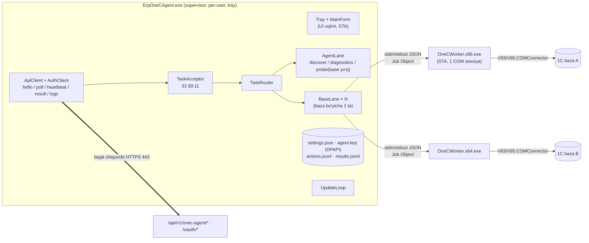
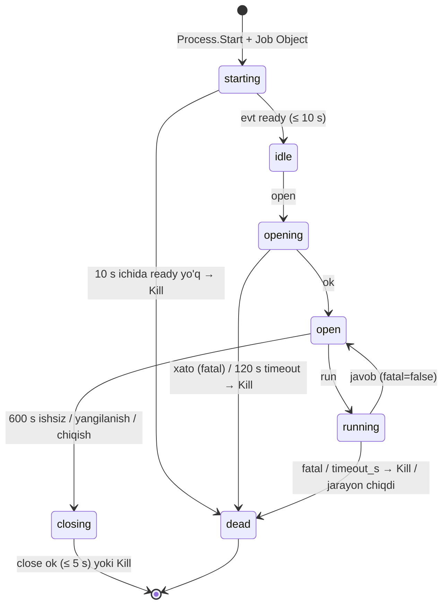
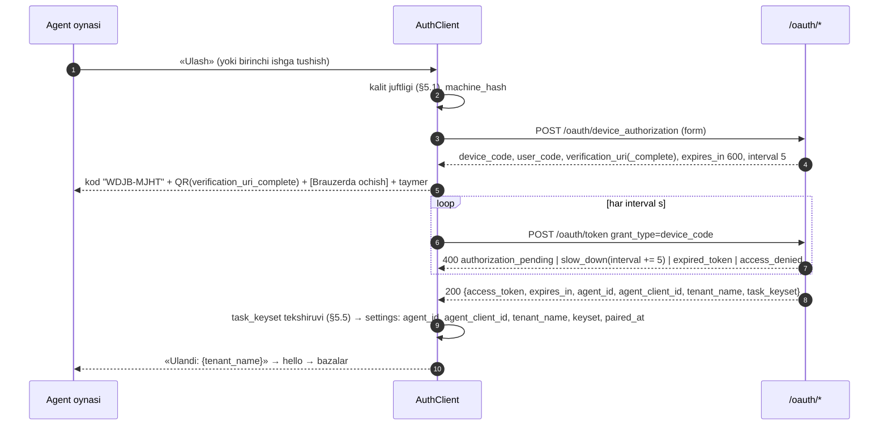

# 34. «ERP 1C Agent» — Windows agentining ichki tuzilishi (COM, pull)

**Maqsad:** do'kon kompyuterida ishlaydigan «ERP 1C Agent» (supervisor tray-ilova + 32/64-bit COM worker'lar) ni kodga tayyor darajada belgilash: solution tuzilishi, jarayonlar va oqimlar, worker protokoli, o'rnatish va imzoli avto-yangilanish, ulash va token, bazalarni topish va onboarding, pull sikli, har vazifa turining COM ketma-ketligi, xato tasnifi, mahalliy jurnal, loglar, UI, xavfsizlik va testlar — `33-1c-integratsiya.md` §9 protokoliga to'liq bo'ysungan holda. · **Kim uchun:** agent dasturchisi · **Bog'liq fayllar:** `33-1c-integratsiya.md` (ustun: §2.3, §8, §9, §12, §15, §16.1), `14-autentifikatsiya-oauth2.md` (§5, §6), `15-xavfsizlik-va-audit.md`, `01-qarorlar.md` (#36–#41, #60, #71), `26-ochiq-savollar-reestri.md` (#100, #102, #105, #109); tadqiqot — `research_notes/1c-integratsiya/01`, `04`, `06`; `research_notes/sonar-1c-integratsiya/01`, `02`, `04` (faqat g'oyalar, kod ko'chirilmaydi) · **Holat:** joriy, 2026-10-16.

Bu fayl agent **ichini** yozadi; tashqi shartnoma (endpointlar A-01…A-10, vazifa turlari, `ObjectSpec`/`QuerySpec`, imzo, muddatlar, xato kodlari) — `33` da va shu yerda o'zgartirilmaydi. Ziddiyatda tartib: `01-qarorlar.md` → `33-1c-integratsiya.md` → shu fayl. `33` bilan moslik jadvali — §13.1. Agent — Do'kon agentining (qaror #60) 1C moduli; Do'kon agentining boshqa modullari — §14. Sonar AI dekompilyatsiya kodi **ko'chirilmaydi** (qaror #36: noldan yoziladi) — faqat naqshlar olinadi.

---

## Asosiy xulosalar

1. **Texnologiya** (qaror #38): C# / .NET Framework 4.8, WinForms tray-ilova `ErpOneCAgent.exe` (AnyCPU, 64-bit OS'da 64-bit) + ikki COM worker `OneCWorker.x86.exe` / `OneCWorker.x64.exe` (`33` §1.2). Barcha bog'liqliklar — sof managed, AnyCPU, MIT/Apache/BSD litsenziyali; native DLL, paketlovchi (ILMerge/Costura) va obfuskator **yo'q** (antivirus soxta signali).
2. **Jarayon modeli**: supervisor COM'ga hech qachon tegmaydi; **bitta 1C bazasi = bitta worker = bitta STA oqim = bitta COM sessiya**; supervisor ↔ worker — stdin/stdout'da bir qatorli JSON (§3.4); har worker Job Object'da (`KILL_ON_JOB_CLOSE`), `timeout_s` o'tsa o'ldiriladi; 10 daqiqa ishsiz — yopiladi.
3. **O'rnatish** — per-user, admin huquqisiz: `%LOCALAPPDATA%\Programs\ErpOneCAgent\`, `HKCU\…\Run` avtostart, Inno Setup (`PrivilegesRequired=lowest`); admin faqat bitta joyda — foydalanuvchi bosgan [Tuzatish] (`regsvr32` UAC bilan).
4. **Ulash** — RFC 8628 device code + `private_key_jwt` (RFC 7523): Ed25519 maxfiy kalit faqat PK'da (DPAPI `CurrentUser`), refresh token yo'q, access token 600 s, 480 s da yangilanadi (`33` §9.2).
5. **Pull sikli** — faqat chiquvchi HTTPS 443: `hello` (600 s), uzluksiz `poll` (25 s long-poll), `heartbeat` (15 s), `result` (oldin `results.jsonl` outbox'ga), `logs` (60 s); tarmoq xatosida `1, 2, 5, 10, 30, 60 s ±20%` backoff.
6. **Har vazifa qabul qilinishidan oldin** `33` §9.11 tekshiruvlari aynan shu tartibda: Ed25519 imzo (kalitlar to'plami `agent_update` ildiz kaliti bilan imzolangan) → claim'lar → muddat → `payload_sha256` (RFC 8785 JCS) → mahalliy jurnal → uch qulfning ikkisi (PK va server) → JSON Schema. Rad → `ONEC_TASK_REJECTED`.
7. **Yozish** — `33` §8.3 kanonik algoritmi so'zma-so'z (§8.8): GUID (`conn.NewObject("УникальныйИдентификатор", s)` — ulangan baza tomonida) bo'yicha bor-yo'qligi → `УстановитьСсылкуНового` yoki yangilash → har qiymatni qayta o'qib solishtirish → `Записать(Проведение, Неоперативный)` → qayta o'qish. Yozish ichida **qayta urinilmaydi**; `writing`/`posting` bosqichi boshlangandan keyingi uzilish → `outcome='unknown'` (`ONEC_UNKNOWN_OUTCOME`). Platforma shu GUID'li obyekt borligini aytsa («Уникальность ссылки») — `ONEC_DUPLICATE_REF`: dublikat yaratilmaydi, keyingi urinish GUID bo'yicha o'qib yangilaydi.
8. **Faqat oq ro'yxat**: 13 vazifa turi (`33` §9.5), COM metod nomlari ham oq ro'yxatda (§8.1.2) — `Удалить`, global `Выполнить`/`Вычислить` va ixtiyoriy 1C kodi agent binarida umuman yo'q (CI tekshiradi).
9. **Mahalliy jurnal** `actions.jsonl` — har vazifa (`task_id`, `attempt`) boshlanishi va natijasi; qayta kelgan vazifa 1C'ga bormasdan jurnaldagi natija bilan javob oladi; «boshlangan, tugamagan» yozish qayta ishga tushganda `unknown` sifatida yuboriladi.
10. **Sirlar**: 1C paroli va agent kaliti — faqat DPAPI `CurrentUser` (+ entropy), serverga hech qachon chiqmaydi; loglarda `Pwd=`, `Bearer`, `client_assertion`, JWS va ulanish satri maskalanadi.
11. **Do'kon agenti** (qaror #60): shu agent (bitta o'rnatish, bitta ulash, bitta pull sikli) — agent infratuzilmasi (ulash, token, A-API, imzoli vazifa navbati, avto-yangilanish) Bosqich 5 da quriladi (qaror #66) va fiskal ko'prik hamda raw TCP 9100 printer modullari bilan kengaytiriladi (tarozi PLU yuklash — MVP'dan keyin): sotuv paytidagi fiskal chek va chop etish — lokal API (`127.0.0.1:47110`, `Origin` oq ro'yxati + qurilmaga bog'langan token; sxemalar `21` §16.1); server vazifalari — `fiscal.status`, `fiscal.resend_unsent`, `fiscal.zreport`, `print.raw`, `scale.plu_upload` (`21` §16 bilan bir xil); 1C moduli (A-02, 13 turli oq ro'yxat) Bosqich 7 da (§14).

---

## 1. Maqsad, qamrov va minimal talablar

### 1.1 Qamrov

| Agent qiladi | Agent qilmaydi |
|---|---|
| Kompyuterni tenantga ulash (device code), token olish va yangilash | Foydalanuvchi sifatida tizimga kirish, ERP veb-interfeysini ko'rsatish |
| PK'dagi 1C bazalarini topish (`ibases.v8i`), platforma va COM'ni aniqlash, [Tuzatish] (`regsvr32`) | 1C platformasini o'rnatish/yangilash, 1C bazasiga `.epf`/`.cfe` qo'shish (qaror #41) |
| Bazani «saqlash = sinash» bilan qo'shish, 1C parolini DPAPI bilan saqlash | 1C parolini, to'liq ulanish satrini yoki maxfiy kalitni serverga yuborish |
| Serverdan imzolangan vazifalarni tortish (pull) va `33` §9.5 dagi 13 turni bajarish | Kiruvchi port ochish, push qabul qilish, WebSocket |
| `ObjectSpec` bo'yicha deklarativ yozish, `QuerySpec` bo'yicha faqat-o'qish | Nom bo'yicha qidirib havola topish (istisno — `dedupe`), havolani o'zi yaratish, jismoniy o'chirish (`Удалить`) |
| Mahalliy jurnal, natija outbox'i, maskalangan loglarni serverga yuborish, diagnostika paketi | Biznes qaror (qaysi hujjat, qaysi rekvizit) — hammasi server profilida (`33` §3.3 «aqlli server, sodda agent») |
| PK qulfi (`pc_write_enabled`) — baza bo'yicha, agent oynasida | Partiyani tasdiqlash yoki yozishni boshlash (faqat serverdagi ruxsatli tasdiq, `33` §15.2) |
| Imzoli avto-yangilanish | Windows xizmati sifatida ishlash (server-PK rejimi — keyingi bosqich, `33` §2.2) |

### 1.2 Minimal talablar

| Talab | Qiymat | Tekshiruv / xato |
|---|---|---|
| OS | Windows 7 SP1 (KB2533623 va SHA-2 kod-imzolash yangilanishi KB4474419 bilan), 8.1, **10/11 — asosiy**; 32 va 64-bit | O'rnatuvchi `MinVersion=6.1.7601`; Win7'da TLS 1.2 eslatmasi (§7.1) |
| .NET | .NET Framework **4.8** (release ≥ 528040) | O'rnatuvchi `HKLM\SOFTWARE\Microsoft\NET Framework Setup\NDP\v4\Full\Release` ni tekshiradi; yo'q bo'lsa — rasmiy offline o'rnatuvchiga havola, o'zi o'rnatmaydi (admin kerak) |
| 1C platformasi | 1C:Предприятие **8.3.x** yoki **8.5.x**, «Внешнее соединение» (COM) komponenti bilan, PK'ga o'rnatilgan; 32 yoki 64-bit | `33` §2.3 `com_registered`, `bitness`, `platform_version` |
| 1C nashri | **ПРОФ/КОРП**. «Базовая» — COM yo'q, qamrovdan tashqari | `edition` → `ONEC_EDITION_NO_COM` |
| 1C litsenziyasi | PK'da ishlaydigan klient litsenziyasi (agent shu PK'da, shu Windows sessiyasida) | `license` → `ONEC_LICENSE_UNAVAILABLE` (warn); `license_source` → `ONEC_LICENSE_SEPARATE_REQUIRED` (warn: server tarqatadigan litsenziya, RDP sessiya yoki veb-server orqali baza) |
| Konfiguratsiya | `bp30_uz` («Бухгалтерия для Узбекистана», ред. 3.0, ≥ 3.0.64) | `config_supported`, `config_version` (server hal qiladi) |
| Baza turi | Fayl (`File=`) yoki klient-server (`Srvr=;Ref=`); veb (`ws=`) — yo'q | `cloud` → `ONEC_CLOUD_BASE_UNSUPPORTED` |
| 1C foydalanuvchisi | Alohida «ERP integratsiya», tashqi ulanish huquqi bilan, «Полные права» siz (`33` §15.3) | `user_rights` → tashqi ulanish huquqi yo'q — `ONEC_NO_RIGHTS` (fail), to'liq huquqli — `ONEC_USER_TOO_PRIVILEGED` (warn) |
| 1C sozlamasi | «Разрешить списание запасов при отсутствии остатков» — o'chiq tavsiya etiladi | `negative_stock_setting` → `ONEC_NEGATIVE_STOCK_ALLOWED` (warn; server talqini, `33` §2.3) |
| Windows sessiyasi | Foydalanuvchi tizimga kirgan bo'lishi kerak (per-user ilova) | BO-22 da aniq yozilgan (`33` §2.2) |
| Tarmoq | Chiquvchi HTTPS 443 `<domen>` ga; tizim proksisi qo'llanadi | `hello` muvaffaqiyatsiz → tray sariq |
| Resurs | RAM ≥ 4 GB (worker x64 ≤ 4 GB, x86 ≤ 1.5 GB limit), disk ≥ 300 MB (dastur ~15 MB + loglar/jurnal ≤ 200 MB) | Disk < 100 MB bo'sh — log `warn`, diagnostika paketi o'chiriladi |

### 1.3 Atamalar (agent ichki)

| Atama | Ma'nosi |
|---|---|
| Supervisor | `ErpOneCAgent.exe` — UI, tarmoq, sirlar, rejalashtirish, yangilanish; COM'ga tegmaydi |
| Worker | `OneCWorker.x86.exe` / `OneCWorker.x64.exe` — bitta bazaga bitta COM sessiya ochadigan bola jarayon |
| Lane (yo'lak) | Bitta baza bo'yicha vazifalarning ketma-ket bajarilish navbati (`BaseLane`); agent darajasidagi vazifalar uchun alohida `AgentLane` |
| Konvert | `poll` javobidagi bitta vazifa obyekti (`task_id`, `lease_id`, `payload`, `signature` …) |
| Results outbox | `results.jsonl` — serverga hali yetkazilmagan A-05 natijalari |
| Jurnal | `actions.jsonl` — har vazifa urinishining mahalliy, faqat qo'shiladigan izi (§8.14) |
| Tuzatilgan vaqt | `DateTime.UtcNow + clock_offset` (§7.9) |
| Kalitlar to'plami | `task_keyset` — `onec_task` ochiq kalitlari, `agent_update` ildiz kaliti bilan imzolangan JWS (`33` §9.4) |

---

## 2. Solution tuzilishi

### 2.1 Repo papkasi

Agent kodi repo ildizida `agent-1c/` papkasida (`backend/`, `web/` yonida; `32-kod-qoidalari.md` §1.3 bilan bir xil). Bosqich 5 modullari — `src/Erp1C.Fiscal/`, `src/Erp1C.Devices/` va `src/Erp1C.CardTerminal/` (+ vendor drayverlari `src/Erp1C.CardTerminal.Drivers.<Vendor>/`) (§14.1 «Kod tuzilishi», §14.4). Umumiy test vektorlari — `shared/` (backend bilan birga).

```
agent-1c/
├── ErpOneCAgent.sln
├── Directory.Build.props          # net48, LangVersion 9, Nullable enable, TreatWarningsAsErrors, Deterministic, versiya
├── src/
│   ├── Erp1C.Core/                # AnyCPU classlib — supervisor ham, worker ham ishlatadi
│   │   ├── Contracts/             # ObjectSpec, QuerySpec, Value, ErrorObj, TaskEnvelope, A-01…A-10 DTO (sxemadan generatsiya)
│   │   ├── Json/                  # Jcs.cs (RFC 8785), JsonOptions, ValueConverter (§9.8)
│   │   ├── Crypto/                # Ed25519 (BouncyCastle), CompactJws, JwkThumbprint, Uuid5, Sha256Hex
│   │   ├── Trust/                 # RootKeys.cs (agent_update ochiq kalitlari: joriy + keyingi), TaskKeyset
│   │   ├── Schema/                # onec-object-spec-1.json (embedded), SpecValidator (JSON Schema + qo'shimcha qoidalar)
│   │   ├── WorkerProtocol/        # WorkerRequest/Response/Event, LineCodec
│   │   ├── Errors/                # OneCCodes (33 §12), ErrorClassifier (§8.12), ErrorTexts (uz/ru)
│   │   ├── Masking/               # SecretMasker (§9.2)
│   │   └── Connect/               # ConnectString (parse/build), Fingerprint, IbasesParser
│   ├── Erp1C.Worker/              # AnyCPU classlib — COM bajaruvchi (faqat worker jarayonida yuklanadi)
│   │   ├── Com/                   # ComScope, Disp (oq ro'yxatli late binding), ComSession, OneCValues
│   │   ├── Ops/                   # ProbeOp, MetadataOp, QueryOp, WriteObjectOp, StateOps (post/unpost/mark_delete)
│   │   ├── IOneCGateway.cs        # COM ustidagi abstraksiya (testda FakeOneC, §12.2)
│   │   └── WorkerLoop.cs          # stdin o'qish oqimi + STA bajarish oqimi
│   ├── Erp1C.Worker32/            # exe, PlatformTarget=x86, AssemblyName=OneCWorker.x86 → OneCWorker.x86.exe
│   ├── Erp1C.Worker64/            # exe, PlatformTarget=x64, AssemblyName=OneCWorker.x64 → OneCWorker.x64.exe
│   └── Erp1C.Agent/               # WinExe, AnyCPU, Prefer32Bit=false, AssemblyName=ErpOneCAgent
│       ├── App/                   # Program.cs, AppHost, SingleInstance, CommandLine
│       ├── State/                 # SettingsStore, SecretStore (DPAPI), ActionJournal, ResultOutbox, LogOutbox
│       ├── Net/                   # ApiClient, AuthClient (device + private_key_jwt), ClockSync, Backoff
│       ├── Loops/                 # HelloLoop, PollLoop, HeartbeatPump, ResultSender, LogShipper, UpdateLoop
│       ├── Tasks/                 # TaskAcceptor (33 §9.11), TaskRouter, BaseLane, AgentLane, DiagnosticsOp, DiscoverOp
│       ├── Workers/               # WorkerHost, JobObject (P/Invoke), WorkerPool, BitnessSelector
│       ├── Platform/              # PlatformDetector (fayl + registr), ComFixer (regsvr32 runas), MachineInfo
│       ├── Update/                # ManifestVerifier, Downloader, AuthenticodeCheck, Installer
│       └── Ui/                    # TrayIcon, MainForm (Holat/Bazalar/Jurnal/Sozlamalar), BaseDialog, PairingPanel, Texts.uz.resx, Texts.ru.resx
├── tests/
│   ├── Erp1C.Core.Tests/          # JCS, JWS, Uuid5, Fingerprint, IbasesParser, SpecValidator, ErrorClassifier, Masker
│   ├── Erp1C.Worker.Tests/        # WriteObjectOp va boshqalar FakeOneC ustida (§12.2)
│   ├── Erp1C.Agent.Tests/         # TaskAcceptor, outbox/jurnal, backoff, ApiClient (fake HTTP), BitnessSelector
│   └── Erp1C.IntegrationTests/    # [Trait("Category","OneC")] — haqiqiy 1C demo bazasi (§12.4)
├── installer/
│   ├── ErpOneCAgent.iss           # Inno Setup 6 skripti (§4.2)
│   └── build-installer.ps1
└── tools/
    ├── gen-contracts.ps1          # shared/schemas/*.json → Erp1C.Core/Contracts/*.cs (dev vositasi, runtime'ga kirmaydi)
    └── Erp1C.ReleaseTool/         # oflayn CLI: manifest va task_keyset'ni agent_update ildiz kaliti bilan imzolash (yetkazilmaydi)
```

**Nega alohida `Erp1C.Updater` loyihasi yo'q:** yangilanishni tekshirish/yuklash/tasdiqlash supervisor ichida (`Update/`), o'rnatishni esa Inno Setup o'rnatuvchisining o'zi qiladi (`/VERYSILENT`) — Sonar naqshi (`sonar-1c-integratsiya/01` §5.7): alohida patch formati va uchinchi exe yo'q.

**Nega worker — ikki exe + bitta classlib:** in-process `comcntr.dll` faqat bir xil bitlikdagi jarayonga yuklanadi (`research_notes/1c-integratsiya/01` §4.1); `Erp1C.Worker` AnyCPU kutubxonasi ikkala exe'ga ham yuklanadi, exe'lar faqat `Main` + `PlatformTarget` dan iborat.

### 2.2 Loyihalar va bog'liqliklar

| Loyiha | Chiqish | Platforma | Kimga bog'liq |
|---|---|---|---|
| `Erp1C.Core` | `Erp1C.Core.dll` | AnyCPU, `net48` | System.Text.Json, JsonSchema.Net, BouncyCastle.Cryptography |
| `Erp1C.Worker` | `Erp1C.Worker.dll` | AnyCPU, `net48` | `Erp1C.Core` (+ `Microsoft.CSharp` — `dynamic` uchun) |
| `Erp1C.Worker32` / `Erp1C.Worker64` | `OneCWorker.x86.exe` / `OneCWorker.x64.exe` | x86 / x64 | `Erp1C.Worker` |
| `Erp1C.Agent` | `ErpOneCAgent.exe` | AnyCPU, `Prefer32Bit=false` | `Erp1C.Core`, Serilog, QRCoder |
| `Erp1C.CardTerminal` | `Erp1C.CardTerminal.dll` (Bosqich 5) | AnyCPU, `net48` | `Erp1C.Core` |
| `Erp1C.CardTerminal.Drivers.<Vendor>` | `Erp1C.CardTerminal.Drivers.<Vendor>.dll` (Fake — Bosqich 5; real — hamkordan keyin) | AnyCPU, `net48` | faqat `Erp1C.CardTerminal` |
| `Erp1C.ReleaseTool` | `erp1c-release.exe` (yetkazilmaydi) | x64 | `Erp1C.Core` |

Barcha exe'lar bitta papkada (umumiy managed DLL'lar bir marta yotadi); har exe'ning `.config` faylida `<supportedRuntime version="v4.0" sku=".NETFramework,Version=v4.8"/>`.

### 2.3 Ruxsat etilgan NuGet paketlari

Faqat shu ro'yxat; yangi paket — PR'da asoslash va litsenziya tekshiruvi bilan. Versiyalar `Directory.Packages.props` da markazlashgan (Central Package Management), aniq pin.

| Paket | Maqsad | Litsenziya | Izoh |
|---|---|---|---|
| `System.Text.Json` (8.x) | Barcha JSON; `JsonDocument` JCS uchun xom son matnini beradi | MIT | Newtonsoft ishlatilmaydi (sana avtomatik konversiyasi xavfi, ikki JSON kutubxona) |
| `JsonSchema.Net` (netstandard2.0) | `ObjectSpec` JSON Schema 2020-12 validatsiyasi (`33` §9.6) | MIT | `Newtonsoft.Json.Schema` **taqiqlangan** (AGPL) |
| `BouncyCastle.Cryptography` (2.x) | Ed25519 imzo/tekshirish, sof managed | MIT | NSec/libsodium — taqiq (native, net48 emas) |
| `Serilog`, `Serilog.Sinks.File`, `Serilog.Formatting.Compact` | Aylanuvchi JSON-qator loglar (§9.1) | Apache-2.0 | — |
| `QRCoder` | Ulash kodi QR'i (`verification_uri_complete`) | MIT | Faqat supervisor |
| Test: `xunit`, `xunit.runner.visualstudio`, `Shouldly`, `NSubstitute` | Testlar | Apache/BSD/MIT | FluentAssertions 8+ — taqiq (tijoriy litsenziya) |

**Taqiqlangan:** ILMerge/Costura/ConfuserEx va har qanday paketlovchi/obfuskator; native DLL olib keladigan paketlar; `Velopack` (Win7 qo'llovi tasdiqlanmagan); telemetriya SDK'lari (Sentry agentda yo'q — xatolar A-06 orqali).

### 2.4 Build

- SDK-uslubidagi `.csproj`, `TargetFramework=net48`; build mashinasida .NET Framework 4.8 Developer Pack; `dotnet build -c Release` (yoki `msbuild`).
- `Directory.Build.props`: `LangVersion=9.0`, `Nullable=enable`, `TreatWarningsAsErrors=true`, `Deterministic=true`, `ContinuousIntegrationBuild=true` (CI'da), `GenerateDocumentationFile=false`, `AnalysisLevel=latest-recommended`.
- Kontrakt klasslari `tools/gen-contracts.ps1` bilan `shared/schemas/onec-object-spec-1.json` (backend Pydantic'dan generatsiya qilgan, `33` §9.6) dan quriladi va commit qilinadi; CI sxema faylining SHA-256 ni `Contracts/SchemaHash.g.cs` bilan solishtiradi — farq bo'lsa build yiqiladi (sxema o'zgardi, klasslar eskirgan).
- Natija papkasi `artifacts/bin/` → o'rnatuvchi `artifacts/setup/erp-onec-agent-<versiya>-setup.exe`.

### 2.5 Imzolash konveyeri

| Qadam | Qayerda | Nima |
|---|---|---|
| 1. Build + unit testlar | CI (`windows-2022`) | `Release`, imzosiz artefakt |
| 2. Authenticode | Imzolash PK'si (OV sertifikat, qaror #38; kalit — apparat tokenda yoki CA bulut imzolash xizmatida, 26 #105) | `signtool sign /fd sha256 /tr <RFC3161 TSA> /td sha256 /n "<noshir>"` — `ErpOneCAgent.exe`, `OneCWorker.x86.exe`, `OneCWorker.x64.exe`, `Erp1C.*.dll`, uchinchi tomon DLL'lari (imzosizlari) |
| 3. O'rnatuvchi | Imzolash PK'si | `ISCC.exe` (`SignTool=` direktivasi bilan — setup va `unins000.exe` ham imzolanadi) |
| 4. Tekshiruv | Imzolash PK'si | `signtool verify /pa /all` har faylga; noshir nomi `ExpectedPublisher` ga teng |
| 5. Manifest | **Oflayn** PK (`agent_update` ildiz kaliti, CI'da emas — `33` §9.4) | `erp1c-release sign-manifest --setup <exe> --channel pilot` → `manifest.json` (sha256, size) + Ed25519 imzo + `kid` |
| 6. Nashr | Admin | Setup → `https://<domen>/downloads/`, manifest → server (A-09 manbasi); avval `pilot`, keyin `stable` |

### 2.6 Versiyalash

| Versiya | Format | Qayerda |
|---|---|---|
| Agent versiyasi | SemVer `MAJOR.MINOR.PATCH` (masalan `1.4.2`) | `AssemblyInformationalVersion`, `X-Agent-Version`, `User-Agent`, manifest `version`; `AssemblyFileVersion = MAJOR.MINOR.PATCH.<build>`; `AssemblyVersion = MAJOR.0.0.0` |
| Agent protokoli | Butun son, hozir `2` (A-01 `capabilities`, `33` §9.3) | `X-Agent-Protocol`, `hello.protocol`; faqat `33` §9 o'zgarganda oshadi |
| Worker protokoli | Butun son, hozir `1` | `ready.protocol` (§3.4); supervisor va worker bir xil versiyada yetkaziladi, mos kelmasa worker o'ldiriladi |
| `ObjectSpec` | `spec_version = 1` | `33` §9.6 |
| Git teg | `agent-v1.4.2` | Reliz |

Versiya solishtirish — butun sonli uchlik bo'yicha; `-pilot.N` kabi suffiks ishlatilmaydi (kanal manifestda).

---

## 3. Jarayonlar va oqimlar

### 3.1 Umumiy ko'rinish



### 3.2 Supervisor komponentlari

| Komponent | Mas'uliyat | Oqim |
|---|---|---|
| `AppHost` | Ishga tushirish/to'xtatish tartibi (§7.3), komponentlarni bog'lash | Asosiy |
| `TrayIcon`, `MainForm` | UI (§10); hech qachon tarmoq/COM'ni to'g'ridan-to'g'ri chaqirmaydi — `AppHost` buyruqlari orqali | UI (WinForms STA) |
| `SettingsStore` | `settings.json` atomik o'qish/yozish (`.tmp` + `File.Replace`), versiyalash (`v`) | Har qaysi (ichki `lock`) |
| `SecretStore` | DPAPI: agent kaliti, 1C parollari (§5.1, §6.8) | Har qaysi |
| `AuthClient` | Device code ulash, client assertion, token keshi (§5) | Thread pool |
| `ApiClient` | Bitta `HttpClient`, headerlar, gzip, xato konverti, 401/403/426 qayta ishlash (§7.1) | Thread pool |
| `ClockSync` | Server vaqti ofseti (§7.9) | — |
| `HelloLoop`, `PollLoop`, `HeartbeatPump`, `ResultSender`, `LogShipper`, `UpdateLoop` | §7.2 jadvali | Har biri — alohida `async` sikl |
| `TaskAcceptor` | `33` §9.11 tekshiruvlari (§7.5) | Poll siklida |
| `TaskRouter` | Vazifani `AgentLane` yoki `BaseLane(base_id)` ga beradi | — |
| `BaseLane` | Baza bo'yicha FIFO, `SemaphoreSlim(1,1)`; `WorkerHost` egasi | Thread pool |
| `WorkerHost` | Worker jarayoni: ishga tushirish, Job Object, so'rov/javob, watchdog, o'ldirish (§3.5) | O'qish oqimi + thread pool |
| `ActionJournal`, `ResultOutbox`, `LogOutbox` | §8.14, §7.7, §9.3 | Ichki `lock` |
| `PlatformDetector`, `ComFixer` | §6.3, §6.4 | Thread pool |
| `IbasesDiscovery` | §6.1 | Thread pool |

### 3.3 Oqim (threading) modeli

- **UI oqimi** — yagona STA (`[STAThread] Main`, `Application.Run`). Fon natijalari UI'ga `SynchronizationContext.Post` bilan.
- **Tarmoq va rejalashtirish** — `async/await` thread pool'da; har sikl o'z `CancellationTokenSource` iga ega, `AppHost.StopAsync` hammasini bekor qiladi.
- **Baza yo'lagi** — har `base_id` (yoki hali ro'yxatdan o'tmagan baza uchun `local_id`) ga bitta `BaseLane`: navbat + `SemaphoreSlim(1,1)`; bir bazada bir vaqtda faqat bitta ish (server vazifasi yoki UI «Sinash»). Parallel yo'laklar soni — `max_parallel_bases` (standart **2**, 1…4; har yo'lak — alohida COM sessiya va potentsial litsenziya, 26 #100).
- **Agent yo'lagi** — bitta (`33` §5.15 `uq_onec_tasks_one_leased_agent_level`): `discover_bases`, `collect_diagnostics`, bazasiz `probe`.
- **Worker** — ikki oqim: `stdin` o'qish oqimi (fon) va **asosiy STA oqimi** (`[STAThread] Main`), barcha COM chaqiruvlari faqat shu oqimda (COM obyekti uni yaratgan oqimdan tashqarida ishlatilmaydi — `research_notes/1c-integratsiya/06` §1.12). O'qish oqimi buyruqlarni `BlockingCollection` ga qo'yadi; `ping` ga o'zi javob beradi (§3.4). `stdout` ga yozish — bitta `lock` ostida, har qatordan keyin `Flush()`.

### 3.4 Worker protokoli (stdin/stdout JSON-qator)

**Kodlash:** UTF-8 BOM'siz; har xabar — bitta qator JSON, `\n` bilan tugaydi; maksimal qator 64 MB (oshsa — protokol xatosi, worker o'ldiriladi). Worker `Main` boshida `Console.SetOut(Console.Error)` qiladi — hech qanday kutubxona tasodifan protokol kanaliga yozmasligi uchun; protokol faqat `Console.OpenStandardOutput()` dan olingan xom oqimga yoziladi. `stderr` — erkin matn, supervisor uni `warn` darajasida o'z logiga yozadi (maskalanib).

**Ishga tushirish argumentlari:** `OneCWorker.x64.exe --parent-pid <pid> --protocol 1 --session <uuid>`. Worker ota jarayonni har 2 s tekshiradi va u yo'qolsa o'zini tugatadi (Job Object'ga qo'shimcha himoya).

**Xabarlar:**

| Yo'nalish | Shakl | Qachon |
|---|---|---|
| W → S | `{"evt":"ready","protocol":1,"bits":64,"pid":4312,"version":"1.4.2","clr":"4.8.9032.0"}` | Ishga tushgach, ≤ 10 s ichida (aks holda o'ldiriladi) |
| S → W | `{"id":1,"cmd":"probe","params":{"progids":["V85.COMConnector","V83.COMConnector"]}}` | COM ro'yxatini shu bitlikda sinash (`Type.GetTypeFromProgID` + `Activator.CreateInstance` + darhol `ReleaseComObject`) |
| W → S | `{"id":1,"ok":true,"data":{"bits":64,"progids":[{"progid":"V83.COMConnector","registered":true,"created":true,"dll":"C:\\Program Files\\1cv8\\8.3.25.1374\\bin\\comcntr.dll","version":"8.3.25.1374","error":null}]}}` | — |
| S → W | `{"id":2,"cmd":"open","params":{"progid":"V83.COMConnector","conn":"File=\"D:\\1C\\Shop\";Usr=\"ERP integratsiya\";Pwd=\"…\";","connect_timeout_s":120}}` | Bazaga ulanish. **`params` hech qachon loglanmaydi** |
| W → S | `{"id":2,"ok":true,"data":{"config_name":"…","config_synonym":"…","config_version":"3.0.64.8","platform_version":"8.3.25.1374","user_name":"ERP integratsiya","user_full_name":"…","connect_ms":4210,"bits":64,"progid":"V83.COMConnector"}}` | — |
| S → W | `{"id":3,"cmd":"run","params":{"op":"write_object","task_id":"…","attempt":1,"payload":{…},"limits":{"max_rows":100000,"max_result_bytes":8388608}}}` | Vazifa (`op` = `33` §9.5 `kind`) |
| W → S | `{"evt":"stage","re":3,"stage":"writing","pct":80,"at":"2026-10-15T18:03:10.120Z"}` | Bosqich o'zgarganda — **`writing`/`posting` `Записать`/`УстановитьПометкуУдаления` chaqiruvidan OLDIN yuboriladi va `Flush` qilinadi** (§8.13) |
| W → S | `{"evt":"log","level":"warn","msg":"…"}` | Worker ichki logi (supervisor maskalab yozadi) |
| W → S | `{"id":3,"ok":true,"data":{…33 §9.5 natija…}}` yoki `{"id":3,"ok":false,"error":{…ErrorObj 33 §9.10…,"fatal":false}}` | Vazifa natijasi |
| S → W | `{"id":4,"cmd":"ping"}` → `{"id":4,"ok":true,"data":{"busy":true,"op":"write_object","stage":"filling","since_ms":41000}}` | Faqat bo'sh turgan worker tirikligini tekshirish (o'qish oqimi javob beradi) |
| S → W | `{"id":5,"cmd":"close"}` → `{"id":5,"ok":true,"data":{}}`, so'ng worker `exit 0` | Bo'sh turganda yopish, yangilanish, chiqish |

- `id` — supervisor beradigan monoton `long`; javob shu `id` bilan; `evt` xabarlarida `re` — tegishli so'rov `id` si.
- `error.fatal = true` — COM sessiyasi yaroqsiz (`ONEC_COM_NOT_REGISTERED`, `ONEC_CONNECTION_LOST`, `Connect` xatosi): supervisor workerni yopadi, keyingi ish yangi worker bilan.
- Worker bir vaqtda faqat bitta `open`/`run` ni bajaradi; ikkinchisi kelsa — `{"ok":false,"error":{"code":"ONEC_TASK_REJECTED","message":"busy"}}` (supervisor xatosi, normal oqimda bo'lmaydi).
- Natija hajmi `limits.max_result_bytes` dan oshsa, o'qish natijasi qatorlari kesiladi, `truncated=true` (§8.5).

### 3.5 Worker hayot sikli, muddatlar va qayta ishga tushirish



| Parametr | Qiymat | Manba |
|---|---|---|
| `ready` kutish | 10 s | — |
| `probe` (COM) | 30 s | — |
| `open` (`Connect`) | 120 s | `33` §9.9 |
| `run` watchdog | ObjectSpec turlari uchun `payload.timeout_s`; boshqalar uchun konvert `timeout_s`; ikkalasida ham `[10, 1800]` ga qisiladi | `33` §9.5, §9.9 |
| `close` | 5 s, keyin `Kill` | — |
| Ishsiz yopish | 600 s (`33` §9.9) — oxirgi `run` tugaganidan keyin; litsenziya va xotira bo'shaydi | `33` §9.9 |
| Job Object | `JOB_OBJECT_LIMIT_KILL_ON_JOB_CLOSE` + `JOB_OBJECT_LIMIT_PROCESS_MEMORY` (x64: 4 GB, x86: 1.5 GB — *taxmin*, P-19 bilan sozlanadi) | `research_notes/1c-integratsiya/04` §2.2 |
| Crash-loop | Bitta bazada 10 daqiqada 3 marta `dead` (o'ldirilgan yoki o'zi chiqqan) → yo'lak 5 daqiqaga pauza, `hello.bases[].status="error"`, `last_error_code=ONEC_WORKER_CRASHED`; pauzada kelgan vazifa `failed ONEC_WORKER_CRASHED` (transient) | — |
| Sessiya qayta ishlatilishi | Bitta bazaning ketma-ket vazifalari bitta ochiq sessiyada; har `run` boshida worker `ПолучитьСообщенияПользователю(Истина)` ni chaqiradi — u ham tiriklik tekshiruvi; `ONEC_CONNECTION_LOST` bo'lsa (yozish bosqichidan **oldin**) supervisor workerni almashtirib, shu vazifada **bir marta** qayta `open` qiladi | `33` §9.9 |

**Job Object** (P/Invoke, `Workers/JobObject.cs`): `CreateJobObject(IntPtr.Zero, null)` → `SetInformationJobObject(JobObjectExtendedLimitInformation, {LimitFlags = KILL_ON_JOB_CLOSE | PROCESS_MEMORY, ProcessMemoryLimit})` → har worker `AssignProcessToJobObject`. Win7'da supervisor o'zi boshqa job ichida bo'lsa (ichma-ich job'lar Win8+ da) `AssignProcessToJobObject` xato beradi — u holda worker `CREATE_BREAKAWAY_FROM_JOB` bilan qayta ishga tushiriladi; bu ham bo'lmasa job'siz ishlaydi va faqat `--parent-pid` kuzatuviga tayanadi (log `warn`).

**O'ldirish** — `Process.Kill()` + `WaitForExit(5000)`; o'ldirilgandan keyin pipe'da qolgan qatorlar baribir o'qib olinadi (oxirgi `stage` hodisasi yo'qolmasligi uchun, §8.13).

### 3.6 Bitlik va ProgID tanlash

Kirish: `PlatformDetector` ro'yxati (§6.3), baza sozlamasi `bits ∈ {auto, 32, 64}`, oxirgi muvaffaqiyatli `(bits_used, progid_used)`.

```
candidates = []
if bits_used va progid_used hali ro'yxatda (registered=true): candidates += (progid_used, bits_used)
for progid in ["V85.COMConnector", "V83.COMConnector"]:          # V82 faqat ko'rsatish uchun, ulanmaydi
  for bits in (OS 64-bit ? [64, 32] : [32]):
    if sozlama bits ≠ auto va bits ≠ sozlama: continue
    if (progid, bits) registered: candidates += (progid, bits)
for c in unique(candidates):
  r = worker(c.bits).open(c.progid, conn)
  if r.ok: saqla bits_used, progid_used; return r
  if r.code in {ONEC_COM_NOT_REGISTERED, ONEC_BITNESS_MISMATCH, ONEC_PLATFORM_VERSION_MISMATCH}: oxirgi_xato = r; continue
  return r                                      # AUTH_FAILED, BASE_LOCKED va h.k. — boshqa nomzod sinalmaydi
yakuniy kod: hech biri ro'yxatda yo'q → ONEC_COM_NOT_REGISTERED;
             ro'yxatda bor, lekin hammasi bitlik xatosi → ONEC_BITNESS_MISMATCH;
             aks holda oxirgi_xato
```

Fayl baza bitlikka bog'liq emas — har qaysi ro'yxatdagi bitlik ishlaydi; klient-server bazada `comcntr` versiyasi server versiyasiga teng bo'lishi shart (`33` §2.3 `platform_version`) — shuning uchun versiya nomuvofiqligida keyingi nomzod sinaladi.

### 3.7 Yagona nusxa va chiqish signali

- Mutex `Global\ErpOneCAgent-<SID>` (foydalanuvchi SID'i; bir foydalanuvchining bir nechta Windows sessiyasida — masalan RDP — ham ikkinchi nusxa ishga tushmaydi). Olinmasa: `Local\ErpOneCAgent-Show-<SID>` nomli event signal qilinadi (mavjud nusxa oynasini ochadi) va jarayon `exit 0`.
- Chiqish signali — `Local\ErpOneCAgent-Exit-<SID>` event: o'rnatuvchi/o'chiruvchi va `ErpOneCAgent.exe --shutdown` shu orqali nazokatli to'xtatadi (§4.2).
- Boshqa Windows foydalanuvchisi shu PK'da o'z agentini ishga tushirishi mumkin (alohida `machine_hash`, alohida ulash); bitta 1C bazasiga ikkinchi yozuvchi server darajasida `ONEC_BASE_DUPLICATE` bilan to'xtatiladi (`33` §5.3).

---

## 4. O'rnatish, o'chirish, avto-yangilanish va kod-imzolash

### 4.1 Fayl va registr joylari

| Nima | Joy | Izoh |
|---|---|---|
| Dastur | `%LOCALAPPDATA%\Programs\ErpOneCAgent\` (`ErpOneCAgent.exe`, `OneCWorker.x86.exe`, `OneCWorker.x64.exe`, `*.dll`, `*.config`, `unins000.exe`) | Admin huquqisiz (qaror #38) |
| Ma'lumot | `%LOCALAPPDATA%\ErpOneCAgent\` | **Roaming emas** — DPAPI blob va kalit boshqa PK'ga ko'chmasligi uchun (`33` §15.3) |
| `settings.json` | `…\ErpOneCAgent\settings.json` | §6.8 sxemasi; sirlar faqat DPAPI blob sifatida |
| `agent.key` | `…\ErpOneCAgent\agent.key` | Ed25519 seed, DPAPI (§5.1) |
| Jurnal / outbox | `actions.jsonl`, `results.jsonl`, `logs-outbox.jsonl` | §8.14, §7.7, §9.3 |
| Loglar | `…\ErpOneCAgent\logs\agent-YYYYMMDD.clef`, `worker-YYYYMMDD.clef` | §9.1 |
| Yangilanish | `…\ErpOneCAgent\updates\` | 1 kundan eski `*.part`/setup fayllar tozalanadi |
| Diagnostika | `…\ErpOneCAgent\diag\` | Vaqtinchalik zip; yuborilgach o'chiriladi |
| Avtostart | `HKCU\Software\Microsoft\Windows\CurrentVersion\Run` → `ErpOneCAgent = "<app>\ErpOneCAgent.exe" --hidden` | UI'dagi «Windows bilan ishga tushirish» shu qiymatni qo'yadi/o'chiradi |
| «Dasturlar» yozuvi | `HKCU\Software\Microsoft\Windows\CurrentVersion\Uninstall\{AppId}_is1` (Inno o'zi yozadi) | `Publisher`, `DisplayVersion`, `QuietUninstallString` |
| Yorliqlar | Start menyu `ERP 1C Agent.lnk`; Ish stoli — ixtiyoriy (o'rnatishda belgi) | — |

Ma'lumot papkasi yaratilganda ACL — faqat joriy foydalanuvchi va `SYSTEM` (meros uzilib, `Administrators` ham olib tashlanmaydi — Windows siyosati), `DirectorySecurity` bilan.

### 4.2 O'rnatuvchi (Inno Setup 6)

```ini
; installer/ErpOneCAgent.iss — asosiy direktivalar
[Setup]
AppId={{6B2E1C34-0A7D-4E1B-9C55-3F0E8D2A1C11}
AppName=ERP 1C Agent
AppVersion={#AppVersion}
AppPublisher={#Publisher}
PrivilegesRequired=lowest
PrivilegesRequiredOverridesAllowed=
DefaultDirName={userpf}\ErpOneCAgent
DisableDirPage=yes
DisableProgramGroupPage=yes
UsePreviousAppDir=yes
MinVersion=6.1.7601
ArchitecturesInstallIn64BitMode=x64compatible
CloseApplications=no
RestartApplications=no
SignTool=erpsign
SetupLogging=yes
OutputBaseFilename=erp-onec-agent-{#AppVersion}-setup

[Files]
Source: "..\artifacts\bin\*"; DestDir: "{app}"; Flags: ignoreversion recursesubdirs

[Registry]
Root: HKCU; Subkey: "Software\Microsoft\Windows\CurrentVersion\Run"; ValueType: string; \
  ValueName: "ErpOneCAgent"; ValueData: """{app}\ErpOneCAgent.exe"" --hidden"; \
  Flags: uninsdeletevalue; Check: IsFirstInstall

[Run]
Filename: "{app}\ErpOneCAgent.exe"; Parameters: "{code:RunArgs}"; Flags: nowait; Check: ShouldStartAgent

[UninstallRun]
Filename: "{app}\ErpOneCAgent.exe"; Parameters: "--uninstall-hook {code:KeepArg}"; Flags: runhidden waituntilterminated; RunOnceId: "unpair"
```

`[Code]` bo'limi:

- `InitializeSetup`: .NET 4.8 tekshiruvi (§1.2); keyin `Local\ErpOneCAgent-Exit-<SID>` eventini signal qilib, mutex bo'shashini 60 s kutadi (`CheckForMutexes` sikli); bo'shamasa — jim rejimda `Abort` (yangilanish keyinga qoladi), oddiy rejimda «Dasturni yoping» xabari.
- Jim rejimda ham ishlaydi: `/VERYSILENT /SUPPRESSMSGBOXES /NORESTART /SP-`; maxsus parametrlar `/restart` (o'rnatilgach agentni ishga tushirish) va `/hidden` (`--hidden` bilan) `ParamStr` orqali o'qiladi → `RunArgs`.
- `IsFirstInstall` — `{app}\ErpOneCAgent.exe` hali yo'q bo'lsa `True` (yangilanish foydalanuvchi o'chirgan avtostartni qayta yoqmaydi).
- `InitializeUninstall`: jim bo'lmasa so'raydi — «Sozlamalar (bazalar ro'yxati va 1C parollari) saqlansinmi? Qayta o'rnatilsa kompyuterni baribir qayta ulash kerak bo'ladi.» [Ha]/[Yo'q]; jim rejimda — saqlash (`KeepArg = --keep-settings`).

Inno Setup versiyasi — Win7 SP1 ni qo'llaydigan oxirgi 6.x, aniq pinlanadi. Worker'lar va supervisor bitta papkada; o'rnatuvchi workerlarni alohida yopmaydi — supervisor chiqishda ularni `close`/`Kill` qiladi va Job Object yopilishi yetimlarni o'ldiradi.

### 4.3 O'chirish (uninstall)

`ErpOneCAgent.exe --uninstall-hook [--keep-settings]` (o'chiruvchi chaqiradi):

1. Ishlayotgan nusxaga chiqish signali (§3.7), mutex bo'shashini 30 s kutish.
2. Agent ulangan bo'lsa — A-10 `POST /unpair {"reason":"uninstall"}` (token olish + so'rov, jami ≤ 10 s, muvaffaqiyatsiz bo'lsa ham davom; server BO-22 dan revoke qilinishi mumkin — log yoziladi).
3. Har doim o'chiriladi: `agent.key`, kalitlar to'plami, `results.jsonl`, `actions.jsonl`, `logs-outbox.jsonl`, `updates\`, `diag\`.
4. `--keep-settings` bo'lsa: `settings.json` qoladi, lekin `agent_id`, `agent_client_id`, `tenant_name`, `keyset` tozalanadi va har bazada `base_id=null`, `registration="pending"` qilinadi (qayta ulashda bazalar A-02 bilan qayta yuboriladi → `ONEC_BASE_DUPLICATE` → BO-22 dagi W-14); `logs\` qoladi. Aks holda butun `%LOCALAPPDATA%\ErpOneCAgent\` o'chiriladi.
5. HKCU Run qiymati va yorliqlarni Inno o'zi o'chiradi.

### 4.4 Avto-yangilanish (A-09)

**Trigger:** `hello` javobida `update` (bo'sh emas) yoki har 6 soatda (`33` §9.9) — `GET /api/v1/onec-agent/update-manifest?channel=<settings.update_channel yoki hello.update.channel>`; `426 ONEC_AGENT_UPDATE_REQUIRED` — darhol.

**Tekshiruv zanjiri** (har biri o'tmasa — o'rnatilmaydi, log `error`, UI «Yangilanish tasdiqlanmadi»):

| # | Tekshiruv | Qoida |
|---|---|---|
| 1 | Imzo | `signature` — Ed25519, `manifest` base64 dan **ochilgan aynan baytlar** ustida; ochiq kalit — `RootKeys` dagi `kid` bo'yicha (joriy yoki keyingi ildiz); boshqa `kid` → rad |
| 2 | Mahsulot va kanal | `product == "erp-onec-agent"`, `channel` so'ralgan kanalga teng |
| 3 | Versiya | `version` (SemVer) **>** o'rnatilgan versiya — downgrade va tenglik rad (`33` §9.4) |
| 4 | OS | `min_os` (`6.1.7601` formatida) ≤ joriy OS versiyasi |
| 5 | Protokol | `min_protocol` ≤ agent qo'llaydigan eng yuqori protokol (hozir 2) |
| 6 | URL | Faqat `https://`, userinfo yo'q |
| 7 | Yuklash | `updates\erp-onec-agent-<ver>-setup.exe.part` ga oqim bilan; `size` dan oshsa — to'xtatish; oxirida `size` va SHA-256 (`sha256`, kichik harf hex) **aynan** teng; keyin `.part` → `.exe` |
| 8 | Authenticode | `WinVerifyTrust(WINTRUST_ACTION_GENERIC_VERIFY_V2)` muvaffaqiyatli va imzolovchi sertifikat `Subject` CN'i `ExpectedPublisher` konstantasiga teng (binarga joylangan) |

**O'rnatish vaqti:** hech qanday vazifa lease'da emas, yo'laklar bo'sh, `ResultOutbox` bo'sh yoki faqat yuborilib bo'lmagan yozuvlar (ular diskda qoladi). `hello.update.mandatory=true` yoki `426` bo'lsa — yangi `poll` to'xtatiladi va joriy vazifalar tugashi bilan; aks holda birinchi bo'sh payt. Ketma-ketlik: `PollLoop` to'xtaydi → yo'laklar tugashini kutish → workerlarga `close` → setup'ni alohida jarayon sifatida `"/VERYSILENT /SUPPRESSMSGBOXES /NORESTART /SP- /restart" + (oyna yashirin bo'lsa " /hidden")` bilan ishga tushirish → supervisor `exit 0` (mutex bo'shaydi). Yangi versiya `--after-update` bilan ochiladi, birinchi `hello` da yangi `agent_version` ketadi (server `agent.updated`).

**Muvaffaqiyatsizlik:** setup yiqilsa eski fayllar joyida qoladi (Inno), keyingi ishga tushishda agent `updates\` dagi setup'ni qayta sinamaydi — 6 soatdan keyin manifest qayta olinadi. Avtomatik rollback yo'q — shuning uchun avval `pilot` kanali (`33` §5.2 `update_channel`).

### 4.5 Kod-imzolash

- **OV Authenticode** sertifikati (qaror #38, 26 #105; Microsoft Artifact Signing O'zbekiston uchun mavjud emas — `research_notes/1c-integratsiya/04` §2.9); kalit apparat tokenda yoki CA bulut imzolash xizmatida, imzolash faqat imzolash PK'sida (§2.5).
- Imzolanadi: barcha bizning exe/dll, imzosiz uchinchi tomon DLL'lari, setup va uninstaller. Har imzo RFC 3161 vaqt tamg'asi bilan (sertifikat muddati tugagach ham imzo yaroqli).
- SmartScreen obro'si birinchi haftalarda yig'iladi — pilot yo'riqnomasida «Подробнее → Выполнить в любом случае / Baribir ishga tushirish» skrinshoti.
- Antivirus: reliz oldidan setup va exe'lar Kaspersky, ESET, Dr.Web, Microsoft'ga «false positive» oq ro'yxatiga yuboriladi (pilot relizidan 2 hafta oldin); agent PowerShell/cmd ishga tushirmaydi, boshqa jarayonga kod kiritmaydi, o'zini o'zgartirmaydi.

---

## 5. Ulash va autentifikatsiya (`33` §9.2)

### 5.1 Kalit juftligi va DPAPI

**Generatsiya** (ulash boshlanganda, agar `agent.key` yo'q bo'lsa):

```csharp
using Org.BouncyCastle.Crypto.Generators;
using Org.BouncyCastle.Crypto.Parameters;
using Org.BouncyCastle.Security;

var gen = new Ed25519KeyPairGenerator();
gen.Init(new Ed25519KeyGenerationParameters(new SecureRandom()));
var kp = gen.GenerateKeyPair();
byte[] seed = ((Ed25519PrivateKeyParameters)kp.Private).GetEncoded();   // 32 bayt
byte[] x    = ((Ed25519PublicKeyParameters)kp.Public).GetEncoded();     // 32 bayt
```

**Ochiq JWK** (serverga ketadi, `33` §9.2): `{"kty":"OKP","crv":"Ed25519","x":"<base64url(x), padding'siz>"}`.

**Thumbprint (RFC 7638)** — `kid` va `public_key_thumbprint`: `base64url(SHA-256(UTF8("{\"crv\":\"Ed25519\",\"kty\":\"OKP\",\"x\":\"" + x_b64u + "\"}")))` — a'zolar aynan shu tartibda, bo'shliqsiz.

**Saqlash** — `agent.key`:

```json
{"v":1,"alg":"Ed25519","kid":"<thumbprint>","x":"<base64url>","protected":"<base64(DPAPI blob)>","created_at":"2026-10-15T17:40:02Z"}
```

`protected = ProtectedData.Protect(seed, entropy, DataProtectionScope.CurrentUser)`, `entropy = UTF8("ErpOneCAgent/agent.key/v1|" + machine_hash)`. .NET `ProtectedData` `CRYPTPROTECT_UI_FORBIDDEN` ni o'zi qo'yadi; `LocalMachine` hech qachon ishlatilmaydi (`33` §15.3). `seed` massivi ishlatilgach `Array.Clear` bilan nollanadi; maxfiy kalit faqat imzolash vaqtida xotirada. Fayl atomik yoziladi; ochilmasa (`CryptographicException`) — `ONEC_DPAPI_FAILED`: tray qizil, «Kompyuterdagi kalit ochilmadi — kompyuterni qayta ulang» (§5.6 qayta ulash oqimi), poll to'xtaydi.

### 5.2 `machine_hash`

`machine_hash = hex(SHA-256(UTF8(lower(MachineGuid) + "|" + UserSid)))` — 64 belgili kichik harf hex (`33` §5.2 CHECK). `MachineGuid` — `HKLM\SOFTWARE\Microsoft\Cryptography\MachineGuid` (`RegistryView.Registry64` 64-bit OS'da); `UserSid` — `WindowsIdentity.GetCurrent().User.Value` (`S-1-5-21-…`). Ishga tushishda bir marta hisoblanadi; `hello`, device authorization va DPAPI entropy'da ishlatiladi.

### 5.3 Birinchi ulash — device code (RFC 8628)



**So'rov** `POST https://<domen>/oauth/device_authorization` (`application/x-www-form-urlencoded`): `client_id=onec-agent`, `scope=onec.agent`, `public_jwk=<JSON satr>`, `machine_hash`, `pc_name=Environment.MachineName` (≤ 64), `os_version` (§7.1 formati), `agent_version`.

**Javob va UI:** `user_code` ko'rsatishda `XXXX-XXXX` (server shunday beradi); QR — `verification_uri_complete`; [Brauzerda ochish] — `Process.Start(verification_uri_complete)` (faqat `https://<domen>/` bilan boshlansa). Taymer `expires_in` dan. Matn: «Egasi ERP'da Sozlamalar → 1C integratsiyasi → «Kompyuterni ulash» bo'limida shu kodni kiritsin. Kodni hech kimga telefonda aytmang.»

**Token so'rovi** `POST /oauth/token`: `grant_type=urn:ietf:params:oauth:grant-type:device_code`, `device_code`, `client_id=onec-agent`; har `interval` soniyada (≥ 5).

| Javob | Agent harakati |
|---|---|
| `authorization_pending` | Kutishni davom ettirish |
| `slow_down` | `interval += 5` |
| `expired_token` | «Kod muddati tugadi» + [Yangi kod] (yangi device_authorization, **o'sha** kalit juftligi bilan) |
| `access_denied` | Egasi BO-22 da so'rovni rad etdi (W-04 «Rad etish» → `app.onec_device_auth_deny`, `33` §10.3) — «Ulash rad etildi» + [Yangi kod] |
| `429 RATE_LIMITED` | «Juda ko'p urinish — 1 soatdan keyin» (`Retry-After` bo'lsa shuni ko'rsatish) |
| Tarmoq xatosi | §7.8 backoff, kod amal qilish muddati ichida |
| `200` | Saqlash: `agent_id`, `agent_client_id`, `tenant_name`, `keyset`; access token xotirada (§5.4) |

`device_code` diskka yozilmaydi; agent ulash vaqtida yopilsa — keyingi ochilishda yangi kod.

### 5.4 Doimiy autentifikatsiya — `private_key_jwt` (RFC 7523) va token keshi

```csharp
string BuildClientAssertion(AgentIdentity id, DateTimeOffset now)          // now — tuzatilgan vaqt (§7.9)
{
    var header = new { alg = "EdDSA", typ = "JWT", kid = id.Kid };
    var claims = new {
        iss = id.ClientId, sub = id.ClientId,                               // "onec-agent:<agent_id>"
        aud = id.ServerBase + "/oauth/token",                               // "https://<domen>/oauth/token"
        jti = Guid.NewGuid().ToString(),
        iat = now.ToUnixTimeSeconds(),
        exp = now.AddSeconds(60).ToUnixTimeSeconds()                        // exp ≤ iat + 60
    };
    return CompactJws.SignEd25519(header, claims, id.SignWithPrivateKey);  // b64u(h) + "." + b64u(c) + "." + b64u(sig)
}
```

`POST /oauth/token`: `grant_type=client_credentials`, `client_id=onec-agent:<agent_id>`, `client_assertion_type=urn:ietf:params:oauth:client-assertion-type:jwt-bearer`, `client_assertion=<JWT>`, `scope=onec.agent`.

- **Kesh:** access token faqat xotirada (`SecureString` emas — oddiy `string`, lekin hech qachon loglanmaydi/diskka yozilmaydi). `expires_in` (600) dan 480 s o'tgach yoki 401 da yangilanadi (`33` §9.9); bir vaqtda faqat bitta yangilash (`SemaphoreSlim`), qolgan so'rovlar uni kutadi.
- Tokendagi `tenant_id`, `agent_id`, `device_id` claim'lari (JWT payload, imzo tekshirilmay — u TLS orqali o'z AS'imizdan keladi) `33` §9.11 #2 uchun xotirada saqlanadi.
- `401 {"error":"invalid_client","error_description":"agent_revoked"}` → §5.6.
- Boshqa 400/401 (masalan soat farqi tufayli `invalid_client`) → §7.9 bo'yicha ofsetni HTTP `Date` sarlavhasidan yangilab **bir marta** qayta urinish, keyin backoff.

### 5.5 Vazifa kalitlari to'plami (`task_keyset`)

- Manbalar: device grant javobi, `hello.task_keyset` (null bo'lmasa), A-08 `GET /task-keys`.
- **Tekshiruv:** compact JWS; header `alg == "EdDSA"`, `typ == "onec-task-keyset+jwt"`, `kid` — `RootKeys` dagi kalitlardan biri; imzo to'g'ri; payload `exp > tuzatilgan vaqt`; `ver ≥` saqlangan `ver` (**pasaytirish rad** — eski, bekor qilingan kalitlarni qaytarishga qarshi; `33` §9.4); `keys[]` — har biri `kty=OKP`, `crv=Ed25519`, `x` 32 bayt.
- Saqlash: `settings.keyset = {"version": ver, "jws": "<asl JWS>"}` (ochiq ma'lumot, DPAPI kerak emas); har ishga tushishda qayta tekshiriladi.
- `hello.task_keyset_version` = saqlangan `ver`.
- Vazifada noma'lum `kid` kelsa — bir marta A-08 bilan yangilab qayta tekshiriladi; baribir yo'q → rad (`signature`).
- `RootKeys` — `Erp1C.Core/Trust/RootKeys.cs` da ikkita `agent_update` ochiq kaliti (joriy + keyingi, `{kid, x}`); ildiz kaliti almashtirilganda yangi agent versiyasi yangi «keyingi» kalitni olib keladi.

### 5.6 Bekor qilish (revoke), uzish va qayta ulash

| Signal | Harakat |
|---|---|
| Istalgan endpointda `403 ONEC_AGENT_REVOKED` yoki tokenda `agent_revoked` | Barcha sikllar to'xtaydi; lease'dagi yozish vazifasi **tugatiladi** (COM'ni to'xtatib bo'lmaydi), natija jurnal va outbox'da qoladi (server qabul qilmaydi — `33` W-05: item `unknown`, yangi agent tekshiradi); `agent.key`, token, kalitlar to'plami, `agent_id` o'chiriladi; bazalar `base_id=null`, `registration="pending"`; tray qizil: «Kompyuter uzilgan — qayta ulang» (`33` §9.9) |
| UI «Kompyuterni uzish» | Tasdiq dialogi → lease yo'qligini kutish → A-10 `{"reason":"user"}` → yuqoridagi tozalash |
| `ONEC_DPAPI_FAILED` (kalit ochilmadi) | Yuqoridagi tozalash (A-10 chaqirilmaydi — imzolay olmaymiz), «Qayta ulash» — BO-22 da eski agentni W-05 bilan uzish tavsiyasi |
| Qayta ulash | Yangi kalit juftligi + device code (§5.3); keyin har baza A-02 bilan qayta yuboriladi; `409 ONEC_BASE_DUPLICATE` → §6.5 |

`machine_hash` o'zgargani (OS qayta o'rnatilgan, profil ko'chirilgan) haqida agent hech narsa qilmaydi — server `hello` da aniqlaydi (`33` §9.3 A-01).

---

## 6. Bazalarni topish va onboarding

### 6.1 `ibases.v8i` va `1CEStart.cfg` (discover_bases manbasi)

**Manbalar** (tartib bilan, mavjud bo'lmasa jim o'tkaziladi):

1. `%APPDATA%\1C\1CEStart\ibases.v8i` — joriy foydalanuvchi ro'yxati.
2. `CommonInfoBases=` qiymatlari — `%APPDATA%\1C\1CEStart\1CEStart.cfg` va `%ProgramData%\1C\1CEStart\1CEStart.cfg` dan; har qiymat — `.v8i` fayl yo'li (lokal yoki UNC). `http://`/`https://` ro'yxatlar **yuklanmaydi** (agent faqat `33` endpointlariga chiqadi).

**Kodlash:** BOM bo'yicha — `FF FE` → UTF-16LE, `EF BB BF` → UTF-8; BOM'siz — UTF-8 (qat'iy dekoder), xato bo'lsa Windows-1251.

**Format (parser qoidalari):** qatorlar `\r\n`/`\n`; har qatordan BOM (`\uFEFF`) va chekka bo'shliq olinadi; `;` bilan boshlangan va bo'sh qatorlar o'tkaziladi; `[Nom]` — yangi yozuv; `kalit=qiymat` — birinchi `=` bo'yicha bo'linadi, kalit katta-kichik harfsiz. O'qiladigan kalitlar: `Connect`, `ID`, `Folder`, `Version`; qolganlari e'tiborsiz. `Connect` bo'sh yozuv (papka) tashlanadi.

**Filtr:** `Connect` ulanish satri sifatida parse qilinadi (§6.2); `File=` → `file`, `Srvr=`+`Ref=` → `server`; `ws=` va boshqalar **tashlanadi** (bulut, `33` §2.2). Dublikat — `connect_fingerprint` bo'yicha (birinchisi qoladi).

**`discover_bases` natijasi** (`33` §9.5): har topilgan baza `{local_id, name, connect_kind, connect_display, connect_fingerprint, registered_base_id}`; `local_id` — agentda shu fingerprint bilan qo'shilgan baza bo'lsa uning `local_id` si, aks holda `discovered.json` dagi vaqtinchalik `local_id` (fingerprint → UUIDv4, keyin «Qo'shish»da aynan shu ishlatiladi); `registered_base_id` — shu bazaning `base_id` si yoki `null`.

### 6.2 Ulanish satri, fingerprint va ko'rsatish shakli

**Parse:** `kalit=qiymat;` juftlari; qiymat qo'shtirnoqda bo'lishi mumkin, ichida `""` = `"`; kalitlar katta-kichik harfsiz (`File`, `Srvr`, `Ref`, `Usr`, `Pwd`, `ws`). Diskda **hech qachon** `Usr`/`Pwd` saqlanmaydi — `settings.json` dagi `connect` faqat `File="…";` yoki `Srvr="…";Ref="…";`.

**Qurish** (faqat xotirada, `open` dan oldin):

```csharp
static string Q(string v) => "\"" + v.Replace("\"", "\"\"") + "\"";
string BuildConn(BaseConfig b, string? password) =>
    (b.ConnectKind == "file" ? $"File={Q(b.FilePath)};" : $"Srvr={Q(b.Srvr)};Ref={Q(b.Ref)};")
    + (b.AuthKind == "os" ? "" : $"Usr={Q(b.UserName)};Pwd={Q(password ?? "")};");
```

**Fingerprint** (`33` §5.3 — «Usr/Pwd'siz, kichik harf, disk harfi UNC'ga yechilgan»):

| Tur | Kanonik satr |
|---|---|
| `file` | `"file=" + path`, bu yerda: muhit o'zgaruvchilari ochiladi → `Path.GetFullPath` → oxirgi `\` olinadi → disk harfi tarmoq diski bo'lsa (`GetDriveType == DRIVE_REMOTE`) `WNetGetUniversalName` bilan UNC'ga; **lokal** disk bo'lsa `\\<COMPUTERNAME>\<harf>$\<qolgan yo'l>` (administrativ ulush shakli, `33` A-02); UNC — o'zgarishsiz → hammasi `ToLowerInvariant()` |
| `server` | `"srvr=" + srvr + ";ref=" + ref` — ikkalasi `Trim().ToLowerInvariant()`, `srvr` dan `tcp://` prefiksi olinadi |

`connect_fingerprint = hex(SHA-256(UTF8(kanonik)))`.

**`connect_display`** (maskalangan — sirsiz): `file` → foydalanuvchi ko'radigan yo'l (`D:\1C\Shop` yoki `\\SERVER\1c\shop`); `server` → `srvr/ref` (`srv1c/shop`).

Cheklov: bir xil fayl bazaga bir PK lokal yo'l bilan, boshqasi nomli ulush (`\\PC1\buh\shop`) orqali kirsa — fingerprint'lar farq qiladi va server dublikatni ko'rmaydi; BO-22 yo'riqnomasida «bitta bazaga faqat bitta kompyuterdagi agent» deb yoziladi.

### 6.3 Platforma va COM aniqlash

**Fayl tizimi:** `%ProgramW6432%` (64-bit) va `%ProgramFiles(x86)%` (32-bit; 32-bit OS'da `%ProgramFiles%`) ichida `1cv8\8.*` va `1cv82\8.*` papkalari; `bin\1cv8.exe` yoki `bin\1cv8c.exe` bo'lsa platforma hisoblanadi; `bin\comcntr.dll` bor-yo'qligi; versiya — papka nomi (`8.3.25.1374`), bitlik — qaysi `Program Files`.

**Registr** (ikki ko'rinish: `RegistryView.Registry64` va `Registry32`): `HKCR\<ProgID>\CLSID` (standart qiymat) → `HKCR\CLSID\{clsid}\InprocServer32` (standart qiymat = DLL yo'li); `ProgID ∈ {V85.COMConnector, V83.COMConnector, V82.COMConnector}` (qattiq versiya yozilmaydi — `33` §2.1); DLL versiyasi — `FileVersionInfo.FileVersion`.

**`hello.platforms[]` / `probe.data.com.progids[]` yig'ish:** har (ProgID, bitlik) ro'yxatga olingan yozuv → `{version, bits, progid, registered:true, dll}`; ro'yxatda yo'q, lekin `comcntr.dll` bor platformalar → `{version, bits, progid:null, registered:false, dll}`. Registrdagi DLL fayli yo'q bo'lsa — `registered:true`, `dll` yo'li bilan va log `warn` «COM ro'yxati eskirgan» (bu holda `probe.created=false` chiqadi va [Tuzatish] taklif qilinadi).

Supervisor faqat registr/faylni o'qiydi; COM obyekti yaratish sinovi (`created`) — har bitlikdagi worker'ning `probe` buyrug'i (§3.4).

### 6.4 [Tuzatish] — `regsvr32` UAC bilan

Onboarding'dagi **bir martalik** UAC qadami (`33` §2.3 `com_registered`, §15.3) — agentning admin huquqi so'raydigan yagona joyi; agentning o'zi admin'siz ishlaydi. Faqat foydalanuvchi tugmani bosganda (bazada `ONEC_COM_NOT_REGISTERED`/`ONEC_BITNESS_MISMATCH` yoki «Kompyuter» bo'limida); avtomatik hech qachon.

1. Nishon DLL: kerakli bitlikdagi **eng yangi** platformaning `bin\comcntr.dll` (klient-server baza xato matnida server versiyasi bo'lsa — aynan shu versiya). Yo'l faqat `Program Files*\1cv8*\8.*\bin\comcntr.dll` naqshiga mos bo'lsa qabul qilinadi (ixtiyoriy DLL ro'yxatga olinmaydi).
2. Oldindan matn: «Windows administrator ruxsatini so'raydi. 1C ulagichi (COM) ro'yxatdan o'tkaziladi, keyin baza qayta tekshiriladi.»
3. `regsvr32.exe` yo'li: 32-bit DLL 64-bit OS'da → `%windir%\SysWOW64\regsvr32.exe`; aks holda `%windir%\System32\regsvr32.exe` (supervisor 64-bit jarayon, `Sysnative` kerak emas).
4. `ProcessStartInfo { FileName = regsvr32, Arguments = "/s \"" + dll + "\"", UseShellExecute = true, Verb = "runas", WindowStyle = Hidden }`; 60 s kutish.
5. `Win32Exception.NativeErrorCode == 1223` → «Administrator ruxsati berilmadi»; chiqish kodi ≠ 0 → «Ro'yxatdan o'tkazib bo'lmadi (kod N). 1C platformasini «Исправить» rejimida qayta o'rnating».
6. Muvaffaqiyatda — `PlatformDetector` qayta, so'ng shu bazaga «Sinash» (§6.5), so'ng `hello`.

### 6.5 Baza qo'shish — «saqlash = sinash» va A-02

**Dialog** (§10.3): manba «1C ro'yxatidan» (§6.1) yoki «Qo'lda» (fayl baza papkasi — `1Cv8.1CD` borligi tekshiriladi — yoki `Srvr`/`Ref`); nom; autentifikatsiya «1C foydalanuvchisi» / «Windows (OS)»; foydalanuvchi, parol; bitlik «Avto/32/64» (kengaytirilgan).

**[Saqlash va sinash]:**

1. Validatsiya: nom ≤ 100, ulanish satri `file`/`server` (veb — «Bulutdagi 1C qo'llab-quvvatlanmaydi», `ONEC_CLOUD_BASE_UNSUPPORTED`), fingerprint shu agentda yo'q.
2. Vaqtinchalik `BaseLane` (`local_id` bilan) → §3.6 bo'yicha `open` → `base_info`.
3. Xato → hech narsa saqlanmaydi; matn §10.4 + (COM xatosida) [Tuzatish] havolasi.
4. Muvaffaqiyat → parol DPAPI bilan (§6.8), `settings.json` ga yozuv (`registration="pending"`, `pc_write_enabled=false`), so'ng **A-02**:

```json
{"local_id":"…","name":"Do'kon BP","connect_kind":"file","connect_fingerprint":"…64 hex…",
 "connect_display":"D:\\1C\\Shop","auth_kind":"password","onec_user_name":"ERP integratsiya",
 "platform_version":"8.3.25.1374","platform_bits":64,"config_name":"…","config_synonym":"…",
 "config_version":"3.0.64.8","pc_write_enabled":false}
```

| Javob | Agent |
|---|---|
| `201`/`200` | `base_id`, `profile_code`, `status` saqlanadi, `registration="registered"`; darhol `hello` |
| `409 ONEC_BASE_DUPLICATE` | `registration="duplicate"`; oynada: «Bu baza boshqa kompyuterga («{agent_name}») ulangan. ERP'da 1C integratsiyasi → Bazalar → «Bu kompyuterga o'tkazish» ni bosing.» Baza `hello.bases[]` da `base_id=null` bilan yuboriladi; W-14 dan keyin `hello.bases_control` da shu `local_id` bilan `base_id` keladi → `registered` |
| `422 ONEC_CLOUD_BASE_UNSUPPORTED` / `VALIDATION_ERROR` | Lokal yozuv o'chiriladi, xato ko'rsatiladi |
| Tarmoq / 5xx | `registration="pending"` qoladi; `HelloLoop` har siklda pending bazalarni A-02 bilan qayta yuboradi |

**Tahrirlash:** ro'yxatdan o'tgan bazaning ulanish satri (va demak fingerprint) o'zgartirilmaydi — «O'chirib, qayta qo'shing»; foydalanuvchi/parol/bitlik o'zgarsa — qayta «Sinash» majburiy. **O'chirish:** tasdiq («Bazaning o'ziga tegilmaydi; ERP bu bazaga yuborishni to'xtatadi»), lane yopiladi, parol blob'i o'chiriladi, `hello` → server `ONEC_BASE_NOT_ON_PC` → `disabled`.

### 6.6 Onboarding tekshiruvlari — agent qismi (`33` §2.3)

Tekshiruvlar zanjirini **server** yaratadi va natijani talqin qiladi; agent faqat vazifani bajaradi.

| `33` §2.3 `code` | Agentdagi bajarilish |
|---|---|
| `com_registered` | `probe` (bazasiz yoki bazali): registr ikki ko'rinishda + har bitlik worker'ida `probe` → `com.progids[]` |
| `bitness` | §3.6 algoritmi; `base.bits_used` |
| `platform_version` | `base.platform_version` (`СистемнаяИнформация.ВерсияПриложения`); nomuvofiqlik matni → `ONEC_PLATFORM_VERSION_MISMATCH` (§8.12) |
| `connect` | `open` natijasi: `connect_ok`, `connect_ms`, xatoda `base.error` (`ONEC_AUTH_FAILED`/`ONEC_BASE_UNAVAILABLE`/`ONEC_BASE_LOCKED`/`ONEC_BASE_EXCLUSIVE`/`ONEC_NO_RIGHTS`/`ONEC_LICENSE_UNAVAILABLE`, §8.12) |
| `edition` | `edition_hint`: ulanish xatosi `ONEC_EDITION_NO_COM` → `basic`; ulangan bo'lsa `Метаданные.Синоним` (kichik harf) da `базов` → `basic`; aks holda `prof` (*taxmin*, P-14) |
| `config_supported`, `config_version` | `config_name`, `config_synonym`, `config_version` (`Метаданные.Имя/Синоним/Версия`) |
| `metadata_profile` | `read_metadata` (§8.4) |
| `organization` | `read_refs` (`Справочник.Организации`, server `QuerySpec`) |
| `tax_regime`, `retail_valuation`, `marking_check` | `probe.payload.queries` — server profili `QuerySpec` matnlari (`queries.yaml`); agent faqat bajaradi (§8.5) |
| `negative_stock_setting` | `read_metadata` `constants` (§8.4): konstanta nomi profil faylidan keladi, agent qiymatni o'qib `constants` ga qo'yadi. Server uni har partiya yozilishidan oldin yangilaydi (o'qilganiga 6 soatdan oshgan bo'lsa — yengil `read_metadata`, `classes=[]` + `constants`, `33` §7.3); yoqilgan → `ONEC_NEGATIVE_STOCK_ALLOWED` (warn, server talqini) |
| `date_prohibition` | `read_date_prohibition` (§8.7) — server talqin qiladi |
| `license` | `probe(license_test=true)`: agent oddiy `probe` bilan bir xil ishlaydi (yangi worker, yangi sessiya — mavjud ochiq sessiya **yopiladi** va qayta ochiladi, shunda 1C oynasi ochiq holatdagi yangi ulanish sinaladi); UI'da: «ERP sinov qilmoqda: 1C dasturini shu kompyuterda ochiq qoldiring» banneri vazifa davomida |
| `license_source` | `probe(base)`: server `connect_kind` (A-02) va litsenziya xatosi matni (`base.error.onec_text`) dan; agent Windows sessiyasi turini qo'shadi — `GetSystemMetrics(SM_REMOTESESSION) ≠ 0` → `rdp`, aks holda `console` (§8.2, §13.1 #1). Server tarqatadigan litsenziya, RDP sessiya yoki veb-server orqali baza → `ONEC_LICENSE_SEPARATE_REQUIRED` (warn, server talqini) |
| `user_rights` | `user_full_rights = РольДоступна("ПолныеПрава") ИЛИ ПравоДоступа("Администрирование", Метаданные)`; `external_connection_right = ПравоДоступа("ВнешнееСоединение", Метаданные)`; har biri `try` ichida, xato → `null` (*taxmin*, P-18). Server: `external_connection_right=false` → `ONEC_NO_RIGHTS` (fail), `user_full_rights=true` → `ONEC_USER_TOO_PRIVILEGED` (warn). Huquq yo'qligi ulanishning o'zida chiqsa («Внешнее соединение не разрешено») — `base.error.code=ONEC_NO_RIGHTS` (§8.12) |

### 6.7 1C foydalanuvchisi — eng kam huquq tavsiyasi

Agent oynasida (baza qo'shish dialogida havola «Qanday foydalanuvchi kerak?»), `33` §15.3 matnidan:

- 1C'da alohida foydalanuvchi **«ERP integratsiya»** yarating; «Полные права» va «Администратор» rollarini **bermang**.
- Kerak: tashqi ulanish (COM) huquqi; profil hujjatlarini yozish, o'tkazish, o'tkazishdan chiqarish va o'chirishga belgilash; ma'lumotnomalarni o'qish va (tasdiqlangan yaratish uchun) qo'shish. Aniq rollar — `profiles/bp30_uz/onec_user_roles.md` (P-18 natijasi, OQ-10) — havola BO-22 dan.
- 1C'dagi barcha ERP hujjatlari shu foydalanuvchi nomidan yoziladi — buxgalter «kim yozgan» ni ko'radi.
- To'liq huquqli foydalanuvchi bilan ulangan bo'lsa — sariq ogohlantirish (`ONEC_USER_TOO_PRIVILEGED`), lekin ishlash to'xtatilmaydi. Tashqi ulanish huquqi bo'lmasa — `ONEC_NO_RIGHTS`, baza `ready` holatiga o'tmaydi.

### 6.8 Mahalliy sozlamalar va sirlar

```json
{
  "v": 1,
  "agent_id": "…", "agent_client_id": "onec-agent:…", "tenant_name": "Oltin Don MChJ", "paired_at": "2026-10-15T17:41:00Z",
  "update_channel": "stable", "ui_language": "uz", "max_parallel_bases": 2,
  "keyset": {"version": 3, "jws": "…"},
  "bases": [{
    "local_id": "3f0c…", "base_id": "0192…", "registration": "registered",
    "name": "Do'kon BP", "connect_kind": "file", "connect": "File=\"D:\\1C\\Shop\";",
    "connect_fingerprint": "…", "connect_display": "D:\\1C\\Shop",
    "auth_kind": "password", "user_name": "ERP integratsiya", "password_protected": "<base64 DPAPI>",
    "bits": "auto", "bits_used": 64, "progid_used": "V83.COMConnector",
    "pc_write_enabled": false,
    "config_name": "…", "config_synonym": "…", "config_version": "3.0.64.8", "platform_version": "8.3.25.1374",
    "last_ok_at": "…", "last_error_code": null
  }]
}
```

- Server manzili `settings.json` da **yo'q** — har kanal build'iga kompilyatsiya qilingan (`BuildInfo.ServerBase`); faqat `DEV` build konfiguratsiyasida `--server` argumenti ruxsat (fishing/ichki o'zgartirishga qarshi).
- 1C paroli: `password_protected = base64(ProtectedData.Protect(UTF8(parol), UTF8("ErpOneCAgent/1c-password/v1|" + local_id), CurrentUser))`; `auth_kind="os"` bo'lsa maydon bo'sh. Ochilmasa — baza holati `credentials_missing` (§7.4 — `ready_base_ids` ga kirmaydi), oynada «1C parolini qayta kiriting», `last_error_code=ONEC_DPAPI_FAILED`.
- **Serverga hech qachon yuborilmaydi:** parol, `Usr=`/`Pwd=` li satr, `agent.key` maxfiy qismi, DPAPI blob'lari, `ibases.v8i` ning o'zi. Yuboriladi: A-02 maydonlari, `hello` maydonlari, vazifa natijalari va maskalangan loglar.

---

## 7. Server bilan almashinuv — pull sikli (`33` §9.1, §9.3, §9.9)

### 7.1 HTTP mijozi

| Band | Qiymat |
|---|---|
| Mijoz | Bitta `HttpClient` (butun jarayon uchun), `HttpClientHandler { UseProxy = true, Proxy = WebRequest.DefaultWebProxy, DefaultProxyCredentials = CredentialCache.DefaultCredentials, AutomaticDecompression = GZip \| Deflate, AllowAutoRedirect = false }` — .NET Framework'da tizim (IE/WinINET) proksisi; `33` §9.1 dagi `HttpClient.DefaultProxy` ning net48 ekvivalenti |
| TLS | `ServicePointManager.SecurityProtocol = Tls12 \| Tls13` (Tls13 faqat OS qo'llasa); sertifikat — OS ombori; SPKI pinning yo'q (`33` §9.1); `ServerCertificateValidationCallback` **o'zgartirilmaydi** |
| Ulanishlar | `ServicePointManager.DefaultConnectionLimit = 16` (net48 standarti 2 — long-poll heartbeat va natijalarni bloklaydi), `Expect100Continue = false` |
| Headerlar | `Authorization: Bearer <token>`, `X-Agent-Version: 1.4.2`, `X-Agent-Protocol: 2`, `User-Agent: ErpOneCAgent/1.4.2 (Windows 10.0.19045; x64)`, `Accept: application/json`, `Accept-Encoding: gzip` |
| Siqish | So'rov tanasi > 16 KB → `Content-Encoding: gzip`; gzip'dan keyin > 10 MB → yuborilmaydi (o'qish natijasi kesiladi, §8.5) |
| JSON | `System.Text.Json`, snake_case nomlar `[JsonPropertyName]` bilan (generatsiya qilingan klasslar); noma'lum maydonlar **e'tiborsiz** (server yangi maydon qo'shsa agent buzilmaydi) — `ObjectSpec`/`QuerySpec` bundan mustasno (qat'iy sxema, §7.5) |
| Xato | `{"error":{code,message_key,params,details,request_id}}` → `ApiException(status, code, params, request_id)`; `request_id` logga |
| OS versiyasi | `os_version` = `"{ProductName} {DisplayVersion} ({CurrentBuild})"` registrdan (`HKLM\SOFTWARE\Microsoft\Windows NT\CurrentVersion`); `CurrentBuild ≥ 22000` bo'lsa `ProductName` dagi «Windows 10» → «Windows 11» |

Win7 SP1 eslatmasi: TLS 1.2 SChannel'da o'chiq bo'lsa, birinchi ulanish xatosi («could not create SSL/TLS secure channel») oynada aniq matn bilan ko'rsatiladi: «Windows 7 da TLS 1.2 yoqilmagan — administrator KB3140245 yangilanishini o'rnatsin». Server TLS konfiguratsiyasi Win7 SChannel bilan mos shifrni ham qo'llaydi (Win7'da ECDHE-RSA-AES-GCM yo'q — ECDSA sertifikat yoki CBC zaxira; infratuzilma talabi).

### 7.2 Sikllar

| Sikl | Endpoint | Interval / trigger | Xato bo'lsa |
|---|---|---|---|
| `HelloLoop` | A-01 | Ishga tushganda; har `hello_interval_s` (standart 600 s); darhol — baza qo'shildi/o'chdi, `pc_write_enabled` o'zgardi, ulash tugadi, uyqudan uyg'ondi; pending bazalar uchun A-02 shu siklda | §7.8 backoff |
| `PollLoop` | A-03 | Uzluksiz, faqat kamida bitta bo'sh yo'lak bo'lsa (§7.4) | §7.8 backoff |
| `HeartbeatPump` | A-04 | Lease'dagi har vazifa uchun har 15 s | Keyingi tikda qayta; 409 → §7.6 |
| `ResultSender` | A-05 | Outbox'ga yozuv tushganda darhol; qolganlari har 30 s (`33` §9.9) | §7.7 |
| `LogShipper` | A-06 | Har 60 s yoki 200 yozuv; ≤ 500 yozuv/so'rov | Navbatda qoladi |
| `UpdateLoop` | A-09 | `hello.update`, har 6 soat, `426` | 6 soatdan keyin |
| `TokenRefresher` | `/oauth/token` | 480 s da yoki 401 | §5.4 |

### 7.3 Ishga tushish tartibi

1. Argumentlar: `--hidden`, `--after-update`, `--shutdown`, `--uninstall-hook [--keep-settings]`, `--save-diagnostics <yo'l>`.
2. Yagona nusxa (§3.7); `SetDefaultDllDirectories(LOAD_LIBRARY_SEARCH_DEFAULT_DIRS)` (mavjud bo'lsa — DLL o'g'irlashga qarshi), TLS va `ServicePointManager` sozlamalari.
3. Serilog (§9.1), ma'lumot papkasi va ACL (§4.1).
4. `settings.json` o'qish (buzilgan bo'lsa — `settings.json.bad-<vaqt>` ga ko'chirib, bo'sh holatdan; log `error`).
5. **Jurnal tiklash** (§8.14): «boshlangan, tugamagan» yozuvlar → outbox'ga `unknown`/`failed` natija.
6. Tray UI.
7. Ulanmagan bo'lsa — ulash oynasi (`--hidden` bo'lsa faqat tray xabari «Kompyuterni ERP'ga ulash kerak»), sikllar to'xtaydi.
8. Ulangan bo'lsa — `agent.key` (DPAPI), `PlatformDetector`, token (§5.4), `hello`; keyin `PollLoop`, `HeartbeatPump`, `ResultSender`, `LogShipper`, `UpdateLoop`.
9. `SystemEvents.PowerModeChanged(Resume)` → backoff'lar nollanadi, token yangilanadi, `hello`. `SystemEvents.SessionEnding` → §7.10 tezkor to'xtash.

### 7.4 Poll

```json
{"ready_base_ids": ["0192…"], "busy_base_ids": ["0193…"], "agent_level_busy": false, "max_tasks": 1, "wait_s": 25}
```

- `ready_base_ids` — `base_id` si bor, `hello.bases_control[].active=true`, holati `credentials_missing` emas, yo'lagi pauzada emas va bo'sh bazalar. `pc_write_enabled=false` baza ham kiradi (o'qish vazifalari uchun; yozish kelsa — `ONEC_PC_WRITE_DISABLED`, §7.5 #7).
- `busy_base_ids` — hozir vazifa bajarayotgan bazalar; `agent_level_busy` — `AgentLane` band.
- `max_tasks = min(4, bo'sh baza yo'laklari + (AgentLane bo'sh ? 1 : 0))`; `0` bo'lsa poll **yuborilmaydi** — yo'lak bo'shashi kutiladi (`hello` va heartbeat'lar onlayn belgisini ushlab turadi).
- Mijoz timeout'i 35 s (`33` §9.9); `204` → darhol keyingi poll; `200` → har vazifa §7.5 → yo'lakka; keyingi poll darhol.
- Bir vaqtda faqat bitta poll so'rovi (yangisi eskisini serverda `204` bilan yopadi — `33` A-03); `PollLoop` yagona.
- `403 SUBSCRIPTION_RESTRICTED` (obuna lokauti, `33` §9.1): server faqat A-01 `hello`, A-02 `bases`, A-03 `poll` ni rad etadi. Agent: `PollLoop` to'xtaydi, pending bazalar A-02 ga yuborilmaydi, `hello` har 600 s takrorlanadi (birinchi muvaffaqiyatli `hello` — cheklov olingan, poll qayta boshlanadi). A-04 heartbeat, A-05 natija, A-06 loglar, A-07 diagnostika, A-08 kalitlar, A-09 yangilanish va A-10 uzish **davom etadi** — lease'dagi ishlar oxirigacha bajarilib natijasi yuboriladi (`33` §9.9); tray: «Obuna cheklangan — 1C ga yuborish to'xtatilgan».

### 7.5 Vazifani qabul qilish — `33` §9.11 tekshiruvlari

`TaskAcceptor.Accept(envelope)` — aynan shu tartibda; birinchi muvaffaqiyatsizlik natijani belgilaydi:

| # | Tekshiruv | Muvaffaqiyatsiz → |
|---|---|---|
| 0 | Konvert maydonlari (`task_id`, `kind`, `lease_id`, `attempt`, `payload`, `payload_sha256`, `kid`, `signature`, `timeout_s`) mavjud va turi to'g'ri | `ONEC_TASK_REJECTED` `schema` |
| 1 | `signature` — compact JWS: header `alg=="EdDSA"`, `typ=="onec-task+jwt"`, `kid` == konvert `kid`, `kid` kalitlar to'plamida (yo'q bo'lsa A-08 bilan bir marta yangilash), kalit `nbf ≤ tuzatilgan vaqt ≤ exp`, Ed25519 imzo `b64u(header).b64u(claims)` ASCII baytlari ustida to'g'ri | `signature` |
| 2 | Claim'lar: `iss=="urn:erp:onec"`; `aud=="urn:erp:onec-agent:"+agent_id` va `aid==agent_id` → aks holda `agent`; `ten==`token `tenant_id` → `tenant`; `tid`,`att`,`lid` == konvert `task_id`,`attempt`,`lease_id` → `agent`; `knd==kind` va `kind` 13 turdan biri (`33` §9.5) → `kind` | mos sabab |
| 3 | `bid == base_id` (ikkalasi `null` yoki teng); `base_id` bo'lsa — agentda shu `base_id` li baza bor, uning `local_id` si konvert `local_id` ga teng va `bases_control.active=true`; `base_id` talab qilinadigan turlarda (`33` §9.5 «ha») `null` emas | `base` |
| 4 | `exp > tuzatilgan vaqt − 120 s` | `expired` |
| 5 | `hex(SHA-256(JCS(payload)))` == `psh` == konvert `payload_sha256` | `payload_hash` |
| 6 | `(task_id, attempt)` jurnalda **tugagan** bo'lsa — rad emas: jurnaldagi natija (`lease_id` yangilanib) outbox'ga, 1C'ga murojaat yo'q (§8.14) | — |
| 7 | `is_write` turlarda (`write_object`, `post_object`, `unpost_object`, `mark_delete_object`): baza `pc_write_enabled=true`, aks holda `ONEC_PC_WRITE_DISABLED`; oxirgi `hello.bases_control[].write_enabled=true`, aks holda `ONEC_WRITE_DISABLED` (ikkalasi `outcome='failed'`, rad emas) | kod bo'yicha |
| 8 | Payload sxemasi: `write_object`/`preview_object` — `ObjectSpec` JSON Schema (`33` §9.6, embedded) + qo'shimcha qoidalar (`write_mode='post'` faqat `Document`; `Catalog` → `write_mode='write'`, `dedupe=null`; har `rows[i]` uzunligi = `columns` soni; `fields` da nom takrorlanmaydi; `marker.field` `fields` da yo'q; `op` == `kind`; barcha `meta_name`, ustun, maydon va `dedupe.match` nomlari 1C identifikator naqshi `^[А-Яа-яЁёA-Za-z_][А-Яа-яЁёA-Za-z0-9_]{0,79}$` ga mos); boshqa turlar — `33` §9.5 payload shakli (qat'iy, noma'lum maydon yo'q); `QuerySpec` — §8.5 qoidalari; payload'da butun bo'lmagan JSON son bo'lsa — rad (JCS mosligi uchun) | `schema` |

**Rad natijasi** (darhol outbox'ga, lease'ni bo'shatish uchun): `{"lease_id": <konvertdan>, "attempt": …, "outcome": "failed", "data": {}, "error": {"code": "ONEC_TASK_REJECTED", "message": "<sabab: signature|agent|tenant|base|expired|payload_hash|kind|schema>", "onec_text": null, "onec_messages": [], "com_hresult": null, "stage": null, "field": "<sxema xatosi yo'li yoki null>", "retryable_hint": false}}`. Log `error` + UI «Jurnal» da qizil yozuv «Vazifa rad etildi (xavfsizlik)»; 24 soatda 3 tadan ko'p rad → tray sariq va bildirishnoma (bu xavfsizlik signali — `33` §9.11).

Qabul qilingan vazifa: jurnalga `started` (§8.14), heartbeat'ga ro'yxat, yo'lakka (`TaskRouter`).

### 7.6 Heartbeat

`POST /tasks/{task_id}/heartbeat {"lease_id","progress":{"stage","pct","message":null}}` — vazifa qabul qilingan paytdan natija outbox'ga tushguncha har 15 s; `stage`/`pct` — workerdan kelgan oxirgi `evt:"stage"` (ishga tushishda `connecting`).

| Javob | Agent |
|---|---|
| `200 {lease_until, cancel_requested:false}` | `lease_until` saqlanadi (faqat ko'rsatish uchun) |
| `200 {cancel_requested:true}` | O'qish vazifasi → worker o'ldiriladi, natija **yuborilmaydi**, jurnalga `cancelled` (`33` A-04); yozish vazifasi → e'tiborsiz, tugatiladi |
| `409 ONEC_TASK_LEASE_LOST` | O'qish → yuqoridagidek to'xtatiladi; yozish → tugatiladi va natija baribir yuboriladi (`33` A-04) |
| Tarmoq xatosi / 5xx | Keyingi tikda qayta; ish **to'xtatilmaydi** (lease serverda o'tib ketsa, yozish `unknown` bo'ladi va server yangi urinish beradi — yangi vazifa shu baza yo'lagida joriy ish tugagach bajariladi va §8.3 2(b) bo'yicha `existed` qaytadi) |

### 7.7 Natija outbox'i (`results.jsonl`) va A-05

Har natija **avval** diskka, keyin tarmoqqa (`33` A-05):

```json
{"v":1,"task_id":"…","lease_id":"…","attempt":1,"queued_at":"2026-10-15T18:03:41.300Z","tries":0,
 "body":{"lease_id":"…","attempt":1,"outcome":"done","data":{…},"error":null,
         "started_at":"2026-10-15T18:02:20Z","finished_at":"2026-10-15T18:03:41Z","duration_ms":81000,"worker_bits":64}}
```

- Yozish: qator qo'shiladi, `FileStream.Flush(true)` (fsync); o'chirish — faylni qayta yozish (`.tmp` + `File.Replace`) — fayl kichik (odatda 0–5 qator).
- `ResultSender`: eng eskisidan boshlab; `200` → qator o'chiriladi, jurnalga `delivered` belgisi (`duplicate:true` ham muvaffaqiyat).

| Javob | Harakat |
|---|---|
| `200` | O'chirish |
| `404 NOT_FOUND`, `409 ONEC_TASK_LEASE_LOST` | O'chirish, log `warn` (jurnalda natija qoladi) |
| `413 FILE_TOO_LARGE` (so'rov gzip'dan keyin > 10 MB, `33` §9.1) | O'qish natijasi: `data` dagi qatorlar yarmiga kesiladi, `truncated=true`, **bir marta** qayta; yana `413` yoki yozish natijasi → o'chirish, log `error` |
| `422 VALIDATION_ERROR` | O'chirish, log `error` (agent xatosi — diagnostika) |
| `401` | Token yangilash, qayta |
| `403 ONEC_AGENT_REVOKED` | §5.6 (qator diskda qoladi — qayta ulangandan keyin ham yuborilmaydi; 7 kundan keyin o'chiriladi) |
| Tarmoq / 5xx | Backoff, har 30 s |

- `hello.results_outbox_pending` = qatorlar soni. Natija `started_at`/`finished_at` — tuzatilgan UTC vaqt (server ularni saqlamaydi — faqat `duration_ms`, `33` A-05).

### 7.8 Backoff va HTTP holatlari

```csharp
static readonly int[] Steps = { 1, 2, 5, 10, 30, 60 };                       // 33 §9.9
TimeSpan Next(int failures) {
    int s = Steps[Math.Min(failures, Steps.Length - 1)];
    double jitter = 1.0 + (Rng.NextDouble() * 0.4 - 0.2);                      // ±20%
    return TimeSpan.FromSeconds(s * jitter);
}
```

Har sikl o'z hisoblagichiga ega; birinchi muvaffaqiyatda 0 ga qaytadi.

| Holat | Barcha endpointlar uchun |
|---|---|
| Tarmoq xatosi, timeout, `5xx`, `429` | Backoff (`429` da `Retry-After` bo'lsa — kattasi) |
| `401 UNAUTHORIZED` | Bir marta yangi assertion → token → qayta; yana 401 → backoff (`33` §9.9) |
| `403 ONEC_AGENT_REVOKED` | §5.6 |
| `403 SUBSCRIPTION_RESTRICTED` | §7.4 |
| `426 ONEC_AGENT_UPDATE_REQUIRED` | Poll to'xtaydi, A-09 → §4.4; yangilanish topilmasa/tasdiqlanmasa — tray qizil «Agentni qayta o'rnating» |
| `4xx` (boshqa) | Log `error`, so'rov tashlanadi (outbox qoidalari §7.7) |

### 7.9 Soat farqi

- `clock_offset = server_time − (t_yuborildi + t_olindi) / 2` — har `hello` javobidan (`server_time`); `hello` dan oldin — istalgan javobning HTTP `Date` sarlavhasidan (soniya aniqligi; birinchi token so'rovi uchun).
- **Tuzatilgan vaqt** ishlatiladi: client assertion `iat`/`exp`, vazifa va kalit `exp`/`nbf` tekshiruvi (±120 s tolerans, `33` §9.1), log `at`, natija `started_at`/`finished_at`, `actions.jsonl` vaqtlari.
- `hello.clock` — **tuzatilmagan** mahalliy UTC (server farqni ko'rsin).
- `|clock_offset| > 120 s` → tray sariq: «Kompyuter soati {N} daqiqaga noto'g'ri — Windows vaqt sinxronlashini yoqing»; ish davom etadi (tuzatilgan vaqt bilan).
- 1C hujjat sanalari (`date` qiymatlari) soat farqiga bog'liq emas — server tayyor zonasiz mahalliy vaqtni beradi (`33` §9.8).

### 7.10 Offline, uyqu va to'xtash

- Server bilan aloqa yo'q: lease'dagi ishlar tugaydi, natijalar outbox'da kutadi, yangi ish olinmaydi; server navbati kunlab kutadi (`33` §15.1). Tray sariq «Server bilan aloqa yo'q (HH:MM dan)».
- Chiqish (menyu «Chiqish»): lease'da yozish bo'lsa — dialog «Hozir 1C ga yozilmoqda. Chiqsangiz natija noma'lum qoladi va keyin tekshiriladi. Kutish / Baribir chiqish»; [Kutish] — tugashi bilan chiqadi.
- `SessionEnding`/`--shutdown`/o'rnatuvchi signali: poll to'xtaydi → 5 s ichida workerlarga `close` → outbox va jurnal `Flush` → chiqish. Yozish o'rtasida o'ldirilgan worker → keyingi ishga tushishda jurnal tiklash `unknown` yuboradi (§8.14).

### 7.11 Ketma-ketlik va parallellik

- Bitta bazada bir vaqtda bitta vazifa (server `uq_onec_tasks_one_leased_per_base` + agent `BaseLane`); yo'lakka ikkinchi vazifa kelsa (lease muddati o'tib server yangi urinish bergan holat) — FIFO navbatda kutadi, uning heartbeat'i navbatda turganida ham yuboriladi (`stage="connecting"`, `pct=0`).
- Turli bazalar — parallel, `max_parallel_bases` gacha; agent darajasidagi vazifa — `AgentLane` da, baza yo'laklariga to'sqinlik qilmaydi.
- UI amallari (Sinash, Tuzatish) shu yo'laklardan o'tadi va server vazifasi bilan bir vaqtda COM'ga kirmaydi.

---

## 8. Vazifalarni bajarish (`33` §8.3, §9.5–§9.10)

Barcha COM ishi worker'ning STA oqimida, `IOneCGateway` interfeysi orqali (haqiqiy — `ComGateway`, testda — `FakeOneC`, §12.2). Agent darajasidagi `discover_bases`, `collect_diagnostics` va bazasiz `probe` ning registr qismi — supervisor'da.

### 8.1 Umumiy COM qatlami

#### 8.1.1 Late binding va COM obyektlarini bo'shatish

1C obyektlari type library bermaydi — faqat `IDispatch`. Nomlari spec'dan keladigan a'zolar `Type.InvokeMember` bilan, qat'iy nomlar — `dynamic` bilan. Har olingan COM obyekti `ComScope` ga yoziladi va teskari tartibda `Marshal.ReleaseComObject` qilinadi; uzun nuqta-zanjirlar (`conn.Документы.X.СоздатьДокумент()`) yozilmaydi — har oraliq obyekt alohida o'zgaruvchida va scope'da (1C tavsiyasi, `research_notes/1c-integratsiya/04` §2.7).

```csharp
sealed class ComScope : IDisposable
{
    private readonly List<object> _items = new List<object>();
    public T? Track<T>(T? o) where T : class { if (o != null && Marshal.IsComObject(o)) _items.Add(o); return o; }
    public void Dispose()
    {
        for (int i = _items.Count - 1; i >= 0; i--)
            try { Marshal.ReleaseComObject(_items[i]); } catch { /* jim */ }
        _items.Clear();
    }
}

static class Disp
{
    public static object? Get(object o, string name) =>
        Invoke(o, name, BindingFlags.GetProperty, null);
    public static void Set(object o, string name, object? v) =>
        Invoke(o, name, BindingFlags.SetProperty, new[] { v });
    public static object? Call(object o, string name, params object?[] args)
    {
        if (!MethodAllowList.Contains(name)) throw new InvalidOperationException("COM method not allowed: " + name);
        return Invoke(o, name, BindingFlags.InvokeMethod, args);
    }
    private static object? Invoke(object o, string name, BindingFlags f, object?[]? args)
    {
        try { return o.GetType().InvokeMember(name, f, null, o, args, CultureInfo.InvariantCulture); }
        catch (TargetInvocationException tie) when (tie.InnerException != null)
        { ExceptionDispatchInfo.Capture(tie.InnerException).Throw(); throw; }
    }
}
```

Rus nomlari ishlatiladi: 1C platformasining o'rnatilgan metod/xususiyat nomlari tashqi ulanishda rus va inglizcha ikkalasida ham mavjud, konfiguratsiya obyektlari (`ОтчетОРозничныхПродажах`, rekvizitlar) esa profil bergan nom bilan — shuning uchun Sonar'dagi kabi har chaqiruvni ikki til bilan sinash kerak emas.

#### 8.1.2 COM metodlari oq ro'yxati

`Disp.Call` faqat shu nomlarni chaqiradi (`MethodAllowList`, unit test bilan qotirilgan; CI manba kodida ro'yxatdan tashqari `Call(` nomini va `"Удалить"`, `"Delete"`, `"Вычислить"`, `"Eval"`, `"УдалитьОбъекты"`, `"ВыполнитьОбработку"` satrlarini qidiradi — topilsa build yiqiladi):

| Guruh | Metodlar |
|---|---|
| Ulanish | `Connect` (COMConnector), `NewObject` (faqat `"УникальныйИдентификатор"`, `"Запрос"`, `"Массив"`, `"СистемнаяИнформация"` argumentlari bilan) |
| Menejer | `ПолучитьСсылку`, `СоздатьДокумент`, `СоздатьЭлемент`, `СоздатьГруппу`, `ПустаяСсылка` |
| Obyekt | `ПолучитьОбъект`, `УстановитьСсылкуНового`, `Заполнить`, `Записать`, `УстановитьПометкуУдаления` |
| Jadval qismi | `Добавить`, `Очистить`, `Количество`, `Получить`, `Итог` |
| So'rov | `УстановитьПараметр`, `Выполнить` (**faqat `Запрос` obyektida** — `QueryRunner` ichida, global kontekstda emas), `Выбрать`, `Следующий`, `Колонки` (xususiyat) |
| Global kontekst | `ПолучитьСообщенияПользователю`, `XMLЗначение`, `XMLСтрока`, `XMLТипЗнч`, `Тип`, `ТипЗнч`, `Строка`, `Число`, `РольДоступна`, `ПравоДоступа`, `ТранзакцияАктивна`, `ОтменитьТранзакцию` |
| Metadata | `НайтиПоТипу`, `ПолноеИмя`, `Типы`, `Найти` |
| Boshqa | `Пустая`, `УникальныйИдентификатор`, `ТекущийПользователь` |

Agent hech qachon `НачатьТранзакцию` chaqirmaydi (har `Записать` — o'z tranzaksiyasi, `33` §3.3); faqat xato yo'lida `ТранзакцияАктивна()` → `ОтменитьТранзакцию()` himoyasi (konfiguratsiya kodi ochiq tranzaksiya qoldirsa).

#### 8.1.3 Sessiya ochish (`open`)

```csharp
object connector = scope.Track(Activator.CreateInstance(
    Type.GetTypeFromProgID(progId, throwOnError: false)
    ?? throw OneCError.Of("ONEC_COM_NOT_REGISTERED", stage: "connect")))!;
var sw = Stopwatch.StartNew();
object conn = Disp.Call(connector, "Connect", connString)!;                // 120 s — supervisor watchdog
// base_info
object md   = Disp.Get(conn, "Метаданные")!;
string name = (string)Disp.Get(md, "Имя")!, syn = (string)Disp.Get(md, "Синоним")!, ver = (string)Disp.Get(md, "Версия")!;
object si   = Disp.Call(conn, "NewObject", "СистемнаяИнформация")!;
string platform = (string)Disp.Get(si, "ВерсияПриложения")!;
object users = Disp.Get(conn, "ПользователиИнформационнойБазы")!;
object me    = Disp.Call(users, "ТекущийПользователь")!;                    // Имя, ПолноеИмя
```

`conn` va `connector` sessiya davomida saqlanadi (ishsiz yopilguncha); `close` da ikkalasi `ReleaseComObject` + `GC.Collect()` + `GC.WaitForPendingFinalizers()` — 1C tashqi ulanishida `Disconnect` yo'q, sessiya oxirgi havola bo'shaganda yopiladi (`research_notes/1c-integratsiya/06` §1.11). Har ixtiyoriy maydon (`ПолноеИмя`, huquqlar) `try` ichida — bittasi xato bersa `base_info` qulamaydi.

#### 8.1.4 Qiymatlarni 1C'ga berish (`33` §9.8)

| `t` | 1C'ga beriladigan qiymat |
|---|---|
| `str` | `string` (≤ 1024) |
| `num` | `Disp.Call(conn, "XMLЗначение", Disp.Call(conn, "Тип", "Число"), v)` — `v` aynan JSON satri (`"-123.450"`); natija vazifa ichida satr bo'yicha keshlanadi (`Dictionary<string, object>`); `Тип` tashqi ulanishda chaqirilmasa (P-12 qo'shimchasi) — zaxira `Disp.Call(conn, "Число", v)`. C# `double`/`float` hech qachon ishlatilmaydi (`33` §9.8) |
| `date` | `"0001-01-01T00:00:00"` → `XMLЗначение(Тип("Дата"), v)` (OLE `VT_DATE` 100-yildan oldingi sanani ifodalay olmaydi); boshqasi → `DateTime.ParseExact(v, "yyyy-MM-dd'T'HH:mm:ss", Invariant)` `Kind=Unspecified` (zonasiz mahalliy) |
| `bool` | `bool` |
| `ref` | `ПолучитьСсылку(conn.NewObject("УникальныйИдентификатор", guid))` — UUID ulangan baza tomonida yaratiladi (satr yoki agent jarayonida yaratilgan obyekt berilsa «Несоответствие типов», `33` §9.8, P-01); `type` prefiksi bo'yicha menejer: `Справочник.`→`Справочники`, `Документ.`→`Документы`, `Перечисление.`→`Перечисления`, `ПланСчетов.`→`ПланыСчетов`; boshqa prefiks → `ONEC_METADATA_MISMATCH`. Mavjudligi §8.1.6 da oldindan tekshiriladi |
| `enum` | `Disp.Get(Disp.Get(Disp.Get(conn, "Перечисления"), <Nom>), v)` — `v` qiymat **nomi**; topilmasa (`DISP_E_UNKNOWNNAME`) → `ONEC_METADATA_MISMATCH`, `field` bilan |
| `empty_ref` | `Disp.Call(manager, "ПустаяСсылка")` |
| `null` | `null` (COM `VT_EMPTY` → `Неопределено`) |
| `ref_list` | `NewObject("Массив")` + har element `Добавить(ref)` (faqat `QuerySpec.params`) |

#### 8.1.5 1C qiymatini o'qish va solishtirish

| 1C'dan kelgan .NET qiymat | JSON (`33` §9.8) | Solishtirish (4-qadam) |
|---|---|---|
| `string` | `{"t":"str","v":…}` | Aynan teng (1C rekvizit uzunligidan oshganini kesgan bo'lsa — farq) |
| `double`, `decimal`, `int`, `long` | `{"t":"num","v":"<o'nlik satr>"}` — `Convert.ToDecimal` (double → 15 muhim raqam), `InvariantCulture`, eksponentasiz, oxirgi nollar olinadi (`"12000"`, `"30857.14"`) | `decimal` sifatida teng (yaxlitlash yo'q) |
| `DateTime` | yil ≤ 100 → `"0001-01-01T00:00:00"`; aks holda `"yyyy-MM-ddTHH:mm:ss"` | Soniyagacha teng |
| `bool` | `{"t":"bool"}` | Teng |
| COM obyekt | `XMLТипЗнч(v).ИмяТипа` bo'yicha: `…Ref.<Nom>` → `Метаданные.НайтиПоТипу(ТипЗнч(v)).ПолноеИмя()` → havola: `guid = XMLСтрока(v)`, nol-GUID → `{"t":"empty_ref","type"}`, aks holda `{"t":"ref","type","guid","presentation":Строка(v)}`; `EnumRef.<Nom>` → `{"t":"enum","type","v":XMLСтрока(v)}`; `УникальныйИдентификатор` → `{"t":"str","v":XMLСтрока(v)}`; boshqasi → `{"t":"str","v":Строка(v)}` (≤ 1024) | Havola — GUID bo'yicha; enum — nom bo'yicha; `empty_ref` — `Пустая()` |
| `null`, `DBNull` | `{"t":"null"}` | Ikkalasi `Неопределено` |

Tur aniqlash natijasi (`ИмяТипа` → to'liq nom, sinf) vazifa ichida keshlanadi.

#### 8.1.6 Havolalarni oldindan tekshirish (`resolving` bosqichi)

`ObjectSpec` dagi barcha `ref` qiymatlari (maydonlar va jadval kataklari) tur bo'yicha guruhlanadi va har tur uchun **bitta** so'rov (agentning ichki, qotirilgan shabloni; tur nomi identifikator naqshidan o'tgan, §7.5 #8):

```
ВЫБРАТЬ Т.Ссылка КАК Ссылка, Т.ПометкаУдаления КАК ПометкаУдаления
ИЗ Справочник.Номенклатура КАК Т
ГДЕ Т.Ссылка В (&Ссылки)
```

(`Перечисление.*` uchun `ПометкаУдаления` o'rniga `ЛОЖЬ`.) Natijada yo'q GUID → `ONEC_REF_NOT_FOUND` (`field` = birinchi uchragan joy, masalan `Товары[12].Номенклатура`, `onec_text` da `presentation` bo'lsa); `ПометкаУдаления = Истина` → `ONEC_REF_MARKED_FOR_DELETION`. Bosqich §8.8 dagi 2-qadamdan **keyin** (mavjud obyekt marker bo'yicha `existed` bo'lsa havolalar tekshirilmaydi — `33` §8.3 tartibi saqlanadi). Natija lug'ati `(type, guid) → COM ref` vazifa oxirigacha keshlanadi — 1 500 qatorli ОРП'da `ПолучитьСсылку` har tovar uchun bir marta.

#### 8.1.7 1C xabarlari

`TakeMessages()` = `ПолучитьСообщенияПользователю(Истина)` → massiv; `Количество()`, `Получить(i).Текст` → `string[]` (har biri ≤ 1000 belgi, ≤ 50 ta, maskalanib). Har `run` boshida chaqiriladi (navbatni tozalash va sessiya tiriklik tekshiruvi), xatoda va muvaffaqiyatli yozishdan keyin (`onec_messages`). `ОписаниеОшибки()`/`ИнформацияОбОшибке()` tashqi ulanish mijozida ma'nosiz (faqat 1C kodidagi `Исключение` blokida ishlaydi) — xato matni COM istisnosidan olinadi (§8.12).

### 8.2 `probe`

```
data.com.progids = registr (supervisor, §6.3) ⊕ har ro'yxatdagi bitlik worker'ining `probe` (created, error)
agar payload.base_local_id == null → data.base = null, data.results = []
aks holda:
  agar license_test → shu bazaning ochiq sessiyasi yopiladi, yangi worker
  open (§3.6) → muvaffaqiyat: base = {connect_ok:true, connect_ms, bits_used, config_*, platform_version,
                                      user_name, user_full_rights, external_connection_right, edition_hint, error:null}
  base.session_kind = GetSystemMetrics(SM_REMOTESESSION) ≠ 0 ? "rdp" : "console"   # license_source dalili (§13.1 #1)
              → xato:        base = {connect_ok:false, …null…, edition_hint, error: ErrorObj (§8.12)}
                                      # «Внешнее соединение не разрешено» → ONEC_NO_RIGHTS; monopol → ONEC_BASE_EXCLUSIVE
  agar connect_ok va payload.queries → har QuerySpec §8.5 → data.results[]
outcome = 'done' (ulanish xatosi ham — u base.error ichida); faqat agent ichki xatosi → 'failed'
```

### 8.3 `discover_bases`

Supervisor'da: §6.1 parser → `{"bases":[…]}`; COM'ga murojaat yo'q; `outcome='done'` (bo'sh ro'yxat ham).

### 8.4 `read_metadata`

Payload `classes` → kolleksiya nomlari: `Документ`→`Документы`, `Справочник`→`Справочники`, `Перечисление`→`Перечисления`, `ПланСчетов`→`ПланыСчетов`, `РегистрСведений`→`РегистрыСведений`, `РегистрБухгалтерии`→`РегистрыБухгалтерии` (`РегистрНакопления`→`РегистрыНакопления` — so'ralsa). `names` berilgan bo'lsa (`"Документ.ОтчетОРозничныхПродажах"` shaklida) — faqat shular (`Метаданные.<Kolleksiya>.Найти(<Nom>)`), aks holda butun kolleksiya `Количество()`/`Получить(i)` bilan.

Har obyekt uchun:

| Maydon | Manba |
|---|---|
| `class`, `name`, `synonym` | so'ralgan sinf, `Имя`, `Синоним` |
| `attributes[]` | `Реквизиты` + (Справочник/Документ/ПланСчетов) `СтандартныеРеквизиты` (`"standard":true` bilan: `Ссылка`, `Дата`, `Номер`, `Проведен`, `ПометкаУдаления`, `Код`, `Наименование`, `Владелец`, `Родитель` …); registrlarda `Измерения`/`Ресурсы`/`Реквизиты` — `"role":"dimension\|resource\|attribute"` |
| `attributes[].types[]` | `Тип.Типы()` → har tur: `Метаданные.НайтиПоТипу(t)` topilsa `ПолноеИмя()` → `"<Sinf>Ссылка.<Nom>"` (`СправочникСсылка.Склады`, `ДокументСсылка.X`, `ПеречислениеСсылка.X`, `ПланСчетовСсылка.X`); aks holda primitiv `Строка(t)` (`Строка`, `Число`, `Дата`, `Булево`); 50 tadan ko'p bo'lsa kesiladi, `"types_truncated":true` |
| `attributes[].number` / `.string` | `КвалификаторыЧисла.Разрядность/РазрядностьДробнойЧасти` → `{"digits":15,"fraction":2}`; `КвалификаторыСтроки.Длина` → `{"length":150}` (faqat shu tur bo'lsa) |
| `tables[]` | `ТабличныеЧасти` → `{name, attributes:[…]}` (xuddi shu qoidalar) |
| `values[]` | Faqat `Перечисление`: `ЗначенияПеречисления` → `Имя` lar |

- Har element `try` ichida; xato bo'lsa obyekt `"error":"<qisqa matn>"` bilan qoladi va o'qish davom etadi.
- `config = {name, synonym, version}` (`Метаданные`).
- `metadata_hash = hex(SHA-256(JCS({"config":config,"objects":objects})))`, `objects` `(class, name)` bo'yicha tartiblangan, har ro'yxat (`attributes`, `tables`, `values`) nom bo'yicha tartiblangan.
- Progress: har 50 obyektda `evt:"stage"` `reading` + `pct`. Natija gzip'dan keyin 10 MB dan oshsa → `ONEC_QUERY_FAILED` (`message="metadata too large — use names"`) — server `names` bilan qayta so'raydi.
- **`constants`** (`33` §9.5; profil konstantalari — «Разрешить списание запасов при отсутствии остатков» (`negative_stock_setting`), «По кассам» va h.k.): har nom identifikator naqshidan o'tadi (§7.5 #8); qiymat `Disp.Call(Disp.Get(Disp.Get(conn, "Константы"), <Nom>), "Получить")` → §8.1.5 bo'yicha `Value`; natija `constants: {"<nom>": Value}`. Nom bazada yo'q (`DISP_E_UNKNOWNNAME`) → shu kalit `{"t":"null"}`, log `warn`, vazifa yiqilmaydi (§13.1 #2).
- **`queries`**: har `QuerySpec` §8.5 bo'yicha → `results[]` (masalan «Счета учета номенклатуры» registri yozuvlari — server `data.account_rules` ga oladi, `33` §6.1); so'rov xatosi → `failed` `ONEC_QUERY_FAILED`.
- **Yengil o'qish** `classes=[]` + `constants` (`33` §7.3): metadata kolleksiyalari ochilmaydi, `objects=[]`, `metadata_hash=null` (§13.1 #3).
- Natija: `{config, metadata_hash, objects, constants, results}` (`constants`/`queries` so'ralmagan bo'lsa — `{}` / `[]`).

### 8.5 `QuerySpec` ijrochisi (`33` §9.7)

**Tekshiruv** (buzilsa — `ONEC_TASK_REJECTED` `schema`, §7.5 #8): `text` uzunligi ≤ 20 000; boshidagi bo'shliq va `//` izohlar olib tashlangandan keyin birinchi so'z (katta-kichik harfsiz) `ВЫБРАТЬ` yoki `SELECT`; `params` kalitlari identifikator naqshiga mos; qiymatlar §9.8 + `ref_list`; `max_rows` 1…100 000 (berilmasa 100 000). Agent matnni **o'zgartirmaydi** va hech qachon satr yopishtirib parametr qo'ymaydi.

```csharp
object q = scope.Track(Disp.Call(conn, "NewObject", "Запрос"))!;
Disp.Set(q, "Текст", spec.Text);
foreach (var p in spec.Params) Disp.Call(q, "УстановитьПараметр", p.Key, ToOneC(p.Value, scope));
object res  = scope.Track(Disp.Call(q, "Выполнить"))!;
object cols = scope.Track(Disp.Get(res, "Колонки"))!;
var names = Enumerable.Range(0, (int)Disp.Call(cols, "Количество")!)
                      .Select(i => (string)Disp.Get(scope.Track(Disp.Call(cols, "Получить", i))!, "Имя")!).ToList();
object sel = scope.Track(Disp.Call(res, "Выбрать"))!;
var rows = new List<Value[]>(); bool truncated = false; long bytes = 0;
while ((bool)Disp.Call(sel, "Следующий")!)
{
    if (rows.Count >= spec.MaxRows || bytes >= limits.MaxResultBytes) { truncated = true; break; }
    var row = new Value[names.Count];
    for (int i = 0; i < names.Count; i++) { object? cell = Disp.Get(sel, names[i]); row[i] = FromOneC(cell, scope); ReleaseIfCom(cell); }
    rows.Add(row); bytes += EstimateJsonBytes(row);
}
// QueryResult = {name, columns, rows, row_count = rows.Count, truncated, duration_ms}
```

- Ustun nomi bo'yicha `Disp.Get(sel, name)` — 1C `ВыборкаИзРезультатаЗапроса` ustunlarni xususiyat sifatida beradi.
- So'rov xatosi → `ONEC_QUERY_FAILED` (`stage="query"`, `onec_text`); so'rov matni faqat `debug` logda.
- Har 1 000 qatorda `evt:"stage"` `querying`.

### 8.6 `read_refs`

`payload = {onec_type, query: QuerySpec, page: {after_guid, size}}`:

- Agent `&ПослеСсылки` parametrini **faqat** `query.text` da `&ПослеСсылки` (katta-kichik harfsiz) uchrasa va `query.params` da yo'q bo'lsa qo'yadi: `after_guid == null` → `onec_type` menejerining `ПустаяСсылка()`, aks holda shu GUID'li havola (`33` §9.5). Tartib (`УПОРЯДОЧИТЬ ПО Т.Ссылка`) va filtr (`Т.Ссылка > &ПослеСсылки`) — server matnida.
- `max_rows = page.size` (≤ 5 000); qator ko'p bo'lsa (`truncated`) → `next_after_guid` = oxirgi qatordagi `guid` ustunining GUID'i; aks holda `null`.
- Natija: `{"result": QueryResult, "next_after_guid": …}`; ustun nomlari (`guid`, `code`, `name`, `inn`, `barcodes` …) — server matnidagi taxalluslar, agent tekshirmaydi.

### 8.7 `read_date_prohibition`, `read_totals`, `read_stock_balances`

- Barchasi: `queries[]` ketma-ket §8.5 bo'yicha → `{"results":[QueryResult, …]}`; birinchi xatoda to'xtaydi (`failed`, `ONEC_QUERY_FAILED`).
- `read_totals.template` (`batch_totals` | `drift`) — agent uchun faqat log/metrika belgisi.
- `read_stock_balances.as_of` → so'rov matnida `&НаДату` bo'lsa va `params` da yo'q bo'lsa — `НаДату = date(as_of)` (§8.1.4 `date`); boshqa hollarda e'tiborsiz (`33` §9.5).
- `read_date_prohibition` sanani agent talqin qilmaydi (server `onec_bases.date_prohibition` ni o'zi hisoblaydi).

### 8.8 `write_object` — `33` §8.3 kanonik algoritmi

Bosqich hodisalari (`evt:"stage"`): `connecting` (sessiya qayta ochilsa) → `reading` → `resolving` → `filling` (`pct` qatorlar bo'yicha 20…80) → `writing` | `posting` → `rereading`. Xato obyektidagi `stage`: `connect`, `resolve`, `create`, `fill`, `set`, `verify`, `write`, `post`, `reread`.

```csharp
public OpResult WriteObject(ObjectSpec s, bool preview, IStage st, ComScope sc)
{
    g.TakeMessages();                                                                     // 0
    st.Report("reading", 5);
    object mgr  = g.Manager(s.Target.MetaKind, s.Target.MetaName, sc);                   // 1  Документы[X] | Справочники[X]
    object refT = g.RefByGuid(mgr, s.Target.Guid, sc);                                   //    ПолучитьСсылку(conn.NewObject("УникальныйИдентификатор", guid)) — P-01
    object? obj = sc.Track(Disp.Call(refT, "ПолучитьОбъект"));                           //    Неопределено → null (P-01)
    string mode; bool unmarkBeforeWrite = false; var fillBefore = new Dictionary<string, Value>();

    if (obj == null)                                                                      // 2  obyekt yo'q
    {
        if (s.Dedupe != null)
        {
            var hits = g.DedupeQuery(s.Dedupe, sc);                                       //    ВЫБРАТЬ ПЕРВЫЕ 2 … (pastda)
            if (hits.Count == 1) return ExistedForeign(hits[0], s, sc);                   //    outcome_detail='existed_foreign', yozilmaydi
            if (hits.Count >= 2) throw OneCError.Of("ONEC_REF_AMBIGUOUS", stage: "resolve", field: "dedupe");
        }
        obj = sc.Track(s.Target.MetaKind == "Document" ? Disp.Call(mgr, "СоздатьДокумент")
                     : s.Target.IsFolder ? Disp.Call(mgr, "СоздатьГруппу") : Disp.Call(mgr, "СоздатьЭлемент"))!;
        Disp.Call(obj, "УстановитьСсылкуНового", refT);                                   //    (P-01, P-02)
        if (s.FillOnCreate == "Заполнить") { Disp.Call(obj, "Заполнить", (object?)null); fillBefore = ReadFields(obj, s.Fields, sc); }
        mode = "created";
    }
    else                                                                                  //    obyekt bor
    {
        if ((bool)Disp.Get(obj, "ПометкаУдаления")!)                                     // 2a
        {
            if (s.IfMarkedDeleted != "unmark") throw OneCError.Of("ONEC_OBJECT_MARKED_DELETED", stage: "resolve");
            unmarkBeforeWrite = true;                                                     //    chaqiruv 6-qadamdan bevosita oldin (`33` §8.3 2(a))
        }
        string marker = Disp.Get(obj, s.Marker.Field) as string ?? "";
        bool sameHash = marker.Contains("h:" + s.ContentHash.Substring(0, 8));
        bool postedOk = s.Target.MetaKind != "Document" || (bool)Disp.Get(obj, "Проведен")! == (s.WriteMode == "post");
        if (sameHash && postedOk && !unmarkBeforeWrite)                                   // 2b
            return Reread(refT, s, "existed", sc);                                        //    oldingi urinish yozgan — yozilmaydi
        if (!s.AllowUpdate) throw OneCError.Of("ONEC_EXISTS_DIFFERENT", stage: "resolve"); // 2c
        if (s.ExpectVersion != null && (string)Disp.Get(obj, "ВерсияДанных")! != s.ExpectVersion)
            throw OneCError.Of("ONEC_CHANGED_IN_1C", stage: "resolve");                   // 2d
        mode = "updated";                                                                 // 2e (jadvallar pastda tozalanadi)
    }

    st.Report("resolving", 15);
    var refs = resolver.ResolveAll(s, sc);                                                // §8.1.6 → REF_NOT_FOUND / REF_MARKED_FOR_DELETION
    st.Report("filling", 20);
    var before = preview ? Snapshot(obj, s, sc) : null;
    foreach (var f in s.FieldsWithMarker())                                               // 3 (+ marker.field = marker.text)
        SetAndVerify(obj, f.Name, f.Value, refs, sc, fieldPath: f.Name);                  // 4 har qiymat qayta o'qiladi
    foreach (var t in s.Tables)
    {
        object tbl = sc.Track(Disp.Get(obj, t.Name))!;
        Disp.Call(tbl, "Очистить");                                                       //    mode='replace' (yaratishda ham — Заполнить qator qo'shgan bo'lsa)
        for (int r = 0; r < t.Rows.Count; r++)
        {
            using var rowScope = new ComScope();
            object row = rowScope.Track(Disp.Call(tbl, "Добавить"))!;
            for (int c = 0; c < t.Columns.Count; c++)
                SetAndVerify(row, t.Columns[c], t.Rows[r][c], refs, rowScope, fieldPath: $"{t.Name}[{r}].{t.Columns[c]}");
            st.ReportRows(r + 1, t.Rows.Count);                                           //    pct 20…80, ≤ 1 hodisa/s
        }
    }
    VerifyTables(obj, s.Verify, sc);                                                      // 5 qatorlar soni, Итог(ustun) → ONEC_FIELD_VERIFY_FAILED
    if (preview) return BuildPreview(obj, refT, s, mode, before, sc);                     //    Записать chaqirilmaydi (§8.9)

    st.Report(s.WriteMode == "post" ? "posting" : "writing", 85);                         //    !! Записать'dan OLDIN, Flush bilan (§8.13)
    if (unmarkBeforeWrite) Disp.Call(obj, "УстановитьПометкуУдаления", false);           // 2a 'unmark' — Записать'dan bevosita oldin (o'zi yozadi)
    Write(obj, s);                                                                        // 6  xato → §8.12 (xabarlar bilan); «Уникальность ссылки» → ONEC_DUPLICATE_REF
    var msgs = g.TakeMessages();                                                          // 6  har doim, muvaffaqiyatda ham — Записать'dan darhol keyin
    st.Report("rereading", 95);
    var res = Reread(refT, s, mode, sc);                                                  // 7 yangi ПолучитьОбъект() bilan
    res.FillChanged = DiffFill(fillBefore, s.Fields);
    res.OnecMessages = msgs;
    return res;
}

void Write(object obj, ObjectSpec s)
{
    if (s.Target.MetaKind != "Document") { Disp.Call(obj, "Записать"); return; }        // ma'lumotnoma: rejimsiz
    object wm = Disp.Get(Disp.Get(conn, "РежимЗаписиДокумента")!, s.WriteMode == "post" ? "Проведение" : "Запись")!;
    if (s.WriteMode != "post") { Disp.Call(obj, "Записать", wm); return; }
    object pm = Disp.Get(Disp.Get(conn, "РежимПроведенияДокумента")!,
                         s.PostingMode == "operational" ? "Оперативный" : "Неоперативный")!;
    Disp.Call(obj, "Записать", wm, pm);                                                  // Записать(Проведение, Неоперативный)
}
```

**GUID to'qnashuvi (`ONEC_DUPLICATE_REF`, `33` §8.3 6-qadam):** 1-qadamda `ПолучитьОбъект()` `Неопределено` qaytargan, lekin `Записать` vaqtida shu ssylkali obyekt bazada paydo bo'lgan bo'lsa (shu orada boshqa jarayon yozgan) — platforma «Уникальность ссылки» / «Значение не может равняться ссылке…» bilan rad etadi va **dublikat yaratmaydi**. Agent: `outcome='failed'`, `error.code='ONEC_DUPLICATE_REF'`, `stage='write'|'post'`, `onec_messages` bilan (yozish boshlangan bo'lsa ham `unknown` emas — platforma aniq javob bergan); vazifa ichida qayta urinilmaydi. Server sinf `unknown` (`33` §12) bo'yicha itemni qayta navbatga qo'yadi; keyingi urinish 1-qadamda obyektni GUID bo'yicha topadi va 2(b) (`existed`) yoki 2(d)/(e) (`updated`) yo'lidan o'tadi.

**`SetAndVerify`**: `Disp.Set(target, name, ToOneC(value))` → `Disp.Get(target, name)` → §8.1.5 solishtirish; farq → `ONEC_FIELD_VERIFY_FAILED` (`field` = yo'l, `onec_text` = `"expected X, got Y"`), **hech narsa yozilmaydi** (obyekt xotirada tashlanadi). `DISP_E_UNKNOWNNAME`/`DISP_E_MEMBERNOTFOUND` → `ONEC_METADATA_MISMATCH` (`field`); `DISP_E_TYPEMISMATCH` → `ONEC_METADATA_MISMATCH` (`field`, «tur mos emas»).

**`VerifyTables`** (5-qadam, yozishdan oldin): `verify.tables[n].rows == Количество()`; har `sums[ustun]` == `decimal(Итог(ustun))`. `verify.document_amount` 5-qadamda **tekshirilmaydi** — `СуммаДокумента` odatda `ПередЗаписью` da hisoblanadi; u 7-qadamda o'qilib `data.document_amount` ga yoziladi, solishtirishni server `verifying` da qiladi (`33` §8.3 5–7-qadam).

**`dedupe` so'rovi** (agent shabloni; nomlar §7.5 #8 naqshidan o'tgan):

```
ВЫБРАТЬ ПЕРВЫЕ 2 Д.Ссылка КАК Ссылка
ИЗ Документ.<dedupe.meta_name> КАК Д
ГДЕ Д.Дата МЕЖДУ &ДатаС И &ДатаПо И НЕ Д.ПометкаУдаления
  И Д.<match[0].name> = &П0 [И Д.<match[1].name> = &П1 …]
```

`&ДатаС = date_from 00:00:00`, `&ДатаПо = date_to 23:59:59`, `&Пi` — §8.1.4 bo'yicha (havola qiymatlari ham §8.1.6 dan o'tadi). 1 ta → `ExistedForeign`: topilgan hujjat `Reread` qilinadi, `guid` = **topilgan** GUID, `outcome_detail="existed_foreign"`.

**7-qadam `Reread`** — `refT.ПолучитьОбъект()` (yangi obyekt): `guid = XMLСтрока(Ссылка)`; `number` = `Номер` (hujjat) yoki `Код` (ma'lumotnoma, `33` §9.5); `date` = `Дата` (hujjat, aks holda `null`); `posted` = `Проведен` (hujjat, aks holda `null`); `deletion_mark`; `data_version` = `ВерсияДанных`; `document_amount` = `СуммаДокумента` (rekvizit yo'q bo'lsa `null`); `tables` = `verify.tables` dagi har jadval uchun `{rows, sums}` (verify bo'lmasa — `ObjectSpec.tables` dagi jadvallar, `Сумма`/`СуммаНДС`/`Количество` ustunlari bor bo'lsa). 7-qadamdagi xato (6-qadam muvaffaqiyatli o'tgan) → `outcome='unknown'`, `ONEC_UNKNOWN_OUTCOME`, `stage="reread"` — keyingi urinish 2(b) orqali to'liq natijani qaytaradi (`33` §8.3 7-qadam).

**Natija `data`** (`33` §9.5): `{"guid","outcome_detail":"created|updated|existed|existed_foreign","number","date","posted","deletion_mark","data_version","document_amount","tables":{…},"fill_changed":[{"field","before","after"}],"onec_messages":[…]}`; `fill_changed` — `Заполнить` qo'ygan bo'sh bo'lmagan qiymat spec qiymatidan farq qilgan maydonlar (faqat yaratishda).

### 8.9 `preview_object`

§8.8 ning 0–5 qadamlari aynan shunday (shu kod, `preview=true`), `Записать`/`УстановитьПометкуУдаления` **chaqirilmaydi**; obyekt `ComScope` bilan tashlanadi — `СоздатьДокумент`/`Заполнить`/rekvizit qo'yish bazaga yozmaydi (Sonar `object.preview` naqshi, `sonar-1c-integratsiya/04` §2.2).

| Holat | Natija |
|---|---|
| Oddiy | `outcome='done'`, `data = {guid, mode:"create\|update", exists, before:{fields:{nom: Value}, tables:{nom:{columns, rows}}}, after:{…}, verify_ok:true, warnings:[], onec_messages}` — `before` mavjud obyekt uchun spec'dagi maydon/jadval ustunlari bo'yicha; yaratishda `before = {fields:{}, tables:{}}` |
| 2(a) `fail`, 2(c), 2(d) | `outcome='done'`, `verify_ok=false`, `warnings:[{"code":"ONEC_OBJECT_MARKED_DELETED"\|"ONEC_EXISTS_DIFFERENT"\|"ONEC_CHANGED_IN_1C","message":…}]`, `after = before` |
| 2(b) (marker xeshi mos) | `outcome='done'`, `warnings:[{"code":"existed","message":"1C'da shu kontent bilan allaqachon bor"}]` |
| `dedupe` 1 ta | `warnings:[{"code":"existed_foreign","message":…,"guid":"<topilgan>"}]`; 2+ → `outcome='failed'` `ONEC_REF_AMBIGUOUS` |
| 4/5-qadam farqi | `verify_ok=false`, `warnings:[{"code":"ONEC_FIELD_VERIFY_FAILED","field":…}]` |
| Havola yo'q / metadata xatosi | `outcome='failed'`, mos kod |

(`33` §9.5 `preview_object`.)

### 8.10 `post_object`, `unpost_object`, `mark_delete_object`

Umumiy: `TakeMessages` → `obj = ПолучитьСсылку(target.guid).ПолучитьОбъект()`; `null` → `ONEC_REF_NOT_FOUND` (`field="target"`); `expect_version` berilgan va `ВерсияДанных` farq → `ONEC_CHANGED_IN_1C`. Natija: `{"guid","posted","deletion_mark","data_version"}` (yangi `ПолучитьОбъект()` bilan qayta o'qib). `post_object`/`unpost_object` — faqat `meta_kind="Document"` (aks holda §7.5 `schema`).

| Tur | Ketma-ketlik |
|---|---|
| `post_object` | `ПометкаУдаления` → `ONEC_OBJECT_MARKED_DELETED`; `stage posting` → `Записать(Проведение, posting_mode)` |
| `unpost_object` | `Проведен = Ложь` → yozmasdan joriy holat (idempotent); aks holda `stage writing` → `Записать(ОтменаПроведения)` |
| `mark_delete_object` | `ПометкаУдаления = Истина` → yozmasdan joriy holat (idempotent); aks holda: hujjat + `unpost_first` + `Проведен` → `stage writing` → `Записать(ОтменаПроведения)`; so'ng `stage writing` → `УстановитьПометкуУдаления(Истина)` |

**`Удалить` hech qachon** — oq ro'yxatda yo'q (§8.1.2, `33` §8.7).

### 8.11 `collect_diagnostics`

Supervisor'da (`AgentLane`): §9.4 paketi → `POST /api/v1/onec-agent/diagnostics` (`multipart/form-data`: `file`, `task_id`) → `201 {attachment_id}` → `outcome='done'`, `data={"attachment_id"}`. Hajm > 20 MB → eng eski loglar chiqariladi (`413 FILE_TOO_LARGE` kelsa — yana kesilib, bir marta qayta); yuklash xatosi — backoff bilan `timeout_s` (300) ichida qayta, so'ng `failed` `ONEC_TIMEOUT` (`stage="upload"`).

### 8.12 Xatoni ajratib olish va tasniflash (`33` §9.10)

**Ajratib olish:** `COMException` (yoki `TargetInvocationException.InnerException`) → `com_hresult = "0x" + HResult.ToString("X8")`; `onec_text = Message` (`DISP_E_EXCEPTION 0x80020009` da bu 1C'ning `EXCEPINFO.bstrDescription` — masalan `{Документ….МодульОбъекта(512)}: Ошибка при вызове метода контекста (Записать): …`), maskalanadi, ≤ 2 000 belgi; `onec_messages = TakeMessages()` (o'zi xato bersa — bo'sh ro'yxat). `ТранзакцияАктивна()` → `ОтменитьТранзакцию()` (himoya, `try` ichida).

**Tasnif** — `ErrorClassifier.Classify(hresult, onec_text + "\n" + messages, stage, writeStarted, isWrite)`; matn kichik harfga, `ё`→`е`; qoidalar **tartib bilan**, birinchi mos keladigan g'olib:

| # | Shart | Bosqich | `code` |
|---|---|---|---|
| 1 | ProgID topilmadi; HRESULT `0x80040154` (REGDB_E_CLASSNOTREG), `0x800401F3` (CO_E_CLASSSTRING), `0x8002801D` (TYPE_E_LIBNOTREGISTERED) | connect | `ONEC_COM_NOT_REGISTERED` |
| 2 | HRESULT `0x800700C1` (BAD_EXE_FORMAT), `0x8007007E` (MOD_NOT_FOUND) obyekt yaratishda | connect | `ONEC_BITNESS_MISMATCH` (§3.6 keyingi nomzod) |
| 3 | HRESULT `0x80010108` (RPC_E_DISCONNECTED), `0x800706BA` (RPC_S_SERVER_UNAVAILABLE), `0x800706BE` (RPC_S_CALL_FAILED) | connect bo'lmagan | yozish boshlangan → `ONEC_UNKNOWN_OUTCOME`; aks holda `ONEC_CONNECTION_LOST` |
| 4 | `несоответствие версий` \| `различаются версии клиента и сервера` \| (`верси` va `клиент` va `сервер`) \| (`версия` va (`отличается` \| `не соответствует`)) | connect | `ONEC_PLATFORM_VERSION_MISMATCH` |
| 5 | (`не поддерживается` va (`внешн` \| `com`)) \| `базов` | connect | `ONEC_EDITION_NO_COM` |
| 6 | `идентификация пользователя не выполнена` \| (`неправильн` va (`парол` \| `имя пользователя`)) | connect | `ONEC_AUTH_FAILED` |
| 7 | `внешнее соединение не разрешено` \| (`внешн` va `соединени` va `не разрешен`) | connect | `ONEC_NO_RIGHTS` |
| 8 | `монопольн` \| `ошибка совместного доступа к файлу` \| `конфигуратор` \| (`обновлени` va `конфигурац`) | connect | `ONEC_BASE_EXCLUSIVE` |
| 9 | (`начало сеанса` va `запрещен`) \| `установлена блокировка` \| `блокировка работы пользователей` | connect | `ONEC_BASE_LOCKED` (`UC=` hech qachon ishlatilmaydi) |
| 10 | `недостаточно прав` \| `нарушение прав доступа` | har qaysi | `ONEC_ACCESS_DENIED` (18 dan oldin turishi shart — «недостаточно» kesishmasi) |
| 11 | `лиценз` | har qaysi | `ONEC_LICENSE_UNAVAILABLE` |
| 12 | `файл базы данных не обнаружен` \| `не найден` \| `не обнаружен` \| HRESULT 3-qatordagilar | connect | `ONEC_BASE_UNAVAILABLE` |
| 13 | `конфликт блокировок` \| `превышено максимальное время ожидания` | write/post/query | `ONEC_LOCK_CONFLICT` |
| 14 | `объект уже заблокирован` \| `ошибка блокировки объекта` | write/post/set | `ONEC_OBJECT_LOCKED` |
| 15 | `уникальность ссылки` \| `значение не может равняться ссылке` | write/post | `ONEC_DUPLICATE_REF` (§8.8 GUID to'qnashuvi) |
| 16 | `дата запрета` \| `запрет изменения` \| `период закрыт` \| `нельзя изменять данные` | write/post | `ONEC_DATE_PROHIBITED` |
| 17 | `оперативное проведение` | post | `ONEC_POST_FAILED`, `retryable_hint=false` (server `posting_mode` ni tuzatadi) |
| 18 | `недостаточно` \| `не хватает` \| `остат` | post | `ONEC_NEGATIVE_STOCK` |
| 19 | `не заполнено поле` \| (`поле` va `не заполнено`) | write/post | `ONEC_FILL_CHECK_FAILED` |
| 20 | `данные были изменены или удалены другим пользователем` | write/post | `ONEC_CHANGED_IN_1C` |
| 21 | `метод объекта не обнаружен` \| `поле объекта не обнаружено`; HRESULT `0x80020006` (DISP_E_UNKNOWNNAME), `0x80020003` (DISP_E_MEMBERNOTFOUND), `0x80020005` (DISP_E_TYPEMISMATCH) | create/fill/set/resolve | `ONEC_METADATA_MISMATCH` |
| 22 | Qolgan | query | `ONEC_QUERY_FAILED` |
| 23 | Qolgan | post | `ONEC_POST_FAILED` |
| 24 | Qolgan | write | `ONEC_WRITE_FAILED` |
| 25 | Qolgan (connect, resolve, create, fill, set, verify, upload) | boshqa | `ONEC_UNKNOWN` — xom matn `onec_text` da; server profil regex jadvali (`error_patterns.yaml`) bo'yicha qayta tasniflaydi (`33` §9.10) |

Agent ichidagi tekshiruv xatolari (havola, verify, §8.8 2a–2d, dedupe) tasnifdan o'tmaydi — kod to'g'ridan-to'g'ri beriladi. 7-qadam (qayta o'qish) xatosi tasnifdan o'tmaydi — `ONEC_UNKNOWN_OUTCOME` (§8.13). Supervisor darajasida: watchdog → `ONEC_TIMEOUT`, worker chiqib ketdi → `ONEC_WORKER_CRASHED` (yozish boshlangan bo'lsa ikkalasi ham `ONEC_UNKNOWN_OUTCOME`, §8.13); DPAPI → `ONEC_DPAPI_FAILED`.

`warn` sinfli va server manbali kodlarni (`ONEC_USER_TOO_PRIVILEGED`, `ONEC_LICENSE_SEPARATE_REQUIRED`, `ONEC_NEGATIVE_STOCK_ALLOWED`, `ONEC_AGENT_OFFLINE` va boshq.) agent xato sifatida qaytarmaydi — u faqat dalil beradi (`user_full_rights`, `external_connection_right`, `session_kind`, `constants`), kodni server tekshiruv natijasiga qo'yadi (`33` §2.3, §12).

**ErrorObj** (`33` §9.10): `{"code","message","onec_text","onec_messages","com_hresult","stage","field","retryable_hint"}`; `message` — `ErrorTexts` dagi o'zbekcha qisqa matn (`33` §12 «uz» ustuni; server baribir `message_key` bilan ko'rsatadi); `retryable_hint = true` faqat `33` §12 da `transient` sinfli kodlar uchun.

### 8.13 Qayta urinish sinflari va «noma'lum natija»

- **Agent yozishni hech qachon qayta urinmaydi** (`33` §8.3) — qaror serverda (`33` §7.5); agent faqat aniq kod va `outcome` beradi.
- O'qish vazifasi: `ONEC_CONNECTION_LOST`/`ONEC_WORKER_CRASHED` bo'lsa va `timeout_s` ning yarmidan kam vaqt o'tgan bo'lsa — yangi worker bilan **bir marta** qayta (Sonar «reconnect once» naqshi); keyin `failed`.
- Yozish vazifasi: 6-qadamgacha bo'lgan ulanish xatosi (`stage` `connect`…`verify`) — yangi sessiya bilan bir marta qayta `open` mumkin (hali hech narsa yozilmagan); `writing`/`posting` hodisasidan keyin — hech qanday qayta urinish yo'q.

**«Yozish boshlandi» chegarasi:** worker `evt:"stage"` `writing`/`posting` ni yuborib `Flush` qilgandan keyingina `Записать`/`УстановитьПометкуУдаления` ni chaqiradi; supervisor shu hodisani olgan zahoti jurnalga `write_started` yozadi (§8.14). Supervisor o'ldirilgan worker pipe'idagi qolgan qatorlarni ham o'qiydi.

| Hodisa | Yozish turi, `write_started=false` | Yozish turi, `write_started=true` | O'qish turi |
|---|---|---|---|
| Watchdog (`timeout_s`) | `failed` `ONEC_TIMEOUT` | `unknown` `ONEC_UNKNOWN_OUTCOME` | `failed` `ONEC_TIMEOUT` |
| Worker chiqib ketdi / xotira limiti | `failed` `ONEC_WORKER_CRASHED` | `unknown` | `failed` `ONEC_WORKER_CRASHED` |
| COM ulanish uzildi (§8.12 #3) | `failed` `ONEC_CONNECTION_LOST` | `unknown` | `failed` `ONEC_CONNECTION_LOST` |
| 7-qadam (qayta o'qish) xatosi | — | `unknown` (`stage="reread"`) | — |
| Supervisor qulagan (jurnal tiklash) | `failed` `ONEC_WORKER_CRASHED` | `unknown` | `failed` `ONEC_WORKER_CRASHED` |
| `Записать` GUID to'qnashuvi (§8.8) | — | `failed` `ONEC_DUPLICATE_REF` (server sinfi `unknown` → qayta navbat) | — |

`unknown` natijasi: `{"outcome":"unknown","data":{},"error":{"code":"ONEC_UNKNOWN_OUTCOME","stage":"write|post|reread",…}}` (`33` A-05). Server itemni darhol `queued` qiladi, keyingi urinish §8.8 2(b) orqali `existed` yoki 2(d)/(e) orqali `updated` — GUID bir xil, dublikat bo'lmaydi (`33` §8.4).

### 8.14 Mahalliy jurnal `actions.jsonl`

Faqat qo'shiladigan JSON-qator fayl; har qator `fsync` bilan (`started`, `write_started`, `finished`):

```json
{"v":1,"e":"started","at":"2026-10-15T18:02:20.010Z","task_id":"…","attempt":1,"lease_id":"…","kind":"write_object","base_id":"…","is_write":true,"target_guid":"266a501b-…","payload_sha256":"…"}
{"v":1,"e":"write_started","at":"2026-10-15T18:03:30.500Z","task_id":"…","attempt":1,"stage":"posting"}
{"v":1,"e":"finished","at":"2026-10-15T18:03:41.200Z","task_id":"…","attempt":1,"outcome":"done","error_code":null,"result_sha256":"…","result_stored":true,"result":{"outcome":"done","data":{…},"error":null,"duration_ms":81000,"worker_bits":64}}
{"v":1,"e":"delivered","at":"2026-10-15T18:03:41.900Z","task_id":"…","attempt":1}
{"v":1,"e":"cancelled","at":"…","task_id":"…","attempt":1,"reason":"lease_lost"}
```

- **Qoida 6** (`33` §9.11): kalit `(task_id, attempt)`; `finished` + `result_stored=true` → 1C'ga murojaat qilinmaydi, `result` joriy `lease_id` bilan outbox'ga. `result_stored=false` (64 KB dan katta o'qish natijasi — faqat xesh saqlanadi) → o'qish qayta bajariladi (o'qish xavfsiz). Yozish natijalari har doim to'liq saqlanadi.
- **Ishga tushishdagi tiklash:** `started` bor, `finished` yo'q → §8.13 jadvalining oxirgi qatori bo'yicha natija outbox'ga va jurnalga `finished` (server lease'i allaqachon o'tgan bo'lsa ham qabul qiladi — `late=true`, `33` §8.4).
- **Xotira indeksi:** ishga tushishda oxirgi 30 kunlik fayllardan `(task_id, attempt) → holat` lug'ati.
- **Aylanish:** fayl 20 MB yoki oy almashsa → `actions-YYYYMM.jsonl`; 90 kundan eskilari o'chiriladi; diagnostika paketiga oxirgi N kun kiradi (`33` A-07).
- Jurnalda sir yo'q (parol, token, ulanish satri yozilmaydi); hujjat summalari va GUID'lar bor — ma'lumot papkasi ACL bilan himoyalangan (§4.1).

---

## 9. Loglar, diagnostika va metrikalar

### 9.1 Mahalliy loglar (Serilog)

```csharp
Log.Logger = new LoggerConfiguration()
    .MinimumLevel.ControlledBy(levelSwitch)                       // standart Information; hello.log_level bilan o'zgaradi
    .Enrich.WithProperty("agent_version", BuildInfo.Version)
    .Enrich.FromLogContext()                                      // task_id, base_id, kind, attempt — LogContext.PushProperty
    .WriteTo.Sink(new MaskingSink(                                // §9.2 — faylga yozishdan OLDIN
        new FileSink(Path.Combine(dataDir, "logs", "agent-.clef"), new CompactJsonFormatter(),
                     rollingInterval: RollingInterval.Day, fileSizeLimitBytes: 10_000_000,
                     rollOnFileSizeLimit: true, retainedFileCountLimit: 20)))
    .WriteTo.Sink(logOutboxSink, restrictedToMinimumLevel: LogEventLevel.Information)   // §9.3
    .CreateLogger();
```

- Worker loglari (`evt:"log"` va `stderr`) supervisor tomonidan alohida `worker-.clef` fayliga `base_id`, `bits`, `pid` bilan yoziladi; worker o'zi faylga yozmaydi.
- Jami log hajmi ≤ ~200 MB (2 × 20 fayl × 10 MB, eng yomon holatda); 30 kundan eski fayllar har ishga tushishda o'chiriladi.
- Har vazifa: `task.accepted` (info: kind, base, attempt), bosqich o'zgarishlari (debug), `task.finished` (info: outcome, code, duration_ms, outcome_detail, number). Hujjat qatorlari va `ObjectSpec` to'liq matni **loglanmaydi** (faqat `payload_sha256`, qatorlar soni).

### 9.2 Sirlarni maskalash

`SecretMasker` — har log hodisasining render qilingan matni va barcha satr xususiyatlariga, `onec_text`/`onec_messages` ga (serverga ketishdan oldin) va diagnostika paketidagi har matn faylga qo'llanadi (server ham qayta maskalaydi — `33` §5.20):

| Naqsh (regex, katta-kichik harfsiz) | Almashtirish |
|---|---|
| `\b(pwd\|password\|пароль)\s*=\s*("(?:[^"]\|"")*"\|[^;\s]*)` | `$1=***` |
| `\bbearer\s+[A-Za-z0-9._~+/=-]+` | `Bearer ***` |
| `"?(client_assertion\|access_token\|device_code\|assertion\|password_protected\|protected)"?\s*[:=]\s*"?[A-Za-z0-9._~+/=-]{8,}"?` | `$1=***` |
| `eyJ[A-Za-z0-9_-]{4,}\.[A-Za-z0-9_-]{4,}\.[A-Za-z0-9_-]{8,}` (JWT/JWS) | `***jws***` |
| `\b(File\|Srvr)\s*=\s*"[^"]*"\s*;\s*(Ref\s*=\s*"[^"]*"\s*;\s*)?Usr=.*` (to'liq ulanish satri) | faqat `File=…`/`Srvr=…;Ref=…` qismi qoladi, qolgani `***` |

Unit test: har naqsh uchun ijobiy/salbiy misollar; CI'da maskalovchi o'chirib qo'yilgan holda test yiqilishi kerak.

### 9.3 Serverga yuborish (A-06)

- Manba: `Information` va undan yuqori (yoki `hello.log_level`), maskalangan; `LogOutbox` — `logs-outbox.jsonl` (≤ 5 MB / 10 000 yozuv; to'lsa avval eng eski `info`, keyin `warn` tashlanadi, `error` oxirgi).
- Yozuv: `{"client_log_id": UUIDv4 (yozish paytida), "at": tuzatilgan vaqt, "level": "debug|info|warn|error", "code": "<ONEC_* yoki agent.* kodi yoki null>", "message": ≤ 4000, "base_id", "task_id", "context": {"stage","kind","bits","duration_ms",…}}`.
- Har 60 s yoki 200 yozuv, ≤ 500/so'rov; `200 {accepted, duplicates}` → yuborilganlar o'chiriladi; xato → navbatda qoladi.
- Agent kodlari: `agent.started`, `agent.paired`, `agent.unpaired`, `agent.update.available|installed|rejected`, `agent.clock_skew`, `agent.metrics` (§9.5), `worker.spawned`, `worker.killed`, `worker.crashed`, `task.accepted`, `task.finished`, `task.rejected`, `com.fix.attempted|succeeded|failed`.

### 9.4 Diagnostika paketi (`collect_diagnostics` va tray «Diagnostika paketini saqlash»)

Zip (`diag\erp-onec-agent-diag-<pc_name>-<yyyyMMddHHmm>.zip`, ≤ 20 MB):

| Fayl | Tarkib |
|---|---|
| `logs/*.clef` | Oxirgi `include_logs_days` kun (1…7, standart 3) agent va worker loglari |
| `settings.redacted.json` | `settings.json` — `password_protected`, `keyset.jws` olib tashlangan (`include_settings=false` bo'lsa yo'q) |
| `actions.jsonl` | Shu davr jurnal yozuvlari |
| `outbox.json` | `results.jsonl` va `logs-outbox.jsonl` soni, eng eski yozuv vaqti (tanalarisiz) |
| `platforms.json` | §6.3 natijasi (fayl + registr ikki ko'rinish) |
| `env.json` | OS versiyasi va build, .NET `Release` kaliti, bitlik, madaniyat (`CurrentCulture`, `CurrentUICulture`), vaqt zonasi, `clock_offset`, proksi bor-yo'qligi (manzilsiz), antivirus nomlari (`root\SecurityCenter2` WMI `AntiVirusProduct.displayName` — P-22), disk bo'sh joyi |
| `bases.json` | Har baza: `local_id`, `base_id`, `connect_kind`, `connect_display`, `bits_used`, `progid_used`, `config_version`, `last_error_code`, yo'lak holati |

**Hech qachon kirmaydi:** `agent.key`, DPAPI blob'lari, tokenlar, `Usr=`/`Pwd=` satrlari, `ibases.v8i` fayli. Tray varianti zip'ni foydalanuvchi tanlagan papkaga saqlaydi (qo'llab-quvvatlashga qo'lda yuborish uchun); serverga yuklanmaydi.

### 9.5 Metrikalar

`33` §9.3 A-01 `hello` sxemasida metrika maydoni yo'q — shuning uchun agent hisoblagichlari har `hello` siklida (600 s) bitta A-06 yozuvi sifatida ketadi: `level="info"`, `code="agent.metrics"`, `context` (`33` A-01, A-06):

```json
{"window_s":600,"tasks":{"write_object":{"done":4,"failed":0,"unknown":0},"read_refs":{"done":2}},
 "task_ms_p50":{"write_object":41000},"task_ms_max":{"write_object":81000},
 "worker":{"spawned":2,"killed_timeout":0,"crashed":0,"idle_closed":1},
 "com_connect_ms_last":4210,"poll":{"ok":24,"errors":0},"token":{"refresh_ok":1,"refresh_failed":0},
 "outbox_pending":0,"journal_bytes":183020,"clock_offset_ms":-850,"rejected_tasks":0}
```

`hello` ning o'z maydonlari (`results_outbox_pending`, `busy_base_ids`, `task_keyset_version`, `capabilities` — §14.2, `clock`) `33` A-01 bo'yicha alohida to'ldiriladi.

---

## 10. Foydalanuvchi interfeysi

### 10.1 Umumiy

- WinForms, `NotifyIcon` + bitta asosiy oyna (`MainForm`) + dialoglar; DPI: `app.manifest` da `PerMonitorV2` + `App.config` `<System.Windows.Forms.ApplicationConfigurationSection><add key="DpiAwareness" value="PerMonitorV2"/>`; shrift Segoe UI 9.
- Tillar: o'zbekcha (lotin, standart) va ruscha; birinchi ishga tushishda `CurrentUICulture` `ru*` bo'lsa ruscha, aks holda o'zbekcha; menyudan almashtiriladi (oyna qayta chiziladi). Barcha matnlar `Texts.uz.resx` / `Texts.ru.resx` da; kodda matn literal yo'q (analyzer qoidasi).
- `--hidden` bilan ishga tushsa faqat tray; ikonkaga ikki marta bosish yoki menyudan — oyna. Oyna yopilsa — tray'ga yashirinadi (chiqish emas).
- UI hech qachon to'g'ridan-to'g'ri tarmoq/COM chaqirmaydi (§3.2); uzun amallar progress bilan, oyna muzlamaydi.

### 10.2 Tray ikonkasi va menyusi

| Holat | Ikonka | Tooltip (uz) |
|---|---|---|
| Ulanmagan | Kulrang | «ERP 1C Agent — kompyuter ulanmagan» |
| Hammasi joyida | Yashil | «ERP 1C Agent — {tenant_name} · {N} baza · tayyor» |
| 1C ga yozilmoqda | Ko'k (2 kadrli animatsiya) | «1C ga yozilmoqda: {baza} — {stage} {pct}%» |
| Ogohlantirish | Sariq | Server bilan aloqa yo'q > 5 daq; bazada xato; soat farqi; outbox'da > 10 daq yozuv; rad etilgan vazifalar |
| Xato | Qizil | Kompyuter uzilgan; kalit ochilmadi (`ONEC_DPAPI_FAILED`); hech bir bitlikda COM yo'q; `426` va yangilanish o'rnatilmadi |

Menyu: **Holat oynasini ochish** · **Kompyuterni ulash…** (ulanmagan bo'lsa) / «Ulangan: {tenant_name}» (o'chiq yozuv) · **Bazalar…** · **Barcha bazalarda 1C ga yozishni o'chirish** (bitta bosishda hamma `pc_write_enabled=false`, darhol `hello`) · **Diagnostika paketini saqlash…** · **Jurnal papkasini ochish** · **Til ▸ O'zbekcha / Русский** · ☑ **Windows bilan ishga tushirish** · **Yangilanishni tekshirish** · **Haqida** · **Chiqish** (§7.10).

### 10.3 Asosiy oyna — yorliqlar

| Yorliq | Tarkib |
|---|---|
| **Holat** | Ulanmagan: katta kod `WDJB-MJHT`, QR, [Brauzerda ochish], [Yangi kod], taymer «Kod 9:41 dan keyin eskiradi», yo'riqnoma matni. Ulangan: tashkilot nomi, server bilan oxirgi aloqa, agent versiyasi va yangilanish holati, platformalar ro'yxati (versiya · bitlik · COM ✓/✗) + [COM'ni tuzatish], joriy vazifa (baza, tur, bosqich, %), outbox navbati, soat farqi ogohlantirishi |
| **Bazalar** | Jadval: Nomi · Joylashuv (`connect_display`) · 1C konfiguratsiya va versiya · Serverdagi holat (`bases_control.status`: tekshiruvda / tayyor / xato / o'chirilgan) · **Bu bazaga yozishga ruxsat** (katakcha = `pc_write_enabled`) · Oxirgi muvaffaqiyat · Oxirgi xato (matn §10.5). Tugmalar: [+ Qo'shish] [Tahrirlash] [Sinash] [O'chirish] [Tuzatish (COM)] |
| **Jurnal** | Oxirgi 500 mahalliy hodisa (info+), baza bo'yicha filtr; rad etilgan vazifalar qizil |
| **Sozlamalar** | Til; Windows bilan ishga tushirish; parallel bazalar soni (kengaytirilgan, 1–4); yangilanish kanali (faqat ko'rsatish — serverdan); server manzili (faqat ko'rsatish); [Kompyuterni uzish] (§5.6) |

**`pc_write_enabled` yoqish dialogi:** «“{baza}” bazasiga ERP hujjatlari yoziladi va o'tkaziladi. Bu faqat ERP'da buxgalter yoki Egasi tasdiqlagan kunlar uchun bo'ladi. Ruxsat berasizmi?» [Ruxsat berish] [Bekor qilish]. O'chirish — tasdiqsiz. Har o'zgarish → darhol `hello` (`33` §9.3 A-01) va log `info`.

### 10.4 Baza qo'shish dialogi

§6.5 maydonlari. Matnlar: sarlavha ostida «Agent avval ulanishni tekshiradi — muvaffaqiyatli bo'lsagina saqlaydi»; parol yonida «Parol faqat shu kompyuterda shifrlangan holda saqlanadi va serverga yuborilmaydi»; ro'yxat bo'sh bo'lsa «1C ishga tushirish oynasidagi ro'yxatda baza topilmadi — yo'lni qo'lda kiriting»; qo'lda kiritish yordamchisi «Fayl baza: D:\1C\Baza · Server baza: server / baza nomi»; havola «Qanday 1C foydalanuvchisi kerak?» (§6.7). [Saqlash va sinash] bosilganda tugma «Ulanish tekshirilmoqda…» ga o'tadi.

### 10.5 Asosiy matnlar (uz / ru)

| Kalit | uz | ru |
|---|---|---|
| `pair.title` | Kompyuterni ERP'ga ulash | Подключение компьютера к ERP |
| `pair.hint` | ERP'da Sozlamalar → 1C integratsiyasi → «Kompyuterni ulash» bo'limida shu kodni kiriting. Kodni hech kimga telefonda aytmang. | В ERP откройте Настройки → Интеграция с 1С → «Подключить компьютер» и введите этот код. Не сообщайте код по телефону. |
| `pair.expired` | Kod muddati tugadi | Срок кода истёк |
| `pair.new_code` | Yangi kod | Новый код |
| `pair.denied` | Ulash rad etildi | Подключение отклонено |
| `pair.done` | Ulandi: {tenant} | Подключено: {tenant} |
| `revoked` | Kompyuter uzilgan — qayta ulang | Компьютер отключён — подключите заново |
| `dpapi_failed` | Kompyuterdagi saqlangan kalit ochilmadi — kompyuterni qayta ulang | Не удалось открыть сохранённый ключ — подключите компьютер заново |
| `password_missing` | 1C parolini qayta kiriting | Введите пароль 1С заново |
| `base.saved` | «{name}» saqlandi — ulanish ishlayapti | «{name}» сохранена — подключение работает |
| `base.remove_confirm` | «{name}» shu kompyuterdagi agentdan o'chiriladi. 1C bazasining o'ziga tegilmaydi. | «{name}» будет удалена из агента на этом компьютере. Сама база 1С не изменится. |
| `base.duplicate` | Bu baza boshqa kompyuterga («{agent}») ulangan. ERP'da «Bu kompyuterga o'tkazish» ni bosing. | Эта база подключена к другому компьютеру («{agent}»). В ERP нажмите «Перенести на этот компьютер». |
| `com.fix_hint` | Windows administrator ruxsatini so'raydi, keyin baza qayta tekshiriladi. | Windows запросит права администратора, затем база будет проверена снова. |
| `com.uac_denied` | Administrator ruxsati berilmadi | Права администратора не предоставлены |
| `write.confirm` | (§10.3 matni) | «{base}»: в базу будут записываться и проводиться документы ERP — только за дни, подтверждённые бухгалтером или владельцем. Разрешить? |
| `writing` | 1C ga yozilmoqda: {base} — {pct}% | Запись в 1С: {base} — {pct}% |
| `offline` | Server bilan aloqa yo'q ({since} dan) | Нет связи с сервером (с {since}) |
| `clock_skew` | Kompyuter soati {n} daqiqaga noto'g'ri — Windows vaqt sinxronlashini yoqing | Часы компьютера отличаются на {n} мин — включите синхронизацию времени |
| `subscription` | Obuna cheklangan — 1C ga yuborish to'xtatilgan | Подписка ограничена — выгрузка в 1С остановлена |
| `update.ready` | Yangi versiya {v} o'rnatildi | Установлена новая версия {v} |
| `update.rejected` | Yangilanish tasdiqlanmadi — o'rnatilmadi | Обновление не прошло проверку — не установлено |
| `exit.busy` | Hozir 1C ga yozilmoqda. Chiqsangiz natija noma'lum qoladi va keyin tekshiriladi. | Сейчас идёт запись в 1С. При выходе результат останется неизвестным и будет проверен позже. |
| `license_test` | ERP sinov qilmoqda: 1C dasturini shu kompyuterda ochiq qoldiring | ERP выполняет проверку: оставьте 1С открытой на этом компьютере |
| `tls_win7` | Windows 7 da TLS 1.2 yoqilmagan — administrator KB3140245 yangilanishini o'rnatsin | В Windows 7 не включён TLS 1.2 — администратору нужно установить обновление KB3140245 |

Xato kodlari matni (bazalar jadvali, jurnal) — `33` §12 «uz»/«ru» ustunlari, `ErrorTexts` resursida aynan ko'chirilgan (parametrlar `{onec_message}` va h.k. o'rniga mahalliy qiymat).

### 10.6 Bildirishnomalar

`NotifyIcon.ShowBalloonTip` (Win7'da balloon, Win10/11'da toast sifatida ko'rinadi); har tur bo'yicha 30 daqiqada bittadan ko'p emas:

| Hodisa | Matn kaliti |
|---|---|
| Ulash tugadi | `pair.done` |
| Kompyuter uzildi / kalit ochilmadi | `revoked` / `dpapi_failed` |
| Bazada `config` sinfli xato birinchi marta (`ONEC_AUTH_FAILED`, `ONEC_COM_NOT_REGISTERED`, `ONEC_NO_RIGHTS`, `ONEC_ACCESS_DENIED` …) | Baza nomi + `33` §12 matni |
| Rad etilgan vazifalar (24 soatda > 3) | «Shubhali vazifalar rad etildi — qo'llab-quvvatlashga murojaat qiling» |
| Yangilanish o'rnatildi | `update.ready` |
| Soat farqi | `clock_skew` |
| `--hidden` va ulanmagan | «Kompyuterni ERP'ga ulash kerak» |

Har vazifa yakuni bo'yicha bildirishnoma **yo'q** (natija Telegram va BO-23 da — `33` §13.3).

---

## 11. Xavfsizlik

### 11.1 Tahdid modeli (agent tomoni; server tomoni — `33` §15.2)

| Tahdid | Himoya |
|---|---|
| Internetdan PK'ga hujum | Kiruvchi port yo'q; faqat chiquvchi HTTPS; HTTP server, named pipe server, COM server agentda yo'q |
| TLS ushlash (AV/proksi MITM), soxta server | Vazifa Ed25519 imzosi (`onec_task`), kalitlar to'plami oflayn `agent_update` ildiz kaliti bilan; `payload_sha256` (JCS) imzo ichida; muddat; kalitlar to'plami versiyasi pasaytirilmaydi |
| Soxta yoki eski yangilanish | Ed25519 manifest + SHA-256 + hajm + Authenticode noshir nomi + downgrade taqiqi (§4.4) |
| Agent kalitini nusxalash | DPAPI `CurrentUser` + `machine_hash` entropy, roaming bo'lmagan papka; boshqa PK/foydalanuvchida ochilmaydi; revoke ≤ 60 s (`33` §4.5) |
| Shu PK'dagi boshqa Windows foydalanuvchisi | DPAPI `CurrentUser`; ma'lumot papkasi ACL; mutex SID bilan |
| Shu foydalanuvchi nomidan ishlayotgan zararli dastur | **Qabul qilingan xavf** (DPAPI foydalanuvchi kontekstida ochiladi): server tomonda revoke, `machine_hash` ogohlantirishi, yozish faqat server tasdig'i bilan (agent UI'sidan yozish yaratib bo'lmaydi) |
| PK oldidagi boshqa odam | Agent UI'sida «yuborish/tasdiqlash» yo'q; faqat `pc_write_enabled` o'chirish/yoqish (yoqish tasdiq dialogi bilan) |
| Ixtiyoriy 1C kodi bajarish | 13 turli oq ro'yxat; COM metodlari oq ro'yxati (§8.1.2); `Выполнить`/`Вычислить`/`Удалить` binarda yo'q; `QuerySpec` faqat `ВЫБРАТЬ`/`SELECT`, parametrlar `&` orqali; agent shablonlariga faqat identifikator naqshidan o'tgan nomlar qo'yiladi |
| 1C'ga dublikat yozish | GUID (`УстановитьСсылкуНового`) + platforma ssylka noyobligi (`ONEC_DUPLICATE_REF`) + marker xeshi + jurnal (`33` §8) |
| DLL o'g'irlash (hijacking) | `SetDefaultDllDirectories`, COM DLL faqat registrdagi to'liq yo'l bilan, `regsvr32` faqat `Program Files\1cv8*` ichidagi `comcntr.dll` ga |
| Loglarda sir | §9.2 maskalovchi; parol/token/kalit hech qachon log/diag/serverga |
| `regsvr32` orqali imtiyoz oshirish | Faqat foydalanuvchi bosganda, faqat tasdiqlangan yo'lga, UAC orqali; agent o'zi hech qachon admin bo'lib ishlamaydi |
| Yarim yozish (obuna lokauti, revoke) | Lease'dagi yozish oxirigacha bajariladi, natija jurnalda; keyingi urinish GUID bilan tekshiradi |

### 11.2 Reliz va kod-review tekshiruv ro'yxati

- [ ] Barcha exe/dll/setup Authenticode bilan imzolangan va vaqt tamg'ali; `signtool verify /pa /all` o'tadi.
- [ ] Manifest oflayn kalit bilan imzolangan; `RootKeys` da joriy + keyingi ildiz kaliti; CI'da maxfiy kalit **yo'q**.
- [ ] `Disp.Call` oq ro'yxati o'zgargan bo'lsa — alohida review; CI qora ro'yxat satrlari (`Удалить`, `Вычислить` …) topilmadi.
- [ ] Yangi NuGet paketi §2.3 ro'yxatida va litsenziyasi mos; native DLL yo'q.
- [ ] `settings.json`, loglar, diagnostika paketi, A-02/A-01/A-06 tanalarida parol/token/kalit yo'qligi — avtomatik test (§12.1).
- [ ] `TaskAcceptor` ning 8 tekshiruvi har biri salbiy test bilan qoplangan.
- [ ] `ServerCertificateValidationCallback` o'zgartirilmagan, `SecurityProtocol` ≥ TLS 1.2.
- [ ] Hech qanday kod yo'li yozish vazifasini qayta urinmaydi (`writing`/`posting` dan keyin).
- [ ] `ObjectSpec` sxema xeshi backend bilan bir xil (`SchemaHash.g.cs`).
- [ ] O'rnatuvchi `PrivilegesRequired=lowest`, HKLM'ga yozmaydi; uninstall `--keep-settings` va to'liq o'chirish ikkalasi sinalgan.
- [ ] AV vendorlariga oq ro'yxat so'rovi yuborilgan (pilot relizi oldidan).

---

## 12. Testlash

### 12.1 Unit testlar (CI, har PR)

| Loyiha | Qamrov |
|---|---|
| `Erp1C.Core.Tests` | JCS (RFC 8785 rasmiy vektorlari + `shared/onec-jcs-vectors.json`); compact JWS va Ed25519 (RFC 8037/8032 vektorlari; noto'g'ri `alg`, `typ`, `kid`, imzo); JWK thumbprint (RFC 7638 misoli); `Uuid5` — `shared/onec-guid-vectors.json` (`33` §8.1 uchta vektor — US-M19-08); `ConnectString` parse/build (qo'shtirnoq, `""`); fingerprint (lokal disk, tarmoq diski — `WNetGetUniversalName` fake bilan, UNC, server); `IbasesParser` (UTF-16LE/UTF-8 BOM, cp1251, izohlar, `ws=`, `CommonInfoBases`, dublikat); `SpecValidator` (`shared/object-spec-examples/{valid,invalid}/*.json` — backend generatsiya qiladi); `ErrorClassifier` (`33` §9.10 jadvalining har qatori uchun haqiqiy 1C matn namunalari, P-10/P-11/P-15/P-16 matnlari kelgach qo'shiladi); `SecretMasker` |
| `Erp1C.Worker.Tests` | `WriteObjectOp` `FakeOneC` ustida (§12.2): yaratish, yangilash, 2(a)–2(e), `dedupe` 0/1/2, havola yo'q/o'chirishga belgilangan, 4-qadam farqi (1C satrni kesgan, sonni yaxlitlagan), 5-qadam farqi, `Записать` xatosi + xabarlar, GUID to'qnashuvi (`FailOn("Записать", "Уникальность ссылки…")` → `failed ONEC_DUPLICATE_REF`, obyektlar soni o'zgarmaydi), muvaffaqiyatli `Записать` dan keyin xabarlar o'qilishi, `preview` hech qachon `Записать` chaqirmasligi, `writing` hodisasi `Записать` dan oldin; `QueryRunner` (`max_rows`, `truncated`, `ref_list`, `&ПослеСсылки`); state ops idempotentligi; `MetadataOp` — `constants` (mavjud va yo'q nom), `queries`, `classes=[]` yengil o'qish; `MethodAllowList` |
| `Erp1C.Agent.Tests` | `TaskAcceptor` — 8 tekshiruvning har biri (ijobiy + salbiy) va rad natijasi shakli; jurnal tiklash (§8.14) va qoida 6; `ResultOutbox` (crash simulyatsiyasi — fayl o'rtasida uzilgan qator); backoff (jitter chegaralari); `ApiClient` — fake `HttpMessageHandler` bilan 401→refresh, 403 revoked, 426, 413 kesish, 409; `ClockSync`; `BitnessSelector` (registr fake); `WorkerHost` — test worker exe (`--fake` rejimi) bilan: `ready` timeout, watchdog kill, pipe'da qolgan `stage` qatorini o'qish, crash-loop pauza; sirlar oqmasligi (A-01/A-02/A-06 tanalari, log fayllari, diag zip ichida parol/`Pwd=`/`eyJ` yo'q) |

### 12.2 `FakeOneC` — COM'siz test

`IOneCGateway` (Manager, RefByGuid, GetObject, Create, SetNewRef, Fill, Get/Set, Tables, Write, SetDeletionMark, Query, TakeMessages, XmlValue …) — haqiqiy implementatsiya `Disp` orqali, test implementatsiyasi xotiradagi «1C»: metadata (`names.yaml` dan yuklanadi), obyektlar lug'ati `guid → {kind, fields, tables, posted, deletion_mark, data_version}`, sozlanadigan nosozliklar (`FailOn("Записать", "Недостаточно товара …")`, `TruncateString("Комментарий", 150)`, `RoundNumber(2)`, `DisconnectAt(stage)`, `ChangeVersionExternally(guid)`), chaqiruvlar jurnali (qaysi metod qaysi tartibda — `writing` hodisasi va `Записать` tartibini tekshirish uchun).

### 12.3 Umumiy vektorlar (`shared/`)

| Fayl | Kim yaratadi | Kim tekshiradi |
|---|---|---|
| `onec-guid-vectors.json` | backend (`33` §8.1) | backend va agent testlari |
| `onec-jcs-vectors.json` | backend (`rfc8785` kutubxonasi) — `{input, canonical, sha256}` | agent `Jcs` |
| `onec-task-jws-vectors.json` | backend test kaliti bilan imzolangan konvertlar (to'g'ri, buzilgan imzo, eskirgan, boshqa `aid`, `psh` mos emas) | agent `TaskAcceptor` |
| `schemas/onec-object-spec-1.json` | backend (Pydantic) | agent build (§2.4) |
| `object-spec-examples/` | backend profil testlari | agent `SpecValidator` |

### 12.4 Integratsion testlar (haqiqiy 1C)

- Self-hosted Windows runner (`onec` belgisi): 1C:Предприятие 8.3 (32 va 64-bit) ПРОФ litsenziyasi bilan, «Бухгалтерия для Узбекистана 3.0.64.x» demo bazasining toza nusxasi (har test yugurishida `.1CD` nusxadan tiklanadi), alohida «ERP integratsiya» foydalanuvchisi (P-18 rollari).
- Testlar `[Trait("Category","OneC")]`, tunda va reliz oldidan: `probe` (ikki bitlik), `read_metadata` (`names` bilan), `read_refs` sahifalash, `write_object` ОРП 10/300/1 500 qator (vaqt — P-19), takror yozish → `existed`, yozish o'rtasida worker o'ldirish → keyingi urinish `existed`/`updated` va hujjat soni o'zgarmagan (P-20), `mark_delete_object`, sana taqiqi o'rnatilgan bazada `ONEC_DATE_PROHIBITED` (P-11), Konfigurator ochiq / monopol rejim → `ONEC_BASE_EXCLUSIVE`, «Блокировка работы пользователей» → `ONEC_BASE_LOCKED` (P-16), tashqi ulanish huquqisiz foydalanuvchi → `ONEC_NO_RIGHTS` (P-18), «Разрешить списание…» o'qilishi (`read_metadata` `constants`, P-10), hujjat formasi ochiq → `ONEC_OBJECT_LOCKED` (P-17).
- Uchidan-uchiga: staging server + haqiqiy agent: ulash (device code) → baza qo'shish → onboarding → bitta kun partiyasi → `done`.

### 12.5 Pilot oldi testlari (`33` §16.1) — agentdagi bog'liqlik

| Test | Agentning qaysi qismi tasdiqlanadi / sozlanadi |
|---|---|
| P-01, P-02 | §8.8 1–2-qadam (`conn.NewObject("УникальныйИдентификатор", s)`, `ПолучитьОбъект` → `null`, `УстановитьСсылкуНового`, GUID to'qnashuvi → `ONEC_DUPLICATE_REF`); `FakeOneC` xatti-harakati shu natijaga moslanadi |
| P-03, P-04 | Agent o'zgarmaydi — `read_metadata` natijasi profilni qotiradi |
| P-05, P-06 | `fill_on_create`/`fill_changed` (§8.8) |
| P-07, P-08, P-09 | Agent o'zgarmaydi (server profili) |
| P-10, P-11 | §8.12 #16, #18 matnlari; `read_date_prohibition`; `read_metadata` `constants` (`negative_stock_setting`) |
| P-12 | §8.1.4 `num` (`XMLЗначение(Тип("Число"), …)` va zaxira `Число()`), 4-qadam aniqligi |
| P-13 | Agent o'zgarmaydi |
| P-14 | `license`, `license_source` (`session_kind`) tekshiruvlari (§6.6), `edition_hint`, `max_parallel_bases` standarti |
| P-15 | §3.6 bitlik/ProgID tanlash, `V85.COMConnector` nomi, §8.12 #1, #2, #4; [Tuzatish] bir martalik UAC (§6.4) |
| P-16, P-17 | §8.12 #8, #9, #14 |
| P-18 | `user_rights` (§6.6), §8.12 #7 (`ONEC_NO_RIGHTS`), §6.7 yo'riqnomasi |
| P-19 | `timeout_s` formulasi, Job Object xotira limiti, COM chaqiruvlari soni |
| P-20 | §8.13 «yozish boshlandi» chegarasi, jurnal tiklash |
| P-21 | Agent o'zgarmaydi (1C sozlamasi) |
| P-22 | §7.1 TLS/proksi, `env.json` dagi AV nomlari; 24 soatlik uzluksiz poll |

### 12.6 CI

| Ish | Runner | Qadamlar |
|---|---|---|
| `agent-build` (har PR, `agent-1c/**` yoki `shared/**` o'zgarsa) | GitHub `windows-2022` | restore (lock fayl bilan) → `SchemaHash` tekshiruvi → build x86/x64/AnyCPU `Release` → unit testlar → qora ro'yxat grep (§8.1.2) → Inno compile (imzosiz) → artefakt |
| `agent-integration` (tunda, qo'lda) | self-hosted `onec` | §12.4 |
| `agent-release` (teg `agent-v*`) | Imzolash PK'si (qo'lda tasdiq) | §2.5 qadamlari 2–6 |

---

## 13. Agent tanlovlari, ochiq savollar, manbalar

### 13.1 `33` bilan moslik

Agentning quyidagi tanlovlari `33` da kanonik qilib yozilgan — ikki hujjat bir xil:

| # | Mavzu | `33` joyi | Shu fayl |
|---|---|---|---|
| 1 | `data.base.session_kind ∈ {"console","rdp"}` (`GetSystemMetrics(SM_REMOTESESSION)`) — `license_source` dalili | §2.3, §9.5 `probe` | §8.2 |
| 2 | Profildagi konstanta bazada yo'q → `{"t":"null"}`, log `warn`, vazifa `done` | §9.5 `read_metadata` | §8.4 |
| 3 | Yengil `read_metadata` (`classes=[]`) → `objects=[]`, `metadata_hash=null`, snapshot yangilanmaydi | §9.5 | §8.4 |
| 4 | Tasnif: raqamlangan tartib va bosqich chegarasi, birinchi mos qoida g'olib | §9.10 (katalog) | §8.12 (kanonik tartib) |
| 5 | `ONEC_DUPLICATE_REF` → `outcome='failed'`; `outcome='unknown'` faqat `ONEC_UNKNOWN_OUTCOME` | §9.10, A-05 | §8.8, §8.13 |

### 13.2 Ochiq savollar

Faqat tashqi javob talab qiladigan bandlar, `26-ochiq-savollar-reestri.md` raqami bilan.

| 26 # | Savol | Kim | Vaqtinchalik qaror |
|---|---|---|---|
| #105 | Authenticode OV kod-imzolash sertifikati — CA, kalit saqlash usuli, yuridik shaxs nomi (qaror #38) | Asoschi + CA | Olinmaguncha agent faqat ichki sinovda (tarqatilmaydi); imzolash qo'lda tasdiq bilan (§2.5) |
| #100 | Agentning COM ulanishi alohida ish o'rni/litsenziya hisoblanadimi; parallel sessiyalar (`max_parallel_bases`) litsenziyani ortiqcha egallaydimi (P-14) | 1C rasmiy hamkori | `max_parallel_bases=2`; litsenziya xatosi ko'p bo'lsa 1 ga tushiriladi; `license_source` tekshiruvi |
| #102 | «ERP integratsiya» 1C foydalanuvchisining minimal rollari (P-18) | Real БП UZ baza / 1C hamkori | §6.7 tavsiyasi; `user_rights` tekshiruvi |
| #109 | Fiskal hamkor, lokal ko'prik (hamkor lokal xizmati/SDK), autentifikatsiya, sertifikatlash talabi (§14) | Fiskal hamkor | `FISCAL_PROVIDER=fake` (`FakeFiscalAdapter` + FM emulyatori); §14.3 fiskal payload sxemalari hamkor tanlangach aniqlanadi |

### 13.3 Manbalar

- **Ichki:** `33-1c-integratsiya.md` §1, §2.1–§2.3, §3, §5.2–§5.3, §5.15–§5.20, §7.3, §7.5–§7.6, §8, §9, §12, §15, §16.1 (ustun); `01-qarorlar.md` #36–#41, #43, #60, #66; `26-ochiq-savollar-reestri.md` #84, #100, #102, #105, #109; `research_notes/ochiq-savollar/01-qollash-yoriqnomasi.md` A.6, A.15, A.17; `14-autentifikatsiya-oauth2.md` §5, §6; `15-xavfsizlik-va-audit.md`; `32-kod-qoidalari.md` §1.
- **Tadqiqot:** `research_notes/1c-integratsiya/01-1c-ga-yozish-kanallari.md` (litsenziya, bitlik, `regsvr32`, versiya mosligi), `04-integratsiya-arxitekturasi.md` §2 (agent dizayni), `06-1c-ga-yozish-texnikasi.md` §1 (COM yozish mexanikasi, xatolar, xabarlar, tranzaksiyalar); `research_notes/sonar-1c-integratsiya/01-bazani-topish-va-sozlash.md` (`ibases.v8i`, registr, DPAPI, o'rnatuvchi, imzoli yangilanish), `02-1c-dan-malumot-oqish.md` §1–§3 (worker protokoli, COM qatlami, metadata keshi), `04-1c-ga-yozish-va-tasdiqlash.md` §2, §4, §6 (preview/write, `WriteGuard`/`TaskJournal`, `ComHandle`) — faqat naqshlar, kod ko'chirilmagan.
- **Standartlar:** RFC 8628 (Device Authorization Grant), RFC 7523 (`private_key_jwt`), RFC 7515 (JWS), RFC 8037 (OKP/EdDSA JOSE'da), RFC 8032 (Ed25519), RFC 7638 (JWK thumbprint), RFC 8785 (JCS), RFC 4122 (UUIDv5), RFC 6202 (long polling), RFC 3161 (vaqt tamg'asi).
- **Microsoft:** `ProtectedData` / DPAPI (`CRYPTPROTECT_UI_FORBIDDEN`); Job Objects (`JOBOBJECT_EXTENDED_LIMIT_INFORMATION`, `KILL_ON_JOB_CLOSE`); `regsvr32` va WOW64 registr ko'rinishlari; `WinVerifyTrust`/Authenticode, `signtool`; `SetDefaultDllDirectories`; .NET Framework 4.8 tizim requirements va TLS eng yaxshi amaliyotlari (`SecurityProtocol`, `DefaultConnectionLimit`); WinForms yuqori DPI.
- **1C:** v8.1c.ru — tashqi ulanish (in-process COM, bitlik talabi), «Базовая версия» (COM yo'q); ИТС standartlari 773 (`ОбменДанными.Загрузка` — ishlatilmaydi), 637 (avval noyob ID bo'yicha moslash); 1C litsenziyalash FAQ IX.1-57.
- **Vositalar:** Inno Setup 6 hujjatlari (`PrivilegesRequired=lowest`, `{userpf}`, `SignTool`, `/VERYSILENT`); BouncyCastle C# (Ed25519); JsonSchema.Net (draft 2020-12); Serilog.Sinks.File, CLEF formati.

---

## 14. Do'kon agenti kengaytmasi (qaror #60, Bosqich 5)

Qaror #60: do'kon Windows kompyuteridagi **bitta** lokal dastur — «Do'kon agenti»; shu faylning §1–§13 dagi 1C moduli uning imkoniyatlaridan biri (Bosqich 7). Agent infratuzilmasi (ulash, token, A-API, imzoli vazifa navbati, avto-yangilanish — qaror #66), fiskal ko'prik va karta terminali imkoniyati (qaror #71) — **Bosqich 5**; MVP kodi `FISCAL_PROVIDER=fake` (`FakeFiscalAdapter` + FM emulyatori) bilan yoziladi, real adapter fiskal hamkor tanlangach (26 #109). Quyida — o'zgarmas asos.

### 14.1 Umumiy asos

| Band | Qoida |
|---|---|
| Identitet | Bitta o'rnatish, bitta ulash (device code, §5.3), bitta Ed25519 kalit (DPAPI, §5.1), bitta `agent_id` va `devices` yozuvi; yangi modul uchun alohida dastur yoki qayta ulash yo'q. Agent infratuzilmasi — Bosqich 5 (qaror #66; jadvallar `onec_agents`, `onec_agent_tasks`, `onec_task_results`, `auth.onec_device_authorizations` — migratsiya `0028 store_agent`); 1C moduli (A-02, 1C vazifa turlari, `0029 onec_integration`) — Bosqich 7 |
| Autentifikatsiya | O'sha `private_key_jwt` + 10 daqiqalik access token (§5.4); modul imkoniyatlari serverda agent yozuvida (`onec_agents.capabilities`, §14.2) saqlanadi |
| Server bilan almashinuv | O'sha pull sikli (§7): A-01 `hello`, A-03 `poll` (long-poll; vazifa paydo bo'lsa server darhol uyg'otadi), A-04 heartbeat, A-05 natija outbox'i, A-06 loglar, A-09 imzoli yangilanish; faqat chiquvchi HTTPS 443, kiruvchi port yo'q |
| Vazifa xavfsizligi | Har vazifa — §7.5 dagi kabi Ed25519 JWS (`knd` claim), `payload_sha256`, muddat, mahalliy jurnal (§8.14); har modulning o'z `kind` oq ro'yxati; noma'lum `kind` → rad |
| Jarayon | Supervisor — tarmoq, sirlar, UI, rejalashtirish; har qurilma o'z yo'lagida (`DeviceLane` — qurilma bo'yicha FIFO), 1C `BaseLane` lari bilan bloklashmaydi: 1C'ga uzun yozish chek chiqarishni kechiktirmaydi |
| 1C moduli chegaralari | O'zgarmaydi: 13 turli oq ro'yxat, COM metodlari oq ro'yxati, uch qulf (`33` §3.1); yangi modullar 1C COM'ga tegmaydi |
| Lokal kanal | Qaror #60: agent `127.0.0.1:<port>` da lokal API beradi — POS (PWA) shu PK'dan internet uzilganda ham chek chiqarishi, bank karta terminalidan to'lov olishi (qaror #71) va xom printerga chop etishi uchun. Yo'llar (`/v1/status`, `/v1/pair`, `/v1/fiscal/*`, `/v1/card/*`, `/v1/print/raw`), so'rov/javob sxemalari, standart port `47110` va xato shakli — yagona ta'rif `21-integratsiyalar.md` §16.1; himoya — `21` §16: faqat loopback, `Origin` oq ro'yxati (`https://app.<domen>`), CORS/Private Network Access javobi faqat shu `Origin` uchun, qurilmaga bog'langan lokal token (tray'dagi 6 raqamli bir martalik kod → `POST /v1/pair {code, device_id}` → 256-bit token, `device_id` bilan juft holda DPAPI ostida; tray «Ulangan kassalar»dan o'chiriladi). Agent javob bermasa POS «Fiskal modul ulanmagan» holatida chekni yopmaydi (`24-frontend-arxitekturasi.md` §6.4). 1C moduli lokal API'dan foydalanmaydi |
| Kod tuzilishi | Har modul alohida loyiha (`Erp1C.*` yonida); fiskal modul kodi — alohida, kam o'zgaradigan paket (VMQ-943 2-ilova 6-band: fiskal qism o'zgarsa qayta xulosa); karta terminali — `Erp1C.CardTerminal` (kontrakt, holat mashinasi, jurnal) + har vendor uchun alohida drayver loyihasi (§14.4) |
| Kod-imzolash | O'sha OV Authenticode va imzoli manifest (§2.5, §4.4); pilot tarqatish sharti — 26 #105 |

### 14.2 `hello` imkoniyat bayroqlari

```json
"capabilities": {
  "onec":   {"enabled": true,  "version": 1},
  "fiscal": {"enabled": false, "version": 0, "provider": null, "devices": []},
  "print":  {"enabled": true,  "version": 1,
             "devices": [{"local_id": "…", "transport": "tcp9100", "host": "192.168.1.50", "port": 9100, "status": "ok"}]},
  "scale":  {"enabled": false, "version": 0, "devices": []},
  "card_terminal": {"enabled": true, "version": 1,
             "devices": [{"local_id": "…", "driver": "rahmat_lan", "host": "192.168.1.60", "tid": "…", "status": "online"}]}
}
```

- `capabilities` — A-01 `hello` so'rovi sxemasiga kiritilgan (`33` §9.3, `X-Agent-Protocol: 2`); server uni `onec_agents.capabilities` ga yozadi.
- Agent faqat o'zi qo'llaydigan va shu do'konda sozlangan modullarni `enabled=true` deb e'lon qiladi; server vazifani faqat `capabilities.<oila>.enabled = true` bo'lsa navbatga qo'yadi (aks holda `AgentTaskPort.enqueue` → `409 AGENT_CAPABILITY_DISABLED`). Maydonsiz `hello` — faqat `onec`.
- `fiscal.devices[].local_id` — lokal ko'prik kassasi bog'lanishining kaliti: kassa tomonida `cash_registers.fiscal_agent_id` (shu agent) + `cash_registers.fiscal_local_device_id` (shu `local_id`), BO-12 da sozlanadi.
- `provider` — fiskal ko'prik turi (`multikassa_local` / `fiscaldrive_local`, qaror #60); `devices[].status` ∈ `ok`, `error`, `offline`.
- `card_terminal.devices[].local_id` — karta terminali bog'lanishining kaliti: `card_terminals.agent_id` (shu agent) + `card_terminals.local_id` (shu `local_id`), BO-12 da sozlanadi; `driver` — o'rnatilgan vendor drayveri nomi (`rahmat_lan`, `humo_lan`, `era_lan`, `arcus2_tcp`, `fake`); `status` ∈ `online`, `busy`, `offline`, `error`. `card_terminal.enabled=true` faqat kamida bitta drayver o'rnatilgan va terminal sozlangan bo'lsa.

### 14.3 Lokal API amallari va server vazifa turlari

Ikki xil kanal — aralashtirilmaydi:

**(a) Lokal API amallari** (POS → agent, `127.0.0.1:47110`; sotuv paytida, internetsiz ham; server navbatiga tushmaydi; so'rov/javob sxemalari va xato shakli — `21-integratsiyalar.md` §16.1):

| Oila | Amallar | Bajaruvchi | Qoidalar |
|---|---|---|---|
| fiskal | `open-shift`, `close-shift`, `sale`, `refund`, `device-status`, `unsent`, `resend` (`/v1/fiscal/*`) | Fiskal ko'prik: hamkorning lokal xizmati yoki SDK'si orqali fiskal modul (FM) → OFD | `FiscalPort` chegarasida summalar butun son tiyinda (26 #84); FM bergan raqam — alohida `fm_receipt_seq`; 48 soatlik offline blok (qaror #43) eng eski yuborilmagan chek vaqtidan; fiskal amal hech qachon avtomatik takrorlanmaydi — `device-status`/`unsent` bilan tekshiriladi, keyin `resend` |
| karta terminali | `terminals`, `health`, `purchase`, `refund`, `void`, `tx/{attempt_id}`, `cancel-pending`, `settlement` (`/v1/card/*`) | `Erp1C.CardTerminal` → vendor drayveri → LAN/Wi-Fi'dagi bank terminali (TCP yoki terminalning lokal HTTP API'si) | Summalar butun son tiyinda; `attempt_id` idempotent (jurnalda saqlangan natija qaytadi, terminalga qayta bormaydi); **`purchase` hech qachon avtomatik takrorlanmaydi** — taymaut → `unknown` → `tx/{attempt_id}` holat so'rovi; bir terminalga bitta tranzaksiya (`DeviceLane` FIFO, band → `CARD_TERMINAL_BUSY`); ulanish faqat sozlangan terminalga (xususiy LAN manzili) — ixtiyoriy host yo'q; jurnal va logda faqat niqob (PAN/track/CVV hech qachon) — §14.4 |
| chop etish | `print/raw` (`/v1/print/raw`) | Raw TCP 9100 (ESC/POS) LAN printer | Matn — `cp866` kod sahifasi (`ESC t`); cp866 da yo'q belgilar (o'zbek kirill `ў қ ғ ҳ`, `ʻ`) bo'lsa — raster (`GS v 0`); ulanish faqat ro'yxatdagi printerga (xususiy LAN manzili, port 9100) — ixtiyoriy host yo'q |

**(b) Server vazifa turlari** (server → agent, `33` §9 dagi o'sha imzoli vazifa konverti va pull sikli; `purpose='device_service'`, `base_id = null`; vazifa faqat `capabilities.<oila>.enabled = true` bo'lsa qo'yiladi; ro'yxat `21-integratsiyalar.md` §16, `23-backend-arxitekturasi.md` §4.2 va `33-1c-integratsiya.md` §9.5 bilan aynan bir xil):

| `kind` | Vazifa | Payload | Natija |
|---|---|---|---|
| `fiscal.status` | FM holati: `fm_state`, yuborilmagan cheklar soni, eng eski yuborilmagan chek vaqti, OFD tasdig'ini olgan cheklar (har 5 daqiqa) | `{cash_register_id}` | `{cash_register_id, fm_state, pending_count, oldest_unacked_at, acked:[{fm_terminal_id, fm_receipt_seq, acked_at}]}` → `cash_registers.fm_state`, `fm_receipts_pending`, `last_unacked_receipt_at`; `acked[]` → `fiscal_receipts.ofd_acked_at` |
| `fiscal.resend_unsent` | Yuborilmagan cheklarni qayta yuborish (40 soatda server avtomatik qo'yadi, BO-14'da qo'lda ham) | `{cash_register_id}` | `ResendResult {sent, failed, acked:[…]}` |
| `fiscal.zreport` | Smena POS'siz yopilganda Z-hisobotni FM'dan olish | `{cash_register_id, shift_id}` | `ZReport` → `fiscal_receipts(kind='z_report')` |
| `print.raw` | Back-office'dan LAN printerga chop etish | `{printer_local_id, data_base64, encoding: "cp866"\|"raster"}` | yuborildi / printer xatosi |
| `scale.plu_upload` | PLU ro'yxatini yorliqli taroziga yuklash (CAS TCP 20304, Shtrih-Print UDP 1111) — **MVP'dan keyin** (MVP'da PLU CSV eksport) | `{scale_local_id, items:[{plu, name, price, barcode_prefix}]}` | yuklangan qatorlar soni / xato |
| `card.status` | Karta terminallari holati (`health`) va jurnalda hal qilinmagan `unknown` urinishlarni terminaldan aniqlash (har 5 daqiqa) | `{card_terminal_ids?:[]}` | `{terminals:[{card_terminal_id, local_id, status, tid, last_tx_at}], unresolved:[CardTxResult]}` → `card_terminals.health_status`; `unresolved[]` → `card_terminal_transactions` (`resolved_by='status_query'`) |
| `card.settlement` | Smena POS'siz yopilganda yoki kun oxirida terminal settlement'i | `{card_terminal_id, shift_id?}` | `SettlementResult` → `card_terminal_settlements` (server `expected_*`/`variance`/`status` ni hisoblaydi) |

**Karta terminali bog'lanishi:** `card.*` vazifasi payload'idagi `card_terminal_id` — `card_terminals.agent_id` shu agent bo'lgan terminal; agent vazifani `card_terminals.local_id` qurilmasida bajaradi. `card.*` vazifasi to'lov (`purchase`/`refund`/`void`) bajarmaydi — ular faqat lokal API orqali.

**Kassa bog'lanishi:** `fiscal.*` vazifasi payload'idagi `cash_register_id` kassasi agentga `cash_registers.fiscal_agent_id` (shu agent) va `cash_registers.fiscal_local_device_id` (`capabilities.fiscal.devices[].local_id`) orqali bog'langan; agent vazifani shu `local_id` qurilmasida bajaradi.

Kassadagi jonli og'irlik agent vazifasi emas — desktop Chrome'da Web Serial (MVP'dan keyin, `24-frontend-arxitekturasi.md` §6.3); vaznli shtrix kod prefiksi (EAN-13) — do'kon sozlamasi, POS tomonda.

Fiskal hamkor tanlangach (26 #109) aniqlanadi: hamkor xato kodlarining `fm_state`/`FISCAL_*` ga xaritasi (hamkorga xos maydonlar adapter ichida qoladi — lokal API va vazifa sxemalari o'zgarmaydi), hamkor lokal xizmati bilan aloqa (localhost API yoki SDK), dasturni sertifikatlash talabi. Qo'llab-quvvatlanadigan printer va tarozi modellari ro'yxati — pilot uskunasi bilan birga.

### 14.4 Karta terminali moduli (`Erp1C.CardTerminal`, qaror #71)

Vazifa: POS'ning `CardTerminalPort` chaqiruvlarini (`21-integratsiyalar.md` §9.4) do'kon LAN/Wi-Fi tarmog'idagi bank terminaliga uzatish. Brauzer terminalga to'g'ridan-to'g'ri ulana olmaydi (xom TCP yo'q, `http://` LAN manziliga mixed content va Local Network Access bloki), agent esa internetsiz ham ishlaydi — terminal bankka o'z kanali bilan chiqadi.

**Lokal API** — `127.0.0.1:47110/v1/card/*`; so'rov/javob sxemalari, HTTP kodlari va xato shakli — yagona ta'rif `21-integratsiyalar.md` §16.1 (C# DTO'lari backend eksport qilgan JSON Schema'dan generatsiya qilinadi — `tools/gen-contracts.ps1`, qo'lda ikkinchi sxema yo'q):

| Yo'l | Agentdagi bajarilish |
|---|---|
| `GET /v1/card/terminals` | Sozlangan terminallar va oxirgi `health` holati (keshdan, ≤ 30 s eski) |
| `GET /v1/card/health?local_id=` | Drayver `HealthAsync` (≤ 3 s) |
| `POST /v1/card/purchase` | Jurnalda `attempt_id` bo'lsa — saqlangan natija; aks holda jurnalga `created` → `DeviceLane` navbati → drayver `PurchaseAsync` (≤ 120 s) → jurnalga natija; HTTP uzun so'rov ≤ 125 s, mijoz uzilsa natija jurnalda qoladi va `tx/{attempt_id}` bilan olinadi |
| `POST /v1/card/refund`, `/void` | `original_rrn` yoki `original_attempt_id` (jurnaldan RRN olinadi); ≤ 60 s |
| `GET /v1/card/tx/{attempt_id}` | Jurnaldan; holat `unknown` bo'lsa — drayver `GetStatusAsync`, qo'llamasa `GetLastTransactionAsync` (ERN/summa/vaqt bo'yicha moslash), natija jurnalga (`resolved_by='status_query'`) |
| `POST /v1/card/cancel-pending` | Drayver `CancelPendingAsync` (qo'llamasa `not_cancellable`) |
| `POST /v1/card/settlement` | Drayver `SettlementAsync`; natija jurnalga va keyingi `results` outbox orqali serverga |

**Drayver plug-in modeli**:
```csharp
public interface ICardTerminalDriver
{
    string Name { get; }                                   // "rahmat_lan", "humo_lan", "era_lan", "arcus2_tcp", "fake"
    DriverCapabilities Capabilities { get; }               // Void, CancelPending, StatusByErn, LastTransaction, Settlement, CardType
    Task<TerminalHealth> HealthAsync(TerminalConfig t, CancellationToken ct);
    Task<CardTxResult> PurchaseAsync(TerminalConfig t, CardPurchase req, CancellationToken ct);
    Task<CardTxResult> RefundAsync(TerminalConfig t, CardRefund req, CancellationToken ct);
    Task<CardTxResult> VoidAsync(TerminalConfig t, CardVoid req, CancellationToken ct);
    Task<CardTxResult?> GetStatusAsync(TerminalConfig t, Guid attemptId, CancellationToken ct);
    Task<CardTxResult?> GetLastTransactionAsync(TerminalConfig t, CancellationToken ct);
    Task<SettlementResult> SettlementAsync(TerminalConfig t, CancellationToken ct);
    Task CancelPendingAsync(TerminalConfig t, Guid attemptId, CancellationToken ct);
}
```
- Har vendor drayveri — alohida loyiha `Erp1C.CardTerminal.Drivers.<Vendor>` (classlib, `net48`, AnyCPU), faqat `Erp1C.CardTerminal` kontraktiga bog'liq; `Erp1C.Agent` drayverlarni `DriverRegistry` orqali nom bo'yicha topadi (refleksiya bilan ixtiyoriy DLL yuklanmaydi — ro'yxat kompilyatsiya vaqtida, imzolangan reliz ichida). Yangi drayver — yangi agent relizi (imzoli avto-yangilanish, §4.4).
- `FakeCardTerminalDriver` (`fake`) — CI va demo uchun, `21` §9.4 dagi deterministik ssenariylar (summa oxiri bo'yicha: tasdiq, rad, taymaut → `unknown`, busy); prod tenant terminaliga `fake` tayinlanmaydi.
- Drayver vendor protokolini (TCP/TLV, lokal HTTP va h.k.) **ichida** saqlaydi; tashqariga faqat `CardTxResult` chiqadi — vendor kodlari `status`/`decline_code` ga drayverda xaritalanadi. NDA ostidagi vendor hujjatlari repo'ga qo'yilmaydi (faqat drayver kodi va anonim test-fiksturalar).
- `card_mask` normallashtirish (`^[0-9]{4}\*+[0-9]{4}$`), `amount_tiyin` tekshiruvi (farq → avtomatik `void` + `CARD_AMOUNT_MISMATCH`) va `card_scheme` aniqlash (AID yoki BIN) — `Erp1C.CardTerminal` umumiy qatlamida, drayverda emas.

**Qoidalar**:
- **Avtomatik takrorlash yo'q**: `PurchaseAsync` bir `attempt_id` uchun bir martadan ortiq chaqirilmaydi (jurnal yozuvi `sent` bo'lgach — hech qachon); taymaut/uzilish → `unknown`. `HealthAsync`, `GetStatusAsync`, `SettlementAsync` — 3 martagacha, 2 s oraliq.
- **Taymautlar**: ulanish 5 s; `purchase` 120 s; `refund`/`void` 60 s; `health` 3 s.
- **`DeviceLane`**: har terminal — o'z FIFO yo'lagi; bir vaqtda bitta tranzaksiya, kutayotgan so'rov bo'lsa yangi `purchase` → `409 CARD_TERMINAL_BUSY` (navbatga qo'yilmaydi — kassir bir vaqtda ikki to'lov boshlamasligi kerak). Fiskal va printer yo'laklari bilan bloklashmaydi.
- **Tarmoq**: terminal manzili faqat sozlamadagi xususiy LAN IP (RFC 1918) va port; ixtiyoriy host yo'q; terminal topish (POS-16 «Uskunalar sozlamasi») — foydalanuvchi IP kiritadi yoki drayver qo'llasa lokal subnetda tor skan (faqat drayver portlari).
- **Jurnal** `card_journal.jsonl` (DPAPI'siz, lekin sirsiz): `attempt_id`, `kind`, `local_id`, `amount_tiyin`, `status`, `rrn`, `approval_code`, `card_mask`, `card_scheme`, `tid`, `tx_at`, `resolved_by`; **to'liq PAN, track, CVV, PIN-blok hech qachon** — drayver bunday maydon qaytarsa umumiy qatlam uni tashlaydi va `card_mask` ga normallashtiradi; Serilog'da ham shu `SecretMasker` (§9.2) qoidasi. Saqlash — 90 kun.
- **Sirlar**: vendor kredensiali (bo'lsa) — DPAPI `CurrentUser` (§5.1); serverga chiqmaydi.
- **Settlement**: POS smena yopilishida `/v1/card/settlement` chaqiradi; POS yopiq bo'lsa server `card.settlement` vazifasini qo'yadi (§14.3 (b)).

**Testlar**: `Erp1C.CardTerminal.Tests` — holat mashinasi, idempotentlik (bir `attempt_id` → bitta drayver chaqiruvi), taymaut → `unknown` → status so'rovi, `DeviceLane` busy, niqob normallashtirish va PAN tashlash, summa farqida avtomatik `void`; har real drayver — vendor test qurilmasida qabul testi (`[Trait("Category","CardTerminal")]`, CI'da emas).

Birinchi real drayver — birinchi imzolangan hamkor bilan (26 #172–#174: Rahmat/Humo Sunmi P3 yoki ERA PAX A930); unga qadar agent faqat `fake` drayver bilan yetkaziladi va `card_terminal.enabled=false` (demo-tenantdan tashqari).
